<a id="ch12-transactional-sagas"></a>

# Chương 12. Transactional saga (Transactional Sagas)

`Thursday, March 31, 16:55`

Austen xuất hiện ở văn phòng của Logan vào một chiều thứ Năm lộng gió. “Addison vừa bảo tôi qua đây hỏi anh về một horror story (câu chuyện kinh dị) nào đó?”<a id="idm45798377171480"></a><a id="idm45798377170504"></a><a id="idm45798377169496"></a>

Logan dừng lại và ngước lên. “Đó là mô tả về môn thể thao mạo hiểm điên rồ nào mà cậu định chơi cuối tuần này à? Lần này là gì vậy?”

“Giờ đang cuối xuân, nên một nhóm chúng tôi sẽ đi trượt băng trên mặt hồ đang tan băng. Chúng tôi mặc đồ bó toàn thân, nên thực ra nó là sự kết hợp giữa trượt băng và bơi. Nhưng đó hoàn toàn không phải điều Addison muốn nói. Khi tôi cho Addison xem thiết kế của tôi cho workflow Ticketing, tôi lập tức được bảo đến gặp anh và nói với anh rằng tôi đã tạo ra một horror story.”

Logan cười. “À, tôi hiểu chuyện gì đang xảy ra rồi—cậu đã vấp phải communication pattern Horror Story saga. Cậu đã thiết kế một workflow với giao tiếp bất đồng bộ, tính transaction nguyên tử, và choreography, đúng không?”

“Sao anh biết?”

“Đó là Horror Story saga pattern, hay thực ra là anti-pattern. Có tám saga pattern chung mà chúng ta bắt đầu từ đó, nên biết chúng là gì là điều tốt, vì mỗi pattern có một sự cân bằng trade-offs khác nhau.”

Khái niệm *saga* trong architecture có trước microservices,<a id="idm45798377163736"></a><a id="idm45798377162872"></a><a id="idm45798377161960"></a> ban đầu liên quan đến việc giới hạn phạm vi khóa database trong các architecture phân tán thời kỳ đầu—bài báo được phần lớn cho là đã đặt ra khái niệm này nằm trong Kỷ yếu hội nghị ACM năm 1987. <a id="idm45798377160360"></a><a id="idm45798377159688"></a><a id="idm45798377159000"></a><a id="idm45798377158056"></a><a id="idm45798377157096"></a>Trong cuốn sách *Microservices Patterns* (Manning Publications) và cũng được phác thảo trong mục [“Saga Pattern”](https://oreil.ly/drXJa) trên website của mình, Chris Richardson mô tả *saga pattern* cho microservices là một chuỗi các transaction cục bộ trong đó mỗi cập nhật publish một sự kiện, từ đó kích hoạt cập nhật tiếp theo trong chuỗi. Nếu bất kỳ cập nhật nào thất bại, saga gửi một loạt cập nhật bù trừ để hoàn tác các thay đổi trước đó được thực hiện trong saga.

Tuy nhiên, hãy nhớ lại từ [Chương 2](ch02_discerning_coupling_in_software_architecture.vi.md#ch02-discerning) rằng đây chỉ là một trong tám loại saga khả dĩ. Trong phần này, chúng tôi đi sâu hơn nhiều và xem xét cách hoạt động bên trong của transactional saga và cách quản lý chúng, đặc biệt khi xảy ra lỗi. Suy cho cùng, vì transaction phân tán thiếu tính nguyên tử (xem [“Distributed Transactions”](ch09_data_ownership_and_distributed_transactions.vi.md#sec-acid-vs-base)), điều làm chúng thú vị là khi vấn đề xảy ra.

<a id="sec-transactional-sagas"></a>

## Các transactional saga pattern (Transactional Saga Patterns)

Trong [Chương 2](ch02_discerning_coupling_in_software_architecture.vi.md#ch02-discerning), chúng tôi đã giới thiệu một ma trận đặt cạnh nhau từng<a id="idm45798377148680"></a><a id="idm45798377147496"></a><a id="idm45798377146536"></a><a id="idm45798377145592"></a><a id="idm45798377144360"></a><a id="idm45798377143400"></a><a id="idm45798377142440"></a><a id="idm45798377141224"></a><a id="idm45798377140264"></a> chiều giao nhau khi kiến trúc sư phải chọn cách triển khai một transactional saga, được tái hiện trong [Bảng 12-1](#tbl-sagas-matrix).

<a id="tbl-sagas-matrix"></a>

<a id="tbl-sagas-matrix"></a>*Bảng 12-1. Ma trận các giao điểm chiều cho architecture phân tán*

| Tên pattern | Giao tiếp | Tính nhất quán | Phối hợp |
|---|---|---|---|
| Epic Saga<sup>(sao)</sup> | Đồng bộ | Nguyên tử | Orchestrated |
| Phone Tag Saga<sup>(sac)</sup> | Đồng bộ | Nguyên tử | Choreographed |
| Fairy Tale Saga<sup>(seo)</sup> | Đồng bộ | Eventual | Orchestrated |
| Time Travel Saga<sup>(sec)</sup> | Đồng bộ | Eventual | Choreographed |
| Fantasy Fiction Saga<sup>(aao)</sup> | Bất đồng bộ | Nguyên tử | Orchestrated |
| Horror Story<sup>(aac)</sup> | Bất đồng bộ | Nguyên tử | Choreographed |
| Parallel Saga<sup>(aeo)</sup> | Bất đồng bộ | Eventual | Orchestrated |
| Anthology Saga<sup>(aec)</sup> | Bất đồng bộ | Eventual | Choreographed |

Chúng tôi đặt những cái tên vui nhộn cho mỗi tổ hợp, tất cả đều bắt nguồn từ các loại saga (truyện kể). Tuy nhiên, tên pattern tồn tại để giúp phân biệt các khả năng, và chúng tôi không muốn đưa ra một bài kiểm tra ghi nhớ để gắn tên pattern với một tập đặc điểm, nên chúng tôi đã thêm một chỉ số trên cho mỗi loại saga biểu thị giá trị của ba chiều được liệt kê theo thứ tự bảng chữ cái (như trong [Bảng 12-1](#tbl-sagas-matrix)). Ví dụ, *Epic Saga<sup>(sao)</sup> pattern* biểu thị các giá trị *synchronous* (đồng bộ), *atomic* (nguyên tử), và *orchestrated* cho giao tiếp, tính nhất quán và phối hợp. Các chỉ số trên giúp bạn gắn tên với các tập đặc điểm dễ dàng hơn.

Dù kiến trúc sư sẽ dùng một số pattern nhiều hơn các pattern khác, tất cả chúng đều có những cách dùng hợp lệ và các tập trade-offs khác nhau.

Chúng tôi minh họa mỗi tổ hợp giao tiếp khả dĩ bằng cả một<a id="idm45798377103992"></a><a id="idm45798377102664"></a><a id="idm45798377101720"></a> biểu diễn three-dimensional (ba chiều) về giao điểm của ba lực trong không gian cùng với một workflow ví dụ dùng các service phân tán chung, mà chúng tôi gọi là *isomorphic diagram* (sơ đồ đẳng cấu). Những sơ đồ này thể hiện tương tác giữa các service theo cách chung nhất, hướng tới mục tiêu của chúng tôi là thể hiện các khái niệm kiến trúc ở dạng đơn giản nhất. Trong mỗi sơ đồ này, chúng tôi dùng tập ký hiệu chung thể hiện trong [Hình 12-1](#fig-iso-legend).

<a id="fig-iso-legend"></a>

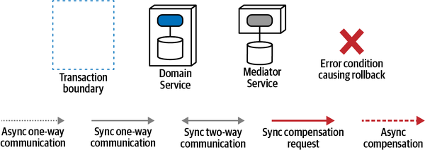

*Hình 12-1. Chú giải cho các sơ đồ tương tác kiến trúc ISO*

Với mỗi architecture pattern, chúng tôi không thể hiện mọi tương tác khả dĩ, điều sẽ trở nên lặp lại. Thay vào đó, chúng tôi xác định và minh họa các đặc điểm phân biệt của pattern—điều làm hành vi của nó trở nên độc nhất giữa các pattern.

<a id="sec-epic-saga"></a>

### Epic Saga<sup>(sao)</sup> Pattern

Loại giao tiếp này là saga pattern “truyền thống” như nhiều<a id="ch12-epic"></a><a id="ch12-epic2"></a><a id="ch12-epic3"></a><a id="ch12-epic4"></a><a id="ch12-epic5"></a> kiến trúc sư hiểu, còn được gọi là *Orchestrated Saga* vì loại phối hợp của nó. Các quan hệ chiều của nó xuất hiện trong [Hình 12-2](#fig-discerning-aq-saga-cube).

Pattern này dùng giao tiếp *đồng bộ*, tính nhất quán *nguyên tử*, và phối hợp *orchestrated*. Mục tiêu của kiến trúc sư khi chọn pattern này là bắt chước hành vi của các hệ thống monolith—thực tế, nếu một hệ thống monolith được thêm vào sơ đồ này trong [Hình 12-2](#fig-discerning-aq-saga-cube), nó sẽ là gốc tọa độ (0, 0, 0), hoàn toàn không có phân tán. Do đó, kiểu giao tiếp này quen thuộc nhất với kiến trúc sư và developer của các hệ thống transaction truyền thống.

<a id="fig-discerning-aq-saga-cube"></a>

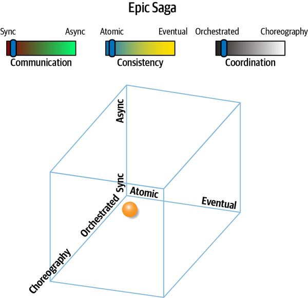

*Hình 12-2. Các quan hệ dynamic coupling (giao tiếp, tính nhất quán, phối hợp) của Epic Saga<sup>(sao)</sup> pattern*

Biểu diễn đẳng cấu của Epic Saga<sup>(sao)</sup> pattern xuất hiện trong [Hình 12-3](#fig-discerning-aq-saga-iso).

<a id="fig-discerning-aq-saga-iso"></a>

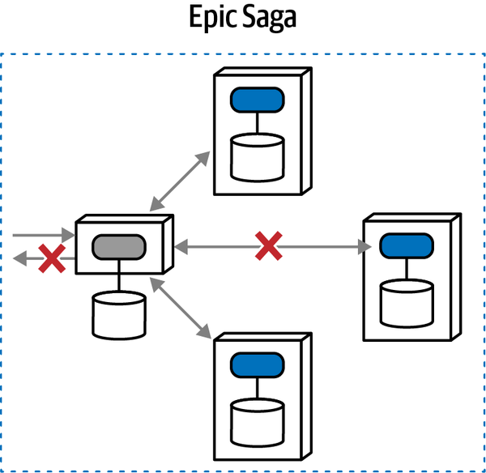

*Hình 12-3. Minh họa giao tiếp đẳng cấu của pattern *Epic Saga<sup>(sao)</sup>**

Ở đây, một service *orchestrator* điều phối một workflow bao gồm các cập nhật cho ba service, được kỳ vọng xảy ra theo kiểu transaction—hoặc cả ba lời gọi đều thành công hoặc không lời gọi nào thành công. Nếu một trong các lời gọi thất bại, tất cả đều thất bại và quay về trạng thái trước đó. Kiến trúc sư có thể giải quyết vấn đề phối hợp này theo nhiều cách khác nhau, tất cả đều phức tạp trong architecture phân tán. Tuy nhiên, những transaction như vậy giới hạn lựa chọn database và có những kiểu thất bại kinh điển.

Nhiều kiến trúc sư non nớt hoặc ngây thơ tin rằng, vì có một pattern cho một vấn đề, nó đại diện cho một giải pháp sạch sẽ. Tuy nhiên, pattern chỉ là sự công nhận tính phổ biến, không phải khả năng giải quyết được. <a id="idm45798377074472"></a><a id="idm45798377073480"></a>Transaction phân tán là một ví dụ tuyệt vời cho hiện tượng này—kiến trúc sư quen mô hình hóa transaction trong các hệ thống không phân tán đôi khi tin rằng chuyển năng lực đó sang thế giới phân tán là một thay đổi nhỏ. Tuy nhiên, transaction trong architecture phân tán đặt ra một số thách thức, những thách thức này trở nên tệ hơn theo tỉ lệ tùy thuộc vào độ phức tạp của semantic coupling của vấn đề.

Hãy xét một cách triển khai phổ biến của Epic Saga<sup>(sao)</sup> pattern, dùng compensating transaction.<a id="idm45798377070744"></a><a id="idm45798377069752"></a><a id="idm45798377068984"></a> Một *compensating update* (cập nhật bù trừ) là một cập nhật đảo ngược một hành động ghi dữ liệu do một service khác thực hiện (như đảo ngược một cập nhật, chèn lại một hàng đã bị xóa trước đó, hoặc xóa một hàng đã được chèn trước đó) trong phạm vi transaction phân tán. Dù compensating update cố gắng đảo ngược các thay đổi để đưa các nguồn dữ liệu phân tán về trạng thái ban đầu trước khi transaction phân tán bắt đầu, chúng đầy rẫy những vấn đề, thách thức và trade-offs phức tạp.

Một compensating transaction pattern giao cho một service giám sát tính hoàn chỉnh transaction của một request, như thể hiện trong [Hình 12-4](#fig-discerning-comp-trans-success).

<a id="fig-discerning-comp-trans-success"></a>

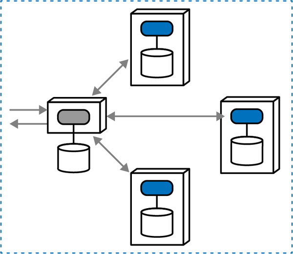

*Hình 12-4. Một Epic Saga transaction orchestrated thành công dùng compensating transaction*

Tuy nhiên, như nhiều thứ trong architecture, các điều kiện lỗi gây ra khó khăn. Trong một compensating transaction framework, mediator giám sát sự thành công của các lời gọi, và gửi các lời gọi bù trừ tới các service khác nếu một hoặc nhiều request thất bại, như thể hiện trong [Hình 12-5](#fig-discerning-comp-trans-rollback).

<a id="fig-discerning-comp-trans-rollback"></a>

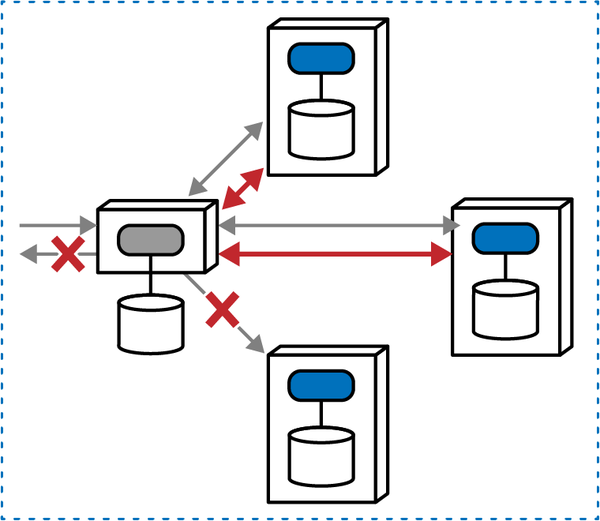

*Hình 12-5. Khi xảy ra lỗi, mediator phải gửi các request bù trừ tới các service khác*

Một mediator vừa chấp nhận request vừa điều phối workflow, và các lời gọi đồng bộ tới hai service đầu tiên thành công. Tuy nhiên, khi cố thực hiện lời gọi tới service cuối cùng, nó thất bại (vì có thể là rất nhiều lý do cả về domain lẫn vận hành). Vì mục tiêu của Epic Saga<sup>(sao)</sup> là tính nhất quán nguyên tử, mediator phải dùng compensating transaction và yêu cầu hai service kia hoàn tác thao tác trước đó, đưa trạng thái tổng thể về như trước khi transaction bắt đầu.

Pattern này được dùng rộng rãi: nó mô hình hóa hành vi quen thuộc, và nó có một tên pattern well-established (đã vững vàng). Nhiều kiến trúc sư mặc định chọn Epic Saga<sup>(sao)</sup> pattern vì nó có cảm giác quen thuộc với monolithic architecture, kết hợp với yêu cầu (đôi khi là đòi hỏi) từ các stakeholder rằng các thay đổi trạng thái phải được đồng bộ, bất kể các ràng buộc kỹ thuật. Tuy nhiên, nhiều dynamic quantum coupling pattern khác có thể mang lại một tập trade-offs tốt hơn.

Lợi thế rõ ràng của Epic Saga<sup>(sao)</sup> là sự phối hợp transaction bắt chước các hệ thống monolith, kết hợp với chủ sở hữu workflow rõ ràng được đại diện bởi orchestrator. Tuy nhiên, các nhược điểm thì đa dạng. Thứ nhất, orchestration cộng với tính transaction có thể tác động đến các architecture characteristic vận hành như performance, scale, elasticity, v.v.—orchestrator phải bảo đảm rằng mọi bên tham gia transaction đều đã thành công hoặc thất bại, tạo ra các nút thắt cổ chai về thời gian. Thứ hai, các pattern khác nhau được dùng để triển khai tính transaction phân tán (như compensating transaction) dễ gặp nhiều kiểu thất bại và điều kiện biên, cùng với việc thêm độ phức tạp vốn có thông qua các thao tác hoàn tác. Transaction phân tán đặt ra hàng loạt khó khăn và do đó tốt nhất nên tránh nếu có thể.

Epic Saga<sup>(sao)</sup> pattern có các đặc điểm sau:

**Mức coupling (Coupling level)**

Pattern này thể hiện mức coupling cực kỳ cao trên mọi chiều khả dĩ: giao tiếp đồng bộ, tính nhất quán nguyên tử, và phối hợp orchestrated—thực tế đây là pattern coupled cao nhất trong danh sách. Điều này không đáng ngạc nhiên, vì nó mô hình hóa hành vi giao tiếp của hệ thống monolith coupled cao, nhưng tạo ra một số vấn đề trong architecture phân tán.

**Mức độ phức tạp (Complexity level)**

Các điều kiện lỗi và việc phối hợp chuyên sâu khác được thêm vào yêu cầu về tính nguyên tử làm tăng độ phức tạp cho architecture này. Các lời gọi đồng bộ mà architecture này dùng giảm bớt phần nào độ phức tạp, vì kiến trúc sư không phải lo về race condition và deadlock trong các lời gọi.

**Khả năng phản hồi/availability (Responsiveness/availability)**

Orchestration tạo ra một nút thắt cổ chai, đặc biệt khi nó cũng phải phối hợp tính nguyên tử transaction, điều làm giảm khả năng phản hồi. Pattern này dùng các lời gọi đồng bộ, càng ảnh hưởng thêm đến performance và khả năng phản hồi. Nếu bất kỳ service nào không khả dụng hoặc xảy ra một lỗi không thể phục hồi, pattern này sẽ thất bại.

**Scale/elasticity**

Tương tự *khả năng phản hồi*, nút thắt cổ chai và sự phối hợp cần thiết để triển khai pattern này khiến scale và các mối quan tâm vận hành khác trở nên khó khăn.

Dù Epic Saga<sup>(sao)</sup> phổ biến vì sự quen thuộc, nó tạo ra một số thách thức, cả từ góc độ thiết kế lẫn đặc điểm vận hành, như thể hiện trong [Bảng 12-2](#fig-discerning-aq-epic-saga-stars).

<a id="fig-discerning-aq-epic-saga-stars"></a>

<a id="fig-discerning-aq-epic-saga-stars"></a>*Bảng 12-2. Xếp hạng cho Epic Saga<sup>(sao)</sup>*

| Epic Saga<sup>(sao)</sup> pattern | Xếp hạng |
|---|---|
| Giao tiếp | Đồng bộ |
| Tính nhất quán | Nguyên tử |
| Phối hợp | Orchestrated |
| Coupling | Rất cao |
| Độ phức tạp | Thấp |
| Khả năng phản hồi/availability | Thấp |
| Scale/elasticity | Rất thấp |

May mắn là kiến trúc sư không cần mặc định chọn những pattern, dù có vẻ quen thuộc, lại tạo ra độ phức tạp ngẫu nhiên—có nhiều pattern khác với các tập trade-offs khác nhau. Hãy tham khảo [“Sysops Squad Saga: Atomic Transactions and Compensating Updates”](#ss-saga-atomic-transactions) để có một ví dụ cụ thể về Epic Saga<sup>(sao)</sup> và một số thách thức phức tạp mà nó đặt ra (và cách giải quyết những thách thức đó).<a id="idm45798377027480"></a><a id="idm45798377026776"></a><a id="idm45798377026104"></a><a id="idm45798377025432"></a><a id="idm45798377024760"></a>

<a id="sec-phone-tag-saga"></a>

### Phone Tag Saga<sup>(sac)</sup> Pattern

*Phone Tag Saga<sup>(sac)</sup> pattern* thay đổi một trong các<a id="ch12-pho"></a><a id="ch12-pho2"></a><a id="ch12-pho3"></a> chiều của Epic Saga<sup>(sao)</sup>, chuyển *phối hợp* từ *orchestrated* sang *choreographed*; thay đổi này được minh họa trong [Hình 12-6](#fig-discerning-aq-phone-tag).

<a id="fig-discerning-aq-phone-tag"></a>

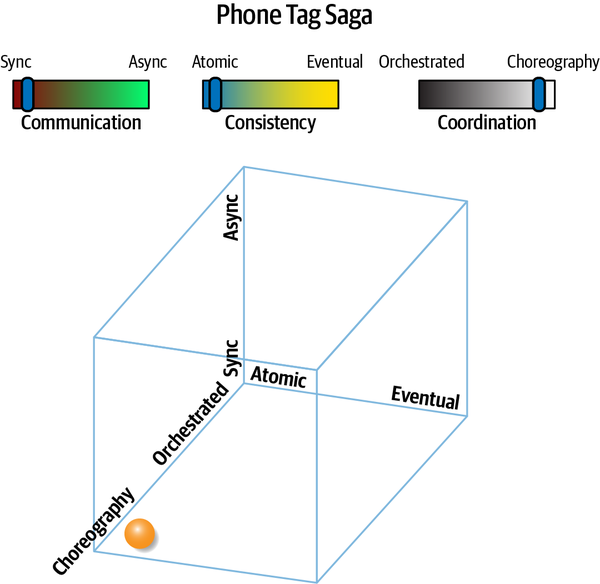

*Hình 12-6. Phone Tag pattern dùng giao tiếp coupled lỏng*

Pattern được đặt tên là *Phone Tag* vì nó giống một trò chơi trẻ em well-known (nổi tiếng) có tên *Telephone* ở Bắc Mỹ: trẻ em xếp thành vòng tròn, và một người thì thầm một bí mật cho người tiếp theo, người này truyền nó cho người kế tiếp, cho đến khi phiên bản cuối cùng được người cuối cùng nói ra. Trong [Hình 12-6](#fig-discerning-aq-phone-tag), choreography được ưu tiên hơn orchestration, tạo ra thay đổi tương ứng trong giao tiếp cấu trúc thể hiện ở [Hình 12-7](#fig-discerning-aq-phone-tag-iso).

<a id="fig-discerning-aq-phone-tag-iso"></a>

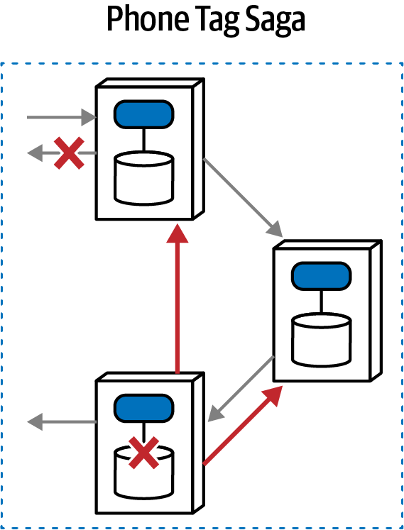

*Hình 12-7. Vì không có orchestration, mỗi bên tham gia phải phối hợp trạng thái*

Phone Tag Saga<sup>(sac)</sup> pattern có tính nguyên tử nhưng cũng có choreography, nghĩa là kiến trúc sư không chỉ định orchestrator chính thức nào. Tuy nhiên tính nguyên tử đòi hỏi một mức phối hợp nhất định. Trong [Hình 12-7](#fig-discerning-aq-phone-tag-iso), service được gọi đầu tiên trở thành điểm phối hợp (đôi khi được gọi là *front controller*). Một khi nó hoàn thành công việc của mình, nó chuyển một request tới service tiếp theo trong workflow, việc này tiếp diễn cho đến khi workflow thành công. Tuy nhiên, nếu xảy ra một điều kiện lỗi, mỗi service phải có logic built-in (tích hợp sẵn) để gửi các request bù trừ ngược lại dọc theo chuỗi.

Vì mục tiêu kiến trúc là tính nguyên tử transaction, logic để phối hợp tính nguyên tử đó phải nằm ở đâu đó. Do đó, các domain service phải chứa nhiều logic hơn về bối cảnh workflow mà chúng tham gia, bao gồm xử lý lỗi và định tuyến. Với các workflow phức tạp, *front controller* trong pattern này sẽ trở nên phức tạp như hầu hết các mediator, làm giảm sức hấp dẫn và khả năng áp dụng của pattern này. Do đó, pattern này thường được dùng cho các workflow đơn giản cần scale cao hơn, nhưng có tác động tiềm năng đến performance.

Choreography so với orchestration cải thiện các architecture characteristic vận hành như scale như thế nào? <a id="idm45798377002728"></a><a id="idm45798377001432"></a><a id="idm45798377000168"></a><a id="idm45798376999192"></a><a id="idm45798376998216"></a><a id="idm45798376997272"></a>Dùng choreography ngay cả với giao tiếp đồng bộ cũng giảm bớt các nút thắt cổ chai—trong điều kiện không lỗi, service cuối cùng trong workflow có thể trả về kết quả, cho phép throughput cao hơn và ít điểm nghẽn hơn. Performance cho các workflow happy path có thể nhanh hơn so với Epic Saga<sup>(sao)</sup> vì không có phối hợp. Tuy nhiên, các điều kiện lỗi sẽ chậm hơn nhiều khi không có mediator—mỗi service phải tháo gỡ chuỗi lời gọi, điều này cũng làm tăng coupling giữa các service.

Nhìn chung, Phone Tag Saga<sup>(sac)</sup> mang lại scale tốt hơn một chút so với Epic Saga<sup>(sao)</sup> vì không có mediator, thứ đôi khi có thể trở thành một nút thắt cổ chai giới hạn. Tuy nhiên, pattern này cũng có performance thấp hơn đối với các điều kiện lỗi và các độ phức tạp workflow khác—không có mediator, workflow phải được giải quyết thông qua giao tiếp giữa các service, điều này ảnh hưởng đến performance.

Một đặc điểm hay của các architecture không có orchestration<a id="idm45798376992648"></a> là không có điểm kỳ dị coupling, một nơi duy nhất mà workflow couple vào. Dù pattern này dùng các request đồng bộ, có ít điều kiện chờ hơn đối với các workflow happy path, cho phép scale cao hơn. <a id="idm45798376991032"></a><a id="idm45798376990088"></a>Nhìn chung, giảm coupling làm tăng scale.

Cùng với scalability được cải thiện nhờ không có orchestration là độ phức tạp gia tăng của các domain service khi phải quản lý các mối quan tâm workflow bên cạnh trách nhiệm danh nghĩa của chúng. Với các workflow phức tạp, độ phức tạp gia tăng và giao tiếp interservice có thể đẩy kiến trúc sư quay lại orchestration và các trade-offs của nó.

Phone Tag Saga<sup>(sac)</sup> có một tổ hợp đặc điểm khá hiếm—nhìn chung, nếu kiến trúc sư chọn *choreography*, họ cũng chọn *tính bất đồng bộ*. Tuy nhiên, có một số trường hợp kiến trúc sư có thể chọn tổ hợp này thay thế: các lời gọi đồng bộ bảo đảm rằng mỗi domain service hoàn thành phần workflow của mình trước khi gọi service tiếp theo, loại bỏ race condition. Nếu các điều kiện lỗi dễ giải quyết, hoặc các domain service có thể dùng idempotence và thử lại, thì kiến trúc sư có thể xây dựng scale song song cao hơn bằng pattern này so với Epic Saga<sup>(sao)</sup>.

Phone Tag Saga<sup>(sac)</sup> pattern có các đặc điểm sau:

**Mức coupling (Coupling level)**

Pattern này nới lỏng một trong các chiều coupling của Epic Saga<sup>(sao)</sup> pattern, dùng workflow choreographed thay vì orchestrated. Do đó, pattern này ít coupled hơn một chút, nhưng với cùng yêu cầu transaction, nghĩa là độ phức tạp của workflow phải được phân bổ giữa các domain service.

**Mức độ phức tạp (Complexity level)**

Pattern này phức tạp hơn đáng kể so với Epic Saga<sup>(sao)</sup>; độ phức tạp trong pattern này tăng tuyến tính tỉ lệ với độ phức tạp ngữ nghĩa của workflow: workflow càng phức tạp, càng nhiều logic phải xuất hiện trong mỗi service để bù cho việc thiếu orchestrator. <a id="idm45798376980056"></a>Ngoài ra, kiến trúc sư có thể thêm thông tin workflow vào chính các message như một dạng *stamp coupling* (xem [“Stamp Coupling for Workflow Management”](ch13_contracts.vi.md#sec-stamp-coupling)) để duy trì trạng thái nhưng làm tăng thêm overhead bối cảnh mà mỗi service cần.

**Khả năng phản hồi/availability (Responsiveness/availability)**

Ít orchestration hơn nhìn chung dẫn đến khả năng phản hồi tốt hơn, nhưng các điều kiện lỗi trong pattern này trở nên khó mô hình hóa hơn khi không có orchestrator, đòi hỏi nhiều phối hợp hơn thông qua callback và các hoạt động time-consuming (tốn thời gian) khác.

**Scale/elasticity**

Không có orchestration đồng nghĩa với ít nút thắt cổ chai hơn, nhìn chung làm tăng scalability, nhưng chỉ một chút. Pattern này vẫn dùng coupling chặt quanh hai trong ba chiều, nên scalability không phải là điểm nổi bật, đặc biệt nếu các điều kiện lỗi phổ biến.

Xếp hạng cho Phone Tag Saga<sup>(sac)</sup> xuất hiện trong [Bảng 12-3](#fig-discerning-aq-phone-tag-stars).

<a id="fig-discerning-aq-phone-tag-stars"></a>

<a id="fig-discerning-aq-phone-tag-stars"></a>*Bảng 12-3. Xếp hạng cho Phone Tag Saga<sup>(sac)</sup>*

| Phone Tag Saga<sup>(sac)</sup> | Xếp hạng |
|---|---|
| Giao tiếp | Đồng bộ |
| Tính nhất quán | Nguyên tử |
| Phối hợp | Choreographed |
| Coupling | Cao |
| Độ phức tạp | Cao |
| Khả năng phản hồi/availability | Thấp |
| Scale/elasticity | Thấp |

Phone Tag Saga<sup>(sac)</sup> pattern tốt hơn cho các workflow đơn giản không có nhiều điều kiện lỗi phổ biến. Dù nó mang lại một vài đặc điểm tốt hơn Epic Saga<sup>(sao)</sup>, độ phức tạp do thiếu orchestrator làm mất đi nhiều lợi thế.<a id="idm45798376954488"></a><a id="idm45798376953784"></a><a id="idm45798376953112"></a>

<a id="sec-fairy-tale-saga"></a>

### Fairy Tale Saga<sup>(seo)</sup> Pattern

Truyện cổ tích điển hình mang lại những câu chuyện vui với cốt truyện easy-to-follow (dễ theo dõi),<a id="ch12-fair"></a><a id="ch12-fair2"></a><a id="ch12-fair3"></a> do đó có tên *Fairy Tale Saga<sup>(seo)</sup>*, dùng giao tiếp đồng bộ, eventual consistency và orchestration, như thể hiện trong [Hình 12-8](#fig-discerning-aq-fairy-tale).

<a id="fig-discerning-aq-fairy-tale"></a>

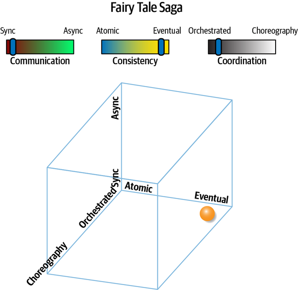

*Hình 12-8. Fairy Tale Saga<sup>(seo)</sup> minh họa eventual consistency*

Communication pattern này nới lỏng yêu cầu khó khăn về tính nguyên tử, mang lại nhiều lựa chọn hơn cho kiến trúc sư khi thiết kế hệ thống. Ví dụ, nếu một service tạm thời sập, eventual consistency cho phép cache một thay đổi cho đến khi service phục hồi. Cấu trúc giao tiếp của Fairy Tale Saga<sup>(seo)</sup> được minh họa trong [Hình 12-9](#fig-discerning-aq-fairy-tale-iso).

Trong pattern này, có một orchestrator để phối hợp request, phản hồi và xử lý lỗi. Tuy nhiên, orchestrator không chịu trách nhiệm quản lý transaction, việc mà mỗi domain service giữ trách nhiệm (để xem ví dụ về các workflow phổ biến, xem [Chương 11](ch11_managing_distributed_workflows.vi.md#ch11-managing-workflows)). Do đó orchestrator có thể quản lý các lời gọi bù trừ, nhưng không có yêu cầu phải diễn ra trong một transaction đang hoạt động.

<a id="fig-discerning-aq-fairy-tale-iso"></a>

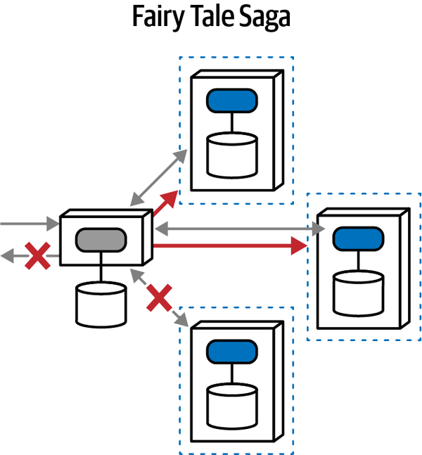

*Hình 12-9. Minh họa đẳng cấu của một tương tác Fairy Tale*

Đây là một pattern hấp dẫn hơn nhiều và xuất hiện phổ biến trong nhiều microservices architecture. Có một mediator giúp quản lý workflow dễ hơn, giao tiếp đồng bộ là lựa chọn dễ hơn trong hai lựa chọn, và eventual consistency loại bỏ thách thức phối hợp khó nhất, đặc biệt đối với xử lý lỗi.

Lợi thế hấp dẫn lớn nhất của Fairy Tale Saga<sup>(seo)</sup> là không có transaction tổng thể. Mỗi domain service quản lý hành vi transaction riêng của nó, dựa vào eventual consistency cho workflow tổng thể.

So với nhiều pattern khác, pattern này nhìn chung thể hiện một sự cân bằng trade-offs tốt:

**Mức coupling (Coupling level)**

Fairy Tale Saga<sup>(seo)</sup> có coupling cao, với hai trong ba động lực coupling được tối đa hóa trong pattern này (giao tiếp đồng bộ và phối hợp orchestrated). Tuy nhiên, động lực tệ hơn của độ phức tạp coupling—tính transaction—biến mất trong pattern này để nhường chỗ cho eventual consistency. Orchestrator vẫn phải quản lý các workflow phức tạp, nhưng không bị ràng buộc phải làm điều đó trong một transaction.

**Mức độ phức tạp (Complexity level)**

Độ phức tạp của Fairy Tale Saga<sup>(seo)</sup> khá thấp; nó bao gồm các lựa chọn thuận tiện nhất (orchestrated, đồng bộ) với ràng buộc lỏng nhất (eventual consistency). Do đó có tên Fairy Tale Saga<sup>(seo)</sup>—một câu chuyện đơn giản với kết thúc có hậu.

**Khả năng phản hồi/availability (Responsiveness/availability)**

Khả năng phản hồi thường tốt hơn trong các kiểu giao tiếp loại này vì, dù các lời gọi là đồng bộ, mediator cần chứa ít trạng thái time-sensitive (nhạy cảm về thời gian) hơn về các transaction đang diễn ra, cho phép load balancing tốt hơn. Tuy nhiên, những khác biệt thực sự về performance đến từ tính bất đồng bộ, được minh họa trong các pattern sau.

**Scale/elasticity**

Thiếu coupling nhìn chung dẫn đến scale cao hơn; loại bỏ coupling transaction cho phép mỗi service scale độc lập hơn.

Xếp hạng cho Fairy Tale Saga<sup>(seo)</sup> xuất hiện trong [Bảng 12-4](#fig-discerning-aq-fairy-tale-stars).

<a id="fig-discerning-aq-fairy-tale-stars"></a>

<a id="fig-discerning-aq-fairy-tale-stars"></a>*Bảng 12-4. Xếp hạng cho Fairy Tale Saga<sup>(seo)</sup>*

| Fairy Tale Saga<sup>(seo)</sup> | Xếp hạng |
|---|---|
| Giao tiếp | Đồng bộ |
| Tính nhất quán | Eventual |
| Phối hợp | Orchestrated |
| Coupling | Cao |
| Độ phức tạp | Rất thấp |
| Khả năng phản hồi/availability | Trung bình |
| Scale/elasticity | Cao |

Nếu kiến trúc sư có thể tận dụng eventual consistency, pattern này khá hấp dẫn, kết hợp các bộ phận chuyển động dễ dàng với ít ràng buộc đáng sợ nhất, khiến nó trở thành lựa chọn phổ biến của kiến trúc sư.<a id="idm45798376907832"></a><a id="idm45798376907128"></a><a id="idm45798376906456"></a>

<a id="sec-time-travel-saga"></a>

### Time Travel Saga<sup>(sec)</sup> Pattern

Pattern *Time Travel Saga<sup>(sec)</sup>* có giao tiếp<a id="ch12-tts"></a><a id="ch12-tts2"></a><a id="ch12-tts3"></a> đồng bộ, và eventual consistency, nhưng workflow choreographed. Nói cách khác, pattern này tránh một mediator trung tâm, đặt trách nhiệm workflow hoàn toàn lên các domain service tham gia, như minh họa trong [Hình 12-10](#fig-discerning-aq-time-travel).

<a id="fig-discerning-aq-time-travel"></a>

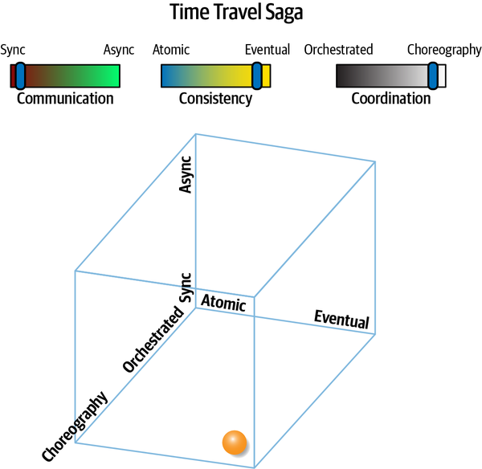

*Hình 12-10. Time Travel Saga<sup>(sec)</sup> pattern dùng hai trong ba kỹ thuật decoupling*

Topology cấu trúc minh họa việc không có orchestration, thể hiện trong [Hình 12-11](#fig-discerning-aq-time-travel-iso).

<a id="fig-discerning-aq-time-travel-iso"></a>

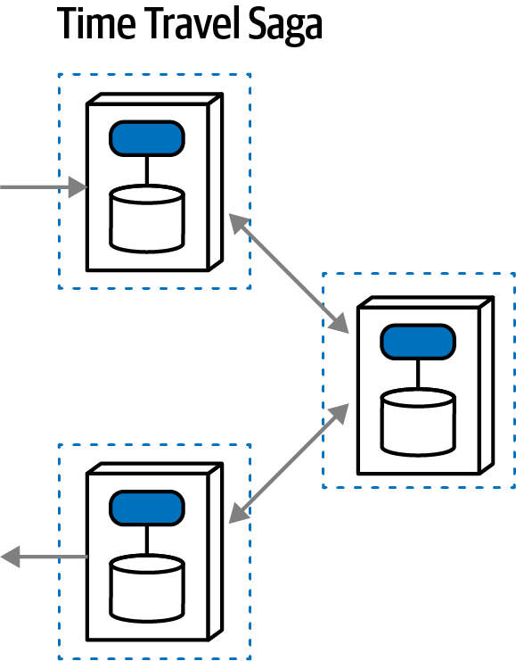

*Hình 12-11. Các workflow phức tạp trở nên khó quản lý khi không có orchestration*

Trong workflow này, mỗi service chấp nhận một request, thực hiện một hành động, rồi chuyển tiếp request tới service khác. <a id="idm45798376891176"></a><a id="idm45798376890200"></a><a id="idm45798376889560"></a><a id="idm45798376888616"></a>Architecture này có thể triển khai design pattern *Chain of Responsibility* hoặc architecture style *Pipes and Filters*—bất kỳ workflow nào có một chuỗi bước one-way (một chiều). Mỗi service trong pattern này “sở hữu” tính transaction riêng của nó, nên kiến trúc sư phải thiết kế các điều kiện lỗi của workflow vào thiết kế domain. Nhìn chung, tồn tại một quan hệ tỉ lệ về độ phức tạp giữa độ phức tạp workflow và các giải pháp choreographed vì thiếu sự phối hợp built-in thông qua một mediator—workflow càng phức tạp, choreography càng trở nên khó khăn. Nó được gọi là Time Travel Saga<sup>(sec)</sup> vì mọi thứ đều decoupled từ góc độ thời gian: mỗi service sở hữu bối cảnh transaction riêng của nó, khiến tính nhất quán workflow diễn ra dần dần theo thời gian—trạng thái sẽ trở nên nhất quán theo thời gian dựa trên thiết kế của tương tác.

Việc không có transaction trong Time Travel Saga<sup>(sec)</sup> pattern khiến workflow dễ mô hình hóa hơn; tuy nhiên, việc không có orchestrator nghĩa là mỗi domain service phải bao gồm phần lớn trạng thái và thông tin workflow. Như trong mọi giải pháp choreographed, tồn tại một tương quan trực tiếp giữa độ phức tạp workflow và tính hữu dụng của một orchestrator; do đó, pattern này phù hợp nhất cho các workflow đơn giản.

Với các giải pháp được lợi từ throughput cao, pattern này hoạt động cực kỳ tốt cho các workflow kiểu “fire and forget” (gửi rồi quên), như nạp dữ liệu điện tử, transaction hàng loạt, v.v. Tuy nhiên, vì không có orchestrator, các domain service phải tự xử lý các điều kiện lỗi và phối hợp.

Thiếu coupling làm tăng scalability với pattern này; chỉ có thêm tính bất đồng bộ mới làm nó scalable hơn (như trong Anthology Saga<sup>(aec)</sup> pattern). Tuy nhiên, vì pattern này thiếu sự phối hợp transaction tổng thể, kiến trúc sư phải bỏ thêm công sức để đồng bộ dữ liệu.

Đây là đánh giá định tính của Time Travel Saga<sup>(sec)</sup> pattern:

**Mức coupling (Coupling level)**

Mức coupling nằm ở khoảng trung bình với Time Travel Saga<sup>(sec)</sup>, với coupling giảm nhờ không có orchestrator được cân bằng bởi coupling còn lại của giao tiếp đồng bộ. Như với mọi eventual consistency pattern, việc không có coupling transaction làm giảm nhẹ nhiều mối quan tâm về dữ liệu.

**Mức độ phức tạp (Complexity level)**

Việc mất tính transaction làm giảm độ phức tạp cho pattern này. Pattern này là quasi-special-purpose (gần như chuyên dụng), cực kỳ phù hợp với các architecture throughput nhanh, giao tiếp one-way, và mức coupling khớp tốt với kiểu architecture đó.

**Khả năng phản hồi/availability (Responsiveness/availability)**

*Khả năng phản hồi* đạt mức *trung bình* với architectural pattern này: nó khá cao đối với các hệ thống built-to-purpose (xây dựng có mục đích riêng), như đã mô tả trước đó, và khá thấp đối với xử lý lỗi phức tạp. Vì không có orchestrator trong pattern này, mỗi domain service phải xử lý kịch bản khôi phục eventual consistency trong trường hợp có điều kiện lỗi, điều sẽ gây ra nhiều overhead với các lời gọi đồng bộ, ảnh hưởng đến khả năng phản hồi và performance.

**Scale/elasticity**

Architecture pattern này mang lại scale và elasticity cực kỳ tốt; nó chỉ có thể tốt hơn với tính bất đồng bộ (xem Anthology Saga<sup>(aec)</sup> pattern).

Xếp hạng cho Time Travel Saga<sup>(sec)</sup> pattern xuất hiện trong [Bảng 12-5](#fig-discerning-aq-time-travel-stars).

<a id="fig-discerning-aq-time-travel-stars"></a>

<a id="fig-discerning-aq-time-travel-stars"></a>*Bảng 12-5. Xếp hạng cho *Time Travel Saga<sup>(sec)</sup>**

| Time Travel Saga<sup>(sec)</sup> | Xếp hạng |
|---|---|
| Giao tiếp | Đồng bộ |
| Tính nhất quán | Eventual |
| Phối hợp | Choreographed |
| Coupling | Trung bình |
| Độ phức tạp | Thấp |
| Khả năng phản hồi/availability | Trung bình |
| Scale/elasticity | Cao |

Time Travel Saga<sup>(sec)</sup> pattern mang lại một on-ramp (lối vào) tới Anthology Saga<sup>(aec)</sup> pattern phức tạp hơn nhưng rốt cuộc scalable hơn. Kiến trúc sư và developer thấy việc xử lý giao tiếp đồng bộ dễ lập luận, triển khai và debug hơn; nếu pattern này mang lại đủ scalability, các team không phải áp dụng các lựa chọn thay thế phức tạp hơn nhưng scalable hơn.<a id="idm45798376853384"></a><a id="idm45798376852680"></a><a id="idm45798376852008"></a>

<a id="sec-fantasy-fiction-saga"></a>

### Fantasy Fiction Saga<sup>(aao)</sup> Pattern

*Fantasy Fiction Saga<sup>(aao)</sup>* dùng tính nhất quán *nguyên tử*,<a id="ch12-ffs"></a><a id="ch12-ffs2"></a><a id="ch12-ffs3"></a> giao tiếp *bất đồng bộ*, và phối hợp *orchestrated*, như thể hiện trong [Hình 12-12](#fig-discerning-aq-fantasy-fiction).

<a id="fig-discerning-aq-fantasy-fiction"></a>

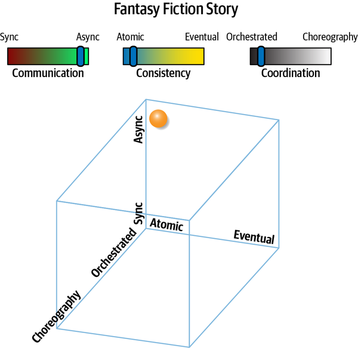

*Hình 12-12. Giao tiếp bất đồng bộ khiến tính transaction trở nên khó khăn trong pattern này*

Biểu diễn cấu trúc thể hiện trong [Hình 12-13](#fig-discerning-aq-fantasy-fiction-iso) bắt đầu cho thấy một số khó khăn với pattern này.

Chỉ vì một tổ hợp các lực kiến trúc tồn tại không có nghĩa là nó tạo thành một pattern hấp dẫn, nhưng tổ hợp tương đối khó tin này vẫn có những cách dùng. Pattern này giống Epic Saga<sup>(sao)</sup> ở mọi khía cạnh ngoại trừ *giao tiếp*—pattern này dùng giao tiếp *bất đồng bộ* thay vì *đồng bộ*. Theo truyền thống, một cách kiến trúc sư tăng khả năng phản hồi của các hệ thống phân tán là dùng tính bất đồng bộ, cho phép các thao tác diễn ra song song thay vì tuần tự. Điều này có vẻ là một cách tốt để tăng performance cảm nhận được so với Epic Saga<sup>(sao)</sup>.

<a id="fig-discerning-aq-fantasy-fiction-iso"></a>

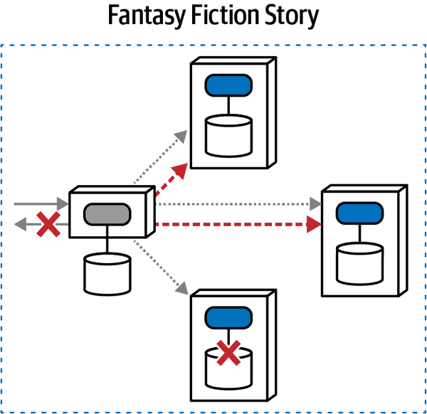

*Hình 12-13. Fantasy Fiction Saga<sup>(aao)</sup> pattern là far-fetched (viển vông) vì việc phối hợp transaction cho giao tiếp bất đồng bộ đặt ra nhiều khó khăn*

Tuy nhiên, tính bất đồng bộ không phải là một thay đổi đơn giản—nó thêm nhiều <a id="idm45798376832248"></a>lớp độ phức tạp vào architecture, đặc biệt quanh việc phối hợp, đòi hỏi nhiều độ phức tạp hơn nhiều trong mediator. Ví dụ, giả sử một workflow transaction *Alpha* bắt đầu. Vì mọi thứ đều bất đồng bộ, trong khi Alpha đang chờ xử lý, workflow transaction Beta bắt đầu. Giờ, mediator phải theo dõi trạng thái của mọi transaction đang diễn ra ở trạng thái chờ xử lý.

Còn tệ hơn nữa. Giả sử workflow *Gamma* bắt đầu, nhưng lời gọi đầu tiên tới domain service phụ thuộc vào kết quả vẫn đang chờ của Alpha—kiến trúc sư có thể mô hình hóa hành vi này thế nào? Dù khả thi, độ phức tạp tăng lên mãi.

Thêm tính bất đồng bộ vào các workflow orchestrated đưa trạng thái transaction bất đồng bộ vào phương trình, loại bỏ các giả định tuần tự về thứ tự và thêm khả năng xảy ra deadlock, race condition, và hàng loạt thách thức khác của hệ thống song song.

Pattern này đặt ra các thách thức sau:

**Mức coupling (Coupling level)**

Mức coupling cực kỳ cao trong pattern này, dùng một orchestrator và tính nguyên tử nhưng với giao tiếp bất đồng bộ, điều khiến việc phối hợp khó khăn hơn vì kiến trúc sư và developer phải xử lý race condition và các vấn đề out-of-order (sai thứ tự) khác do giao tiếp bất đồng bộ gây ra.

**Mức độ phức tạp (Complexity level)**

Vì coupling quá khó khăn, độ phức tạp cũng tăng lên trong pattern này. Không chỉ có độ phức tạp *thiết kế*, đòi hỏi kiến trúc sư phát triển các workflow quá phức tạp, mà còn có độ phức tạp *debugging* và *vận hành* khi xử lý các workflow bất đồng bộ ở quy mô lớn.

**Khả năng phản hồi/availability (Responsiveness/availability)**

Vì pattern này cố gắng phối hợp transaction xuyên các lời gọi, khả năng phản hồi sẽ bị ảnh hưởng về tổng thể và trở nên cực kỳ tệ nếu một hoặc nhiều service không khả dụng.

**Scale/elasticity**

Scale cao gần như không thể trong các hệ thống transaction, ngay cả với tính bất đồng bộ. Scale tốt hơn nhiều trong pattern tương tự Parallel Saga<sup>(aeo)</sup>, pattern chuyển *nguyên tử* thành *eventual consistency*.

Xếp hạng cho Fantasy Fiction Saga<sup>(aao)</sup> pattern xuất hiện trong [Bảng 12-6](#fig-discerning-aq-fantasy-fiction-stars).

<a id="fig-discerning-aq-fantasy-fiction-stars"></a>

<a id="fig-discerning-aq-fantasy-fiction-stars"></a>*Bảng 12-6. Xếp hạng cho Fantasy Fiction Saga<sup>(aao)</sup>*

| Fantasy Fiction | Xếp hạng |
|---|---|
| Giao tiếp | Bất đồng bộ |
| Tính nhất quán | Nguyên tử |
| Phối hợp | Orchestrated |
| Coupling | Cao |
| Độ phức tạp | Cao |
| Khả năng phản hồi/availability | Thấp |
| Scale/elasticity | Thấp |

Đáng tiếc là pattern này phổ biến hơn mức nó nên có, chủ yếu do nỗ lực mis-guided (sai lầm) nhằm cải thiện performance của Epic Saga<sup>(sao)</sup> trong khi vẫn duy trì tính transaction; một lựa chọn tốt hơn thường là Parallel Saga<sup>(aeo)</sup>.<a id="idm45798376799384"></a><a id="idm45798376798648"></a><a id="idm45798376797976"></a>

<a id="sec-horror-story"></a>

### Horror Story<sup>(aac)</sup> Pattern

Một trong các pattern phải là tổ hợp tệ nhất có thể;<a id="ch12-hor"></a><a id="ch12-hor2"></a><a id="ch12-hor3"></a> đó là *Horror Story<sup>(aac)</sup> pattern* được đặt tên rất xác đáng, đặc trưng bởi giao tiếp *bất đồng bộ*, tính nhất quán *nguyên tử*, và phối hợp *choreographed*, minh họa trong [Hình 12-14](#fig-discerning-aq-horror-story).

<a id="fig-discerning-aq-horror-story"></a>

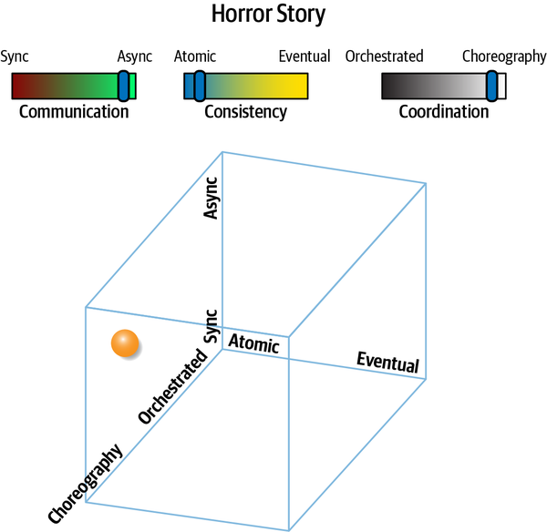

*Hình 12-14. Tổ hợp khó nhất: đạt được tính transaction trong khi bất đồng bộ và choreographed*

Tại sao tổ hợp này lại tệ đến vậy? Nó kết hợp coupling nghiêm ngặt nhất quanh tính nhất quán (*nguyên tử*) với hai kiểu coupling lỏng nhất, *bất đồng bộ* và *choreography*. Giao tiếp cấu trúc của pattern này xuất hiện trong [Hình 12-15](#fig-discerning-aq-horror-story-iso).

<a id="fig-discerning-aq-horror-story-iso"></a>

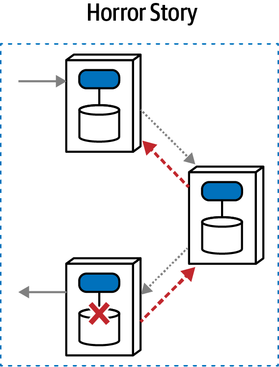

*Hình 12-15. Pattern này đòi hỏi nhiều giao tiếp interservice vì tính transaction bắt buộc và việc không có mediator*

Trong pattern này, không có mediator nào để quản lý tính nhất quán transaction xuyên nhiều service—trong khi dùng giao tiếp bất đồng bộ. Do đó, mỗi domain service phải theo dõi thông tin hoàn tác về nhiều transaction đang chờ xử lý, có thể sai thứ tự vì tính bất đồng bộ, và phối hợp với nhau trong các điều kiện lỗi. Chỉ với một trong nhiều ví dụ kinh khủng khả dĩ, hãy tưởng tượng transaction *Alpha* bắt đầu và, trong khi đang chờ xử lý, transaction *Beta* bắt đầu. Một trong các lời gọi cho transaction *Alpha* thất bại—giờ, các service choreographed phải đảo ngược thứ tự kích hoạt, hoàn tác từng phần tử (có thể out-of-order) của transaction dọc đường. Sự đa dạng và độ phức tạp của các điều kiện lỗi khiến đây là một lựa chọn đáng ngại.

Tại sao kiến trúc sư có thể chọn lựa chọn này? Tính bất đồng bộ hấp dẫn như một cách tăng performance, nhưng kiến trúc sư có thể vẫn cố duy trì tính toàn vẹn transaction, điều có vô số kiểu thất bại. Thay vào đó, kiến trúc sư nên chọn Anthology Saga<sup>(aec)</sup> pattern, pattern loại bỏ tính transaction tổng thể.

Các đánh giá định tính cho Horror Story<sup>(aac)</sup> pattern như sau:

**Mức coupling (Coupling level)**

Đáng ngạc nhiên là mức coupling của pattern này không phải là tệ nhất (“vinh dự” đó thuộc về Epic Saga<sup>(sao)</sup> pattern). Dù pattern này cố gắng đạt loại coupling đơn lẻ tệ nhất (tính transaction), nó nới lỏng hai loại còn lại, không có cả mediator lẫn giao tiếp đồng bộ vốn làm tăng coupling.

**Mức độ phức tạp (Complexity level)**

Đúng như tên gọi, độ phức tạp của pattern này thực sự kinh khủng, tệ nhất trong tất cả vì nó đòi hỏi yêu cầu nghiêm ngặt nhất (tính transaction) với tổ hợp khó khăn nhất của các yếu tố khác để đạt được điều đó (tính bất đồng bộ và choreography).

**Scale/elasticity**

Pattern này scale tốt hơn các pattern có mediator, và tính bất đồng bộ cũng bổ sung khả năng thực hiện nhiều công việc song song hơn.

**Khả năng phản hồi/availability (Responsiveness/availability)**

Khả năng phản hồi *thấp* với pattern này, tương tự các pattern khác đòi hỏi transaction tổng thể: việc phối hợp workflow đòi hỏi một lượng lớn “trò chuyện” interservice, làm hại performance và khả năng phản hồi.

Các trade-offs của Horror Story<sup>(aac)</sup> pattern xuất hiện trong [Bảng 12-7](#tbl-horror-story-stars).

<a id="tbl-horror-story-stars"></a>

<a id="tbl-horror-story-stars"></a>*Bảng 12-7. Xếp hạng cho Horror Story<sup>(aac)</sup>*

| Horror Story<sup>(aac)</sup> | Xếp hạng |
|---|---|
| Giao tiếp | Bất đồng bộ |
| Tính nhất quán | Nguyên tử |
| Phối hợp | Choreographed |
| Coupling | Trung bình |
| Độ phức tạp | Rất cao |
| Khả năng phản hồi/availability | Thấp |
| Scale/elasticity | Trung bình |

Horror Story<sup>(aac)</sup> pattern được đặt tên rất xác đáng này thường là kết quả của một kiến trúc sư well-meaning (có thiện ý) bắt đầu với Epic Saga<sup>(sao)</sup> pattern, nhận thấy performance chậm vì các workflow phức tạp, và <a id="idm45798376749128"></a>nhận ra rằng các kỹ thuật để cải thiện performance bao gồm giao tiếp bất đồng bộ và choreography. Tuy nhiên, lối suy nghĩ này là một ví dụ tuyệt vời về việc không xem xét mọi chiều bị rối vào nhau của một không gian vấn đề. Xét riêng lẻ, giao tiếp bất đồng bộ cải thiện performance. Tuy nhiên, với vai trò kiến trúc sư, chúng ta không thể xét nó riêng lẻ khi nó bị rối vào các chiều kiến trúc khác, như tính nhất quán và phối hợp.<a id="idm45798376747432"></a><a id="idm45798376746760"></a><a id="idm45798376746088"></a>

<a id="sec-parallel-saga"></a>

### Parallel Saga<sup>(aeo)</sup> Pattern

Pattern *Parallel Saga<sup>(aeo)</sup>* được đặt tên theo<a id="ch12-para"></a><a id="ch12-para2"></a><a id="ch12-para3"></a> Epic Saga<sup>(sao)</sup> pattern “truyền thống” với hai khác biệt then chốt giúp nới lỏng các ràng buộc và do đó khiến nó trở thành một pattern dễ triển khai hơn: giao tiếp bất đồng bộ và eventual consistency. Sơ đồ chiều của Parallel Saga<sup>(aeo)</sup> pattern xuất hiện trong [Hình 12-16](#fig-discerning-aq-parallel-saga).

<a id="fig-discerning-aq-parallel-saga"></a>

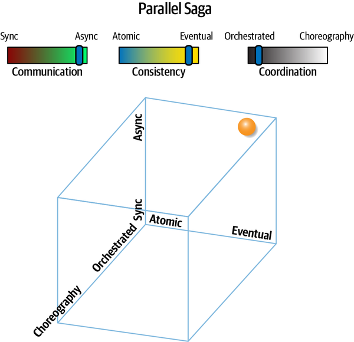

*Hình 12-16. Parallel Saga<sup>(aeo)</sup> mang lại cải thiện performance so với saga truyền thống*

Các mục tiêu khó nhất trong Epic Saga<sup>(sao)</sup> pattern xoay quanh transaction và giao tiếp đồng bộ, cả hai đều gây ra nút thắt cổ chai và suy giảm performance. Như thể hiện trong [Hình 12-16](#fig-discerning-aq-parallel-saga), pattern này nới lỏng cả hai ràng buộc.

Biểu diễn đẳng cấu của Parallel Saga<sup>(aeo)</sup> xuất hiện trong [Hình 12-17](#fig-discerning-aq-parallel-saga-iso).

Pattern này dùng một mediator, khiến nó phù hợp với các workflow phức tạp. Tuy nhiên, nó dùng giao tiếp bất đồng bộ, cho phép khả năng phản hồi tốt hơn và thực thi song song. Tính nhất quán trong pattern nằm ở các domain service, có thể đòi hỏi một số đồng bộ dữ liệu dùng chung, hoặc ở nền hoặc được mediator dẫn dắt. Như trong các vấn đề kiến trúc khác đòi hỏi phối hợp, mediator trở nên khá hữu ích.

<a id="fig-discerning-aq-parallel-saga-iso"></a>

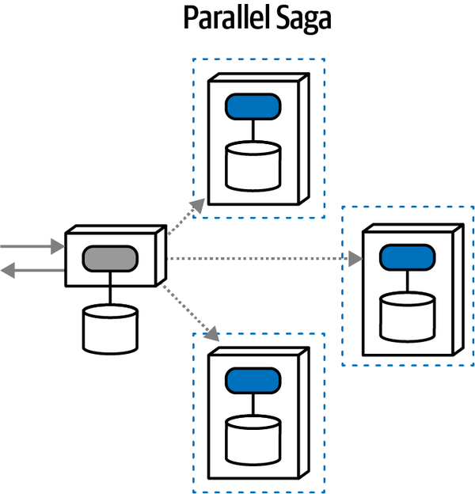

*Hình 12-17. Mỗi service sở hữu tính transaction riêng của nó; mediator phối hợp request và phản hồi*

Ví dụ, nếu xảy ra lỗi trong quá trình thực thi một workflow, mediator có thể gửi các message bất đồng bộ tới từng domain service liên quan để bù trừ cho thay đổi thất bại, điều có thể bao gồm thử lại, đồng bộ dữ liệu, hoặc hàng loạt biện pháp khắc phục khác.

Tất nhiên, việc nới lỏng ràng buộc hàm ý rằng một số lợi ích sẽ bị đánh đổi, đó là bản chất của software architecture. Thiếu tính transaction đặt thêm gánh nặng lên mediator để giải quyết lỗi và các vấn đề workflow khác. Giao tiếp bất đồng bộ, dù mang lại khả năng phản hồi tốt hơn, khiến việc giải quyết các vấn đề về thời điểm và đồng bộ trở nên khó khăn—race condition, deadlock, độ tin cậy của queue, và hàng loạt cơn đau đầu khác của architecture phân tán nằm trong không gian này.

Parallel Saga<sup>(aeo)</sup> pattern thể hiện các điểm định tính sau:

**Mức coupling (Coupling level)**

Pattern này có mức coupling thấp, cô lập lực coupling-intensifying (làm tăng coupling) của transaction trong phạm vi từng domain service riêng lẻ. Nó cũng dùng giao tiếp bất đồng bộ, decouple thêm các service khỏi trạng thái chờ, cho phép xử lý song song nhiều hơn nhưng thêm yếu tố thời gian vào phân tích coupling của kiến trúc sư.

**Mức độ phức tạp (Complexity level)**

Độ phức tạp của Parallel Saga<sup>(aeo)</sup> cũng thấp, phản ánh việc giảm coupling đã nêu trước đó. Pattern này khá dễ hiểu đối với kiến trúc sư, và orchestration cho phép thiết kế workflow và error-handling (xử lý lỗi) đơn giản hơn.

**Scale/elasticity**

Dùng giao tiếp bất đồng bộ và ranh giới transaction nhỏ hơn cho phép architecture này scale khá tốt, và với mức cô lập tốt giữa các service. Ví dụ, trong một microservices architecture, một số service public-facing (hướng ra công chúng) có thể cần mức scale và elasticity cao hơn, trong khi các service back office không cần scale mà cần mức security cao hơn. Cô lập transaction ở mức domain giải phóng architecture để scale quanh các khái niệm domain.

**Khả năng phản hồi/availability (Responsiveness/availability)**

Vì không có transaction phối hợp và có giao tiếp bất đồng bộ, khả năng phản hồi của architecture này *cao*. Thực tế, vì mỗi service duy trì bối cảnh transaction riêng của nó, architecture này rất phù hợp với các dấu ấn performance service biến thiên cao giữa các service, cho phép kiến trúc sư scale một số service nhiều hơn các service khác theo nhu cầu.

Xếp hạng gắn với Parallel Saga<sup>(aeo)</sup> pattern xuất hiện trong [Bảng 12-8](#tbl-parallel-saga-stars).

<a id="tbl-parallel-saga-stars"></a>

<a id="tbl-parallel-saga-stars"></a>*Bảng 12-8. Xếp hạng cho Parallel Saga<sup>(aeo)</sup>*

| Parallel Saga<sup>(aeo)</sup> | Xếp hạng |
|---|---|
| Giao tiếp | Bất đồng bộ |
| Tính nhất quán | Eventual |
| Phối hợp | Orchestrated |
| Coupling | Thấp |
| Độ phức tạp | Thấp |
| Khả năng phản hồi/availability | Cao |
| Scale/elasticity | Cao |

Nhìn chung, Parallel Saga<sup>(aeo)</sup> pattern mang lại một tập trade-offs hấp dẫn cho nhiều kịch bản, đặc biệt với các workflow phức tạp cần scale cao.<a id="idm45798376697368"></a><a id="idm45798376696664"></a><a id="idm45798376695992"></a>

<a id="sec-anthology-saga"></a>

### Anthology Saga<sup>(aec)</sup> Pattern

*Anthology Saga<sup>(aec)</sup> pattern* mang lại tập đặc điểm hoàn toàn đối lập với Epic Saga<sup>(sao)</sup> pattern truyền thống:<a id="ch12-anth"></a><a id="ch12-anth2"></a><a id="ch12-anth3"></a> nó dùng giao tiếp *bất đồng bộ*, tính nhất quán *eventual*, và phối hợp *choreographed*, mang lại hình mẫu ít coupled nhất trong số tất cả các pattern này. Góc nhìn chiều của Anthology Saga<sup>(aec)</sup> pattern xuất hiện trong [Hình 12-18](#fig-discerning-aq-anthology).

<a id="fig-discerning-aq-anthology"></a>

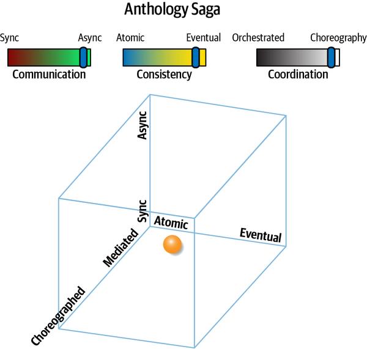

*Hình 12-18. Anthology Saga<sup>(aec)</sup> pattern mang lại các cực đối lập của Epic Saga, và do đó là pattern ít coupled nhất*

Anthology pattern dùng message queue để gửi các message bất đồng bộ tới các domain service khác mà không có orchestration, như minh họa trong [Hình 12-19](#fig-discerning-aq-anthology-iso).

Như bạn thấy, mỗi service duy trì tính toàn vẹn transaction riêng của nó, và không có orchestrator, buộc mỗi domain service phải bao gồm nhiều bối cảnh hơn về các workflow mà chúng tham gia, bao gồm xử lý lỗi và các chiến lược phối hợp khác.

<a id="fig-discerning-aq-anthology-iso"></a>

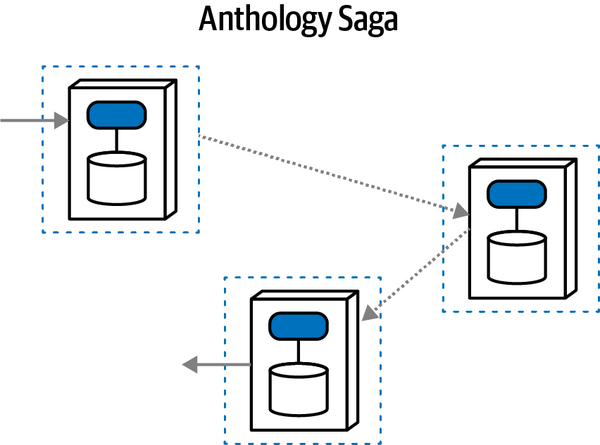

*Hình 12-19. Việc không có orchestration, eventual consistency, và tính bất đồng bộ khiến pattern này decoupled cao nhưng là một thách thức cho việc phối hợp*

Việc không có orchestration khiến các service phức tạp hơn nhưng cho phép throughput, scalability, elasticity cao hơn nhiều, và các architecture characteristic vận hành có lợi khác. Không có nút thắt cổ chai hay điểm nghẽn coupling nào trong architecture này, cho phép khả năng phản hồi và scalability cao.

Tuy nhiên, pattern này không hoạt động đặc biệt tốt cho các workflow phức tạp, đặc biệt quanh việc giải quyết các lỗi về tính nhất quán dữ liệu. Dù có vẻ không thể khi không có orchestrator, stamp coupling ([“Stamp Coupling for Workflow Management”](ch13_contracts.vi.md#sec-stamp-coupling)) có thể được dùng để mang trạng thái workflow, như được mô tả trong Phone Tag Saga<sup>(sac)</sup> pattern tương tự.

Pattern này hoạt động tốt nhất cho các workflow đơn giản, phần lớn tuyến tính, nơi kiến trúc sư mong muốn throughput xử lý cao. Pattern này mang lại tiềm năng lớn nhất cho cả performance cao lẫn scale, khiến nó trở thành lựa chọn hấp dẫn khi đó là những động lực then chốt của hệ thống. Tuy nhiên, mức độ decoupling khiến việc phối hợp khó khăn, khó đến mức không khả thi với các workflow phức tạp hoặc then chốt.

Anthology Saga<sup>(aec)</sup> pattern short-story-inspired (lấy cảm hứng từ truyện ngắn) có các đặc điểm sau:

**Mức coupling (Coupling level)**

Coupling của pattern này thấp nhất so với mọi tổ hợp lực khác, tạo ra một architecture decoupled cao rất phù hợp cho scale và elasticity cao.

**Mức độ phức tạp (Complexity level)**

Dù coupling cực kỳ thấp, độ phức tạp tương ứng lại cao, đặc biệt với các workflow phức tạp nơi một orchestrator (thứ thiếu ở đây) sẽ tiện lợi.

**Scale/elasticity**

Pattern này đạt điểm cao nhất trong hạng mục scale và elasticity, tương quan với việc thiếu coupling tổng thể trong pattern này.

**Khả năng phản hồi (Responsiveness)**

Khả năng phản hồi cao trong architecture này vì không có các bộ hãm tốc độ (tính nhất quán transaction, giao tiếp đồng bộ) và dùng các bộ tăng tốc khả năng phản hồi (phối hợp choreographed).

Bảng xếp hạng cho Anthology Saga<sup>(aec)</sup> pattern xuất hiện trong [Bảng 12-9](#tbl-anthology-stars).

<a id="tbl-anthology-stars"></a>

<a id="tbl-anthology-stars"></a>*Bảng 12-9. Xếp hạng cho Anthology Saga<sup>(aec)</sup>*

| Anthology Saga<sup>(aec)</sup> | Xếp hạng |
|---|---|
| Giao tiếp | Bất đồng bộ |
| Tính nhất quán | Eventual |
| Phối hợp | Choreographed |
| Coupling | Rất thấp |
| Độ phức tạp | Cao |
| Khả năng phản hồi/availability | Cao |
| Scale/elasticity | Rất cao |

Anthology Saga<sup>(aec)</sup> pattern rất phù hợp với giao tiếp throughput cực kỳ cao với các điều kiện lỗi đơn giản hoặc hiếm khi xảy ra. <a id="idm45798376647688"></a><a id="idm45798376646712"></a>Ví dụ, một architecture *Pipes and Filters* sẽ khớp chính xác với pattern này.<a id="idm45798376645464"></a><a id="idm45798376644760"></a><a id="idm45798376644088"></a>

Kiến trúc sư có thể triển khai các pattern được mô tả trong phần này theo nhiều cách khác nhau. Ví dụ, kiến trúc sư có thể quản lý transactional saga thông qua atomic transaction bằng cách dùng compensating update hoặc bằng cách quản lý trạng thái transaction với eventual consistency. Phần này đã trình bày ưu và nhược điểm của từng cách tiếp cận, điều sẽ giúp kiến trúc sư quyết định nên dùng transactional saga pattern nào.

<a id="idm45798377151240"></a>

## Quản lý trạng thái và eventual consistency (State Management and Eventual Consistency)

Quản lý trạng thái và eventual consistency tận dụng *finite state machine* (máy trạng thái hữu hạn) (xem [“Saga State Machines”](#sec-state-machines)) <a id="idm45798376639896"></a><a id="idm45798376638952"></a><a id="idm45798376638040"></a><a id="idm45798376636808"></a><a id="idm45798376635848"></a>để luôn biết trạng thái hiện tại của transactional saga, và cũng để cuối cùng sửa điều kiện lỗi thông qua thử lại hoặc một loại hành động khắc phục tự động hoặc thủ công nào đó. Để minh họa cách tiếp cận này, hãy xét cách triển khai Fairy Tale Saga<sup>(seo)</sup> cho ví dụ hoàn tất ticket minh họa trong [Hình 12-20](#fig-managing-workflows-saga-state-mgmt).

<a id="fig-managing-workflows-saga-state-mgmt"></a>

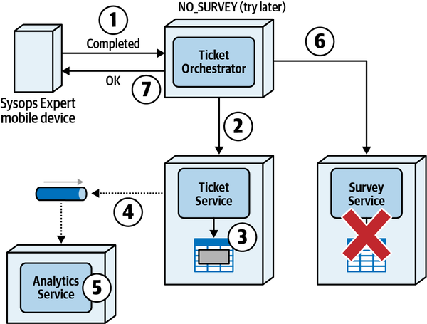

*Hình 12-20. Fairy Tale Saga dẫn đến khả năng phản hồi tốt hơn, nhưng để các nguồn dữ liệu mất đồng bộ với nhau cho đến khi chúng có thể được sửa*

Hãy để ý rằng Survey Service không khả dụng trong phạm vi transaction phân tán. Tuy nhiên, với loại saga này, thay vì gửi một compensating update, trạng thái của saga được đổi thành `NO_SURVEY` và một phản hồi thành công được gửi tới Sysops Expert (bước 7 trong sơ đồ). Ticket Orchestrator Service sau đó làm việc bất đồng bộ (ở hậu trường) để giải quyết lỗi theo chương trình bằng cách thử lại và phân tích lỗi. Nếu không thể giải quyết lỗi, Ticket Orchestrator Service gửi lỗi tới một quản trị viên hoặc người giám sát để sửa chữa và xử lý thủ công.

Bằng cách quản lý *trạng thái* của saga thay vì gửi compensating update,<a id="idm45798376628680"></a> người dùng cuối (trong trường hợp này là chuyên gia Sysops Squad) không cần lo rằng khảo sát chưa được gửi tới khách hàng—trách nhiệm đó thuộc về Ticket Orchestrator Service. Khả năng phản hồi tốt từ góc độ của người dùng cuối, và người dùng có thể làm các việc khác trong khi hệ thống xử lý các lỗi.

<a id="sec-state-machines"></a>

### Saga state machine (Saga State Machines)

Một *state machine* là một pattern mô tả mọi đường đi khả dĩ<a id="ch12-asm"></a><a id="ch12-asm2"></a><a id="ch12-asm3"></a><a id="ch12-asm4"></a><a id="ch12-asm5"></a><a id="ch12-asm6"></a> có thể tồn tại trong một architecture phân tán. Một state machine luôn bắt đầu với một trạng thái khởi đầu khởi chạy transactional saga, rồi chứa các trạng thái chuyển tiếp và hành động tương ứng nên xảy ra khi trạng thái chuyển tiếp diễn ra.

Để minh họa cách một saga state machine hoạt động, hãy xét workflow sau của một problem ticket mới được khách hàng tạo trong hệ thống Sysops Squad:

1. Khách hàng nhập một problem ticket mới vào hệ thống.
2. Ticket được giao cho chuyên gia Sysops Squad sẵn sàng tiếp theo.
3. Ticket sau đó được định tuyến tới thiết bị di động của chuyên gia.
4. Chuyên gia nhận ticket và xử lý sự cố.
5. Chuyên gia hoàn tất sửa chữa và đánh dấu ticket là hoàn tất.
6. Một khảo sát được gửi tới khách hàng.

Các trạng thái khác nhau có thể tồn tại trong transactional saga này, cũng như các hành động chuyển tiếp tương ứng, được minh họa trong [Hình 12-21](#fig-managing-workflows-saga-new-ticket). Hãy để ý rằng transactional saga bắt đầu với node `START` biểu thị điểm vào saga, và kết thúc với node `CLOSED` biểu thị điểm ra saga.

<a id="fig-managing-workflows-saga-new-ticket"></a>

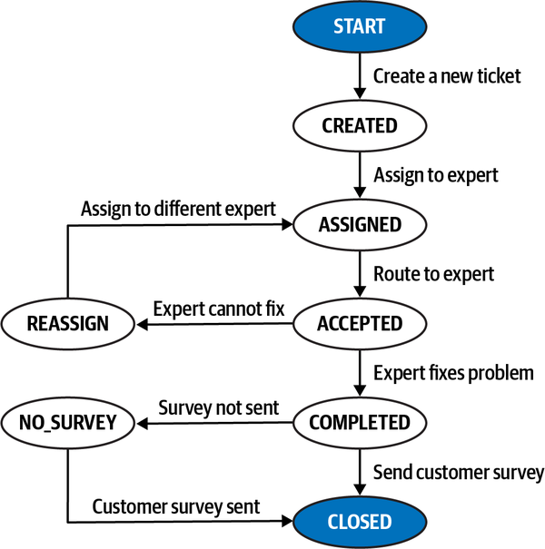

*Hình 12-21. Sơ đồ trạng thái cho việc tạo một problem ticket mới*

Các mục sau mô tả chi tiết hơn transactional saga này cùng các trạng thái và hành động chuyển tiếp tương ứng xảy ra trong mỗi trạng thái:

**START**

Transactional saga bắt đầu với việc khách hàng nhập một problem ticket mới vào hệ thống. Gói hỗ trợ của khách hàng được xác minh, và dữ liệu ticket được kiểm tra hợp lệ. Một khi ticket được chèn vào bảng ticket trong database, trạng thái transactional saga chuyển sang CREATED và khách hàng được thông báo rằng ticket đã được tạo thành công. Đây là kết quả khả dĩ duy nhất cho phép chuyển trạng thái này—mọi lỗi trong trạng thái này đều ngăn saga bắt đầu.

**CREATED**

Một khi ticket được tạo thành công, nó được giao cho một chuyên gia Sysops Squad. Nếu không có chuyên gia nào sẵn sàng phục vụ ticket, nó được giữ ở trạng thái chờ cho đến khi có chuyên gia sẵn sàng. Một khi chuyên gia được giao, trạng thái saga chuyển sang trạng thái ASSIGNED. Đây là kết quả duy nhất cho phép chuyển trạng thái này, nghĩa là ticket được giữ ở trạng thái CREATED cho đến khi có thể được giao.

**ASSIGNED**

Một khi ticket được giao cho một chuyên gia, kết quả khả dĩ duy nhất là định tuyến ticket tới chuyên gia. Giả định rằng trong quá trình chạy thuật toán giao, chuyên gia đã được định vị và đang sẵn sàng. Nếu ticket không thể được định tuyến vì không định vị được chuyên gia hoặc chuyên gia không sẵn sàng, saga ở lại trạng thái này cho đến khi có thể định tuyến. Một khi đã định tuyến, chuyên gia phải xác nhận đã nhận ticket. Một khi điều này xảy ra, trạng thái transactional saga chuyển sang ACCEPTED. Đây là kết quả khả dĩ duy nhất cho phép chuyển trạng thái này.

**ACCEPTED**

Có hai trạng thái khả dĩ một khi ticket đã được chuyên gia Sysops Squad chấp nhận: COMPLETED hoặc REASSIGN. Một khi chuyên gia hoàn tất sửa chữa và đánh dấu ticket là “hoàn tất,” trạng thái của saga chuyển sang COMPLETED. Tuy nhiên, nếu vì lý do nào đó ticket bị giao sai hoặc chuyên gia không thể hoàn tất sửa chữa, chuyên gia thông báo cho hệ thống và trạng thái chuyển sang REASSIGN.

**REASSIGN**

Một khi ở trạng thái saga này, hệ thống sẽ giao lại ticket cho một chuyên gia khác. Giống như trạng thái CREATED, nếu không có chuyên gia nào sẵn sàng, transactional saga sẽ ở lại trạng thái REASSIGN cho đến khi một chuyên gia được giao. Một khi tìm được chuyên gia khác và ticket được giao lại một lần nữa, trạng thái chuyển sang trạng thái ASSIGNED, chờ chuyên gia kia chấp nhận. Đây là kết quả khả dĩ duy nhất cho phép chuyển trạng thái này, và saga ở lại trạng thái này cho đến khi một chuyên gia được giao cho ticket.

**COMPLETED**

Hai trạng thái khả dĩ một khi chuyên gia hoàn tất ticket là CLOSED hoặc NO_SURVEY. Khi ticket ở trạng thái này, một khảo sát được gửi tới khách hàng để đánh giá chuyên gia và dịch vụ, và trạng thái saga được chuyển sang CLOSED, nhờ đó kết thúc transaction saga. Tuy nhiên, nếu Survey Service không khả dụng hoặc xảy ra lỗi khi gửi khảo sát, trạng thái chuyển sang NO_SURVEY, biểu thị rằng sự cố đã được sửa nhưng chưa có khảo sát nào được gửi tới khách hàng.

**NO_SURVEY**

Ở trạng thái điều kiện lỗi này, hệ thống tiếp tục thử gửi khảo sát tới khách hàng. Một khi gửi thành công, trạng thái chuyển sang CLOSED, đánh dấu kết thúc transactional saga. Đây là kết quả khả dĩ duy nhất của state transaction này.

Trong nhiều trường hợp, sẽ hữu ích khi đặt danh sách mọi phép chuyển trạng thái khả dĩ và hành động chuyển tiếp tương ứng vào một loại bảng nào đó. Developer sau đó có thể dùng bảng này để triển khai các trigger chuyển trạng thái và các điều kiện lỗi khả dĩ trong một orchestration service (hoặc các service tương ứng nếu dùng choreography). Một ví dụ về thực hành này được thể hiện trong [Bảng 12-10](#table-saga-new-ticket), liệt kê mọi trạng thái và hành động khả dĩ được kích hoạt khi phép chuyển trạng thái xảy ra.

<a id="table-saga-new-ticket"></a>

<a id="table-saga-new-ticket"></a>*Bảng 12-10. Saga state machine cho một problem ticket mới trong hệ thống Sysops Squad*

| Trạng thái khởi đầu | Trạng thái chuyển tiếp | Hành động transaction |
|---|---|---|
| START | CREATED | Giao ticket cho chuyên gia |
| CREATED | ASSIGNED | Định tuyến ticket tới chuyên gia được giao |
| ASSIGNED | ACCEPTED | Chuyên gia sửa sự cố |
| ACCEPTED | COMPLETED | Gửi khảo sát khách hàng |
| ACCEPTED | REASSIGN | Giao lại cho một chuyên gia khác |
| REASSIGN | ASSIGNED | Định tuyến ticket tới chuyên gia được giao |
| COMPLETED | CLOSED | Saga ticket hoàn tất |
| COMPLETED | NO_SURVEY | Gửi khảo sát khách hàng |
| NO_SURVEY | CLOSED | Saga ticket hoàn tất |

Việc chọn giữa dùng compensating update hay quản lý trạng thái<a id="idm45798376565160"></a><a id="idm45798376564056"></a><a id="idm45798376563096"></a> cho các workflow transaction phân tán phụ thuộc vào tình huống cũng như phân tích trade-off giữa khả năng phản hồi và tính nhất quán. Bất kể kỹ thuật nào được dùng để quản lý lỗi trong một transaction phân tán, trạng thái của transaction phân tán nên được biết và cũng được quản lý.

[Bảng 12-11](#table-state-mgmt-tradeoffs) tóm tắt các trade-offs gắn với việc dùng quản lý trạng thái thay vì atomic distributed transaction với compensating update.<a id="idm45798376560152"></a><a id="idm45798376559480"></a><a id="idm45798376558808"></a><a id="idm45798376558136"></a><a id="idm45798376557464"></a><a id="idm45798376556792"></a>

> **Các đánh đổi (Trade-Offs)**
>
> <a id="table-state-mgmt-tradeoffs"></a>
>
> <a id="table-state-mgmt-tradeoffs"></a>*Bảng 12-11. Trade-offs gắn với quản lý trạng thái thay vì atomic distributed transaction với compensating update*
>
> | Ưu điểm | Nhược điểm |
> |---|---|
> | Khả năng phản hồi tốt | Dữ liệu có thể mất đồng bộ khi xảy ra lỗi |
> | Ít tác động đến người dùng cuối khi có lỗi | Eventual consistency có thể mất một khoảng thời gian |

<a id="idm45798376626376"></a>

## Kỹ thuật quản lý saga (Techniques for Managing Sagas)

Transaction phân tán không phải là thứ có thể đơn giản “thả vào” một hệ thống.<a id="idm45798376546120"></a><a id="idm45798376545144"></a><a id="idm45798376543864"></a> Chúng không thể được tải về hay mua bằng một loại framework hay sản phẩm nào đó như các ACID transaction manager—chúng phải được developer và kiến trúc sư thiết kế, viết code và duy trì.

Một trong những kỹ thuật chúng tôi thích dùng để giúp quản lý transaction phân tán<a id="idm45798376541896"></a><a id="idm45798376541224"></a><a id="idm45798376540264"></a><a id="idm45798376539560"></a> là tận dụng annotation (Java) hoặc custom attribute (C#), hoặc các artifact tương tự khác trong các ngôn ngữ khác. Dù bản thân những artifact ngôn ngữ này không chứa chức năng thực tế nào, chúng cung cấp một cách theo chương trình để nắm bắt và ghi tài liệu các transactional saga trong hệ thống, cũng như cung cấp một phương tiện để gắn các service với các transactional saga.

Các đoạn source trong [Ví dụ 12-1](#source-saga-java) (Java) và [Ví dụ 12-2](#source-saga-csharp) (C#) thể hiện một ví dụ triển khai các annotation và custom attribute này. Hãy để ý rằng trong cả hai cách triển khai, các transactional saga (`NEW_TICKET`, `CANCEL_TICKET`, v.v.) được chứa trong enum `Transaction`, cung cấp một nơi duy nhất trong source code để liệt kê và ghi tài liệu các saga khác nhau tồn tại trong một bối cảnh ứng dụng.

<a id="source-saga-java"></a>

*Ví dụ 12-1. Source code định nghĩa một annotation transactional saga (Java)*

```java
@Retention(RetentionPolicy.RUNTIME)
@Target(ElementType.TYPE)
public @interface Saga {
   public Transaction[] value();

   public enum Transaction {
      NEW_TICKET,
      CANCEL_TICKET,
      NEW_CUSTOMER,
      UNSUBSCRIBE,
      NEW_SUPPORT_CONTRACT
   }
}
```

<a id="source-saga-csharp"></a>

*Ví dụ 12-2. Source code định nghĩa một attribute transactional saga (C#)*

```csharp
[AttributeUsage(AttributeTargets.Class)]
class Saga : System.Attribute {
   public Transaction[] transaction;

   public enum Transaction {
      NEW_TICKET,
      CANCEL_TICKET,
      NEW_CUSTOMER,
      UNSUBSCRIBE,
      NEW_SUPPORT_CONTRACT
   };
}
```

Một khi đã được định nghĩa, các annotation hoặc attribute này có thể được dùng để xác định<a id="idm45798376475144"></a> các service tham gia transactional saga. Ví dụ, đoạn source code trong [Ví dụ 12-3](#source-saga-java-using) cho thấy Survey Service (được xác định bởi class `SurveyServiceAPI` là entry point của service) tham gia saga `NEW_TICKET`, trong khi Ticket Service (được xác định bởi class `TicketServiceAPI` là entry point của service) tham gia hai saga: `NEW_TICKET` và `CANCEL_TICKET`.

<a id="source-saga-java-using"></a>

*Ví dụ 12-3. Source code thể hiện việc dùng annotation transactional saga (Java)*

```java
@ServiceEntrypoint
@Saga(Transaction.NEW_TICKET)
public class SurveyServiceAPI {
   ...
}

@ServiceEntrypoint
@Saga({Transaction.NEW_TICKET,)
       Transaction.CANCEL_TICKET})
public class TicketServiceAPI {
   ...
}
```

Hãy để ý cách saga `NEW_TICKET` bao gồm Survey Service và Ticket Service. Đây là thông tin giá trị với developer vì nó giúp họ xác định phạm vi testing khi thực hiện thay đổi đối với một workflow hay saga cụ thể, và cũng cho họ biết những service nào khác có thể bị ảnh hưởng bởi một thay đổi đối với một trong các service trong transactional saga.

Dùng các annotation và custom attribute này, kiến trúc sư và developer có thể viết các công cụ command-line interface (CLI) đơn giản để duyệt qua một codebase hoặc source code repository nhằm cung cấp thông tin saga theo thời gian thực. Ví dụ, dùng một công cụ code-walk tùy biến đơn giản, developer, kiến trúc sư, hoặc thậm chí một business analyst có thể truy vấn những service nào tham gia saga `NEW_TICKET`:

```bash
$ ./sagatool.sh NEW_TICKET -services

-> Ticket Service
-> Assignment Service
-> Routing Service
-> Survey Service

$
```

Một công cụ code-walking tùy biến có thể xem từng file class trong bối cảnh ứng dụng chứa custom annotation (hoặc attribute) `@ServiceEntrypoint` và kiểm tra custom annotation `@Saga` xem có saga cụ thể đó không (trong trường hợp này là `Transaction.NEW_TICKET`). Loại công cụ tùy biến này không phức tạp để viết, và có thể giúp cung cấp thông tin giá trị khi quản lý transactional saga.

<a id="ss-saga-atomic-transactions"></a>

## Sysops Squad Saga: Atomic transaction và compensating update (Sysops Squad Saga: Atomic Transactions and Compensating Updates)

`Tuesday, April 5, 09:44`

Addison và Austen gặp Logan ngay đầu buổi sáng trong phòng họp khá dài để giải quyết các vấn đề quanh tính transaction trong microservices architecture mới.<a id="ch12-ssts"></a><a id="ch12-ssts2"></a><a id="ch12-ssts3"></a><a id="ch12-ssts5"></a><a id="ch12-ssts4"></a><a id="ch12-sstsa"></a><a id="ch12-sstsb"></a>

Logan bắt đầu, “Tôi biết không phải ai cũng có cùng hiểu biết về việc những gì các bạn đã đọc áp dụng thế nào vào những gì chúng ta đang làm ở đây. Vì vậy, tôi đã chuẩn bị một số workflow và sơ đồ để giúp mọi người có cùng hiểu biết. Hôm nay, chúng ta sẽ thảo luận việc đánh dấu một ticket là hoàn tất trong hệ thống. Với workflow này, chuyên gia Sysops Squad hoàn thành một công việc và đánh dấu ticket là “hoàn tất” bằng ứng dụng di động trên thiết bị di động của chuyên gia. Tôi muốn nói về Epic Saga pattern và các vấn đề quanh compensating update. Tôi đã tạo một sơ đồ minh họa workflow này trong [Hình 12-22](#fig-managing-workflows-saga-example) Mọi người có thấy không?”

<a id="fig-managing-workflows-saga-example"></a>

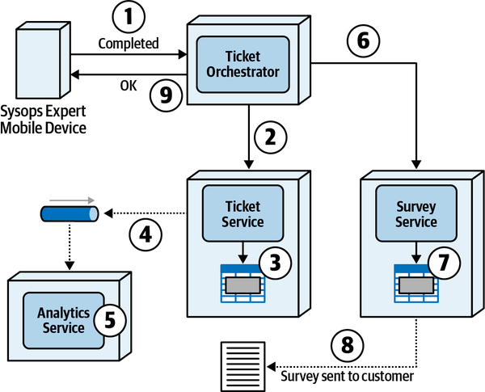

*Hình 12-22. Epic saga đòi hỏi trạng thái ticket được cập nhật và khảo sát được gửi trong một thao tác nguyên tử đồng bộ*

Logan tiếp tục, “Tôi cũng đã tạo một danh sách mô tả từng bước. Các số được khoanh tròn trên sơ đồ khớp với workflow.”

1. Chuyên gia Sysops Squad đánh dấu ticket là hoàn tất bằng một ứng dụng trên thiết bị di động của họ, request này được Ticket Orchestrator Service nhận một cách đồng bộ.
2. Ticket Orchestrator Service gửi một request đồng bộ tới Ticket Service để thay đổi trạng thái của ticket từ “in-progress” (đang xử lý) sang “complete” (hoàn tất).
3. Ticket Service cập nhật số ticket thành “complete” trong bảng database và commit cập nhật.
4. Như một phần của quy trình hoàn tất ticket, Ticket Service gửi bất đồng bộ thông tin ticket (như thời gian sửa chữa ticket, thời gian chờ ticket, thời lượng, v.v.) tới một queue để Analytics Service lấy. Một khi đã gửi, Ticket Service gửi xác nhận tới Ticket Orchestrator Service rằng cập nhật đã hoàn tất.
5. Vào khoảng cùng thời điểm đó, Analytics Service nhận bất đồng bộ dữ liệu phân tích ticket đã cập nhật và bắt đầu xử lý thông tin ticket.
6. Ticket Orchestrator Service sau đó gửi một request đồng bộ tới Survey Service để chuẩn bị và gửi khảo sát khách hàng tới khách hàng.
7. Survey Service chèn dữ liệu vào một bảng với thông tin khảo sát (khách hàng, thông tin ticket và timestamp) và commit thao tác chèn.
8. Survey Service sau đó gửi khảo sát tới khách hàng qua email và trả lại xác nhận cho Ticket Orchestrator Service rằng việc xử lý khảo sát đã hoàn tất.
9. Cuối cùng, Ticket Orchestrator Service gửi phản hồi lại thiết bị di động của chuyên gia Sysops Squad cho biết việc xử lý hoàn tất ticket đã xong. Một khi điều này xảy ra, chuyên gia có thể chọn problem ticket tiếp theo được giao cho họ.

“Ồ, cái này thực sự hữu ích. Anh mất bao lâu để tạo ra nó?” Addison nói.

“Không ít thời gian, nhưng nó tỏ ra hữu dụng. Các cậu không phải là nhóm duy nhất bối rối về cách làm cho tất cả những mảnh chuyển động này hoạt động cùng nhau. Đây là phần khó của software architecture. Mọi người hiểu những điều cơ bản của workflow chứ?”

Trước một rừng cái gật đầu, Logan tiếp tục, “Một trong những vấn đề đầu tiên xảy ra với compensating update là vì không có transaction isolation trong một transaction phân tán (xem [“Distributed Transactions”](ch09_data_ownership_and_distributed_transactions.vi.md#sec-acid-vs-base)), các service khác có thể đã thực hiện hành động trên dữ liệu được cập nhật trong phạm vi transaction phân tán trước khi transaction phân tán hoàn tất. Để minh họa vấn đề này, hãy xét cùng ví dụ Epic Saga xuất hiện trong [Hình 12-23](#fig-managing-workflows-saga-compensate): chuyên gia Sysops Squad đánh dấu một ticket là hoàn tất, nhưng lần này Survey Service không khả dụng. Trong trường hợp này, một compensating update (bước 7 trong sơ đồ) được gửi tới Ticket Service để đảo ngược cập nhật, đổi trạng thái ticket từ *completed* trở lại *in-progress* (bước 8 trong sơ đồ).”

“Cũng hãy để ý trong [Hình 12-23](#fig-managing-workflows-saga-compensate) rằng vì đây là một atomic distributed transaction, một lỗi sau đó được gửi lại cho chuyên gia Sysops Squad cho biết hành động không thành công và hãy thử lại. Giờ, một câu hỏi cho các bạn: tại sao chuyên gia Sysops Squad lại phải lo rằng khảo sát chưa được gửi?”

Austen suy ngẫm một lúc. “Nhưng chẳng phải đó là một phần của workflow trong monolith sao? Tất cả những thứ đó đều xảy ra trong một transaction, nếu tôi nhớ đúng.”

“Ừ, nhưng tôi luôn thấy điều đó kỳ lạ, chỉ là chưa bao giờ nói ra,” Addison nói. “Tôi không thấy tại sao chuyên gia phải lo về khảo sát. Chuyên gia chỉ muốn chuyển sang ticket tiếp theo được giao cho họ.”

“Đúng vậy,” Logan nói. “Đây là vấn đề với atomic distributed transaction—người dùng cuối bị coupled về ngữ nghĩa một cách không cần thiết với quy trình nghiệp vụ. Nhưng hãy để ý rằng [Hình 12-23](#fig-managing-workflows-saga-compensate) cũng minh họa vấn đề thiếu transaction isolation trong một transaction phân tán. Hãy để ý rằng như một phần của cập nhật ban đầu để đánh dấu ticket là *complete,* Ticket Service đã gửi bất đồng bộ thông tin ticket tới một queue (bước 4 trong sơ đồ) để Analytics Service xử lý (bước 5). Tuy nhiên, khi compensating update được gửi tới Ticket Service (bước 7), thông tin ticket đã được Analytics Service xử lý ở bước 5.”

<a id="fig-managing-workflows-saga-compensate"></a>

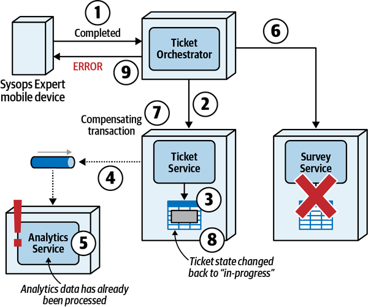

*Hình 12-23. Epic Saga<sup>(sao)</sup> đòi hỏi bù trừ, nhưng tác dụng phụ có thể xảy ra*

“Chúng ta gọi đây là một *side effect* (tác dụng phụ) trong các architecture phân tán. <a id="idm45798376260856"></a><a id="idm45798376259864"></a>Bằng cách đảo ngược transaction trong Ticket Service, các hành động do các service khác thực hiện dùng dữ liệu từ cập nhật trước đó có thể đã diễn ra và có thể không đảo ngược được. <a id="idm45798376258760"></a>Kịch bản này chỉ ra tầm quan trọng của *isolation* trong một transaction, điều mà transaction phân tán không hỗ trợ. Để giải quyết vấn đề này, Ticket Service có thể gửi một request khác qua data pump tới Analytics Service, bảo service đó bỏ qua thông tin ticket trước đó, nhưng hãy tưởng tượng lượng code phức tạp và logic thời điểm sẽ cần trong Analytics Service để xử lý thay đổi bù trừ này. Hơn nữa, có thể đã có thêm các hành động downstream được thực hiện trên dữ liệu phân tích đã được Analytics Service xử lý, càng làm phức tạp thêm chuỗi sự kiện cần đảo ngược và sửa chữa. Với các architecture phân tán và transaction phân tán, đôi khi đúng là [*turtles all the way down*](https://oreil.ly/zP8dK) (rùa chồng rùa mãi không hết).”

Logan dừng lại một lúc, rồi tiếp tục, “Một vấn đề khác—”

Austen ngắt lời, “Một vấn đề khác nữa?”

Logan mỉm cười. “Một vấn đề khác liên quan đến compensating update là việc bù trừ thất bại. Tiếp tục với cùng ví dụ Epic Saga cho việc hoàn tất ticket, hãy để ý trong [Hình 12-24](#fig-managing-workflows-saga-compensate-fail) rằng ở bước 7 một compensating update được gửi tới Ticket Service để đổi trạng thái từ *completed* trở lại *in-progress.* Tuy nhiên, trong trường hợp này, Ticket Service sinh ra lỗi khi cố thay đổi trạng thái của ticket (bước 8).”

<a id="fig-managing-workflows-saga-compensate-fail"></a>

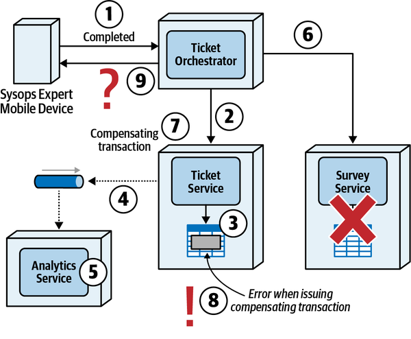

*Hình 12-24. Compensating update trong một Epic Saga có thể thất bại, dẫn đến sự không nhất quán và bối rối về việc nên thực hiện hành động gì trong trường hợp bù trừ thất bại*

“Tôi đã thấy điều đó xảy ra! Mất cả thế kỷ để truy ra,” Addison nói.

“Kiến trúc sư và developer có xu hướng giả định rằng compensating update sẽ luôn hoạt động,” Logan nói. “Nhưng đôi khi chúng không. Trong trường hợp này, như thể hiện trong [Hình 12-24](#fig-managing-workflows-saga-compensate-fail), có sự bối rối về loại phản hồi nên gửi lại cho người dùng cuối (trong trường hợp này là chuyên gia Sysops Squad). Trạng thái ticket đã được đánh dấu là *complete* vì việc bù trừ thất bại, nên việc thử lại request “đánh dấu là hoàn tất” có thể chỉ dẫn đến thêm một lỗi khác (như *Ticket already marked as complete*). Đúng là gây bối rối cho người dùng cuối!”

“Ừ, tôi có thể tưởng tượng các developer đến hỏi chúng ta cách giải quyết vấn đề này,” Addison nói.

“Thường thì developer là những người kiểm tra tốt đối với các giải pháp kiến trúc chưa hoàn chỉnh hoặc gây bối rối. Nếu họ bối rối, có thể có lý do chính đáng,” Logan nói. “OK, một vấn đề nữa. Atomic distributed transaction và các compensating update tương ứng cũng ảnh hưởng đến khả năng phản hồi. Nếu xảy ra lỗi, người dùng cuối phải chờ cho đến khi mọi hành động khắc phục được thực hiện (thông qua compensating update) trước khi một phản hồi được gửi để báo cho người dùng về lỗi.”

“Chẳng phải đó là chỗ việc chuyển sang eventual consistency giúp ích, cho khả năng phản hồi sao?” Austen hỏi.

“Đúng vậy, dù khả năng phản hồi đôi khi có thể được giải quyết bằng cách gửi bất đồng bộ các compensating update thông qua eventual consistency (như với Parallel Saga và Anthology Saga pattern), nhưng hầu hết các atomic distributed transaction có khả năng phản hồi tệ hơn khi có liên quan đến compensating update.”

“OK, hợp lý đấy—phối hợp nguyên tử sẽ luôn có overhead,” Austen nói.

“Thông tin nhiều quá. Hãy xây dựng một bảng để tóm tắt một số trade-offs gắn với atomic distributed transaction và compensating update.” (Xem [Bảng 12-12](#table-compensation-tradeoffs).)

> **Các đánh đổi (Trade-Offs)**
>
> <a id="table-compensation-tradeoffs"></a>
>
> <a id="table-compensation-tradeoffs"></a>*Bảng 12-12. Trade-offs gắn với atomic distributed transaction và compensating update*
>
> | Ưu điểm | Nhược điểm |
> |---|---|
> | Mọi dữ liệu được khôi phục về trạng thái trước | Không có transaction isolation |
> | Cho phép thử lại và khởi động lại | Tác dụng phụ có thể xảy ra khi bù trừ |
> |  | Việc bù trừ có thể thất bại |
> |  | Khả năng phản hồi kém đối với người dùng cuối |

Logan nói, “Dù compensating transaction pattern này tồn tại, nó cũng đặt ra một số thách thức. Ai muốn nêu một cái?”

“Tôi biết: *một service không thể thực hiện rollback*,” Austen nói. “Nếu một trong các service *không thể* hoàn tác thành công thao tác trước đó thì sao? Orchestrator phải có code phối hợp để chỉ ra rằng transaction không thành công.”

“Đúng—còn cái khác?”

"*Khóa hay không khóa các service tham gia?*" Addison nói. “Khi mediator thực hiện một lời gọi tới một service và nó cập nhật một giá trị, mediator sẽ thực hiện các lời gọi tới các service tiếp theo là một phần của workflow. Tuy nhiên, điều gì xảy ra nếu một request khác xuất hiện cho service đầu tiên, phụ thuộc vào kết quả giải quyết của request đầu tiên, dù từ cùng mediator hay từ một bối cảnh khác? Vấn đề architecture phân tán này trở nên tệ hơn khi các lời gọi là bất đồng bộ thay vì đồng bộ (minh họa trong [“Phone Tag Saga<sup>(sac)</sup> Pattern”](#sec-phone-tag-saga)). Ngoài ra, mediator có thể khăng khăng rằng các service khác không chấp nhận lời gọi trong quá trình một workflow, điều bảo đảm một transaction hợp lệ nhưng phá hủy performance và scalability.”

Logan nói, “Đúng vậy. Hãy triết lý một chút. Về mặt khái niệm, transaction buộc các bên tham gia dừng thế giới riêng của mình và đồng bộ trên một giá trị cụ thể. Điều này rất dễ mô hình hóa với monolithic architecture và relational database đến mức kiến trúc sư lạm dụng transaction trong những hệ thống đó. Phần lớn thế giới thực không mang tính transaction, <a id="idm45798376225496"></a><a id="idm45798376224792"></a>như được nhận xét trong bài tiểu luận nổi tiếng của Gregor Hohpe, [“Starbucks Does Not Use Two-Phase Commit”](https://oreil.ly/feCe1). Phối hợp transaction là một trong những phần khó nhất của architecture, và phạm vi càng rộng, nó càng trở nên tệ hơn.”

“Có lựa chọn thay thế nào cho việc dùng Epic Saga không?” Addison hỏi.

“Có!” Logan nói. “Một cách tiếp cận thực tế hơn cho kịch bản được mô tả trong [Hình 12-24](#fig-managing-workflows-saga-compensate-fail) có thể là dùng Fairy Tale Saga hoặc Parallel Saga pattern. Những saga này dựa vào eventual consistency bất đồng bộ và quản lý trạng thái thay vì atomic distributed transaction với compensating update khi xảy ra lỗi. Với những loại saga này, người dùng ít bị ảnh hưởng hơn bởi các lỗi có thể xảy ra trong transaction phân tán, vì lỗi được xử lý ở hậu trường, không cần end-user (người dùng cuối) tham gia. Khả năng phản hồi cũng tốt hơn với cách tiếp cận quản lý trạng thái và eventual consistency, vì người dùng không phải chờ hành động khắc phục được thực hiện trong transaction phân tán. Nếu chúng ta có vấn đề với tính nguyên tử, chúng ta có thể tìm hiểu những pattern đó như các lựa chọn thay thế.”

“Cảm ơn—thông tin nhiều thật, nhưng giờ tôi đã hiểu tại sao các kiến trúc sư đưa ra một số quyết định trong architecture mới,” Addison nói.<a id="idm45798376220024"></a><a id="idm45798376219320"></a><a id="idm45798376218648"></a><a id="idm45798376217976"></a><a id="idm45798376217304"></a><a id="idm45798376216632"></a><a id="idm45798376215960"></a>
