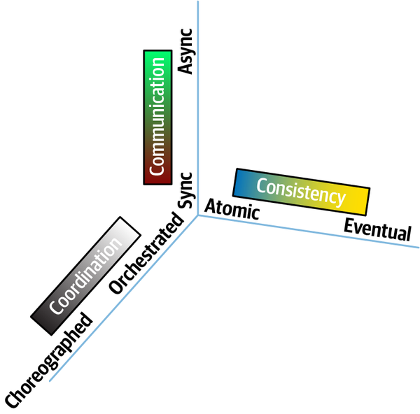
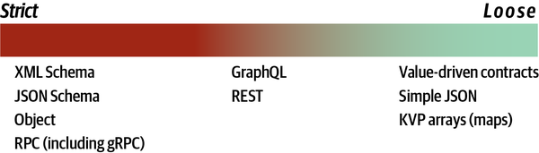
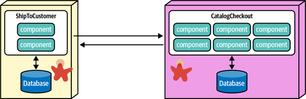
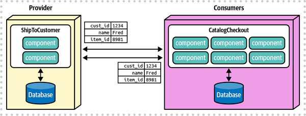
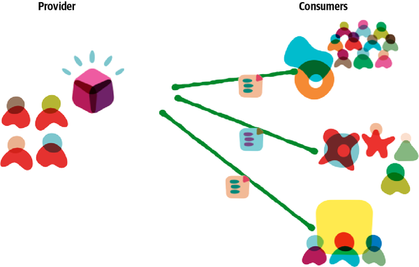
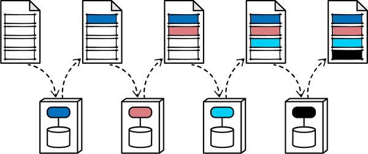
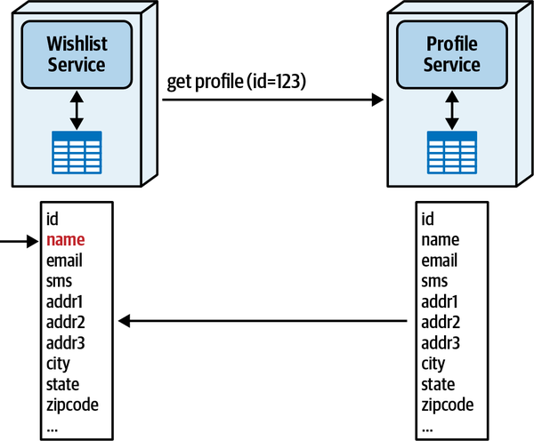
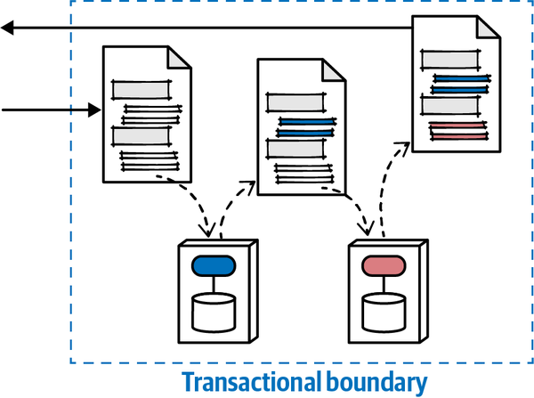
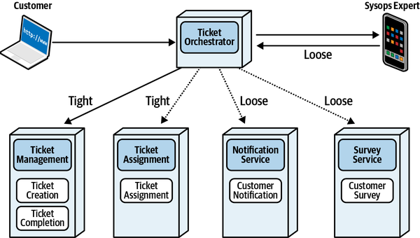

<a id="ch13-contracts"></a>

# Chương 13. Contract (Contracts)

`Friday, April 15, 12:01`

Addison gặp Sydney vào bữa trưa ở căng tin để trò chuyện về việc phối hợp<a id="idm45798376212360"></a><a id="idm45798376211384"></a> giữa Ticket Orchestrator và các service mà nó tích hợp cho workflow quản lý ticket.

“Sao không dùng gRPC cho mọi giao tiếp luôn? Tôi nghe nói nó rất nhanh,” Sydney nói.

“Chà, đó là một cách triển khai, không phải một architecture,” Addison nói. “Chúng ta cần quyết định loại contract nào chúng ta muốn trước khi chọn cách triển khai chúng. Trước hết, chúng ta cần quyết định giữa contract chặt hay lỏng. Một khi đã quyết định loại, tôi sẽ để cậu quyết định cách triển khai chúng, miễn là chúng vượt qua các fitness function của chúng ta.”

“Điều gì quyết định loại contract chúng ta cần?” Sydney nói.

Trong [Chương 2](ch02_discerning_coupling_in_software_architecture.vi.md#ch02-discerning), chúng tôi đã bắt đầu thảo luận về giao điểm của ba<a id="idm45798376207032"></a> lực quan trọng—giao tiếp, tính nhất quán và phối hợp—và cách phát triển trade-offs cho chúng. Chúng tôi đã mô hình hóa không gian giao nhau của ba lực trong một không gian three-dimensional (ba chiều) kết hợp, được thể hiện lại trong [Hình 13-1](#fig-contracts-dimensions). Trong [Chương 12](ch12_transactional_sagas.vi.md#ch12-transactional-sagas), chúng tôi đã xem lại ba lực này với phần thảo luận về các kiểu giao tiếp khác nhau và trade-offs của chúng.

Dù một architecture có thể nhận diện một quan hệ như thế này đến mức nào, một số lực cắt ngang không gian khái niệm và ảnh hưởng như nhau đến mọi chiều khác. Nếu theo đuổi ẩn dụ trực quan three-dimensional, những lực cross-cutting (xuyên suốt) này đóng vai trò như một chiều bổ sung, giống như *thời gian* trực giao với ba chiều vật lý.

<a id="fig-contracts-dimensions"></a>



*Hình 13-1. Không gian giao nhau three-dimensional cho các lực messaging trong architecture phân tán*

Một yếu tố bất biến trong software architecture cắt ngang và ảnh hưởng đến gần như mọi khía cạnh của việc ra quyết định kiến trúc là *contract*, được định nghĩa rộng là cách các phần khác biệt của một architecture kết nối với nhau. Định nghĩa từ điển của contract như sau:

**contract (hợp đồng)**

Một thỏa thuận bằng văn bản hoặc lời nói, đặc biệt là thỏa thuận liên quan đến việc làm, mua bán hoặc thuê mướn, được dự định có hiệu lực thi hành theo luật.

Trong phần mềm, chúng ta dùng contract theo nghĩa rộng để mô tả những thứ như các điểm tích hợp trong architecture, và nhiều định dạng contract là một phần của quy trình thiết kế trong phát triển phần mềm: SOAP, REST, gRPC, XMLRPC, và cả một mớ từ viết tắt khác. Tuy nhiên, chúng tôi mở rộng định nghĩa đó và làm nó nhất quán hơn:

**hard parts contract (contract theo nghĩa của cuốn sách)**

Định dạng được các phần của một architecture dùng để truyền đạt thông tin hoặc phụ thuộc.

Định nghĩa *contract* này bao gồm mọi kỹ thuật dùng để “nối” các phần của một hệ thống với nhau, bao gồm các phụ thuộc bắc cầu cho framework và thư viện, các điểm tích hợp nội bộ và bên ngoài, cache, và bất kỳ giao tiếp nào khác giữa các phần.

Chương này minh họa tác động của contract lên nhiều phần của architecture, bao gồm static quantum coupling và dynamic quantum coupling, cũng như các cách cải thiện (hoặc làm hại) hiệu quả của workflow.

<a id="idm45798376192520"></a>

## Contract chặt so với contract lỏng (Strict Versus Loose Contracts)

Như nhiều thứ trong software architecture, contract không tồn tại<a id="idm45798376190504"></a><a id="idm45798376189528"></a> theo kiểu nhị phân mà trên một dải phổ rộng, từ chặt đến lỏng. [Hình 13-2](#fig-contracts-spectrum) minh họa dải phổ này, dùng các loại contract ví dụ.

<a id="fig-contracts-spectrum"></a>



*Hình 13-2. Dải phổ các loại contract, từ chặt đến lỏng*

Một contract chặt đòi hỏi tuân thủ tên, kiểu, thứ tự và mọi chi tiết khác, không để lại sự mơ hồ nào. Một ví dụ về contract chặt nhất có thể có trong phần mềm là một lời gọi method từ xa, dùng một cơ chế nền tảng như RMI trong Java. Trong trường hợp đó, lời gọi từ xa bắt chước một lời gọi method nội bộ, khớp tên, tham số, kiểu và mọi chi tiết khác.

Nhiều định dạng contract chặt bắt chước ngữ nghĩa của lời gọi method. <a id="idm45798376184648"></a>Ví dụ, developer thấy hàng loạt giao thức bao gồm một biến thể nào đó của RPC, theo truyền thống là từ viết tắt của *Remote Procedure Call*. [gRPC](https://grpc.io) là một ví dụ về framework gọi từ xa phổ biến mặc định dùng contract chặt.

Nhiều kiến trúc sư thích contract chặt vì chúng mô hình hóa hành vi ngữ nghĩa giống hệt các lời gọi method nội bộ. <a id="idm45798376181560"></a><a id="idm45798376180552"></a><a id="idm45798376179320"></a>Tuy nhiên, contract chặt tạo ra tính giòn trong integration architecture—điều cần tránh. Như đã thảo luận trong [Chương 8](ch08_reuse_patterns.vi.md#ch08-reuse-patterns), thứ gì đó vừa thay đổi thường xuyên vừa được nhiều phần kiến trúc khác nhau dùng sẽ tạo ra vấn đề trong architecture. Contract khớp với mô tả đó vì chúng tạo thành chất keo trong một architecture phân tán: chúng càng phải thay đổi thường xuyên, chúng càng gây ra nhiều vấn đề lan tỏa cho các service khác. Tuy nhiên, kiến trúc sư không bị buộc phải dùng contract chặt và chỉ nên làm vậy khi có lợi.

Ngay cả một định dạng có vẻ lỏng như<a id="idm45798376176488"></a><a id="idm45798376175240"></a> [JSON](https://www.json.org) cũng đưa ra cách để thêm có chọn lọc thông tin schema vào các cặp name-value đơn giản. [Ví dụ 13-1](#lst-json-strict) thể hiện một JSON contract chặt có đính kèm thông tin schema.

<a id="lst-json-strict"></a>

*Ví dụ 13-1. JSON contract chặt*

```javascript
{
    "$schema": "http://json-schema.org/draft-04/schema#",
    "properties": {
      "acct": {"type": "number"},
      "cusip": {"type": "string"},
      "shares": {"type": “number", "minimum": 100}
   },
    "required": ["acct", "cusip", "shares"]
}
```

Dòng đầu tiên tham chiếu tới định nghĩa schema chúng tôi dùng và sẽ kiểm tra hợp lệ theo. Chúng tôi định nghĩa ba thuộc tính (`acct`, `cusip` và `shares`), cùng với kiểu của chúng và, ở dòng cuối, những thuộc tính nào là bắt buộc. Điều này tạo ra một contract chặt, với các trường bắt buộc và kiểu được chỉ định.

Các ví dụ về contract lỏng hơn bao gồm các định dạng<a id="idm45798376141480"></a><a id="idm45798376140504"></a><a id="idm45798376139560"></a><a id="idm45798376138856"></a> như [REST](https://oreil.ly/tzoUg) và [GraphQL](https://graphql.org), những định dạng rất khác nhau nhưng giống nhau ở chỗ thể hiện coupling lỏng hơn các định dạng RPC-based (dựa trên RPC). Với REST, kiến trúc sư mô hình hóa resource thay vì endpoint method hay procedure, tạo ra các contract ít giòn hơn. Ví dụ, nếu kiến trúc sư xây dựng một RESTful resource mô tả các bộ phận của một chiếc máy bay để hỗ trợ truy vấn về ghế ngồi, truy vấn đó sẽ không bị hỏng trong tương lai nếu ai đó thêm chi tiết về động cơ vào resource—thêm thông tin không làm hỏng những gì đã có.

Tương tự, GraphQL được các architecture phân tán dùng để cung cấp<a id="idm45798376135736"></a> dữ liệu tổng hợp read-only thay vì thực hiện các lời gọi orchestration tốn kém qua nhiều service khác nhau. Hãy xét hai biểu diễn GraphQL trong các Ví dụ [13-2](#lst-graphql) và [13-3](#lst-graphql-customer), cung cấp hai góc nhìn khác nhau nhưng đầy đủ năng lực về contract Profile.

<a id="lst-graphql"></a>

*Ví dụ 13-2. Biểu diễn `Profile` của Customer Wishlist*

```javascript
type Profile {
    name: String
}
```

<a id="lst-graphql-customer"></a>

*Ví dụ 13-3. Biểu diễn `Profile` của Customer*

```javascript
type Profile {
    name: String
    addr1: String
    addr2: String
    country: String
    . . .
}
```

Khái niệm *profile* xuất hiện trong cả hai ví dụ nhưng với các giá trị khác nhau. Trong kịch bản này, Customer Wishlist không có quyền truy cập nội bộ vào tên khách hàng, chỉ có một định danh duy nhất. Do đó, nó cần truy cập một Customer Profile ánh xạ định danh tới tên khách hàng. Customer Profile, ngược lại, bao gồm một lượng lớn thông tin về khách hàng ngoài tên. Đối với Wishlist, thứ duy nhất đáng quan tâm trong Profile là tên.

Một anti-pattern phổ biến mà một số kiến trúc sư mắc phải là giả định rằng Wishlist cuối cùng có thể cần mọi phần khác, nên kiến trúc sư đưa chúng vào contract ngay từ đầu. Đây là một ví dụ về stamp coupling và là một anti-pattern trong hầu hết trường hợp, vì nó đưa vào các breaking change ở những chỗ không cần thiết, khiến architecture mong manh mà lại mang lại ít lợi ích. Ví dụ, nếu Wishlist chỉ quan tâm đến tên khách hàng từ Profile, nhưng contract chỉ định mọi trường trong Profile (phòng khi cần), thì một thay đổi trong Profile mà Wishlist không quan tâm sẽ gây hỏng contract và cần phối hợp để sửa. Giữ contract ở mức “cần mới biết” tạo ra sự cân bằng giữa semantic coupling và thông tin cần thiết mà không tạo ra sự mong manh không cần thiết trong integration architecture.

Ở đầu xa nhất của dải phổ coupling contract là các contract cực kỳ lỏng, thường được biểu diễn dưới dạng các cặp name-value trong các định dạng như [YAML](https://yaml.org) hoặc JSON, như minh họa trong [Ví dụ 13-4](#lst-nv-json).

<a id="lst-nv-json"></a>

*Ví dụ 13-4. Các cặp name-value trong JSON*

```javascript
{
  "name": "Mark",
  "status": "active",
  "joined": "2003"
}
```

Không có gì ngoài các dữ kiện thô trong ví dụ này! Không có metadata bổ sung, thông tin kiểu, hay bất cứ thứ gì khác, chỉ là các cặp name-value.

Dùng những contract lỏng như vậy cho phép các hệ thống<a id="idm45798375213416"></a><a id="idm45798375226152"></a><a id="idm45798375225272"></a> cực kỳ decoupled, thường là một trong những mục tiêu trong các architecture, như microservices. Tuy nhiên, tính lỏng của contract đi kèm các trade-offs như thiếu sự chắc chắn về contract, thiếu kiểm chứng, và logic ứng dụng gia tăng. Chúng tôi minh họa trong [“Contracts in Microservices”](#sec-contracts-in-ms) cách kiến trúc sư giải quyết vấn đề này bằng contract fitness function.

<a id="idm45798375222744"></a>

### Đánh đổi giữa contract chặt và lỏng (Trade-Offs Between Strict and Loose Contracts)

Khi nào kiến trúc sư nên dùng contract chặt và khi nào nên dùng contract lỏng hơn? Như mọi phần khó của architecture, không có câu trả lời chung cho câu hỏi này, nên điều quan trọng là kiến trúc sư phải hiểu khi nào mỗi loại phù hợp nhất.

#### Contract chặt (Strict contracts)

Contract chặt hơn có một số ưu điểm, bao gồm:<a id="idm45798375186440"></a><a id="idm45798375185192"></a><a id="idm45798375184248"></a>

**Bảo đảm độ trung thực contract (Guaranteed contact fidelity)**

Xây dựng việc kiểm chứng schema trong contract bảo đảm tuân thủ chính xác các giá trị, kiểu và metadata được quản trị khác. Một số không gian vấn đề được lợi từ coupling chặt cho các thay đổi contract.

**Có versioning (Versioned)**

Contract chặt nhìn chung đòi hỏi một chiến lược versioning để hỗ trợ<a id="idm45798375180120"></a> hai endpoint chấp nhận các giá trị khác nhau hoặc để quản lý sự tiến hóa của domain theo thời gian. Điều này cho phép thay đổi dần các điểm tích hợp trong khi vẫn hỗ trợ một số lượng phiên bản cũ có chọn lọc để việc cộng tác tích hợp dễ dàng hơn.

**Dễ kiểm chứng hơn lúc build (Easier to verify at build time)**

Nhiều công cụ schema cung cấp cơ chế kiểm chứng contract lúc build, thêm một mức kiểm tra kiểu cho các điểm tích hợp.

**Tài liệu tốt hơn (Better documentation)**

Các tham số và kiểu riêng biệt cung cấp tài liệu tuyệt vời không có sự mơ hồ.

Contract chặt cũng có một vài nhược điểm:

**Coupling chặt (Tight coupling)**

Theo định nghĩa chung của chúng tôi về coupling, contract chặt tạo ra các điểm coupling<a id="idm45798375173336"></a> chặt. Nếu hai service dùng chung một contract chặt và contract thay đổi, cả hai service đều phải thay đổi.

**Có versioning (Versioned)**

Điều này xuất hiện ở cả ưu điểm lẫn nhược điểm. Dù việc giữ các phiên bản riêng biệt cho phép sự chính xác, nó có thể trở thành cơn ác mộng tích hợp nếu team không có chiến lược deprecation rõ ràng hoặc cố hỗ trợ quá nhiều phiên bản.

Các trade-offs của contract chặt được tóm tắt trong [Bảng 13-1](#totbl-strict-loose).

> **Các đánh đổi (Trade-Offs)**
>
> <a id="totbl-strict-loose"></a>
>
> <a id="totbl-strict-loose"></a>*Bảng 13-1. Trade-offs của contract chặt*
>
> | Ưu điểm | Nhược điểm |
> |---|---|
> | Bảo đảm độ trung thực contract | Coupling chặt |
> | Có versioning | Có versioning |
> | Dễ kiểm chứng hơn lúc build |  |
> | Tài liệu tốt hơn |  |

#### Contract lỏng (Loose contracts)

Contract lỏng, như các cặp name-value, mang lại các điểm tích hợp ít<a id="idm45798375130888"></a><a id="idm45798375129640"></a><a id="idm45798375128696"></a> coupled nhất, nhưng chúng cũng có trade-offs, như tóm tắt trong [Bảng 13-2](#totbl-loose-contracts).

Đây là một số ưu điểm của contract lỏng:

**Decoupled cao (Highly decoupled)**

Nhiều kiến trúc sư có mục tiêu đã nêu cho microservices architecture<a id="idm45798375124904"></a><a id="idm45798375123656"></a> bao gồm mức decoupling cao, và contract lỏng mang lại nhiều linh hoạt nhất.

**Dễ tiến hóa hơn (Easier to evolve)**

Vì có ít hoặc không có thông tin schema, những contract này có thể tiến hóa tự do hơn. Tất nhiên, các thay đổi semantic coupling vẫn đòi hỏi phối hợp giữa mọi bên liên quan—việc triển khai không thể giảm semantic coupling—nhưng contract lỏng cho phép tiến hóa phần triển khai dễ dàng hơn.

Contract lỏng cũng có một vài nhược điểm:

**Quản lý contract (Contract management)**

Theo định nghĩa, contract lỏng không có các đặc điểm của contract chặt, điều có thể gây ra các vấn đề như tên viết sai chính tả, thiếu cặp name-value, và các khiếm khuyết khác mà schema có thể khắc phục.

**Đòi hỏi fitness function (Requires fitness functions)**

Để giải quyết các vấn đề contract vừa mô tả, nhiều team dùng<a id="idm45798375117144"></a><a id="idm45798375116088"></a><a id="idm45798375115128"></a> consumer-driven contract (contract do bên tiêu thụ dẫn dắt) như một architecture fitness function để bảo đảm rằng contract lỏng vẫn chứa đủ thông tin để contract hoạt động.

> **Các đánh đổi (Trade-Offs)**
>
> <a id="totbl-loose-contracts"></a>
>
> <a id="totbl-loose-contracts"></a>*Bảng 13-2. Trade-offs của contract lỏng*
>
> | Ưu điểm | Nhược điểm |
> |---|---|
> | Decoupled cao | Quản lý contract |
> | Dễ tiến hóa hơn | Đòi hỏi fitness function |

Để có một ví dụ về các trade-offs phổ biến mà kiến trúc sư gặp phải, hãy xét ví dụ về contract trong microservice architecture.

<a id="sec-contracts-in-ms"></a>

### Contract trong microservices (Contracts in Microservices)

Kiến trúc sư phải liên tục đưa ra quyết định về cách các service<a id="idm45798375102792"></a><a id="idm45798375101736"></a> tương tác với nhau, thông tin gì cần truyền (ngữ nghĩa), cách truyền nó (triển khai), và mức độ coupling chặt giữa các service.

#### Mức coupling (Coupling levels)

Hãy xét hai microservice với tính transaction độc lập<a id="idm45798375098568"></a><a id="idm45798375097240"></a> phải dùng chung thông tin domain như *Customer Address*, thể hiện trong [Hình 13-3](#fig-contracts-ms-strict).

<a id="fig-contracts-ms-strict"></a>



*Hình 13-3. Hai service phải dùng chung thông tin domain về khách hàng*

Kiến trúc sư có thể triển khai cả hai service trên cùng một technology stack và dùng một contract có kiểu chặt, hoặc là một giao thức remote procedure platform-specific (đặc thù nền tảng) (như RMI) hoặc là một giao thức implementation-independent (độc lập với bản triển khai) như gRPC, và truyền thông tin khách hàng từ service này sang service kia với độ tin cậy cao về độ trung thực contract. Tuy nhiên, coupling chặt này vi phạm một trong những mục tiêu hướng tới của microservices architecture, nơi kiến trúc sư cố gắng tạo ra các service decoupled.

Hãy xét cách tiếp cận thay thế, trong đó mỗi service có cách biểu diễn nội bộ riêng về Customer, và việc tích hợp dùng các cặp name-value để truyền thông tin từ service này sang service kia, như minh họa trong [Hình 13-4](#fig-contracts-ms-loose).

Ở đây, mỗi service có định nghĩa bounded-context riêng về Customer. Khi truyền thông tin, kiến trúc sư dùng các cặp name-value trong JSON để truyền thông tin liên quan trong một contract lỏng.

<a id="fig-contracts-ms-loose"></a>



*Hình 13-4. Các microservice với cách biểu diễn ngữ nghĩa nội bộ riêng có thể truyền giá trị trong các message đơn giản*

Coupling lỏng này đáp ứng nhiều mục tiêu bao trùm của microservices. Thứ nhất, nó tạo ra các service decoupled cao được mô hình hóa theo bounded context, cho phép mỗi team tiến hóa cách biểu diễn nội bộ mạnh mẽ đến mức cần thiết. Thứ hai, nó tạo ra decoupling triển khai. Nếu cả hai service bắt đầu trên cùng một technology stack, nhưng team ở service thứ hai quyết định chuyển sang nền tảng khác, nhiều khả năng điều đó sẽ không ảnh hưởng gì đến service thứ nhất. Mọi nền tảng thông dụng đều có thể tạo ra và tiêu thụ các cặp name-value, khiến chúng trở thành ngôn ngữ chung của integration architecture.

Nhược điểm lớn nhất của contract lỏng là độ trung thực contract—với vai trò <a id="idm45798375085368"></a><a id="idm45798375084008"></a><a id="idm45798375083048"></a>kiến trúc sư, làm sao tôi biết developer truyền đúng số lượng và kiểu tham số cho các lời gọi tích hợp? Một số giao thức, như JSON, bao gồm công cụ schema cho phép kiến trúc sư phủ thêm metadata lên contract lỏng. Kiến trúc sư cũng có thể dùng một kiểu architect fitness function gọi là *consumer-driven contract*.

#### Contract do bên tiêu thụ dẫn dắt (Consumer-driven contracts)

Một vấn đề phổ biến trong microservices architecture là<a id="idm45798375079176"></a><a id="idm45798375077848"></a><a id="idm45798375076600"></a><a id="idm45798375075368"></a> các mục tiêu có vẻ mâu thuẫn giữa coupling lỏng và độ trung thực contract. Một cách tiếp cận đổi mới tận dụng những tiến bộ trong phát triển phần mềm là *consumer-driven contract*, phổ biến trong microservices architecture.

Trong nhiều kịch bản tích hợp kiến trúc, một service quyết định <a id="idm45798375073624"></a><a id="idm45798375072840"></a>thông tin gì sẽ phát ra cho các đối tác tích hợp khác (mô hình *push*—service provider đẩy contract tới các consumer). Khái niệm consumer-driven contract đảo ngược quan hệ đó thành mô hình *pull*; ở đây, consumer tập hợp một contract cho các mục họ cần từ provider, và chuyển contract cho provider, người đưa nó vào build của mình và giữ cho contract test luôn xanh. Contract đóng gói thông tin mà consumer cần từ provider. Điều này có thể hiệu quả với một mạng lưới các request đan cài nhau mà Provider phải đáp ứng, như minh họa trong [Hình 13-5](#fig-contracts-cdc).

<a id="fig-contracts-cdc"></a>



*Hình 13-5. Consumer-driven contract cho phép provider và các consumer giữ đồng bộ thông qua governance kiến trúc tự động*

Trong ví dụ này, team bên trái cung cấp các mẩu thông tin (nhiều khả năng) chồng lấn cho từng team consumer bên phải. Mỗi consumer tạo một contract chỉ định thông tin cần thiết và chuyển nó cho provider, người đưa các test của họ vào như một phần của continuous integration hoặc deployment pipeline. Điều này cho phép mỗi team chỉ định contract chặt hoặc lỏng tùy nhu cầu trong khi vẫn bảo đảm độ trung thực contract như một phần của quy trình build. Nhiều công cụ testing consumer-driven contract cung cấp tiện ích để tự động hóa các kiểm tra build-time (lúc build) đối với contract, mang lại thêm một lớp lợi ích tương tự contract chặt hơn.

Consumer-driven contract khá phổ biến trong microservices architecture vì chúng cho phép kiến trúc sư giải quyết hai vấn đề coupling lỏng và tích hợp được quản trị. Trade-offs của consumer-driven contract được thể hiện trong [Bảng 13-3](#totbl-cdc).

Các ưu điểm của consumer-driven contract như sau:

**Cho phép coupling contract lỏng giữa các service (Allow loose contract coupling between services)**

Dùng các cặp name-value là coupling lỏng nhất có thể giữa hai service, cho phép thay đổi bản triển khai với ít khả năng gây hỏng nhất.

**Cho phép mức độ chặt chẽ biến thiên (Allow variability in strictness)**

Nếu các team dùng architecture fitness function, kiến trúc sư có thể xây dựng các phép kiểm chứng chặt hơn so với những gì schema hoặc các công cụ type-additive (bổ sung kiểu) khác thường cung cấp. Ví dụ, hầu hết schema cho phép kiến trúc sư chỉ định những thứ như kiểu số nhưng không chỉ định được khoảng giá trị chấp nhận được. Xây dựng fitness function cho phép kiến trúc sư xây dựng mức độ cụ thể tùy ý.

**Có thể tiến hóa (Evolvable)**

Coupling lỏng hàm ý khả năng tiến hóa. Dùng các cặp name-value đơn giản cho phép các điểm tích hợp thay đổi chi tiết triển khai mà không làm hỏng ngữ nghĩa của thông tin được truyền giữa các service.

Đây là các nhược điểm của consumer-driven contract:

**Đòi hỏi độ trưởng thành kỹ thuật (Require engineering maturity)**

Architecture fitness function là một ví dụ tuyệt vời về một năng lực chỉ thực sự hoạt động tốt khi các team well-disciplined (có kỷ luật tốt) có thực hành tốt và không bỏ qua bước nào. Ví dụ, nếu mọi team đều chạy continuous integration bao gồm contract test, thì fitness function cung cấp một cơ chế kiểm chứng tốt. Mặt khác, nếu nhiều team bỏ qua các test thất bại hoặc không chạy contract test kịp thời, các điểm tích hợp có thể bị hỏng trong architecture lâu hơn mong muốn.

**Hai cơ chế đan cài thay vì một (Two interlocking mechanisms rather than one)**

Kiến trúc sư thường tìm một cơ chế duy nhất để giải quyết vấn đề, và nhiều công cụ schema có những năng lực phức tạp để tạo kết nối end-to-end (đầu cuối). Tuy nhiên, đôi khi hai cơ chế đan cài đơn giản có thể giải quyết vấn đề đơn giản hơn. Do đó, nhiều kiến trúc sư dùng kết hợp các cặp name-value và consumer-driven contract để kiểm chứng contract. Tuy nhiên, điều này có nghĩa là các team cần hai cơ chế thay vì một.

Giải pháp tốt nhất của kiến trúc sư cho trade-off này phụ thuộc vào độ trưởng thành của team và việc lựa chọn giữa decoupling với contract lỏng so với độ phức tạp cộng sự chắc chắn với contract chặt hơn.

> **Các đánh đổi (Trade-Offs)**
>
> <a id="totbl-cdc"></a>
>
> <a id="totbl-cdc"></a>*Bảng 13-3. Trade-offs của consumer-driven contract*
>
> | Ưu điểm | Nhược điểm |
> |---|---|
> | Cho phép coupling contract lỏng giữa các service | Đòi hỏi độ trưởng thành kỹ thuật |
> | Cho phép mức độ chặt chẽ biến thiên | Hai cơ chế đan cài thay vì một |
> | Có thể tiến hóa |  |

<a id="idm45798376191704"></a>

## Stamp Coupling

Một pattern phổ biến và đôi khi là anti-pattern trong các architecture<a id="idm45798375043288"></a><a id="idm45798375042040"></a><a id="idm45798375041096"></a> phân tán là [stamp coupling](https://oreil.ly/Jau2N), mô tả việc truyền một cấu trúc dữ liệu lớn giữa các service, nhưng mỗi service chỉ tương tác với một phần nhỏ của cấu trúc dữ liệu đó. Hãy xét ví dụ bốn service thể hiện trong [Hình 13-6](#fig-contracts-stamp-coupling).

<a id="fig-contracts-stamp-coupling"></a>



*Hình 13-6. Stamp coupling giữa bốn service*

Mỗi service chỉ truy cập (đọc, ghi, hoặc cả hai) một phần nhỏ của cấu trúc dữ liệu được truyền giữa các service. Pattern này phổ biến khi tồn tại một định dạng tài liệu industry-standard (tiêu chuẩn ngành), thường là XML. Ví dụ, ngành du lịch có một định dạng tài liệu XML tiêu chuẩn toàn cầu chỉ định chi tiết về hành trình du lịch. Một số hệ thống làm việc với các dịch vụ travel-related (liên quan đến du lịch) truyền toàn bộ tài liệu đi khắp nơi, chỉ cập nhật các phần liên quan của chúng.

Tuy nhiên, stamp coupling thường là một anti-pattern ngẫu nhiên, nơi kiến trúc sư đã over-specified (chỉ định quá mức) các chi tiết không cần thiết trong contract hoặc vô tình tiêu tốn quá nhiều băng thông cho các lời gọi thông thường.

<a id="idm45798375034520"></a>

### Coupling quá mức qua stamp coupling (Over-Coupling via Stamp Coupling)

Quay lại các service Wishlist và Profile của chúng ta, hãy xét việc<a id="idm45798375032936"></a><a id="idm45798375031880"></a><a id="idm45798375030664"></a> ràng buộc hai service với nhau bằng một contract chặt kết hợp với stamp coupling, như minh họa trong [Hình 13-7](#fig-contracts-stamp-cust-wishlist).

Trong ví dụ này, dù Wishlist Service chỉ cần tên (truy cập qua một ID duy nhất), kiến trúc sư đã couple toàn bộ cấu trúc dữ liệu của Profile làm contract, có lẽ trong một nỗ lực sai lầm để phòng xa cho tương lai. Tuy nhiên, tác dụng phụ tiêu cực của việc coupling quá nhiều trong contract là tính giòn. Nếu Profile thay đổi một trường mà Wishlist không quan tâm, như `state`, nó vẫn làm hỏng contract.

<a id="fig-contracts-stamp-cust-wishlist"></a>



*Hình 13-7. Wishlist Service bị stamp coupled với Profile Service*

Over-specifying (chỉ định quá mức) các chi tiết trong contract nhìn chung là một anti-pattern nhưng dễ mắc phải khi cũng dùng stamp coupling cho những mối quan tâm chính đáng, bao gồm các cách dùng như quản lý workflow (xem [“Stamp Coupling for Workflow Management”](#sec-stamp-coupling)).

<a id="idm45798375023368"></a>

### Băng thông (Bandwidth)

Một anti-pattern vô tình khác mà một số kiến trúc sư mắc phải<a id="idm45798375022152"></a><a id="idm45798375021096"></a><a id="idm45798375019880"></a><a id="idm45798375018664"></a> là một trong những ngụy biện nổi tiếng của tính toán phân tán: *băng thông là vô hạn*. Kiến trúc sư và developer hiếm khi phải xem xét kích thước tích lũy của số lượng lời gọi method họ thực hiện trong một monolith vì có những rào cản tự nhiên. Tuy nhiên, nhiều rào cản đó biến mất trong các architecture phân tán, vô tình tạo ra vấn đề.

Hãy xét ví dụ trước với 2,000 request mỗi giây. Nếu mỗi payload là 500 KB, thì băng thông cần cho request đơn lẻ này bằng 1,000,000 KB mỗi giây! Rõ ràng đây là một cách dùng băng thông quá đáng không có lý do chính đáng. Ngược lại, nếu coupling giữa Wishlist và Profile chỉ chứa thông tin cần thiết, `name`, overhead thay đổi thành 200 *byte* mỗi giây, cho một con số hoàn toàn hợp lý là 400 KB.

Stamp coupling có thể tạo ra vấn đề khi bị lạm dụng, bao gồm các vấn đề do coupling quá chặt với băng thông. Tuy nhiên, như mọi thứ trong architecture, nó cũng có những cách dùng có lợi.

<a id="sec-stamp-coupling"></a>

### Stamp coupling cho quản lý workflow (Stamp Coupling for Workflow Management)

Trong [Chương 12](ch12_transactional_sagas.vi.md#ch12-transactional-sagas), <a id="idm45798375011656"></a><a id="idm45798375010680"></a><a id="idm45798375009464"></a><a id="idm45798375008248"></a><a id="idm45798375007288"></a><a id="idm45798375006312"></a><a id="idm45798375005336"></a><a id="idm45798375004072"></a>chúng tôi đã đề cập một số dynamic quantum communication pattern, bao gồm một số pattern có kiểu *phối hợp* là *choreography*. Kiến trúc sư có xu hướng chọn mediation cho các workflow phức tạp vì nhiều lý do mà chúng tôi đã nêu. Tuy nhiên, điều gì xảy ra nếu các yếu tố khác, như scalability, đẩy kiến trúc sư tới một giải pháp vừa choreographed vừa phức tạp?

Kiến trúc sư có thể dùng stamp coupling để quản lý trạng thái workflow giữa các service, truyền cả kiến thức domain lẫn trạng thái workflow như một phần của contract, như minh họa trong [Hình 13-8](#fig-contracts-sc-for-workflow).

<a id="fig-contracts-sc-for-workflow"></a>



*Hình 13-8. Dùng stamp coupling cho quản lý workflow*

Trong ví dụ này, kiến trúc sư thiết kế contract bao gồm thông tin workflow: tình trạng của workflow, trạng thái transaction, v.v. Khi mỗi domain service nhận contract, nó cập nhật phần của mình trong contract và trạng thái cho workflow, rồi chuyển tiếp. Ở cuối workflow, bên nhận có thể truy vấn contract để xác định thành công hay thất bại, cùng với tình trạng và thông tin như message lỗi. Nếu hệ thống cần triển khai tính nhất quán transaction xuyên suốt, thì các domain service nên phát lại contract tới các service đã đi qua trước đó để khôi phục tính nhất quán nguyên tử.

Dùng stamp coupling để quản lý workflow tạo ra coupling giữa các service<a id="idm45798374997048"></a><a id="idm45798374995720"></a> cao hơn mức danh nghĩa, nhưng semantic coupling phải đi đâu đó—hãy nhớ, kiến trúc sư không thể giảm semantic coupling thông qua triển khai. Tuy nhiên, trong nhiều trường hợp, chuyển sang choreography có thể cải thiện throughput và scalability, khiến lựa chọn stamp coupling thay vì mediation trở nên hấp dẫn. [Bảng 13-4](#totbl-stamp-coupling) thể hiện các trade-offs của stamp coupling.

> **Các đánh đổi (Trade-Offs)**
>
> <a id="totbl-stamp-coupling"></a>
>
> <a id="totbl-stamp-coupling"></a>*Bảng 13-4. Trade-offs của stamp coupling*
>
> | Ưu điểm | Nhược điểm |
> |---|---|
> | Cho phép các workflow phức tạp trong các giải pháp choreographed | Tạo ra coupling cao (đôi khi giả tạo) giữa các bên cộng tác |
> |  | Có thể tạo ra vấn đề băng thông ở quy mô lớn |

<a id="idm45798374985352"></a>

## Sysops Squad Saga: Quản lý contract ticket (Sysops Squad Saga: Managing Ticketing Contracts)

`Tuesday, May 10, 10:10`

Sydney và Addison lại gặp nhau ở căng tin bên tách cà phê để thảo luận về các contract trong workflow quản lý ticket.<a id="idm45798374982488"></a><a id="idm45798374981512"></a>

Addison nói, “Hãy xem workflow đang được bàn, workflow quản lý ticket. Tôi đã phác thảo các loại contract chúng ta nên dùng, và muốn hỏi ý kiến cậu để chắc chắn tôi không bỏ sót gì. Nó được minh họa trong [Hình 13-9](#fig-contracts-ss-contracts).”

“Các contract giữa orchestrator và hai service ticket, Ticket Management và Ticket Assignment, là chặt; thông tin đó coupled ngữ nghĩa cao và nhiều khả năng sẽ thay đổi cùng nhau,” Addison nói. “Ví dụ, nếu chúng ta thêm các loại thứ mới cần quản lý, phần giao ticket phải đồng bộ theo. Notification và Survey Service có thể lỏng hơn nhiều—thông tin thay đổi chậm hơn, và không được lợi gì từ coupling giòn.”

Sydney nói, “Tất cả những quyết định đó đều hợp lý—nhưng còn contract giữa orchestrator và ứng dụng chuyên gia Sysops Squad thì sao? Có vẻ nó sẽ cần một contract chặt như phần giao ticket.”

“Nhận xét hay đấy—về danh nghĩa, chúng ta muốn contract với ứng dụng di động khớp với phần giao ticket. Tuy nhiên, chúng ta deploy ứng dụng di động qua một app store công khai, và quy trình phê duyệt của họ đôi khi mất nhiều thời gian. Nếu giữ contract lỏng hơn, chúng ta có được sự linh hoạt và tốc độ thay đổi chậm hơn.”

<a id="fig-contracts-ss-contracts"></a>



*Hình 13-9. Các loại contract giữa các bên cộng tác trong workflow quản lý ticket*

Cả hai cùng viết một ADR cho việc này:

> <a id="adr_14"></a>
>
> *ADR: Contract lỏng cho ứng dụng di động của chuyên gia Sysops Squad*
>
> *Bối cảnh (Context)*<br>
> Ứng dụng di động được các chuyên gia Sysops Squad dùng phải được deploy qua app store công khai, gây ra chậm trễ cho khả năng cập nhật contract.
>
> *Quyết định (Decision)*<br>
> Chúng tôi sẽ dùng một contract lỏng dạng cặp name-value để truyền thông tin tới và từ orchestrator và ứng dụng di động.
>
> Chúng tôi sẽ xây dựng một cơ chế mở rộng để cho phép các phần mở rộng tạm thời nhằm có sự linh hoạt short-term (ngắn hạn).
>
> *Hệ quả (Consequences)*<br>
> Quyết định này nên được xem xét lại nếu chính sách của app store cho phép deployment nhanh hơn (hoặc liên tục).
>
> Nhiều logic hơn để kiểm chứng contract phải nằm trong orchestrator và ứng dụng di động.
