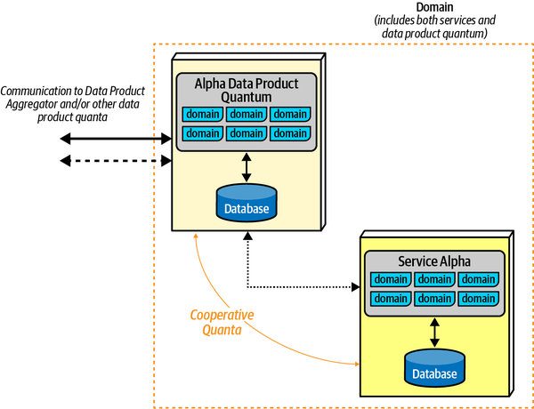
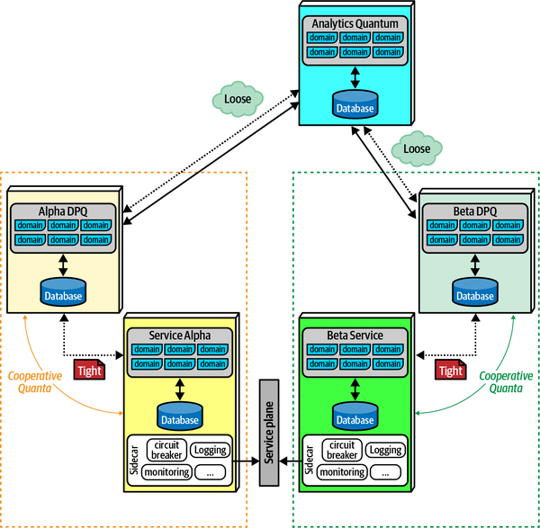
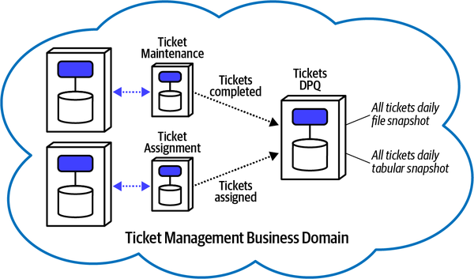
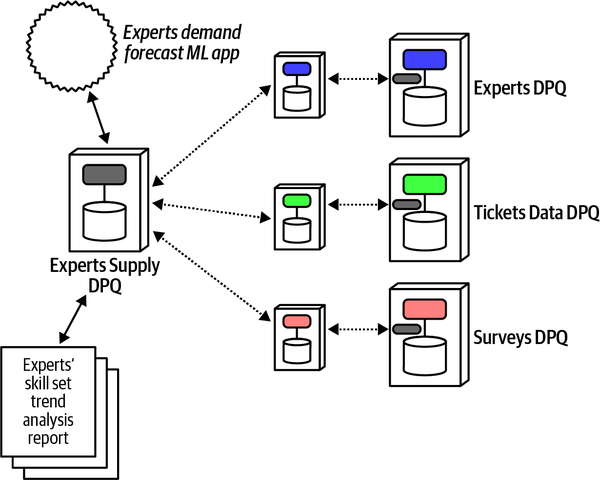

# Chương 14. Quản lý dữ liệu phân tích (Managing Analytical Data)

`Tuesday, May 31, 13:23`

Logan và Dana (kiến trúc sư dữ liệu) đứng bên ngoài phòng họp lớn, trò chuyện sau cuộc họp báo cáo tiến độ hằng tuần.

“Chúng ta sẽ xử lý dữ liệu phân tích trong architecture mới này thế nào?” Dana hỏi. “Chúng ta đang chia database thành các phần nhỏ, nhưng chúng ta sẽ phải dán toàn bộ dữ liệu đó trở lại với nhau cho báo cáo và phân tích. Một trong những cải tiến chúng ta đang cố triển khai là lập kế hoạch dự đoán tốt hơn, nghĩa là chúng ta đang dùng nhiều khoa học dữ liệu và thống kê hơn để đưa ra các quyết định chiến lược hơn. Giờ chúng ta có một team chuyên nghĩ về dữ liệu phân tích, và chúng ta cần một phần của hệ thống để đáp ứng nhu cầu này. Chúng ta sẽ có một data warehouse chứ?”

Logan nói, “Chúng tôi đã xem xét việc tạo một data warehouse, và dù nó giải quyết được vấn đề hợp nhất, nó lại có cả đống vấn đề đối với chúng ta.”

Phần lớn cuốn sách này quan tâm đến cách phân tích trade-offs trong các architectural style hiện có như microservices. Tuy nhiên, các kỹ thuật chúng tôi nêu bật cũng có thể được dùng để hiểu các năng lực brand-new (hoàn toàn mới) khi chúng xuất hiện trong hệ sinh thái phát triển phần mềm; *data mesh* là một ví dụ tuyệt vời.

Dữ liệu phân tích và dữ liệu vận hành có những mục đích rất khác nhau trong các architecture hiện đại (xem [“The Importance of Data in Architecture”](ch01_what_happens_when_there_are_no_best_practices.vi.md#sec-data-in-arch)); phần lớn cuốn sách này đã xử lý các trade-offs khó khăn gắn với dữ liệu vận hành. Khi các hệ thống client/server trở nên phổ biến và đủ mạnh cho các doanh nghiệp lớn, kiến trúc sư và quản trị viên database đã tìm kiếm một giải pháp cho phép các truy vấn chuyên biệt.

## Các cách tiếp cận trước đây (Previous Approaches)

Sự phân tách giữa dữ liệu vận hành và dữ liệu phân tích hầu như không phải là một vấn đề mới—các cách dùng khác nhau về bản chất của dữ liệu đã tồn tại lâu như chính dữ liệu. Khi các architecture style xuất hiện và tiến hóa, các cách tiếp cận để xử lý dữ liệu cũng thay đổi và tiến hóa tương tự.

### Data warehouse (The Data Warehouse)

Trong những thời kỳ trước của phát triển phần mềm (ví dụ, máy tính mainframe hoặc máy tính cá nhân thời kỳ đầu), các ứng dụng là monolith, bao gồm code và dữ liệu trên cùng một hệ thống vật lý. Không ngạc nhiên, với bối cảnh chúng tôi đã đề cập cho đến giờ, việc phối hợp transaction giữa các hệ thống vật lý khác nhau trở nên thách thức. Khi các yêu cầu dữ liệu trở nên tham vọng hơn, cùng với sự ra đời của mạng cục bộ trong văn phòng, điều này dẫn đến sự trỗi dậy của các ứng dụng *client/server*, nơi một database server mạnh mẽ chạy trên mạng và các ứng dụng desktop chạy trên máy tính cục bộ, truy cập dữ liệu qua mạng. Việc tách ứng dụng và xử lý dữ liệu cho phép quản lý transaction, phối hợp tốt hơn, và nhiều lợi ích khác, bao gồm khả năng bắt đầu dùng dữ liệu lịch sử cho các mục đích mới, như phân tích.

Kiến trúc sư đã có một nỗ lực sớm để cung cấp dữ liệu phân tích có thể truy vấn với pattern *Data Warehouse*. Vấn đề cơ bản họ cố giải quyết đi vào cốt lõi của việc tách dữ liệu vận hành và dữ liệu phân tích: định dạng và schema của loại này không nhất thiết phù hợp với (hoặc thậm chí cho phép dùng) loại kia. Ví dụ, nhiều vấn đề phân tích đòi hỏi tổng hợp và tính toán, là những thao tác tốn kém trên relational database, đặc biệt là những database đã vận hành dưới tải transaction nặng.

Các pattern Data Warehouse tiến hóa có những biến thể nhỏ, chủ yếu dựa trên sản phẩm và năng lực của nhà cung cấp. Tuy nhiên, pattern có nhiều đặc điểm chung. Giả định cơ bản là dữ liệu vận hành được lưu trong các relational database có thể truy cập trực tiếp qua mạng. Đây là các đặc điểm chính của pattern Data Warehouse:

**Dữ liệu được trích xuất từ nhiều nguồn (Data extracted from many sources)**

Vì dữ liệu vận hành nằm trong các database riêng lẻ, một phần của pattern này chỉ định một cơ chế trích xuất dữ liệu sang một data store khác (khổng lồ), phần “warehouse” (kho) của pattern. Truy vấn qua mọi database khác nhau trong tổ chức để xây dựng báo cáo là không thực tế, nên dữ liệu được trích xuất vào warehouse chỉ cho mục đích phân tích.

**Được biến đổi thành một schema duy nhất (Transformed to single schema)**

Thường thì schema vận hành không khớp với schema cần cho báo cáo. Ví dụ, một hệ thống vận hành cần cấu trúc schema và hành vi quanh transaction, trong khi một hệ thống phân tích hiếm khi là dữ liệu OLTP (xem [Chương 1](ch01_what_happens_when_there_are_no_best_practices.vi.md#ch01-introduction)) mà thường xử lý lượng lớn dữ liệu, cho báo cáo, tổng hợp, v.v. Do đó, hầu hết data warehouse dùng một *Star Schema* để triển khai mô hình hóa theo chiều (dimensional modelling), biến đổi dữ liệu từ các hệ thống vận hành ở các định dạng khác nhau thành schema của warehouse. Để thúc đẩy tốc độ và sự đơn giản, người thiết kế warehouse phi chuẩn hóa dữ liệu để tạo điều kiện cho performance và các truy vấn đơn giản hơn.

**Được nạp vào warehouse (Loaded into warehouse)**

Vì dữ liệu vận hành nằm trong các hệ thống riêng lẻ, warehouse phải xây dựng cơ chế để thường xuyên trích xuất dữ liệu, biến đổi nó, và đặt nó vào warehouse. Người thiết kế hoặc dùng các cơ chế built-in của relational database như replication hoặc các công cụ chuyên dụng để xây dựng bộ chuyển đổi từ schema gốc sang schema của warehouse. Tất nhiên, mọi thay đổi đối với schema của hệ thống vận hành đều phải được nhân bản sang schema đã biến đổi, khiến việc phối hợp thay đổi trở nên khó khăn.

**Phân tích được thực hiện trên warehouse (Analysis done on the warehouse)**

Vì dữ liệu “sống” trong warehouse, mọi phân tích đều được thực hiện ở đó. Điều này đáng mong muốn từ góc độ vận hành: hệ thống data warehouse thường có năng lực lưu trữ và tính toán khổng lồ, chuyển các yêu cầu nặng nề sang hệ sinh thái riêng của nó.

**Được nhà phân tích dữ liệu dùng (Used by data analysts)**

Data warehouse dùng các nhà phân tích dữ liệu, công việc của họ bao gồm xây dựng báo cáo và các tài sản business intelligence khác. Tuy nhiên, xây dựng báo cáo hữu ích đòi hỏi hiểu biết domain, nghĩa là chuyên môn domain phải nằm ở cả hệ thống dữ liệu vận hành lẫn hệ thống phân tích, nơi người thiết kế truy vấn phải dùng cùng dữ liệu trong một schema đã biến đổi để xây dựng báo cáo và business intelligence có ý nghĩa.

**Báo cáo BI và dashboard (BI reports and dashboards)**

Đầu ra của data warehouse bao gồm các báo cáo business intelligence, dashboard cung cấp dữ liệu phân tích, báo cáo, và mọi thông tin khác để cho phép công ty đưa ra quyết định tốt hơn.

**Giao diện giống SQL (SQL-ish interface)**

Để DBA dễ dùng hơn, hầu hết công cụ truy vấn data warehouse cung cấp các tiện ích quen thuộc, như một ngôn ngữ SQL-like để tạo truy vấn. Một trong những lý do cho bước biến đổi dữ liệu đã đề cập trước đó là cung cấp cho người dùng một cách đơn giản hơn để truy vấn các tổng hợp phức tạp và các thông tin thông minh khác.

> **Star schema (The Star Schema)**
>
> *Star Schema pattern* phổ biến với data mart và warehouse. Nó tách ngữ nghĩa dữ liệu thành *fact*, chứa dữ liệu định lượng được của tổ chức, và *dimension*; do đó chúng còn được gọi là *dimensional model*, bao gồm các thuộc tính mô tả của dữ liệu fact.
>
> Các ví dụ về dữ liệu fact cho Sysops Squad có thể bao gồm đơn giá theo giờ, thời gian sửa chữa, khoảng cách tới khách hàng, và những thứ đo lường cụ thể được khác. Dimension có thể bao gồm chuyên môn của thành viên squad, tên thành viên squad, địa điểm cửa hàng, và các metadata khác.
>
> Quan trọng nhất, Star Schema được cố ý phi chuẩn hóa để tạo điều kiện cho truy vấn đơn giản hơn, business logic được đơn giản hóa (nói cách khác, ít join phức tạp hơn), truy vấn và tổng hợp nhanh hơn, các phân tích phức tạp như data cube, và khả năng tạo truy vấn đa chiều. Hầu hết Star Schema trở nên phức tạp đến khó tin.

Data Warehouse pattern là một ví dụ tốt về *phân vùng theo kỹ thuật* trong software architecture: người thiết kế warehouse biến đổi dữ liệu thành một schema tạo điều kiện cho truy vấn và phân tích nhưng mất đi mọi phân vùng theo domain, thứ phải được re-created (tạo lại) trong truy vấn khi cần. Do đó, cần các chuyên gia được đào tạo chuyên sâu để hiểu cách xây dựng truy vấn trong architecture này.

Tuy nhiên, những thất bại lớn của Data Warehouse pattern bao gồm tính giòn khi tích hợp, sự phân mảnh cực đoan của kiến thức domain, độ phức tạp, và chức năng hạn chế so với mục đích dự kiến:

**Tính giòn khi tích hợp (Integration brittleness)**

Yêu cầu được tích hợp sẵn trong pattern này là phải biến đổi dữ liệu trong giai đoạn nạp tạo ra tính giòn làm tê liệt hệ thống. Một database schema cho một problem domain cụ thể coupled rất chặt với ngữ nghĩa của vấn đề đó; các thay đổi đối với domain đòi hỏi thay đổi schema, điều này đến lượt nó đòi hỏi thay đổi logic nhập dữ liệu.

**Sự phân mảnh cực đoan của kiến thức domain (Extreme partitioning of domain knowledge)**

Xây dựng các workflow nghiệp vụ phức tạp đòi hỏi kiến thức domain. Xây dựng báo cáo phức tạp và business intelligence cũng đòi hỏi kiến thức domain, cùng với các kỹ thuật phân tích chuyên biệt. Do đó, các sơ đồ Venn về chuyên môn domain chồng lấn nhau, nhưng chỉ một phần. Kiến trúc sư, developer, DBA và nhà khoa học dữ liệu đều phải phối hợp về các thay đổi và sự tiến hóa của dữ liệu, buộc phải có coupling chặt giữa những phần rất khác nhau của hệ sinh thái.

**Độ phức tạp (Complexity)**

Xây dựng một schema thay thế để cho phép phân tích nâng cao làm tăng độ phức tạp cho hệ thống, cùng với các cơ chế liên tục cần thiết để nạp và biến đổi dữ liệu. Data warehouse là một dự án riêng biệt bên ngoài các hệ thống vận hành thông thường của tổ chức, nên phải được duy trì như một hệ sinh thái hoàn toàn riêng biệt, nhưng lại coupled rất chặt với các domain nằm trong các hệ thống vận hành. Tất cả những yếu tố này góp phần vào độ phức tạp.

**Chức năng hạn chế so với mục đích dự kiến (Limited functionality for intended purpose)**

Rốt cuộc, hầu hết data warehouse thất bại vì chúng không mang lại giá trị nghiệp vụ tương xứng với công sức cần thiết để tạo và duy trì warehouse. Vì pattern này phổ biến từ rất lâu trước các môi trường cloud, khoản đầu tư vật lý vào hạ tầng là khổng lồ, cùng với việc phát triển và bảo trì liên tục. Thường thì những người tiêu thụ dữ liệu sẽ yêu cầu một loại báo cáo nhất định mà warehouse không thể cung cấp. Do đó, một khoản đầu tư liên tục như vậy cho chức năng rốt cuộc hạn chế đã khiến hầu hết các dự án này thất bại.

**Đồng bộ tạo ra nút thắt cổ chai (Synchronization creates bottlenecks)**

Nhu cầu trong một data warehouse phải đồng bộ dữ liệu từ nhiều hệ thống vận hành khác nhau tạo ra các nút thắt cổ chai cả về vận hành lẫn tổ chức—một nơi mà nhiều luồng dữ liệu vốn độc lập phải hội tụ. Một tác dụng phụ phổ biến của data warehouse là quá trình đồng bộ ảnh hưởng đến các hệ thống vận hành bất chấp mong muốn decoupling.

**Khác biệt contract giữa vận hành và phân tích (Operational versus analytical contract differences)**

Các hệ thống ghi nhận (system of record) có những nhu cầu contract cụ thể (được thảo luận trong [Chương 13](ch13_contracts.vi.md#ch13-contracts)). Các hệ thống phân tích cũng có những nhu cầu contract thường khác với hệ thống vận hành. Trong một data warehouse, các pipeline thường xử lý cả việc biến đổi lẫn nạp dữ liệu, đưa tính giòn của contract vào quá trình biến đổi.

[Bảng 14-1](#totbl-data-warehouse) thể hiện các trade-offs của data warehouse pattern.

> **Các đánh đổi (Trade-Offs)**
>
> 
>
> *Bảng 14-1. Trade-offs của Data Warehouse pattern*
>
> | Ưu điểm | Nhược điểm |
> |---|---|
> | Hợp nhất dữ liệu tập trung | Sự phân mảnh cực đoan của kiến thức domain |
> | Silo phân tích chuyên dụng mang lại sự cô lập | Tính giòn khi tích hợp |
> |  | Độ phức tạp |
> |  | Chức năng hạn chế so với mục đích dự kiến |

`Tuesday, May 31, 13:33`

“Chúng tôi đã xem xét việc tạo một data warehouse, nhưng nhận ra rằng nó phù hợp hơn với các loại architecture monolith cũ hơn là các architecture phân tán hiện đại,” Logan nói. “Hơn nữa, giờ chúng ta có rất nhiều use case machine learning hơn cần hỗ trợ.”

“Còn ý tưởng data lake mà tôi nghe nói thì sao?” Dana hỏi. “Tôi đã đọc một bài blog trên trang của Martin Fowler.[1](#idm45798374585736) Có vẻ nó giải quyết được cả đống vấn đề của data warehouse, và nó phù hợp hơn cho các use case ML.”

“À, đúng rồi, tôi đã đọc bài đó khi nó ra mắt,” Logan nói. “Trang của ông ấy là một kho báu thông tin hay, và bài đó ra mắt ngay sau khi chủ đề microservices trở nên nóng. Thực ra, lần đầu tôi đọc về microservices là trên chính trang đó vào năm 2014, và một trong những câu hỏi lớn vào thời điểm đó là, *Chúng ta quản lý báo cáo trong những architecture như vậy thế nào?* Data lake là một trong những câu trả lời ban đầu, chủ yếu như một phản đề với data warehouse, thứ chắc chắn sẽ không hoạt động trong thứ như microservices.”

“Tại sao không?” Dana hỏi.

### Data lake (The Data Lake)

Như nhiều phản ứng ngược lại trước độ phức tạp, chi phí và thất bại của data warehouse, con lắc thiết kế đã đung đưa sang cực đối lập, tiêu biểu là pattern *Data Lake*, cố ý là nghịch đảo của Data Warehouse pattern. Dù nó giữ mô hình tập trung và các pipeline, nó đảo ngược mô hình “transform and load” (biến đổi rồi nạp) của data warehouse thành mô hình “load and transform” (nạp rồi biến đổi). Thay vì làm khối lượng công việc biến đổi khổng lồ, triết lý của Data Lake pattern cho rằng, thay vì làm những phép biến đổi vô ích có thể không bao giờ được dùng, hãy không biến đổi gì cả, cho phép người dùng nghiệp vụ truy cập dữ liệu phân tích ở định dạng tự nhiên của nó, thứ thường đòi hỏi biến đổi và xử lý cho mục đích của họ. Do đó, gánh nặng công việc được chuyển thành *phản ứng* thay vì *chủ động*—thay vì làm công việc có thể không cần, chỉ làm công việc biến đổi khi có yêu cầu.

Nhận xét cơ bản mà nhiều kiến trúc sư đưa ra là các schema dựng sẵn trong data warehouse thường không phù hợp với loại báo cáo hay truy vấn mà người dùng yêu cầu, đòi hỏi thêm công việc để hiểu schema của warehouse đủ để tạo ra giải pháp. Ngoài ra, nhiều model machine learning hoạt động tốt hơn với dữ liệu “gần” với định dạng semi-raw (bán thô) hơn là một phiên bản đã biến đổi. Với các chuyên gia domain vốn đã hiểu domain, đây là một thử thách đau khổ, nơi dữ liệu bị tước bỏ sự phân tách domain và bối cảnh để được biến đổi vào data warehouse, chỉ để rồi đòi hỏi kiến thức domain để tạo ra các truy vấn không khớp tự nhiên với schema mới!

Các đặc điểm của Data Lake pattern như sau:

**Dữ liệu được trích xuất từ nhiều nguồn (Data extracted from many sources)**

Dữ liệu vận hành vẫn được trích xuất trong pattern này, nhưng ít biến đổi sang schema khác hơn—thay vào đó, dữ liệu thường được lưu ở dạng “thô,” hay nguyên bản. Một số biến đổi vẫn có thể xảy ra trong pattern này. Ví dụ, một hệ thống upstream có thể đổ các file đã định dạng vào một lake được tổ chức dựa trên các snapshot column-based (dựa trên cột).

**Được nạp vào lake (Loaded into the lake)**

Lake, thường được deploy trong môi trường cloud, gồm các lần đổ dữ liệu định kỳ từ các hệ thống vận hành.

**Được nhà khoa học dữ liệu dùng (Used by data scientists)**

Nhà khoa học dữ liệu và những người tiêu thụ dữ liệu phân tích khác khám phá dữ liệu trong lake và thực hiện bất kỳ phép tổng hợp, kết hợp và biến đổi nào khác cần thiết để trả lời các câu hỏi cụ thể.

Data Lake pattern, dù là một cải tiến theo nhiều cách so với Data Warehouse pattern, vẫn chịu nhiều hạn chế.

Pattern này vẫn có góc nhìn *tập trung* về dữ liệu, nơi dữ liệu được trích xuất từ database của các hệ thống vận hành và nhân bản vào một lake free-form (dạng tự do) ít nhiều. Gánh nặng thuộc về người tiêu thụ trong việc khám phá cách kết nối các tập dữ liệu khác biệt với nhau, điều thường xảy ra trong data warehouse bất chấp mức độ lên kế hoạch. Logic diễn ra là, nếu chúng ta sẽ phải làm pre-work (công việc chuẩn bị) cho một số phân tích, hãy làm cho tất cả, và bỏ qua khoản đầu tư up-front khổng lồ.

Dù Data Lake pattern tránh được các vấn đề transformation-induced (do biến đổi gây ra) của Data Warehouse pattern, nó hoặc không giải quyết hoặc tạo ra những vấn đề mới.

**Khó khám phá tài sản phù hợp (Difficulty in discovery of proper assets)**

Phần lớn hiểu biết về quan hệ dữ liệu trong một domain bay hơi khi dữ liệu chảy vào lake không có cấu trúc. Do đó, các chuyên gia domain vẫn phải tham gia vào việc tạo ra phân tích.

**PII và các dữ liệu nhạy cảm khác (PII and other sensitive data)**

Mối lo ngại về PII đã tăng lên cùng với năng lực của nhà khoa học dữ liệu trong việc lấy các mẩu thông tin khác biệt và học ra kiến thức privacy-invading (xâm phạm quyền riêng tư). Nhiều quốc gia giờ không chỉ hạn chế thông tin cá nhân, mà còn cả thông tin có thể được kết hợp để học và nhận dạng, cho mục đích nhắm quảng cáo hoặc những mục đích kém tốt đẹp khác. Đổ dữ liệu không có cấu trúc vào một lake thường có rủi ro làm lộ thông tin có thể được khâu lại với nhau để vi phạm quyền riêng tư. Đáng tiếc là, giống như trong quá trình khám phá, các chuyên gia domain có kiến thức cần thiết để tránh những rò rỉ vô tình, buộc họ phải phân tích lại dữ liệu trong lake.

**Vẫn phân vùng theo kỹ thuật, không theo domain (Still technically, not domain, partitioned)**

Xu hướng hiện tại trong software architecture chuyển trọng tâm từ việc phân vùng một hệ thống dựa trên năng lực kỹ thuật sang dựa trên domain, trong khi cả Data Warehouse pattern lẫn Data Lake pattern đều tập trung vào phân vùng theo kỹ thuật. Nhìn chung, kiến trúc sư thiết kế mỗi giải pháp đó với các phân vùng nạp, biến đổi, tải và phục vụ riêng biệt, mỗi phân vùng tập trung vào một năng lực kỹ thuật. Các architecture pattern hiện đại ưu tiên phân vùng theo domain, đóng gói các chi tiết triển khai kỹ thuật. Ví dụ, microservices architecture cố gắng tách các service theo domain thay vì theo năng lực kỹ thuật, đóng gói kiến thức domain, kể cả dữ liệu, bên trong ranh giới service. Tuy nhiên, cả Data Warehouse pattern lẫn Data Lake pattern đều cố tách dữ liệu thành một thực thể riêng, làm mất hoặc che khuất các góc nhìn domain quan trọng (như dữ liệu PII) trong quá trình đó.

Điểm cuối cùng là then chốt—ngày càng nhiều, kiến trúc sư thiết kế quanh phân vùng theo *domain* thay vì theo *kỹ thuật* trong architecture, và cả hai cách tiếp cận trước đó đều là ví dụ về việc tách dữ liệu khỏi bối cảnh của nó. Điều mà kiến trúc sư và nhà khoa học dữ liệu cần là một kỹ thuật giữ được loại phân vùng macro-level (mức vĩ mô) phù hợp, nhưng vẫn hỗ trợ sự tách biệt rõ ràng giữa dữ liệu phân tích và dữ liệu vận hành. [Bảng 14-2](#totbl-data-lake) liệt kê các trade-offs của Data Lake pattern.

> **Các đánh đổi (Trade-Offs)**
>
> 
>
> *Bảng 14-2. Trade-offs của Data Lake pattern*
>
> | Ưu điểm | Nhược điểm |
> |---|---|
> | Ít cấu trúc hơn data warehouse | Đôi khi khó hiểu các quan hệ |
> | Ít biến đổi up-front hơn | Đòi hỏi các phép biến đổi ad hoc |
> | Phù hợp hơn với architecture phân tán |  |

Các nhược điểm về tính giòn và coupling bệnh lý của các pipeline vẫn còn. Dù họ làm ít biến đổi hơn trong Data Lake pattern, việc biến đổi vẫn phổ biến, cũng như việc làm sạch dữ liệu.

Data Lake pattern đẩy việc kiểm thử tính toàn vẹn dữ liệu, chất lượng dữ liệu và các vấn đề chất lượng khác xuống các pipeline lake downstream, điều có thể tạo ra một số nút thắt cổ chai vận hành giống như những gì xuất hiện trong Data Warehouse pattern.

Vì cả phân vùng theo kỹ thuật lẫn bản chất batch-like (dạng batch), các giải pháp có thể gặp vấn đề dữ liệu cũ. Nếu không phối hợp cẩn thận, kiến trúc sư hoặc bỏ qua các thay đổi trong các hệ thống upstream, dẫn đến dữ liệu cũ, hoặc để các pipeline coupled bị hỏng.

`Tuesday, May 31, 14:43`

“OK, vậy chúng ta cũng không thể dùng data lake!” Dana thốt lên. “Giờ thì sao?”

“May mắn là một số nghiên cứu gần đây đã tìm ra cách giải quyết vấn đề dữ liệu phân tích với các architecture phân tán như microservices,” Logan đáp. “Nó tuân theo các ranh giới domain mà chúng ta đang cố đạt được, nhưng cũng cho phép chúng ta chiếu dữ liệu phân tích theo cách mà nhà khoa học dữ liệu có thể dùng. Và, nó loại bỏ các vấn đề PII mà luật sư của chúng ta đang lo lắng.”

“Tuyệt!” Dana đáp. “Nó hoạt động thế nào?”

## Data mesh (The Data Mesh)

Quan sát các xu hướng khác trong architecture phân tán, Zhamak Dehghani và một số nhà đổi mới khác đã rút ra ý tưởng cốt lõi của Data Mesh pattern từ việc decoupling domain-oriented (hướng domain) của microservices, service mesh và sidecar (xem [“Sidecars and Service Mesh”](ch08_reuse_patterns.vi.md#sec-sidecar-pattern)), và áp dụng nó cho dữ liệu phân tích, có sửa đổi. Như chúng tôi đã đề cập trong [Chương 8](ch08_reuse_patterns.vi.md#ch08-reuse-patterns), *Sidecar Pattern* cung cấp một cách không gây rối để tổ chức orthogonal coupling (xem [“Orthogonal Coupling”](ch08_reuse_patterns.vi.md#sb-orthogonal-coupling)); sự tách biệt giữa dữ liệu vận hành và dữ liệu phân tích là một ví dụ tuyệt vời khác về chính loại coupling đó, nhưng phức tạp hơn so với operational coupling đơn giản.

### Định nghĩa data mesh (Definition of Data Mesh)

Data mesh là một cách tiếp cận xã hội–kỹ thuật cho việc chia sẻ, truy cập và quản lý dữ liệu phân tích theo cách phi tập trung. Nó đáp ứng nhiều use case phân tích, như báo cáo, huấn luyện model ML, và tạo ra hiểu biết sâu sắc. Trái với architecture trước đó, nó làm điều này bằng cách sắp architecture và quyền sở hữu dữ liệu khớp với các business domain và cho phép tiêu thụ dữ liệu peer-to-peer (ngang hàng).

Data mesh được xây dựng trên bốn nguyên lý:

**Domain sở hữu dữ liệu (Domain ownership of data)**

Dữ liệu được sở hữu và chia sẻ bởi các domain hiểu dữ liệu sâu sắc nhất: các domain hoặc là nguồn gốc của dữ liệu, hoặc là những người tiêu thụ first-class (hạng nhất) của dữ liệu. Architecture này cho phép chia sẻ và truy cập dữ liệu phân tán từ nhiều domain và theo kiểu peer-to-peer mà không có lake hay warehouse trung gian tập trung nào, và không có team dữ liệu chuyên trách.

**Dữ liệu như một sản phẩm (Data as a product)**

Để ngăn dữ liệu bị cô lập thành silo và khuyến khích các domain chia sẻ dữ liệu của mình, data mesh đưa ra khái niệm dữ liệu được phục vụ như một sản phẩm. Nó đặt ra các vai trò tổ chức và metric thành công cần thiết để bảo đảm các domain cung cấp dữ liệu theo cách làm hài lòng trải nghiệm của những người tiêu thụ dữ liệu trong toàn tổ chức. Nguyên lý này dẫn đến việc đưa vào một architectural quantum mới gọi là *data product quantum*, để duy trì và phục vụ dữ liệu có thể khám phá, dễ hiểu, kịp thời, an toàn và high-quality (chất lượng cao) cho người tiêu thụ. Chương này giới thiệu khía cạnh kiến trúc của data product quantum.

**Nền tảng dữ liệu tự phục vụ (Self-serve data platform)**

Để trao quyền cho các domain team xây dựng và duy trì sản phẩm dữ liệu của mình, data mesh đưa vào một tập năng lực nền tảng self-serve mới. Các năng lực này tập trung vào cải thiện trải nghiệm của developer và người tiêu thụ sản phẩm dữ liệu. Nó bao gồm các tính năng như tạo sản phẩm dữ liệu theo kiểu khai báo, khả năng khám phá sản phẩm dữ liệu khắp mesh thông qua tìm kiếm và duyệt, và quản lý sự xuất hiện của các đồ thị thông minh khác, như dòng dõi dữ liệu và knowledge graph.

**Governance liên bang tính toán (Computational federated governance)**

Nguyên lý này bảo đảm rằng dù quyền sở hữu dữ liệu phi tập trung, các yêu cầu governance organization-wide (toàn tổ chức)—như tuân thủ, security, quyền riêng tư và chất lượng dữ liệu, cũng như khả năng tương tác giữa các sản phẩm dữ liệu—được đáp ứng nhất quán trên mọi domain. Data mesh đưa vào một mô hình decision-making (ra quyết định) liên bang gồm các chủ sở hữu sản phẩm dữ liệu của domain. Các chính sách họ xây dựng được tự động hóa và nhúng dưới dạng code vào từng sản phẩm dữ liệu. Hàm ý kiến trúc của cách tiếp cận governance này là một sidecar nhúng platform-supplied (do nền tảng cung cấp) trong mỗi data product quantum để lưu và thực thi các chính sách tại điểm truy cập: đọc hoặc ghi dữ liệu.

Data mesh là một chủ đề wide-ranging (rộng lớn), được đề cập đầy đủ trong cuốn sách [*Data Mesh*](https://learning.oreilly.com/library/view/data-mesh/9781492092384) của Zhamak Dehghani (O’Reilly). Trong chương này, chúng tôi tập trung vào phần tử kiến trúc cốt lõi, *data product quantum*.

### Data Product Quantum

Nguyên lý cốt lõi của data mesh phủ lên các architecture phân tán hiện đại như microservices. Giống như trong *service mesh*, các team xây dựng một *data product quantum* (DPQ) liền kề nhưng coupled với service của họ, như minh họa trong [Hình 14-1](#fig-data-mesh-domain).

*Hình 14-1. Cấu trúc của một data product quantum*

Trong ví dụ này, service *Alpha* chứa cả hành vi lẫn dữ liệu transaction (vận hành). Domain bao gồm một *data product quantum*, cũng chứa code và dữ liệu, và đóng vai trò giao diện tới phần phân tích và báo cáo tổng thể của hệ thống. DPQ đóng vai trò như một tập hành vi và dữ liệu độc lập về vận hành nhưng coupled cao.

Một số loại DPQ thường tồn tại trong các architecture hiện đại:

**DPQ gắn với nguồn (nguyên bản) (Source-aligned (native) DPQ)**

Cung cấp dữ liệu phân tích thay mặt cho architecture quantum cộng tác, thường là một microservice, đóng vai trò cooperative quantum.

**DPQ tổng hợp (Aggregate DQP)**

Tổng hợp dữ liệu từ nhiều đầu vào, hoặc đồng bộ hoặc bất đồng bộ. Ví dụ, với một số phép tổng hợp, một request bất đồng bộ có thể là đủ; với những phép khác, DPQ tổng hợp có thể cần thực hiện các truy vấn đồng bộ tới một DPQ source-aligned.

**DPQ đúng mục đích (Fit-for-purpose DPQ)**

Một DPQ custom-made (làm riêng) để phục vụ một yêu cầu cụ thể, có thể bao gồm báo cáo phân tích, business intelligence, machine learning, hoặc năng lực hỗ trợ khác.

Mỗi domain cũng đóng góp vào phân tích và business intelligence đều bao gồm một DPQ, như minh họa trong [Hình 14-2](#fig-data-mesh-data-sidecar).

*Hình 14-2. Data product quantum đóng vai trò như một phần phụ trợ riêng biệt nhưng coupled cao của một service*

Ở đây, DPQ biểu thị một component thuộc sở hữu của domain team chịu trách nhiệm triển khai service. Nó chồng lấn thông tin được lưu trong database, và có thể có tương tác bất đồng bộ với một số hành vi domain. Data product quantum nhiều khả năng cũng có hành vi cũng như dữ liệu cho mục đích phân tích và business intelligence.

Mỗi data product quantum đóng vai trò cooperative quantum cho chính service đó:

**Quantum cộng tác (Cooperative quantum)**

Một quantum riêng biệt về vận hành giao tiếp với bên cộng tác của nó qua giao tiếp bất đồng bộ và eventual consistency, nhưng có coupling contract chặt với bên cộng tác và nhìn chung coupling contract lỏng hơn với analytics quantum, service chịu trách nhiệm cho báo cáo, phân tích, business intelligence, v.v. Dù hai quanta cộng tác độc lập về vận hành, chúng biểu thị hai mặt của dữ liệu: dữ liệu vận hành trong quantum và dữ liệu phân tích trong data product quantum.

Một phần nào đó của hệ thống sẽ đảm nhận trách nhiệm phân tích và business intelligence, phần này sẽ hình thành domain và quantum riêng của nó. Để vận hành, analytical quantum này có static quantum coupling với từng data product quanta riêng lẻ mà nó cần lấy thông tin. Service này có thể thực hiện lời gọi đồng bộ hoặc bất đồng bộ tới DPQ, tùy thuộc vào loại request. Ví dụ, một số DPQ sẽ có giao diện SQL tới DPQ phân tích, cho phép truy vấn đồng bộ. Các yêu cầu khác có thể tổng hợp thông tin từ nhiều DPQ.

### Data mesh, coupling và architecture quantum (Data Mesh, Coupling, and Architecture Quantum)

Vì báo cáo phân tích có lẽ là một tính năng bắt buộc của một giải pháp, DPQ và cách triển khai giao tiếp của nó thuộc về static coupling của một architecture quantum. Ví dụ, trong một microservices architecture, service plane phải khả dụng, giống như message broker phải khả dụng nếu thiết kế đòi hỏi messaging. Tuy nhiên, giống như Sidecar pattern trong service mesh, DPQ nên trực giao với các thay đổi triển khai bên trong service, và duy trì một contract riêng với data plane.

Từ góc độ dynamic quantum coupling, data sidecar nên luôn triển khai một trong các communication pattern có cả eventual consistency lẫn tính bất đồng bộ: hoặc [“Parallel Saga(aeo) Pattern”](ch12_transactional_sagas.vi.md#sec-parallel-saga) hoặc [“Anthology Saga(aec) Pattern”](ch12_transactional_sagas.vi.md#sec-anthology-saga). Nói cách khác, data sidecar không bao giờ nên bao gồm yêu cầu transaction để giữ dữ liệu vận hành và dữ liệu phân tích đồng bộ, điều sẽ phá hỏng mục đích của việc dùng DPQ để decoupling trực giao. Tương tự, giao tiếp tới data plane nhìn chung nên là bất đồng bộ, để có tác động tối thiểu đến các architecture characteristic vận hành của domain service.

### Khi nào nên dùng data mesh (When to Use Data Mesh)

Như mọi thứ trong architecture, pattern này có các trade-offs gắn với nó, như thể hiện trong [Bảng 14-3](#totbl-data-mdsh).

> **Các đánh đổi (Trade-Offs)**
>
> 
>
> *Bảng 14-3. Trade-offs của Data Mesh pattern*
>
> | Ưu điểm | Nhược điểm |
> |---|---|
> | Rất phù hợp với microservices architecture | Đòi hỏi phối hợp contract với data product quantum |
> | Tuân theo các nguyên lý kiến trúc và thực hành kỹ thuật hiện đại | Đòi hỏi giao tiếp bất đồng bộ và eventual consistency |
> | Cho phép decoupling xuất sắc giữa dữ liệu phân tích và dữ liệu vận hành |  |
> | Các contract được hình thành cẩn thận cho phép tiến hóa coupled lỏng các năng lực phân tích |  |

Nó phù hợp nhất trong các architecture phân tán hiện đại như microservices với tính transaction well-contained (được bao gói tốt) và sự cô lập tốt giữa các service. Nó cho phép các domain team xác định lượng, nhịp, chất lượng và tính minh bạch của dữ liệu được các quanta khác tiêu thụ.

Nó khó hơn trong các architecture nơi dữ liệu phân tích và dữ liệu vận hành phải luôn đồng bộ tại mọi thời điểm, điều đặt ra một thách thức đáng ngại trong các architecture phân tán. Tìm cách hỗ trợ eventual consistency, có lẽ với các contract rất chặt, cho phép nhiều pattern không áp đặt những khó khăn khác.

Data mesh là một ví dụ nổi bật về sự tiến hóa tăng dần liên tục diễn ra trong hệ sinh thái phát triển phần mềm; các năng lực mới tạo ra góc nhìn mới, điều này đến lượt nó giúp giải quyết một số cơn đau đầu dai dẳng từ quá khứ, như sự tách biệt nhân tạo giữa domain và dữ liệu, cả vận hành lẫn phân tích.

## Sysops Squad Saga: Data Mesh

`Friday, June 10, 09:55`

Logan, Dana và Addison gặp nhau trong phòng họp lớn, nơi thường có đồ ăn vặt còn thừa (hoặc, vào thời điểm sớm trong ngày thế này, bữa sáng) từ các cuộc họp trước.

“Tôi vừa trở về từ cuộc họp với các nhà khoa học dữ liệu của chúng ta, và họ đang cố tìm cách giải quyết một vấn đề long-term (dài hạn) cho chúng ta—chúng ta cần trở nên data-driven (dựa trên dữ liệu) trong việc lập kế hoạch cung ứng chuyên gia, cho nhu cầu bộ kỹ năng ở các vị trí địa lý khác nhau tại các thời điểm khác nhau. Năng lực đó sẽ giúp ích cho tuyển dụng, đào tạo và các chức năng supply-related (liên quan đến cung ứng) khác,” Logan nói.

“Tôi chưa tham gia nhiều vào việc triển khai data mesh—chúng ta đã tiến được bao xa rồi?” Addison hỏi.

“Mỗi service mới chúng ta triển khai đều bao gồm một DPQ. Domain team chịu trách nhiệm chạy và duy trì cooperative quantum DPQ cho service của họ. Chúng ta chỉ mới bắt đầu. Chúng ta đang dần xây dựng các năng lực khi xác định được nhu cầu. Tôi có một bức hình về Ticket Management Domain trong [Hình 14-3](#fig-data-mesh-ss-ticket-dpq).”

*Hình 14-3. Ticket Management Domain, bao gồm hai service với DPQ riêng của chúng, cùng một Tickets DPQ*

Logan nói, “Tickets DPQ là architecture quantum riêng của nó, và đóng vai trò điểm tổng hợp cho một vài góc nhìn ticket khác nhau mà các hệ thống khác quan tâm.”

“Mỗi team phải tự xây dựng bao nhiêu so với những gì đã được cung cấp sẵn?” Addison hỏi.

“Tôi có thể trả lời câu đó,” Dana nói. “Team nền tảng data mesh đang cung cấp cho người dùng dữ liệu và developer sản phẩm dữ liệu một tập năng lực self-serve. Điều đó cho phép bất kỳ team nào muốn xây dựng một use case phân tích mới tìm kiếm và tìm thấy các sản phẩm dữ liệu mình cần trong các architecture quanta hiện có, kết nối trực tiếp tới chúng, và bắt đầu dùng chúng. Nền tảng cũng hỗ trợ các domain muốn tạo sản phẩm dữ liệu mới. Nền tảng liên tục giám sát mesh để phát hiện bất kỳ thời gian ngừng hoạt động nào của sản phẩm dữ liệu, hoặc sự không tương thích với các chính sách governance và thông báo cho các domain team để hành động.”

Logan nói, “Các chủ sở hữu sản phẩm dữ liệu của domain, cộng tác với các SME về security, pháp lý, rủi ro và tuân thủ, cũng như các product owner của nền tảng, đã hình thành một nhóm governance liên bang toàn cục, quyết định các khía cạnh của DPQ phải được chuẩn hóa, như các contract data-sharing (chia sẻ dữ liệu), phương thức vận chuyển dữ liệu bất đồng bộ, kiểm soát truy cập, v.v. Team nền tảng, theo thời gian, làm giàu sidecar của DPQ với các năng lực thực thi chính sách mới và nâng cấp các sidecar một cách đồng nhất trên toàn mesh.”

“Ồ, chúng ta đã tiến xa hơn tôi nghĩ,” Dana nói. “Chúng ta cần dữ liệu gì để cung cấp thông tin cho vấn đề cung ứng chuyên gia?”

Logan đáp, “Cộng tác với các nhà khoa học dữ liệu, chúng tôi đã xác định thông tin nào cần tổng hợp. Có vẻ chúng ta có đúng thông tin: Tickets DPQ phục vụ góc nhìn long-term về mọi ticket được tạo và được giải quyết, User Maintenance DPQ cung cấp các snapshot hằng ngày cho mọi hồ sơ chuyên gia, và Survey DPQ cung cấp log mọi kết quả khảo sát từ khách hàng.”

“Tuyệt vời,” Addison nói. “Có lẽ chúng ta nên tạo một DPQ mới tên kiểu Experts Supply DPQ, nhận đầu vào bất đồng bộ từ ba DPQ đó? Sản phẩm đầu tiên của nó có thể gọi là *supply recommendations* (khuyến nghị cung ứng), dùng một model ML được huấn luyện bằng dữ liệu tổng hợp từ các DPQ trong các domain khảo sát, ticket và bảo trì. Experts Supply DPQ sẽ cung cấp dữ liệu khuyến nghị hằng ngày, khi có dữ liệu mới về ticket, khảo sát và hồ sơ chuyên gia. Thiết kế tổng thể trông như [Hình 14-4](#fig-data-mesh-ss-summary).”

*Hình 14-4. Triển khai Experts Supply DPQ*

“OK, trông hoàn toàn hợp lý,” Dana nói. “Các service đã xong; chúng ta chỉ cần bảo đảm các endpoint cụ thể tồn tại trong mỗi DPQ nguồn, và triển khai Experts Supply DPQ mới.”

“Đúng vậy,” Logan nói. “Tuy nhiên, có một điều chúng ta cần lo—phân tích xu hướng phụ thuộc vào dữ liệu đáng tin cậy. Điều gì xảy ra nếu một trong các hệ thống nguồn cung cấp dữ liệu trả về thông tin không đầy đủ trong một khoảng thời gian? Chẳng phải điều đó sẽ làm sai lệch phân tích xu hướng sao?”

“Đúng vậy—không có dữ liệu cho một khoảng thời gian còn tốt hơn dữ liệu không đầy đủ, điều khiến có vẻ như traffic ít hơn thực tế,” Dana nói. “Chúng ta có thể loại trừ một ngày trống, miễn là điều đó không xảy ra nhiều.”

“OK, Addison, cậu biết điều đó có nghĩa là gì mà, đúng không?” Logan nói.

“Vâng, tôi chắc chắn biết—một ADR chỉ định thông tin đầy đủ hoặc không có gì, và một fitness function để bảo đảm chúng ta nhận được dữ liệu đầy đủ.”

> *ADR: Bảo đảm các nguồn của Expert Supply DPQ cung cấp dữ liệu của cả ngày hoặc không gì cả*
>
> *Bối cảnh (Context)* 
> Expert Supply DPQ thực hiện phân tích xu hướng trong các khoảng thời gian được chỉ định. Dữ liệu không đầy đủ cho một ngày cụ thể sẽ làm sai lệch kết quả xu hướng và nên được tránh.
>
> *Quyết định (Decision)* 
> Chúng tôi sẽ bảo đảm mỗi nguồn dữ liệu cho Expert Supply DPQ nhận được snapshot đầy đủ cho xu hướng hằng ngày hoặc không có dữ liệu nào cho ngày đó, cho phép nhà khoa học dữ liệu loại trừ ngày đó.
>
> Các contract giữa các nguồn cấp dữ liệu và Expert Supply DPQ nên coupled lỏng để tránh tính giòn.
>
> *Hệ quả (Consequences)* 
> Nếu có quá nhiều ngày bị loại trừ vì availability hoặc các vấn đề khác, độ chính xác của xu hướng sẽ bị ảnh hưởng tiêu cực.
>
> *Fitness function*:
>
> *Snapshot hằng ngày đầy đủ*. Kiểm tra timestamp trên các message khi chúng đến. Với lượng message điển hình, bất kỳ khoảng trống nào hơn một phút đều biểu thị một khoảng trống trong xử lý, đánh dấu ngày đó là bị loại trừ.
>
> *Consumer-driven contract fitness function cho Ticket DPQ và Expert Supply DPQ.* Để bảo đảm sự tiến hóa nội bộ của Ticket Domain không làm hỏng Experts Supply DPQ.

[1](#idm45798374585736-marker) Martin Fowler đã đăng một bài viết có ảnh hưởng về Data Lake pattern trên blog của ông vào năm 2015 tại [*https://martinfowler.com/bliki/DataLake.html*](https://martinfowler.com/bliki/DataLake.html).
