

# Chương 15. Tự xây dựng phân tích đánh đổi của riêng bạn (Build Your Own Trade-Off Analysis)

`Monday, June 10, 10:01`

Phòng họp bằng cách nào đó có vẻ sáng sủa hơn so với cái ngày định mệnh vào tháng Chín khi các nhà tài trợ nghiệp vụ của Sysops Squad sắp rút phích cắm toàn bộ mảng kinh doanh hợp đồng hỗ trợ. Mọi người trong phòng họp trò chuyện với nhau trước khi cuộc họp bắt đầu, tạo ra một năng lượng chưa từng thấy trong phòng họp này từ rất, rất lâu.

“Chà,” Bailey, nhà tài trợ nghiệp vụ chính và người đứng đầu ứng dụng ticket Sysops Squad, nói, “tôi nghĩ chúng ta nên bắt đầu. Như các bạn biết, mục đích của cuộc họp này là thảo luận cách bộ phận IT đã có thể xoay chuyển tình thế và sửa chữa thứ mà chín tháng trước còn là một vụ đắm tàu.”

“Chúng tôi gọi đó là một buổi retrospective (nhìn lại),” Addison nói. “Và nó thực sự hữu ích để khám phá cách làm mọi thứ tốt hơn trong tương lai, và cũng để thảo luận những gì có vẻ đã hoạt động tốt.”

“Vậy thì, hãy cho chúng tôi biết, điều gì đã hoạt động thực sự tốt? Các bạn đã xoay chuyển mảng kinh doanh này từ góc độ kỹ thuật như thế nào?” Bailey hỏi.

“Thực ra không phải một điều duy nhất,” Austen nói, “mà là sự kết hợp của rất nhiều thứ. Trước hết, chúng tôi ở IT đã học được một bài học quý giá về việc nhìn vào các động lực nghiệp vụ như một cách để giải quyết vấn đề và tạo ra giải pháp. Trước đây, chúng tôi luôn chỉ tập trung vào khía cạnh kỹ thuật của một vấn đề, và kết quả là không bao giờ thấy bức tranh toàn cảnh.”

“Đó là một phần của nó,” Dana nói, “nhưng một trong những điều đã xoay chuyển tình thế đối với tôi và team database là bắt đầu làm việc cùng nhau nhiều hơn với các team ứng dụng để giải quyết vấn đề. Các bạn thấy đấy, trước đây, những người chúng tôi ở phía database làm việc của mình, và các team phát triển ứng dụng làm việc của họ. Chúng tôi sẽ không bao giờ đến được vị trí hiện tại nếu không cộng tác và làm việc cùng nhau để chuyển đổi ứng dụng Sysops Squad.”

“Với tôi, đó là học cách phân tích trade-offs đúng cách,” Addison nói. “Nếu không có sự hướng dẫn, hiểu biết sâu sắc và kiến thức của Logan, chúng tôi đã không ở trong tình trạng như hiện nay. Chính nhờ Logan mà chúng tôi đã có thể biện minh cho các giải pháp của mình từ góc độ nghiệp vụ.”

“Về chuyện đó,” Bailey nói, “tôi nghĩ tôi nói thay cho mọi người ở đây khi nói rằng những lý do biện minh nghiệp vụ ban đầu của các bạn chính là điều thúc đẩy chúng tôi cho các bạn một cơ hội cuối cùng để sửa chữa mớ hỗn độn mà chúng ta đã gặp. Đó là điều chúng tôi không quen, và, chà, thành thật mà nói nó khiến chúng tôi bất ngờ—theo hướng tốt.”

“OK,” Parker nói, “vậy giờ khi tất cả chúng ta đều đồng ý rằng mọi thứ có vẻ đang tiến triển tốt, làm sao chúng ta giữ được nhịp độ này? Làm sao chúng ta giúp các phòng ban và bộ phận khác trong công ty tránh rơi vào cùng mớ hỗn độn mà chúng ta từng gặp?”

“Kỷ luật,” Logan nói. “Chúng ta tiếp tục thói quen mới là tạo bảng trade-off cho mọi quyết định, tiếp tục ghi tài liệu và truyền đạt quyết định thông qua architecture decision record, và tiếp tục cộng tác với các team khác về vấn đề và giải pháp.”

“Nhưng chẳng phải điều đó chỉ thêm rất nhiều quy trình và thủ tục vào mớ hỗn hợp sao?” Morgan, người đứng đầu bộ phận marketing, hỏi.

“Không,” Logan nói. “Đó là *architecture*. Và như các bạn thấy, nó hiệu quả.”

Xuyên suốt cuốn sách này, ví dụ thống nhất minh họa cách thực hiện phân tích trade-off một cách chung chung trong các architecture phân tán. Tuy nhiên, các giải pháp chung chung hiếm khi tồn tại trong architecture và, nếu có, nhìn chung không đầy đủ đối với các architecture rất đặc thù và những vấn đề độc đáo mà chúng mang lại. Do đó, chúng tôi không cho rằng phân tích giao tiếp được đề cập trong [Chương 2](ch02_discerning_coupling_in_software_architecture.vi.md#ch02-discerning) là đầy đủ, mà là một điểm khởi đầu để bạn thêm nhiều cột hơn cho các yếu tố độc đáo bị rối vào không gian vấn đề của bạn.

Để đạt mục tiêu đó, chương này đưa ra một số lời khuyên về cách xây dựng phân tích trade-off của riêng bạn, dùng nhiều kỹ thuật giống như những kỹ thuật chúng tôi đã dùng để rút ra các kết luận được trình bày trong cuốn sách này.

Quy trình three-step (ba bước) của chúng tôi cho phân tích trade-off hiện đại, mà chúng tôi đã giới thiệu trong [Chương 2](ch02_discerning_coupling_in_software_architecture.vi.md#ch02-discerning) như sau:

- Tìm những phần nào bị rối vào nhau.
- Phân tích cách chúng coupled với nhau.
- Đánh giá trade-offs bằng cách xác định tác động của thay đổi lên các hệ thống phụ thuộc lẫn nhau.

Tiếp theo chúng tôi thảo luận một số kỹ thuật và cân nhắc cho từng bước.

## Tìm các chiều bị rối vào nhau (Finding Entangled Dimensions)

Bước đầu tiên của kiến trúc sư trong quy trình này là khám phá những chiều nào bị rối, hay bện, vào nhau. Điều này là độc nhất trong một architecture cụ thể nhưng có thể được khám phá bởi các developer, kiến trúc sư, nhân sự vận hành giàu kinh nghiệm, và những vai trò khác quen thuộc với hệ sinh thái tổng thể hiện có cùng các năng lực và ràng buộc của nó.

### Coupling

Phần đầu tiên của phân tích trả lời câu hỏi này cho một kiến trúc sư: các phần trong một architecture coupled với nhau thế nào? Thế giới phát triển phần mềm có nhiều định nghĩa khác nhau về coupling, nhưng chúng tôi dùng phiên bản đơn giản nhất, trực quan nhất cho bài tập này: nếu ai đó thay đổi *X*, liệu nó có thể buộc *Y* phải thay đổi không?

Trong [Chương 2](ch02_discerning_coupling_in_software_architecture.vi.md#ch02-discerning), chúng tôi đã mô tả khái niệm static coupling giữa các architecture quanta, cung cấp một sơ đồ cấu trúc toàn diện về coupling kỹ thuật. Không có công cụ chung nào để xây dựng sơ đồ này vì mỗi architecture là độc nhất. Tuy nhiên, trong một tổ chức, development team có thể xây dựng một sơ đồ static coupling, hoặc thủ công hoặc thông qua tự động hóa.

Ví dụ, để tạo sơ đồ static coupling cho một microservice trong một architecture, kiến trúc sư cần thu thập các chi tiết sau:

- Các phụ thuộc hệ điều hành/container
- Các phụ thuộc được cung cấp qua quản lý phụ thuộc bắc cầu (framework, thư viện, v.v.)
- Các phụ thuộc persistence vào database, search engine, môi trường cloud, v.v.
- Các điểm tích hợp kiến trúc cần thiết để service tự khởi động
- Hạ tầng messaging (như message broker) cần thiết để cho phép giao tiếp với các quanta khác

Sơ đồ static coupling không xem xét các quanta khác mà điểm coupling duy nhất là giao tiếp workflow với quantum này. Ví dụ, nếu một AssignTicket Service cộng tác với `ManageTicket` trong một workflow nhưng không có điểm coupling nào khác, chúng độc lập về mặt tĩnh (nhưng coupled động trong workflow thực tế).

Các team đã có phần lớn môi trường được xây dựng thông qua tự động hóa có thể đưa vào cơ chế sinh đó thêm một năng lực ghi tài liệu các điểm coupling khi hệ thống được build.

Với cuốn sách này, mục tiêu của chúng tôi là đo lường các trade-offs trong coupling và giao tiếp của architecture phân tán. Để xác định thứ đã trở thành ba chiều của dynamical quantum coupling, chúng tôi đã xem xét hàng trăm ví dụ về architecture phân tán (cả microservices lẫn các loại khác) để xác định các điểm coupling phổ biến. Nói cách khác, mọi ví dụ chúng tôi xem xét đều nhạy cảm với các thay đổi trên các chiều *giao tiếp*, *tính nhất quán* và *phối hợp*.

Quy trình này làm nổi bật tầm quan trọng của thiết kế lặp trong architecture. Không kiến trúc sư nào xuất sắc đến mức bản nháp đầu tiên của họ luôn hoàn hảo. Xây dựng các topology mẫu cho workflow (giống như chúng tôi làm trong cuốn sách này) cho phép kiến trúc sư hoặc team xây dựng một góc nhìn ma trận về trade-offs, cho phép phân tích nhanh hơn và kỹ lưỡng hơn so với các cách tiếp cận ad hoc.

### Phân tích các điểm coupling (Analyze Coupling Points)

Một khi kiến trúc sư hoặc team đã xác định các điểm coupling họ muốn phân tích, bước tiếp theo là mô hình hóa các tổ hợp khả dĩ theo cách nhẹ nhàng. Một số tổ hợp có thể không khả thi, cho phép kiến trúc sư bỏ qua việc mô hình hóa những tổ hợp đó. Mục tiêu của phân tích là xác định những lực nào kiến trúc sư cần nghiên cứu—nói cách khác, những lực nào đòi hỏi phân tích trade-off? Ví dụ, với phân tích dynamic coupling của architecture quantum, chúng tôi chọn coupling, độ phức tạp, khả năng phản hồi/availability, và scale/elasticity làm các mối quan tâm trade-off chính, bên cạnh việc phân tích ba lực giao tiếp, tính nhất quán và phối hợp, như thể hiện trong bảng xếp hạng cho [“Parallel Saga(aeo) Pattern”](ch12_transactional_sagas.vi.md#sec-parallel-saga), xuất hiện lại trong [Bảng 15-1](#tbl-parallel-saga-stars_15).

*Bảng 15-1. Xếp hạng cho Parallel Saga pattern*

| Parallel Saga | Xếp hạng |
|---|---|
| Giao tiếp | Bất đồng bộ |
| Tính nhất quán | Eventual |
| Phối hợp | Tập trung |
| Coupling | Thấp |
| Độ phức tạp | Thấp |
| Khả năng phản hồi/availability | Cao |
| Scale/elasticity | Cao |

Khi xây dựng các danh sách xếp hạng này, chúng tôi xem xét từng giải pháp thiết kế (các pattern được đặt tên của chúng tôi) một cách riêng lẻ, chỉ kết hợp chúng ở cuối để thấy sự khác biệt, thể hiện trong [Bảng 15-2](#tbl-tradeoff-consolidated).

> **Các đánh đổi (Trade-Offs)**
>
> 
>
> *Bảng 15-2. So sánh tổng hợp các dynamic coupling pattern*
>
> | Pattern | Mức coupling | Độ phức tạp | Khả năng phản hồi/availability | Scale/elasticity |
> |---|---|---|---|---|
> | Epic Saga | Rất cao | Thấp | Thấp | Rất thấp |
> | Phone Tag Saga | Cao | Cao | Thấp | Thấp |
> | Fairy Tale Saga | Cao | Rất thấp | Trung bình | Cao |
> | Time Travel Saga | Trung bình | Thấp | Trung bình | Cao |
> | Fantasy Fiction Saga | Cao | Cao | Thấp | Thấp |
> | Horror Story | Trung bình | Rất cao | Thấp | Trung bình |
> | Parallel Saga | Thấp | Thấp | Cao | Cao |
> | Anthology Saga | Rất thấp | Cao | Cao | Rất cao |

Một khi đã phân tích từng pattern độc lập, chúng tôi tạo một ma trận để so sánh các đặc điểm, dẫn đến những nhận xét thú vị. Thứ nhất, hãy để ý tương quan nghịch trực tiếp giữa *mức coupling* và *scale/elasticity*: pattern càng có nhiều coupling, scalability của nó càng tệ. Điều này hợp lý về mặt trực giác; càng nhiều service tham gia một workflow, kiến trúc sư càng khó thiết kế cho scale.

Thứ hai, chúng tôi có một nhận xét tương tự quanh *khả năng phản hồi/availability* và *mức coupling*, điều không trực tiếp bằng tương quan trước đó nhưng cũng đáng kể: coupling cao hơn dẫn đến khả năng phản hồi và availability thấp hơn vì càng nhiều service tham gia một workflow, khả năng toàn bộ workflow thất bại do một service bị lỗi càng cao.

Kỹ thuật phân tích này là ví dụ về architecture *lặp*. Không kiến trúc sư nào, bất kể thông minh đến đâu, có thể ngay lập tức hiểu những sắc thái của một tình huống thực sự độc đáo—và những sắc thái này liên tục xuất hiện trong các architecture phức tạp. Xây dựng một ma trận các khả năng định hướng cho các bài tập mô hình hóa mà kiến trúc sư có thể muốn làm để nghiên cứu hệ quả của việc hoán vị một hoặc nhiều chiều nhằm thấy hiệu ứng kết quả.

### Đánh giá các đánh đổi (Assess Trade-Offs)

Một khi bạn đã xây dựng được một nền tảng cho phép các kịch bản “what if” (nếu như) lặp đi lặp lại, hãy tập trung vào các trade-offs nền tảng cho một tình huống nhất định. Ví dụ, chúng tôi tập trung vào giao tiếp đồng bộ so với bất đồng bộ, một lựa chọn tạo ra hàng loạt khả năng và ràng buộc—mọi thứ trong software architecture đều là trade-off. Do đó, chọn một chiều nền tảng như tính đồng bộ trước sẽ giới hạn các lựa chọn về sau. Với chiều đó giờ đã cố định, hãy thực hiện cùng loại phân tích lặp đối với các quyết định tiếp theo được khuyến khích hoặc bị ép buộc bởi quyết định đầu tiên. Một team kiến trúc sư có thể lặp lại quy trình này cho đến khi giải quyết xong các quyết định khó—nói cách khác, các quyết định có các chiều bị rối vào nhau. Phần còn lại là thiết kế.

## Các kỹ thuật đánh đổi (Trade-Off Techniques)

Theo thời gian, các tác giả đã thực hiện một số phân tích trade-off và tích lũy được một số lời khuyên về cách tiếp cận chúng.

### Phân tích định tính so với định lượng (Qualitative Versus Quantative Analysis)

Bạn có thể đã để ý rằng hầu như không bảng trade-off nào của chúng tôi là *định lượng*—dựa trên con số—mà là *định tính*—đo lường chất lượng của một thứ gì đó thay vì số lượng, điều này là cần thiết vì hai architecture sẽ luôn khác nhau đủ nhiều để ngăn các so sánh định lượng thực sự. Tuy nhiên, dùng phân tích thống kê trên một tập dữ liệu lớn cho phép phân tích định tính hợp lý.

Ví dụ, khi so sánh scalability của các pattern, chúng tôi đã xem xét nhiều *cách hiện thực* khác nhau của các tổ hợp giao tiếp, tính nhất quán và phối hợp, đánh giá scalability trong từng trường hợp, và cho phép chúng tôi xây dựng thang so sánh thể hiện trong [Bảng 15-2](#tbl-tradeoff-consolidated).

Tương tự, kiến trúc sư trong một tổ chức cụ thể có thể thực hiện cùng bài tập, xây dựng một ma trận chiều các mối quan tâm coupled, và xem xét các ví dụ tiêu biểu (hoặc trong tổ chức hiện có hoặc các spike cục bộ để kiểm chứng lý thuyết).

Chúng tôi khuyến nghị bạn trau dồi kỹ năng thực hiện phân tích định tính, vì có rất ít cơ hội cho phân tích định lượng thực sự trong architecture.

### Danh sách MECE (MECE Lists)

Điều quan trọng là kiến trúc sư phải chắc chắn họ đang so sánh những thứ giống nhau chứ không phải những thứ khác nhau hoàn toàn. Ví dụ, so sánh một message queue đơn giản với một enterprise service bus, thứ chứa một message queue nhưng còn hàng chục component khác nữa, là một phép so sánh không hợp lệ.

Một khái niệm hữu ích vay mượn từ thế giới chiến lược công nghệ để giúp kiến trúc sư có được sự tương xứng đúng giữa những thứ cần so sánh là *danh sách MECE*, từ viết tắt của *mutually exclusive, collectively exhaustive* (loại trừ lẫn nhau, bao phủ toàn bộ):

**Loại trừ lẫn nhau (Mutually exclusive)**

Không năng lực nào được chồng lấn giữa các mục được so sánh. Như trong ví dụ trên, so sánh một message queue với toàn bộ một ESB là không hợp lệ vì chúng thực sự không cùng một loại. Nếu bạn muốn so sánh chỉ các năng lực messaging mà không có các phần khác, điều đó thu hẹp phép so sánh thành hai thứ có thể so sánh với nhau.

**Bao phủ toàn bộ (Collectively exhaustive)**

Điều này gợi ý rằng bạn đã bao phủ mọi khả năng trong không gian quyết định, và bạn không bỏ sót năng lực hiển nhiên nào. Ví dụ, nếu một team kiến trúc sư đang đánh giá các message queue high-performance (hiệu năng cao) và chỉ xem xét một ESB và một message queue đơn giản mà không xét Kafka, họ đã không xem xét mọi khả năng trong không gian đó.

Mục tiêu của danh sách MECE là bao phủ hoàn toàn một không gian loại, không có lỗ hổng hay chồng lấn, như thể hiện bằng hình ảnh trong [Hình 15-1](#fig-build-your-own-mece).

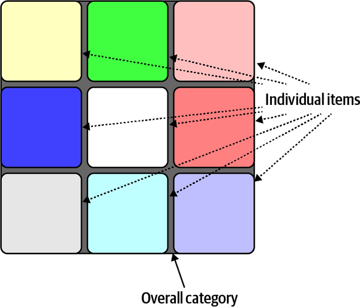

*Hình 15-1. Danh sách MECE loại trừ lẫn nhau và bao phủ toàn bộ*

Hệ sinh thái phát triển phần mềm liên tục tiến hóa, khám phá ra các năng lực mới trên đường đi. Khi đưa ra một quyết định có hệ quả long-term (dài hạn), kiến trúc sư nên chắc chắn rằng không có một năng lực mới nào vừa xuất hiện làm thay đổi tiêu chí. Bảo đảm tiêu chí so sánh bao phủ toàn bộ khuyến khích sự khám phá đó.

### Cái bẫy “ngoài bối cảnh” (The “Out-of-Context” Trap)

Khi đánh giá trade-offs, kiến trúc sư phải bảo đảm giữ quyết định trong bối cảnh; nếu không, các yếu tố bên ngoài sẽ ảnh hưởng quá mức đến phân tích của họ. Thường thì một giải pháp có nhiều khía cạnh có lợi, nhưng thiếu những năng lực then chốt ngăn cản thành công. Kiến trúc sư cần bảo đảm cân bằng tập trade-offs *đúng*, không phải mọi thứ có sẵn.

Ví dụ, có lẽ một kiến trúc sư đang cố quyết định nên dùng service dùng chung hay thư viện dùng chung cho chức năng chung trong một architecture phân tán, như minh họa trong [Hình 15-2](#fig-build-your-own-context-shared-lib).

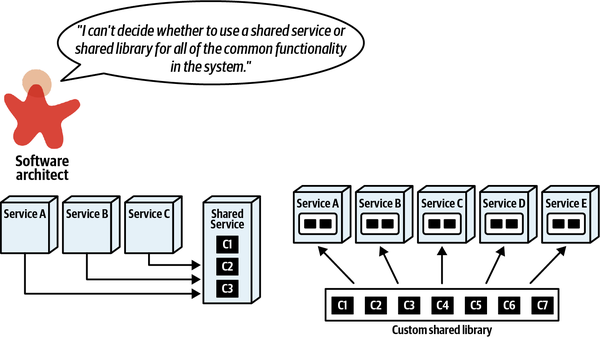

*Hình 15-2. Quyết định giữa *service* hay *thư viện* dùng chung trong một architecture phân tán*

Kiến trúc sư đối mặt với quyết định này sẽ bắt đầu nghiên cứu hai giải pháp khả dĩ, cả qua các đặc điểm chung được khám phá thông qua nghiên cứu lẫn qua dữ liệu thực nghiệm trong tổ chức của họ. Kết quả của quá trình khám phá đó dẫn đến một ma trận trade-off như ma trận thể hiện trong [Hình 15-3](#fig-build-your-own-context-table).

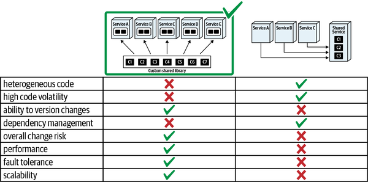

*Hình 15-3. Phân tích trade-off cho hai giải pháp*

Kiến trúc sư có vẻ có cơ sở khi chọn cách tiếp cận thư viện dùng chung, vì ma trận rõ ràng ưu tiên giải pháp đó…*về tổng thể*. Tuy nhiên, quyết định này là ví dụ về vấn đề *out-of-context* (ngoài bối cảnh)—khi bối cảnh bổ sung của vấn đề trở nên rõ ràng, tiêu chí quyết định thay đổi, như minh họa trong [Hình 15-4](#fig-build-your-own-context-decision).

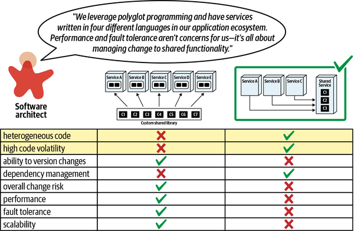

*Hình 15-4. Quyết định thay đổi dựa trên bối cảnh bổ sung*

Kiến trúc sư tiếp tục nghiên cứu không chỉ vấn đề chung về service so với thư viện, mà cả bối cảnh thực tế áp dụng trong tình huống này. Hãy nhớ, các giải pháp chung chung hiếm khi hữu ích trong các architecture real-world nếu không áp dụng thêm bối cảnh situation-specific (đặc thù tình huống).

Quy trình này nhấn mạnh hai nhận xét quan trọng. Thứ nhất, tìm ra bối cảnh tốt nhất cho một quyết định cho phép kiến trúc sư xem xét ít lựa chọn hơn, đơn giản hóa đáng kể quá trình ra quyết định. Một lời khuyên phổ biến từ các bậc hiền triết phần mềm là “hãy theo đuổi thiết kế đơn giản,” mà không bao giờ giải thích cách đạt được mục tiêu đó. Tìm đúng bối cảnh *hẹp* cho các quyết định cho phép kiến trúc sư phải suy nghĩ về ít thứ hơn, trong nhiều trường hợp đơn giản hóa thiết kế.

Thứ hai, điều then chốt là kiến trúc sư phải hiểu tầm quan trọng của thiết kế *lặp* trong architecture, vẽ sơ đồ các giải pháp kiến trúc mẫu để chơi các trò chơi “what-if” (nếu như) định tính nhằm thấy các chiều kiến trúc tác động lẫn nhau thế nào. Dùng thiết kế lặp, kiến trúc sư có thể tìm hiểu các giải pháp khả dĩ và khám phá bối cảnh phù hợp mà một quyết định thuộc về.

### Mô hình hóa các trường hợp domain liên quan (Model Relevant Domain Cases)

Kiến trúc sư không nên đưa ra quyết định trong chân không, thiếu các động lực liên quan mang lại giá trị cho giải pháp cụ thể. Đưa các động lực domain đó trở lại quá trình ra quyết định có thể giúp kiến trúc sư lọc các lựa chọn có sẵn và tập trung vào các trade-offs thực sự quan trọng.

Ví dụ, hãy xét quyết định này của một kiến trúc sư về việc nên tạo một payment service duy nhất hay một service riêng cho mỗi loại thanh toán, như minh họa trong [Hình 15-5](#fig-build-your-own-biz-scenario-payment-type).

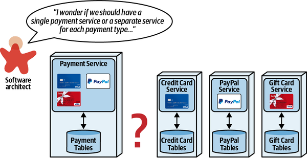

*Hình 15-5. Chọn giữa một payment service duy nhất hoặc một service cho mỗi loại thanh toán*

Như chúng tôi đã thảo luận trong [Chương 7](ch07_service_granularity.vi.md#ch07-service-granularity), kiến trúc sư có thể chọn từ một số integrator và disintegrator để hỗ trợ quyết định này. Tuy nhiên, những lực đó là chung chung—kiến trúc sư có thể thêm nhiều sắc thái hơn vào quyết định bằng cách mô hình hóa một số kịch bản có khả năng xảy ra.

Ví dụ, hãy xét kịch bản thứ nhất, minh họa trong [Hình 15-6](#fig-build-your-own-biz-scenario-1), để cập nhật một service xử lý thẻ tín dụng.

Trong kịch bản này, có các service riêng biệt mang lại *maintainability*, *testability* và *deployability* tốt hơn, tất cả đều dựa trên sự cô lập quantum-level (mức quantum) của các service. Tuy nhiên, nhược điểm của các service riêng biệt thường là code bị trùng lặp để ngăn static quantum coupling giữa các service, điều này làm hại lợi ích của việc có các service riêng biệt.

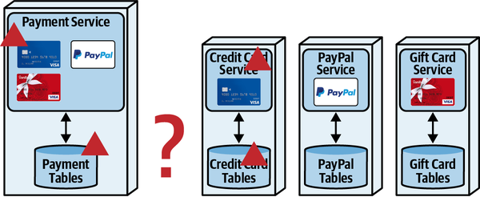

*Hình 15-6. Kịch bản 1: cập nhật service xử lý thẻ tín dụng*

Trong kịch bản thứ hai, kiến trúc sư mô hình hóa điều gì xảy ra khi hệ thống thêm một loại thanh toán mới, như thể hiện trong [Hình 15-7](#fig-build-your-own-biz-scenario-2).

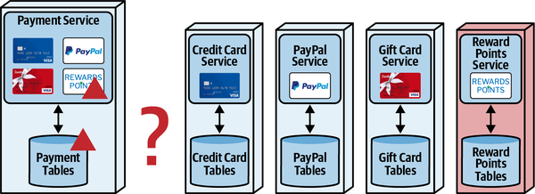

*Hình 15-7. Kịch bản 2: thêm một loại thanh toán*

Kiến trúc sư thêm loại thanh toán *điểm thưởng* để xem nó có tác động gì đến các architecture characteristic được quan tâm, làm nổi bật *extensibility* như một lợi ích của các service riêng biệt. Cho đến giờ, các service riêng biệt có vẻ hấp dẫn.

Tuy nhiên, như trong nhiều trường hợp, các workflow phức tạp hơn làm nổi bật các phần khó của architecture, như thể hiện trong kịch bản thứ ba ở [Hình 15-8](#fig-build-your-own-biz-scenario-3).

Trong kịch bản này, kiến trúc sư bắt đầu có được hiểu biết sâu sắc về các trade-offs thực sự liên quan đến quyết định này. Dùng các service riêng biệt đòi hỏi phối hợp cho workflow này, tốt nhất được xử lý bởi một orchestrator. Tuy nhiên, như chúng tôi đã thảo luận trong [Chương 11](ch11_managing_distributed_workflows.vi.md#ch11-managing-workflows), chuyển sang một orchestrator nhiều khả năng ảnh hưởng tiêu cực đến performance và khiến tính nhất quán dữ liệu trở thành thách thức lớn hơn. Kiến trúc sư có thể tránh orchestrator, nhưng logic workflow phải nằm ở đâu đó—hãy nhớ, semantic coupling chỉ có thể tăng lên thông qua hiện thực, không bao giờ giảm.

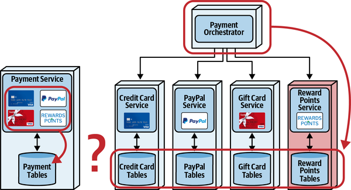

*Hình 15-8. Kịch bản 3: dùng nhiều loại thanh toán*

Sau khi mô hình hóa ba kịch bản này, kiến trúc sư nhận ra rằng phân tích trade-off thực sự quy về việc cái nào quan trọng hơn: *performance và tính nhất quán dữ liệu* (một payment service duy nhất) hay *extensibility và agility* (các service riêng biệt).

Suy nghĩ về các vấn đề architecture theo cách chung chung và trừu tượng chỉ đưa kiến trúc sư đi được đến một mức nhất định. Vì architecture nhìn chung né tránh các giải pháp chung chung, điều quan trọng là kiến trúc sư phải xây dựng kỹ năng mô hình hóa các kịch bản domain liên quan để nhắm tới phân tích trade-off và quyết định tốt hơn.

### Ưu tiên điểm mấu chốt hơn bằng chứng áp đảo (Prefer Bottom Line over Overwhelming Evidence)

Kiến trúc sư rất dễ tích lũy một lượng thông tin khổng lồ khi theo đuổi việc tìm hiểu mọi khía cạnh của một phân tích trade-off cụ thể. Ngoài ra, bất kỳ ai học được điều gì mới nhìn chung đều muốn kể cho người khác, đặc biệt nếu họ nghĩ bên kia sẽ quan tâm. Tuy nhiên, nhiều chi tiết kỹ thuật mà kiến trúc sư phát hiện ra lại khó hiểu đối với các stakeholder phi kỹ thuật, và lượng chi tiết có thể lấn át khả năng của họ trong việc đóng góp hiểu biết có ý nghĩa vào quyết định.

Thay vì trình bày mọi thông tin đã thu thập, kiến trúc sư nên rút gọn phân tích trade-off thành một vài điểm then chốt, đôi khi là tổng hợp của các trade-offs riêng lẻ.

Hãy xét vấn đề phổ biến mà kiến trúc sư có thể đối mặt trong một microservices architecture về việc chọn giao tiếp đồng bộ hay bất đồng bộ, minh họa trong [Hình 15-9](#fig-build-your-own-bottom-setup).

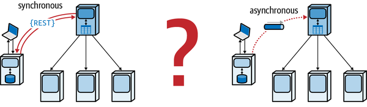

*Hình 15-9. Quyết định giữa các loại giao tiếp*

Orchestrator của giải pháp đồng bộ thực hiện các lời gọi REST đồng bộ để giao tiếp với các bên cộng tác trong workflow, trong khi giải pháp bất đồng bộ dùng message queue để hiện thực giao tiếp bất đồng bộ.

Sau khi xem xét các yếu tố chung chỉ về phía lựa chọn này hay lựa chọn kia, kiến trúc sư tiếp theo nghĩ về các kịch bản domain cụ thể mà các stakeholder phi kỹ thuật quan tâm. Để đạt mục tiêu đó, kiến trúc sư sẽ xây dựng một bảng trade-off giống [Bảng 15-3](#totbl-sync-async).

> **Các đánh đổi (Trade-Offs)**
>
> 
>
> *Bảng 15-3. Trade-offs giữa giao tiếp đồng bộ và bất đồng bộ cho xử lý thẻ tín dụng*
>
> | Ưu điểm của đồng bộ | Nhược điểm của đồng bộ | Ưu điểm của bất đồng bộ | Nhược điểm của bất đồng bộ |
> |---|---|---|---|
> |  | Khách hàng phải chờ quy trình phê duyệt thẻ tín dụng bắt đầu | Không phải chờ quy trình bắt đầu |  |
> | Việc phê duyệt tín dụng được bảo đảm bắt đầu trước khi request của khách hàng kết thúc |  |  | Không bảo đảm rằng quy trình đã bắt đầu |
> |  | Hồ sơ của khách hàng bị từ chối nếu orchestrator sập | Việc nộp hồ sơ không phụ thuộc vào orchestrator |  |

Sau khi mô hình hóa các kịch bản này, kiến trúc sư có thể tạo ra một quyết định bottom-line (mấu chốt) cho các stakeholder: điều nào quan trọng hơn, *sự bảo đảm rằng quy trình phê duyệt tín dụng bắt đầu ngay lập tức* hay *khả năng phản hồi và fault-tolerance*? Loại bỏ các chi tiết kỹ thuật gây bối rối cho phép các stakeholder domain phi kỹ thuật tập trung vào kết quả thay vì các quyết định thiết kế, điều giúp tránh nhấn chìm họ trong một biển chi tiết.

### Tránh thuốc rởm và truyền giáo (Avoiding Snake Oil and Evangelism)

Một tác dụng phụ đáng tiếc của sự nhiệt tình với công nghệ là sự truyền giáo (evangelism), thứ lẽ ra nên là một sự xa xỉ dành cho tech lead và developer nhưng lại có xu hướng khiến kiến trúc sư gặp rắc rối.

Rắc rối đến vì, khi ai đó truyền giáo về một công cụ, kỹ thuật, cách tiếp cận, hay bất cứ thứ gì khác mà người ta nhiệt tình, họ bắt đầu phóng đại những phần tốt và giảm nhẹ những phần xấu. Đáng tiếc là, trong software architecture, các trade-offs rốt cuộc luôn quay lại làm mọi thứ phức tạp.

Kiến trúc sư cũng nên cảnh giác với bất kỳ công cụ hay kỹ thuật nào hứa hẹn những năng lực mới gây sốc, những thứ đến rồi đi một cách thường xuyên. Hãy luôn buộc những người truyền giáo cho công cụ hay kỹ thuật đưa ra một đánh giá trung thực về cái tốt và cái xấu—không có gì trong software architecture là hoàn toàn tốt—điều này cho phép một quyết định cân bằng hơn.

Ví dụ, hãy xét một kiến trúc sư đã thành công trong quá khứ với một cách tiếp cận cụ thể và trở thành người truyền giáo cho nó, như minh họa trong [Hình 15-10](#fig-build-your-own-evangelize-setup).

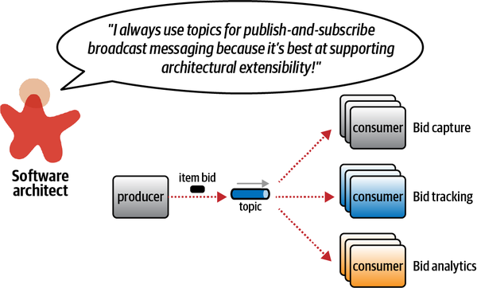

*Hình 15-10. Một kiến trúc sư truyền giáo nghĩ rằng họ đã tìm ra viên đạn bạc*

Kiến trúc sư này có lẽ đã làm việc với những vấn đề trong quá khứ mà extensibility là một architecture characteristic dẫn dắt then chốt và tin rằng năng lực đó sẽ luôn dẫn dắt quá trình ra quyết định. Tuy nhiên, các giải pháp trong architecture hiếm khi mở rộng ra ngoài giới hạn hẹp của một không gian vấn đề cụ thể. Mặt khác, bằng chứng giai thoại thường có sức thuyết phục. Làm sao bạn đi đến trade-off thực sự ẩn đằng sau sự truyền giáo knee-jerk (phản xạ tức thời)?

Dù kinh nghiệm hữu ích, phân tích kịch bản là một trong những công cụ mạnh mẽ nhất của kiến trúc sư để cho phép thiết kế lặp mà không cần xây dựng toàn bộ hệ thống. Bằng cách mô hình hóa các kịch bản có khả năng xảy ra, kiến trúc sư có thể khám phá liệu một giải pháp cụ thể trên thực tế có hoạt động tốt hay không.

Trong ví dụ thể hiện ở [Hình 15-10](#fig-build-your-own-evangelize-setup), một hệ thống hiện có dùng một topic duy nhất để phát các thay đổi. Mục tiêu của kiến trúc sư là thêm *bid history* (lịch sử đấu giá) vào workflow—team nên giữ cách tiếp cận publish-and-subscribe hiện có hay chuyển sang messaging point-to-point cho mỗi consumer?

Để khám phá các trade-offs cho vấn đề cụ thể này, kiến trúc sư nên mô hình hóa các kịch bản domain có khả năng xảy ra dùng hai topology. Việc thêm bid history vào thiết kế publish-and-subscribe hiện có xuất hiện trong [Hình 15-11](#fig-build-your-own-evangelize-add-topic).

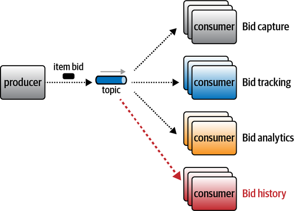

*Hình 15-11. Kịch bản 1: Thêm *bid history* vào topic hiện có*

Dù giải pháp này hoạt động, nó có vấn đề. Thứ nhất, điều gì xảy ra nếu các team cần các contract khác nhau cho mỗi consumer? Xây dựng một contract lớn duy nhất bao gồm mọi thứ hiện thực anti-pattern [“Stamp Coupling for Workflow Management”](ch13_contracts.vi.md#sec-stamp-coupling); buộc mỗi team thống nhất trên một contract duy nhất tạo ra một điểm coupling ngẫu nhiên trong architecture—nếu một team thay đổi thông tin cần thiết của mình, mọi team đều phải phối hợp về thay đổi đó. Thứ hai, còn security dữ liệu thì sao? Dùng một topic publish-and-subscribe duy nhất, mỗi consumer có quyền truy cập mọi dữ liệu, điều có thể tạo ra cả vấn đề security lẫn vấn đề PII (Personally Identifiable Information — thông tin định danh cá nhân, được thảo luận trong [Chương 14](ch14_managing_analytical_data.vi.md#ch14-data-mesh)). Thứ ba, kiến trúc sư nên xem xét sự khác biệt về architecture characteristic vận hành giữa các consumer khác nhau. Ví dụ, nếu team vận hành muốn giám sát độ sâu queue và dùng auto-scaling cho *bid capture* và *bid tracking* nhưng không cho hai service còn lại, việc dùng một topic duy nhất ngăn cản năng lực đó—các consumer giờ bị coupled về mặt vận hành với nhau.

Để giảm thiểu những nhược điểm này, kiến trúc sư nên mô hình hóa giải pháp thay thế để xem nó có giải quyết các vấn đề trên không (và không đưa vào những vấn đề nan giải mới). Phiên bản queue riêng lẻ xuất hiện trong [Hình 15-12](#fig-build-your-own-evangelize-add-queue).

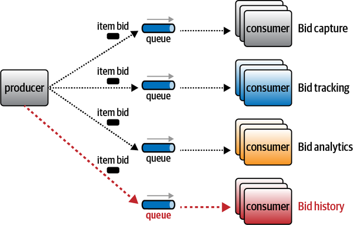

*Hình 15-12. Dùng các queue riêng lẻ để ghi nhận thông tin đấu giá*

Mỗi phần của workflow này (bid capture, bid tracking, bid analytics và bid history) dùng message queue riêng của nó và giải quyết nhiều vấn đề trên. Thứ nhất, mỗi consumer có thể có contract riêng, decouple các consumer với nhau. Thứ hai, quyền truy cập security và kiểm soát dữ liệu nằm trong contract giữa producer và mỗi consumer, cho phép khác biệt cả về thông tin lẫn tốc độ thay đổi. Thứ ba, mỗi queue giờ có thể được giám sát và scale độc lập.

Tất nhiên, đến thời điểm này của cuốn sách, bạn hẳn đã nhận ra rằng hệ thống dựa trên point-to-point cũng không hoàn hảo mà mang lại một tập trade-offs khác.

Một khi kiến trúc sư đã mô hình hóa cả hai cách tiếp cận, có vẻ như sự khác biệt quy về các lựa chọn thể hiện trong [Bảng 15-4](#tbl-topic-queue).

> **Các đánh đổi (Trade-Offs)**
>
> 
>
> *Bảng 15-4. Trade-offs giữa messaging point-to-point so với publish-and-subscribe*
>
> | Point-to-point | Publish-and-subscribe |
> |---|---|
> | Cho phép các contract không đồng nhất | Extensibility (dễ thêm consumer mới) |
> | Truy cập security và kiểm soát dữ liệu chi tiết hơn |  |
> | Hồ sơ vận hành riêng cho mỗi consumer |  |

Cuối cùng, kiến trúc sư nên hỏi ý kiến các bên liên quan (vận hành, enterprise architect, business analyst, v.v.) để xác định tập trade-offs nào trong số này quan trọng hơn.

Đôi khi kiến trúc sư không chọn truyền giáo cho thứ gì đó mà lại bị ép phải đóng vai đối trọng, đặc biệt với thứ gì đó không có lợi thế rõ ràng. Các công nghệ có người hâm mộ, đôi khi cuồng nhiệt, những người có xu hướng giảm nhẹ nhược điểm và phóng đại ưu điểm.

Ví dụ, gần đây một tech lead trong một dự án đã cố lôi một trong các tác giả vào cuộc tranh luận về [monorepo](https://oreil.ly/PEEBC) so với [trunk-based development](https://oreil.ly/HCtsh). Cả hai đều có mặt tốt và xấu, một quyết định software architecture kinh điển. Tech lead là người ủng hộ cuồng nhiệt cách tiếp cận monorepo, và cố ép tác giả đứng ở vị trí đối lập—không phải là tranh luận nếu không tồn tại hai phía.

Thay vào đó, kiến trúc sư chỉ ra rằng đó là một trade-off, nhẹ nhàng giải thích rằng nhiều lợi thế mà tech lead quảng bá đòi hỏi một mức kỷ luật chưa từng thể hiện trong team trước đây, nhưng chắc chắn sẽ cải thiện.

Thay vì bị ép vào vị trí đối lập, kiến trúc sư lại buộc một phân tích trade-off real-world, không dựa trên các giải pháp chung chung. Kiến trúc sư đồng ý thử cách tiếp cận Monorepo nhưng cũng thu thập metric để bảo đảm các khía cạnh tiêu cực của giải pháp không xuất hiện. Ví dụ, một trong những anti-patterns gây hại mà họ muốn tránh là coupling ngẫu nhiên giữa hai dự án vì ở gần nhau trong repository, nên kiến trúc sư và team đã xây dựng một loạt fitness function để bảo đảm rằng, dù về mặt kỹ thuật có thể tạo ra một điểm coupling, fitness function sẽ ngăn chặn nó.

> **Mẹo**
>
> Đừng để người khác ép bạn truyền giáo cho thứ gì đó—hãy đưa nó trở lại về trade-offs.

Chúng tôi khuyên kiến trúc sư tránh truyền giáo và cố gắng trở thành người phân xử khách quan về trade-offs. Kiến trúc sư mang lại giá trị thực sự cho tổ chức không phải bằng cách đuổi theo hết viên đạn bạc này đến viên đạn bạc khác mà bằng cách trau dồi kỹ năng phân tích trade-offs khi chúng xuất hiện.

## Sysops Squad Saga: Lời kết (Sysops Squad Saga: Epilogue)

`Monday, June 20, 16:55`

“OK, tôi nghĩ cuối cùng tôi cũng hiểu. Chúng ta thực sự không thể dựa vào lời khuyên chung chung cho architecture của mình—nó quá khác biệt so với tất cả những architecture khác. Chúng ta phải liên tục làm công việc khó khăn là phân tích trade-off.”

“Đúng vậy. Nhưng đó không phải là nhược điểm—đó là lợi thế. Một khi tất cả chúng ta học được cách cô lập các chiều và thực hiện phân tích trade-off, chúng ta đang học những điều cụ thể về architecture *của chúng ta*. Ai quan tâm đến những architecture chung chung khác chứ? Nếu chúng ta có thể rút gọn số lượng trade-offs cho một vấn đề xuống đủ nhỏ để thực sự mô hình hóa và kiểm thử chúng, chúng ta có được kiến thức vô giá về hệ sinh thái của mình. Cậu biết đấy, các kỹ sư kết cấu đã xây dựng cả đống toán học và công cụ dự đoán khác, nhưng xây dựng thứ của họ rất khó và tốn kém. Phần mềm thì…chà, mềm hơn nhiều. Tôi luôn nói rằng *testing là sự chặt chẽ kỹ thuật của phát triển phần mềm*. Dù chúng ta không có loại toán học mà các kỹ sư khác có, chúng ta có thể xây dựng và kiểm thử giải pháp của mình một cách tăng dần, cho phép linh hoạt hơn nhiều và tận dụng lợi thế của một phương tiện linh hoạt hơn. Kiểm thử với kết quả khách quan cho phép các phân tích trade-off của chúng ta đi từ định tính đến định lượng—từ suy đoán đến kỹ thuật. Chúng ta càng học được nhiều sự thật cụ thể về hệ sinh thái độc đáo của mình, phân tích của chúng ta càng có thể chính xác hơn.”

“Ừ, hợp lý đấy. Muốn đi dự buổi gặp mặt after-work (sau giờ làm) để ăn mừng sự xoay chuyển lớn không?”

“Chắc chắn rồi.”
