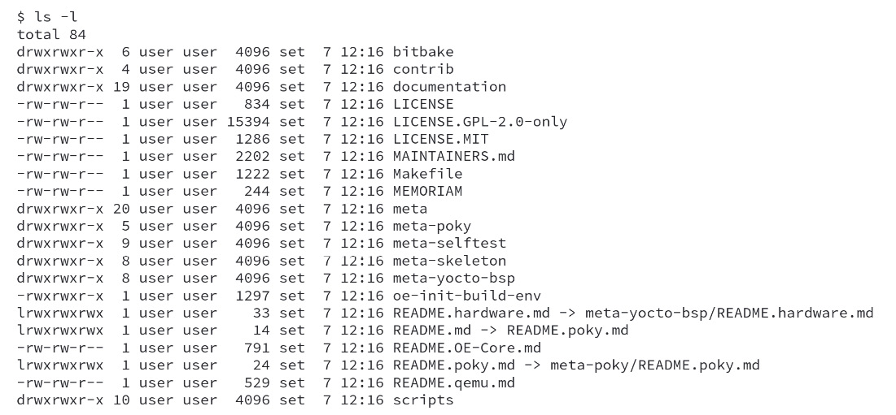
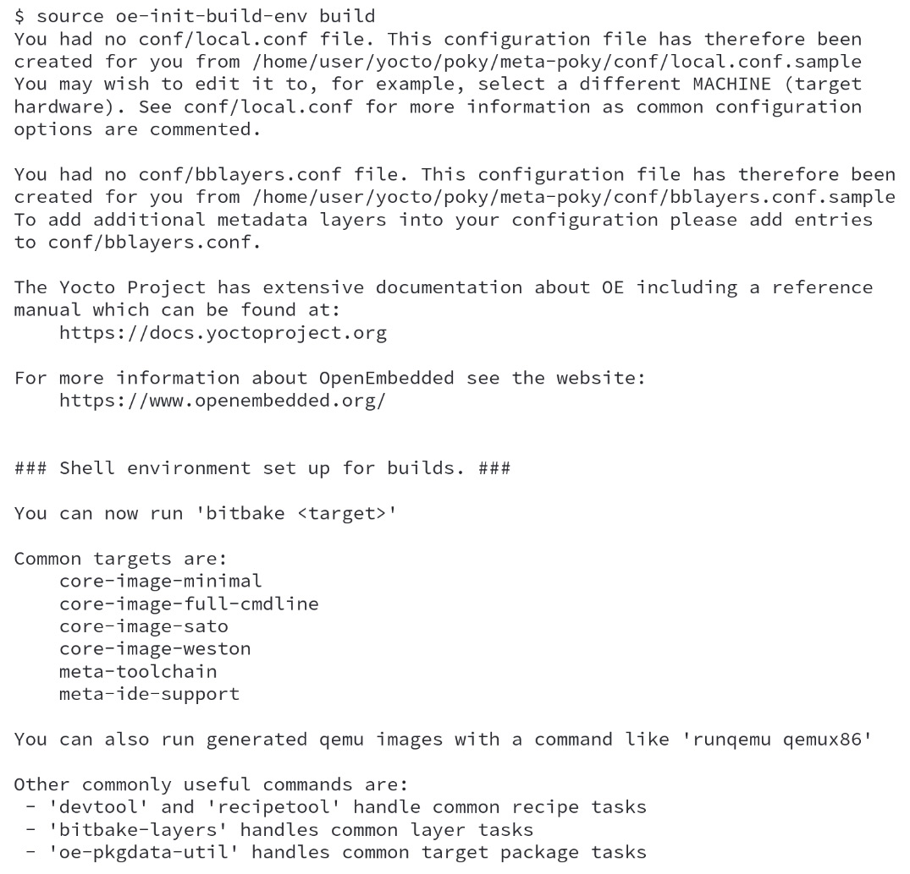
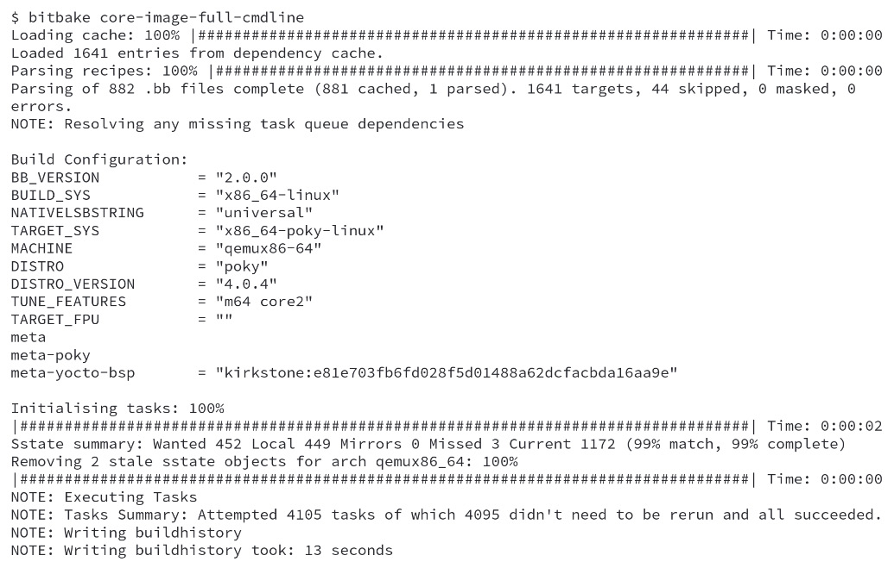
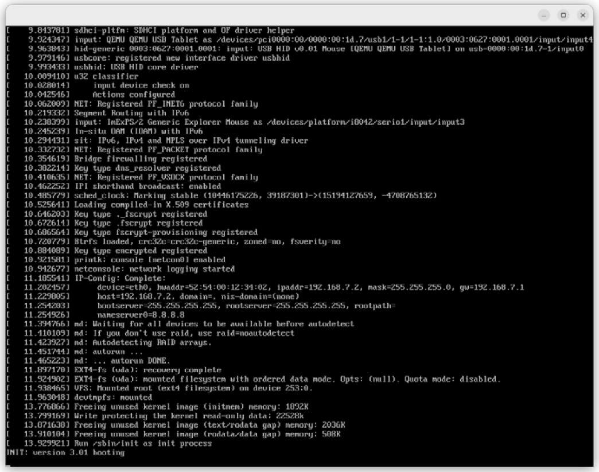
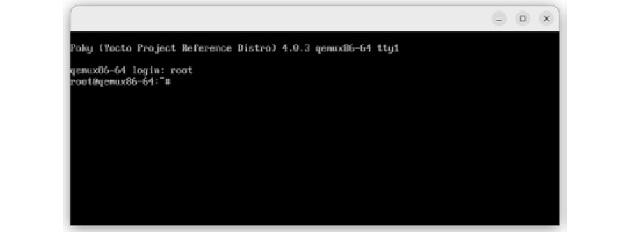

# Chương 2: Build hệ thống Poky-Based đầu tiên của chúng ta (Baking Our First Poky-Based System)

Hãy bắt tay vào làm! Trong chương này, chúng ta sẽ hiểu các khái niệm cơ bản trong workflow của Poky. Chúng ta sẽ đi qua các bước để tải về, cấu hình và chuẩn bị môi trường build Poky, rồi build ra một thứ có thể dùng được. Các bước được trình bày ở đây là những bước thường dùng cho kiểm thử và phát triển. Chúng sẽ giúp chúng ta có chút kinh nghiệm dùng Poky và nếm thử các khả năng của nó.

## Chuẩn bị hệ thống build host

Mục này mô tả cách chuẩn bị hệ thống host chạy Windows và chạy bản phân phối Linux. Tuy sẽ mô tả các bước cho Windows, chúng ta sẽ tập trung vào việc dùng hệ thống host chạy bản phân phối Linux.

> **Mẹo**
>
> Có thể dùng macOS làm hệ thống host. Tuy nhiên, việc này cần dùng framework **CROss PlatformS** (**CROPS**), vốn tận dụng Docker và cho phép dùng các hệ điều hành khác, bao gồm cả macOS. Để biết thêm thông tin, bạn có thể tham khảo mục *Setting Up to Use CROss PlatformS (CROPS)* trong *Yocto Project Development Tasks Manual* ([https://docs.yoctoproject.org/4.0.4/dev-manual/start.html#setting-up-to-use-cross-platforms-crops](https://docs.yoctoproject.org/4.0.4/dev-manual/start.html#setting-up-to-use-cross-platforms-crops)).

Tiếp theo, chúng ta sẽ cung cấp những thông tin cần thiết để bắt đầu chuẩn bị hệ thống build host.

### Dùng Windows Subsystem for Linux (WSLv2)

Nếu là người dùng Windows, bạn có thể cài đặt một bản phân phối Linux trên Windows. WSLv2 chỉ có trên các bản build Windows 10+ lớn hơn 18917. WSLv2 cho phép phát triển bằng Yocto Project. Bạn có thể cài đặt bản phân phối Linux từ Microsoft Store.

Vui lòng tham khảo phần *Setting Up to Use Windows Subsystem For Linux* ([https://docs.yoctoproject.org/4.0.4/dev-manual/start.html#setting-up-to-use-windows-subsystem-for-linux-wslv2](https://docs.yoctoproject.org/4.0.4/dev-manual/start.html#setting-up-to-use-windows-subsystem-for-linux-wslv2)) trong *Yocto Project Development Tasks Manual* ([https://docs.yoctoproject.org/4.0.4/dev-manual/index.html](https://docs.yoctoproject.org/4.0.4/dev-manual/index.html)). Khi đã cài đặt xong WSLv2, bạn có thể làm theo các mục tiếp theo như thể đang chạy trên một máy Linux native.

### Chuẩn bị một hệ thống Linux-based

Quy trình cần thiết để cài đặt hệ thống host phụ thuộc vào bản phân phối Linux mà chúng ta dùng. Poky có một tập các bản phân phối Linux được hỗ trợ. Giả sử chúng ta mới làm quen với việc phát triển embedded Linux. Trong trường hợp đó, nên dùng một trong các bản phân phối Linux được hỗ trợ để tránh mất thời gian debug những vấn đề liên quan đến việc hỗ trợ hệ thống host.

Nếu bạn dùng bản phát hành hiện tại của một trong các bản phân phối sau, bạn có thể bắt đầu dùng Yocto Project trên máy của mình:

- Ubuntu
- Fedora
- CentOS
- AlmaLinux
- Debian
- OpenSUSE Leap

Để xác nhận phiên bản của bạn có được hỗ trợ hay không, nên xem tài liệu chính thức trực tuyến ở mục *Required Packages for the Build Host* ([https://docs.yoctoproject.org/4.0.4/ref-manual/system-requirements.html#required-packages-for-the-build-host](https://docs.yoctoproject.org/4.0.4/ref-manual/system-requirements.html#required-packages-for-the-build-host)).

Nếu bản phân phối bạn thích không có trong danh sách trên, điều đó không có nghĩa là không thể dùng Poky trên bản phân phối đó. Hệ thống phát triển host của bạn phải đáp ứng một số phiên bản cụ thể của Git, tar, Python và GCC. Các bản phân phối Linux của bạn nên cung cấp những phiên bản tương thích của các công cụ nền tảng này. Tuy nhiên, có khả năng hệ thống phát triển host của bạn không đáp ứng tất cả các yêu cầu này. Trong trường hợp đó, bạn có thể giải quyết bằng cách cài đặt một tarball **buildtools** chứa các công cụ này, như được mô tả chi tiết trong *Required Git, tar, Python, and GCC Versions* ([https://docs.yoctoproject.org/4.0.4/ref-manual/system-requirements.html#required-git-tar-python-and-gcc-versions](https://docs.yoctoproject.org/4.0.4/ref-manual/system-requirements.html#required-git-tar-python-and-gcc-versions)).

Chúng ta phải cài đặt một vài package trên hệ thống host. Cuốn sách này đưa ra hướng dẫn cho **Debian** và **Fedora**, những bản phân phối chúng tôi ưa dùng, và chúng ta sẽ xem chúng ngay sau đây. Tập package cho các bản phân phối được hỗ trợ khác có thể được tìm thấy trong *Yocto Project Reference Manual* ([https://docs.yoctoproject.org/4.0.4/ref-manual/system-requirements.html#required-packages-for-the-build-host](https://docs.yoctoproject.org/4.0.4/ref-manual/system-requirements.html#required-packages-for-the-build-host)).

#### Bản phân phối Debian-based

Để cài đặt các package cần thiết cho một hệ thống host headless, hãy chạy lệnh sau:

```
$ sudo apt install gawk wget git diffstat unzip texinfo gcc build-essential chrpath socat cpio python3 python3-pip python3-pexpect xz-utils debianutils iputils-ping python3-git python3-jinja2 libegl1-mesa libsdl1.2-dev pylint3 xterm python3-subunit mesa-common-dev zstd liblz4-tool
```

#### Fedora

Để cài đặt các package cần thiết cho một hệ thống host headless, hãy chạy lệnh sau:

```
$ sudo dnf install gawk make wget tar bzip2 gzip python3 unzip perl patch diffutils diffstat git cpp gcc gcc-c++ glibc-devel texinfo chrpath ccache perl-Data-Dumper perl-Text-ParseWords perl-Thread-Queue perl-bignum socat python3-pexpect findutils which file cpio python python3-pip xz python3-GitPython python3-jinja2 SDL-devel xterm rpcgen mesa-libGL-devel perl-FindBin perl-File-Compare perl-File-Copy perl-locale zstd lz4
```

## Tải source code của Poky

Sau khi đã cài đặt các package cần thiết trên hệ thống phát triển host, chúng ta có thể tải về phiên bản LTS hiện tại (tại thời điểm viết sách) của source code Poky bằng Git, với lệnh sau:

```
$ git clone https://git.yoctoproject.org/poky -b kirkstone
```

> **Mẹo**
>
> Tìm hiểu thêm về Git tại [https://git-scm.com](https://git-scm.com).

Sau khi quá trình tải về hoàn tất, chúng ta sẽ có nội dung sau bên trong thư mục `poky`:



*Hình 2.1 – Nội dung của thư mục poky sau khi tải về*

> **Lưu ý**
>
> Các ví dụ và code được trình bày trong chương này và các chương tiếp theo dùng bản phát hành Yocto Project 4.0 (tên mã **Kirkstone**) làm tham chiếu.

## Chuẩn bị môi trường build

Bên trong thư mục `poky` có một script tên là `oe-init-build-env`, dùng để thiết lập môi trường build. Nhưng trước hết, script này phải được run-sourced (chứ không phải được thực thi) như sau:

```
$ source oe-init-build-env [build-directory]
```

Ở đây, `[build-directory]` là một tham số tùy chọn cho tên của thư mục nơi môi trường được cấu hình. Nếu để trống, giá trị mặc định là `build`. Tham số `[build-directory]` là nơi chúng ta thực hiện các lần build.

Output từ `source oe-init-build-env build` hiển thị một số cấu hình quan trọng như vị trí file, một số URL của dự án và một số target thường dùng, như các image hiện có. Hình sau cho thấy một ví dụ output:



*Hình 2.2 – Output của lệnh source oe-init-build-env build*

Dùng các thư mục build khác nhau rất tiện lợi. Chúng ta có thể làm song song các dự án riêng biệt hoặc các thiết lập thử nghiệm mà không ảnh hưởng đến các lần build khác.

> **Lưu ý**
>
> Trong suốt cuốn sách, chúng ta sẽ dùng `build` làm thư mục build. Khi cần trỏ tới một file bên trong thư mục build, chúng ta sẽ áp dụng cùng quy ước đó – ví dụ, `build/conf/local.conf`.

## Tìm hiểu file local.conf

Khi chúng ta khởi tạo một môi trường build, nó tạo ra một file tên là `build/conf/local.conf`. File cấu hình này rất mạnh, vì nó có thể cấu hình gần như mọi khía cạnh của quá trình build. Chúng ta có thể đặt target machine và architecture host của toolchain sẽ được dùng cho một cross-toolchain tùy chỉnh, tối ưu các tùy chọn để giảm tối đa thời gian build, v.v. Các comment bên trong file `build/conf/local.conf` là tài liệu rất tốt và là nguồn tham khảo về các biến có thể dùng và giá trị mặc định của chúng. Tập biến tối thiểu mà có lẽ chúng ta muốn thay đổi so với mặc định là:

```
MACHINE ??= "qemux86-64"
```

Biến `MACHINE` là nơi chúng ta xác định target machine mà mình muốn build. Tại thời điểm viết sách, Poky hỗ trợ các machine sau trong BSP tham chiếu của nó:

- `beaglebone-yocto`: Đây là BeagleBone, nền tảng tham chiếu cho ARM 32-bit
- `genericx86`: Đây là hỗ trợ chung cho các machine x86-based 32-bit
- `genericx86-64:` *(ghi chú: đúng là `genericx86-64`: — dấu `:` nằm ngoài code)* Đây là hỗ trợ chung cho các machine x86-based 64-bit
- `edgerouter`: Đây là EdgeRouter Lite, nền tảng tham chiếu cho MIPS 64-bit

Các machine này được cung cấp bởi một layer tên là `meta-yocto-bsp`. Ngoài các machine này, OpenEmbedded Core, nằm trong thư mục `meta`, cũng hỗ trợ các machine Quick Emulation (QEMU) sau:

- `qemuarm`: Đây là emulation QEMU ARMv7
- `qemuarmv5`: Đây là emulation QEMU ARMv5
- `qemuarm64`: Đây là emulation QEMU ARMv8
- `qemumips`: Đây là emulation QEMU MIPS
- `qemumips64`: Đây là emulation QEMU MIPS64
- `qemuppc`: Đây là emulation QEMU PowerPC
- `qemuppc64`: Đây là emulation QEMU PowerPC 64
- `qemux86-64`: Đây là emulation QEMU x86-64
- `qemux86`: Đây là emulation QEMU x86
- `qemuriscv32`: Đây là emulation QEMU RISC-V 32
- `qemuriscv64`: Đây là emulation QEMU RISC-V 64

Các BSP layer bổ sung do nhiều nhà cung cấp phát hành sẽ hỗ trợ các machine khác. Quy trình dùng một BSP layer bổ sung được trình bày trong *Chương 11*, *Khám phá các layer bên ngoài*.

> **Lưu ý**
>
> File `local.conf` là một cách tiện lợi để ghi đè nhiều cấu hình mặc định toàn cục trong các công cụ của Yocto Project. Về cơ bản, chúng ta có thể thay đổi hoặc đặt bất kỳ biến nào – ví dụ, thêm các package bổ sung vào một file image. Thay đổi file `build/conf/local.conf` thì tiện lợi; tuy nhiên, hệ thống quản lý source code thường không theo dõi những thay đổi tạm thời trong thư mục này.

File `build/conf/local.conf` có thể đặt nhiều biến. Đáng để dành chút thời gian đọc qua các comment được sinh ra trong file để có ý niệm chung về những biến có thể đặt.

## Build một target image

Poky cung cấp nhiều image recipe được thiết kế sẵn mà chúng ta có thể dùng để build binary image của mình. Chúng ta có thể xem danh sách các image hiện có bằng cách chạy lệnh sau từ thư mục `poky`:

```
$ ls meta*/recipes*/*images/*.bb
```

Tất cả các recipe này cung cấp các image là một tập package đã được giải nén và cấu hình, tạo ra một filesystem mà chúng ta có thể dùng với phần cứng hoặc với một trong các machine QEMU được hỗ trợ.

Tiếp theo, chúng ta có thể xem danh sách các image thường dùng nhất:

- `core-image-minimal`: Đây là một image nhỏ cho phép một thiết bị boot. Nó rất tiện cho việc kiểm thử và phát triển kernel và bootloader.
- `core-image-base`: Image console-only này cung cấp hỗ trợ phần cứng cơ bản cho thiết bị đích.
- `core-image-weston`: Image này cung cấp các thư viện giao thức Wayland và compositor Weston tham chiếu.
- `core-image-x11`: Đây là một image X11 cơ bản có terminal.
- `core-image-sato`: Đây là một image có hỗ trợ Sato và một môi trường di động cho các thiết bị di động dùng X11. Nó cung cấp các ứng dụng như terminal, trình soạn thảo, trình quản lý file, trình phát đa phương tiện, v.v.
- `core-image-full-cmdline`: Một image console-only có cài đặt nhiều chức năng hệ thống Linux full-featured hơn.

Cộng đồng cũng cung cấp các image tham chiếu khác. Một số image hỗ trợ các tính năng như Real Time, `initramfs` và MTD (các công cụ flash). Nên xem source code hoặc *Yocto Project Reference Manual* ([https://docs.yoctoproject.org/4.0.4/ref-manual/index.html](https://docs.yoctoproject.org/4.0.4/ref-manual/index.html)) để có danh sách đầy đủ và cập nhật.

Quy trình build một image cho một target rất đơn giản. Nhưng trước hết, chúng ta cần thiết lập môi trường build bằng `source oe-init-build-env [build-directory]` trước khi dùng BitBake. Để build image, chúng ta có thể dùng mẫu trong lệnh sau:


*Hình 2.3 – Cách build một recipe bằng BitBake*

> **Lưu ý**
>
> Chúng ta sẽ dùng `MACHINE = "qemux86-64"` trong các ví dụ sau. Bạn có thể đặt nó trong `build/conf/local.conf` cho phù hợp.

Ví dụ, để build `core-image-full-cmdline`, hãy chạy lệnh sau:

```
$ bitbake core-image-full-cmdline
```

Quá trình build Poky trông giống như hình sau:



*Hình 2.4 – Kết quả của bitbake core-image-full-cmdline*

## Chạy image trong QEMU

Chúng ta có thể dùng emulation phần cứng để đẩy nhanh quá trình phát triển, vì nó cho phép chạy thử mà không cần đến bất kỳ phần cứng thật nào. May mắn là hầu hết các dự án chỉ có một phần rất nhỏ là hardware-dependent.

QEMU là một package phần mềm mã nguồn mở, miễn phí, thực hiện ảo hóa phần cứng. Các machine QEMU-based cho phép kiểm thử và phát triển mà không cần phần cứng thật. Hiện tại, các emulation ARMv5, ARMv7, ARMv8, MIPS, MIPS64, PowerPC, PowerPC 64, RISC-V 32, RISC-V 64, x86 và x86-64 được hỗ trợ. Chúng ta sẽ đi vào chi tiết hơn về cách dùng QEMU trong *Chương 16*, *Tăng tốc phát triển sản phẩm nhờ emulation – QEMU*.

OpenEmbedded Core cung cấp công cụ script `runqemu`, là một lớp bọc giúp dùng QEMU dễ dàng hơn. Cách chạy công cụ script này như sau:

```
$ runqemu <machine> <zimage> <filesystem>
```

Ở đây, `<machine>` là machine/architecture sẽ được dùng, như `qemux86-64`, hoặc bất kỳ machine nào khác được hỗ trợ. Ngoài ra, `<zimage>` là đường dẫn tới một kernel (ví dụ, `bzImage-qemux86-64.bin`). Cuối cùng, `<filesystem>` là đường dẫn tới một image `ext4` (ví dụ, `filesystem-qemux86-64.ext4`) hoặc một thư mục NFS. Tất cả các tham số trong lời gọi `runqemu` ở trên, `<zimage>` và `<filesystem>`, đều là tùy chọn. Chỉ cần chạy `runqemu` là đủ để khởi chạy image trong shell nơi môi trường build đã được thiết lập, vì nó sẽ tự động lấy các thiết lập mặc định từ việc build môi trường.

Vậy, ví dụ, nếu chúng ta chạy `runqemu qemux86-64 core-image-full-cmdline`, chúng ta có thể thấy một thứ tương tự như trong ảnh chụp màn hình sau:



*Hình 2.5 – Màn hình QEMU trong lúc Linux kernel boot*

Sau khi Linux boot xong, bạn sẽ thấy dấu nhắc đăng nhập, như trong *Hình 2.6*:



*Hình 2.6 – Màn hình QEMU trong lúc người dùng đăng nhập*

Chúng ta có thể đăng nhập vào tài khoản `root` với mật khẩu để trống. Hệ thống hoạt động như một máy bình thường, ngay cả khi được thực thi bên trong QEMU. Quy trình deploy một image lên phần cứng thật thay đổi tùy theo loại storage được dùng, bootloader, v.v. Tuy nhiên, quy trình tạo image thì như nhau. Chúng ta sẽ khám phá cách build và chạy một image trên phần cứng thật trong *Chương 15*, *Boot hệ thống embedded Linux tùy chỉnh của chúng ta*.

## Tóm tắt

Trong chương này, chúng ta đã học các bước cần thiết để thiết lập Poky và build được image đầu tiên. Sau đó, chúng ta đã chạy image đó bằng `runqemu`, giúp chúng ta có cái nhìn tổng quan tốt về các khả năng hiện có. Trong chương tiếp theo, chúng ta sẽ giới thiệu Toaster, một giao diện human-friendly cho BitBake. Chúng ta sẽ dùng nó để build một image và tùy chỉnh image đó thêm.
