# Chương 3: Dùng Toaster để build một image (Using Toaster to Bake an Image)

Giờ đây khi đã biết cách build một image bằng BitBake bên trong Poky, chúng ta sẽ học cách làm điều tương tự bằng Toaster. Chúng ta sẽ tập trung vào cách dùng Toaster đơn giản nhất, đồng thời đề cập những việc khác mà nó có thể làm để bạn biết về các khả năng của nó.

## Toaster là gì?

**Toaster** là một giao diện web để cấu hình và chạy các lần build. Nó giao tiếp với BitBake và build system Poky để quản lý và thu thập thông tin về các lần build, package và image.

Có hai cách dùng Toaster:

- **Cục bộ (Locally)**: Chúng ta có thể chạy Toaster dưới dạng một instance cục bộ, phù hợp cho việc phát triển single-user, cung cấp giao diện đồ họa cho các dòng lệnh BitBake và một số thông tin build.
- **Được host (Hosted)**: Cách này phù hợp cho nhiều người dùng. Các server Toaster build và lưu trữ các artifact của người dùng. Khi dùng một instance được host, các thành phần của nó có thể được phân bố trên nhiều máy.

Trong chương này, chúng ta sẽ dùng Toaster dưới dạng một instance cục bộ. Tuy nhiên, nếu bạn muốn dùng nó dưới dạng một instance được host, hãy truy cập website sau để xem hướng dẫn – *Toaster Manual* ([https://docs.yoctoproject.org/4.0.4/toaster-manual/index.html](https://docs.yoctoproject.org/4.0.4/toaster-manual/index.html)).

> **Lưu ý**
>
> Hãy nhớ rằng mọi dịch vụ được host đều cần được chú ý về bảo mật. Hãy cân nhắc điều này trước khi dùng một instance được host.

## Cài đặt Toaster

Toaster dùng framework Python Django. Cách dễ nhất để cài đặt nó là dùng tiện ích `pip` của Python. Chúng ta đã cài đặt tiện ích này khi cấu hình máy host trong *Chương 2*, *Build hệ thống Poky-Based của chúng ta*. Giờ chúng ta có thể cài đặt các yêu cầu còn lại của Toaster bên trong thư mục source của Poky bằng cách chạy lệnh sau:

```
$ pip3 install --user -r bitbake/toaster-requirements.txt
```

## Khởi động Toaster

Khi đã cài đặt các yêu cầu của Toaster, chúng ta đã sẵn sàng khởi động server của nó. Để làm điều này, chúng ta vào thư mục của Poky và chạy các lệnh sau:

```
$ source oe-init-build-env
$ source toaster start
```

Các lệnh này mất một khoảng thời gian để hoàn tất. Khi mọi thứ đã được thiết lập, web server được khởi động. Kết quả được thể hiện trong hình sau.

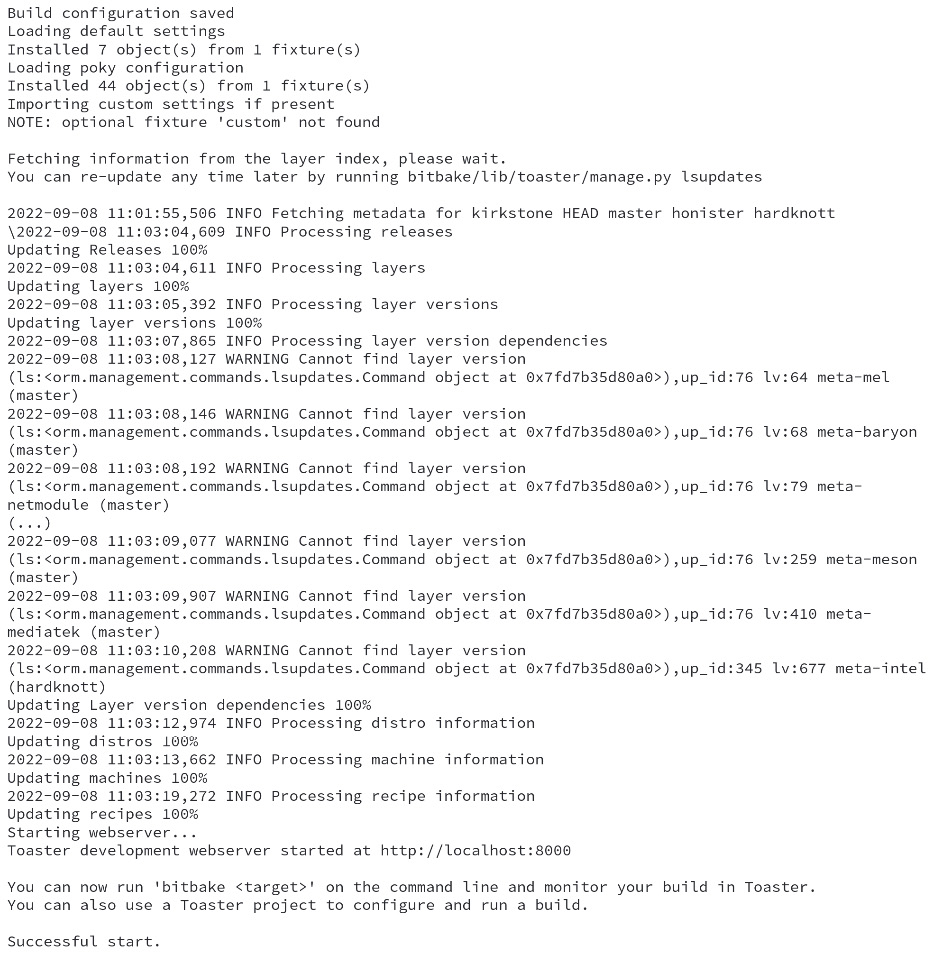

*Hình 3.1 – Kết quả của việc khởi động source toaster*

Để truy cập giao diện web của Toaster, hãy mở trình duyệt bạn yêu thích và nhập địa chỉ sau:

`http://127.0.0.1:8000`

> **Lưu ý**
>
> Mặc định, Toaster khởi động trên cổng `8000`. Tham số `webport` cho phép bạn dùng một cổng khác – ví dụ, `$ source toaster start webport=8400`.

Tiếp theo, chúng ta có thể thấy trang khởi đầu của Toaster:

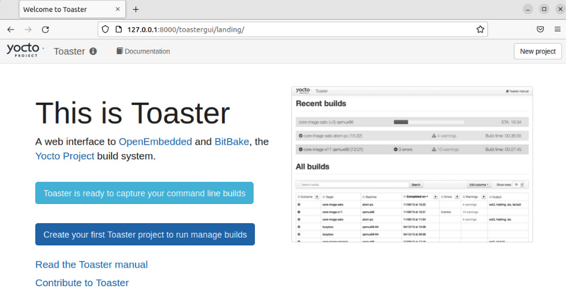

*Hình 3.2 – Trang chào mừng của Toaster*

## Build một image cho QEMU

Làm theo các bước giống như trong *Chương 2*, *Build hệ thống Poky-Based của chúng ta*, chúng ta sẽ build một image cho emulation QEMU x86-64.

Vì hiện chưa có project nào – tức là một tập hợp các cấu hình và lần build – chúng ta cần tạo một project. Hãy đặt tên project và chọn bản phát hành đích, như trong ảnh chụp màn hình sau:

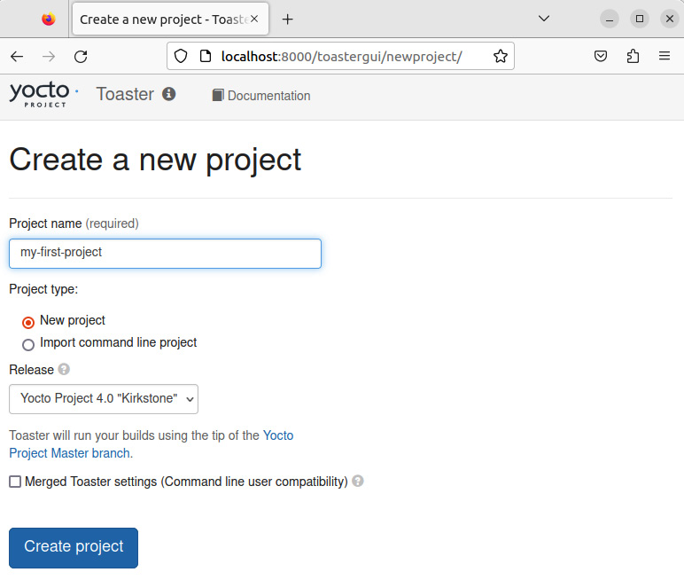

*Hình 3.3 – Tạo một project mới với Toaster*

Sau khi tạo **my-first-project**, chúng ta có thể thấy màn hình chính của project, như trong ảnh chụp màn hình sau:

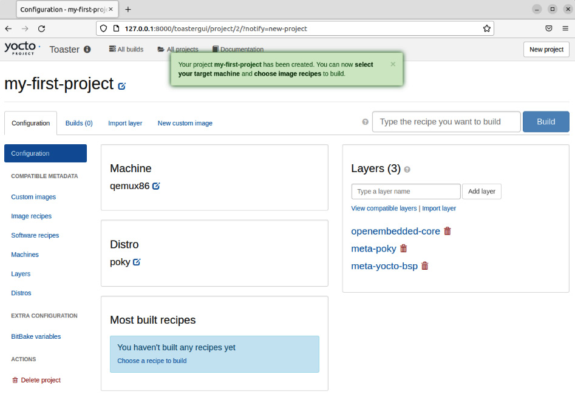

*Hình 3.4 – Trang đầu tiên của project*

Khi đang ở tab **Configuration**, hãy vào **Machine** và đổi target machine thành `qemux86-64`:

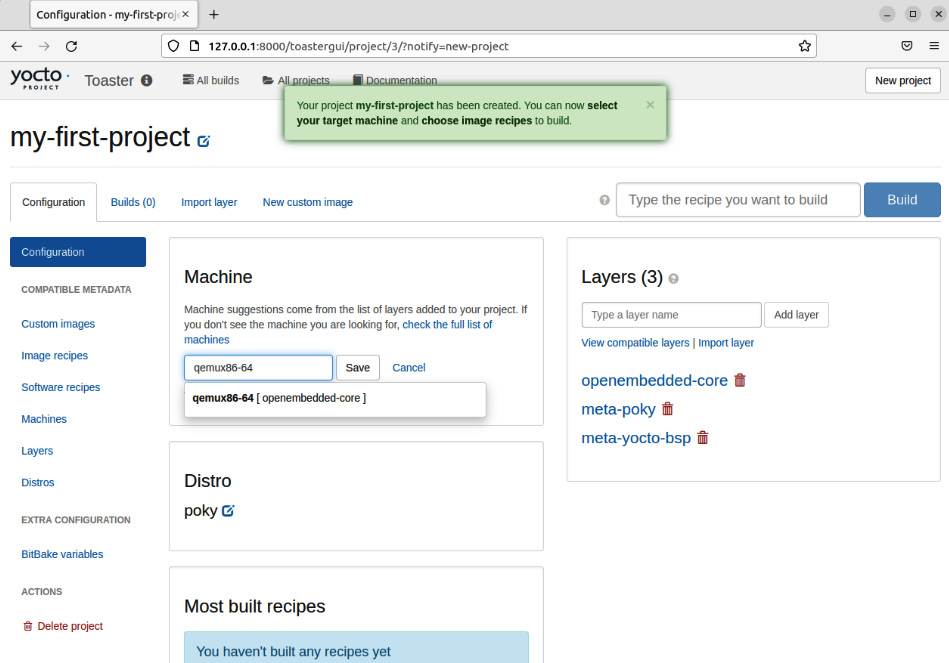

*Hình 3.5 – Cách chọn target machine*

Sau đó, nhấn vào tab **Image recipes** để chọn image bạn muốn build. Trong ví dụ này, giống như trong *Chương 2*, *Build hệ thống Poky-Based của chúng ta*, chúng ta có thể build `core-image-full-cmdline`:

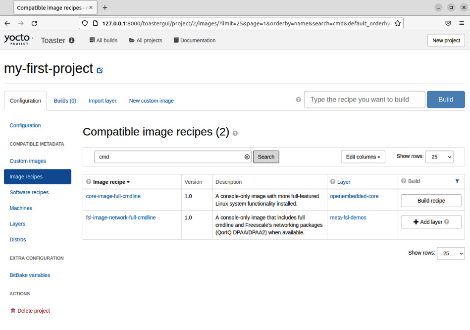

*Hình 3.6 – Cách tìm một image bằng Search*

Ảnh chụp màn hình sau cho thấy quá trình build:

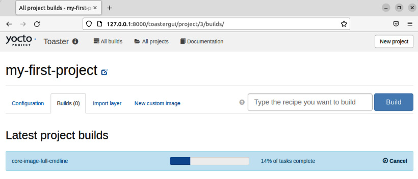

*Hình 3.7 – Toaster trong lúc build image*

Quá trình build mất một khoảng thời gian, nhưng sau đó chúng ta có thể thấy image đã build cùng một số thống kê, như trong ảnh chụp màn hình sau:

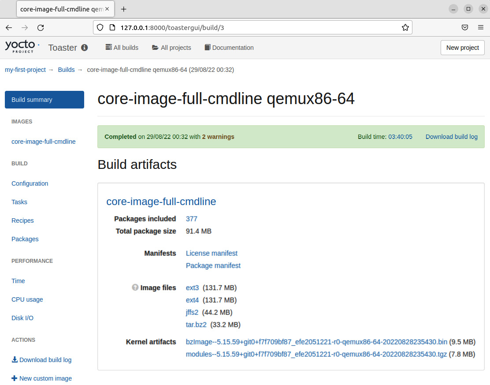

*Hình 3.8 – Báo cáo artifact của lần build image*

Chúng ta cũng có thể kiểm tra tập file được tạo ra, như trong ảnh chụp màn hình sau:

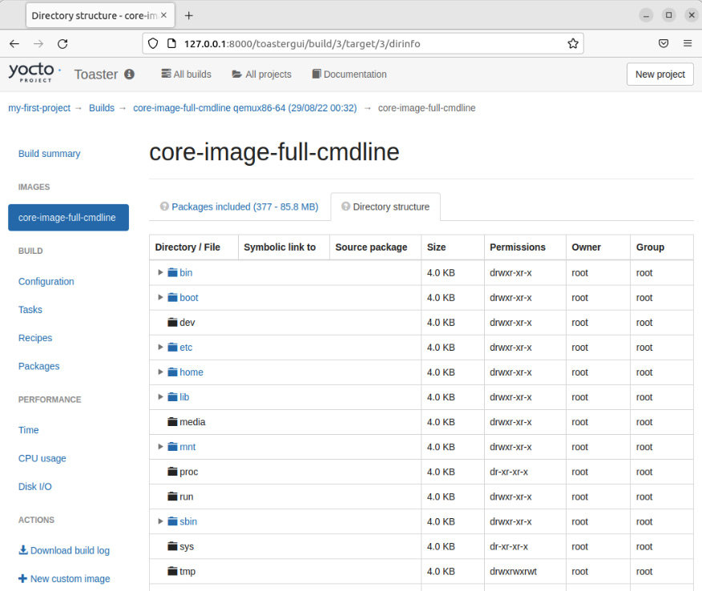

*Hình 3.9 – Cấu trúc thư mục của core-image-full-cmdline như được hiển thị trong Toaster*

Toaster là một công cụ mạnh. Bạn có thể dùng nó trên một máy phát triển cục bộ hoặc trên một server dùng chung để có được hình ảnh trực quan về lần build. Bạn có thể quay lại terminal nơi đã khởi động Toaster để chạy `runqemu qemux86-64 core-image-full-cmdline`. Bạn sẽ thấy những gì được thể hiện trong ảnh chụp màn hình sau:

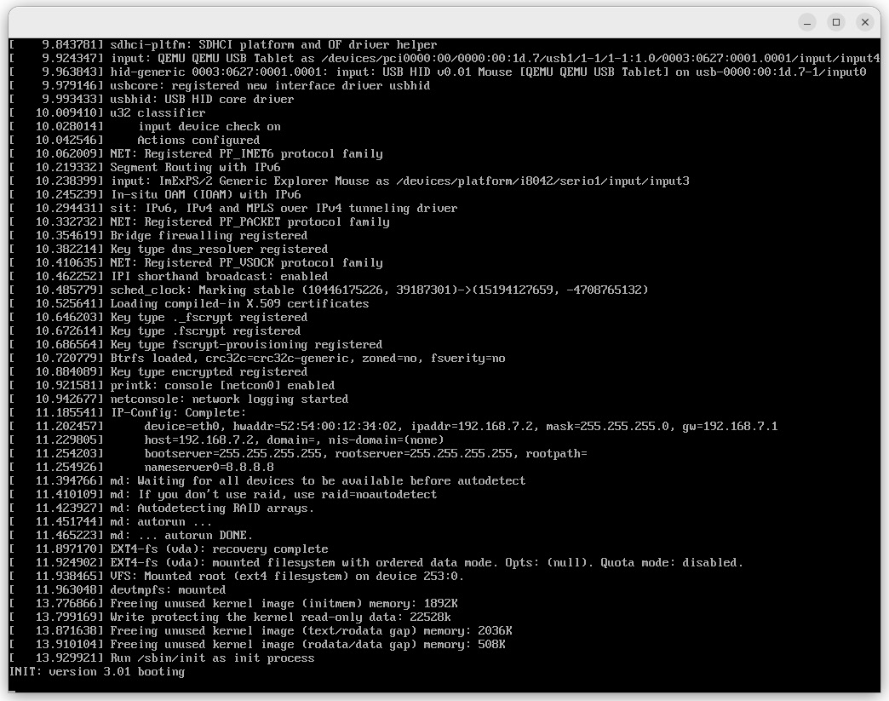

*Hình 3.10 – Màn hình QEMU trong lúc Linux kernel boot*

Sau khi Linux boot xong, bạn sẽ thấy dấu nhắc đăng nhập, như trong *Hình 3.11*.

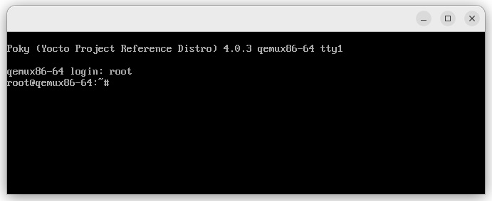

*Hình 3.11 – Màn hình QEMU trong lúc người dùng đăng nhập*

Chúng ta có thể đăng nhập vào tài khoản `root` với mật khẩu để trống.

## Tóm tắt

Trong chương này, chúng ta đã giới thiệu Toaster và các tính năng thiết yếu của nó. Sau đó, chúng ta đã đi qua việc cài đặt và cấu hình Toaster, rồi build và xem xét một image.

Trong chương tiếp theo, chúng ta sẽ đi qua một số khái niệm quan trọng của BitBake. Chúng tôi tin rằng những khái niệm này là thiết yếu để hiểu Yocto Project. Chúng ta sẽ dùng BitBake và dòng lệnh trong phần còn lại của cuốn sách, vì chúng cho phép thấy được tất cả các khái niệm.
