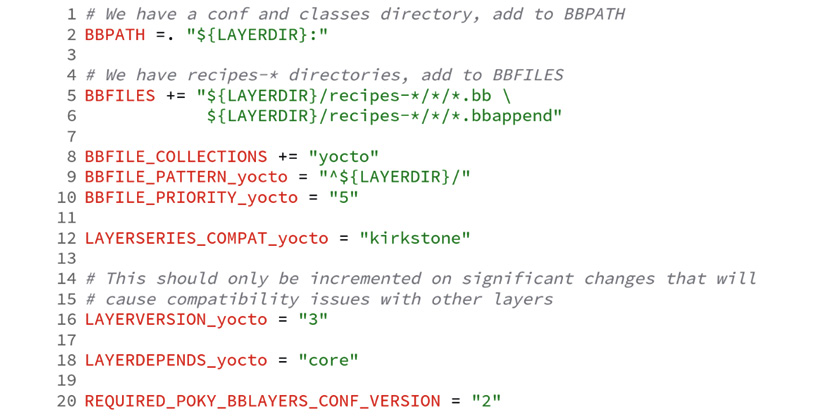
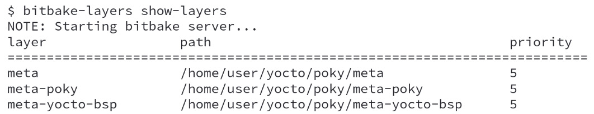

# Chương 4: Làm quen với công cụ BitBake (Meeting the BitBake Tool)

Với chương này, giờ đây chúng ta sẽ bắt đầu hành trình tìm hiểu bộ máy của Yocto Project hoạt động như thế nào ở phía sau. Như với mọi hành trình, giao tiếp là điều then chốt, vì vậy chúng ta cần hiểu ngôn ngữ mà các công cụ của Yocto Project sử dụng và học cách khai thác tốt nhất các công cụ này để đạt được mục tiêu của mình.

Các chương trước đã giới thiệu với chúng ta workflow chuẩn của Yocto Project để tạo và emulate image. Giờ đây, trong chương này, chúng ta sẽ khám phá khái niệm metadata và cách BitBake đọc metadata này để tạo ra các data collection nội bộ của nó.

## Tìm hiểu công cụ BitBake

Bộ lập lịch task BitBake khởi đầu là một fork từ Portage, hệ thống quản lý package được dùng trong bản phân phối Gentoo. Tuy nhiên, hai dự án đã tách ra rất xa nhau do có các trường hợp sử dụng khác nhau. Yocto Project và OpenEmbedded Project là những bên sử dụng BitBake rất nhiều. Nó vẫn là một dự án riêng biệt và độc lập, có chu kỳ phát triển và mailing list riêng ([bitbake-devel@lists.openembedded.org](mailto:bitbake-devel@lists.openembedded.org)).

BitBake là một công cụ tương tự GNU Make. Như đã bàn trong *Chương 1*, *Làm quen với Yocto Project*, BitBake là một bộ thực thi và lập lịch task, có nhiệm vụ parse code hỗn hợp Python và Shell Script.

Do đó, BitBake chịu trách nhiệm chạy song song càng nhiều task càng tốt, đồng thời bảo đảm các task được chạy theo đúng các dependency của chúng.

## Các metadata collection của BitBake

Đối với BitBake, không có metadata nào nằm ngoài một metadata collection. Thay vào đó, mỗi metadata collection có một tên duy nhất, và thuật ngữ chung mà Yocto Project dùng cho các collection này là **Layer**.

*Chương 1*, *Làm quen với Yocto Project*, giải thích rằng chúng ta có các layer sau:

- **OpenEmbedded Core**: Layer này nằm trong thư mục `meta`
- **Bản phân phối Poky**: Layer này nằm trong thư mục `meta-poky`
- **BSP tham chiếu của Yocto Project**: Layer này nằm trong thư mục `meta-yocto-bsp`

Danh sách trên mô tả các ví dụ thực tế về layer. Mỗi layer đều chứa một file tên là `conf/layer.conf`. File này định nghĩa một số thuộc tính của layer, như tên collection và mức ưu tiên. Hình sau cho thấy file `conf/layer.conf` của layer `meta-poky`:

*Hình 4.1 – File conf/layer.conf của layer meta-poky*

Ví dụ trên tương đối đơn giản nhưng đóng vai trò làm nền tảng để chúng ta minh họa các nguyên tắc của file `conf/layer.conf`.

Ở dòng 8, `BBFILE_COLLECTIONS`, chúng ta yêu cầu BitBake tạo một metadata collection mới tên là `yocto`. Tiếp theo, ở dòng 9, `BBFILE_PATTERN_yocto`, chúng ta định nghĩa quy tắc để khớp tất cả các đường dẫn bắt đầu bằng biến `LAYERDIR` nhằm nhận diện metadata thuộc về collection `yocto`. Cuối cùng, ở dòng 10, `BBFILE_PRIORITY_yocto` thiết lập mức ưu tiên (số càng cao thì mức ưu tiên càng cao) của collection `yocto` so với các metadata collection khác.

Quan hệ dependency giữa các layer là rất quan trọng, vì nó bảo đảm tất cả metadata cần thiết đều sẵn có để sử dụng. Một ví dụ nằm ở dòng 18: `LAYERDEPENDS_yocto`, trong file `conf/layer.conf`, thêm một dependency vào `core`, được cung cấp bởi layer OpenEmbedded Core.

*Hình 4.2* cho thấy các layer của Poky khi dùng lệnh `bitbake-layers`, như sau:

*Hình 4.2 – Kết quả của bitbake-layers show-layers cho Poky*

## Các loại metadata

Có ba nhóm chính mà chúng ta có thể dùng để phân loại metadata được BitBake sử dụng. Chúng như sau:

- Cấu hình (các file `.conf`)
- Class (các file `.bbclass`)
- Recipe (các file `.bb` và `.bbappend`)

Các file cấu hình định nghĩa nội dung toàn cục để cung cấp thông tin và cấu hình cách các recipe hoạt động. Một ví dụ điển hình về file cấu hình là file machine, chứa một danh sách các thiết lập mô tả phần cứng.

Toàn bộ hệ thống dùng các class mà recipe có thể `inherit` tùy theo nhu cầu hoặc theo mặc định. Chúng định nghĩa hành vi thường dùng của hệ thống và cung cấp các method nền tảng. Ví dụ, `kernel.bbclass` trừu tượng hóa các task liên quan đến việc build và đóng gói Linux kernel, độc lập với các thay đổi về phiên bản hay nhà cung cấp.

> **Lưu ý**
>
> Các recipe và class trộn lẫn code Python và Shell Script.

Các class và recipe mô tả những task cần chạy và cung cấp thông tin cần thiết để BitBake có thể tạo ra danh sách task cần thiết và các dependency của chúng. Cơ chế kế thừa cho phép một recipe kế thừa một hoặc nhiều class nhằm thúc đẩy việc dùng lại code, cải thiện độ chính xác và giúp việc bảo trì dễ dàng hơn. Một ví dụ về recipe Linux kernel là `linux-yocto_5.15.bb`, recipe này kế thừa một tập class, trong đó có `kernel.bbclass`.

Những khía cạnh thường dùng nhất của BitBake trên tất cả các loại metadata (`.conf`, `.bb` và `.bbclass`) được đề cập trong *Chương 5*, *Nắm vững công cụ BitBake*, còn ngữ pháp và cú pháp của metadata được trình bày chi tiết trong *Chương 8*, *Đi sâu vào metadata của BitBake*.

Khi xét *Hình 4.1*, chúng ta cần chú ý thêm hai biến khác – `BBPATH` và `BBFILES`.

`BBPATH`, ở dòng 2, tương tự như `PATH` nhưng thêm một thư mục vào danh sách tìm kiếm các file metadata; biến `BBFILES`, ở dòng 5, liệt kê mẫu được dùng để đánh index các file recipe của collection.

## Tóm tắt

Trong chương này, chúng ta đã tìm hiểu về metadata, các khái niệm metadata collection, và tầm quan trọng của `conf/layer.conf`, những thứ là nền tảng để hiểu Yocto Project. Trong chương tiếp theo, chúng ta sẽ xem xét kiến thức về metadata, hiểu cách các recipe phụ thuộc vào nhau và cách BitBake xử lý các dependency. Ngoài ra, chúng ta cũng sẽ có cái nhìn rõ hơn về các task do BitBake quản lý: tải về toàn bộ source code cần thiết, build và tạo package, và xem các package này khớp vào các image được tạo ra như thế nào.
