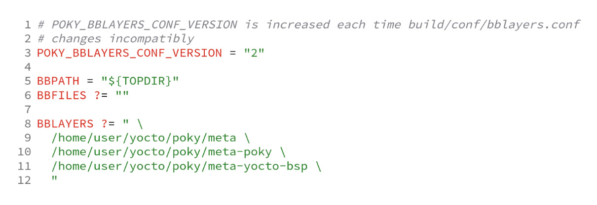
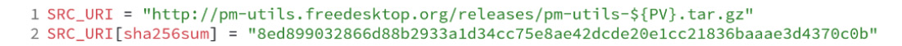
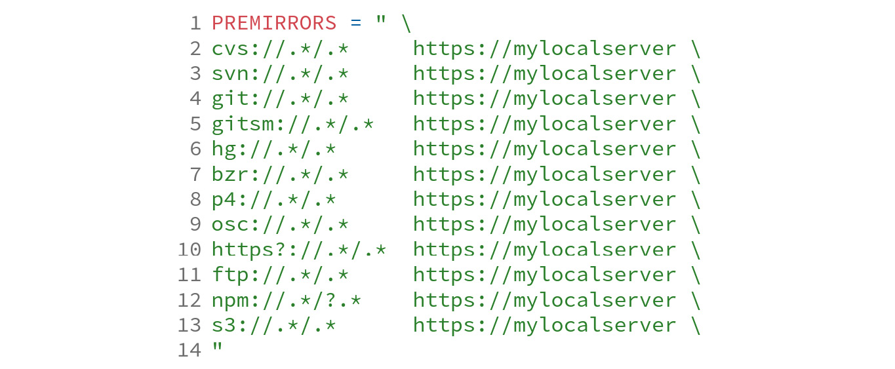
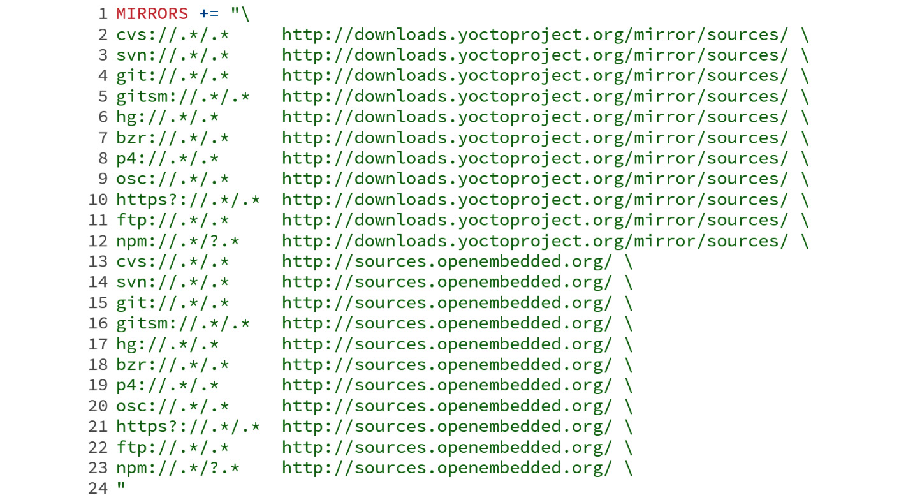
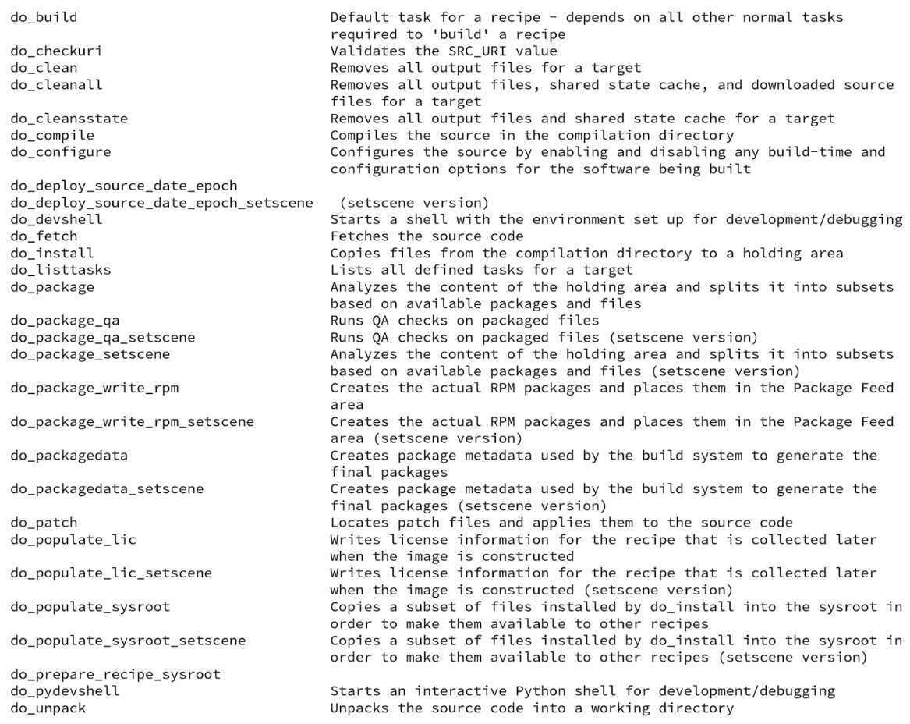

# Chương 5: Nắm vững công cụ BitBake (Grasping the BitBake Tool)

Trong chương trước, chúng ta đã tìm hiểu về metadata, các khái niệm metadata collection và tầm quan trọng của `conf/layer.conf`. Trong chương này, chúng ta sẽ xem xét metadata sâu hơn, hiểu cách các recipe phụ thuộc vào nhau, và xem BitBake xử lý các dependency như thế nào.

Ngoài ra, chúng ta sẽ đề cập một danh sách task rất lớn, từ việc tải source code đến việc tạo ra image và các artifact khác. Một số ví dụ về các task này là lưu source code vào thư mục dùng cho việc build, áp patch, cấu hình, compile, cài đặt và tạo package, và xác định cách các package khớp vào các image được tạo ra; chúng ta sẽ giới thiệu những task này trong chương này.

## Parse metadata

Thông thường, các project của chúng ta bao gồm nhiều layer cung cấp các metadata khác nhau để đáp ứng những nhu cầu cụ thể. Ví dụ, khi chúng ta khởi tạo một thư mục build bằng `source oe-init-build-env build`, một tập file được tạo ra như sau:

*Hình 5.1 – Danh sách các file được tạo bằng source oe-init-build-env build*

File `build/conf/templateconf.cfg` trỏ tới thư mục được dùng làm template để tạo thư mục `build/conf`.

> **Lưu ý**
>
> Người dùng có thể cung cấp một thư mục template khác bằng biến môi trường `TEMPLATECONF` – ví dụ, `TEMPLATECONF=/some/dir source oe-init-build-env build`.

File `build/conf/local.conf` là nơi đặt các cấu hình cục bộ. Chúng ta đã dùng file này trong *Chương 2*, *Build hệ thống Poky-Based đầu tiên của chúng ta*, và sẽ dùng nó trong suốt cuốn sách này.

BitBake dùng file `build/conf/bblayers.conf` để liệt kê các layer được xét đến trong môi trường build. Một ví dụ như sau:

*Hình 5.2 – Nội dung của build/conf/bblayer.conf sau khi chạy source oe-init-build-env build* *(ghi chú: đúng là bblayers.conf)*

Biến `BBLAYERS`, ở dòng 8, là một danh sách space-delimited các thư mục layer. BitBake parse từng layer để nạp nội dung của nó vào metadata collection. Có ba nhóm chính để phân loại metadata được BitBake sử dụng. Chúng được liệt kê như sau:

- Cấu hình (các file `.conf`)
- Class (các file `.bbclass`)
- Recipe (các file `.bb` và `.bbappend`)

> **Mẹo**
>
> Khi parse metadata, BitBake tuân theo thứ tự của các layer được liệt kê trong biến `BBLAYERS`, từ trái sang phải. Vì vậy, nếu layer của bạn cần được parse trước, hãy liệt kê nó ở đúng vị trí trong biến `BBLAYERS`.

Sau khi parse tất cả các layer đang dùng, BitBake bắt đầu parse metadata. Metadata được BitBake parse đầu tiên là metadata cấu hình, được nhận diện bằng phần mở rộng file `.conf`. Metadata này có tính toàn cục và vì vậy ảnh hưởng đến tất cả các recipe và task được thực thi.

> **Lưu ý**
>
> Một ví dụ điển hình về file cấu hình là file machine, chứa một danh sách các thiết lập mô tả phần cứng.

Trước tiên, BitBake nạp `meta/conf/bitbake.conf` từ một trong các đường dẫn có trong danh sách `BBPATH`. File `meta/conf/bitbake.conf` dùng các directive `include` để kéo metadata vào, như metadata architecture-specific, các file cấu hình machine và file `build/conf/local.conf`. Một hạn chế đáng kể của các file cấu hình BitBake (`.conf`) là chỉ cho phép các định nghĩa biến và các directive `include`.

Các class của BitBake (`.bbclass`) là một cơ chế kế thừa sơ khai nằm trong các thư mục `classes/`. Khi một directive `inherit` xuất hiện trong lúc parse, BitBake lập tức parse class được liên kết. Nội dung của class được tìm theo thứ tự của danh sách biến `BBPATH`.

Biến `BBFILES` là một danh sách space-separated các file `.bb` và `.bbappend`, và có thể dùng wildcard. Biến này bắt buộc phải có trong `conf/layer.conf` của mỗi layer, để BitBake biết phải tìm recipe ở đâu. Một recipe BitBake (`.bb`) là một đơn vị logic gồm các task cần thực thi; thường thì nó tương ứng với một package.

## Dependency

Theo góc nhìn của BitBake, có ba loại dependency khác nhau:

- Lúc build
- Lúc thực thi
- Task

Một ứng dụng cần một package khác, chẳng hạn một thư viện, thì có một build dependency để compile thành công. Build dependency bao gồm compiler, thư viện và các công cụ build native (như **CMake**). Ngoài ra, một build dependency có một execution dependency bất cứ khi nào một ứng dụng chỉ cần đến trong lúc thực thi. Runtime dependency bao gồm font, icon, các thư viện được mở động và các trình thông dịch ngôn ngữ.

> **Mẹo**
>
> Quy ước bên trong Poky là dùng hậu tố `-native` cho tên recipe. Lý do là các công cụ đó được dùng để chạy trong quá trình build, trên hệ thống build host, và không được deploy vào target.

Các task dependency tạo ra trật tự trong sự hỗn loạn của việc thực thi task – ví dụ, để compile một package, source code cần được tải về trước. Bên dưới, tất cả các dependency đều là task dependency. Điều này có nghĩa là khi package `B` có một build-time dependency vào package `A`, các task của package `A` cần hoàn tất trước khi package `B` bắt đầu.

Metadata thể hiện tất cả các dependency. OpenEmbedded Core cung cấp một tập class rất lớn để xử lý các task dependency mặc định thường dùng – ví dụ, một recipe có thể thể hiện một build-time dependency bằng biến `DEPENDS` và một execution-time dependence bằng biến `RDEPENDS`.

Khi biết chuỗi dependency của các recipe, BitBake có thể sắp xếp tất cả các recipe cho lần build theo một thứ tự khả thi. BitBake tổ chức các task theo những cách sau:

- Các task của những recipe không có quan hệ dependency với nhau được build song song
- Các recipe phụ thuộc nhau được build theo thứ tự tuần tự và được sắp xếp sao cho thỏa mãn các dependency

> **Mẹo**
>
> Mọi recipe có trong các runtime dependency đều được thêm vào danh sách build. Điều này nghe có vẻ hiển nhiên, nhưng dù chúng không có vai trò gì trong lúc build, chúng vẫn cần sẵn sàng để sử dụng, để các binary package kết quả có thể cài đặt được. Điều này sẽ cần đến khi build image hoặc khi đưa dữ liệu vào các feed.

## Ưu tiên và cung cấp recipe

Dependency là một quan hệ giữa hai thứ; một bên chỉ có thể được đáp ứng nếu bên kia tồn tại. Tuy nhiên, một dependency chỉ xác định rằng cần đáp ứng một chức năng hoặc đặc tính nào đó, chứ không xác định chính xác nó phải được đáp ứng như thế nào.

Ví dụ, khi một recipe phụ thuộc vào `A`, suy nghĩ đầu tiên là nó phụ thuộc vào một recipe tên là `A`. Tuy nhiên, có hai cách có thể để thỏa mãn yêu cầu dependency vào `A`:

- Một recipe tên là `A`
- Một recipe cung cấp một chức năng hoặc đặc tính tên là `A`

Để một recipe báo cho BitBake biết rằng nó có thể đáp ứng một yêu cầu về chức năng hoặc đặc tính, nó phải dùng từ khóa `PROVIDES`. Một hệ quả tinh tế là hai hoặc nhiều recipe có thể cùng cung cấp một chức năng hoặc đặc tính. Chúng ta phải cho BitBake biết recipe nào sẽ đáp ứng yêu cầu đó bằng từ khóa `PREFERRED_PROVIDER`.

Vậy, nếu một recipe tên là `foo_1.0.bb` phụ thuộc vào `bar`, BitBake sẽ liệt kê tất cả các recipe cung cấp `bar`. Dependency `bar` có thể được thỏa mãn bởi những thứ sau:

- Một recipe có định dạng `bar_<version>.bb`, vì mặc định mọi recipe đều cung cấp chính nó
- Một recipe mà biến `PROVIDES` của nó có chứa `bar`

Provider `virtual/kernel` là một ví dụ rõ ràng của cơ chế này. Namespace `virtual/` là quy ước được áp dụng khi chúng ta có một tập provider thường bị ghi đè.

Tất cả các recipe cần kernel được build đều có thể thêm `virtual/kernel` vào danh sách dependency (`DEPENDS`), và BitBake sẽ thỏa mãn dependency đó. Khi có nhiều hơn một recipe với một provider thay thế, chúng ta phải chọn một provider để dùng – ví dụ, như sau:

*Hình 5.3 – Một ví dụ về cách đặt preferred provider cho virtual/kernel*

Provider `virtual/kernel` thường được đặt trong file định nghĩa machine, vì nó có thể khác nhau tùy theo machine. Chúng ta sẽ xem cách tạo một file định nghĩa machine trong *Chương 12*, *Tạo các layer tùy chỉnh*.

> **Lưu ý**
>
> BitBake báo lỗi khi một dependency không thể được thỏa mãn do thiếu provider.

Khi BitBake có hai provider với các phiên bản khác nhau, mặc định nó dùng phiên bản cao nhất. Tuy nhiên, chúng ta có thể buộc BitBake dùng một phiên bản khác bằng `PREFERRED_VERSION`. Điều này phổ biến trong các BSP, chẳng hạn với bootloader, nơi các nhà cung cấp có thể dùng các phiên bản cụ thể cho một board.

Theo mặc định, chúng ta có thể tránh dùng một phiên bản recipe đang phát triển hoặc không đáng tin cậy bằng cách hạ mức ưu tiên phiên bản thông qua từ khóa `DEFAULT_PREFERENCE` trong file recipe, như sau:

*Hình 5.4 – Cách hạ mức ưu tiên phiên bản trong một recipe*

Như vậy, dù phiên bản cao hơn, recipe đó sẽ không được chọn nếu `PREFERRED_VERSION` không được đặt một cách tường minh để dùng nó.

## Fetch source code

Khi tải source code của Poky, chúng ta tải về metadata collection và công cụ BitBake. Một trong những tính năng chính mà BitBake hỗ trợ là fetch thêm source code.

Khả năng fetch source code bên ngoài được thiết kế module hóa và linh hoạt nhất có thể. Ví dụ, mọi hệ thống Linux-based đều bao gồm Linux kernel và một số tiện ích khác tạo nên `root` filesystem, như OpenSSH hay BusyBox.

Source code của OpenSSH có sẵn trên website upstream của nó dưới dạng một file `tar.gz` được lưu trên một HTTP server, trong khi bản phát hành Linux kernel nằm trong một Git repository. Vì vậy, BitBake có thể dễ dàng fetch hai loại source code khác nhau đó.

BitBake hỗ trợ nhiều fetcher module khác nhau cho phép lấy về các file tarball và nhiều hệ thống SCM khác, như sau:

- Amazon AWS S3
- Android repo
- Azure Storage
- Bazaar
- ClearCase
- CVS
- FTP
- Git
- Git Annex
- Git submodules
- HTTP(S)
- Mercurial
- NPM
- NPMSW (bản hiện thực `npm shrinkwrap`)
- Client của openSUSE Build Service
- Perforce
- Rust Crate
- SFTP
- SSH
- Subversion

Cơ chế mà BitBake dùng để fetch source code được gọi nội bộ là fetcher backend; cơ chế này có thể được cấu hình để phù hợp với yêu cầu của người dùng và tối ưu việc fetch source code.

### Tải file từ xa

BitBake hỗ trợ nhiều phương thức tải file từ xa. Những phương thức thường dùng nhất là `http://`, `https://` và `git://`. Chúng ta sẽ không đề cập các chi tiết nội bộ về cách BitBake xử lý việc tải file từ xa mà sẽ tập trung vào những tác động có thể thấy được của nó.

Khi BitBake thực thi task `do_fetch` trong một recipe, nó kiểm tra nội dung của `SRC_URI`. Hãy xem, ví dụ, recipe `pm-utils` (có tại `meta/recipes-bsp/pm-utils/pm-utils_1.4.1.bb`). Các biến được xử lý được thể hiện trong hình sau:

*Hình 5.5 – SRC\_URI của recipe pm-utils\_1.4.1.bb*

BitBake mở rộng biến `PV` thành phiên bản package (`1.4.1` trong ví dụ này được lấy từ tên file recipe `pm-utils_1.4.1.bb`) để tải file từ [http://pm-utils.freedesktop.org/releases/pm-utils-1.4.1.tar.gz](http://pm-utils.freedesktop.org/releases/pm-utils-1.4.1.tar.gz), rồi lưu nó vào `DL_DIR`, biến trỏ tới thư mục lưu trữ các file tải về.

Sau khi tải xong, BitBake so sánh giá trị `sha256sum` của file đã tải với giá trị trong recipe. Nếu giá trị khớp, nó tạo một file `${DL_DIR}/pm-utils-1.4.1.tar.gz.done` để đánh dấu file đã được tải và kiểm tra thành công, cho phép BitBake dùng lại file đó.

> **Lưu ý**
>
> Mặc định, biến `DL_DIR` trỏ tới `build/downloads`. Bạn có thể ghi đè điều này bằng cách thêm dòng sau vào file `build/conf/local.conf` – `DL_DIR = "/my/download-cache"`. Nhờ đó, chúng ta có thể dùng chung một download cache cho nhiều thư mục build, nhờ vậy tiết kiệm thời gian tải và băng thông.

### Git repository

Một trong những hệ thống quản lý source control được dùng phổ biến nhất là Git. BitBake hỗ trợ Git rất tốt, và Git backend được dùng khi task `do_fetch` chạy và tìm thấy một URL `git://` ở đầu biến `SRC_URI`.

Cách mặc định mà Git backend của BitBake xử lý các repository là clone repository vào `${DL_DIR}/git2/<git URL>` – ví dụ, hãy xem đoạn trích sau từ recipe `lz4_1.9.4.bb` nằm tại `meta/recipes-support/lz4/lz4_1.9.4.bb` bên trong Poky:

*Hình 5.6 – Cấu hình tải source code cho recipe lz4\_1.9.4.bb*

Ở đây, repository `lz4.git` được clone vào `${DL_DIR}/git2/ github.com.lz4.lz4.git` *(ghi chú: đúng là `${DL_DIR}/git2/github.com.lz4.lz4.git`)*. Tên thư mục này tránh xung đột giữa các Git repository có thể có cùng tên dự án.

Có hai trường hợp mà biến `SRCREV` có tác động. Chúng như sau:

- `do_fetch`: Task này dùng biến `SRCREV` để bảo đảm repository có Git revision cần thiết
- `do_unpack`: Task này dùng `SRCREV` để thiết lập thư mục làm việc với source revision cần thiết

> **Lưu ý**
>
> Chúng ta cần dùng tham số `branch=<branch name>` như sau – `SRC_URI = "git://myserver/myrepo.git;branch=mybranch"` – để chỉ định branch chứa revision mà chúng ta muốn dùng. Trong trường hợp hash được dùng trỏ tới một tag không có trên branch nào, chúng ta cần dùng tùy chọn `nobranch=1` như sau – `SRC_URI = "git://myserver/myrepo.git;nobranch=1"`.

File từ xa và Git repository là những fetch backend được dùng phổ biến nhất của BitBake. Các hệ thống source code management-supported khác có cách hiện thực khác nhau, nhưng ý tưởng và khái niệm chung thì như nhau.

## Tối ưu việc tải source code

Để cải thiện độ tin cậy của việc tải source code, Poky cung cấp một cơ chế mirror có thể cung cấp những thứ sau:

- Một server tập trung được ưu tiên để tải về
- Một tập server dự phòng

Để cung cấp cơ chế tải về tin cậy này, BitBake tuân theo các bước logic đã được định nghĩa. Trong quá trình build, bước đầu tiên của BitBake là tìm source code trong thư mục download cục bộ (được chỉ định bởi `DL_DIR`). Nếu thất bại, bước tiếp theo là thử các vị trí được định nghĩa bởi biến `PREMIRRORS`. Cuối cùng, trong trường hợp vẫn thất bại, BitBake tìm ở các vị trí được chỉ định trong biến `MIRRORS`. Tóm lại, các bước này như sau:

1. `DL_DIR`: Tìm file cần tải trên máy host.
2. `MIRRORS` *(ghi chú: đúng là `PREMIRRORS` ở bước 2 và `MIRRORS` ở bước 3, như câu mở đầu)*: Tìm file cần tải trong một danh sách mirror.
3. `PREMIRRORS`: Biến này được dùng để giảm việc tải từ các server bên ngoài và thường được dùng bên trong các công ty để giảm hoặc cấm việc dùng internet.

Ví dụ, khi cấu hình một server cục bộ, `https://mylocalserver`, làm `PREMIRROR`, chúng ta có thể thêm đoạn code sau vào một file cấu hình toàn cục, như `build/conf/local.conf`:

*Hình 5.7 – Một ví dụ về cấu hình PREMIRRORS*

Đoạn code trên thêm vào đầu biến `PREMIRRORS` để thay đổi nó và chỉ thị cho build system chặn mọi yêu cầu tải về. Nó chuyển hướng các yêu cầu đó tới mirror của nguồn `https://mylocalserver`.

Cách dùng `PREMIRRORS` này phổ biến đến mức có một class để hỗ trợ việc cấu hình nó. Để làm cho dễ hơn, chúng ta kế thừa class `own-mirror` rồi đặt biến `SOURCE_MIRROR_URL` thành `https://mylocalserver` trong một file cấu hình toàn cục bất kỳ, như `build/conf/local.conf`.

*Hình 5.8 – Cách cấu hình own-mirror*

Nếu thành phần mong muốn không có trên source mirror, BitBake chuyển sang dùng biến `MIRRORS`. Một ví dụ về nội dung của biến này được thể hiện trong hình sau. Nó cho thấy một số server được dùng trong `mirrors.bbclass`, class được kế thừa mặc định trong Poky:

*Hình 5.9 – Một ví dụ về cách dùng biến MIRRORS*

> **Mẹo**
>
> Giả sử mục tiêu là có một download cache có thể dùng chung. Trong trường hợp đó, nên bật việc tạo tarball cho các SCM backend (ví dụ, Git) trong thư mục download bằng `BB_GENERATE_MIRROR_TARBALLS = "1"` trong `build/conf/local.conf`.

### Tắt truy cập mạng

Đôi khi, chúng ta cần bảo đảm rằng không kết nối internet trong quá trình build. Có một số lý do chính đáng cho việc này, như sau:

- **Chính sách**: Công ty của chúng ta không cho phép đưa các nguồn bên ngoài vào sản phẩm nếu chưa được xác nhận và xem xét pháp lý phù hợp.
- **Chi phí mạng**: Khi đang di chuyển và dùng băng thông rộng di động, chi phí dữ liệu có thể quá cao vì lượng dữ liệu cần tải có thể rất lớn.
- **Tách rời việc tải và việc build**: Thiết lập này thường gặp trong các môi trường continuous integration, nơi một job chịu trách nhiệm tải toàn bộ source code cần thiết. Ngược lại, các job build bị tắt truy cập internet. Việc tách rời giữa tải và build bảo đảm không có source code nào bị tải trùng lặp và chúng ta đã cache toàn bộ source code cần thiết.
- **Không có truy cập mạng**: Đôi khi, chúng ta không có quyền truy cập vào mạng.

Để tắt kết nối mạng, chúng ta cần thêm đoạn code sau vào file `build/conf/local.conf`:

*Hình 5.10 – Cách tắt truy cập mạng trong quá trình build*

## Tìm hiểu các task của BitBake

BitBake dùng các đơn vị thực thi, về bản chất là một tập lệnh được nhóm lại và chạy tuần tự. Các đơn vị này được gọi là **task**. Trong mỗi lần build một recipe, BitBake, lập lịch, thực thi và kiểm tra nhiều task do các class cung cấp để tạo nên framework mà chúng ta dùng để build một recipe. Vì vậy, điều cần thiết là phải hiểu một số task trong đó, vì chúng ta thường tự dùng, mở rộng, hiện thực hoặc thay thế chúng khi viết một recipe.

Khi chúng ta chạy lệnh sau, BitBake sẽ chạy một tập task đã được lập lịch:

*Hình 5.11 – Cách chạy tất cả các task của một recipe*

Khi muốn chạy một task cụ thể, chúng ta có thể dùng lệnh sau:

*Hình 5.12 – Cách chạy một task cụ thể của một recipe*

Để liệt kê các task được định nghĩa cho một recipe, chúng ta có thể dùng lệnh sau:

*Hình 5.13 – Cách liệt kê tất cả các task của một recipe*

Output của `listtasks` cho recipe `wget` như sau:

*Hình 5.14 – Danh sách các task của recipe wget*

Chúng ta sẽ mô tả ngắn gọn các task thường dùng nhất ở đây:

- `do_fetch`: Bước đầu tiên khi build một recipe là fetch nguồn cần thiết bằng tính năng fetching backend mà chúng ta đã bàn ở phần trước trong chương này. Điều quan trọng cần lưu ý là việc fetch một nguồn hay một file không có nghĩa đó là một nguồn từ xa.
- `do_unpack`: Task tự nhiên tiếp theo sau task `do_fetch` là `do_unpack`. Task này chịu trách nhiệm giải nén source code hoặc checkout revision hay branch được yêu cầu trong trường hợp nguồn được tham chiếu dùng một hệ thống SCM.
- `do_patch`: Khi source code đã được giải nén đúng cách, BitBake bắt đầu điều chỉnh source code. Mọi file được `do_fetch` fetch về có phần mở rộng `.patch` đều được coi là một patch cần áp dụng. Task này áp danh sách các patch cần thiết. Source code đã được sửa đổi cuối cùng sẽ được dùng để build package.
- `do_configure`, `do_compile` và `do_install`: Các task `do_configure`, `do_compile` và `do_install` được thực hiện theo thứ tự này. Điều quan trọng cần lưu ý là các biến môi trường được định nghĩa trong các task khác nhau giữa task này với task khác. Poky cung cấp một bộ sưu tập phong phú các task được định nghĩa sẵn trong các class, mà chúng ta nên dùng khi có thể – ví dụ, khi một recipe kế thừa class `autotools`, class này cung cấp một bản hiện thực đã biết của các task `do_configure`, `do_compile` và `do_install`.
- `do_package`: Task `do_package` chia các file được recipe cài đặt thành các thành phần logic, như debugging symbol, tài liệu và thư viện. Chúng ta sẽ đề cập chi tiết về đóng gói sâu hơn trong *Chương 7*, *Tìm hiểu cơ chế hỗ trợ đóng gói*.

## Tóm tắt

Trong chương này, chúng ta đã học cách các recipe phụ thuộc vào nhau và cách Poky xử lý các dependency. Chúng ta đã hiểu cách cấu hình một lần tải về và cách tối ưu nó. Ngoài ra, chúng ta đã có cái nhìn rõ hơn về các task do BitBake quản lý để tải về toàn bộ source code cần thiết và dùng nó để build và tạo package.

Trong chương tiếp theo, chúng ta sẽ xem nội dung của thư mục build sau khi tạo xong image hoàn chỉnh và tìm hiểu cách BitBake dùng nó trong quá trình build, bao gồm nội dung của thư mục build tạm và các file được tạo ra trong đó.
