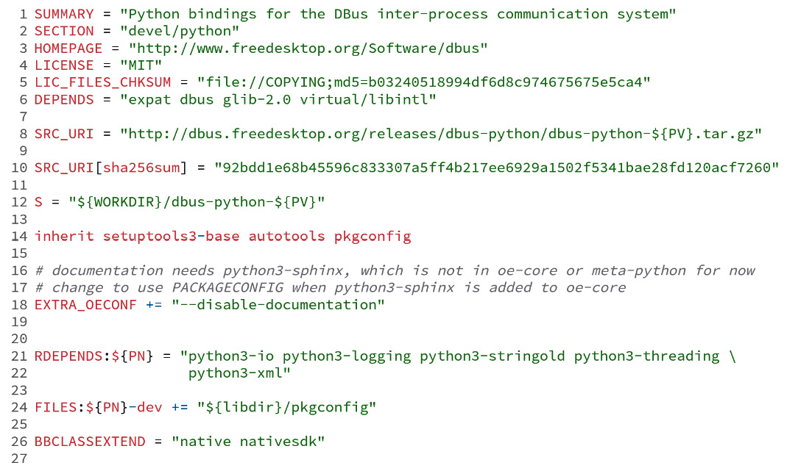

# Chương 7: Tìm hiểu cơ chế hỗ trợ đóng gói (Assimilating Packaging Support)

Chương này trình bày các khái niệm then chốt để hiểu các khía cạnh của Poky và BitBake liên quan đến việc đóng gói. Chúng ta sẽ học về các định dạng binary package được hỗ trợ, shared state cache, các thành phần đánh phiên bản package, cách thiết lập và dùng các binary package feed để hỗ trợ quá trình phát triển của chúng ta, và nhiều nội dung khác.

## Dùng các định dạng package được hỗ trợ

Từ góc nhìn của Yocto Project, một recipe có thể tạo ra một hoặc nhiều output package. Một package gói một tập file và metadata theo cách giúp chúng sẵn sàng để dùng về sau. Chúng có thể được cài đặt vào một hoặc nhiều image hoặc được deploy để dùng sau này.

Package rất quan trọng đối với Poky, vì chúng cho phép build system tạo ra nhiều loại artifact khác nhau, như image và toolchain.

### Danh sách các định dạng package được hỗ trợ

Hiện tại, BitBake hỗ trợ bốn định dạng package khác nhau:

- **Red Hat Package Manager** (**RPM**): Ban đầu có tên là Red Hat Package Manager nhưng nay được biết đến là định dạng package RPM kể từ khi được nhiều bản phân phối Linux khác áp dụng, đây là một định dạng phổ biến được dùng trong các bản phân phối Linux như SuSE, OpenSuSE, Red Hat, Fedora và CentOS.
- **Debian Package Manager** (**DEB**): Đây là một định dạng phổ biến được dùng trong Debian và nhiều bản phân phối Debian-based khác – Ubuntu Linux và Linux Mint là những bản được biết đến rộng rãi nhất.
- **Itsy Package Management System** (**IPK**): Đây từng là một hệ thống quản lý package gọn nhẹ được thiết kế cho các thiết bị embedded, giống với định dạng package của Debian. Trình quản lý package `opkg`, hỗ trợ định dạng IPK, được dùng trong nhiều bản phân phối như OpenEmbedded Core, OpenWRT và Poky.
- **Tar**: Định dạng này bắt nguồn từ **Tape Archive**, một loại file `tarball` được dùng rộng rãi để gom nhiều file thành chỉ một file duy nhất.

### Chọn một định dạng package

Việc hỗ trợ các định dạng được cung cấp bằng một tập class (tức là `package_rpm`, `package_deb` và `package_ipk`). Chúng ta có thể chọn một hoặc nhiều định dạng bằng biến `PACKAGE_CLASSES`, như trong ví dụ sau:

*Hình 7.1 – Biến được dùng để cấu hình định dạng package sẽ dùng*

Bạn có thể cấu hình một hoặc nhiều định dạng package – ví dụ, trong file `build/conf/local.conf`.

> **Mẹo**
>
> Định dạng package đầu tiên trong `PACKAGE_CLASSES` là định dạng được dùng để tạo image.

Poky mặc định dùng định dạng package RPM, vốn dùng trình quản lý package DNF. Tuy nhiên, việc chọn định dạng phụ thuộc vào nhiều yếu tố, như các tính năng package format-specific, bộ nhớ và mức sử dụng tài nguyên. OpenEmbedded Core mặc định dùng IPK và `opkg` làm trình quản lý package, vì nó có mức chiếm dụng bộ nhớ và tài nguyên nhỏ hơn.

Mặt khác, những người dùng quen thuộc với các hệ thống Debian-based có thể thích dùng APT và định dạng package DEB cho sản phẩm của họ.

## Chạy code trong quá trình cài đặt package

Package có thể dùng các script như một phần của quá trình cài đặt và gỡ bỏ. Các script được bao gồm được định nghĩa như sau:

- `preinst`: Script này thực thi trước khi giải nén package. Nếu package có các service, nó phải dừng chúng để cài đặt hoặc nâng cấp.
- `postinst`: Sau khi giải nén, script này thường hoàn tất mọi cấu hình cần thiết của package. Nhiều script `postinst` thực thi bất kỳ lệnh nào cần thiết để khởi động hoặc khởi động lại một service sau khi cài đặt hoặc nâng cấp.
- `prerm`: Script này thường dừng mọi daemon gắn với một package trước khi xóa các file gắn với package đó.
- `postrm`: Script này thường sửa đổi các link hoặc các file khác do package tạo ra.

Các script `preinst` và `prerm` nhắm tới các trường hợp sử dụng phức tạp, như di chuyển dữ liệu khi cập nhật package. Trong trường hợp của Yocto Project, `postinst` và `postrm` cũng chịu trách nhiệm dừng và khởi động các service của `systemd` hoặc `sysvinit`. Một script mặc định được cung cấp khi chúng ta dùng các class `systemd` và `update-rc.d`. Nó có thể được tùy chỉnh để bao gồm bất kỳ trường hợp đặc biệt nào.

Các script post-package installation (`postinst`) được chạy trong lúc tạo `root` filesystem. Package được đánh dấu là đã cài đặt nếu script trả về giá trị thành công. Để thêm một script `postinst` cho một package, chúng ta có thể dùng như sau:

*Hình 7.2 – Một ví dụ về script pkg\_postinst*

Đôi khi, chúng ta cần bảo đảm rằng `postinst` chạy bên trong chính thiết bị target. Điều này có thể thực hiện bằng biến thể `postinst_ontarget`, như sau:

*Hình 7.3 – Một ví dụ về script pkg\_postinst\_ontarget*

> **Mẹo**
>
> Thay vì dùng chính tên package, chúng ta có thể dùng biến `PN`, biến này tự động mở rộng thành tên package của recipe.

Tất cả các script post-installation phải thành công khi chúng ta tạo một image với `read-only-rootfs` trong `IMAGE_FEATURES`. Vì không thể ghi vào một `rootfs` read-only, việc kiểm tra phải diễn ra lúc build. Điều này bảo đảm chúng ta phát hiện vấn đề trong lúc build image, thay vì trong lần boot đầu tiên trên thiết bị target. Nếu có yêu cầu chạy bất kỳ script nào bên trong thiết bị target, task `do_rootfs` sẽ thất bại.

> **Mẹo**
>
> Rốt cuộc, việc dùng toàn bộ image ở dạng read-only không phải là một lựa chọn. Ví dụ, một số project có thể cần lưu giữ một số dữ liệu hoặc thậm chí cho phép một số ứng dụng ghi vào một thư mục volatile. Những trường hợp sử dụng như vậy nằm ngoài phạm vi của cuốn sách này. Tuy nhiên, bạn có thể tìm thấy một số thông tin hữu ích trong *Yocto Project Reference Manual* cho các class `overlayfs` ([https://docs.yoctoproject.org/4.0.4/ref-manual/classes.html#overlayfs-bbclass](https://docs.yoctoproject.org/4.0.4/ref-manual/classes.html#overlayfs-bbclass)) và `overlayfs-etc` ([https://docs.yoctoproject.org/4.0.4/ref-manual/classes.html#overlayfs-etc-bbclass](https://docs.yoctoproject.org/4.0.4/ref-manual/classes.html#overlayfs-etc-bbclass)).

Một sơ suất thường gặp khi tạo các script post-installation là thiếu biến `D` phía trước các đường dẫn tuyệt đối. `D` có hai đặc điểm:

- Trong lúc tạo `rootfs`, `D` được đặt thành gốc của thư mục làm việc
- Bên trong thiết bị, `D` rỗng

Do đó, điều này bảo đảm các đường dẫn hợp lệ trong cả môi trường host lẫn target. Ví dụ, hãy xem đoạn code sau:

*Hình 7.4 – Source code mẫu dùng biến D*

Trong ví dụ ở *Hình 7.4*, lệnh `touch` dùng biến `D`, vì vậy nó hoạt động một cách tổng quát tùy theo giá trị của biến này.

Một lỗi thường gặp khác là cố chạy các tiến trình dành riêng cho hoặc phụ thuộc vào kiến trúc target. Giải pháp dễ nhất trong trường hợp này là hoãn việc thực thi script sang target (dùng `pkg_postinst_ontarget`). Tuy nhiên, như đã đề cập trước đó, điều này ngăn việc dùng các filesystem read-only.

## Tìm hiểu shared state cache

Hành vi mặc định của Poky là build mọi thứ từ đầu, trừ khi BitBake xác định rằng một recipe không cần build lại. Ưu điểm chính của việc build mọi thứ từ đầu là kết quả luôn mới, và không có rủi ro dữ liệu trước đó gây ra vấn đề. Tuy nhiên, build lại mọi thứ đòi hỏi thời gian tính toán và tài nguyên.

Chiến lược xác định một recipe có phải build lại hay không là phức tạp. BitBake cố gắng theo dõi càng nhiều thông tin càng tốt về mọi task, biến và đoạn code được dùng trong quá trình build. Sau đó, BitBake tạo một checksum cho thông tin mà mỗi task sử dụng, bao gồm cả dependency từ các task khác. Tóm lại, BitBake theo dõi một cách đệ quy các biến được dùng, source code của task và các dependency của các recipe cùng các dependency của chúng.

Poky dùng toàn bộ thông tin này do BitBake cung cấp để lưu các snapshot của những task đó dưới dạng một tập dữ liệu đã đóng gói, được tạo ra trong một cache gọi là shared state cache (`sstate-cache`). Cache này gói nội dung output của mỗi task vào các package được lưu trong thư mục `SSTATE_DIR`. Bất cứ khi nào BitBake chuẩn bị chạy một task, trước tiên nó kiểm tra sự tồn tại của một package `sstate-cache` khớp với checksum đã tính cần thiết. Nếu package có mặt, BitBake dùng package đã build sẵn đó.

Toàn bộ cơ chế shared state bao gồm code khá phức tạp, và phần giải thích trên đã đơn giản hóa nó. Để có mô tả chi tiết, bạn nên đọc phần *Shared State Cache* của *Yocto Project Overview and Concepts Manual* ([https://docs.yoctoproject.org/4.0.4/overview-manual/concepts.html#shared-state-cache](https://docs.yoctoproject.org/4.0.4/overview-manual/concepts.html#shared-state-cache)).

Khi dùng Poky cho nhiều lần build, chúng ta phải nhớ rằng `sstate-cache` cần được dọn dẹp thỉnh thoảng, vì nó tiếp tục lớn lên sau mỗi lần build. Có một cách đơn giản để dọn dẹp nó. Hãy dùng lệnh sau từ thư mục `poky`:

*Hình 7.5 – Dòng lệnh để xóa Shared State Cache bị trùng lặp*

> **Mẹo**
>
> Khi cần build lại từ đầu, chúng ta có thể làm một trong hai cách sau:
>
> - Xóa `build/tmp` để có thể dùng `sstate-cache` nhằm tăng tốc lần build
> - Xóa cả `build/tmp` và `sstate-cache` để không có cache nào được dùng lại trong lần build

## Giải thích việc đánh phiên bản package

Việc đánh phiên bản package được dùng để phân biệt cùng một package ở các giai đoạn khác nhau trong vòng đời của nó. Từ góc nhìn của Poky, nó cũng được dùng như một phần của phương trình tạo ra checksum mà BitBake dùng để kiểm tra một task có phải build lại hay không.

Phiên bản package, còn được gọi là `PV`, đóng vai trò chủ đạo khi chúng ta chọn recipe nào để build. Hành vi mặc định của Poky là luôn ưu tiên phiên bản recipe mới nhất, trừ khi có một ưu tiên tường minh khác, như đã bàn trong *Chương 5*, *Nắm vững công cụ BitBake*. Ví dụ, giả sử chúng ta có hai phiên bản của recipe `myrecipe`:

- `myrecipe_1.0.bb`
- `myrecipe_1.1.bb`

Mặc định, BitBake build recipe có phiên bản `1.1`. Bên trong recipe, chúng ta có thể có các biến khác tạo nên việc đánh phiên bản package cùng với biến `PV`. Đó là **package epoch**, được gọi là `PE`, và **package revision**, được gọi là `PR`.

Các biến này thường theo mẫu sau:

*Hình 7.6 – Một mẫu đánh phiên bản đầy đủ*

Biến `PE` có giá trị mặc định là không. Nó được dùng khi lược đồ phiên bản package bị thay đổi, phá vỡ khả năng sắp thứ tự thông thường. `PE` được thêm vào đầu phiên bản package, buộc phiên bản có số cao hơn khi cần.

Ví dụ, giả sử một package dùng ngày tháng để tạo nên các biến `PV` như `20220101`, và có một thay đổi lược đồ phiên bản để phát hành phiên bản `1.0`. Không thể xác định phiên bản `1.0` có cao hơn phiên bản `20220101` hay không. Vì vậy, `PE = "1"` được dùng để thay đổi epoch của recipe, buộc phiên bản `1.0` cao hơn `20220101`, vì `1:1.0` lớn hơn `0:20220101`.

Biến `PR` có giá trị mặc định là `r0` và là một phần của việc đánh phiên bản package. Khi nó được cập nhật, nó buộc BitBake build lại tất cả các task của một recipe cụ thể. Chúng ta có thể cập nhật nó thủ công trong metadata của recipe để buộc một lần build lại mà chúng ta biết là cần thiết. Tuy vậy, cách này mong manh vì nó dựa vào sự can thiệp và hiểu biết của con người. BitBake dùng checksum của task để kiểm soát những gì cần build lại. Việc tăng `PR` thủ công chỉ được dùng trong những trường hợp hiếm hoi khi checksum của task không thay đổi.

## Chỉ định runtime dependency của package

Kết quả của hầu hết các recipe là các package được trình quản lý package quản lý. Như chúng ta đã thấy trong các phần trước, nó cần thông tin về tất cả các package đó và cách chúng liên quan với nhau. Ví dụ, một package có thể phụ thuộc vào hoặc xung đột với một package khác.

Các ràng buộc tồn tại trong nhiều quan hệ giữa các package; tuy nhiên, những ràng buộc đó là package format-specific, vì vậy BitBake có metadata riêng để trừu tượng hóa các ràng buộc đó.

Sau đây là danh sách các ràng buộc runtime của package được dùng nhiều nhất:

- `RDEPENDS`: Danh sách các package phải có sẵn lúc runtime, cùng với package định nghĩa nó.
- `RPROVIDES`: Đây là danh sách các tên tượng trưng mà một package cung cấp. Mặc định, một package luôn bao gồm tên package làm một tên tượng trưng. Nó cũng có thể bao gồm các tên tượng trưng thay thế do package đó cung cấp.
- `RCONFLICTS`: Đây là danh sách các package được biết là xung đột với package này. Image cuối cùng không được bao gồm các package xung đột.
- `RREPLACES`: Đây là danh sách các tên tượng trưng mà package có thể thay thế.

Một recipe đầy đủ, từ `meta/recipes-devtools/python/python3-dbus_1.2.18.bb`, như sau:

*Hình 7.7 – Một ví dụ về cách dùng RDEPENDS*

Recipe từ *Hình 7.7* cho thấy package `python3-dbus` có một danh sách runtime dependency vào nhiều module Python, ở dòng 21.

## Dùng package để tạo một image rootfs

Một trong những cách dùng phổ biến nhất của Poky là tạo image `rootfs`. Image `rootfs` nên được xem là một root filesystem ready-to-use cho một target. Image có thể gồm một hoặc nhiều filesystem. Nó có thể bao gồm các artifact khác có sẵn trong quá trình tạo nó, như Linux kernel, device tree và các binary của bootloader. Quá trình tạo image gồm nhiều bước. Các cách dùng phổ biến nhất của nó như sau:

1. Tạo thư mục `rootfs`
2. Tạo các file cần thiết
3. Gói filesystem cuối cùng theo các yêu cầu cụ thể (nó có thể là một file đĩa với nhiều phân vùng và nội dung)
4. Cuối cùng, nén nó, nếu có thể áp dụng

Các sub-tasks của `do_rootfs` thực hiện tất cả các bước này. `rootfs` là một thư mục với các package mong muốn đã được cài đặt, cùng với các tinh chỉnh cần thiết được áp dụng sau đó. Các tinh chỉnh này thực hiện những điều chỉnh nhỏ đối với nội dung `rootfs` – ví dụ, khi build một image phát triển, `rootfs` được điều chỉnh để cho phép chúng ta đăng nhập bằng `root` mà không cần mật khẩu.

Danh sách các package cần cài đặt vào `rootfs` được định nghĩa bằng hợp của các package được liệt kê bởi `IMAGE_INSTALL` và các package được bao gồm bởi `IMAGE_FEATURES`; việc tùy chỉnh image được trình bày chi tiết trong *Chương 12*, *Tạo các layer tùy chỉnh*. Mỗi image feature có thể bao gồm thêm các package để cài đặt – ví dụ, `dev-pkgs`, feature này cài đặt các thư viện phát triển và header của tất cả các package được liệt kê để cài vào `rootfs`.

Danh sách các package cần cài đặt lúc này được lọc bởi biến `PACKAGE_EXCLUDE`, biến liệt kê các package không nên được cài đặt. Các package được liệt kê trong `PACKAGE_EXCLUDE` chỉ bị loại khỏi danh sách các package được cài đặt một cách tường minh.

Với tập package cuối cùng cần cài đặt, task `do_rootfs` có thể khởi động quá trình giải nén và cấu hình từng package, cùng các dependency cần thiết của nó, vào thư mục `rootfs`. Việc tạo `rootfs` dùng package feed cục bộ, mà chúng ta sẽ đề cập trong phần tiếp theo.

Khi nội dung `rootfs` đã được giải nén, các script post-installation non-target của các package được nhắc đến phải chạy để tránh cái giá phải trả khi chạy chúng trong lần boot đầu tiên.

Lúc này, thư mục đã sẵn sàng để tạo filesystem. `IMAGE_FSTYPES` liệt kê filesystem cần tạo – ví dụ, **EXT4** hoặc **UBIFS**.

Sau khi task `do_rootfs` hoàn tất, file image được tạo ra được đặt tại `build/tmp/deploy/image/<machine>/`. Quá trình tạo image của chúng ta và các giá trị có thể có cho `IMAGE_FEATURES` và `IMAGE_FSTYPES` được mô tả trong *Chương 12*, *Tạo các layer tùy chỉnh*.

## Package feed

Như đã bàn trong *Chương 5*, *Nắm vững công cụ BitBake*, package đóng vai trò thiết yếu, vì image và **Software Development Kit** (**SDK**) dựa vào chúng. Thực tế, `do_rootfs` dùng một repository cục bộ để fetch các binary package khi tạo các artifact đó. Repository này được gọi là package feed.

Không có lý do gì để repository này chỉ được dùng cho các bước build image hay SDK. Có nhiều lý do hợp lệ để làm cho repository này có thể truy cập từ xa, hoặc nội bộ trong môi trường phát triển của chúng ta, hoặc công khai. Một số lý do như sau:

- Bạn có thể dễ dàng kiểm thử một ứng dụng được cập nhật trong giai đoạn phát triển mà không cần re-installation toàn bộ hệ thống
- Bạn có thể làm cho các package bổ sung linh hoạt hơn để chúng có thể được cài đặt vào một image đang chạy
- Bạn có thể cập nhật các sản phẩm ngoài thực địa

Để tạo ra một package feed vững chắc, chúng ta phải bảo đảm có sự tăng nhất quán của package revision mỗi khi package thay đổi. Gần như không thể làm điều này thủ công, và Yocto Project có một dịch vụ `PR` được thiết kế riêng để hỗ trợ việc này.

**PR service**, một phần của BitBake, được dùng để tăng `PR` mà không cần sự can thiệp của con người mỗi khi BitBake phát hiện một thay đổi checksum trong một task. Nó chèn một hậu tố vào `PR` theo định dạng `${PR}.X`. Ví dụ, nếu chúng ta có `PR = "r34"`, sau các lần tương tác tiếp theo với dịch vụ `PR`, giá trị `PR` trở thành `r34.1`, `r34.2`, `r34.3`, v.v. Việc dùng dịch vụ `PR` rất quan trọng đối với các package feed vững chắc, vì nó đòi hỏi phiên bản tăng tuyến tính.

> **Mẹo**
>
> Mặc dù chúng ta nên dùng dịch vụ `PR` để có việc đánh phiên bản package vững chắc, điều này không loại trừ nhu cầu đặt `PR` thủ công trong những trường hợp ngoại lệ.

Mặc định, dịch vụ `PR` không được bật hay chạy. Chúng ta có thể bật nó để chạy cục bộ bằng cách thêm biến `PRSERV_HOST` vào cấu hình BitBake – ví dụ, trong `build/conf/local.conf`, như sau:

*Hình 7.8 – Cách cấu hình dịch vụ PR chạy cục bộ*

Cách tiếp cận này phù hợp khi việc build diễn ra trên một máy tính duy nhất, máy build mọi package của package feed. BitBake khởi động và dừng server ở mỗi lần build và tự động tăng các giá trị `PR` cần thiết.

Với một thiết lập phức tạp hơn, với nhiều máy tính cùng làm việc trên một package feed dùng chung, chúng ta phải có một dịch vụ `PR` duy nhất đang chạy, được dùng bởi tất cả các hệ thống build gắn với package feed đó. Trong trường hợp này, chúng ta cần khởi động dịch vụ `PR` trên server bằng lệnh `bitbake-prserv`, như sau:

*Hình 7.9 – Dòng lệnh để khởi động server của dịch vụ PR*

Ngoài việc manually-starting dịch vụ, chúng ta cần cập nhật file cấu hình BitBake (ví dụ, `build/conf/local.conf`) của mỗi build system, hệ thống kết nối tới một server bằng biến `PRSERV_HOST`, như đã mô tả trước đó, để mỗi hệ thống trỏ tới `IP` và `port` của server.

### Dùng package feed

Để dùng package feed, cần có hai thành phần sau:

- Server cung cấp quyền truy cập vào các package
- Client truy cập server và tải về các package cần thiết

Tập package do package feed cung cấp được xác định bởi các recipe mà chúng ta build. Chúng ta có thể build một hoặc nhiều recipe và cung cấp chúng, hoặc build một tập image để tạo ra các package mong muốn. Khi đã hài lòng với các package được cung cấp, chúng ta phải tạo package index do các package feed cung cấp. Lệnh sau thực hiện việc này:

*Hình 7.10 – Dòng lệnh để tạo package index*

Các package có sẵn bên trong thư mục `build/tmp/deploy`. Chúng ta phải chọn sub-directory tương ứng tùy theo định dạng package đã chọn. Poky dùng RPM theo mặc định, vì vậy chúng ta phải cung cấp nội dung của thư mục `build/tmp/deploy/rpm`.

> **Mẹo**
>
> Hãy bảo đảm chạy `bitbake package-index` sau khi build tất cả các package; nếu không, package index sẽ không bao gồm chúng.

Package index và các package phải được cung cấp thông qua một giao thức truyền như HTTP. Chúng ta có thể dùng bất kỳ server nào mình muốn cho việc này, như Apache, Nginx và Lighttpd. Một cách tiện lợi để cung cấp các package qua HTTP cho việc phát triển cục bộ là dùng Python simple HTTP server, như sau:

*Hình 7.11 – Cách cung cấp package feed bằng Python simple HTTP server*

Để thêm hỗ trợ quản lý package vào image, chúng ta có một vài thay đổi cần thực hiện. Chúng ta cần thêm `package-management` vào `EXTRA_IMAGE_FEATURES` và đặt URI để fetch package trong `PACKAGE_FEED_URIS`. Ví dụ, chúng ta có thể thêm nội dung này vào `build/conf/local.conf`:

*Hình 7.12 – Cách cấu hình một package feed từ xa*

Chúng ta sẽ trình bày chi tiết các biến `IMAGE_FEATURES` và `EXTRA_IMAGE_FEATURES` trong *Chương 12*, *Tạo các layer tùy chỉnh*. Nếu muốn một image nhỏ không có hỗ trợ quản lý package, chúng ta nên bỏ `package-management` khỏi `EXTRA_IMAGE_FEATURES`.

Các cấu hình `PACKAGE_FEED_URIS` và `EXTRA_IMAGE_FEATURES` bảo đảm rằng image ở phía client có thể truy cập server và có các tiện ích cần thiết để cài đặt, gỡ bỏ và nâng cấp các package của nó. Sau các bước này, chúng ta có thể dùng runtime package management trên thiết bị target.

Ví dụ, nếu chọn định dạng package RPM cho image, chúng ta có thể fetch thông tin repository bằng lệnh sau:

*Hình 7.13 – Dòng lệnh để fetch repository của package feed*

Hãy dùng các lệnh `dnf search <package>` và `dnf install <package>` để tìm và cài đặt package từ các repository.

Tùy theo định dạng package đã chọn, các lệnh để target cập nhật package index, tìm kiếm và cài đặt một package là khác nhau. Hãy xem các dòng lệnh có sẵn cho từng định dạng package trong bảng sau:

| **Định dạng package** | **RPM** | **IPK** | **DEB** |
|---|---|---|---|
| Cập nhật package index | `dnf check-updates` | `opkg update` | `apt-get update` |
| Tìm kiếm một package | `dnf search` `<package>` | `opkg search` `<package>` | `apt-cache search` `<package>` |
| Cài đặt một package | `dnf install` `<package>` | `opkg install` `<package>` | `apt-get install` `<package>` |
| Nâng cấp hệ thống | `dnf upgrade` | `opkg upgrade` | `apt-get dist- upgrade` *(ghi chú: đúng là `apt-get dist-upgrade`)* |

*Bảng 7.1 – So sánh các lệnh quản lý package*

Việc dùng package feed rất tốt trong giai đoạn phát triển cục bộ vì chúng cho phép chúng ta cài đặt package vào một image đã được deploy.

> **Lưu ý**
>
> Việc dùng package feed để nâng cấp hệ thống ngoài thực địa đòi hỏi một nỗ lực kiểm thử rất lớn để bảo đảm hệ thống không rơi vào trạng thái hỏng. Nỗ lực kiểm thử là rất lớn để kiểm chứng tất cả các kịch bản nâng cấp khác nhau. Thông thường, nâng cấp toàn bộ image an toàn hơn cho môi trường production.

Việc quản lý một package feed phức tạp hơn nhiều. Nó liên quan đến nhiều khía cạnh khác, như các chuỗi dependency của package và các kịch bản nâng cấp khác nhau. Việc tạo một server package feed bên ngoài phức tạp nằm ngoài phạm vi của cuốn sách này, vì vậy hãy tham khảo tài liệu Yocto Project để biết thêm chi tiết.

## Tóm tắt

Chương này đã trình bày các khái niệm cơ bản về đóng gói, vốn có vai trò quan trọng trong Poky và BitBake (đánh phiên bản package), và cách điều này ảnh hưởng đến hành vi của Poky khi build lại package và package feed. Nó cũng cho chúng ta thấy cách cấu hình một image để được cập nhật bằng các package đã build sẵn do một server từ xa cung cấp.

Trong chương tiếp theo, chúng ta sẽ học về cú pháp metadata của BitBake và các toán tử của nó, cách append, prepend và xóa nội dung khỏi biến, mở rộng biến, v.v. Sau đó, chúng ta sẽ có thể hiểu rõ hơn ngôn ngữ được dùng trong các engine của Yocto Project.
