# Chương 9: Phát triển với Yocto Project (Developing with the Yocto Project)

Cho đến giờ trong cuốn sách này, chúng ta đã dùng Poky như một công cụ build. Nói cách khác, chúng ta đã dùng nó như một công cụ để thiết kế và tạo ra image được giao kèm sản phẩm.

Trong chương này, chúng ta sẽ xem cách thiết lập một môi trường phát triển để dùng bên trong target và làm quen với các công cụ **Standard SDK** và **Extensible SDK**, vốn có thể giúp chúng ta phát triển ứng dụng bên ngoài target. Ví dụ, chúng cho phép chúng ta cross-compile ứng dụng, recipe và image.

## Software development kit là gì?

Trong phát triển embedded, toolchain thường gồm các công cụ cross-platform hoặc các công cụ được thực thi trên một kiến trúc, rồi tạo ra binary để dùng trên một kiến trúc khác – ví dụ, một công cụ GCC chạy trên một máy x86-64-compatible và tạo ra binary cho một máy ARM là một cross-compiler. Khi một công cụ và các binary kết quả dựa vào các dependency từ cùng host mà công cụ chạy trên đó, điều này thường được gọi là native build. Kiến trúc build và kiến trúc target có thể giống nhau, nhưng đó là cross-compilation nếu binary target dùng một root filesystem được staging để tìm các dependency của nó.

Một **software development kit** (**SDK**) là một tập công cụ và file để phát triển và debug ứng dụng. Các công cụ này bao gồm compiler, linker, debugger, thư viện bên ngoài, header và binary, còn được gọi là toolchain. Nó cũng có thể bao gồm thêm các tiện ích và ứng dụng. Chúng ta có thể có hai loại SDK:

- **Cross-development SDK**: Loại này có mục tiêu được dùng trên host phát triển để tạo ra binary cho target
- **Native SDK**: Loại này nhằm chạy trên thiết bị target

## Tạo một native SDK cho việc phát triển on-device

Một số thiết bị embedded đủ mạnh để được dùng làm môi trường phát triển. Tuy nhiên, tài nguyên cần cho việc build thay đổi đáng kể giữa thư viện hay ứng dụng này với thư viện hay ứng dụng khác, vì vậy việc dùng target làm môi trường build không phải lúc nào cũng khả thi. Image phát triển cần những thứ sau:

- Các file header và thư viện
- Toolchain

Dòng sau thêm các thuộc tính này vào một image:

*Hình 9.1 – Cách cấu hình một image để bao gồm các artifact phát triển*

`IMAGE_FEATURES` trong ví dụ trên mở rộng chức năng của image như sau:

- `dev-pkgs`: Cài đặt các development package (header và các link thư viện bổ sung) cho tất cả các package được cài đặt trong một image cho trước
- `tools-sdk`: Cài đặt toolchain chạy trên thiết bị

Biến `IMAGE_FEATURES` được mô tả chi tiết hơn trong *Chương 12*, *Tạo các layer tùy chỉnh*.

> **Mẹo**
>
> Nếu chúng ta chỉ muốn sửa đổi `build/conf/local.conf`, biến chúng ta nên dùng là `EXTRA_IMAGE_FEATURES`.

Target có thể dùng image này trong chu kỳ phát triển ứng dụng và chia sẻ image cho tất cả các developer đang làm việc trên cùng project. Mỗi developer sẽ có một bản sao, và nhóm phát triển sẽ dùng cùng một môi trường phát triển một cách nhất quán.

## Tìm hiểu các loại cross-development SDK

Yocto Project có thể tạo ra hai loại cross-development SDK nhằm đáp ứng các nhu cầu khác nhau. Chúng được định nghĩa như sau:

- **Standard SDK**: Loại này cung cấp các artifact cho việc phát triển ứng dụng, dù là phát triển bootloader hay Linux kernel, hoặc một phần mềm user space nào đó khác
- **Extensible SDK**: Loại này cho phép cài đặt thêm các package bên trong thư mục `sysroot` của SDK, cũng như tích hợp recipe và ứng dụng bên trong một môi trường Yocto Project-controlled

Standard SDK bao gồm một toolchain và các ứng dụng debug. Mục tiêu của nó là cho phép người dùng tạo ra binary để dùng trên target. Extensible SDK mạnh hơn và có thể build image và recipe. Một khác biệt đáng chú ý giữa hai loại SDK là sự có mặt của `devtool` trong Extensible SDK.

`devtool` chịu trách nhiệm cung cấp các tính năng bổ sung của Extensible SDK. Nó là một giao diện để dùng sức mạnh của BitBake và `recipetool`. Các lệnh `devtool` và `recipetool` cũng có sẵn trong môi trường Yocto Project truyền thống.

## Dùng Standard SDK

Thông thường, một SDK có một tập thư viện và ứng dụng mà nó phải cung cấp, được định nghĩa trong một image được may đo cho sản phẩm. Chúng được gọi là các SDK image-based. Ví dụ, chúng ta có thể tạo Standard SDK cho `core-image-full-cmdline` bằng lệnh sau:

*Hình 9.2 – Cách tạo Standard SDK cho core-image-full-cmdline*

Một lựa chọn khác là tạo một SDK tổng quát với toolchain và các công cụ debug. SDK tổng quát này được gọi là `meta-toolchain` và chủ yếu được dùng cho việc phát triển Linux kernel và bootloader cùng các quá trình debug của chúng. Nó có thể không đủ để build các ứng dụng có dependency phức tạp. Để tạo `meta-toolchain`, hãy dùng lệnh sau:

*Hình 9.3 – Cách tạo một SDK tổng quát*

Trong cả hai trường hợp, các file self-installer của SDK kết quả nằm tại `build/tmp/deploy/sdk/`. Xét việc chúng ta đã dùng Standard SDK cho `core-image-full-cmdline`, chúng ta có thể thấy tập file kết quả sau:

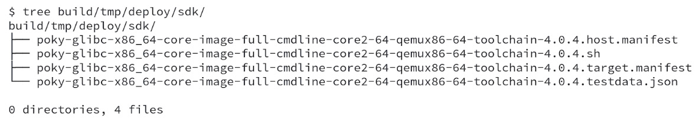

*Hình 9.4 – Các file kết quả sau khi chạy bitbake core-image-full-cmdline -c populate\_sdk*

Bước tiếp theo sau khi tạo Standard SDK là cài đặt nó, vì Standard SDK được gói trong một script cài đặt có thể được thực thi giống như mọi script khác. Trình tự sau cho thấy quá trình cài đặt Standard SDK dùng thư mục đích chuẩn:

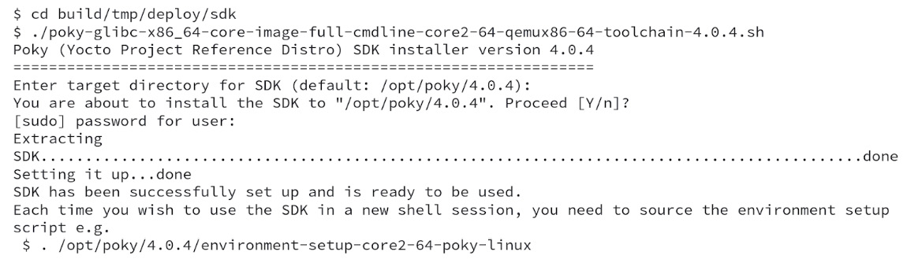

*Hình 9.5 – Quá trình cài đặt Standard SDK*

Standard SDK ở trên minh họa cách chúng ta có thể tạo và cài đặt một Standard SDK. Tuy vậy, việc dùng một image chuẩn không được may đo cho nhu cầu hiện tại của bạn là không lý tưởng. Vì vậy, rất nên tạo một image tùy chỉnh phù hợp với nhu cầu ứng dụng của chúng ta. Cũng nên dựa Standard SDK trên image tùy chỉnh này.

Standard SDK được tạo ra để khớp với kiến trúc machine mà chúng ta đặt bằng biến `MACHINE`. Để dùng Standard SDK build một ứng dụng tùy chỉnh, ví dụ, `hello-world.c`, chúng ta có thể dùng các dòng sau, nhắm tới kiến trúc x86-64:

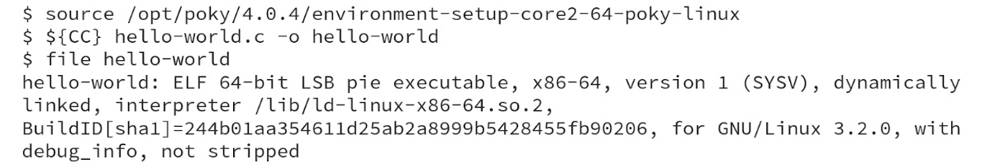

*Hình 9.6 – Các bước build một ứng dụng C bằng Standard SDK*

Một project khác được dùng rất phổ biến là Linux kernel. Khi muốn build source code Linux kernel, chúng ta có thể dùng chuỗi lệnh sau:

*Hình 9.7 – Các bước build Linux kernel bằng Standard SDK*

`unset LDFLAGS` là cần thiết để tránh dùng GCC cho việc link, vốn là mặc định của Standard SDK Yocto Project-based.

## Dùng Extensible SDK

Extensible SDK mở rộng các chức năng của Standard SDK. Một số khả năng đáng kể được bao gồm như sau:

- Tạo recipe
- Build recipe
- Build image
- Cài đặt package vào toolchain nội bộ
- Deploy package tới target

Các tính năng bổ sung này được cung cấp bởi tiện ích `devtool`, tiện ích này cũng có sẵn trong môi trường Yocto Project chuẩn.

Để tạo Extensible SDK, hãy dùng lệnh sau:

*Hình 9.8 – Lệnh để tạo Extensible SDK*

Các file kết quả nằm trong `build/tmp/deploy/sdk/`. Xét việc chúng ta đã dùng Extensible SDK cho `core-image-full-cmdline`, chúng ta thấy tập file sau:

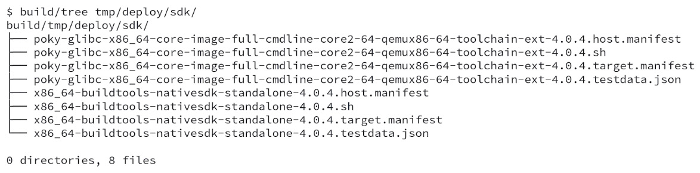

*Hình 9.9 – Các file kết quả sau khi chạy bitbake core-image-full-cmdline -c populate\_sdk\_ext*

Bước tiếp theo sau khi tạo Extensible SDK là cài đặt nó. Để cài đặt, chúng ta có thể thực thi script được tạo ra. Trình tự sau cho thấy quá trình cài đặt Extensible SDK dùng thư mục đích chuẩn:

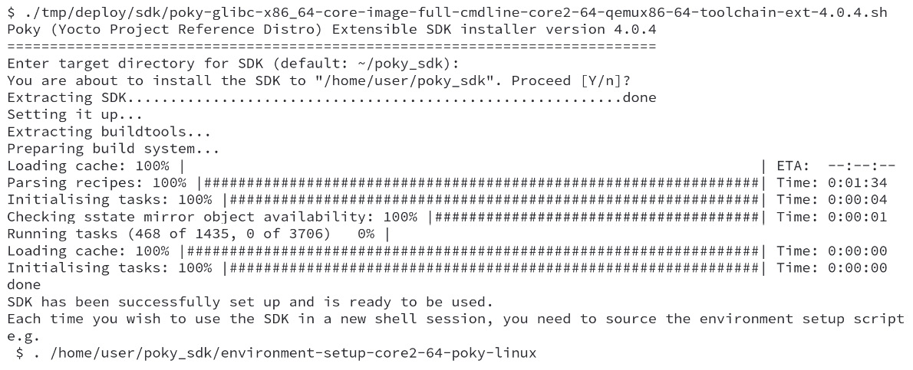

*Hình 9.10 – Quá trình cài đặt Extensible SDK*

Ảnh chụp màn hình trên minh họa cách chúng ta có thể tạo và cài đặt một Extensible SDK. Tuy vậy, việc dùng một image chuẩn không được may đo cho nhu cầu hiện tại của bạn là không lý tưởng. Vì vậy, rất nên tạo một image tùy chỉnh phù hợp với nhu cầu ứng dụng của bạn, và cũng nên dựa Extensible SDK trên một image như vậy. Tuy nhiên, chúng ta có thể build và cài đặt mọi dependency bổ sung vào SDK bằng Extensible SDK.

Trong trường hợp của chúng ta, chúng ta đã cài đặt Extensible SDK vào `/home/user/poky_sdk`. Sau khi cài đặt hoàn tất, bước tiếp theo là dùng script được cung cấp để export các biến môi trường cần thiết, giúp có thể dùng Extensible SDK, bằng lệnh sau:

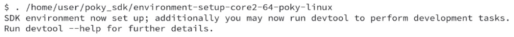

*Hình 9.11 – Export các biến môi trường để có thể dùng Extensible SDK*

Trong các phần sau, chúng ta sẽ đề cập một số trường hợp sử dụng `devtool`. Tất cả các lệnh được thực thi bên trong một terminal đã export các biến của Extensible SDK.

Extensible SDK là một cách khác để phân phối cùng các công cụ và metadata của Yocto Project. Nó gói chung những thứ sau:

- Một tập binary cơ bản để thực thi môi trường Yocto Project
- Một Standard SDK để phát triển
- Một shared state cache để giảm việc build cục bộ
- Một snapshot của metadata và cấu hình Yocto Project

Về bản chất, Extensible SDK là một snapshot của môi trường được dùng để tạo ra nó. Vì vậy, tất cả các lệnh `devtool`, bao gồm cả những lệnh chúng ta sẽ dùng trong các phần sau, đều có sẵn bên trong môi trường Yocto Project.

### Build một image bằng devtool

Hãy bắt đầu bằng việc tạo một image. Extensible SDK có khả năng tạo mọi image được hỗ trợ. Ví dụ, để tạo `core-image-full-cmdline`, chúng ta có thể dùng dòng lệnh sau:

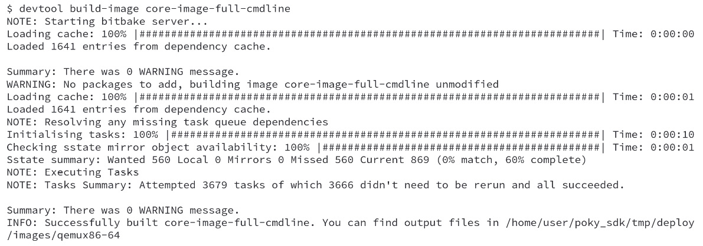

*Hình 9.12 – Build core-image-full-cmdline bằng devtool*

Sau khi chạy lệnh `devtool`, các file được tạo ra có thể được tìm thấy trong `/home/user/poky_sdk/tmp/deploy/images/qemux86-64`.

### Chạy một image trên QEMU

Chúng ta có thể emulate phần cứng target bằng QEMU, dùng image đã build trước đó, `core-image-full-cmdline`, bằng lệnh sau:

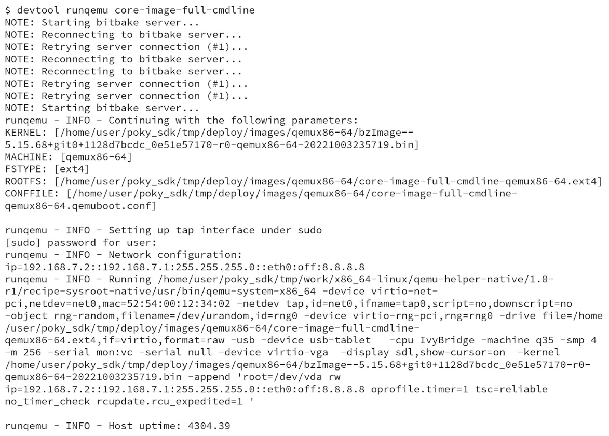

*Hình 9.13 – Emulate bằng devtool và QEMU*

Nó khởi động việc thực thi QEMU và tạo ra màn hình boot splash, như được thể hiện trong ảnh chụp màn hình sau:

*Hình 9.14 – Màn hình boot splash của QEMU*

### Tạo một recipe từ một Git repository bên ngoài

`devtool` cũng có khả năng tạo ra một recipe từ một Git repository bên ngoài. Ở đây, chúng ta sẽ dùng [https://github.com/OSSystems/bbexample](https://github.com/OSSystems/bbexample):

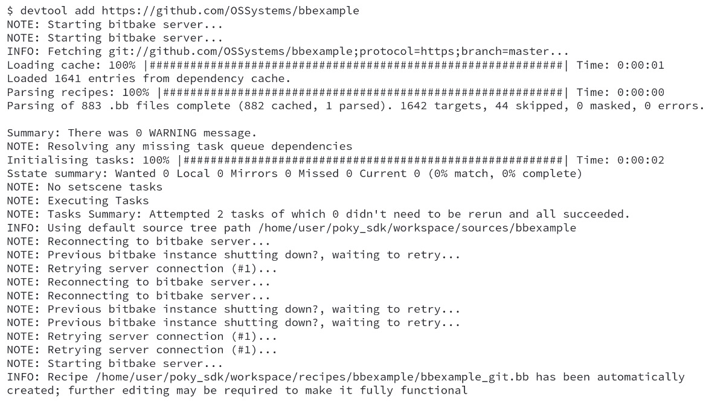

*Hình 9.15 – Tạo recipe bằng devtool*

`devtool` tạo một file recipe cơ bản cho repository được chỉ định. Nó tạo một workspace với source code của package và metadata cần thiết. Cấu trúc file mà `devtool` dùng, sau khi chạy lệnh `devtool add https://github.com/OSSystems/bbexample`, như sau:

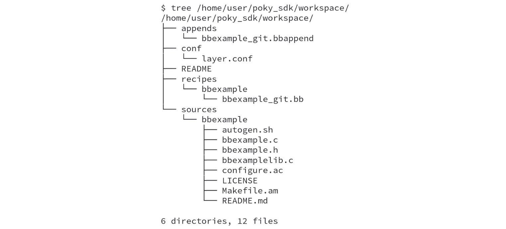

*Hình 9.16 – Cấu trúc file do devtool tạo ra khi tạo một recipe*

Hiện tại, `devtool` tạo ra một recipe dự kiến cho các project dựa trên những thứ sau:

- Autotools (`autoconf` và `automake`)
- CMake
- Scons
- `qmake`
- Một `Makefile` đơn thuần
- Module Node.js
- Các module Python dùng `setuptools` hoặc `distutils`

### Build một recipe bằng devtool

Giờ khi recipe đã được tạo dưới thư mục workspace, chúng ta có thể build nó bằng lệnh sau:

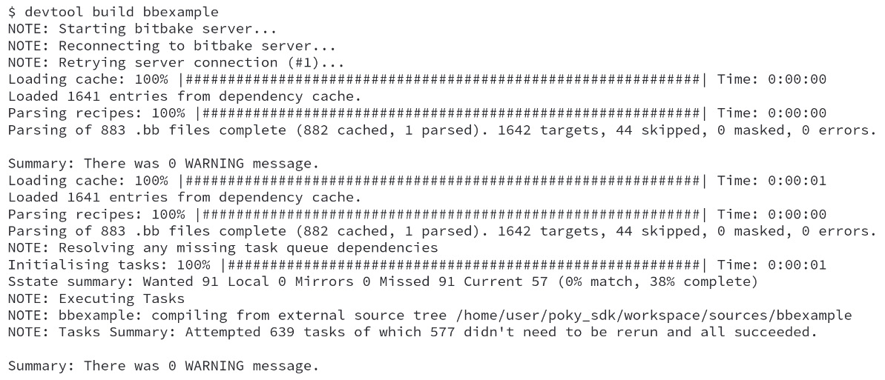

*Hình 9.17 – Build một recipe bằng devtool*

### Deploy tới target bằng devtool

Sau khi build package bằng `devtool`, chúng ta có thể deploy nó tới target. Trong ví dụ của chúng ta, target là QEMU đang chạy. Để truy cập nó, hãy dùng địa chỉ IP mặc định của QEMU, `192.168.7.2`, như trong lệnh sau:

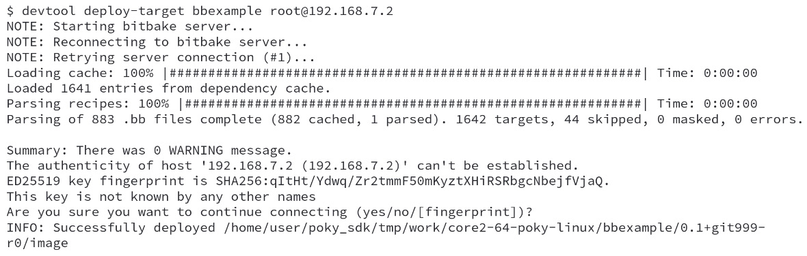

*Hình 9.18 – Deploy tới target bằng devtool*

Ứng dụng đã được cài đặt trên target. Chúng ta có thể thấy `bbexample` đang được thực thi trên target QEMU, như được thể hiện trong ảnh chụp màn hình sau:

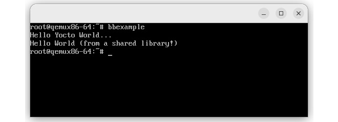

*Hình 9.19 – bbexample đang thực thi trên target*

### Mở rộng SDK

Một trong những mục tiêu của Extensible SDK là cho phép chúng ta cài đặt các recipe khác nhau vào môi trường SDK. Ví dụ, để có sẵn `libusb1`, chúng ta có thể chạy lệnh sau:

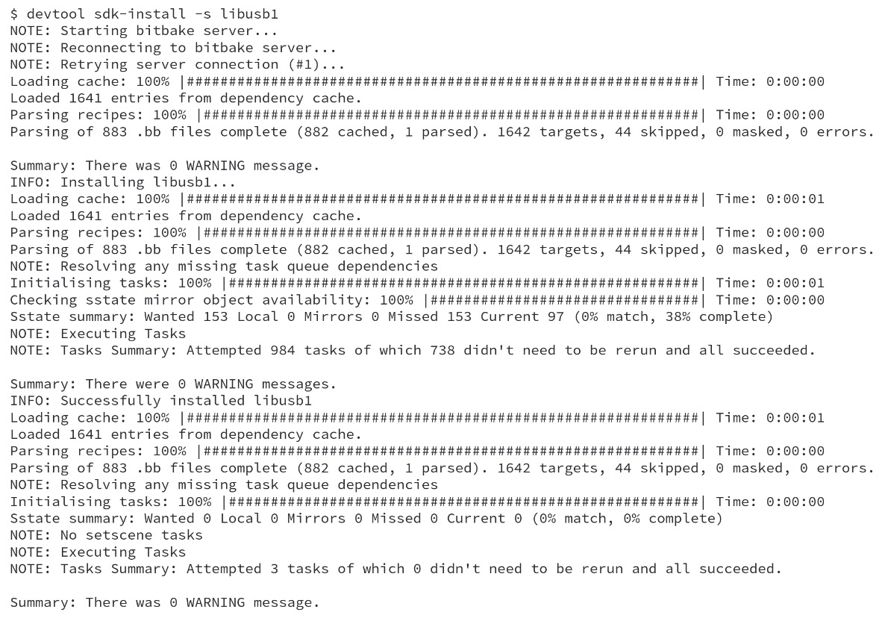

*Hình 9.20 – Cài đặt một recipe mới vào Extensible SDK*

> **Mẹo**
>
> Extensible SDK của Yocto Project cho phép phát triển phân tán, vì các developer có thể cập nhật và mở rộng môi trường SDK hiện có trong suốt vòng đời của project. Cần thiết lập một số hạ tầng để dùng Extensible SDK đúng cách, như một mirror `sstate-cache` và một server Extensible SDK, việc này đòi hỏi một cấu hình phức tạp vượt ngoài phạm vi của cuốn sách này. Để biết thêm chi tiết, hãy tham khảo phần *Providing Updates to the Extensible SDK After Installation* của *Yocto Project Application Development and the Extensible Software Development Kit (eSDK)* ([https://docs.yoctoproject.org/4.0.4/sdk-manual/appendix-customizing.html#providing-updates-to-the-extensible-sdk-after-installation](https://docs.yoctoproject.org/4.0.4/sdk-manual/appendix-customizing.html#providing-updates-to-the-extensible-sdk-after-installation)).

## Tóm tắt

Trong chương này, chúng ta đã học rằng Yocto Project có thể được dùng cho việc phát triển và tạo image. Chúng ta đã học cách tạo các loại toolchain khác nhau và cả cách dùng chúng.

Trong chương tiếp theo, chúng ta sẽ xem cách cấu hình Poky để giúp chúng ta trong quá trình debug, cách cấu hình hệ thống của chúng ta để cung cấp các công cụ cần thiết cho remote debugging bằng GDB, và cách theo dõi các thay đổi của chúng ta bằng `buildhistory`.
