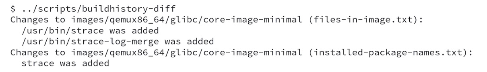
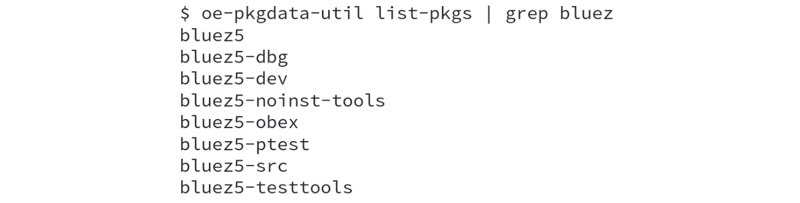
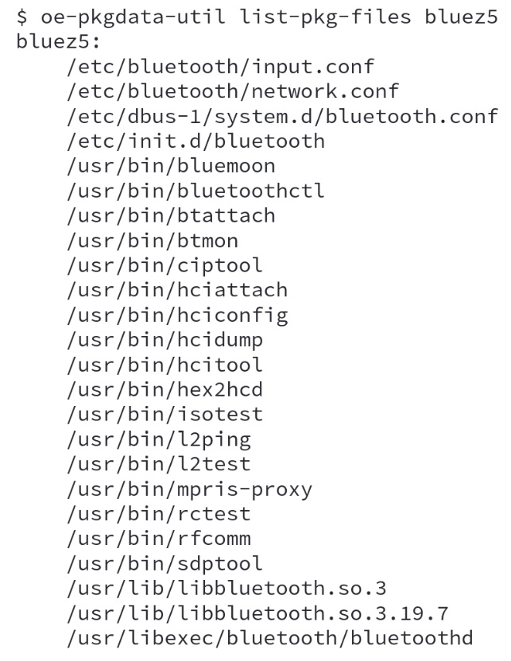
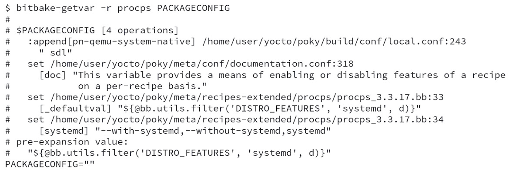
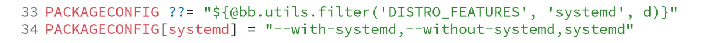
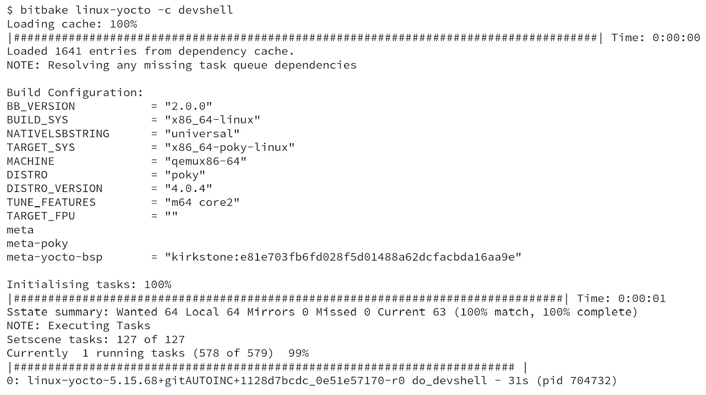
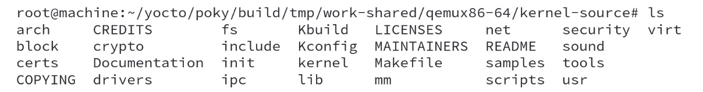

# Chương 10: Debug với Yocto Project (Debugging with the Yocto Project)

Quá trình debug là một bước thiết yếu trong mọi chu kỳ phát triển. Trong chương này, chúng ta sẽ học cách cấu hình Poky để giúp chúng ta trong quá trình debug; ví dụ, cách cấu hình hệ thống để cung cấp các công cụ cần thiết cho việc debug từ xa bằng **Gnu DeBugger** (**GDB**), cách theo dõi các thay đổi bằng `buildhistory`, và cách dùng các công cụ debug tiện lợi, như `oe-pkgdata-util`, `bitbake-getvar` và `devshell`.

## Phân biệt debug metadata và debug ứng dụng

Trước khi đi sâu vào chi tiết của việc debug, chúng ta cần nhận ra rằng có nhiều loại debug khác nhau, như debug metadata và debug code lúc runtime.

Debug metadata là cần thiết để bảo đảm hành vi của các task BitBake khớp với mục tiêu của chúng ta và để xác định thủ phạm khi chúng không khớp. Ví dụ, một recipe có thể cần được sửa để bật một tính năng. Trong trường hợp như vậy, chúng ta có thể dùng nhiều file log do BitBake tạo ra trên host để giúp lần theo đường thực thi của task liên quan.

Mặt khác, debug code lúc runtime tự nhiên hơn vì về bản chất nó giống như chu kỳ phát triển thông thường của một ứng dụng, một thư viện hay một kernel. Tùy theo vấn đề mà chúng ta đang tìm cách giải quyết, công cụ phù hợp để hỗ trợ có thể thay đổi từ một debugger đến việc instrument code (ví dụ, thêm các lệnh in debug).

## Theo dõi nội dung của image, package và SDK

Cách dễ nhất để bảo đảm chúng ta có image, package và **software development kit** (**SDK**) với nội dung như mong đợi là dùng cơ chế `buildhistory`.

Khi một recipe được cập nhật lên phiên bản mới hoặc bị thay đổi code, nó có thể ảnh hưởng đến nội dung của các package được tạo ra và, do đó, đến image hoặc SDK.

Poky xử lý nhiều recipe, và các image hoặc SDK thường có hàng chục hoặc hàng trăm package. Vì vậy, việc theo dõi nội dung package có thể là một thách thức. Công cụ của Poky giúp cho việc này là `buildhistory`.

`buildhistory`, như tên gọi gợi ý, lưu giữ lịch sử nội dung của nhiều artifact được build trong quá trình dùng Poky. Nó theo dõi việc build package, image và SDK cùng nội dung của chúng.

Để bật `buildhistory` trên hệ thống của chúng ta, chúng ta cần thêm các dòng code sau vào file `build/conf/local.conf`:

*Hình 10.1 – Cách bật hỗ trợ buildhistory*

Phương thức `INHERIT` đưa các hook của class `buildhistory` vào quá trình build. Đồng thời, dòng `BUILDHISTORY_COMMIT` cho phép BitBake tạo một Git commit mới trong repository `buildhistory` cho mỗi lần build package, image hoặc SDK mới. Git commit giúp việc theo dõi đơn giản như dùng `git diff` giữa hai commit. Dữ liệu được lưu dưới thư mục `build/buildhistory` dưới dạng các file văn bản để dễ sử dụng.

Poky cung cấp một tiện ích xuất ra sự khác biệt giữa hai trạng thái `buildhistory`, gọi là `buildhistory-diff`, theo một cách ngắn gọn hơn, rất hữu ích khi kiểm tra các thay đổi. Tiện ích `buildhistory-diff` xuất ra sự khác biệt giữa hai Git revision bất kỳ một cách có ý nghĩa hơn.

Ví dụ, giả sử chúng ta thêm package `strace` vào image `core-image-minimal` và build nó. Khi đó, lệnh `buildhistory-diff` có thể được dùng để kiểm tra các thay đổi kết quả, như trong ảnh chụp màn hình sau:

*Hình 10.2 – Kết quả của buildhistory-diff*

Với mỗi lần build package, `buildhistory` tạo ra một danh sách các sub-packages được tạo, các script cài đặt, một danh sách quyền sở hữu và kích thước file, quan hệ dependency, và nhiều thứ khác. Ngoài ra, quan hệ dependency giữa các package, các file filesystem và đồ thị dependency được tạo ra cho image và SDK.

Để hiểu rõ hơn các khả năng và tính năng do `buildhistory` cung cấp, hãy tham khảo *Maintaining Build Output Quality in Yocto Project Development Tasks Manual* ([https://docs.yoctoproject.org/4.0.4/dev-manual/common-tasks.html#maintaining-build-output-quality](https://docs.yoctoproject.org/4.0.4/dev-manual/common-tasks.html#maintaining-build-output-quality)).

## Debug việc đóng gói

Trong các recipe phức tạp hơn, chúng ta chia nội dung đã cài đặt thành nhiều sub-packages. Các sub-packages có thể là các tính năng tùy chọn, module, hoặc bất kỳ tập file nào khác mà việc cài đặt là tùy chọn.

Để kiểm tra nội dung của recipe đã được chia như thế nào, chúng ta có thể dùng thư mục `build/tmp/work/<arch>/<recipe name>/<software version>/packages-split`. Nó chứa một sub-directory cho mỗi sub-package và chứa nội dung của nó trong sub-tree.

Trong số các lý do có thể dẫn đến việc chia nội dung sai, chúng ta đã xác định những lý do sau:

- Nội dung không được cài đặt (ví dụ, một lỗi trong các script cài đặt)
- Lỗi cấu hình ứng dụng hoặc thư viện (ví dụ, một tính năng bị tắt)
- Lỗi metadata (ví dụ, thứ tự package sai)

Một vấn đề thường gặp khác gây lỗi build là thiếu các artifact cần thiết trong thư mục `sysroot` (ví dụ, header hoặc thư viện động). Phần tương ứng của việc tạo `sysroot` có thể được thấy tại `build/tmp/work/<arch>/<recipe_name>/<software_version>/sysroot-destdir`.

Nếu điều này chưa đủ, chúng ta có thể instrument code của task bằng các hàm logging này để xác định lỗi logic hoặc bug đã gây ra kết quả không mong đợi.

### Kiểm tra package

Một khía cạnh trung tâm của Yocto Project là làm việc với package. Vì vậy, project đã thiết kế `oe-pkgdata-util` để giúp chúng ta kiểm tra các package đã build và dữ liệu liên quan. Ví dụ, sau khi chạy `bitbake bluez5`, chúng ta có thể dùng lệnh sau để tìm tất cả các package liên quan đến `bluez`:

*Hình 10.3 – Liệt kê tất cả các package có sẵn và lọc những package liên quan đến bluez*

Đôi khi, chúng ta cần tìm package chứa một file cụ thể. Chúng ta có thể truy vấn cơ sở dữ liệu package bằng lệnh sau:

*Hình 10.4 – Tìm package nào cung cấp /usr/bin/rfcomm*

Một trường hợp sử dụng khác là khi chúng ta cần tìm phiên bản hiện tại của một package. Việc này có thể thực hiện bằng lệnh sau:

*Hình 10.5 – Liệt kê thông tin package của bluez5*

Chúng ta cũng có thể liệt kê tất cả các file của package cho trước bằng lệnh sau:

*Hình 10.6 – Liệt kê các file từ package bluez5*

Script `oe-pkgdata-util` là một công cụ tiện lợi giúp chúng ta debug việc đóng gói.

## Ghi log thông tin trong khi thực thi task

Các tiện ích logging do BitBake cung cấp rất tiện cho việc lần theo đường thực thi của code. BitBake cung cấp các hàm logging để dùng trong code Python và Shell Script, được mô tả như sau:

- **Python**: Để dùng bên trong các hàm Python, BitBake hỗ trợ nhiều mức log như `bb.fatal`, `bb.error`, `bb.warn`, `bb.note`, `bb.plain` và `bb.debug`.
- **Shell Script**: Để dùng trong các hàm Shell Script, có cùng một tập mức log và được truy cập bằng cú pháp tương tự: `bbfatal`, `bberror`, `bbwarn`, `bbnote`, `bbplain` và `bbdebug`.

Các hàm logging này rất giống nhau nhưng có những khác biệt nhỏ, được mô tả như sau:

- `bb.fatal` và `bbfatal`: Các hàm này có mức ưu tiên cao nhất cho thông điệp log vì chúng in thông điệp và kết thúc việc xử lý. Chúng khiến lần build bị ngắt.
- `bb.error` và `bberror`: Các hàm này hiển thị một lỗi nhưng không buộc lần build dừng lại.
- `bb.warn` và `bbwarn`: Các hàm này cảnh báo người dùng về một điều gì đó.
- `bb.note` và `bbnote`: Các hàm này thêm một ghi chú cho người dùng. Chúng chỉ mang tính thông tin.
- `bb.plain` và `bbplain`: Các hàm này xuất ra một thông điệp.
- `bb.debug` và `bbdebug`: Các hàm này thêm thông tin debug được hiển thị tùy theo mức debug được dùng.

Có một khác biệt tinh tế giữa việc dùng các hàm logging trong Python và trong Shell Script. Các hàm logging trong Python được BitBake xử lý trực tiếp, hiển thị trên console và được lưu trong log thực thi bên trong `build/tmp/log/cooker/<machine>`. Khi các hàm logging được dùng trong Shell Script, thông tin được xuất ra một file log riêng của task, có tại `build/tmp/work/<arch>/<recipe name>/<software version>/temp`.

Bên trong thư mục temp, chúng ta có thể kiểm tra các script của mỗi task theo mẫu `run.<task>.<pid>` và dùng mẫu `log.<task>.<pid>` cho output của nó. Các symbolic link trỏ tới các file log mới nhất theo mẫu `log.<task>`. Ví dụ, chúng ta có thể kiểm tra `log.do_compile` để xác minh các file đúng đã được dùng trong quá trình build hay chưa.

Thư mục `build/tmp/work` được trình bày chi tiết trong *Chương 6*, *Chi tiết về thư mục build tạm*.

## Debug các biến metadata

Để debug các biến metadata, chúng ta có thể dùng script `bitbake-getvar`. Nó dùng dữ liệu nội bộ của BitBake để lấy giá trị của một biến cụ thể và lịch sử gán giá trị của nó.

Ví dụ, để kiểm tra biến `PACKAGECONFIG` của recipe `procps`, chúng ta có thể dùng lệnh sau:

*Hình 10.7 – Kết quả của bitbake-getvar -r procps PACKAGECONFIG*

Từ *Hình 10.7*, chúng ta có thể thấy rằng `PACKAGECONFIG` cuối cùng là rỗng. Chúng ta cũng có thể thấy rằng `defaultval` đã được đặt thành `"${@bb.utils.filter('DISTRO_FEATURES', 'systemd', d)}"` ở dòng 33 trong file `meta/recipes-extended/procps/procps_3.3.17.bb`.

Chúng ta có thể thấy các dòng 33 và 34 của recipe `procps` trong ảnh chụp màn hình sau:

*Hình 10.8 - Các dòng 33 và 34 của recipe procps*

Script `bitbake-getvar` có thể được dùng để kiểm tra một tính năng có được bật hay không, hoặc để chắc chắn một biến đã được mở rộng như chúng ta mong đợi.

## Dùng development shell

Development shell có thể là một công cụ hữu ích khi chỉnh sửa package hoặc debug lỗi build. Các bước sau diễn ra khi chúng ta dùng `devshell`:

1. Các file source được giải nén vào thư mục làm việc.
2. Các patch được áp dụng.
3. Một terminal mới được mở trong thư mục làm việc.

Tất cả các biến môi trường cần cho việc build đều có sẵn trong terminal mới, vì vậy chúng ta có thể dùng các lệnh như `configure` và `make`. Các lệnh thực thi giống hệt như khi build system đang chạy chúng.

Lệnh sau là một ví dụ dùng `devshell` trên một target tên là `linux-yocto`:

*Hình 10.9 – Chạy devshell cho recipe linux-yocto*

Lệnh trong *Hình 10.9* cho phép chúng ta làm lại source code Linux kernel, build nó và thay đổi code của nó khi cần. Trong *Hình 10.10*, bạn có thể thấy log sau khi thực thi lệnh `bitbake linux-yocto -c devshell`:

*Hình 10.10 – Log của bitbake linux-yocto -c devshell*

> **Lưu ý**
>
> Điều rất quan trọng cần nhớ là các thay đổi thực hiện bên trong `devshell` không được giữ lại giữa các lần build; vì vậy, chúng ta phải cẩn thận ghi lại mọi thay đổi quan trọng trước khi rời khỏi nó.

Vì có sẵn source trong tay, chúng ta có thể dùng nó để tạo thêm các patch. Một cách tiện lợi để làm điều đó là dùng Git và `git format-patch` để tạo patch sẽ được đưa vào recipe sau đó.

Ảnh chụp màn hình sau cho thấy cửa sổ `devshell` được mở sau khi gọi task `devshell`:

*Hình 10.11 – Danh sách các file bên trong thư mục WORKDIR*

Lệnh `devshell` tiện lợi cho các task nhỏ. Nhưng khi cần một thay đổi phức tạp hơn, dùng một toolchain bên ngoài hoặc `devtool` có thể là lựa chọn tốt hơn.

Để đưa patch được tạo ra vào recipe và làm cho nó được lưu giữ lâu dài, hãy xem *Chương 13*, *Tùy chỉnh các recipe có sẵn*.

## Dùng GNU Debugger để debug

Trong khi phát triển bất kỳ project nào, thỉnh thoảng chúng ta lại vật lộn để hiểu những bug tinh vi. GDB có sẵn dưới dạng một package trong Poky. Nó được cài đặt mặc định trong các image SDK, như đã trình bày chi tiết trong *Chương 9*, *Phát triển với Yocto Project*.

> **Lưu ý**
>
> Để cài đặt các debugging package chứa debug symbol và các công cụ vào một image, hãy thêm `IMAGE_FEATURES += "dbg-pkgs tools-debug"` vào `build/conf/local.conf`.

Dùng SDK hoặc một image đã cài đặt các debugging package và công cụ cho phép chúng ta debug ứng dụng trực tiếp trên target, lặp lại cùng workflow phát triển mà chúng ta thường làm trên máy của mình.

GDB có thể không dùng được trên một số target vì các ràng buộc về bộ nhớ hoặc dung lượng đĩa. Lý do chính của hạn chế này là GDB cần nạp thông tin debug và các binary của tiến trình được debug trước khi bắt đầu quá trình debug.

Để vượt qua các ràng buộc này, chúng ta có thể dùng `gdbserver`, được bao gồm mặc định khi dùng `tools-debug` trong `IMAGE_FEATURES`. Nó chạy trên target và không nạp bất kỳ thông tin debug nào từ tiến trình được debug. Thay vào đó, một instance GDB xử lý thông tin debug trên build host. GDB trên host gửi các lệnh điều khiển tới `gdbserver` để điều khiển ứng dụng được debug, vì vậy target không cần cài đặt các debug symbol.

Tuy nhiên, chúng ta phải bảo đảm host có thể truy cập các binary cùng thông tin debug của chúng. Vì vậy, nên compile các binary target mà không tối ưu hóa để thuận tiện cho quá trình debug.

Quá trình dùng `gdbserver` và cấu hình host và target một cách phù hợp được trình bày chi tiết trong *phần Debugging With the GNU Project Debugger (GDB) Remotely trong Yocto Project Development Tasks Manual* ([https://docs.yoctoproject.org/4.0.4/dev-manual/common-tasks.html#debugging-with-the-gnu-project-debugger-gdb-remotely](https://docs.yoctoproject.org/4.0.4/dev-manual/common-tasks.html#debugging-with-the-gnu-project-debugger-gdb-remotely)).

## Tóm tắt

Trong chương này, chúng ta đã học cách cấu hình Poky để giúp chúng ta trong quá trình debug. Chúng ta đã tìm hiểu nội dung của các thư mục được deploy có thể dùng cho việc debug và cách theo dõi các thay đổi bằng `buildhistory`. Chúng ta cũng đã đề cập việc dùng `oe-pkgdata-util` để kiểm tra thông tin package, dùng `bitbake-getvar` để debug việc mở rộng biến, cách dùng `devshell` để tái tạo cùng môi trường build mà BitBake có, và cách cấu hình hệ thống để cung cấp các công cụ cần cho việc debug bằng GDB.

Trong chương tiếp theo, chúng ta sẽ học cách mở rộng source code Poky bằng các layer bên ngoài. Trước tiên, chúng ta sẽ giới thiệu khái niệm phân lớp (layering). Sau đó, chúng ta sẽ học chi tiết về cấu trúc thư mục và nội dung của từng loại layer.
