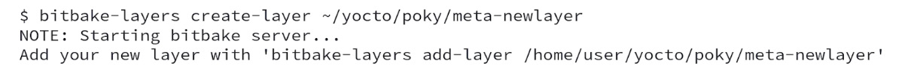
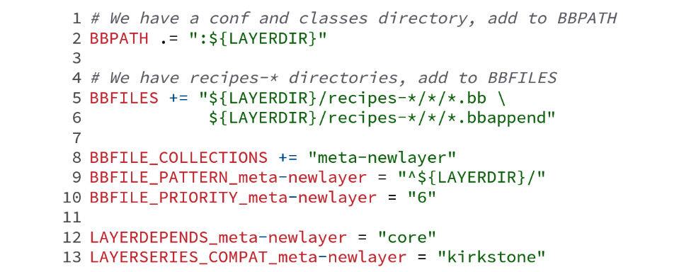
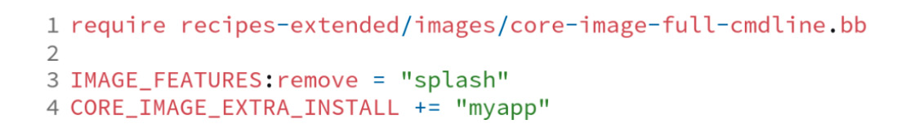
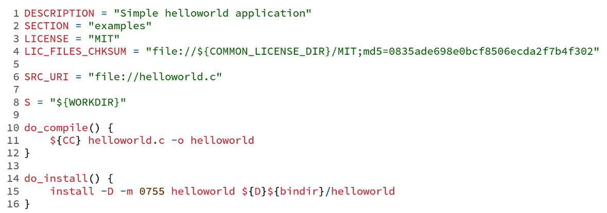
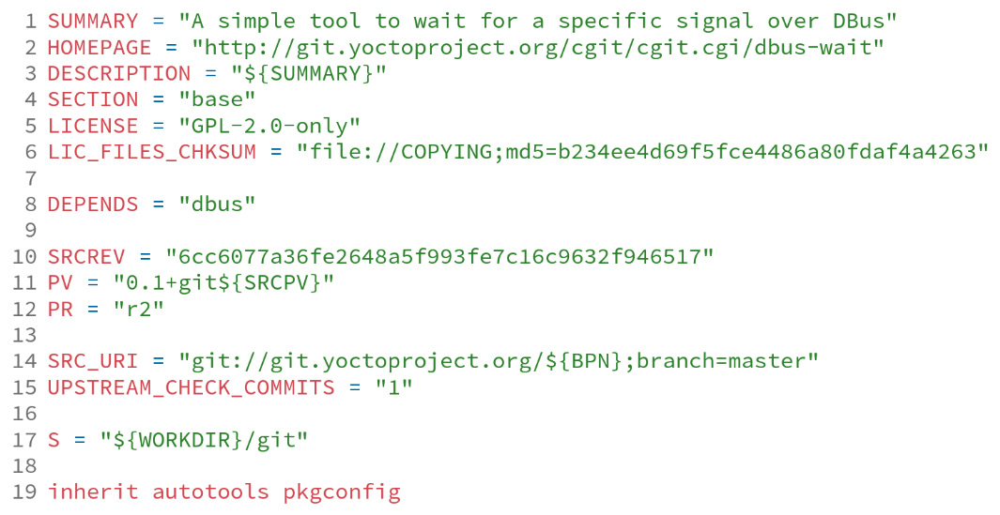
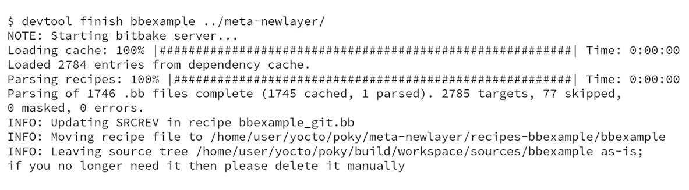
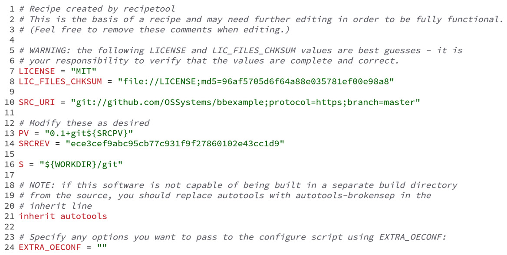
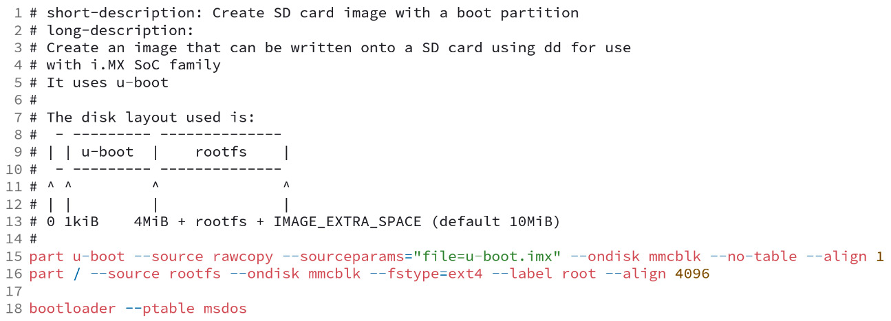
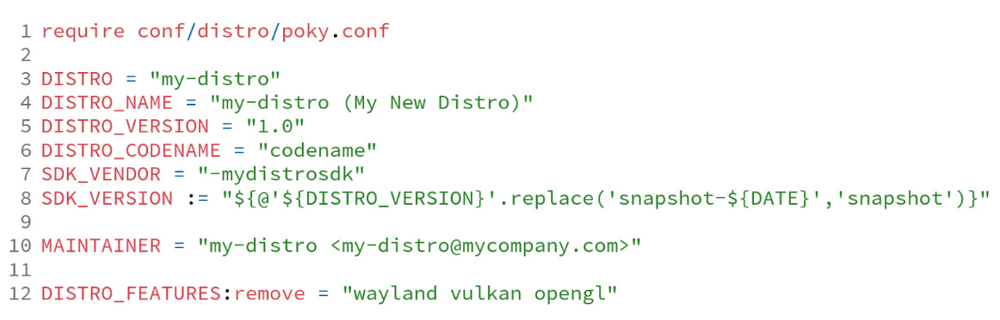

# Chương 12: Tạo các layer tùy chỉnh (Creating Custom Layers)

Ngoài việc dùng các layer có sẵn từ cộng đồng hoặc nhà cung cấp, trong chương này chúng ta sẽ học cách tạo layer cho sản phẩm của mình. Ngoài ra, chúng ta sẽ khám phá cách tạo một định nghĩa machine và bản phân phối, và tận dụng chúng để tổ chức source code tốt hơn.

## Tạo một layer mới

Trước khi tạo layer của mình, luôn là một ý hay khi kiểm tra xem đã có sẵn một layer tương tự tại website sau hay chưa: [http://layers.openembedded.org](http://layers.openembedded.org).

Nếu chúng ta vẫn đang tìm một layer phù hợp với nhu cầu của mình, bước tiếp theo là tạo thư mục. Thông thường, tên layer bắt đầu bằng `meta-`, nhưng đây không phải là một hạn chế kỹ thuật.

File `<layer>/conf/layer.conf` là file cấu hình layer bắt buộc đối với mọi layer. Layer mới có thể được tạo bằng một công cụ tên là `bitbake-layers` từ BitBake, được cung cấp trong Poky, như trong lệnh sau:

*Hình 12.1 – Tạo một layer mới bằng bitbake-layers*

Sau khi tạo layer, chúng ta cần đưa nó vào file `build/conf/bblayers.conf` bằng lệnh sau:

*Hình 12.2 – Thêm meta-newlayer vào build/conf/bblayers.conf*

> **Mẹo**
>
> Mặc định, công cụ `bitbake-layers` tạo layer với mức ưu tiên layer là 6. Chúng ta vẫn có thể tùy chỉnh mức ưu tiên bằng các tham số.

Lệnh cuối cùng tạo ra layer, như được thể hiện trong hình sau:

*Hình 12.3 – Bố cục của meta-newlayer khi được tạo*

File cấu hình layer mặc định của `meta-newlayer` là cấu hình tối thiểu để layer hoạt động. Tuy nhiên, nó có thể được tùy chỉnh để bao gồm các cấu hình cần thiết trong tương lai.

Hình sau cho thấy nội dung của `conf/layer.conf` mặc định của layer `meta-newlayer` mà chúng ta vừa tạo:

*Hình 12.4 – Cấu hình tối thiểu meta-newlayer/conf/layer.conf*

Một số biến thường dùng có thể cần được thêm hoặc thay đổi là `LAYERVERSION` và `LAYERDEPENDS`. Chúng hữu ích nếu layer của chúng ta cần các layer khác để hoạt động. Tên của cả hai biến phải có hậu tố là tên của layer, như sau:

- `LAYERVERSION`: Đây là một biến tùy chọn chỉ định phiên bản của layer bằng một con số duy nhất. Biến này được dùng bên trong biến `LAYERDEPENDS` để phụ thuộc vào một phiên bản layer cụ thể – ví dụ, `LAYERVERSION_meta-newlayer = "1"`.
- `LAYERDEPENDS`: Biến này liệt kê các layer mà các recipe phụ thuộc vào, phân cách bằng dấu cách – ví dụ, chúng ta thêm dependency vào phiên bản `2` của `meta-otherlayer` bằng `LAYERDEPENDS_meta-newlayer += "meta-otherlayer:2"`.

Sẽ phát sinh lỗi nếu một dependency không thể được thỏa mãn hoặc các số phiên bản không khớp. Nền tảng của cấu trúc layer giờ đã được tạo. Trong các phần sau, chúng ta sẽ học cách mở rộng nó.

## Thêm metadata vào layer

Metadata của layer có thể phục vụ hai mục tiêu – thêm phần mềm mới, hoặc tính năng và sửa đổi metadata có sẵn.

Chúng ta có thể đưa nhiều file metadata vào một layer mới, như recipe, image và các file `bbappend`. Có nhiều ví dụ về các file `bbappend` trong `meta-yocto-bsp` và `meta-yocto`. Chúng ta sẽ khám phá một số cách dùng phổ biến của chúng trong *Chương 13*, *Tùy chỉnh các recipe có sẵn*.

Trong các phần tiếp theo, chúng ta sẽ đi qua một số sửa đổi phổ biến đối với metadata của layer.

### Tạo một image

Về bản chất, các file image là một tập package được nhóm lại cho một mục đích và được cấu hình theo một cách có kiểm soát. Chúng ta có thể tạo một image từ đầu hoặc tạo một image bằng cách dùng lại một image có sẵn và thêm các package cần thiết bổ sung.

Chúng ta nên dùng lại một image có sẵn khi có thể, giúp việc bảo trì code dễ quản lý hơn và làm nổi bật các khác biệt về chức năng. Ví dụ, chúng ta có thể muốn thêm một ứng dụng và bỏ một image feature khỏi file image `core-image-full-cmdline`. Trong trường hợp đó, chúng ta có thể tạo một image trong file `recipes-mine/images/my-image-full-cmdline.bb` với các dòng code sau:

*Hình 12.5 – Nội dung của my-image-full-cmdline.bb*

Class `core-image` cung cấp các image feature mang lại những khối xây dựng hữu ích cho các chức năng thường dùng và nên được dùng khi tạo một image từ đầu. Ví dụ, chúng ta có thể tạo một image trong file `recipes-mine/images/my-image-strace.bb` gồm các dòng code sau:

*Hình 12.6 – Nội dung của my-image-strace.bb*

> **Mẹo**
>
> Toán tử list appending (`+=`) bảo đảm rằng một biến `EXTRA_IMAGE_FEATURES` mới có thể được thêm bởi `build/conf/local.conf`.

`CORE_IMAGE_EXTRA_INSTALL` là biến chúng ta nên dùng để đưa thêm package vào image khi kế thừa class `core-image`, class giúp việc tạo image thuận tiện hơn. Class này thêm hỗ trợ cho biến `IMAGE_FEATURES`, giúp tránh trùng lặp code.

Hiện tại, các image feature sau được hỗ trợ, như được trình bày chi tiết trong phần *Image Features* của *Yocto Project Reference Manual* ([https://docs.yoctoproject.org/4.0.4/ref-manual/features.html#image-features](https://docs.yoctoproject.org/4.0.4/ref-manual/features.html#image-features)):

- `allow-empty-password`: Cho phép Dropbear và OpenSSH chấp nhận đăng nhập từ các tài khoản có chuỗi mật khẩu rỗng.
- `allow-root-login`: Cho phép Dropbear và OpenSSH chấp nhận đăng nhập `root`.
- `dbg-pkgs`: Cài đặt các package debug symbol cho tất cả các package được cài đặt trong một image cho trước.
- `debug-tweaks`: Làm cho một image phù hợp cho việc phát triển (ví dụ, cho phép đăng nhập root, đăng nhập không cần mật khẩu – kể cả với root, và bật post-installation logging).
- `dev-pkgs`: Cài đặt các development package (header và các link thư viện bổ sung) cho tất cả các package được cài đặt trong một image cho trước.
- `doc-pkgs`: Cài đặt các package tài liệu cho tất cả các package được cài đặt trong một image cho trước.
- `empty-root-password`: Feature này, hoặc `debug-tweaks`, là bắt buộc nếu bạn muốn cho phép đăng nhập root với mật khẩu rỗng.
- `hwcodecs`: Cài đặt các codec tăng tốc phần cứng.
- `lic-pkgs`: Cài đặt các package license cho tất cả các package được cài đặt trong một image cho trước.
- `nfs-server`: Cài đặt một NFS server.
- `overlayfs-etc`: Cấu hình thư mục `/etc` nằm trong `overlayfs`. Điều này cho phép bạn lưu thông tin device-specific ở nơi khác, đặc biệt nếu root filesystem được cấu hình ở dạng read-only.
- `package-management`: Cài đặt các công cụ quản lý package và giữ lại cơ sở dữ liệu của trình quản lý package.
- `perf`: Cài đặt các công cụ profiling như `perf`, `systemtap` và **LTTng**.
- `post-install-logging`: Cho phép bạn ghi log các lần chạy script postinstall vào file `/var/log/postinstall.log` trong lần boot đầu tiên của image trên hệ thống target.
- `ptest-pkgs`: Cài đặt các package `ptest` cho tất cả các recipe ptest-enabled.
- `read-only-rootfs`: Tạo một image có root filesystem ở dạng read-only.
- `read-only-rootfs-delayed-postinsts`: Khi được chỉ định cùng với `read-only-rootfs`, nó chỉ định rằng các script post-install vẫn được phép.
- `serial-autologin-root`: Khi được chỉ định cùng với `empty-root-password`, nó sẽ tự động đăng nhập bằng `root` trên serial console.
- `splash`: Cho phép bạn hiển thị một màn hình splash trong lúc boot. Mặc định, màn hình này được cung cấp bởi `psplash`, vốn cho phép tùy chỉnh.
- `ssh-server-dropbear`: Cài đặt SSH server tối giản Dropbear.
- `ssh-server-openssh`: Cài đặt SSH server OpenSSH, vốn full-featured hơn Dropbear. Lưu ý rằng nếu cả SSH server OpenSSH và SSH server tối giản Dropbear đều có mặt trong `IMAGE_FEATURES`, thì OpenSSH sẽ được ưu tiên và Dropbear sẽ không được cài đặt.
- `stateless-rootfs`: Chỉ định rằng một image nên được tạo ở dạng stateless – khi dùng `systemd`, `systemctl-native` sẽ không được chạy trên image, để image được `systemd` điền nội dung lúc runtime.
- `staticdev-pkgs`: Cài đặt các static development package, tức là các thư viện tĩnh (ví dụ, các file `*.a`), cho tất cả các package được cài đặt trong một image cho trước.
- `tools-debug`: Cài đặt các công cụ debug như `strace` và `gdb`.
- `tools-sdk`: Cài đặt một SDK đầy đủ chạy trên thiết bị.
- `tools-testapps`: Cài đặt các công cụ kiểm thử thiết bị (ví dụ, debug touchscreen).
- `weston`: Cài đặt Weston (một môi trường Wayland tham chiếu).
- `x11-base`: Cài đặt X server với một môi trường tối giản.
- `x11`: Cài đặt X server.
- `x11-sato`: Cài đặt môi trường OpenedHand Sato.

### Thêm một package recipe

Poky bao gồm nhiều class giúp trừu tượng hóa quy trình cho các công cụ phát triển phổ biến nhất dưới dạng project, dựa trên Autotools, CMake và Meson. Package recipe là cách chúng ta có thể chỉ thị BitBake thực hiện các task `fetch`, `unpack`, `patch`, `configure`, `compile` và `install` trên ứng dụng, kernel module hoặc bất kỳ phần mềm nào mà một project cung cấp. Ngoài ra, danh sách các class có trong Poky có thể được xem trong phần *Classes* của *Yocto Project Reference Manual* ([https://docs.yoctoproject.org/4.0.4/ref-manual/classes.html](https://docs.yoctoproject.org/4.0.4/ref-manual/classes.html)).

Một recipe đơn giản thực thi các task `compile` và `install` một cách tường minh được cung cấp như sau:

*Hình 12.7 – Một recipe helloworld được viết thủ công*

Các khối code `do_compile` và `do_install` cung cấp lệnh Shell Script để chúng ta build và cài đặt binary kết quả vào thư mục đích, được tham chiếu là `${D}`, nhằm chuyển thư mục cài đặt tới một đường dẫn bên trong thư mục `build/tmp/work/`. Giả sử chúng ta đang làm việc với một project Autotools-based. Nếu vậy, chúng ta có thể tránh rất nhiều code trùng lặp bằng cách dùng class `autotools` trong ví dụ rút gọn, được trích từ recipe trong file `poky/meta/recipes-core/dbus-wait/dbus-wait_git.bb`, như sau:

*Hình 12.8 – Nội dung của poky/meta/recipes-core/dbus-wait/dbus-wait\_git.bb*

Chỉ riêng việc kế thừa class `autotools` ở *dòng 19* đã cung cấp toàn bộ code cần thiết để thực hiện các task sau:

- Cập nhật code và các artifact của script `configure`
- Cập nhật các script `libtool`
- Chạy script `configure`
- Chạy `make`
- Chạy `make install`

Các khái niệm tương tự áp dụng cho các công cụ build khác, như trường hợp của **CMake** và **Meson**. Ngoài ra, số lượng class được hỗ trợ tăng lên trong mỗi bản phát hành để hỗ trợ các build system mới và tránh trùng lặp code.

#### Tự động tạo một package recipe cơ sở bằng devtool

Như đã học trong phần *Tạo một recipe từ một Git repository bên ngoài* ở *Chương 9*, *Phát triển với Yocto Project*, `devtool` tự động hóa quá trình tạo một recipe dựa trên một project có sẵn bằng lệnh sau:

*Hình 12.9 – Dòng lệnh để tạo recipe cho bbexample*

Ở phía sau, `devtool` đã chạy `recipetool` để tạo một recipe và tự động cấu hình toàn bộ thông tin pre-built vào file recipe mới. Kết quả cuối cùng được lưu trong thư mục `workspace`, một layer do `devtool` duy trì. Để copy file recipe sang layer đích, chúng ta có thể dùng lệnh `devtool`, như sau:

*Hình 12.10 – Dòng lệnh để deploy recipe bbexample sang meta-newlayer*

File `meta-newlayer/recipes-bbexample/bbexample/bbexample_git.bb` được tạo ra được thể hiện trong đoạn trích sau:

*Hình 12.11 – Nội dung của bbexamle\_git.bb* *(ghi chú: đúng là bbexample\_git.bb)*

`devtool` đã tạo một recipe cơ sở, không nên được xem là recipe cuối cùng. Bạn nên kiểm tra các tùy chọn compile, thông tin metadata bổ sung, v.v.

### Thêm hỗ trợ cho một định nghĩa machine mới

Mặc dù việc tạo một định nghĩa machine mới để dùng trong Poky là một task đơn giản, không nên đánh giá thấp nó. Tùy theo tập tính năng mà chúng ta cần hỗ trợ ở BSP layer, nó có thể liên quan đến việc kiểm tra bootloader, kernel và các driver hỗ trợ phần cứng.

Yocto Project hỗ trợ ARM, ARM64, x86, x86-64, PowerPC, PowerPC 64, MIPS, MIPS64, RISC-V 32 và RISC-V 64, đại diện cho các kiến trúc embedded được dùng phổ biến nhất hiện nay.

Tập biến chủ yếu được dùng trong một định nghĩa machine như sau:

- `TARGET_ARCH`: Biến này đặt kiến trúc machine – ví dụ, ARM và x86-64
- `PREFERRED_PROVIDER_virtual/kernel`: Biến này ghi đè kernel mặc định (`linux-yocto`) nếu bạn cần dùng một kernel cụ thể
- `SERIAL_CONSOLES`: Biến này định nghĩa các serial console và tốc độ của chúng
- `MACHINE_FEATURES`: Biến này mô tả các tính năng phần cứng, để stack phần mềm cần thiết được đưa vào image theo mặc định
- `KERNEL_IMAGETYPE`: Biến này được dùng để chọn loại kernel image – ví dụ, `bzImage` hoặc `Image`
- `IMAGE_FSTYPES`: Biến này đặt các loại filesystem image được tạo ra – ví dụ, `tar.gz`, `ext4` và `ubifs`

Bạn có thể xem các ví dụ về file định nghĩa machine bên trong source code Poky trong thư mục `meta-yocto-bsp/conf/machine/`. Khi mô tả một machine mới, chúng ta nên đặc biệt chú ý đến các tính năng cụ thể mà nó hỗ trợ trong `MACHINE_FEATURES`. Bằng cách này, phần mềm cần thiết để hỗ trợ các tính năng này sẽ được cài đặt vào image. Các giá trị hiện có cho `MACHINE_FEATURES` được liệt kê như sau:

- `acpi`: Phần cứng có ACPI (chỉ x86/x86-64)
- `alsa`: Phần cứng có driver âm thanh ALSA
- `apm`: Phần cứng dùng APM (hoặc APM emulation)
- `bluetooth`: Phần cứng có BT tích hợp
- `efi`: Hỗ trợ boot qua EFI
- `ext2`: Phần cứng có HDD hoặc microdrive
- `keyboard`: Phần cứng có bàn phím
- `numa`: Phần cứng có truy cập bộ nhớ non-uniform
- `pcbios`: Hỗ trợ boot qua BIOS
- `pci`: Phần cứng có bus PCI
- `pcmcia`: Phần cứng có các socket PCMCIA hoặc CompactFlash
- `phone`: Hỗ trợ điện thoại di động (thoại)
- `qemu-usermode`: QEMU có thể hỗ trợ emulation user-mode cho machine này
- `qvga`: Machine có màn hình QVGA (320x240)
- `rtc`: Machine có real-time clock
- `screen`: Phần cứng có màn hình
- `serial`: Phần cứng có hỗ trợ serial (thường là RS232)
- `touchscreen`: Phần cứng có touchscreen
- `usbgadget`: Phần cứng là USB gadget device-capable
- `usbhost`: Phần cứng là USB host-capable
- `vfat`: Hỗ trợ FAT filesystem
- `wifi`: Phần cứng có Wi-Fi tích hợp

#### Đóng gói một image cho machine của bạn

Việc tạo một image ready-to-use cho một machine nên được giải quyết ở cuối quá trình phát triển bất kỳ BSP support layer nào. Loại image phụ thuộc vào bộ xử lý, các thiết bị ngoại vi có trên board và các hạn chế của project.

**Partitioned image** là loại image được dùng thường xuyên nhất để dùng trực tiếp trên bộ lưu trữ. Yocto Project có một công cụ tên là `wic`, cung cấp một cách linh hoạt để tạo image này. Nó cho phép tạo các partitioned image dựa trên một file template (`.wks`), được viết bằng một ngôn ngữ chung mô tả bố cục image đích. Định nghĩa ngôn ngữ có thể được tìm thấy trong phần *OpenEmbedded Kickstart (.wks) Reference* của *The Yocto Project Reference Manual* ([https://docs.yoctoproject.org/4.0.4/ref-manual/kickstart.html#openembedded-kickstart-wks-reference](https://docs.yoctoproject.org/4.0.4/ref-manual/kickstart.html#openembedded-kickstart-wks-reference)).

File `.wks` được đặt trong layer của chúng ta bên trong thư mục `wic`. Thường có nhiều file trong thư mục này để chỉ định các bố cục image khác nhau. Tuy nhiên, điều thiết yếu cần nhớ là cấu trúc được chọn phải khớp với machine – ví dụ, khi xét việc dùng một machine i.MX-based boot bằng U-Boot từ một thẻ SD có hai phân vùng, một cho các file boot và phân vùng còn lại cho `rootfs`. File `.wks` tương ứng được thể hiện ở đây:

*Hình 12.12 – Một ví dụ về file .wks cho một thiết bị i.MX dùng SPL*

Để bật việc tạo image `wic`-based, chỉ cần thêm `wic` vào `IMAGE_FSTYPES`. Chúng ta cũng có thể định nghĩa file `.wks` sẽ được dùng bằng cách đặt biến `WKS_FILE`.

### Dùng một bản phân phối tùy chỉnh

Việc tạo một bản phân phối là sự pha trộn giữa đơn giản và phức tạp. Tạo file bản phân phối thì đơn giản nhưng ảnh hưởng đáng kể đến hành vi của Poky. Tùy theo các tùy chọn của chúng ta, nó có thể gây ra sự không tương thích binary với các binary đã build trước đó.

Bản phân phối là nơi chúng ta định nghĩa các tùy chọn toàn cục, như phiên bản toolchain, các graphical backend và hỗ trợ **OpenGL**. Chúng ta chỉ nên tạo một bản phân phối nếu các thiết lập mặc định do Poky cung cấp không đáp ứng được yêu cầu của chúng ta.

Thông thường, chúng ta dự định thay đổi một tập nhỏ tùy chọn so với Poky. Ví dụ, chúng ta bỏ hỗ trợ **X11** để dùng framebuffer thay thế. Chúng ta có thể dễ dàng làm điều này bằng cách dùng lại bản phân phối Poky và ghi đè các biến cần thiết – ví dụ, bản phân phối mẫu được biểu diễn bởi file `<layer>/conf/distro/my-distro.conf` như sau:

*Hình 12.13 – Một ví dụ về file bản phân phối tùy chỉnh*

Để dùng bản phân phối vừa tạo, chúng ta cần thêm đoạn code sau vào file `build/conf/local.conf`:

*Hình 12.14 – Dòng đặt DISTRO trong build/conf/local.conf*

Biến `DISTRO_FEATURES` có thể ảnh hưởng đến cách các recipe được cấu hình và các package được cài đặt vào image – ví dụ, nếu chúng ta muốn dùng âm thanh trên bất kỳ machine và image nào, feature `alsa` phải có mặt. Danh sách sau cho thấy trạng thái hiện tại của các giá trị được `DISTRO_FEATURES` hỗ trợ, như được trình bày chi tiết trong phần *Distro Features* của *Yocto Project Reference Manual* ([https://docs.yoctoproject.org/4.0.4/ref-manual/features.html#distro-features](https://docs.yoctoproject.org/4.0.4/ref-manual/features.html#distro-features)):

- `3g`: Bao gồm hỗ trợ dữ liệu di động
- `acl`: Bao gồm hỗ trợ Access Control List
- `alsa`: Bao gồm hỗ trợ Advanced Linux Sound Architecture (các kernel module tương thích OSS được cài đặt nếu có)
- `api-documentation`: Bật việc tạo tài liệu API trong quá trình build recipe
- `bluetooth`: Bao gồm hỗ trợ Bluetooth (chỉ BT tích hợp)
- `cramfs`: Bao gồm hỗ trợ CramFS
- `debuginfod`: Bao gồm hỗ trợ lấy thông tin debug ELF qua một server `debuginfod`
- `ext2`: Bao gồm các công cụ hỗ trợ thiết bị có HDD/Microdrive bên trong để lưu file (thay vì các thiết bị Flash-only)
- `gobject-introspection-data`: Bao gồm dữ liệu hỗ trợ GObject introspection
- `ipsec`: Bao gồm hỗ trợ IPSec
- `ipv4`: Bao gồm hỗ trợ IPv4
- `ipv6`: Bao gồm hỗ trợ IPv6
- `keyboard`: Bao gồm hỗ trợ bàn phím
- `ldconfig`: Bao gồm hỗ trợ `ldconfig` và `ld.so.conf` trên target
- `ld-is-gold`: Dùng gold linker thay cho GNU linker chuẩn (`bfd`)
- `lto`: Bật Link-Time Optimization
- `multiarch`: Cho phép bạn build ứng dụng có hỗ trợ nhiều kiến trúc
- `nfc`: Bao gồm hỗ trợ Near Field Communication
- `nfs`: Bao gồm hỗ trợ NFS client
- `nls`: Bao gồm **Native Language Support** (**NLS**)
- `opengl`: Bao gồm Open Graphics Library, một API cross-language, multi-platform, được dùng để render đồ họa two- và three-dimensional
- `overlayfs`: Bao gồm hỗ trợ OverlayFS
- `pam`: Bao gồm hỗ trợ **Pluggable Authentication Module** (**PAM**)
- `pci`: Bao gồm hỗ trợ bus PCI
- `pcmcia`: Bao gồm hỗ trợ PCMCIA/CompactFlash
- `polkit`: Bao gồm hỗ trợ Polkit
- `ppp`: Bao gồm hỗ trợ PPP dial-up
- `ptest`: Cho phép bạn build các package test được hỗ trợ bởi từng recipe riêng lẻ
- `pulseaudio`: Bao gồm hỗ trợ PulseAudio
- `seccomp`: Cho phép bạn build ứng dụng có hỗ trợ `seccomp`, cho phép ứng dụng giới hạn nghiêm ngặt các system call mà chúng được phép gọi
- `selinux`: Bao gồm hỗ trợ **Security-Enhanced Linux** (**SELinux**) (cần `meta-selinux`)
- `smbfs`: Bao gồm hỗ trợ SMB network client
- `systemd`: Bao gồm hỗ trợ `init` manager này, một sự thay thế hoàn toàn cho `init`, với việc khởi động song song các service, giảm overhead của shell, và các tính năng khác
- `usbgadget`: Bao gồm hỗ trợ USB Gadget Device
- `usbhost`: Bao gồm hỗ trợ USB Host
- `usrmerge`: Gộp các thư mục `/bin`, `/sbin`, `/lib` và `/lib64` vào các thư mục tương ứng của chúng trong thư mục `/usr` để mang lại khả năng tương thích package và ứng dụng tốt hơn
- `vfat`: Bao gồm hỗ trợ FAT filesystem
- `vulkan`: Bao gồm hỗ trợ Vulkan API
- `wayland`: Bao gồm giao thức display server Wayland và thư viện hỗ trợ nó
- `wifi`: Bao gồm hỗ trợ Wi-Fi (chỉ loại tích hợp)
- `x11`: Bao gồm X server và các thư viện
- `xattr`: Bao gồm hỗ trợ extended file attribute
- `zeroconf`: Bao gồm hỗ trợ zero-configuration networking

## MACHINE\_FEATURES so với DISTRO\_FEATURES

Các biến `DISTRO_FEATURES` và `MACHINE_FEATURES` phối hợp với nhau để cung cấp sự hỗ trợ khả thi cho hệ thống cuối cùng. Khi một machine hỗ trợ một tính năng, điều này không có nghĩa là hệ thống target hỗ trợ tính năng đó, vì bản phân phối phải cung cấp nền tảng bên dưới của nó.

Ví dụ, nếu một machine hỗ trợ Wi-Fi nhưng bản phân phối thì không, các ứng dụng mà hệ điều hành dùng sẽ được build với hỗ trợ Wi-Fi bị tắt, vì vậy kết quả sẽ là một hệ thống không có hỗ trợ Wi-Fi. Mặt khác, nếu bản phân phối cung cấp hỗ trợ Wi-Fi còn machine thì không, các module và ứng dụng cần cho Wi-Fi sẽ không được cài đặt vào các image được build cho machine này. Tuy nhiên, hệ điều hành và các module của nó vẫn có hỗ trợ Wi-Fi được bật.

## Tìm hiểu phạm vi của một biến

Metadata của BitBake có hàng nghìn biến, nhưng phạm vi mà các biến này có hiệu lực phụ thuộc vào nơi chúng được định nghĩa. Có hai loại biến, như sau:

- Các biến được định nghĩa trong file cấu hình có tính toàn cục đối với mọi recipe, còn được gọi là configuration metadata. Thứ tự parse các file cấu hình chính như sau:

  - `build/conf/local.conf`
  - `<layer>/conf/machines/<machine>.conf`
  - `<layer>/conf/distro/<distro>.conf`

- Các biến được định nghĩa bên trong file recipe có phạm vi hiển thị recipe, chỉ cục bộ đối với recipe cụ thể đó trong quá trình thực thi các task của nó.

## Tóm tắt

Trong chương này, chúng ta đã đề cập cách tạo một layer mới và metadata. Đầu tiên, chúng ta đã thấy cách tạo cấu hình machine, định nghĩa bản phân phối và các file recipe. Sau đó, chúng ta đã học cách tạo image và đưa ứng dụng của mình vào một image.

Trong chương tiếp theo, chúng ta sẽ xem một số ví dụ về các trường hợp tùy chỉnh phổ biến nhất được dùng bởi một layer bổ sung, như sửa đổi các package có sẵn, thêm tùy chọn cho `autoconf`, áp dụng một patch mới và đưa một file mới vào một package. Chúng ta sẽ xem cách cấu hình `BusyBox` và `linux-yocto`, hai package thường được tùy chỉnh khi xây dựng một hệ thống embedded.
