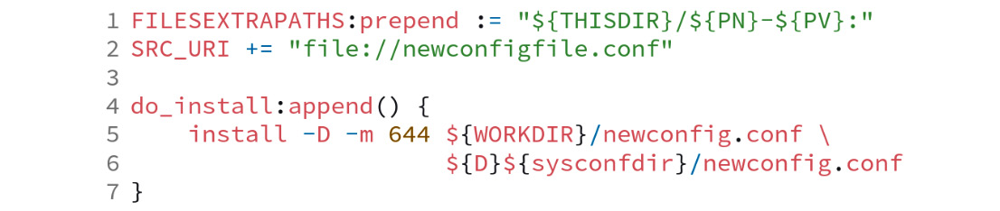
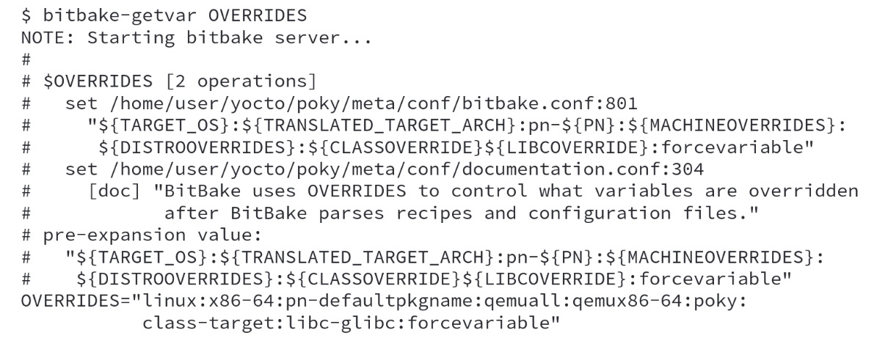
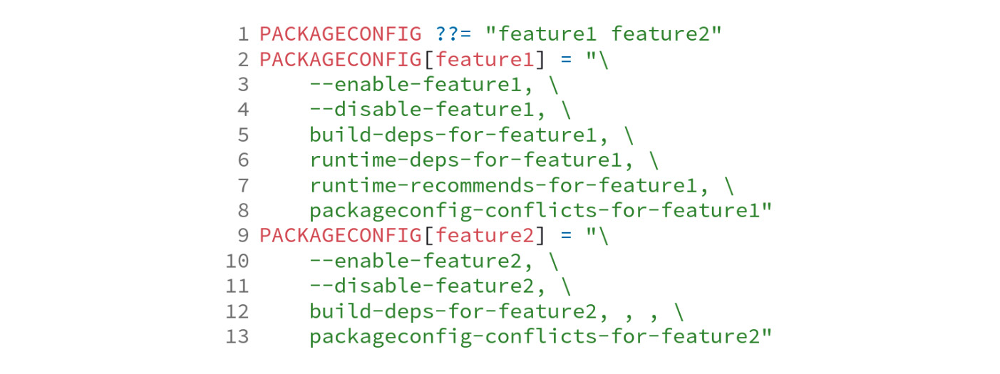
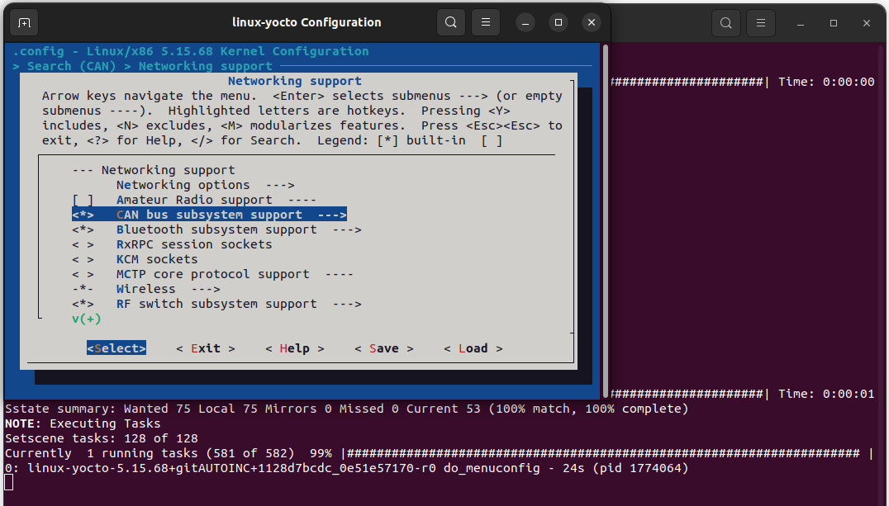
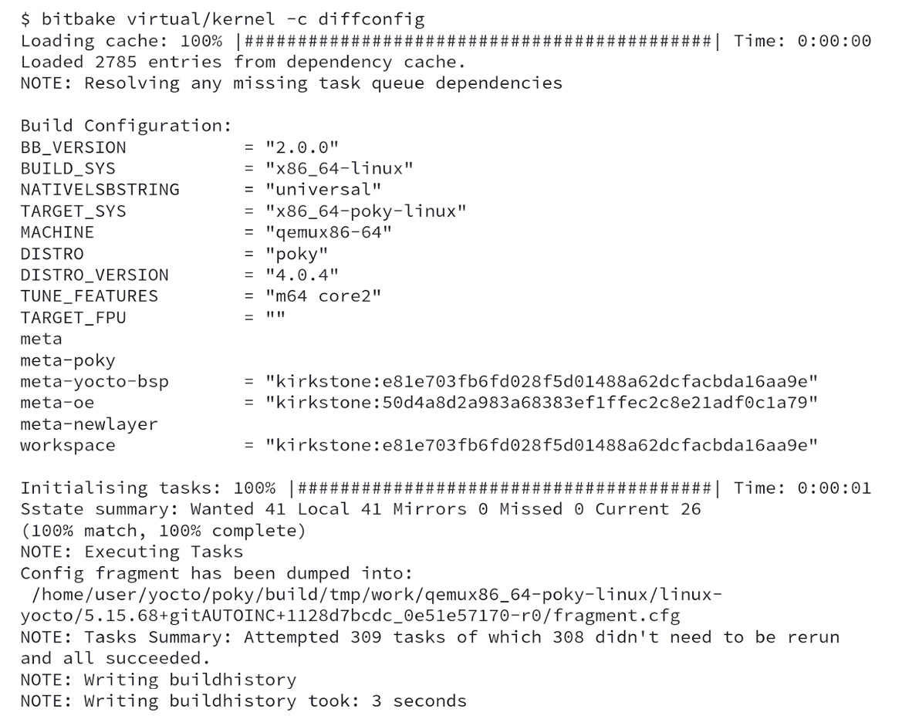

# Chương 13: Tùy chỉnh các recipe có sẵn (Customizing Existing Recipes)

Trong quá trình làm việc với các công cụ của Yocto Project, việc chúng ta sẽ cần tùy chỉnh các recipe có sẵn là điều được dự đoán trước. Trong chương này, chúng ta sẽ khám phá một số ví dụ, như thay đổi các tùy chọn compile, bật hoặc tắt các tính năng của một recipe, áp dụng thêm một patch, và dùng các configuration fragment để tùy chỉnh một số recipe.

## Tìm hiểu các trường hợp sử dụng phổ biến

Ngày nay, các project thường có một tập layer để cung cấp các tính năng cần thiết. Chắc chắn chúng ta cần thực hiện các thay đổi bên trên chúng để điều chỉnh cho phù hợp với nhu cầu cụ thể của mình. Đó có thể là những thay đổi mang tính hình thức hoặc thực chất, nhưng cách thực hiện chúng là như nhau.

Chúng ta phải tạo một file `.bbappend` để thay đổi một recipe có sẵn trong layer project của mình. Ví dụ, giả sử recipe gốc có tên là `<original-layer>/recipes-core/app/app_1.2.3.bb`. Khi tạo một file `.bbappend`, bạn có thể dùng ký tự wildcard `%` để cho phép khớp tên recipe. Vì vậy, file `.bbappend` có thể có các dạng khác nhau sau:

- `App_1.2.3.bbappend` *(ghi chú: đúng là `app_1.2.3.bbappend`, khớp với `app_1.2.3.bb`)*: Áp dụng thay đổi chỉ cho phiên bản `1.2.3`
- `app_1.2.%.bbappend`: Áp dụng thay đổi chỉ cho phiên bản `1.2.y`
- `app_1.%.bbappend`: Áp dụng thay đổi chỉ cho các phiên bản `1.x` và `1.x.y`
- `app_%.bbappend`: Áp dụng thay đổi cho mọi phiên bản

Chúng ta có thể có nhiều file `.bbappend`, tùy theo các thay đổi dự định mà chúng ta muốn áp dụng cho recipe app. Đôi khi chúng ta có thể giới hạn các thay đổi cho một phiên bản, nhưng đôi khi, chúng ta muốn thay đổi tất cả các recipe có sẵn.

> **Lưu ý**
>
> Khi có nhiều hơn một file `.bbappend` cho một recipe, tất cả chúng đều được ghép lại theo thứ tự ưu tiên của layer.

File `.bbappend` có thể được xem như một đoạn văn bản được nối vào cuối recipe gốc. Nó trao cho chúng ta một cơ chế rất linh hoạt để tránh trùng lặp source code khi áp dụng các thay đổi cần thiết vào các layer của project.

### Mở rộng một task

Khi nội dung của task không thỏa mãn yêu cầu của chúng ta, chúng ta thay thế nó (cung cấp bản triển khai của mình) hoặc append vào nó. Như chúng ta đã học kỹ hơn về cú pháp metadata của BitBake trong *Chương 8*, *Đi sâu vào metadata của BitBake*, các toán tử `:append` và `:prepend` có thể mở rộng một task với nội dung bổ sung. Ví dụ, để mở rộng một task `do_install`, chúng ta có thể dùng đoạn code sau:

*Hình 13.1 – Ví dụ về cách mở rộng task do\_install*

Bằng cách này, nội dung mới được nối vào task gốc.

## Thêm tùy chọn cho các recipe dựa trên Autotools

Giả sử chúng ta có ứng dụng Autotools-based, cùng với một recipe có sẵn cho nó, và chúng ta muốn làm những việc sau:

- Bật `my-feature`
- Tắt `another-feature`

Nội dung của file `.bbappend` để thực hiện các thay đổi sẽ như sau:

*Hình 13.2 – Thêm cấu hình bổ sung vào các flag Autoconf*

Có thể dùng cùng chiến lược này nếu chúng ta cần bật nó một cách có điều kiện dựa trên phần cứng mà chúng ta đang build cho, như sau:

*Hình 13.3 – Thêm cấu hình bổ sung vào các flag Autoconf một cách có điều kiện*

Yocto Project hỗ trợ nhiều build system khác nhau, và các biến để cấu hình chúng được thể hiện trong bảng sau:

| **Build System** | **Biến** |
|---|---|
| Autotools | `EXTRA_OECONF` |
| Cargo | `EXTRA_OECARGO` |
| CMake | `EXTRA_OECMAKE` |
| Make | `EXTRA_OEMAKE` |
| Meson | `EXTRA_OEMESON` |
| NPM | `EXTRA_OENPM` |
| SCons | `EXTRA_OESCONS` |
| WAF | `EXTRA_OEWAF` |

*Bảng 13.1 – Danh sách các biến để cấu hình từng build system*

Các biến từ *Bảng 13.1* được truyền làm đối số cho build system tương ứng.

## Áp dụng một patch

Với các trường hợp cần áp dụng một patch vào một package có sẵn, chúng ta nên dùng `FILESEXTRAPATHS`, biến này đưa các thư mục mới vào thuật toán tìm kiếm, giúp BitBake nhìn thấy file bổ sung, như sau:

*Hình 13.4 – Nội dung của .bbappend chỉ được dùng để áp dụng mypatch.patch*

Trong ví dụ trên, `THISDIR` mở rộng thành thư mục hiện tại, còn `PN` và `PV` lần lượt mở rộng thành tên và phiên bản của package. Đường dẫn mới này sau đó được đưa vào danh sách thư mục dùng để tìm file. Toán tử prepend rất quan trọng vì nó bảo đảm file được lấy từ thư mục này, ngay cả khi một file cùng tên được thêm vào các layer có mức ưu tiên thấp hơn trong tương lai.

BitBake giả định rằng mọi file có phần mở rộng `.patch` hoặc `.diff` là một patch và áp dụng chúng cho phù hợp.

## Thêm file bổ sung vào các package có sẵn

Nếu cần đưa vào một file cấu hình bổ sung, chúng ta nên dùng `FILESEXTRAPATHS`, như đã giải thích trong ví dụ trước và được thể hiện trong các dòng code sau:

*Hình 13.5 – Nội dung của file .bbappend để cài đặt một file cấu hình mới*

Hàm `do_install:append` nối khối được cung cấp vào bên dưới metadata đã có sẵn trong hàm `do_install` gốc. Nó bao gồm lệnh để copy file cấu hình mới của chúng ta vào filesystem của package. File được copy từ `${WORKDIR}` sang `${D}` vì đây lần lượt là thư mục Poky dùng để build package và thư mục đích Poky dùng để tạo package.

Có nhiều biến để định nghĩa đường dẫn trong các recipe của chúng ta, như `bindir`, `datadir` và `sysconfdir`. File `poky/meta/conf/bitbake.conf` định nghĩa tất cả các biến thường dùng đó. Các biến này tồn tại để đường dẫn cài đặt của binary có thể được tùy chỉnh tùy theo trường hợp sử dụng. Ví dụ, các binary của native SDK cần một đường dẫn cài đặt cụ thể, để các binary không xung đột với các binary của target.

Bảng sau cho thấy các biến phổ biến nhất và giá trị mở rộng mặc định của chúng:

| **Biến** | **Giá trị mở rộng mặc định** |
|---|---|
| `base_bindir` | `/bin` |
| `base_sbindir` | `/sbin` |
| `sysconfdir` | `/etc` |
| `localstatedir` | `/var` |
| `datadir` | `/usr/share` |
| `bindir` | `/usr/bin` |
| `sbindir` | `/usr/sbin` |
| `libdir` | `/usr/lib` hoặc `/usr/lib64` |
| `libexecdir` | `/usr/libexec` |
| `includedir` | `/usr/include` |

*Bảng 13.2 – Danh sách các biến thường dùng và giá trị mở rộng mặc định của chúng*

Nên tránh dùng đường dẫn hard coded trong recipe để giảm rủi ro cấu hình sai. Ví dụ, khi dùng `DISTRO_FEATURE` `usrmerge`, ở phía sau, tất cả các recipe đặt `base_bindir` thành `bindir`, vì vậy nếu một recipe dùng `/bin` làm đường dẫn hard coded, việc cài đặt sẽ không diễn ra như mong đợi.

### Tìm hiểu các đường dẫn tìm file

Khi một file (một patch hoặc một file thông thường) được đưa vào `SRC_URI`, BitBake tìm kiếm theo các biến `FILESPATH` và `FILESEXTRAPATH` *(ghi chú: đúng là `FILESEXTRAPATHS`)*. Thiết lập mặc định là tìm ở các vị trí sau:

1. `<recipe>-<version>/`
2. `<recipe>/`
3. `files/`

Ngoài ra, nó còn kiểm tra `OVERRIDES` để một file cụ thể được ghi đè trong mỗi thư mục. Để minh họa điều này, hãy xét recipe `foo_1.0.bb`. Với biến `OVERRIDES = "<board>:<arch>"`, file sẽ được tìm trong các thư mục sau, theo đúng thứ tự được thể hiện:

1. `foo-1.0/<board>/`
2. `foo-1.0/<arch>/`
3. `foo-1.0/`
4. `foo/<board>/`
5. `foo/<arch>/`
6. `foo/`
7. `files/<board>/`
8. `files/<arch>/`
9. `files/`

Đây chỉ là minh họa, vì danh sách `OVERRIDES` rất lớn và machine-specific. Khi làm việc với recipe của mình, chúng ta có thể dùng `bitbake-getvar OVERRIDES` để tìm danh sách đầy đủ các override có sẵn cho một machine cụ thể và dùng chúng cho phù hợp. Hãy xem output của Poky như sau:

*Hình 13.6 – Dùng bitbake-getvar để lấy giá trị của biến OVERRIDES*

Lệnh này khá hữu ích để debug metadata trong quá trình debug.

### Thay đổi cấu hình tính năng của recipe

`PACKAGECONFIG` là một cơ chế giúp đơn giản hóa việc tùy chỉnh tập tính năng cho recipe. Nó cung cấp một cách để bật và tắt các tính năng của recipe. Ví dụ, recipe có cấu hình sau:

*Hình 13.7 – Ví dụ về PACKAGECONFIG*

*Hình 13.7* có hai tính năng: `feature1` và `feature2`. Hành vi của mỗi tính năng được định nghĩa bởi sáu đối số, phân cách bằng dấu phẩy. Bạn có thể bỏ qua bất kỳ đối số nào nhưng phải giữ lại các dấu phẩy phân cách. Thứ tự là thiết yếu và chỉ định những điều sau:

1. Các đối số bổ sung nếu tính năng được bật.
2. Các đối số bổ sung nếu tính năng bị tắt.
3. Các build dependency bổ sung (`DEPENDS`) nếu tính năng được bật.
4. Các runtime dependency bổ sung (`RDEPENDS`) nếu tính năng được bật.
5. Các runtime recommendation bổ sung (`RRECOMMENDS`) nếu tính năng được bật.
6. Mọi thiết lập `PACKAGECONFIG` xung đột (loại trừ lẫn nhau) với tính năng này.

Chúng ta có thể tạo một file `.bbappend` mở rộng giá trị mặc định của biến `PACKAGECONFIG` để bật thêm cả `feature2`, như sau:

*Hình 13.8 – Nội dung của một file .bbappend để mở rộng biến PACKAGECONFIG*

> **Lưu ý**
>
> Để thêm cùng tính năng đó vào file `build/conf/local.conf`, chúng ta có thể dùng `PACKAGECONFIG:pn-<recipename>:append = ' feature2'`.

Danh sách các tính năng `PACKAGECONFIG` có sẵn cho một package cụ thể phải được kiểm tra bên trong file recipe, vì không có công cụ nào để liệt kê tất cả chúng.

## Configuration fragment cho các project Kconfig-based

Hạ tầng cấu hình Kconfig đã trở nên phổ biến nhờ sự linh hoạt và khả năng biểu đạt của nó. Mặc dù khởi đầu với Linux kernel, một số project khác cũng dùng cùng hạ tầng này, như U-Boot và BusyBox.

Việc cấu hình dựa trên các tính năng select-based, trong đó bạn có thể bật hoặc tắt một tính năng và lưu kết quả của lựa chọn này vào một file để dùng sau. Vì vậy, hãy xem hình sau:

*Hình 13.9 – Bật hoặc tắt TFTPD trong KConfig của BusyBox*

Chúng ta có quyền kiểm soát việc hỗ trợ TFTPD trong BusyBox được bật **(a)** hay không **(b)**.

Yocto Project cung cấp một class chuyên biệt để xử lý việc cấu hình của project Kconfig-based, cho phép các sửa đổi nhỏ gọi là configuration fragment. Chúng ta có thể dùng điều này để bật hoặc tắt các tính năng cho machine của bạn, ví dụ, khi cấu hình `linux-yocto`, chúng ta có thể dùng `<layer>/recipes-kernel/linux/linux-yocto_%.bbappend` như trong đoạn code sau:

*Hình 13.10 – Nội dung .bbappend để áp dụng một fragment*

Mọi configuration fragment đều phải dùng phần mở rộng file `.cfg`. Vì vậy, nội dung của file `<layer>/recipes-kernel/linux/linux-yocto/linux-yocto/enable-can.cfg` được thể hiện ở đây:

*Hình 13.11 – Nội dung của enable-can.cfg*

Chúng ta có thể dùng BitBake để cấu hình hoặc tạo file cấu hình Linux kernel. Lệnh `bitbake virtual/kernel -c menuconfig` cho phép chúng ta cấu hình Linux kernel có thể được thấy trong ảnh chụp màn hình sau:

*Hình 13.12 – Bật hỗ trợ subsystem CAN bus bằng bitbake virtual/kernel -c menuconfig*

*Hình 13.12* cho thấy cách bật hỗ trợ CAN bus bằng `menuconfig` của Linux kernel. Cấu hình kernel được thay đổi khi thoát và lưu từ `menuconfig`.

Bước tiếp theo là tạo fragment bằng `bitbake virtual/kernel -c diffconfig`, như trong ảnh chụp màn hình sau:

*Hình 13.13 – Tùy chọn diffconfig tạo ra configuration fragment*

*Hình 13.13* hiển thị log sau khi chạy lệnh. Điều quan trọng cần lưu ý là file fragment được tạo dưới thư mục `<build>/tmp/work/`, và đường dẫn tuyệt đối được hiển thị trong log. Chúng ta phải copy file fragment này vào layer và dùng nó trong một file `.bbappend` để nó được áp dụng.

> **Mẹo**
>
> Để lưu một cấu hình đầy đủ, chúng ta có thể dùng `bitbake virtual/kernel -c savedefconfig`. Lệnh này tạo ra một file `defconfig` để tái tạo cùng cấu hình. Đây là một cấu hình đầy đủ, không phải một file fragment.

Hỗ trợ configuration fragment hoạt động với các recipe sau:

- Linux kernel
- U-Boot
- BusyBox

Các recipe này cũng cung cấp các task `menuconfig` và `diffconfig`.

## Tóm tắt

Trong chương này, chúng ta đã học cách tùy chỉnh các recipe có sẵn bằng các file `.bbappend` và hưởng lợi từ điều này nhờ tránh được việc trùng lặp source code. Chúng ta đã thấy cách bật hoặc tắt một tính năng, cách áp dụng một patch và cách dùng hỗ trợ configuration fragment.

Trong chương tiếp theo, chúng ta sẽ bàn về cách Yocto Project có thể giúp chúng ta với một số khía cạnh pháp lý của việc tạo ra một hệ thống Linux-based dùng các package theo các license khác nhau. Chúng ta sẽ hiểu những artifact nào cần thiết và cách Poky có thể được cấu hình để tạo ra các artifact cần được chia sẻ như một phần của quá trình hoàn thành việc tuân thủ copyleft.
