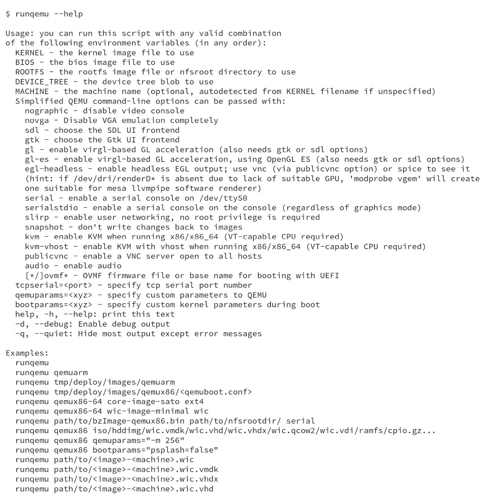
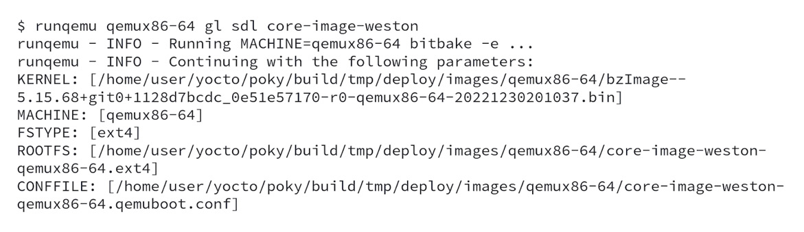
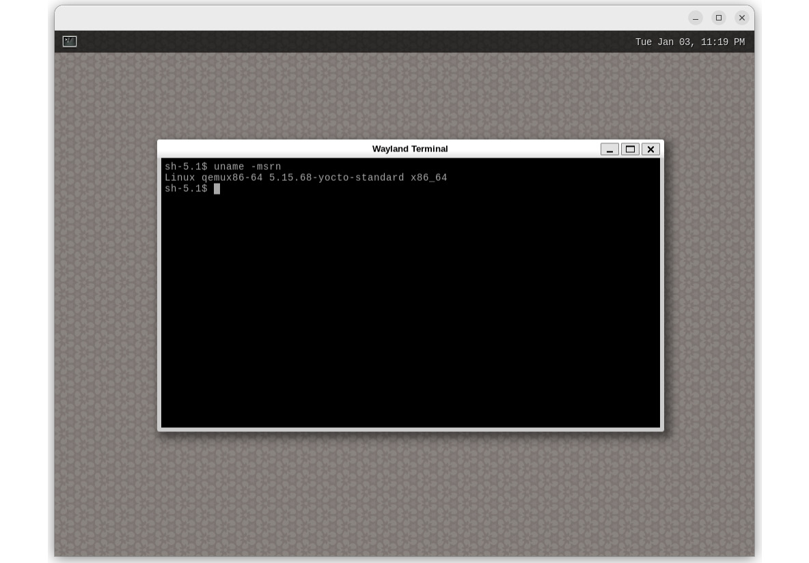
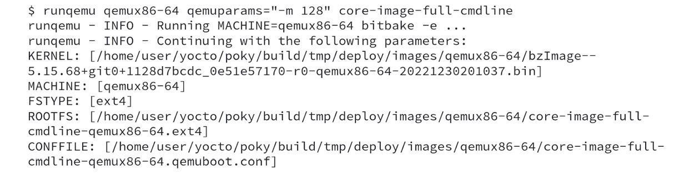
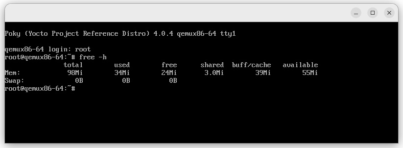
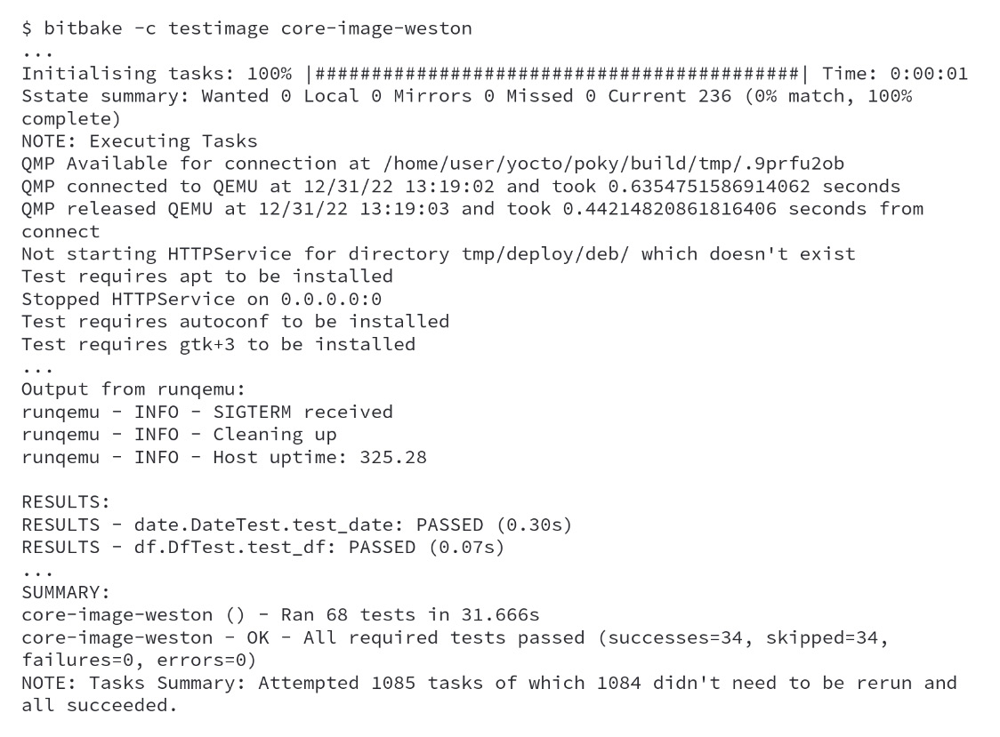

# Chương 16: Tăng tốc phát triển sản phẩm nhờ emulation – QEMU (Speeding Up Product Development through Emulation – QEMU)

Trong chương này, chúng ta khám phá các khả năng rút ngắn việc phát triển sản phẩm nhờ emulation và giảm sự phụ thuộc vào phần cứng thật trong phần lớn quá trình phát triển. Bạn sẽ hiểu được lợi ích của việc dùng QEMU thay cho phần cứng và khi nào thì chọn phần cứng thật là thích hợp hơn. Chúng ta cũng mô tả các khả năng của `runqemu` và minh họa một số trường hợp sử dụng.

## QEMU là gì?

**Quick EMUlator** (**QEMU**) là một công cụ phần mềm tự do, open source cho phép người dùng chạy nhiều kiến trúc trên cùng một máy vật lý. Nó là một system emulator có thể ảo hóa toàn bộ phần cứng thiết bị, bao gồm CPU, bộ nhớ, bộ lưu trữ và các thiết bị ngoại vi.

Dùng QEMU để kiểm thử và debug có thể tiết kiệm thời gian và công sức trong quá trình phát triển. Nó cho phép developer kiểm thử code của mình trong nhiều môi trường mô phỏng khác nhau.

Ngoài những việc khác, Yocto Project dùng QEMU để chạy các kiểm thử **Quality Assurance** (**QA**) tự động trên các image cuối cùng được phát hành cùng mỗi bản phát hành. Trong bối cảnh của Yocto Project, QEMU cho phép bạn chạy một image hoàn chỉnh mà bạn đã build bằng Yocto Project như một task khác trên build system của bạn. Ngoài ra, QEMU giúp chạy và kiểm thử image và ứng dụng trên các kiến trúc được Yocto Project hỗ trợ mà không cần có phần cứng thật.

## Lợi ích của việc dùng QEMU thay cho phần cứng là gì?

Có nhiều tình huống mà việc dùng QEMU thay cho phần cứng thật để kiểm thử và debug có thể thực tế hơn:

- Nó cho phép bạn kiểm thử code nhanh chóng và dễ dàng trong nhiều môi trường mô phỏng khác nhau mà không phải liên tục deploy nó lên thiết bị target
- Nếu bạn không có phần cứng mà phần mềm sẽ chạy trên đó hoặc nếu phần cứng đó có hạn
- Khi bạn cần kiểm thử phần mềm trên nhiều nền tảng phần cứng mà không phải thiết lập nhiều máy vật lý
- Khi bạn muốn debug phần mềm trong một môi trường có kiểm soát, như khi lượng bộ nhớ khả dụng bị giảm, để quan sát hành vi của nó
- Khi bạn muốn kiểm chứng phần mềm không phụ thuộc vào phần cứng cụ thể và muốn giảm thời gian cần cho việc kiểm thử, như flash, đấu dây board, v.v.

Tuy nhiên, điều thiết yếu cần lưu ý là QEMU là một software emulator, có thể không phải lúc nào cũng thay thế hoàn hảo cho phần cứng thật. Vì vậy, việc kiểm thử phần mềm trên phần cứng thật có thể là cần thiết để bảo đảm nó hoạt động đúng.

## Khi nào chọn phần cứng thật là thích hợp hơn?

Có nhiều tình huống mà việc dùng phần cứng thật thay cho QEMU để kiểm thử và debug có thể thực tế hơn, thậm chí là bắt buộc, như sau:

- Khi phần mềm dựa vào các tính năng phần cứng cụ thể, ví dụ, một tính năng cụ thể của **Video Processing Unit** (**VPU**) hoặc **Graphics Processing Unit** (**GPU**)
- Khi đánh giá hiệu năng phần mềm, QEMU có thể không tái tạo được hiệu năng của phần cứng thật

Mặc dù QEMU có thể là một công cụ quý giá để kiểm thử và debug phần mềm, nó không phải lúc nào cũng là sự thay thế hoàn hảo cho phần cứng thật.

## Dùng các khả năng của runqemu

QEMU được tích hợp sâu vào Yocto Project, và điều rất quan trọng là học cách tận dụng sự tích hợp này để chúng ta có thể lên kế hoạch kiểm thử các project của mình. Phần usage của `runqemu` liệt kê nhiều tùy chọn có sẵn, mà bạn có thể thấy trong hình sau:

*Hình 16.1 – Usage của runqemu*

Có một vài trường hợp sử dụng QEMU quan trọng cần nêu bật:

- Cho phép chọn các kernel image khác nhau để kiểm thử
- Cho phép chọn các `rootfs` khác nhau để boot
- Khả năng truyền boot argument cho kernel
- Hỗ trợ việc dùng môi trường đồ họa với các tùy chọn OpenGL hoặc OpenGL ES
- Có thể truyền thêm các tham số command-line của QEMU
- Cho phép dùng chế độ serial console-only để kiểm thử image nhanh
- Kiểm thử hỗ trợ audio stack
- Kiểm thử các hệ thống init khác nhau (ví dụ, systemd)

Trong vài phần tiếp theo, chúng ta dùng machine `qemux86-64` làm tham chiếu để đề cập một số trường hợp sử dụng phổ biến, minh họa các khả năng chính của `runqemu`.

### Dùng runqemu để kiểm thử ứng dụng đồ họa

Khi chúng ta muốn kiểm chứng ứng dụng, bỏ qua hiệu năng GPU của thiết bị embedded, chúng ta có thể dựa vào QEMU cho việc kiểm chứng đó, ví dụ, một ứng dụng Qt hoặc GTK+. Trước tiên, chúng ta cần build image `core-image-weston`. Tiếp theo, chúng ta có thể chạy việc kiểm chứng như sau:

*Hình 16.2 – Log sau khi chạy QEMU với hỗ trợ đồ họa*

Tiếp theo, bạn thấy việc thực thi `core-image-weston` bên trong QEMU:

*Hình 16.3 – Ảnh chụp màn hình QEMU đang chạy core-image-weston*

Ảnh chụp màn hình trên cho thấy Wayland Terminal đang mở, hiển thị thông tin về Linux kernel đang chạy.

### Dùng runqemu để kiểm chứng các ràng buộc bộ nhớ

Khi muốn kiểm chứng mức sử dụng bộ nhớ của ứng dụng, chúng ta có thể dựa vào QEMU cho việc kiểm chứng đó. Trước tiên, chúng ta cần build image `core-image-full-cmdline` và chạy QEMU bằng dòng lệnh sau:

*Hình 16.4 – Log sau khi chạy QEMU với 128 MB RAM*

Trong ảnh chụp màn hình sau, chúng ta có thể thấy lượng bộ nhớ đang được dùng bên trong QEMU:

*Hình 16.5 – Ảnh chụp màn hình QEMU đang chạy core-image-full-cmdline với 128 MB RAM*

Thay đổi dòng lệnh dùng để chạy QEMU có thể giúp chúng ta kiểm thử một tập các kích thước bộ nhớ khác nhau thông qua emulation.

### Dùng runqemu để hỗ trợ kiểm thử regression cho image

Yocto Project cung cấp một framework kiểm thử tự động, một phần quan trọng của quy trình Quality Assurance của Yocto Project. Việc hỗ trợ kiểm thử tích hợp hoặc kiểm chứng dùng class `testimage` để thực thi các image bên trong target.

> **Mẹo**
>
> Framework kiểm thử có thể kiểm thử các recipe và image có sẵn và có thể được mở rộng bằng các bài kiểm thử tùy chỉnh để kiểm chứng các ứng dụng và tích hợp mới. Các khả năng của framework kiểm thử được mô tả trong phần *Types of Testing Overview from Yocto Project Tests* ([https://docs.yoctoproject.org/4.0.4/test-manual/intro.html#yocto-project-tests-types-of-testing-overview](https://docs.yoctoproject.org/4.0.4/test-manual/intro.html#yocto-project-tests-types-of-testing-overview)).

Trước tiên, chúng ta đã bật hỗ trợ `testimage` bằng cách thêm `IMAGE_CLASSES += "testimage"` vào `build/conf/local.conf` và bảo đảm build image `core-image-weston`.

> **Cảnh báo**
>
> Trong quá trình kiểm thử image, lệnh `sudo` được dùng để thiết lập mạng và có thể gây ra lỗi tùy theo cấu hình host của bạn. Hãy xem *Yocto Project Development Tasks Manual*, trong phần *Enabling Runtime Tests on QEMU* ([https://docs.yoctoproject.org/4.0.4/dev-manual/common-tasks.html#enabling-runtime-tests-on-qemu](https://docs.yoctoproject.org/4.0.4/dev-manual/common-tasks.html#enabling-runtime-tests-on-qemu)) để biết cách tránh các lỗi đó.

Sau đó, chúng ta phải build image `core-image-weston`. Giờ chúng ta đã sẵn sàng bắt đầu thực thi `testimage` bằng lệnh sau:

*Hình 16.6 – Kết quả chạy task testimage cho core-image-weston*

Trong log trên, chúng ta thấy kết quả kiểm thử regression.

## Tóm tắt

Trong chương này, chúng ta đã học cách dùng QEMU và cách các khả năng của nó có thể rút ngắn chu kỳ phát triển bằng cách emulate khi có thể và mô tả khi nào thì không thể. Chương này cũng đã trình bày một số trường hợp sử dụng `runqemu`.

Trong chương cuối cùng, chúng tôi đưa ra một danh sách các thực hành tốt mà các tác giả đã dùng qua nhiều năm trong việc phát triển các sản phẩm Yocto Project-based.
