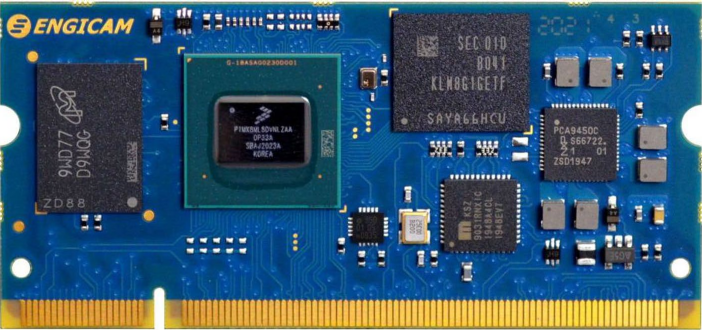
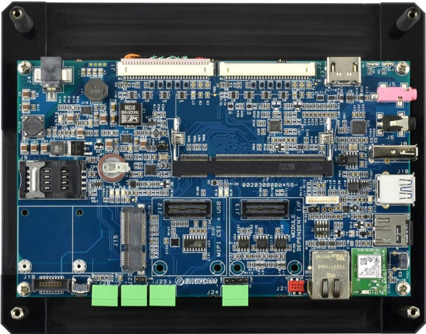
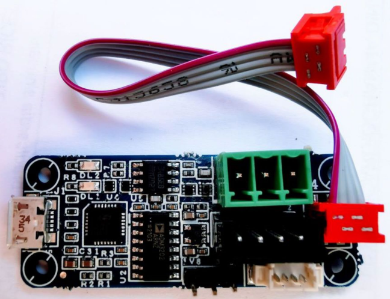
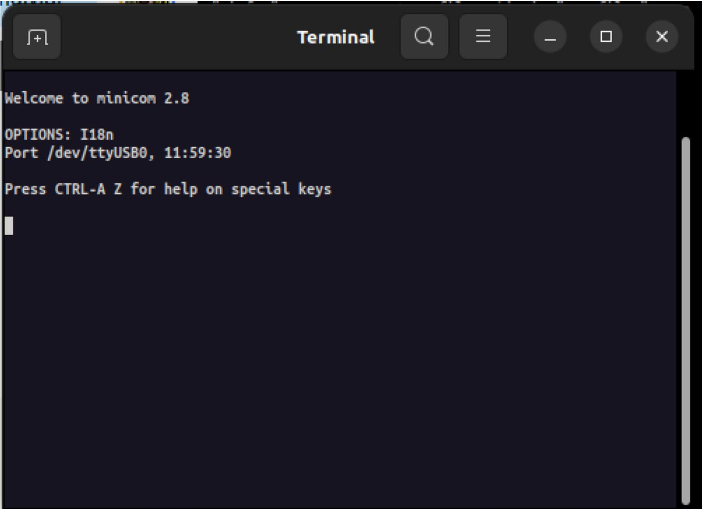
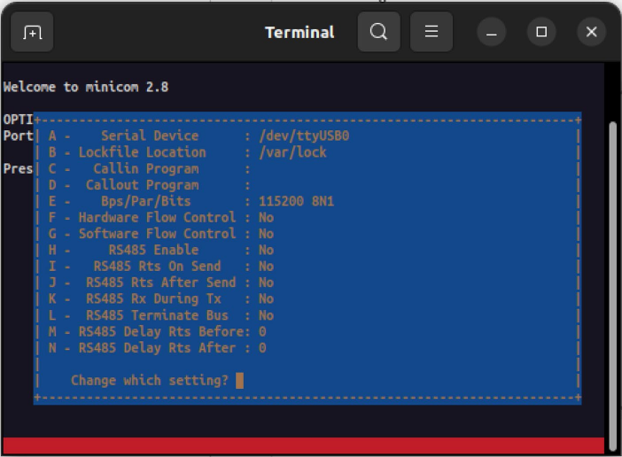
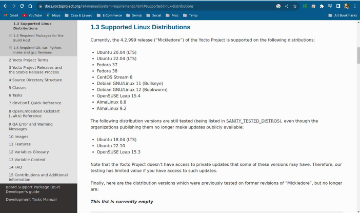
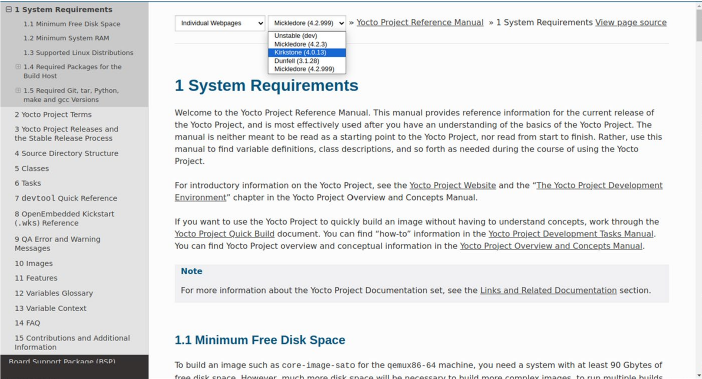
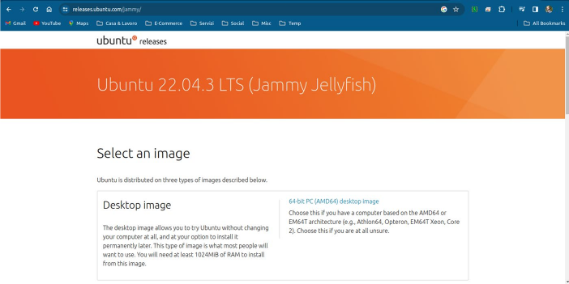

# Chương 1. Thiết lập môi trường build (Setting Up the Building Environment)

Trong chương này, chúng ta sẽ định nghĩa một số thuật ngữ thông dụng được dùng trong sách, liên quan đến thế giới embedded (người đọc đã thành thạo có thể yên tâm bỏ qua phần này), sau đó chúng ta sẽ trình bày tổng quan về thiết bị embedded sẽ dùng trong sách (tất nhiên có thể dùng một thiết bị khác, nhưng bạn đọc nên điều chỉnh các thiết lập lệnh được trình bày ở đây cho máy của mình).

Tiếp theo là một mục hữu ích về cách thiết lập target machine. Phần này khá tổng quát, dù rõ ràng mọi thiết lập đều liên quan đến thiết bị embedded của chúng ta.

Các mục cuối của chương này nói về cách thiết lập host system – bạn đọc có thể dùng nó để thiết lập một máy làm việc GNU/Linux-based hoặc một máy ảo chuyên dụng – và về cách cài đặt một môi trường build Yocto. Phần này rõ ràng liên quan đến thiết bị embedded của chúng ta, nhưng có thể dễ dàng điều chỉnh cho các hệ thống khác.

## 1.1 Các thuật ngữ của thế giới embedded (Embedded World Terms)

Trước khi bắt tay vào hệ thống embedded của mình với Yocto Project, bạn đọc nên làm quen với một số thuật ngữ mà một embedded developer cần biết để tránh hiểu nhầm.

Những người đã từng làm việc với các hệ thống embedded GNU/Linux có thể bỏ qua phần này, dù chúng tôi vẫn khuyên nên xem qua (bạn đọc vẫn có thể học được điều gì đó mới!).

| Thuật ngữ | Mô tả |
|---|---|
| Target | Target system là máy tính embedded mà chúng ta muốn quản lý. Thông thường, đó là một nền tảng ARM, nhưng đây không phải là quy tắc cố định. Thật vậy, PowerPC và MIPS là những nền tảng khác (ít) phổ biến hơn.<br>Ngay cả nền tảng x86 (một PC tiêu chuẩn) cũng có thể là một máy tính embedded. |
| Host | Host system là máy tính chúng ta sẽ dùng để quản lý target system. Thường thì đó là một PC bình thường (nền tảng x86 với 32 hoặc 64 bit) hoặc MAC, nhưng cũng có thể dùng các nền tảng khác.<br>Thông thường, host system mạnh hơn target, vì nó thường được dùng cho các tác vụ compile nặng mà target hoàn toàn không thể thực hiện, hoặc cho những tác vụ mà target phải mất nhiều thời gian để thực hiện. |
| Serial console | Đây là cổng giao tiếp quan trọng nhất trong một hệ thống embedded. Dùng serial console, người dùng có toàn quyền kiểm soát hệ thống, ngay cả khi nó chưa được thiết lập đúng. Thật vậy, serial console không chỉ không thể thiếu cho việc debug mà còn là giải pháp cuối cùng nếu chẳng may các file của hệ điều hành bị hỏng và board không chịu boot (thực ra điều này không hoàn toàn đúng, vì mọi CPU hiện đại đều có nhiều cách để khôi phục booting code bị hỏng – trước hết là serial downloader – tuy nhiên, với embedded developer, nó là thứ must-have!). |
| Compiler (hay native compiler) và cross-compiler | Native compiler chạy trên một máy (host hoặc target) và build code cho chính máy đó; tức là compiler chạy trên PC build code cho PC, giống như compiler chạy trên một máy ARM build code cho chính máy ARM đó, còn cross-compiler đơn giản là một compiler build code cho một máy khác (ví dụ, một cross-compiler có thể chạy trên PC để tạo binary cho một máy ARM). |
| Distribution | Distribution (hay Linux distribution, thường gọi tắt là distro) là một hệ điều hành được tạo thành từ một tập hợp software dựa trên Linux (kernel) và nhiều software package (phần lớn từ dự án GNU hoặc dựa trên một license Libre Software nào đó), thường được quản lý bởi một hệ thống quản lý package.<br>Có nhiều distribution khác nhau, và chúng có sẵn cho rất nhiều loại hệ thống, từ các thiết bị embedded (OpenWrt hoặc, trong trường hợp của chúng ta, Yocto Project) và máy tính cá nhân (Ubuntu hoặc Debian) cho đến các siêu máy tính mạnh mẽ. |
| Root filesystem | Root filesystem (gọi tắt là rootfs) là filesystem nằm trên cùng partition với root directory.<br><br>Đây là filesystem quan trọng nhất trong một hệ thống UNIX, và là filesystem đầu tiên được kernel mount.<br>Tất cả các filesystem khác (nếu có) đều được mount lên nó. |
| System-on-Module | System-on-Module (SoM) là một mạch board-level tích hợp một hệ thống vào một module hoặc board duy nhất; ứng dụng điển hình là trong lĩnh vực hệ thống embedded.<br><br>SoM đảm nhận một chức năng đặc biệt giống như system-on-a-chip (gọi tắt là SoC – thường là một CPU với các ngoại vi trên cùng một chip) nhưng có thêm các ngoại vi bên ngoài, dù nó vẫn cần mức độ kết nối cao. Nói đơn giản, SoM là thứ lai giữa SoC và single-board computer; thật vậy, thường thì SoM là một SoC với một số ngoại vi cơ bản (như RAM, một thiết bị lưu trữ như eMMC hoặc flash memory, và có thể có một module Wi-Fi, bộ nhớ EEPROM, v.v.) được gắn lên một carrier riêng để trở thành một hệ thống hoạt động đầy đủ. |
| Carrier board (gọi tắt là carrier) | SoM thường cần được gắn lên một carrier board (hay baseboard), board này đưa bus ra các connector ngoại vi tiêu chuẩn và cung cấp nguồn điện phù hợp (như bộ nguồn hoặc pin).<br><br>Thường thì carrier còn cung cấp thêm ngoại vi để có cách linh hoạt thêm hoặc bỏ ngoại vi (thông thường, chúng ta dùng một SoM với các carrier khác nhau để triển khai các hệ thống khác nhau). |

Giờ đã nêu ra một số thuật ngữ quan trọng, chúng ta sẵn sàng bước sang mục tiếp theo.

## 1.2 Tổng quan về target system (Target System Overview)

Trong sách này, chúng ta sẽ dùng EDIMM 2.0 Starter Kit do Engicam phát triển. Hệ thống embedded này dựa trên một SOM trang bị CPU i.MX8M-Plus của NXP và một carrier có nhiều ngoại vi được đưa ra ngoài, do Engicam thiết kế riêng.

Hình ảnh của SOM được trình bày trong Hình 1-1.



Hình 1-1. SoM i.Core MX8M Plus của Engicam

> Toàn bộ tài liệu và hỗ trợ cho SoM (System-on-Module) này có thể lấy tại `https://www.engicam.com/vis-prod/101684/EDIMM-SOM-based-on-NXP-iMX-8M-Plus`.

Carrier board nơi SoM này được gắn là EDIMM 2.0 Form Factor Capacitive Evaluation Board; cùng nhau chúng tạo thành EDIMM 2.0 Starter Kit của Engicam. Hình mặt sau của carrier board được trình bày trong Hình 1-2.



Hình 1-2. Carrier board của Engicam

> Toàn bộ tài liệu và hỗ trợ cho starter kit này có thể lấy tại `https://www.engicam.com/vis-prod/101366/EDIMM-2-0-STARTER-KIT-EDIMM-2-0-Form-Factor-Capacitive-Evaluation-Board`. Có thể cần đăng ký để truy cập đầy đủ.

Engicam cung cấp cả hai OS Yocto Project và Android cho máy này, và trên board chúng ta có các ngoại vi sau:

- LCD 7" với màn hình cảm ứng điện dung

- 1 x giao tiếp HDMI (tùy Module)

- 2 x giao tiếp LVDS lên đến FULL HD

- 1 x Gb Ethernet (giao tiếp thứ hai theo yêu cầu)

- 1 x giao tiếp Audio

- 1 x USB3.0 (tùy Module)

- 3 x USB2.0

- 1 x microSD

- 1 x RS485

- 1 x RS232

- 1 x Console (RS232)

- 2 x CAN BUS (tùy Module)

- Giao tiếp Wi-Fi

- Mini PCIe (tùy Module)

- 1 x MIPI CSI

Bạn đọc quan tâm đến việc dùng board này có thể hỏi trực tiếp Engicam tại `https://www.engicam.com`.

## 1.3 Thiết lập target machine (Setting Up the Target Machine)

Giờ là lúc thiết lập target machine của chúng ta. Tất nhiên, chúng ta sẽ trình bày mọi lệnh và thiết lập liên quan đến board Engicam ở trên, nhưng bạn đọc có thể điều chỉnh công việc này cho hệ thống của mình, vì các quy trình này khá thông thường với mọi hệ thống embedded.

### 1.3.1 Kết nối serial (Serial Connection)

Để có toàn quyền kiểm soát thiết bị embedded, chúng ta cần thiết lập đúng serial console qua kết nối serial.

Mỗi hệ thống embedded dựa trên GNU/Linux OS đều có một cổng serial chuyên dụng gọi là serial console, mà developer có thể dùng để debug và quản lý hệ thống ngay cả với một môi trường thu gọn (chỉ một terminal!).

Lưu ý rằng gần như thường xuyên serial console không được hiện thực qua kết nối serial RS232 thông thường, mà qua USB. Trong trường hợp sau, hệ thống embedded vẫn dùng một cổng serial, nhưng dữ liệu của nó đi qua kết nối USB nhờ một bộ chuyển đổi Serial-to-USB, như bộ chuyển đổi đi kèm development kit của Engicam (xem Hình 1-3).



Hình 1-3. Bộ chuyển đổi Serial-to-USB của Engicam

> Bạn đọc nên đọc kỹ user manual của Engicam để cắm đúng connector của bộ chuyển đổi serial console. Nếu không, output trong serial terminal có thể bị lỗi ký tự, và bạn đọc có thể không hiểu vì sao.

Vì vậy, sau khi kết nối với development kit, chúng ta có thể xác nhận rằng kết nối USB đã sẵn sàng bằng cách xem các kernel message của máy host qua lệnh `dmesg`, như dưới đây:

```
$ sudo dmesg -w
...
usb 1-9: new full-speed USB device number 6 using xhci_hcd
usb 1-9: New USB device found, idVendor=10c4, idProduct=ea60, bcdDevice
=1.00
usb 1-9: New USB device strings: Mfr=1, Product=2, SerialNumber=3
usb 1-9: Product: CP2102N USB to UART Bridge Controller
usb 1-9: Manufacturer: Silicon Labs
usb 1-9: SerialNumber: 567bb04d5a89eb11a614c5809693f7bc
usbcore: registered new interface driver cp210x
usbserial: USB Serial support registered for cp210x
cp210x 1-9:1.0: cp210x converter detected
usb 1-9: cp210x converter now attached to ttyUSB0
...
```

> Lưu ý rằng `dmesg` là một lệnh GNU/Linux điển hình, và nó sẽ có sẵn trên mọi bản phân phối GNU/Linux cho desktop. Nếu bạn đọc dùng một host machine non-GNU/Linux (và họ không nên làm vậy...), thì họ phải tra user manual của hệ thống mình để tìm lệnh tương đương.
>
> Trên một số hệ thống, product có thể được báo là `Engicam` `USB-to-Serial` với manufacturer là `Engicam`. Tất nhiên, điều này hoàn toàn không phải là vấn đề.

Trong các thông điệp trên, chúng ta thấy rằng bộ chuyển đổi Serial-to-USB được gắn với device `ttyUSB0`, vì vậy chúng ta có thể dùng nó trên mọi serial terminal emulator để truy cập serial console. Trong trường hợp của chúng ta, chúng ta dùng chương trình giao tiếp serial rất phổ biến tên là Minicom, như dưới đây:

```
$ minicom -o -c on -D /dev/ttyUSB0
```

Lưu ý rằng nếu lệnh `minicom` không có sẵn, chúng ta có thể cài nó trên bất kỳ OS Ubuntu-like nào, chỉ bằng lệnh dưới đây:

```
$ sudo apt install minicom
```

Nếu chương trình được cài đặt đúng, chúng ta sẽ thấy kết quả như trong Hình 1-4.



Hình 1-4. Output của `minicom`

Bây giờ, để chắc chắn rằng `minicom` được thiết lập đúng, chúng ta nên nhấn tổ hợp phím `CTRL-a` rồi `o` để mở menu cấu hình, tại đó chúng ta phải chọn mục `Serial port setup` (bằng các phím mũi tên). Nếu mọi thứ đã được làm đúng, chúng ta sẽ thấy cửa sổ thiết lập như trong Hình 1-5.



Hình 1-5. Cửa sổ thiết lập của `minicom`

Bây giờ chúng ta nên kiểm tra rằng mọi thiết lập trong hệ thống của mình giống như trong Hình 1-5, rồi lưu cấu hình hiện tại làm mặc định để có thiết lập đúng mỗi lần chạy công cụ `minicom` (chúng ta có thể dùng mục `Save setup as dfl` trong menu trước đó, có thể quay lại menu này bằng cách nhấn phím `Enter`).

Sau khi lưu cấu hình làm mặc định, chúng ta sẽ thoát menu và khởi động lại board. Việc này có thể làm bằng cách rút phích cắm ra rồi cắm lại vào ổ điện, hoặc nhấn nút reset gần chỗ cắm nguồn của board. Sau đó, chúng ta sẽ thấy các thông điệp sau:

```
U-Boot SPL 2021.04+fslc+g480445efe5 (Feb 13 2023 - 15:13:15 +0000)
DDRINFO: start DRAM init
DDRINFO: DRAM rate 4000MTS
DDRINFO:ddrphy calibration done
DDRINFO: ddrmix config done
SEC0:  RNG instantiated
Normal Boot
WDT:   Not found!
Trying to boot from BOOTROM
image offset 0x8000, pagesize 0x200, ivt offset 0x0
NOTICE:  BL31: v2.4(release):lf-5.15.5-1.0.0-0-g05f788b9b
NOTICE:  BL31: Built : 05:49:10, Mar  2 2022
...
```

Các thông điệp này thuộc về prebootloader SPL (Secondary Program Loader), còn dưới đây là các thông điệp thuộc về bootloader U-Boot:

```
...
U-Boot 2021.04+fslc+g480445efe5 (Feb 13 2023 - 15:13:15 +0000)

CPU:   i.MX8MP[8] rev1.1 1600 MHz (running at 1200 MHz)
CPU:   Industrial temperature grade (-40C to 105C) at 27C
Reset cause: POR
Model: Engicam i.MX8MPlus iCore
DRAM:  4 GiB
MMC:   FSL_SDHC: 1, FSL_SDHC: 2
Loading Environment from MMC... OK
Fail to setup video link
In:    serial
Out:   serial
Err:   serial
SEC0:  RNG instantiated
...
```

Trong các thông điệp này, chúng ta có thể thấy hệ thống của mình là `Engicam` `i.MX8MPlus iCore` trang bị 4GB RAM. Sau đó U-Boot tiếp tục như dưới đây:

```
...
BuildInfo:
  - ATF 05f788b
switch to partitions #0, OK
mmc2(part 0) is current device
flash target is MMC:2
Net:   eth1: ethernet@30bf0000 [PRIME]
Fastboot: Normal
Normal Boot
Hit any key to stop autoboot:  0
## Error: "distro_bootcmd" not defined
Running BSP bootcmd ...
switch to partitions #0, OK
mmc2(part 0) is current device
Failed to load 'boot.scr'
30792192 bytes read in 95 ms (309.1 MiB/s)
Booting from mmc ...
58643 bytes read in 1 ms (55.9 MiB/s)
Moving Image from 0x40480000 to 0x40600000, end=423f0000
## Flattened Device Tree blob at 43000000
   Booting using the fdt blob at 0x43000000
   Using Device Tree in place at 0000000043000000, end 0000000043011512
...
```

Khi U-Boot đã nạp xong fitimage (ở trên được gọi là Flattened Device Tree blob) chứa kernel và DTB của nó (tức là device tree blob của kernel), nó khởi động kernel, tạo ra output sau:

```
...
Starting kernel ...

[    0.000000] Booting Linux on physical CPU 0x0000000000 [0x410fd034]
[    0.000000] Linux version 5.15.5+g2da4fc0a5923 (oe-user@oe-host) (aa
rch64-poky-linux-gcc (GCC) 11.2.0, GNU ld (GNU Binutils) 2.37.20210721)
#1 SMP PREEMPT Wed Feb 1 08:46:51 UTC 2023
[    0.000000] Machine model: Engicam i.Core i.MX8MPlus
...
```

Một lần nữa, chúng ta thấy machine model là `Engicam i.Core` `i.MX8MPlus`, và theo các thông điệp tiếp theo, chúng ta cũng có thể lấy được kernel command line:

```
...
[    0.000000] Kernel command line: console=ttymxc1,115200 root=/dev/mm
cblk2p2 rootwait rw
...
```

Khi quá trình boot kết thúc, chúng ta sẽ thấy login prompt như dưới đây:

```
...
[  OK  ] Started Weston, a Wayland ...mpositor, as a system service.
[  OK  ] Reached target Graphical Interface.
         Starting Record Runlevel Change in UTMP...
[  OK  ] Finished Record Runlevel Change in UTMP.

NXP i.MX Release Distro 5.15-honister imx8mp-icore-4gb ttymxc1

imx8mp-icore-4gb login:
```

Ở đây, sau khi nhập user `root`, chúng ta chỉ cần nhấn phím `Enter` để có root prompt:

```
root@imx8mp-icore-4gb#
```

Tuyệt! Qua serial console, chúng ta đã xác nhận rằng hệ thống đã khởi động và đang chạy.

Giờ chúng ta có thể chuyển sang mục tiếp theo để thiết lập một kết nối mạng tiện dụng hơn qua SSH.

> Prompt có thể khác tùy theo đặc điểm của hệ thống.

### 1.3.2 Kết nối mạng (Network Connection)

Thiết lập kết nối mạng là một việc khá dễ khi Yocto OS đang chạy trên một hệ thống embedded. Trước tiên, chúng ta phải cắm cáp Ethernet vào hệ thống, và trên serial console chúng ta sẽ thấy kết quả như dưới đây:

```
IPv6: ADDRCONF(NETDEV_CHANGE): eth0: link becomes ready
imx-dwmac 30bf0000.ethernet eth0: Link is Up - 100Mbps/Full - flow contr
ol rx/tx
```

Bây giờ chúng ta có thể dùng lệnh `ip` để gán một địa chỉ IP cho interface `eth0` như dưới đây:

```
# ip address add 192.168.32.132/24 dev eth0
```

Sau đó chúng ta có thể kiểm tra kết nối bằng lệnh `ping` để gửi một ping message tới một máy khác trong LAN của mình, như dưới đây:

```
# ping 192.168.32.2
PING 192.168.32.2 (192.168.32.2) 56(84) bytes of data.
64 bytes from 192.168.32.2: icmp_seq=1 ttl=64 time=0.698 ms
64 bytes from 192.168.32.2: icmp_seq=2 ttl=64 time=0.360 ms
^C
```

Tuy nhiên, cách này không đáng tin cậy vì ở lần reboot tiếp theo, cấu hình mạng sẽ bị mất, và chúng ta cũng không có thiết lập default gateway để cho phép kết nối Internet từ xa. Vì vậy, giải pháp tốt nhất là dùng một file cấu hình phù hợp để thiết lập kết nối mạng tĩnh, kết nối này sẽ được thiết lập ở mỗi lần hệ thống boot.

Để làm vậy, hãy tạo một file mới trong thư mục `/etc/systemd/network/` như dưới đây:

```
# cat > /etc/systemd/network/50-eth0.network <<__EOF
[Match]
Name=eth0

[Network]
Address=192.168.32.132/24
Gateway=192.168.32.2
DNS=192.168.32.2
__EOF
```

> Tất nhiên, bạn đọc nên thay mọi địa chỉ IP ở trên bằng địa chỉ của mình để có kết nối Internet hoạt động.

Sau đó chúng ta phải khởi động lại service `systemd-networkd`:

```
# systemctl restart systemd-networkd
```

Bây giờ, để kiểm tra mọi thứ có hoạt động không, chúng ta có thể làm như dưới đây:

```
# ip addr show dev eth0
2: eth0: <BROADCAST,MULTICAST,DYNAMIC,UP,LOWER_UP> mtu 1500 qdisc mq st
ate UP group default qlen 1000
    link/ether 9c:53:cd:0d:8f:78 brd ff:ff:ff:ff:ff:ff
    inet 192.168.32.132/24 brd 192.168.32.255 scope global eth0
       valid_lft forever preferred_lft forever
    inet6 fe80::9e53:cdff:fe0d:8f78/64 scope link
       valid_lft forever preferred_lft forever
# ip route
default dev eth0 scope link
default via 192.168.32.2 dev eth0 proto static
192.168.32.0/24 dev eth0 proto kernel scope link src 192.168.32.2
```

OK, giờ mọi thứ có vẻ đã sẵn sàng. Chúng ta chỉ cần kiểm tra xem có thể vào hệ thống qua SSH không, vì vậy trên host machine chúng ta có thể thử thực thi lệnh tiếp theo:

```
$ ssh root@192.168.32.132
The authenticity of host '192.168.32.132 (192.168.32.132)' can't be est
ablished.
RSA key fingerprint is SHA256:EJPYPkw+lcPowlZnJosrrJMLO8QKCekVzJo62FBdL
sg.
This key is not known by any other names
Are you sure you want to continue connecting (yes/no/[fingerprint])?
```

Bây giờ chúng ta có thể tiếp tục bằng cách nhập chuỗi `yes`, và sẽ thấy output như dưới đây:

```
Warning: Permanently added '192.168.32.132' (RSA) to the list of known
hosts.
```

Tuyệt! Giờ chúng ta cũng có thể dùng kết nối SSH để đăng nhập vào hệ thống embedded của mình, vì vậy có thể đi tiếp để xem cách thiết lập host machine của developer.

## 1.4 Thiết lập host machine (Setting Up the Host Machine)

Để có một hệ thống Yocto chạy được, chúng ta cần một môi trường build hoạt động trên host machine. Host machine mà chúng ta quyết định dùng có thể là một PC bình thường hoặc một máy ảo hóa, và có thể dùng các giải pháp thay thế để đạt mục tiêu này như được nêu trên trang Yocto Project Documentation tại `https://docs.yoctoproject.org/`, nơi trong Mục 1.3 chúng ta có thể xem danh sách các OS được hỗ trợ.

Tại thời điểm viết sách, chúng ta có thể đọc danh sách các OS như trong Hình 1-6.



Hình 1-6. Các bản phân phối Linux được Yocto Project hỗ trợ

Nhìn vào ảnh chụp màn hình trong Hình 1-6, rõ ràng môi trường build duy nhất có thể dùng là một distro desktop Linux–based! Vì vậy các OS khác không được chấp nhận.

Trong tình huống này, Yocto developer có thể chọn distro desktop Linux–based mình ưa thích từ danh sách.

Trong sách này, chúng ta sẽ dùng Ubuntu OS; tuy nhiên, developer dùng các OS Linux-based khác vẫn có thể dễ dàng làm theo các ví dụ trong sách, vì khi Yocto Project đã được cài đặt, các lệnh được dùng khá độc lập với distro.

Một lưu ý quan trọng ở đây là danh sách bản phân phối Linux được hỗ trợ phụ thuộc vào bản phát hành Yocto mà chúng ta quyết định dùng trên hệ thống embedded, và ảnh chụp màn hình trong Hình 1-6 ứng với Mickledore 4.2.999. Nếu phải dùng một bản phát hành khác, chúng ta có thể xem thông tin cho bản đó bằng cách đổi lựa chọn ở đầu trang của mục 1 System Requirements (xem `https://docs.yoctoproject.org/ref-manual/system-requirements.html`), như trong Hình 1-7.



Hình 1-7. Cách chọn một bản phát hành Yocto khác trong tài liệu chính thức

Trong sách này, chúng ta sẽ dùng Yocto phiên bản Kirkstone 4.0.13, và các bản phân phối Linux được hỗ trợ là

- Ubuntu 20.04 (LTS)

- Ubuntu 22.04 (LTS)

- Fedora 37

- Debian GNU/Linux 11.x (Bullseye)

- AlmaLinux 8.8

Vì vậy, trong sách này, chúng ta sẽ dùng Ubuntu 22.04 làm OS để build.

> Khi cuốn sách này được xuất bản, một phiên bản Yocto mới sẽ có sẵn: Yocto Scarthgap 5.0.5. Mọi giải thích và ví dụ tiếp theo sẽ được chuyển nguyên trạng sang bản phát hành mới, và khi cần, mọi sửa đổi cần thiết hoặc các lệnh mới quan trọng sẽ được nêu ra.

### 1.4.1 Build trên máy ảo (Building on Virtual Machines)

Một giải pháp đơn giản (và hoạt động ở mọi nơi) để có một máy chạy OS Linux-based là dùng một máy ảo chạy trên một virtual engine phù hợp. Trong trường hợp này, chúng ta có thể dùng hệ thống ảo hóa ưa thích, ví dụ VirtualBox hoặc VMWare, rồi cài Ubuntu 22.04 LTS lên đó.

Dù đây là cách dễ nhất để có một máy build, developer giỏi nên cân nhắc dùng máy thật làm hệ thống build; lý do là máy thật hiệu quả hơn nhiều so với máy giả lập, và vì việc build Yocto image tốn khá nhiều tài nguyên hardware, các PC giả lập có thể không phải lựa chọn tốt nhất nếu chúng ta cần một hệ thống compile nhanh. Bạn đọc nên tính đến việc compile một Yocto image từ đầu có thể cần vài giờ trên một PC thật, nên có thể hình dung nó tốn bao nhiêu thời gian trên một máy giả lập!

Như đã nói, để cài một hệ thống build trên một máy trống bất kỳ (thật hay giả lập không quan trọng), bước đầu tiên là biết nơi có thể tải OS Ubuntu 22.04.3 LTS (Jammy Jellyfish). Bạn đọc có thể tìm nó tại `https://releases.ubuntu.com/jammy/`, còn Hình 1-8 là ảnh chụp màn hình của trang này.



Hình 1-8. Trang tải Ubuntu 22.04.3 LTS

Sau đó nhấn vào link Desktop image, và khi ISO image tương ứng đã được tải về, chúng ta có thể đi tiếp và cài nó lên host machine ưa thích.

Nếu quyết định tạo một image giả lập mới, chúng ta chỉ cần chọn ISO image đã tải làm booting image; còn với PC thật, cách ưa dùng để cài OS là tạo một USB stick bootable. Trên Ubuntu, tiện ích cần dùng để làm việc này có tên là Startup Disk Creator, và bạn đọc có thể tìm thấy vô số ví dụ trên Internet về cách dùng nó.

### 1.4.2 Build bằng schroot (và debootstrap) (Building by Using schroot (and debootstrap))

Trong trường hợp chúng ta đã có một hệ thống GNU/Linux hoạt động làm OS chính, nhưng không phải Ubuntu 22.04, chúng ta có thể tránh việc cài máy ảo bằng cách dùng một môi trường chroot, như môi trường do công cụ schroot cung cấp.

Cài schroot khá đơn giản trên mọi hệ thống GNU/Linux desktop có cung cấp package đã compile sẵn, nhưng việc khó có thể là lấy root filesystem của Ubuntu 22.04 nếu OS của bạn không cung cấp công cụ tên là debootstrap. Thật vậy, công cụ này có thể được dùng để tạo một hệ thống Debian/Ubuntu cơ bản từ đầu bằng cách tải các file .deb từ một mirror site rồi cẩn thận giải nén chúng vào một thư mục mà chúng ta có thể chroot vào.

> Với thuật ngữ chroot, chúng ta muốn nói đến một thao tác trên các hệ điều hành Unix-like, thao tác này thay đổi root directory biểu kiến của process đang chạy hiện tại và các process con của nó. Chương trình chạy trong một môi trường đã bị thay đổi như vậy không thể thấy cũng không thể truy cập các file trong các thư mục cha.

Trên một hệ thống Ubuntu- hoặc Debian-based, chúng ta có thể giải quyết vấn đề đơn giản bằng lệnh dưới đây:

```
$ sudo apt install schroot debootstrap
```

Những người dùng non-Ubuntu có thể dùng tương tự công cụ quản lý package do OS Linux-based của họ cung cấp.

> Lưu ý rằng giải pháp này chỉ hoạt động nếu hệ thống đang chạy là một PC 64-bit (thường được gọi là `amd64` hoặc được lệnh `uname -i` nhận diện là `x86_64`).

Bây giờ, nếu đã có một root filesystem Ubuntu 22.04, chúng ta có thể đặt nó vào một thư mục riêng (trong ví dụ của chúng ta là `/srv/chroot/ubuntu-jammy-` `amd64)`; nếu không, chúng ta có thể tạo một root filesystem mới bằng `debootstrap` với các lệnh sau:

```
$ sudo mkdir /srv/chroot && cd /srv/chroot
$ sudo debootstrap --verbose jammy ubuntu-jammy-amd64
```

Nếu mọi thứ suôn sẻ, chúng ta sẽ thấy output như dưới đây:

```
I: Retrieving InRelease
I: Checking Release signature
I: Valid Release signature (key id F6ECB3762474EDA9D21B7022871920D1991B
C93C)
I: Retrieving Packages
I: Validating Packages
I: Resolving dependencies of required packages...
I: Resolving dependencies of base packages...
I: Checking component main on http://archive.ubuntu.com/ubuntu...
I: Retrieving adduser 3.118ubuntu5
I: Validating adduser 3.118ubuntu5
I: Retrieving apt 2.4.5
I: Validating apt 2.4.5
...
```

Khi lệnh kết thúc, root filesystem sẽ có sẵn:

```
$ ls /srv/chroot/ubuntu-jammy-amd64
bin   dev  home  lib32  libx32  mnt  proc  run   srv  tmp  var
boot  etc  lib   lib64  media   opt  root  sbin  sys  usr
```

Bước tiếp theo là cấu hình công cụ `schroot` để vào đúng hệ thống chroot mới của chúng ta. Để làm vậy, chúng ta phải thêm một file mới vào thư mục cấu hình của `schroot`, như dưới đây:

```
$ sudo bash -c 'cat > /etc/schroot/chroot.d/ubuntu-jammy-amd64 <<__EOF__
[ubuntu-jammy-amd64]
description=Ubuntu Jammy (arm64)
directory=/srv/chroot/ubuntu-jammy-amd64
users=giometti
#groups=sbuild
#root-groups=root
#aliases=unstable,default
type=directory
profile=desktop
personality=linux
preserve-environment=true
__EOF__'
```

> Lưu ý rằng lệnh `cat` được bao quanh bởi hai ký tự tick (`’`).
>
> Cũng lưu ý rằng tham số `directory` được đặt thành đường dẫn chứa root filesystem mới của chúng ta, và tham số `users` được đặt thành `giometti`, là username của tôi (đây là một danh sách comma-separated các user được phép truy cập môi trường chroot – xem các man page liên quan tại `man schroot.conf`).

Nhìn vào các thiết lập trên, chúng ta thấy tham số `profile` được đặt thành `desktop`; điều này có nghĩa là nó sẽ xét mọi file trong thư mục `/etc/schroot/desktop`. Cụ thể, file `fstab` chứa mọi mount point mà chúng ta muốn được mount vào hệ thống.

Vì vậy, chúng ta nên kiểm tra rằng file này chứa ít nhất các dòng sau:

```
$ cat /etc/schroot/desktop/fstab
# fstab: static file system information for chroots.
# Note that the mount point will be prefixed by the chroot path
# (CHROOT_PATH)
#
# <file system> <mount point>   <type>  <options>       <dump>  <pass>
/proc           /proc           none    rw,bind         0       0
/sys            /sys            none    rw,bind         0       0
/dev            /dev            none    rw,bind         0       0
/dev/pts        /dev/pts        none    rw,bind         0       0
/home           /home           none    rw,bind         0       0
/tmp            /tmp            none    rw,bind         0       0

# If you use gdm3, uncomment this line to allow Xauth to work
#/var/run/gdm3  /var/run/gdm3   none    rw,bind         0       0
# For PulseAudio and other desktop-related things
/var/lib/dbus    /var/lib/dbus  none    rw,bind         0       0

# It may be desirable to have access to /run, especially if you wish
# to run additional services in the chroot.  However, note that this
# may potentially cause undesirable behaviour on upgrades, such as
# killing services on the host.
#/run           /run            none    rw,bind         0       0
#/run/lock      /run/lock       none    rw,bind         0       0
#/dev/shm       /dev/shm        none    rw,bind         0       0
#/run/shm       /run/shm        none    rw,bind         0       0
```

Giờ mọi thứ đã sẵn sàng, và chúng ta chỉ cần khởi động lại service `schroot`:

```
$ sudo systemctl restart schroot
```

Nếu mọi thứ đã được làm đúng, chúng ta sẽ liệt kê được mọi môi trường chroot có sẵn bằng cách hỏi `schroot` với command line sau:

```
$ schroot -l
Chroot:ubuntu-jammy-amd64
```

OK, mọi thứ chạy tốt, và chúng ta có thể vào hệ thống Ubuntu 22.04 chroot bằng lệnh dưới đây, được thực thi từ home directory của mình:

```
$ cd
$ schroot -c ubuntu-jammy-amd64
$ cat /etc/lsb-release
DISTRIB_ID=Ubuntu
DISTRIB_RELEASE=22.04
DISTRIB_CODENAME=jammy
DISTRIB_DESCRIPTION="Ubuntu 22.04 LTS"
```

Lưu ý rằng điều quan trọng là phải thực thi lệnh `schroot` trong home directory của mình (hoặc ít nhất trong một thư mục mà hệ thống môi trường chroot có thể truy cập); nếu không, chúng ta sẽ nhận được một warning message như dưới đây:

```
$ cd /srv/chroot/
$ schroot -c ubuntu-jammy-amd64
W: Failed to change to directory '/srv/chroot': No such file or directo
ry
I: The directory does not exist inside the chroot.  Use the --directory
 option to run the command in a different directory.
W: Falling back to directory '/home/giometti'
```

Tại thời điểm này, Ubuntu 22.04 mới của chúng ta đã hoạt động, nhưng vẫn chưa sẵn sàng sử dụng vì nó còn rất tối giản. Có thể xác nhận điều này bằng cách xem file `/etc/apt/sources.list`:

```
$ cat /etc/apt/sources.list
deb http://archive.ubuntu.com/ubuntu jammy main
```

File này chứa tham chiếu tới mọi Ubuntu repository nơi các package đã compile sẵn được lưu trữ và sẵn sàng để cài đặt. Mọi người dùng Ubuntu đều biết rằng còn thiếu nhiều source, và một hệ thống well-configured nên có ít nhất các thiết lập sau:

```
$ cat /etc/apt/sources.list
deb http://archive.ubuntu.com/ubuntu/ jammy main universe restricted mu
ltiverse
deb http://security.ubuntu.com/ubuntu jammy-security main universe rest
ricted multiverse
deb http://archive.ubuntu.com/ubuntu/ jammy-updates main universe restr
icted multiverse
```

> Lưu ý rằng các thiết lập trên trỏ tới các site Ubuntu chính, nhưng chúng ta cũng có thể dùng mirror (hãy tìm trên Internet). Ví dụ, với Ý, chúng ta có URL `http://it.archive.ubuntu.com/ubuntu/`.

Sau khi file `/etc/apt/sources.list` đã được cấu hình tốt, chúng ta phải thực thi lệnh sau để đọc và thiết lập các source mới:

```
$ sudo apt update
```

Nếu cuối cùng mọi thứ đã được làm đúng, chúng ta sẽ nhận được thông điệp như dưới đây:

```
98 packages can be upgraded. Run 'apt list --upgradable' to see them.
```

Để cập nhật các package này, chúng ta có thể dùng lệnh:

```
$ sudo apt upgrade
```

Giờ chúng ta đã sẵn sàng cài mọi công cụ cơ bản sẽ dùng trong sách, và để xem cách làm việc đó, chúng ta phải chuyển sang mục tiếp theo.

## 1.5 Cài đặt môi trường build (Installing the Building Environment)

Bây giờ, để chắc chắn rằng mọi lệnh cần thiết đều được cài đặt đúng trong hệ thống Ubuntu mới (cả trường hợp máy thật lẫn máy ảo), chúng ta nên thử cài một số package.

Vậy, hãy dùng lệnh sau:

```
$ sudo apt install man gawk gpg bzip2 wget git diffstat unzip \
        texinfo gcc g++ build-essential chrpath socat cpio \
        python-is-python3 python3-distutils python3 python3-pip \
        python3-pexpect xz-utils debianutils iputils-ping \
        python3-git python3-jinja2 libegl1-mesa libsdl1.2-dev \
        python3-subunit mesa-common-dev zstd liblz4-tool file \
        locales libacl1
$ sudo locale-gen en_US.UTF-8
```

Một công cụ quan trọng khác mà hệ thống phát triển của chúng ta cần là lệnh repo, công cụ chính để dễ dàng tải và thiết lập mọi tài nguyên Yocto cần thiết.

Trong một hệ thống mới cài, lệnh này thường chưa được cài đặt, vì vậy chúng ta có thể cài nó bằng hệ thống quản lý package của OS. Với Ubuntu, chúng ta có thể làm việc đó bằng lệnh dưới đây:

```
$ sudo apt install repo
```

> Nếu dùng giải pháp này, chúng ta có thể nhận được warning message sau:

```
... A new version of repo (2.50) is available.
... New version is available at: /home/giometti/yocto/imx-yocto-bs
p/.repo/repo/repo
... The launcher is run from: /usr/bin/repo
!!! The launcher is not writable.  Please talk to your sysadmin or
 distro
!!! to get an update installed.
```

> Trong trường hợp này, chúng ta phải giải quyết vấn đề bằng cách ghi đè chương trình `repo` theo cách thủ công hoặc tiếp tục dùng phiên bản cũ hơn.

Ngoài ra, chúng ta có thể làm điều tương tự bằng cách lấy `repo` trực tiếp từ site của Google, như dưới đây:

```
$ sudo wget https://storage.googleapis.com/git-repo-downloads/repo \
        -O /usr/local/bin/repo
$ sudo chmod a+x /usr/local/bin/repo
```

Nếu mọi thứ đã được làm đúng, chúng ta sẽ có thể thực thi lệnh sau:

```
$ repo --help
usage: repo COMMAND [ARGS]

repo is not yet installed.  Use "repo init" to install it here.

The most commonly used repo commands are:

  init      Install repo in the current working directory
  help      Display detailed help on a command

For access to the full online help, install repo ("repo init").

Bug reports: https://issues.gerritcodereview.com/issues/new?component=1
370071
```

> Chúng ta có thể nhận được một error message giống như sau:
>
> ```
> bash: repo: command not found
> ```
>
> Nếu vậy, chúng ta cần kiểm tra rằng thư mục `/usr/local/bin/repo` đã được thiết lập đúng trong biến `PATH` như dưới đây:
>
> ```
> $ echo $PATH
> /usr/sbin:/usr/bin:/sbin:/bin:/usr/games:/usr/local/games:/snap/bi
> n:/snap/bin
> ```
>
> Ở đây, thư mục `/usr/local/bin/repo` bị thiếu, và chúng ta có thể sửa bằng cách làm như dưới đây:
>
> ```
> $ PATH="/usr/local/sbin:/usr/local/bin:$PATH"
> ```
>
> Nếu bây giờ thử chạy lại lệnh, nó sẽ hoạt động.
>
> Lưu ý cuối cùng, để thay đổi này có hiệu lực lâu dài, chúng ta có thể thêm một lệnh export vào `.bashrc` (hoặc file tương tự).

OK, giờ mọi lệnh cần thiết đã sẵn sàng, vì vậy chúng ta có thể chuyển sang chương tiếp theo, nơi chúng ta sẽ xem cách cài đặt Yocto source.

## 1.6 Tóm tắt (Summary)

Trong chương này, chúng ta đã xem lại một số thuật ngữ của thế giới embedded và đã giới thiệu bộ kit embedded sẽ dùng xuyên suốt sách. Chúng ta cũng đã tìm hiểu cách kết nối với nó qua cả serial console lẫn kết nối SSH.

Sau đó chúng ta đã thiết lập host machine (cả phiên bản máy thật lẫn chroot) để có một hệ thống build hoạt động đầy đủ.

Giờ chúng ta có thể đi tiếp để xem cách cài đặt Yocto source trên host machine.

