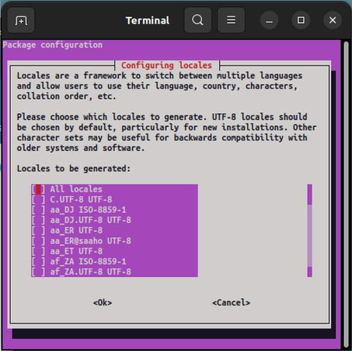
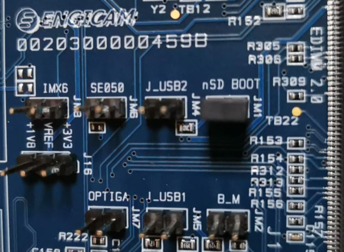

# Chương 2. Cài đặt source (Installing the Sources)

Khi môi trường build đã sẵn sàng hoạt động, chúng ta sẽ phải lấy mọi Yocto source cần thiết. Để làm vậy, chúng ta nên nhớ target system nơi hệ thống mới của mình sẽ chạy là gì. Thật vậy, dù Yocto OS hỗ trợ nhiều kiến trúc khác nhau từ nhiều hãng CPU, việc mỗi hãng fork tree của Yocto để hỗ trợ sản phẩm của mình là khá phổ biến. Điều này thường không phải là vấn đề, vì những gì chúng ta sẽ trình bày trong sách đều có tính tổng quát và (có lẽ 5% cuối cùng của) các tùy biến có thể dễ dàng được điều chỉnh cho từng development kit mà chúng ta phải làm việc cùng.

Hệ thống embedded của chúng ta dựa trên i.MX8, vì vậy chúng ta phải tải và cài đặt Yocto OS do NXP phát triển, và trong sách này chúng ta sẽ làm như vậy. Bạn đọc có hệ thống khác có thể dễ dàng làm tương tự bằng cách dùng Yocto Project tiêu chuẩn hoặc phiên bản do hãng hardware của họ phát hành và khuyến nghị.

Trong chương này, bạn đọc nên thực thi nguyên trạng mọi lệnh (hoặc áp dụng những sửa đổi cần thiết cho kit embedded của mình), vì mọi giải thích về những gì chúng ta đang làm sẽ được mô tả kỹ trong các chương tiếp theo.

## 2.1 Tải các repository (Downloading the Repositories)

Giờ chúng ta đã sẵn sàng bắt đầu tải các source cần thiết, vì vậy trong hệ thống build, chúng ta cần chuyển vào một thư mục riêng (chúng ta sẽ dùng thư mục `yocto` trong home directory của `giometti` – tức là thư mục `/home/giometti/yocto`) rồi thực thi lệnh `repo` như dưới đây:

```
$ mkdir imx-yocto-bsp && cd imx-yocto-bsp
$ repo init -u https://github.com/nxp-imx/imx-manifest \
        -b imx-linux-kirkstone -m imx-5.15.71-2.2.0.xml
$ repo sync
```

Công cụ repo là phương pháp được dùng nhiều nhất để dễ dàng tải và thiết lập mọi tài nguyên Yocto cần thiết. Các lệnh trên lấy source revision imx-linux-kirkstone từ `https://github.com/nxp-imx/imx-manifest`, và chúng làm được việc đó nhờ dùng file `imx-5.15.71-2.2.0.xml` làm manifest file mặc định.

> Để cài phiên bản Scarthgap, chúng ta có thể dùng lệnh repo dưới đây:
>
> ```
> $ repo init -u https://github.com/nxp-imx/imx-manifest \
>         -b imx-linux-scarthgap -m imx-6.6.52-2.2.0.xml
> ```

Manifest file đơn giản là một danh sách các repository cần tải về để có một Yocto build system hoạt động cho embedded board của chúng ta.

> Khi thực thi `repo`, chúng ta có thể nhận được warning message sau:
>
> ```
> ... A new version of repo (2.39) is available.
> ... New version is available at: /home/giometti/yocto/imx-yocto-bs
> p/.repo/repo/repo
> ... The launcher is run from: /usr/local/bin/repo
> !!! The launcher is not writable.  Please talk to your sysadmin or
>  distro
> ```
>
> Chúng ta có thể dễ dàng sửa nó đơn giản bằng cách làm đúng những gì thông điệp gợi ý, tức là chép file phiên bản `repo` mới đè lên file hiện tại trong `/usr/local/bin/repo` (hoặc ở bất cứ đâu thông điệp mà bạn đọc nhận được gợi ý). Tuy nhiên, nếu chúng ta tiếp tục chạy phiên bản cũ, mọi thứ vẫn sẽ hoạt động đúng.

Nếu mọi thứ suôn sẻ, thư mục làm việc của chúng ta sẽ có nội dung như dưới đây:

```
$ ls
imx-setup-release.sh  README  README-IMXBSP  setup-environment  sources
```

trong đó thư mục `sources` sẽ chứa mọi layer của Yocto Project (trong chương tiếp theo, chúng ta sẽ giải thích layer là gì):

```
$ ls sources/
base            meta-freescale-3rdparty   meta-openembedded    poky
meta-browser    meta-freescale-distro     meta-qt6
meta-clang      meta-imx                  meta-timesys
meta-freescale  meta-nxp-demo-experience  meta-virtualization
```

Trong hầu hết các trường hợp, như vậy là đủ để có mọi thứ cần thiết để bắt đầu compile Yocto; tuy nhiên, trong trường hợp đặc biệt này, chúng ta cần thêm một layer khác (tức là thêm source code) do Engicam cung cấp. Chúng ta phải làm vậy để có toàn bộ code cần thiết để hỗ trợ kit embedded của mình.

Việc này phải được làm trong thư mục source, nơi chứa mọi layer, bằng các lệnh dưới đây:

```
$ cd sources
$ git clone https://github.com/engicam-stable/meta-engicam-nxp.git \
        -b kirkstone
```

Bằng cách này, chúng ta clone mọi source từ `https://github.com/engicam-stable/meta-engicam-nxp.git` ở branch kirkstone.

Cuối cùng, chúng ta sẽ có layer mới như dưới đây:

```
$ ls meta-engicam-nxp/
conf         README.md             recipes-core
COPYING.MIT  recipes-bsp           recipes-images
note.txt     recipes-connectivity  recipes-kernel
```

OK, giờ chúng ta đã sẵn sàng bắt đầu! Vậy hãy quay lại thư mục làm việc ở trên bằng lệnh `cd` như dưới đây:

```
$ cd ..
```

Sau đó chúng ta có thể chuyển sang mục tiếp theo để xem cách bắt đầu quá trình build.

## 2.2 Thiết lập build directory (Setting Up the Build Directory)

Giờ mọi thứ đã sẵn sàng, chúng ta có thể bắt đầu compile Yocto image mới cho hệ thống embedded mà chúng ta phải làm việc cùng. Tuy nhiên, trước khi bắt đầu giai đoạn compile thật sự, chúng ta phải thiết lập build directory và mọi thứ cần có trong môi trường để thực thi đúng mọi công cụ compile.

Thông thường, để làm vậy, bước đầu tiên là source một file đặc biệt tên là `setup-environment`, file này tạo ra một môi trường phù hợp để compile đúng mọi công cụ cần thiết và, tất nhiên, cả code mong muốn.

Khi thử thực thi nó, chúng ta nhận được một usage message hữu ích như dưới đây:

```
$ ./setup-environment
-e
Usage: MACHINE=<machine> DISTRO=<distro> source setup-environment <buil
d-dir>
Usage:                                   source setup-environment <buil
d-dir>
    <machine>    machine name
    <distro>     distro name
    <build-dir>  build directory

The first usage is for creating a new build directory. In this case, the
script creates the build directory <build-dir>, configures it for the
specified <machine> and <distro>, and prepares the calling shell for run
ning bitbake on the build directory.

The second usage is for using an existing build directory. In this case,
the script prepares the calling shell for running bitbake on the build
directory <build-dir>. The build directory configuration is unchanged.
...
Examples:

- To create a new Yocto build directory:
  $ MACHINE=imx6qdlsabresd DISTRO=fslc-framebuffer source setup-environ
ment build

- To use an existing Yocto build directory:
  $ source setup-environment build
```

Ngay đầu, chúng ta có thể đọc thấy có hai chế độ sử dụng để thực thi script này:

- Chế độ thứ nhất là để tạo một build directory mới.

  ```
  $ MACHINE=<machine> DISTRO=<distro> \
          source setup-environment <build-dir>
  ```

  Lệnh này thiết lập build directory `<build-dir>` (nơi đặt mọi file được tạo ra cùng các Yocto image mong muốn) và cấu hình nó cho `<machine>` và `<distro>` được chỉ định. Hơn nữa, nó chuẩn bị shell gọi lệnh để có thể chạy đúng lệnh `bitbake` (và mọi lệnh khác có trong build system).

  Khi được thực thi lần đầu, lệnh này tạo ra một file cấu hình, nơi ghi lại các biến `MACHINE` và `DISTRO`.

- Chế độ thứ hai là để (tái) sử dụng một build directory đã có. Cách dùng là

  ```
  $ source setup-environment <build-dir>
  ```

  Lệnh này chuẩn bị shell gọi lệnh để chạy `bitbake` (và các lệnh anh em của nó) trên build directory `<build-dir>`, còn cấu hình môi trường được lấy bằng cách đọc file cấu hình đã được tạo ở chế độ sử dụng thứ nhất.

> Trong mục tiếp theo, chúng ta sẽ trình bày chi tiết file cấu hình này, nằm ở `conf/local.conf`.

Tất cả những điều này luôn đúng, nhưng trong trường hợp này, chúng ta đang dùng một bản phát hành Yocto đặc biệt của NXP. Các developer của NXP quyết định thêm một script khởi tạo bổ sung (script này lại gọi script `setup-environment`) tên là `imx-setup-release.sh`, vì vậy chúng ta phải dùng nó để thiết lập đúng môi trường build.

Nếu thực thi nó với option argument `-h` quen thuộc, chúng ta có thể đọc usage message của nó như dưới đây:

```
$ ./imx-setup-release.sh -h
-e
Usage: source imx-setup-release.sh
    Optional parameters: [-b build-dir] [-h]

    * [-b build-dir]: Build directory, if unspecified script uses 'buil
d' as output directory
    * [-h]: help

To return to this build environment later please run:
    source setup-environment <build_dir>
```

Vì vậy, lệnh chúng ta phải thực thi lần đầu là như sau:

```
$ DISTRO=fsl-imx-xwayland MACHINE=imx8mp-icore source \
        imx-setup-release.sh -b imx8mp-build
```

> Lưu ý rằng bằng cách thay đổi tên được truyền qua option argument `-b`, chúng ta có thể dùng các build directory khác nhau cho nhiều hệ thống.
>
> Hơn nữa, bạn đọc nên nhớ rằng lần sau khi muốn quay lại môi trường Yocto, họ phải thực thi lệnh sau trong thư mục `imx-yocto-bsp`, như dưới đây:
>
> ```
> $ cd imx-yocto-bsp
> $ source setup-environment imx8mp-build
> ```

Khi được thực thi, lệnh sẽ bắt đầu hiển thị thông điệp sau:

```
Build directory is  imx8mp-build
/home/giometti/yocto/imx-yocto-bsp

Some BSPs depend on libraries and packages which are covered by NXP's
End User License Agreement (EULA). To have the right to use these binar
ies in your images, you need to read and accept the following...

LA_OPT_NXP_Software_License v39 August 2022
IMPORTANT.  Read the following NXP Software License Agreement ("Agreeme
nt") completely. By selecting the "I Accept" button at the end of this
page, or by downloading, installing, or using the Licensed Software, you
indicate that you accept the terms of the Agreement, and you acknowledge
that you have the authority, for yourself or on behalf of your company,
...
(a)     to use and reproduce the Licensed Software (and its Derivative
Works prepared under the license in Section 2.2(b)) solely in combinati
On with a NXP Product; and
--More--(11%)[Press space to continue, 'q' to quit.]
```

Sau đó chúng ta chỉ cần nhấn phím `SPACE` cho đến khi gặp câu hỏi:

```
Do you accept the EULA you just read? (y/n)
```

Hãy nhấn phím `y` để cuối cùng có thể chuyển vào build directory (tức là `imx8mp-build`), và cuối cùng chúng ta nhận được thông điệp:

```
EULA has been accepted.

Welcome to Freescale Community BSP

The Yocto Project has extensive documentation about OE including a
reference manual which can be found at:
    http://yoctoproject.org/documentation

For more information about OpenEmbedded see their website:
    http://www.openembedded.org/

You can now run 'bitbake <target>'

Common targets are:
    core-image-minimal
    meta-toolchain
    meta-toolchain-sdk
    adt-installer
    meta-ide-support
Your build environment has been configured with:

    MACHINE=imx8mp-icore
    SDKMACHINE=i686
    DISTRO=fsl-imx-xwayland
    EULA=
BSPDIR=
BUILD_DIR=.
meta-freescale directory found
```

Nội dung của thư mục mới được tạo được trình bày dưới đây:

```
$ ls
conf
```

Như chúng ta thấy (lúc này), chúng ta chỉ có thư mục `conf` với nội dung sau:

```
$ ls conf/
bblayers.conf      local.conf      local.conf.sample
bblayers.conf.org  local.conf.org  templateconf.cfg
```

> Lưu ý rằng file `local.conf` ở trên là file được tạo ở lần thực thi `imx-setup-release.sh` đầu tiên, như đã nói ở trên.

Bây giờ chúng ta phải sửa `bblayers.conf` để thêm layer Engicam vào Yocto source của mình. Thông thường, bước này không cần thiết, nhưng trong trường hợp đặc biệt này, chúng ta phải làm vì developer của Engicam không cung cấp một `repo` manifest phù hợp để tự động tải mọi source cần thiết bằng lệnh `repo` ở trên.

> Thành thật mà nói, các developer của Engicam có cung cấp một cách tương tự để tự động lấy mọi software cần thiết, dù theo một cách không thông thường. Thật vậy, họ đề nghị khách hàng dùng một script riêng để tải và thiết lập bản phát hành BSP (Board Support Package) mới nhất của họ tại link `https://github.com/engicam-stable/engicam-bsp-scripts`.
>
> Bạn đọc nên kiểm tra tài liệu của hệ thống embedded của mình để biết manifest của họ có đầy đủ không, hay cần thêm bước nào trước khi bắt đầu compile.
>
> Trong Mục 13.4, chúng ta sẽ giải thích cách thêm một `repo` manifest đầy đủ, lấy trường hợp đặc biệt này làm ví dụ. Hơn nữa, trong Chương 7, chúng ta sẽ xem cách thêm meta layer tùy biến của mình.

Để làm vậy, chúng ta cần thực thi lệnh dưới đây:

```
$ bitbake-layers add-layer ../sources/meta-engicam-nxp
NOTE: Starting bitbake server...
NOTE: Your conf/bblayers.conf has been automatically updated.
```

Bây giờ, nếu xem file `conf/bblayers.conf`, chúng ta có thể xác nhận rằng layer của Engicam đã được thêm, và giờ đã sẵn sàng để dùng:

```
$ cat conf/bblayers.conf
...
BBLAYERS = " \
  ${BSPDIR}/sources/poky/meta \
  ${BSPDIR}/sources/poky/meta-poky \
...
BBLAYERS += "${BSPDIR}/sources/meta-qt6"
BBLAYERS += "${BSPDIR}/sources/meta-virtualization"
BBLAYERS += "/home/giometti/yocto/imx-yocto-bsp/sources/meta-engicam-nx
p"
```

Như chúng ta sẽ thấy chi tiết hơn trong Mục 3.4.4, biến `BBLAYERS` liệt kê các layer được bật trong quá trình build. Vì vậy, bằng cú pháp trên, ở dòng cuối cùng chúng ta thêm thư mục chứa layer Engicam.

Sau khi làm xong, chúng ta đã sẵn sàng bắt đầu compile Yocto image đầu tiên; tuy nhiên, trước khi tiếp tục, tốt hơn là xem kỹ hơn file `conf/local.conf` để có cái nhìn đầu tiên về nội dung của nó.

> Ở đây, chúng ta sẽ giới thiệu cơ bản cho bạn đọc về file cấu hình này. Tài liệu tham khảo đầy đủ hơn nằm trong Mục 3.4.

## 2.3 Hiểu các thiết lập cấu hình cơ bản (Understanding Basic Configuration Settings)

Như đã nói ở trên, trong mục này chúng ta sẽ giải thích các thiết lập tối thiểu mà bạn đọc nên biết để có ý niệm cơ bản về những gì chúng ta đang làm để thiết lập Yocto build system cho phù hợp với nhu cầu của mình.

Nếu xem nội dung hiện tại của file, chúng ta sẽ thấy các thiết lập sau:

```
$ cat conf/local.conf
MACHINE ??= 'imx8mp-icore'
DISTRO ?= 'fsl-imx-xwayland'
PACKAGE_CLASSES ?= 'package_rpm'
EXTRA_IMAGE_FEATURES ?= "debug-tweaks"
USER_CLASSES ?= "buildstats"
PATCHRESOLVE = "noop"
BB_DISKMON_DIRS ??= "\
    STOPTASKS,${TMPDIR},1G,100K \
    STOPTASKS,${DL_DIR},1G,100K \
    STOPTASKS,${SSTATE_DIR},1G,100K \
    STOPTASKS,/tmp,100M,100K \
    HALT,${TMPDIR},100M,1K \
    HALT,${DL_DIR},100M,1K \
    HALT,${SSTATE_DIR},100M,1K \
    HALT,/tmp,10M,1K"
PACKAGECONFIG:append:pn-qemu-system-native = " sdl"
CONF_VERSION = "2"

DL_DIR ?= "${BSPDIR}/downloads/"
ACCEPT_FSL_EULA = "1"
```

Các biến `MACHINE` và `DISTRO` được dùng để xác định hardware machine và các thiết lập distribution liên quan mà chúng ta sẽ dùng để build Yocto image. Vì ở bước đầu tiên, chúng ta sẽ build từ đầu một image Engicam cho kit embedded của họ tên là `imx8mp-icore`, dùng một distribution Freescale Wayland–based, nên có thể để nguyên các biến này.

Về `PACKAGE_CLASSES`, chúng ta quyết định đặt nó thành `package_ipk` vì muốn có các package IPKG (Itsy Package Management) thay vì các package RPM (Red Hat Package Manager).

> Bạn đọc nên tham khảo Mục 3.4.1 để biết thêm thông tin về sự khác nhau giữa định dạng package IPKG và RPM.
>
> Cũng lưu ý rằng trên một số hệ thống, biến `PACKAGE_CLASSES` có thể được đặt thành `package_deb` thay vì `package_rpm`. Dù sao chúng ta vẫn có thể yên tâm đặt lại thành `package_ipk`.

Sau đó chúng ta cũng thêm chuỗi `package-management` vào `EXTRA_IMAGE_FEATURES` để có một hệ thống quản lý package, giúp dễ dàng cài thêm package lúc runtime trong image cuối cùng (tức là các package IPKG). Nói đơn giản, chúng ta nên thêm các dòng sau vào file:

```
# Switch to IPKG packaging and include package-management in the image
PACKAGE_CLASSES = "package_ipk"
EXTRA_IMAGE_FEATURES += "package-management"
```

Các biến khác có thể để nguyên, nhưng cần nói vài lời về biến `DL_DIR`. Như sẽ được giải thích ở phần sau của sách, biến này chỉ định download directory mà quá trình build dùng để lưu mọi thứ tải về, và mặc định nó trỏ tới thư mục `downloads` trong build directory. Chúng ta có thể để nguyên, hoặc có thể quyết định chuyển nó ra ngoài build directory để có hai lợi ích:

1. Nếu quyết định xóa build directory, mọi source đã tải về cũng sẽ không bị xóa theo.

2. Chúng ta có thể dùng chung các source đã tải về cho nhiều lần build image khác nhau của Yocto Project, nhờ đó tiết kiệm dung lượng đĩa và có thể tăng tốc quá trình build.

Trong hệ thống của mình, chúng ta quyết định đặt biến này trỏ tới thư mục `/home/giometti/Projects/DL_ARCHIVES/yocto`, nơi chúng ta đã có sẵn một số source tải về (việc chọn vị trí phù hợp là tùy bạn đọc).

Sau đó chúng ta nên kiểm tra rằng biến `ACCEPT_FSL_EULA` được đặt thành `”1”` để báo cho các layer Freescale/NXP biết rằng chúng ta đã chấp nhận license EULA của họ (nếu không, một số code sẽ không được compile!).

> Biến này liên quan đến code của Freescale, và khá thường gặp là trên các distribution Yocto non-Freescale, nó hoàn toàn không cần thiết, dù vẫn có thể có thứ gì đó tương tự.

Tại thời điểm này, file `local.conf` của chúng ta sẽ trông như dưới đây:

```
$ cat conf/local.conf
MACHINE ??= 'imx8mp-icore'
DISTRO ?= 'fsl-imx-xwayland'
PACKAGE_CLASSES ?= 'package_rpm'
EXTRA_IMAGE_FEATURES ?= "debug-tweaks"
USER_CLASSES ?= "buildstats"
PATCHRESOLVE = "noop"
BB_DISKMON_DIRS ??= "\
    STOPTASKS,${TMPDIR},1G,100K \
    STOPTASKS,${DL_DIR},1G,100K \
    STOPTASKS,${SSTATE_DIR},1G,100K \
    STOPTASKS,/tmp,100M,100K \
    HALT,${TMPDIR},100M,1K \
    HALT,${DL_DIR},100M,1K \
    HALT,${SSTATE_DIR},100M,1K \
    HALT,/tmp,10M,1K"
PACKAGECONFIG:append:pn-qemu-system-native = " sdl"
CONF_VERSION = "2"

DL_DIR = "/home/giometti/Projects/DL_ARCHIVES/yocto/"
ACCEPT_FSL_EULA = "1"

# Switch to IPKG packaging and include package-management in the image
PACKAGE_CLASSES = "package_ipk"
EXTRA_IMAGE_FEATURES += "package-management"
```

Giờ file `local.conf` đã gần sẵn sàng, nhưng trước khi bắt đầu compile, chúng ta cũng nên xem xét hai bước tiếp theo.

Bước thứ nhất liên quan đến việc chúng ta đang dùng một kit embedded Engicam có 4GB RAM, trong khi theo mặc định, layer Engicam được đặt theo memory layout 2GB. Chúng ta cần sửa file `imx8mp-icore.conf` trong layer Engicam như dưới đây:

```
--- sources/meta-engicam-nxp/conf/machine/imx8mp-icore.conf
+++ sources/meta-engicam-nxp/conf/machine/imx8mp-icore.conf
@@ -14,7 +14,7 @@
 "

 UBOOT_CONFIG_BASENAME = "imx8mp_icore"
-UBOOT_CONFIG ??= "2gb"
+UBOOT_CONFIG ??= "4gb"
 UBOOT_CONFIG[1gb] = "${UBOOT_CONFIG_BASENAME}_1gb_defconfig,sdcard"
 UBOOT_CONFIG[2gb] = "${UBOOT_CONFIG_BASENAME}_defconfig,sdcard"
 UBOOT_CONFIG[4gb] = "${UBOOT_CONFIG_BASENAME}_4gb_defconfig,sdcard"
```

> Thiết lập này chỉ nhằm có được một Yocto image chạy được cho kit embedded của chúng ta, nhưng trong quá trình phát triển Yocto thông thường, chúng ta nên tránh sửa các layer gốc theo cách này.
>
> Một cách tốt hơn và đáng tin cậy hơn để làm việc này sẽ được giải thích bắt đầu từ Chương 7 của sách.

Bước thứ hai liên quan đến khả năng thêm hai thiết lập đặc biệt khác vào file `local.conf` để tránh làm máy chậm đi trong khi build image. Lý do là Yocto Project có thể tác động mạnh đến tài nguyên hardware về dung lượng đĩa và RAM cần dùng (và có thể làm CPU quá nhiệt).

Yocto Project dùng nhiều thread song song để tăng tốc compile, nhưng mỗi thread build sẽ cần một lượng RAM riêng, lượng này có thể dễ dàng vượt quá 3GB! Vì vậy, ví dụ, để chạy an toàn tám thread build, chúng ta nên tính đến việc có 3 hoặc 4GB RAM cho mỗi thread, tức là tổng cộng 32GB RAM. Vì không phải lúc nào cũng có lượng RAM như vậy, chúng ta có thể buộc giảm số thread build bằng cách đặt biến `BB_NUMBER_THREADS` trong `conf/local.conf` thành giá trị khoảng bằng dung lượng RAM khả dụng tính theo GB chia cho 4. Lý do là biến này được dùng để đặt số task tối đa mà build system được chạy song song tại một thời điểm, và theo mặc định, nó bằng số core của build system. Dù đây có vẻ là một giá trị hợp lý, vấn đề sử dụng RAM nêu trên nên khiến developer dùng một giá trị thấp hơn.

Hơn nữa, biến `PARALLEL_MAKE` được dùng để đặt số thread song song tối đa mà `make`, `ninja` hoặc các build engine chuyên biệt hơn (như của ngôn ngữ Go) sẽ chạy trong khi compile.

Biến này thường có dạng `-j <N>`, trong đó `<N>` biểu thị số thread song song tối đa mà các engine đó có thể chạy. Theo mặc định, build system tự động đặt biến này bằng số core mà build system dùng, vì vậy tốt hơn nên đặt nó thành một giá trị thấp hơn (trong ví dụ của chúng ta, chúng ta quyết định dùng giá trị 2).

> Chỉ để đưa ra một ví dụ về những gì xảy ra nếu hệ thống bị quá tải trong khi build Yocto, chúng ta trình bày dưới đây một số lỗi điển hình do tình trạng thiếu memory:
>
> ```
> collect2: fatal error: ld terminated with signal 9 [Killed]
> compilation terminated.
> ```
>
> Một error message khác có thể gặp là
>
> ```
> ERROR: Worker process (23011) exited unexpectedly (-9), shutting down...
> ```
>
> hoặc
>
> ```
> fatal error: Killed signal terminated program
> compilation terminated.
> ```
>
> Bất cứ khi nào một số thông điệp trên được hiển thị trong khi build, chúng ta nên cân nhắc giảm giá trị của các biến `BB_NUMBER_THREADS` và `PARALLEL_MAKE`.

Cuối cùng, các thiết lập điển hình cho một hệ thống có 8GB RAM có thể như sau:

```
# Limiting HW resources
BB_NUMBER_THREADS = "4"
PARALLEL_MAKE = "-j 2"
```

Cuối cùng, với các thiết lập sau cùng này, file `local.conf` của chúng ta sẽ trông như dưới đây:

```
$ cat conf/local.conf
MACHINE ??= 'imx8mp-icore'
DISTRO ?= 'fsl-imx-xwayland'
PACKAGE_CLASSES ?= 'package_rpm'
EXTRA_IMAGE_FEATURES ?= "debug-tweaks"
USER_CLASSES ?= "buildstats"
PATCHRESOLVE = "noop"
BB_DISKMON_DIRS ??= "\
    STOPTASKS,${TMPDIR},1G,100K \
    STOPTASKS,${DL_DIR},1G,100K \
    STOPTASKS,${SSTATE_DIR},1G,100K \
    STOPTASKS,/tmp,100M,100K \
    HALT,${TMPDIR},100M,1K \
    HALT,${DL_DIR},100M,1K \
    HALT,${SSTATE_DIR},100M,1K \
    HALT,/tmp,10M,1K"
PACKAGECONFIG:append:pn-qemu-system-native = " sdl"
CONF_VERSION = "2"

DL_DIR = "/home/giometti/Projects/DL_ARCHIVES/yocto/"
ACCEPT_FSL_EULA = "1"

# Switch to IPKG packaging and include package-management in the image
PACKAGE_CLASSES = "package_ipk"
EXTRA_IMAGE_FEATURES += "package-management"

# Limiting HW resources
BB_NUMBER_THREADS = "4"
PARALLEL_MAKE = "-j 2"
```

Tuyệt! Giờ hãy chuyển sang mục tiếp theo rồi bắt đầu build!

## 2.4 Thực hiện build (Doing the Build)

Giờ chúng ta có thể bắt đầu build Yocto image đầu tiên, có thể là evaluation image mặc định của Engicam cho hệ thống embedded của chúng ta, tên là `engicam-` `evaluation-image-mx8`, vì vậy chúng ta có thể thực thi lệnh dưới đây:

```
$ bitbake engicam-evaluation-image-mx8
```

> Chúng ta có thể nhận được error message sau:
>
> ```
> ERROR:  OE-core's config sanity checker detected a potential misco
> nfiguraction.
>     Either fix the cause of this error or at your own risk disable
>  the checker (see sanity.conf).
>     Following is the list of potential problems / advisories:
>
>     Your system needs to support the en_US.UTF-8 locale.
>
> Summary: There was 1 ERROR message, returning a non-zero exit code.
> ```
>
> Nếu vậy, chúng ta có thể giải quyết vấn đề theo hai cách:
>
> 1) Cách quick-and-dirty là dùng lệnh sau:
>
> ```
>         $ sudo locale-gen en_US.UTF-8
> ```
>
> 2) Hoặc chúng ta có thể dùng lệnh dưới đây:
>
> ```
>         $ sudo dpkg-reconfigure locales
> ```
>
> Lệnh này sẽ mở một menu như trong Hình 2-1, tại đó chúng ta có thể thêm mọi locale được yêu cầu (và nhiều hơn nữa) rồi chọn `en_US.UTF-8` làm mặc định.



Hình 2-1. Menu cấu hình locale

Nếu mọi thứ hoạt động tốt, chúng ta sẽ thấy hệ thống đang build Yocto image của mình, khi đó chúng ta có thể pha một tách trà hoặc cà phê ưa thích rồi bắt đầu đọc một cuốn sách, vì việc này sẽ mất nhiều thời gian...

Để tham khảo, chúng ta trình bày dưới đây ảnh chụp các thông điệp mà build system hiển thị trên hệ thống của chúng ta:

```
$ bitbake engicam-evaluation-image-mx8
Loading cache: 100% |####################################| Time: 0:00:05
Loaded 4754 entries from dependency cache.
Parsing recipes: 100% |##################################| Time: 0:00:01
Parsing of 3208 .bb files complete (3206 cached, 2 parsed). 4756 target
s, 295 skipped, 3 masked, 0 errors.
NOTE: Resolving any missing task queue dependencies
NOTE: Multiple providers are available for runtime linux-mfgtool-base (
linux-fslc-lts-mfgtool, linux-fslc-mfgtool, linux-imx-mfgtool)
Consider defining a PREFERRED_RPROVIDER entry to match linux-mfgtool-ba
se
NOTE: Multiple providers are available for runtime linux-mfgtool-image
(linux-fslc-lts-mfgtool, linux-fslc-mfgtool, linux-imx-mfgtool)
Consider defining a PREFERRED_RPROVIDER entry to match linux-mfgtool-im
age
NOTE: Multiple providers are available for runtime linux-mfgtool-image-
image (linux-fslc-lts-mfgtool, linux-fslc-mfgtool, linux-imx-mfgtool)
Consider defining a PREFERRED_RPROVIDER entry to match linux-mfgtool-im
age-image

Build Configuration:
BB_VERSION           = "2.0.0"
BUILD_SYS            = "x86_64-linux"
NATIVELSBSTRING      = "universal"
TARGET_SYS           = "aarch64-poky-linux"
MACHINE              = "imx8mp-icore"
DISTRO               = "fsl-imx-xwayland"
DISTRO_VERSION       = "5.15-kirkstone"
TUNE_FEATURES        = "aarch64 armv8a crc crypto"
TARGET_FPU           = ""
meta
meta-poky            = "HEAD:24a3f7b3648185e33133f5d96b184a6cb6524f3d"
meta-oe
meta-multimedia
meta-python          = "HEAD:744a4b6eda88b9a9ca1cf0df6e18be384d9054e3"
meta-freescale       = "HEAD:c82d4634e7aba8bc0de73ce1dfc997b630051571"
meta-freescale-3rdparty = "HEAD:5977197340c7a7db17fe3e02a4e014ad997565a
e"
meta-freescale-distro = "HEAD:d5bbb487b2816dfc74984a78b67f7361ce404253"
meta-bsp
meta-sdk
meta-ml
meta-v2x             = "HEAD:9174c61f4dc80b14e0bfdaec9200ed58fb41615f"
meta-nxp-demo-experience = "HEAD:52eaf8bf42f8eda2917a1c8c046003c8c2c8f6
29"
meta-chromium        = "HEAD:e232c2e21b96dc092d9af8bea4b3a528e7a46dd6"
meta-clang           = "HEAD:c728c3f9168c8a4ed05163a51dd48ca1ad8ac21d"
meta-gnome
meta-networking
meta-filesystems     = "HEAD:744a4b6eda88b9a9ca1cf0df6e18be384d9054e3"
meta-qt6             = "HEAD:ed785a25d12e365d1054700d4fc94a053176eb14"
meta-virtualization  = "HEAD:9482648daf0bb42ff3475e7892542cf99f3b8d48"
meta-engicam-nxp     = "kirkstone:983ed77473c8567045d88165a33c81c4ac8b4
e89"

Initialising tasks: 100% |###############################| Time: 0:00:04
Sstate summary: Wanted 3196 Local 0 Mirrors 0 Missed 3196 Current 643 (
0% match, 16% complete)
NOTE: Executing Tasks
WARNING: brcm-patchram-plus-1.0-r0 do_package_qa: QA Issue: Recipe LICE
NSE includes obsolete licenses GPLv2 [obsolete-license]
WARNING: linux-engicam-5.15.71+gitAUTOINC+ac58548817-r0 do_package_qa:
QA Issue: Recipe LICENSE includes obsolete licenses GPLv2 [obsolete-lic
ense]
Setscene tasks: 3839 of 3839
Currently  1 running tasks (8898 of 8909)  99% |###################### |
0: engicam-evaluation-image-mx8-1.0-r0 do_rootfs - 7m27s (pid 2601500)
 81% |# |
```

> Vào lúc bạn đọc thử build, quá trình này có thể thất bại vì một số package đã chuyển branch chính từ master sang main, ví dụ cracklib; nếu vậy, chúng ta có thể đổi `SRC_URI` trong file `meta/recipes-extended/cracklib/cracklib_2.9.8.bb` trong meta layer `poky` thành
>
> ```
> --- a/meta/recipes-extended/cracklib/cracklib_2.9.8.bb
> +++ b/meta/recipes-extended/cracklib/cracklib_2.9.8.bb
> @@ -9,7 +9,7 @@ DEPENDS = "cracklib-native zlib"
>
>  EXTRA_OECONF = "--without-python --libdir=${base_libdir}"
>
> -SRC_URI = "git://github.com/cracklib/cracklib;protocol=https;bran
> ch=master \
> +SRC_URI = "git://github.com/cracklib/cracklib;protocol=https;bran
> ch=main \
>             file://0001-packlib.c-support-dictionary-byte-order-de
> pendent.patch \
>             file://0002-craklib-fix-testnum-and-teststr-failed.pat
> ch \
>             "
> ```
>
> Điều này theo đề xuất năm 2020 của GitHub và các bên khác về việc đổi tên branch master thành main, vì vậy nên làm lại tương tự với những vấn đề tương tự khác.

Trong output trên, chúng ta có thể thấy rằng đã gần hết quá trình compile. Thật vậy, task số 8898 đang chạy trên tổng số 8909 task cần hoàn thành, và build system đang build root filesystem image (thường gọi là rootfs) của Yocto image mới.

Một điều thú vị khác cần chú ý trong output message trên là danh sách các layer hiện tại được dùng để compile. Với mỗi layer, build system hiển thị `HEAD` hiện tại của git repository tương ứng.

> Về các warning message chúng ta thấy ở trên (và được trình bày lại dưới đây):
>
> ```
> WARNING: brcm-patchram-plus-1.0-r0 do_package_qa: QA Issue: Recipe
>  LICENSE includes obsolete licenses GPLv2 [obsolete-license]
> WARNING: linux-engicam-5.15.71+gitAUTOINC+ac58548817-r0 do_package
> _qa:
> QA Issue: Recipe LICENSE includes obsolete licenses GPLv2 [obsolet
> e-license]
> ```
>
> Các warning này liên quan đến một số vấn đề với biến `LICENSE` của các package `brcm-patchram-plus` và `linux-` `engicam`. Biến này được dùng để liệt kê license của package, và license được đặt cho các package này đã lỗi thời; tuy nhiên, đây chỉ là warning và quá trình compile vẫn sẽ tiếp tục (mọi khái niệm này sẽ được giải thích chi tiết trong các chương tiếp theo của sách, bạn đọc cứ tiếp tục mà không cần lo lắng).

Khi hoàn thành và mọi thứ kết thúc không có lỗi, chúng ta có thể xem lại build directory hiện tại (là `imx8mp-build`) để xem những gì đã thay đổi. Chúng ta sẽ có nội dung sau:

```
$ ls
bitbake-cookerdaemon.log  cache  conf  sstate-cache  tmp
```

Đã có thêm các thư mục mới, và trong thư mục `tmp/deploy` chúng ta sẽ có các mục sau:

```
$ ls tmp/deploy/
images  ipk  licenses
```

Ở đây, chúng ta có mọi file được tạo ra cho target system; cụ thể, trong `images`, chúng ta có mọi binary image có thể dùng trên hệ thống embedded:

```
$ ls tmp/deploy/images/imx8mp-icore/
Image
Image--5.15.71+git0+ac58548817-r0-imx8mp-icore-20231114154828.bin
Image-imx8mp-icore.bin
bl31-imx8mp.bin
Engicam-evaluation-image-mx8-imx-imx-boot-bootpart.wks
...
```

còn trong thư mục `ipk`, chúng ta có mọi package, được chia theo kiến trúc, ở định dạng IPKG, có thể cài lên hệ thống embedded:

```
$ ls tmp/deploy/ipk/
all  armv8a  armv8a-mx8mp  imx8mp_icore
$ ls tmp/deploy/ipk/imx8mp_icore/
alsa-state-dbg_0.2.0-r5_imx8mp_icore.ipk
alsa-state-dev_0.2.0-r5_imx8mp_icore.ipk
alsa-state_0.2.0-r5_imx8mp_icore.ipk
alsa-states_0.2.0-r5_imx8mp_icore.ipk
base-files-dbg_3.0.14-r89_imx8mp_icore.ipk
base-files-dev_3.0.14-r89_imx8mp_icore.ipk
base-files-doc_3.0.14-r89_imx8mp_icore.ipk
base-files_3.0.14-r89_imx8mp_icore.ipk
...
```

Tại thời điểm này, chúng ta có thể thử Yocto image mới bằng một thẻ microSD để không ghi đè eMMC trên board, vì nếu có gì sai, chúng ta có thể làm hỏng (brick) development kit mới của mình! Ngược lại, nếu đặt một image không hoạt động lên microSD, chúng ta có thể dễ dàng khôi phục hệ thống đơn giản bằng cách tháo hoặc thay thẻ.

> Như mọi lập trình viên embedded giỏi đều biết, câu nếu có gì sai, chúng ta có thể làm hỏng (brick) development kit mới của mình không hoàn toàn đúng. Lý do là mọi hệ thống đều có khả năng phục hồi từ một image không chạy được và khôi phục một hệ thống hoạt động, ngay cả khi image trên bộ lưu trữ của board bị hỏng.
>
> Ví dụ, các CPU của Freescale/NXP có thể dùng tiện ích `uuu` để phục hồi như vậy (xem `https://github.com/nxp-imx/mfgtools`). Tuy nhiên, dùng một thẻ microSD ngoài là cách tốt để tăng tốc mọi hoạt động phát triển mà không đụng tới software hiện có trên board.

OK, để tiếp tục, chúng ta cần cắm một thẻ microSD (ít nhất 8GB) vào host system, rồi có thể dùng lệnh dưới đây để ghi image mới:

```
$ cd tmp/deploy/images/imx8mp-icore
$ zstdcat engicam-evaluation-image-mx8-imx8mp-icore.wic.zst | \
        sudo dd of=<disk> bs=8M conv=fdatasync status=progress
```

trong đó bạn đọc nên thay chuỗi `<disk>` bằng block device ứng với thẻ microSD được kết nối (trong trường hợp của chúng ta, phải dùng `of=/dev/sdd`).

Khi image đã được ghi, chúng ta phải cắm thẻ microSD vào kit embedded rồi chọn boot từ microSD bằng cách đóng jumper JM1 (Boot CFG) (xem Hình 2-2).



Hình 2-2. Jumper JM1 (Boot CFG) đã đóng

Bây giờ, nếu bật hệ thống, chúng ta sẽ thấy output sau trên serial console:

```
U-Boot SPL 2022.04-master+g05dea559b9 (Oct 26 2023 - 13:17:23 +0000)
DDRINFO: start DRAM init
DDRINFO: DRAM rate 4000MTS
DDRINFO:ddrphy calibration done
DDRINFO: ddrmix config done
SEC0:  RNG instantiated
Normal Boot
Trying to boot from BOOTROM
Boot Stage: Primary boot
image offset 0x8000, pagesize 0x200, ivt offset 0x0
NOTICE:  BL31: v2.6(release):automotive-13.0.0_1.1.0-0-g3c1583ba0
NOTICE:  BL31: Built : 11:00:38, Nov 21 2022
...
```

Ở đây, chỉ cần nhìn vào ngày build là chúng ta thấy code của mình đang chạy. Sau đó giai đoạn boot tiếp tục với U-Boot như dưới đây:

```
...
U-Boot 2022.04-master+g05dea559b9 (Oct 26 2023 - 13:17:23 +0000)
CPU:   i.MX8MP[8] rev1.1 1600 MHz (running at 1200 MHz)
CPU:   Industrial temperature grade (-40C to 105C) at 18C
Reset cause: POR
Model: Engicam i.MX8MPlus iCore
DRAM:  4 GiB
...
switch to partitions #0, OK
mmc1 is current device
...
```

Trong các thông điệp trên, phần thú vị cần chú ý là trong lần boot đầu tiên, device hiện tại là `mmc2` (tức là eMMC), còn bây giờ device hiện tại là `mmc1` (tức là microSD), đúng như mong đợi.

Sau đó quá trình boot tiếp tục cho đến khi kernel khởi động, và chúng ta trình bày dưới đây kernel command line, nơi có những thông tin thú vị khác:

```
...
[    0.000000] Kernel command line: console=ttymxc1,115200 root=/dev/mm
cblk1p2 rootwait rw
...
```

Một lần nữa, chúng ta thấy lần này root device là `/dev/mmcblk1p2` thay vì `/dev/mmcblk2p2` như trong lần boot đầu tiên ở Mục 1.3.

OK, giờ build system đã hoạt động, chạy và được kiểm thử thành công! Vì vậy chúng ta có thể chuyển sang mục tiếp theo, nơi chúng ta sẽ thực hiện một số thiết lập nhỏ để có các thiết lập phù hợp, hữu ích cho việc dễ dàng trao đổi dữ liệu với hệ thống embedded qua kết nối mạng.

## 2.5 Kiểm tra kết nối mạng (Checking the Network Connection)

Giờ image mới đã hoạt động và đang chạy, chúng ta nên kiểm tra xem kết nối mạng có hoạt động như mong đợi không; nếu không, chúng ta phải sửa nó để có thể dễ dàng trao đổi dữ liệu với kit embedded. Cách làm này sẽ được dùng nhiều trong các chương tiếp theo để gửi các package mới cần kiểm thử lên hardware thật, vì vậy điều quan trọng là phải thiết lập nó trước khi tiếp tục.

Hãy xem các thiết lập network interface bằng lệnh `ip` trên serial console:

```
# ip addr
1: lo: <LOOPBACK,UP,LOWER_UP> mtu 65536 qdisc noqueue state UNKNOWN gro
up default qlen 1000
    link/loopback 00:00:00:00:00:00 brd 00:00:00:00:00:00
    inet 127.0.0.1/8 scope host lo
       valid_lft forever preferred_lft forever
    inet6 ::1/128 scope host
       valid_lft forever preferred_lft forever
2: can0: <NOARP,ECHO> mtu 16 qdisc noop state DOWN group default qlen 10
    link/can
3: can1: <NOARP,ECHO> mtu 16 qdisc noop state DOWN group default qlen 10
    link/can
4: eth0: <BROADCAST,MULTICAST,UP,LOWER_UP> mtu 1500 qdisc mq state UP g
roup default qlen 1000
    link/ether 6a:53:3f:e2:98:65 brd ff:ff:ff:ff:ff:ff
    inet6 fe80::6853:3fff:fee2:9865/64 scope link
       valid_lft forever preferred_lft forever
5: wlan0: <BROADCAST,MULTICAST> mtu 1500 qdisc noop state DOWN group de
fault qlen 1000
    link/ether 00:25:ca:7c:27:27 brd ff:ff:ff:ff:ff:ff
```

OK, trong trường hợp của chúng ta, interface `eth0` không được gán địa chỉ IP hợp lệ nào, vì vậy chúng ta có thể dùng lại các thiết lập đã làm trong Mục 1.3.2 rồi khởi động lại service `systemd-networkd` để có cấu hình mạng tương tự. Các lệnh cần thiết được trình bày dưới đây:

```
# cat > /etc/systemd/network/50-eth0.network <<__EOF
[Match]
Name=eth0

[Network]
Address=192.168.32.132/24
Gateway=192.168.32.2
DNS=192.168.32.2
__EOF
# systemctl restart systemd-networkd
# ip addr show dev eth0
4: eth0: <BROADCAST,MULTICAST,UP,LOWER_UP> mtu 1500 qdisc mq state UP g
roup default qlen 1000
    link/ether 6a:53:3f:e2:98:65 brd ff:ff:ff:ff:ff:ff
    inet 192.168.32.132/24 brd 192.168.32.255 scope global eth0
       valid_lft forever preferred_lft forever
    inet6 fe80::6853:3fff:fee2:9865/64 scope link
       valid_lft forever preferred_lft forever
```

Output của lệnh `ip` ở trên cho chúng ta biết rằng giờ kết nối mạng đã được khôi phục như trước, khi đó chúng ta có thể thử lại kết nối SSH từ host machine:

```
$ ssh root@192.168.32.132
@@@@@@@@@@@@@@@@@@@@@@@@@@@@@@@@@@@@@@@@@@@@@@@@@@@@@@@@@@@
@    WARNING: REMOTE HOST IDENTIFICATION HAS CHANGED!     @
@@@@@@@@@@@@@@@@@@@@@@@@@@@@@@@@@@@@@@@@@@@@@@@@@@@@@@@@@@@
IT IS POSSIBLE THAT SOMEONE IS DOING SOMETHING NASTY!
Someone could be eavesdropping on you right now (man-in-the-middle atta
ck)!
It is also possible that a host key has just been changed.
The fingerprint for the RSA key sent by the remote host is
SHA256:Jrn/Cr0BAPjZwXNK2IJZqISSDKQ3lX8S4jkT70Zzmpw.
Please contact your system administrator.
Add correct host key in /home/giometti/.ssh/known_hosts to get rid of t
his message.
Offending ED25519 key in /home/giometti/.ssh/known_hosts:102
  remove with:
  ssh-keygen -f "/home/giometti/.ssh/known_hosts" -R "192.168.32.132"
Host key for 192.168.32.132 has changed and you have requested strict c
hecking.
Host key verification failed.
```

Warning message này là điều được dự đoán trước, vì chúng ta đã cài một image mới, image này lại tạo ra các SSH key mới. Vì vậy hãy xóa các key gây lỗi trên host rồi thử kết nối lại:

```
$ ssh-keygen -f "/home/giometti/.ssh/known_hosts" -R "192.168.32.132"
# Host 192.168.32.132 found: line 102
/home/giometti/.ssh/known_hosts updated.
Original contents retained as /home/giometti/.ssh/known_hosts.old
$ ssh root@192.168.32.132
The authenticity of host '192.168.32.132 (192.168.32.132)' can't be est
ablished.
RSA key fingerprint is SHA256:Jrn/Cr0BAPjZwXNK2IJZqISSDKQ3lX8S4jkT70Zzm
pw.
This key is not known by any other names
Are you sure you want to continue connecting (yes/no/[fingerprint])? yes
Warning: Permanently added '192.168.32.132' (RSA) to the list of known
hosts.
root@imx8mp-icore-cy:~#
```

OK, nhìn vào prompt ở trên, chúng ta có thể thấy rằng giờ chúng ta ở cùng trạng thái như trong chương trước khi boot từ eMMC.

Bây giờ, trước khi chuyển sang mục tiếp theo, chúng ta nên xem cách cập nhật Yocto code đã tải về trước đó, phòng khi muốn lấy các tính năng mới hoặc bản sửa lỗi từ NXP hoặc Engicam.

## 2.6 Cập nhật (và xem xét) code (Updating (and Inspecting) the Code)

Trong trường hợp cần cập nhật một hoặc nhiều layer, có thể vì cần sửa một số bug hoặc cần tính năng mới, chúng ta có thể dùng nhiều cách để làm việc đó. Tuy nhiên, bạn đọc nên tuân theo một số best practice trước khi tiến hành.

Thật vậy, embedded developer nên tránh cập nhật hoặc thay đổi các layer do nhà cung cấp hardware định nghĩa; lý do là chúng ta luôn nên làm việc trên các bản phát hành well-fixed. Nếu cần một bản sửa lỗi hoặc tính năng mới, chúng ta nên cố làm điều đó trong layer tùy biến của mình (như được trình bày ở phần sau của sách). Như vậy, nếu cần hỗ trợ từ nhà sản xuất hardware, chúng ta có thể dẫn chiếu bản phát hành của họ rồi chỉ rõ những thay đổi đã làm trong layer của mình. Cách làm việc này cho phép nhà sản xuất dễ dàng tái tạo vấn đề và nhanh chóng đưa ra một bản sửa lỗi khả dĩ. Tuy nhiên, đây không phải là quy tắc cố định, và thỉnh thoảng chúng ta có thể phải cập nhật một layer từ nhà cung cấp hardware hoặc thậm chí từ dự án Yocto chính. Trong trường hợp này, chúng ta tiến hành bằng cách cố gắng tải các bản phát hành hoặc tag well-fixed sao cho mọi thay đổi đều có thể được ghi lại theo cách nào đó.

Vì tất cả những lý do này, trong mục này, chúng ta sẽ giới thiệu chủ đề này bằng cách dùng layer của Engicam làm ví dụ để cho thấy những gì phải làm để lấy các bản cập nhật software. Sau đó chúng ta trình bày những gì cần làm nếu muốn cập nhật code bằng lệnh `repo`.

Vì mọi meta layer thường được lưu dưới dạng `git` repository, để cập nhật một layer riêng lẻ, chúng ta có thể dùng lệnh `git` như thường lệ với subcommand `pull` như dưới đây:

```
$ git -C sources/meta-engicam-nxp pull origin
Already up to date.
```

Ở đây, chúng ta đã yêu cầu `git` kiểm tra xem có bản cập nhật nào không, và câu trả lời là mọi thứ đều đã cập nhật. Bạn đọc nên lưu ý rằng vì layer `meta-engicam-nxp` không được manifest hiện tại quản lý, dùng cách này là cách duy nhất để cập nhật layer này.

> Điều này sẽ được sửa trong Mục 13.4, nơi chúng ta chuyển layer này vào một `repo` manifest phù hợp.

Mặt khác, khi các meta layer tạo nên bản phân phối Yocto của chúng ta nằm trong một `repo` manifest, chúng ta có thể dùng lệnh `repo` để cập nhật tất cả chúng cùng một lúc như dưới đây:

```
$ cd ..
$ ls -ld .repo
drwxrwsr-x 7 giometti giometti 4096 Nov 24 09:27 .repo
$ repo sync
Fetching: 28% (4/14) 0:05 | 2 jobs | 0:00 meta-virtualization @ source..
```

Lưu ý rằng để thực thi đúng lệnh `repo`, chúng ta cần chuyển vào thư mục cha, nơi thư mục ẩn `.repo` đã được tạo ra khi cài đặt source (xem Mục 2.1).

Bằng lệnh `repo sync`, chúng ta yêu cầu `repo` quét mọi repository được định nghĩa trong manifest hiện tại rồi kiểm tra bản cập nhật.

Khi hoàn thành, chúng ta sẽ nhận được output như sau:

```
Fetching: 100% (14/14), done in 7.426s
repo sync has finished successfully.
```

Điều này có nghĩa là việc cập nhật đã được thực hiện thành công.

Tuy nhiên, `repo` có nhiều subcommand hữu ích, như chúng ta có thể thấy chỉ bằng cách thực thi nó với option argument `-h`, như dưới đây:

```
$ repo -h

Usage: repo [-p|--paginate|--no-pager] COMMAND [ARGS]

Options:
  -h, --help            show this help message and exit
  --help-all            show this help message with all subcommands and
 exit
  -p, --paginate        display command output in the pager
  --no-pager            disable the pager
...
The most commonly used repo commands are:
  abandon        Permanently abandon a development branch
  branch         View current topic branches
  branches       View current topic branches
  checkout       Checkout a branch for development
  cherry-pick    Cherry-pick a change.
  diff           Show changes between commit and working tree
  diffmanifests  Manifest diff utility
  download       Download and checkout a change
  grep           Print lines matching a pattern
  info           Get info on the manifest branch, current branch or unm
erged branches
  init           Initialize a repo client checkout in the current direc
tory
  list           List projects and their associated directories
  overview       Display overview of unmerged project branches
  prune          Prune (delete) already merged topics
  rebase         Rebase local branches on upstream branch
  smartsync      Update working tree to the latest known good revision
  stage          Stage file(s) for commit
  start          Start a new branch for development
  status         Show the working tree status
  sync           Update working tree to the latest revision
  upload         Upload changes for code review
See 'repo help <command>' for more information on a specific command.
See 'repo help --all' for a complete list of recognized commands.
Bug reports:
https://issues.gerritcodereview.com/issues/new?component=1370071
```

Bằng subcommand `info`, chúng ta có thể lấy thông tin về manifest branch (hoặc các branch khác) như dưới đây:

```
$ repo --no-pager info

Manifest branch:
Manifest merge branch: refs/heads/imx-linux-kirkstone
Manifest groups: default,platform-linux
----------------------------
Project: fsl-community-bsp-base
Mount path: /home/giometti/yocto/imx-yocto-bsp/sources/base
Current revision: 60f79f7af60537146298560079ae603260f0bd14
Manifest revision: 60f79f7af60537146298560079ae603260f0bd14
Local Branches: 0
----------------------------
...
Project: meta-virtualization
Mount path: /home/giometti/yocto/imx-yocto-bsp/sources/meta-virtualizat
ion
Current revision: 9482648daf0bb42ff3475e7892542cf99f3b8d48
Manifest revision: 9482648daf0bb42ff3475e7892542cf99f3b8d48
Local Branches: 0
----------------------------
Project: poky
Mount path: /home/giometti/yocto/imx-yocto-bsp/sources/poky
Current revision: 24a3f7b3648185e33133f5d96b184a6cb6524f3d
Manifest revision: 24a3f7b3648185e33133f5d96b184a6cb6524f3d
Local Branches: 0
----------------------------
```

> Option argument `--no-pager` đã được dùng để tắt pager, nhằm có một output liên tục đơn giản (thay vì output phân trang) cho mục đích trình bày trong sách.

Ở đây, ví dụ, chúng ta có thể kiểm tra xem branch hiện tại có giống branch của manifest không. Tuy nhiên, có thể có output tốt hơn bằng cách thêm option argument `-d`, như dưới đây:

```
$ repo --no-pager info -d

Manifest branch:
Manifest merge branch: refs/heads/imx-linux-kirkstone
Manifest groups: default,platform-linux
----------------------------
Project: fsl-community-bsp-base
Mount path: /home/giometti/yocto/imx-yocto-bsp/sources/base
Current revision: 60f79f7af60537146298560079ae603260f0bd14
Manifest revision: 60f79f7af60537146298560079ae603260f0bd14
Local Branches: 0
Local Commits: 0 (on current branch)
----------------------------
Remote Commits: 0
----------------------------
...
Project: meta-virtualization
Mount path: /home/giometti/yocto/imx-yocto-bsp/sources/meta-virtualizat
ion
Current revision: 9482648daf0bb42ff3475e7892542cf99f3b8d48
Manifest revision: 9482648daf0bb42ff3475e7892542cf99f3b8d48
Local Branches: 0
Local Commits: 0 (on current branch)
----------------------------
Remote Commits: 0
----------------------------
Project: poky
Mount path: /home/giometti/yocto/imx-yocto-bsp/sources/poky
Current revision: 24a3f7b3648185e33133f5d96b184a6cb6524f3d
Manifest revision: 24a3f7b3648185e33133f5d96b184a6cb6524f3d
Local Branches: 0
Local Commits: 0 (on current branch)
----------------------------
Remote Commits: 0
----------------------------
```

> Bạn đọc nên chú ý thứ tự các option argument được dùng trong lệnh trên. Thật vậy, `--no-pager` là option argument của lệnh `repo`, còn `-d` thuộc về subcommand `info`. Vì vậy thứ tự viết là quan trọng!

Trong output này, chúng ta có nhiều thông tin hơn trước về các local commit.

Để xem nhanh trạng thái của working tree, chúng ta có thể dùng subcommand `status`, và trong trường hợp working tree không hoàn toàn sạch, chúng ta có thể nhận được output như dưới đây:

```
$ repo status

project sources/base/                           (*** NO BRANCH ***)
 -m     setup-environment
project sources/meta-openembedded/              (*** NO BRANCH ***)
 -m     meta-oe/recipes-support/devmem2/devmem2_2.0.bb
project sources/poky/                           (*** NO BRANCH ***)
 -d     meta-skeleton/recipes-skeleton/service/service/COPYRIGHT
 -d     meta-skeleton/recipes-skeleton/service/service/skeleton_test.c
 -m     scripts/buildhistory-collect-srcrevs
```

> Lưu ý rằng output có thể khác.

Ở đây, chúng ta có thể dễ dàng thấy rằng các file `setup-environment` và `meta-oe/recipes-support/devmem2/devmem2_2.0.bb` đã bị sửa, còn các file `COPYRIGHT` và `skeleton_test.c` trong thư mục `meta-skeleton/recipes-skeleton/service/service` đã bị xóa. Bây giờ, để xem các khác biệt trong project `sources/meta-openembedded/`, chúng ta có thể làm như dưới đây:

```
$ repo diff sources/meta-openembedded/

project sources/meta-openembedded/
diff --git a/meta-oe/recipes-support/devmem2/devmem2_2.0.bb b/meta-oe/r
ecipes-support/devmem2/devmem2_2.0.bb
index aee6bfe3d..07f99e43c 100644
--- a/meta-oe/recipes-support/devmem2/devmem2_2.0.bb
+++ b/meta-oe/recipes-support/devmem2/devmem2_2.0.bb
@@ -1,4 +1,4 @@
-SUMMARY = "Simple program to read/write from/to any location in memory"
+SUMMARY = "Program to read/write from/to any location in memory"
 LICENSE = "GPL-2.0-or-later"
 LIC_FILES_CHKSUM = "file://devmem2.c;endline=38;md5=a9eb9f3890384519f43
5aedf986297cf"
```

Tất nhiên, nếu thực thi lệnh `repo diff` mà không chỉ định project nào, chúng ta sẽ nhận được các khác biệt trong mọi project của manifest.

> Vì layer `meta-engicam-nxp` không có trong manifest file, chúng ta không thể lấy thông tin về nó, và phải dùng lệnh Git thông thường để xem các sửa đổi có thể có. Trong Mục 7.4.4, chúng ta sẽ đề xuất một giải pháp khả dĩ cho những trường hợp đặc biệt này.

Giờ bạn đọc đã có ý niệm về cách dùng lệnh `repo` để xem xét Yocto build system của mình.

## 2.7 Tóm tắt (Summary)

Trong chương này, chúng ta đã tải mọi source cần thiết để có thể compile Yocto image của riêng mình trên host machine đã thiết lập trong chương đầu tiên của sách. Sau đó chúng ta đã cấu hình build directory, nơi chúng ta sẽ thực hiện mọi thử nghiệm và sửa đổi để tạo recipe mới, như sẽ được giải thích ở phần sau của sách, và đã xác nhận build system hoạt động đầy đủ bằng cách tạo ra Yocto image chạy được đầu tiên. Yocto image mới này giờ có thể được dùng để thử mọi thiết lập ví dụ, recipe và package mà chúng ta sẽ trình bày trong các chương tiếp theo.

Hơn nữa, nhờ có Yocto source trên máy của mình, chúng ta có thể nghiên cứu cách nó hoạt động và kiểm chứng, thử nghiệm mọi chủ đề sẽ được giải thích tiếp trong sách.

