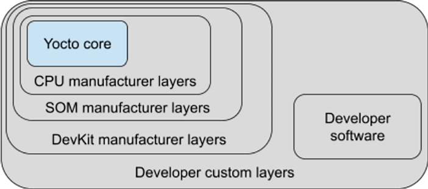

# Chương 3. Kiến thức cơ bản về Yocto Project (Yocto Project Basics)

Trong các chương trước, chúng ta đã thiết lập host machine và tải Yocto source, vì vậy giờ chúng ta đã sẵn sàng bắt đầu đi sâu vào chúng.

Trong chương này (và các chương tiếp theo cho đến Chương 6), chúng ta sẽ giới thiệu những thông tin cơ bản về Yocto Project mà mọi Yocto developer nên biết để hiểu rõ hơn cách nó hoạt động. Sau đó, sau khi giải thích Yocto Project là gì và các khái niệm cơ bản của nó, chúng ta sẽ trình bày các thành phần chính của Yocto Project, bắt đầu từ các file cấu hình và những biến mà chúng chứa. Trong các chương tiếp theo, chúng ta sẽ tiếp tục phần trình bày này bằng cách giải thích cách dùng các công cụ chính của Yocto Project và tìm hiểu sâu hơn recipe của Yocto Project là gì.

Bạn đọc chưa biết rõ phần bên trong của Yocto nên đọc chương này (và có thể cả các chương tiếp theo), còn bạn đọc muốn bắt đầu sửa Yocto source của mình có thể chuyển thẳng tới Chương 7 và dùng các chương này làm tài liệu tham khảo.

## 3.1 Yocto Project là gì (What Is the Yocto Project)

Với câu hỏi “Yocto Project là gì?”, câu trả lời rất đơn giản, và định nghĩa tốt nhất có thể đọc trực tiếp trên trang chính của Yocto Project (YP) tại `https://yoctoproject.org`:

> Yocto Project (YP) là một dự án cộng tác open-source giúp developer tạo các hệ thống Linux-based tùy biến bất kể kiến trúc hardware.
>
> Dự án cung cấp một bộ công cụ linh hoạt và một không gian nơi embedded developer trên toàn thế giới có thể chia sẻ công nghệ, software stack, cấu hình và best practice, có thể được dùng để tạo các Linux image may đo cho thiết bị embedded và IOT, hoặc bất cứ nơi nào cần một Linux OS tùy biến.

Trong những năm gần đây, Yocto Project trên thực tế đã là distribution quan trọng nhất trong thế giới embedded, vì mọi nhà sản xuất CPU, SOM và thiết bị embedded đều dùng Yocto Project làm distribution nền (hoặc demo) cho các embedded development kit của họ.

> Khi lướt trang Yocto Project và đặc biệt là các trang tài liệu của nó, bạn đọc có thể để ý thấy cả hai thuật ngữ OpenEmbedded và Poky.
>
> Không đi sâu hơn và để giải thích đơn giản, chúng ta có thể nói rằng
>
> – OpenEmbedded là một build automation framework (là một môi trường cross-compile phù hợp cho nền tảng cần làm việc) được dùng để tạo các bản phân phối Linux cho thiết bị embedded.
>
> – Poky là tên bản phân phối tham chiếu của Yocto Project, chứa OpenEmbedded build system cùng một tập metadata (xem bên dưới) để cho phép developer có thể build bản phân phối của riêng mình.
>
> Yocto Project dựa vào cả hai, và hình ảnh tại `https://docs.yoctoproject.org/dev/_images/key-dev-elements.png` giải thích rõ sự phụ thuộc lẫn nhau này.

Lợi ích chính với mọi developer có một kit embedded được phát triển từ Board Support Package (hay BSP) của nhà sản xuất hardware là họ có thể dễ dàng tạo ra một OS hoạt động đầy đủ, sẵn sàng dùng cho ứng dụng cụ thể của mình chỉ với vài sửa đổi. Các sửa đổi này, thay vì được làm trên code gốc, được áp dụng bằng cách override và/hoặc append thông tin (các khái niệm này sẽ được giải thích rõ hơn ở phần sau của sách). Điều này thực sự có thể rút ngắn time to market, và đó là lý do chính khiến việc biết cách tùy biến Yocto Project bằng các kỹ thuật này quan trọng đến vậy!

## 3.2 Mô hình layer (The Layer Model)

Để có thể tùy biến Yocto một cách hiệu quả và đáng tin cậy, chúng ta phải hiểu Layer Model của Yocto Project là gì. Nói đơn giản, đó là một mô hình phát triển dựa trên khái niệm layer, đồng thời hỗ trợ cả cộng tác lẫn tùy biến. Thật vậy, với thuật ngữ layer, chúng ta muốn nói đến một repository chứa các tập chỉ dẫn liên quan, cho build system biết phải làm gì.

Các layer này có thể phụ thuộc vào các layer khác, và chúng được áp dụng theo một kiểu thứ tự ưu tiên. Thông thường, một bản phân phối Yocto có nhiều layer, mỗi layer dành cho một mục đích cụ thể. Một số là layer cơ bản có mặt trong mọi bản phân phối Yocto, còn những layer khác thì đặc thù cho hardware và có thể thay đổi nếu chúng ta thay hardware phải làm việc cùng.

Sức mạnh của khái niệm layer là developer có thể cộng tác, chia sẻ và tái sử dụng layer, và trong trường hợp này, tạo ra các layer mới để thêm chức năng và hỗ trợ mới. Có thể làm được điều này vì layer có thể chứa các thay đổi đối với chỉ dẫn hoặc thiết lập trước đó, cho phép developer, bằng cách override những gì đã được viết, tùy biến các layer cộng tác (hay layer cộng đồng) đã được cung cấp trước đó cho phù hợp với yêu cầu sản phẩm của mình.

Chúng ta có thể đơn giản hóa khái niệm này (và đây là một sự đơn giản hóa rất lớn!) bằng cách xét cấu trúc các lớp vỏ hành (hình vuông) được trình bày trong Hình 3-1.



Hình 3-1. Các lớp phụ thuộc lẫn nhau như những lớp vỏ hành (hình vuông)

Tính năng này rất quan trọng, vì chúng ta có thể dễ dàng điều chỉnh một Yocto image đã hoạt động cho một board tùy biến, board này thường chỉ khác devkit ở vài đặc điểm!

Ở phần sau của sách, khi xem cách thêm layer tùy biến của mình, chúng ta sẽ thấy rằng layer của Yocto Project khá thường được đặt tên với tiền tố `meta-`. Chúng ta có thể thấy một ví dụ thực tế bằng cách xem thư mục `sources` trong Yocto source:

```
$ ls imx-yocto-bsp/sources/
base              meta-freescale            meta-openembedded
meta-browser      meta-freescale-3rdparty   meta-qt6
meta-clang        meta-freescale-distro     meta-timesys
meta-cy           meta-imx                  meta-virtualization
meta-engicam-nxp  meta-nxp-demo-experience  poky
```

> Bạn đọc nên lưu ý rằng tên thư mục chứa mọi meta layer của Yocto source không phải lúc nào cũng là `sources`. Họ có thể gặp những tên như `meta` hoặc `layers`, hoặc thậm chí không có thư mục riêng nào cả, và mọi meta layer chỉ đơn giản được đặt trong thư mục gốc của Yocto source!

Chúng ta có thể thấy đây không phải là quy tắc cố định (thật vậy, có những ngoại lệ hiếm hoi như layer `poky` trong output ở trên); tuy nhiên, tuân theo quy ước đặt tên layer này có thể giúp chúng ta tránh rắc rối về sau, khi các thành phần hoặc công cụ của Yocto giả định tên layer của chúng ta bắt đầu bằng tiền tố `meta-`.

Chữ meta là vì một layer chứa recipe (tức là một tập cấu hình cho công cụ build – xem phần sau của sách), file cấu hình và các thông tin khác liên quan đến chính các chỉ dẫn build. Cũng như dữ liệu dùng để kiểm soát những gì được build và kết quả của việc build, và tất cả những thứ này nói chung được gọi bằng thuật ngữ metadata. Metadata cũng bao gồm các lệnh và dữ liệu dùng để cho biết phiên bản software nào được dùng, lấy chúng từ đâu, và các thay đổi hoặc bổ sung cho chính software đó (patch hoặc file phụ trợ) được dùng để sửa bug hoặc tùy biến software cho một tình huống cụ thể.

Ngoài cách đặt tên, chúng ta có thể phân biệt ba loại layer:

- Software layer: Chứa các file recipe user-supplied (các file có hậu tố `.bb` trong tên), patch và append file (các file có hậu tố `.bbappend` trong tên).

  Một ví dụ tốt về software layer có thể là layer `meta-qt5` (xem `https://layers.openembedded.org/layerindex/branch/master/layer/meta-qt5`), dành cho phiên bản 5.0 của Qt, framework phát triển ứng dụng cross-platform phổ biến cho desktop, embedded và mobile.

- Machine BSP layer(s): Thường là một (nhưng đôi khi nhiều hơn) layer Board Support Package (BSP) riêng, cung cấp các cấu hình machine-specific. Các loại layer này chứa thông tin cụ thể về một kiến trúc target hoặc development kit nhất định.

  Thông thường, đây là các layer chứa các file `machine.conf`, tức là các file cấu hình machine cụ thể (xem Mục 3.4.2), cùng các recipe để build kernel, bootloader và các recipe hardware-specific khác.

  Ví dụ, trong sách này, chúng ta sẽ dùng layer `meta-freescale` (xem `https://github.com/Freescale/meta-freescale`).

- Distribution layer (hay Distro layer): Các layer này chứa cấu hình chính sách cho các image được build cho một distribution cụ thể.

  Thông thường, đây là các layer chứa các file `distro.conf`, tức là các file cấu hình distro cụ thể (xem Mục 3.4.3).

  Ví dụ, trong sách này, chúng ta sẽ dùng `meta-freescale-distro` (xem `https://github.com/Freescale/meta-freescale-distro`), layer cung cấp hỗ trợ cho các Demonstration image của Freescale để dùng với BSP layer Yocto Freescale ở trên.

Dù có những khác biệt nhỏ nêu trên, thường thì mọi layer đều có cấu trúc tương tự. Tất cả đều chứa một file license (nếu layer được phân phối), một file `README`, một thư mục cấu hình `conf` và các thư mục recipe (tất cả đều được đặt tên với tiền tố `recipes-`).

Mọi layer đều được parse bởi công cụ BitBake, công cụ chính trong môi trường build Yocto được mô tả trong chương tiếp theo, công cụ này dùng file `bblayers.conf` (thuộc cấu hình người dùng – xem Mục 3.4.5) để tìm những layer cần dùng như một phần của quá trình build.

Tuy nhiên, mọi khía cạnh này sẽ được trình bày rộng hơn trong các chương tiếp theo. Lúc này, hãy xem các thành phần cốt lõi của Yocto Project.

## 3.3 Các thành phần cốt lõi (The Core Components)

Các thành phần cốt lõi của Yocto có thể được tóm tắt trong danh sách đơn giản sau:

- Task executor `bitbake`, xử lý việc parse và thực thi các file dữ liệu như

- Recipe, cung cấp chi tiết về những phần software cụ thể

- Class, trừu tượng hóa thông tin build chung (ví dụ, cách build một Linux kernel hoặc bootloader)

- Dữ liệu cấu hình, định nghĩa các thiết lập machine-specific, chính sách image, v.v. Dữ liệu cấu hình đóng vai trò chất kết dính gắn mọi thứ lại với nhau.

Công cụ `bitbake`, bằng cách đọc các file cấu hình, biết cách kết hợp class và recipe với nhau để tạo ra một image, và xem mỗi nguồn dữ liệu là một layer.

Trước khi giới thiệu BitBake, tốt hơn là nói vài lời để chỉ ra recipe, class hay dữ liệu cấu hình là gì, dù trong mục này chúng ta chỉ đưa ra phần giới thiệu về các khái niệm này, còn phần giải thích chi tiết hơn sẽ có trong các chương tiếp theo.

### 3.3.1 Recipe (Recipes)

Như đã giới thiệu ở trên, recipe là một file có hậu tố `.bb` trong tên, và nó chứa thông tin về một phần software riêng lẻ.

Thông tin này bao gồm vị trí để tải source chưa bị thay đổi và mọi patch mà chúng ta muốn áp dụng lên source đó. Một recipe cũng bao gồm các tùy chọn cấu hình được áp dụng khi compile, cách compile các file source, và cách đóng gói output đã compile cùng các file cấu hình cần thiết (nếu có).

Ví dụ, một recipe cơ bản là recipe cho chương trình uFTP:

```
$ cat sources/meta-openembedded/meta-networking/recipes-support/uftp/uf
tp_5.0.bb
DESCRIPTION = "Encrypted UDP based FTP with multicast"
HOMEPAGE = "https://sourceforge.net/projects/uftp-multicast"
SECTION = "libs/network"
LICENSE = "GPL-3.0-only"
LIC_FILES_CHKSUM = "file://LICENSE.txt;md5=d32239bcb673463ab874e80d47fa
e504"

UPSTREAM_CHECK_URI = "https://sourceforge.net/projects/uftp-multicast/f
iles/source-tar/"

SRC_URI = "${SOURCEFORGE_MIRROR}/uftp-multicast/source-tar/uftp-${PV}.t
ar.gz"
SRC_URI[sha256sum] = "562f71ea5a24b615eb491f5744bad01e9c2e58244c1d6252d
5ae98d320d308e0"

DEPENDS = "openssl"

do_install () {
        oe_runmake install DESTDIR=${D}
}
```

Dù chúng ta chưa giải thích gì về recipe, chỉ cần đọc recipe ở trên là có thể dễ dàng hiểu nó làm gì. Thật vậy, phần đầu với các biến `DESCRIPTION`, `HOMEPAGE`, v.v., là phần mô tả, còn phần giữa với biến `SRC_URI` chịu trách nhiệm xác định vị trí source. Sau đó recipe cho chúng ta biết nó phụ thuộc vào package (hay recipe) OpenSSL, và cuối cùng chúng ta có thể thấy cách các file của chương trình được cài vào image cuối cùng bằng cách thực thi lệnh `make` với một command line đặc biệt (trong các chương tiếp theo, chúng ta sẽ thấy `oe_runmake` chỉ là một wrapper hữu ích cho lệnh `make`).

Dù một recipe có thể nằm gọn trong một file, đôi khi có thể xảy ra trường hợp nhiều recipe dùng chung code; khi đó, chúng ta có thể dùng một hoặc nhiều include file (là các file có hậu tố `.inc` trong tên). Các file này không phải là recipe, nhưng chúng có thể được include trong recipe (hoặc thậm chí trong class hoặc trong các file `.inc` khác – xem bên dưới), và chúng hoạt động gần giống như include header trong ngôn ngữ lập trình C.

Về cơ bản, chúng được dùng để tránh trùng lặp trong recipe; thật vậy, trong các file `.bb`, chúng ta chỉ nên chỉ rõ những khác biệt giữa các recipe, còn các phần chung được đặt trong một (hoặc nhiều hơn nếu cần) file `.inc` (thường) trong cùng thư mục, và file đó được cả hai recipe dùng.

Để include một file trong một file recipe, chúng ta có thể dùng directive `include` hoặc `require`. Tác dụng của chúng gần như nhau, nhưng khi dùng `require` mà file được chỉ định không tồn tại, điều đó tạo ra một lỗi nghiêm trọng (fatal error) và dừng quá trình build. Khi dùng `include`, quá trình build sẽ tiếp tục ngay cả khi file được chỉ định không tồn tại (xem Mục 5.4 để biết thêm thông tin về các directive này).

Một ví dụ về recipe include một file khác là recipe để build công cụ Vim, nhưng ở dạng tiny:

```
$ cat sources/poky/meta/recipes-support/vim/vim-tiny_9.0.bb
require vim.inc

SUMMARY += " (with tiny features)"

PACKAGECONFIG += "tiny"

do_install() {
    install -D -m 0755 ${S}/src/vim ${D}/${bindir}/vim.tiny
}

ALTERNATIVE_PRIORITY = "90"
ALTERNATIVE_TARGET = "${bindir}/vim.tiny"
```

Recipe này rất thú vị vì nó cho thấy cách nó require một số chỉ dẫn khác từ file `vim.inc`, rồi thêm một số thiết lập đặc biệt. Tức là, nó append chuỗi `(with tiny features)` vào biến `SUMMARY`, biến mô tả package, và thêm tùy chọn `tiny` vào biến `PACKAGECONFIG`, biến chỉ dẫn cho build system cách compile package, sau đó nó chỉ cài ứng dụng `vim.tiny`, là phiên bản tiny của ứng dụng Vim chính (và nổi tiếng).

Một khía cạnh thiết yếu khác về recipe là chúng cũng có thể được hiện thực bằng append file (các file có hậu tố `.bbappend` trong tên). Các file recipe đặc biệt này (gọi là append file) được dùng để append metadata vào các recipe khác cùng tên; ví dụ, chúng ta có thể append metadata vào file `myrecipe.bb` bằng file `myrecipe.bbappend`.

> Chính xác hơn, append file phải có cùng tên gốc với recipe tương ứng. Ví dụ, append file `myrecipe_2.3.bbappend` phải áp dụng cho file `myrecipe_2.3.bb`. Điều này có nghĩa là tên file recipe gốc và append file phụ thuộc vào số phiên bản, vì vậy nếu recipe tương ứng được đổi tên để cập nhật lên phiên bản mới hơn, file `.bbappend` tương ứng cũng phải được đổi tên.
>
> Một cách để không phải lo về phiên bản là dùng ký tự wildcard `%` để báo cho BitBake biết rằng append file `myrecipe_%.bb` áp dụng cho mọi phiên bản, hoặc append file `myrecipe_2.%.bb` áp dụng cho mọi phiên bản software `2.x`.

Trong môi trường build Yocto, một thông lệ phổ biến là dùng các file `.bbappend` để bổ sung hoặc thay đổi nội dung recipe của một layer khác mà không phải chép recipe kia vào từng layer. Ngay trong sách này, chúng ta cũng sẽ tạo các file `.bbappend` nằm trong layer của mình, còn các file recipe `.bb` chính mà chúng ta append metadata vào thì nằm trong một layer khác.

Việc có thể append thông tin vào một recipe có sẵn không chỉ tránh trùng lặp mà còn tự động áp dụng các thay đổi của recipe ở layer khác vào layer của chúng ta. Nếu chép recipe, chúng ta sẽ phải tự merge các thay đổi mỗi khi chúng xuất hiện!

Lấy một ví dụ đơn giản về file `.bbappend`, chúng ta có thể xét file sau:

```
$ cat sources/meta-freescale-3rdparty/recipes-bsp/mc-utils/mc-utils_git
.bbappend
FILESEXTRAPATHS:append:lx2160acex7 := "${THISDIR}/${PN}-lx2160acex7:"

SRC_URI:append:lx2160acex7 = "\
        file://0001-lx2160acex7-add-8x10G-dual-40G-and-dual-100G-DPL-DP
C.patch \
"

MC_FLAVOUR:lx2160acex7 = "CEX7"
```

Trong recipe trên, chúng ta nên biết rằng dạng `FILESEXTRAPATHS` `:append:lx2160acex7` có nghĩa là `bitbake` phải append đường dẫn `${THISDIR}/${PN}-lx2160acex7` (trong đó `THISDIR` và `PN` là các biến đặc biệt được giải thích ở phần sau của sách) vào biến `FILESEXTRAPATHS` khi tên machine đặc biệt `lx2160acex7` được dùng. Điều này cần thiết vì khi machine `lx2160acex7` được dùng, trong `SRC_URI` chúng ta phải append một file patch cần thiết để hỗ trợ một số hardware cụ thể. Vì vậy, recipe gốc không bị đụng tới, nhưng trong trường hợp đặc biệt khi machine `lx2160acex7` được dùng, bitbake phải làm thêm một số việc. Thật mạnh mẽ! Phải không nào?

> Phần giải thích rõ hơn về ý nghĩa của một cú pháp như `FILESEXTRAPATHS:ap` `pend:lx2160acex7` sẽ có trong Mục 5.3.

Lưu ý cuối cùng về recipe là chúng có thể chứa chỉ dẫn để build một package riêng lẻ hoặc chỉ dẫn để tạo một Yocto image hoàn chỉnh, image này lại được tạo thành từ một danh sách package. Như đã thấy trong các recipe ở trên, mọi chỉ dẫn đều nói về cách compile một package cụ thể; tuy nhiên, recipe dưới đây chỉ để mô tả cách build một Yocto image cuối cùng (tức là một root filesystem):

```
$ cat sources/poky/meta/recipes-core/images/core-image-minimal.bb
SUMMARY = "A small image just capable of allowing a device to boot."

IMAGE_INSTALL = "packagegroup-core-boot ${CORE_IMAGE_EXTRA_INSTALL}"

IMAGE_LINGUAS = " "

LICENSE = "MIT"

inherit core-image

IMAGE_ROOTFS_SIZE ?= "8192"
IMAGE_ROOTFS_EXTRA_SPACE:append = "{@bb.utils.contains$("DISTRO_FEATURES
", "systemd", " + 4096", "", d)}"
```

Trong recipe trên, mọi package cần cài vào root filesystem được liệt kê trong `IMAGE_INSTALL`. Danh sách này được chỉ định bằng một package group tên là `packagegroup-core-boot` (chúng ta sẽ thấy packagegroup là gì trong Mục 11.4) và một biến khác tên là `CORE_IMAGE_EXTRA_INSTALL` được dùng để chỉ định thêm package qua các file cấu hình (chúng ta sẽ xem tính năng này trong Mục 12.2).

### 3.3.2 Class (Classes)

Class file có hậu tố `.bbclass` trong tên, và chúng chứa thông tin hữu ích để chia sẻ giữa các file recipe. Khi một recipe kế thừa một class (bằng directive `inherit` – xem Mục 5.4 để biết thêm thông tin về directive này), nó nhận các thiết lập và hàm của class đó.

Ví dụ, class `autotools` chứa các thiết lập chung cho mọi ứng dụng được build bằng GNU Autotools như dưới đây:

```
$ cat sources/poky/meta/classes/autotools.bbclass
...
CONFIGUREOPTS = " --build=${BUILD_SYS} \
                  --host=${HOST_SYS} \
                  --target=${TARGET_SYS} \
                  --prefix=${prefix} \
                  --exec_prefix=${exec_prefix} \
                  --bindir=${bindir} \
                  --sbindir=${sbindir} \
                  --libexecdir=${libexecdir} \
                  --datadir=${datadir} \
                  --sysconfdir=${sysconfdir} \
                  --sharedstatedir=${sharedstatedir} \
                  --localstatedir=${localstatedir} \
                  --libdir=${libdir} \
                  --includedir=${includedir} \
                  --oldincludedir=${oldincludedir} \
                  --infodir=${infodir} \
                  --mandir=${mandir} \
                  --disable-silent-rules \
                  ${CONFIGUREOPT_DEPTRACK} \
                  ${@append_libtool_sysroot(d)}"
...
oe_runconf () {
    # Use relative path to avoid buildpaths in files
    cfgscript_name="`basename ${CONFIGURE_SCRIPT}`"
    cfgscript=`python3 -c "import os; print(os.path.relpath(os.path.dir
name('${CONFIGURE_SCRIPT}'), '.'))"`/$cfgscript_name
    if [ -x "$cfgscript" ] ; then
        bbnote "Running $cfgscript ${CONFIGUREOPTS} ${EXTRA_OECONF} $@"
        if ! CONFIG_SHELL=${CONFIG_SHELL-/bin/bash} ${CACHED_CONFIGUREV
ARS} $cfgscript ${CONFIGUREOPTS} ${EXTRA_OECONF} "$@"; then
            bbnote "The following config.log files may provide further
information."
            bbnote `find ${B} -ignore_readdir_race -type f -name config
.log`
            bbfatal_log "configure failed"
            fi
    else
        bbfatal "no configure script found at $cfgscript"
    fi
}
...
```

Trong đoạn code trên, chúng ta có thể thấy, ví dụ, biến `CONFIGUREOPTS` được cấu hình đúng để được gọi trong giai đoạn cấu hình bên trong hàm `oe_runconf()`. Hơn nữa, trong file này chúng ta có thể thấy đoạn sau:

```
...
autotools_do_compile() {
        oe_runmake
}

autotools_do_install() {
        oe_runmake 'DESTDIR=${D}' install
        # Info dir listing isn't interesting at this point so remove it i
f it exists.
        if [ -e "${D}${infodir}/dir" ]; then
                rm -f ${D}${infodir}/dir
        fi
}
...
```

Đây là các hành động `bitbake` phải làm trong các giai đoạn compile và cài đặt khi dùng GNU Autotools.

Một ví dụ thú vị khác về class là kernel class, chứa các chỉ dẫn để compile Linux kernel. Ví dụ, trong file class này, chúng ta có thể thấy đoạn sau:

```
$ cat sources/poky/meta/classes/kernel.bbclass
...
PROVIDES += "virtual/kernel"
DEPENDS += "virtual/${TARGET_PREFIX}binutils virtual/${TARGET_PREFIX}gc
c kmod-native bc-native bison-native"
DEPENDS += "${@bb.utils.contains("INITRAMFS_FSTYPES", "cpio.lzo", "lzop
-native", "", d)}"
DEPENDS += "${@bb.utils.contains("INITRAMFS_FSTYPES", "cpio.lz4", "lz4-
native", "", d)}"
DEPENDS += "${@bb.utils.contains("INITRAMFS_FSTYPES", "cpio.zst", "zstd
-native", "", d)}"
...
```

Ở đây, chúng ta có thể thấy mọi kernel package sẽ cung cấp virtual package `virtual/kernel` (thông tin thêm về các virtual package này sẽ được trình bày ở phần sau của sách) và chúng sẽ phụ thuộc vào một số package cung cấp công cụ nén file tùy theo loại initramfs image mà developer muốn dùng (được chỉ định trong biến `INITRAMFS_FSTYPES` – xem Mục 6.5.3).

Hơn nữa, trong file `kernel.bbclass` chúng ta có thể thấy đoạn code sau:

```
...
kernel_do_configure() {
    # fixes extra + in /lib/modules/2.6.37+
    # $ scripts/setlocalversion . => +
    # $ make kernelversion => 2.6.37
    # $ make kernelrelease => 2.6.37+
    touch ${B}/.scmversion ${S}/.scmversion

    if [ "${S}" != "${B}" ] && [ -f "${S}/.config" ] && [ ! -f "${B}/.co
nfig" ]; then
        mv "${S}/.config" "${B}/.config"
    fi

    # Copy defconfig to .config if .config does not exist. This
    # allows recipes to manage the .config themselves in
    # do_configure:prepend().
    if [ -f "${WORKDIR}/defconfig" ] && [ ! -f "${B}/.config" ]; then
        cp "${WORKDIR}/defconfig" "${B}/.config"
    fi

    ${KERNEL_CONFIG_COMMAND}
}

do_savedefconfig() {
    bbplain "Saving defconfig to:\n${B}/defconfig"
    oe_runmake -C ${B} savedefconfig
}
do_savedefconfig[nostamp] = "1"
addtask savedefconfig after do_configure
...
```

trong đó chúng ta có thể thấy những lệnh nào được thực thi trong giai đoạn cấu hình kernel, và với mỗi kernel package, chúng ta có một hàm đặc biệt tên là `do_savedefconfig()`, được thực thi sau `do_configure()`, có thể được dùng để lưu cấu hình kernel mặc định vào `defconfig` bằng lệnh quen thuộc `make savedefconfig` (mọi kernel developer đều nên biết rõ lệnh này và nó hữu ích thế nào để có được một phiên bản gọn của các thiết lập cấu hình kernel hiện tại). Tất cả những thứ này đều có sẵn cho mọi package thuộc class này.

Tuy nhiên, ngoài các class file thú vị (và quan trọng) này (đặc biệt là file sau), class file thực sự quan trọng nhất là class file `base.bbclass` nằm trong layer `poky`, ở file `meta/classes/base.bbclass`. Class này đặc biệt vì nó luôn được tự động include cho mọi recipe và class, và nó chứa định nghĩa cho các task cơ bản tiêu chuẩn như fetch, unpack, configure, compile, install và package, như dưới đây:

```
$ cat sources/poky/meta/classes/base.bbclass
...
oe_runmake_call() {
        bbnote ${MAKE} ${EXTRA_OEMAKE} "$@"
        ${MAKE} ${EXTRA_OEMAKE} "$@"
}

oe_runmake() {
        oe_runmake_call "$@" || die "oe_runmake failed"
}
...
```

Ở trên, chúng ta có thể thấy nơi hàm `oe_runmake()` được định nghĩa, và nếu tiếp tục đọc file, chúng ta có thể thấy định nghĩa của các hàm cơ bản để compile hoặc cài đặt một package:

```
...
addtask compile after do_configure
do_compile[dirs] = "${B}"
base_do_compile() {
        if [ -e Makefile -o -e makefile -o -e GNUmakefile ]; then
                oe_runmake || die "make failed"
        else
                bbnote "nothing to compile"
        fi
}
addtask install after do_compile
do_install[dirs] = "${B}"
# Remove and re-create ${D} so that is it guaranteed to be empty
do_install[cleandirs] = "${D}"

base_do_install() {
        :
}

base_do_package() {
        :
}
...
```

> Các hàm `base_do_install()` và `base_do_package()`, có thân hàm chỉ là ký tự dấu hai chấm (`:`), là các hàm rỗng trả về true, vì ký tự này là một shell built-in về cơ bản tương đương với lệnh `true`.

Các task này (và các task khác) thường được override hoặc mở rộng bởi những class khác được thêm vào trong quá trình phát triển dự án, vì theo mặc định, các task configure, install và package được định nghĩa rỗng, còn task compile chỉ chạy bất kỳ `Makefile` nào có mặt, như chúng ta thấy ở trên.

### 3.3.3 Cấu hình (Configurations)

Các file cấu hình có hậu tố `.conf` trong tên, và chúng định nghĩa nhiều biến cấu hình chi phối quá trình build của Yocto.

Có nhiều file cấu hình bao quát nhiều lĩnh vực: một số file cấu hình định nghĩa các tùy chọn cấu hình machine, số khác định nghĩa tùy chọn cấu hình distribution, tùy chọn tinh chỉnh compiler, các tùy chọn cấu hình chung và các tùy chọn cấu hình người dùng khác.

Các file này thường nằm trong các thư mục tên là `conf` trong mỗi layer và cả trong build directory.

> Nội dung của file `conf/local.conf` đã được giới thiệu trong Mục 2.3.

Vì các file này rất quan trọng, trong mục tiếp theo chúng ta sẽ trình bày những file quan trọng nhất (và được dùng nhiều nhất), vì vậy trong mục này chúng ta không trình bày nội dung của chúng, mà chỉ nói vài lời giải thích cách các file này được parse.

Việc đầu tiên `bitbake` làm là parse file `bblayers.conf` của project (nằm trong build directory tại `conf/bblayers.conf`) để xác định, qua biến `BBLAYERS`, những layer nào phải được dùng để build source, sau đó nó parse mọi file `layer.conf` (mỗi layer một file) và file `bitbake.conf`.

Như chúng ta sẽ thấy trong Mục 7.2, file `layer.conf` trong mỗi layer được dùng để dựng các biến then chốt như `BBPATH` và `BBFILES`; biến thứ nhất được dùng để tìm các file cấu hình và class file trong các thư mục con `conf` và `classes` của mỗi layer, còn biến thứ hai được dùng để xác định vị trí của cả recipe (file `.bb`) lẫn recipe append (`.bbappend`).

> Lưu ý rằng nếu không có file `bblayers.conf`, thì `bitbake` giả định người dùng đã đặt cả hai biến `BBPATH` và `BBFILES` trực tiếp trong environment.

Khi biến `BBPATH` đã được dựng xong, nó được dùng để tìm file `bitbake.conf`, file này lại có thể include các file cấu hình khác bằng directive `include` hoặc `require`, hoặc qua command line hay environment (xem Mục 4.1.3).

OK, lúc này chúng ta có thể dừng phần thảo luận ở đây và chuyển sang mục tiếp theo, nơi chúng ta đi sâu vào từng file cấu hình để xem chúng chứa những biến nào và các biến này làm gì.

## 3.4 Các file cấu hình chính (Main Configuration Files)

Sau phần tổng quan về Yocto Project là gì và các thành phần chính của nó, đã đến lúc bắt đầu tìm hiểu Yocto Project sâu hơn bằng cách xem một trong những phần quan trọng nhất của nó, tức là các file cấu hình. Lý do là mọi thành phần của Yocto Project đều dùng các file này, và hiểu chúng là gì và làm gì là bước đầu tiên cần thực hiện.

### 3.4.1 File local.conf (The local.conf File)

File cấu hình `local.conf` chứa các biến user-defined, ảnh hưởng tới mọi lần build, và nó nằm trong build directory, ở thư mục con `conf`, như đã thấy trong Mục 2.3.

Ví dụ, việc chọn target machine, được kiểm soát bởi biến `MACHINE`, được định nghĩa ở đây cùng với biến `DISTRO` kiểm soát các chính sách distribution. Hơn nữa, file này chứa download directory, nơi lưu mọi source, bằng cách định nghĩa biến `DL_DIR`, định nghĩa định dạng đóng gói được kiểm soát bởi biến `PACKAGE_CLASSES`, v.v.

File này, nếu chưa có khi chúng ta bắt đầu build, sẽ được tạo từ file `local.conf.sample` khi chúng ta source script thiết lập build environment top-level (thường là `setup-environment` như đã thấy trong Mục 2.2).

Trong mục này, chúng ta sẽ đưa cho bạn đọc danh sách đầy đủ nhất các biến có thể gặp trong file cấu hình này, và để làm vậy, chúng ta có thể xem file `local.conf.sample` nằm trong layer `meta-poky`. Dưới đây là nội dung của nó:

```
$ cat sources/poky/meta-poky/conf/local.conf.sample
...
#
# Machine Selection
#
# You need to select a specific machine to target the build with. There
# are a selection of emulated machines available which can boot and run
# in the QEMU emulator:
#
#MACHINE ?= "qemuarm"
#MACHINE ?= "qemuarm64"
#MACHINE ?= "qemumips"
...
#
# This sets the default machine to be qemux86-64 if no other machine is
# selected:
MACHINE ??= "qemux86-64"
...
```

Biến `MACHINE` chỉ định target device mà image được build cho. Biến này tương ứng với một file cấu hình machine cùng tên, qua đó các cấu hình machine-specific được thiết lập. Vì vậy, khi `MACHINE` được đặt thành `beaglebone-yocto`, file cấu hình machine tương ứng `beaglebone-yocto.conf` được đọc từ thư mục con `conf/machine` trong một layer (xem Mục 3.4.2, nơi chúng ta trình bày chi tiết file này).

> Bạn đọc nên lưu ý rằng trong Yocto Project có nhiều cách gán giá trị cho một biến, và các toán tử `?=` và `??=` là hai trong số đó. Chúng ta có thể xem Mục 5.1.2 để biết thêm thông tin; tuy nhiên, lúc này điều quan trọng cần biết là phép toán `MACHINE ?= "qemuarm"` có nghĩa là gán giá trị `qemuarm` cho biến `MACHINE` nếu biến chưa được đặt, nếu đã đặt thì để nguyên, còn phép toán `MACHINE ??= "qemux86-64"` có nghĩa là gán giá trị `qemux86-64` cho biến `MACHINE` nếu biến chưa được đặt bằng bất kỳ cách nào khác.

Sau đó file tiếp tục với nội dung liên quan sau:

```
...
#
# Where to place downloads
#
# During a first build, the system will download many different source
# code tarballs from various upstream projects. This can take a while,
# particularly if your network connection is slow. These are all stored
# in DL_DIR. When wiping and rebuilding you can preserve this directory
# to speed up this part of subsequent builds. This directory
# is safe to share between multiple builds on the same machine too.
#
# The default is a downloads directory under TOPDIR which is the build
# directory.
#
#DL_DIR ?= "${TOPDIR}/downloads"
...
```

Như được nêu trong comment ở trên, biến `DL_DIR` chỉ định download directory mà quá trình build dùng để lưu những gì tải về, và theo mặc định nó trỏ tới thư mục `downloads` trong build directory.

> Lưu ý rằng thông thường, trong Yocto Project, build directory được định nghĩa bởi biến `TOPDIR`.

Vẫn theo comment đó, chúng ta nên tính đến việc một image cơ bản có thể cần vài gigabyte dữ liệu từ các bản phát hành của các dự án upstream, vì vậy nếu có nhiều bản build trên máy, theo mặc định mỗi bản build sẽ có một thư mục `downloads` với nội dung rất giống nhau (trùng lặp). Hơn nữa, nếu xóa build directory để thử một bản build sạch, Yocto Project sẽ phải tải lại mọi thứ!

Trong những tình huống này, chúng ta có thể giảm thời gian build bằng cách có một download directory chung cho cả máy mà mọi bản build đều có thể dùng. Điều này đơn giản là đặt biến `DL_DIR` thành một đường dẫn bên ngoài build directory.

Một lưu ý quan trọng cần chỉ ra là theo mặc định, `DL_DIR` lấy các file phù hợp để mirror mọi thứ ngoại trừ Git repository. Nếu muốn có tarball của các git repository, chúng ta phải thêm biến `BB_GENERATE_MIRROR_TARBALLS` vào `local.conf` như dưới đây:

```
BB_GENERATE_MIRROR_TARBALLS = "1"
```

Với thiết lập trên, chúng ta chỉ dẫn Yocto build system tạo một archive cho mỗi source mà nó check out và đặt archive đó vào download directory. Ở các lần build sau, nếu cần source đó, nó sẽ tìm archive trong thư mục do `DL_DIR` trỏ tới trước khi thử fetch từ Internet, vì vậy bằng cách dùng một thư mục chung phù hợp cho `DL_DIR` và bật `BB_GENERATE_MIRROR_TARBALLS`, chúng ta có thể cải thiện thời gian build nhờ giảm thời gian lấy source từ Internet.

> Đây thực chất là một bản build offline, giúp cải thiện đáng kể độ tin cậy và khả năng tái tạo của các bản build, vì việc một URL từ xa tạm thời không truy cập được (hoặc được host trên một server chậm) không phải là hiếm.

Hơn nữa, tiếp tục đọc file `local.conf.sample`, chúng ta đọc thấy đoạn sau:

```
...
#
# Where to place shared-state files
#
# BitBake has the capability to accelerate builds based on previously
# built output.
# This is done using "shared state" files which can be thought of as
# cache objects and this option determines where those files are placed.
#
# You can wipe out TMPDIR leaving this directory intact and the build
# would regenerate from these files if no changes were made to the
# configuration. If changes were made to the configuration, only shared
# state files where the state was still valid would be used (done using
# checksums).
#
# The default is a sstate-cache directory under TOPDIR.
#
#SSTATE_DIR ?= "${TOPDIR}/sstate-cache"
...
```

Như được nêu trong comment ở trên, lệnh `bitbake` (tức là phần lõi của Yocto build system) có thể tăng tốc build bằng các shared state file này, được lưu trong thư mục do biến `SSTATE_DIR` chỉ định. Theo mặc định, thư mục này có tên là `sstate-cache`, và nó nằm trong build directory (tức là theo mặc định được đặt thành `${TOPDIR}/sstate-cache`).

Cũng như thư mục `downloads`, dữ liệu trong thư mục này có thể chiếm vài gigabyte dung lượng đĩa, vì vậy, giống như `DL_DIR`, shared state cache cũng có thể được chuyển ra ngoài build directory tới một thư mục machine-wide có thể dùng chung cho mọi bản build. Điều này có thể cải thiện đáng kể tốc độ build (và giảm dung lượng đĩa).

Tuy nhiên, bạn đọc nên chú ý những gì được viết trong comment ở trên, đó là:

> … (chúng ta) có thể xóa sạch `TMPDIR` (thư mục tạm – xem bên dưới) mà giữ nguyên thư mục này, và bản build sẽ được tạo lại từ các file này nếu không có thay đổi nào về cấu hình. Nếu cấu hình có thay đổi, chỉ những shared state file mà trạng thái vẫn còn hợp lệ mới được dùng (việc này được làm bằng checksum).

Không đi sâu vào phần bên trong của Yocto build system, câu trên có nghĩa là nếu xóa sạch thư mục `TMPDIR` mà không đụng tới `SSTATE_DIR`, `bitbake` sẽ có thể tạo lại bản build từ `sstate-cache`, và đây là một lý do tốt nữa để chúng ta cân nhắc chuyển thư mục này ra ngoài build directory.

> Tất cả những lợi ích này là do khi `bitbake` nhận ra rằng có một sstate-cache cho một task nhất định, nó sẽ thay task đó bằng một task thay thế (gọi là setscene – không được đề cập trong sách này), task này tái tạo kết quả cuối cùng của task bị thay thế (ví dụ, bằng cách chép các build artifact đã được cache tới vị trí mong đợi), với kết quả cuối cùng là tăng tốc việc build image.

Một lần nữa, trong file `local.conf.sample`, chúng ta có thể thấy phần đặc tả cho `TMPDIR`:

```
...
#
# Where to place the build output
#
# This option specifies where the bulk of the building work should be.
# done and where BitBake should place its temporary files and output.
# Keep in mind that this includes the extraction and compilation of many
# applications and the toolchain which can use Gigabytes of hard disk
# space.
#
# The default is a tmp directory under TOPDIR.
#
#TMPDIR = "${TOPDIR}/tmp"
...
```

Biến `TMPDIR` được dùng để chỉ định nơi đặt mọi file tạm, ngoài shared state cache, do build system của Yocto Project tạo ra. Theo mặc định, thư mục này có tên là `tmp`, và nó nằm trong build directory (tức là theo mặc định là `${TOPDIR}/tmp`).

Thư mục này có thể được để trong build directory, vì ngay cả khi chuyển nó đi như `DL_DIR` và `SSTATE_DIR`, chúng ta cũng không được hưởng lợi ích từ việc dùng chung các file được tạo ra. Tuy nhiên, nếu quyết định chuyển nó, chúng ta phải chú ý tới filesystem mà `TMPDIR` dùng, filesystem này phải có ngữ nghĩa filesystem tiêu chuẩn (phải hỗ trợ tên file mixed-case, POSIX file locking và inode bền vững). Ví dụ, do nhiều vấn đề với NFS (Network File System) và bug trong một số hiện thực, NFS không đáp ứng yêu cầu tối thiểu này, vì vậy `TMPDIR` không thể nằm trên NFS!

Một biến quan trọng khác trong `local.conf.sample` là `DISTRO`:

```
...
#
# Default policy config
#
# The distribution setting controls which policy settings are used as
# defaults.
# The default value is fine for general Yocto project use, at least
# initially.
# Ultimately when creating custom policy, people will likely end up
# subclassing these defaults.
#
DISTRO ?= "poky"
...
```

Cũng như biến `MACHINE`, biến `DISTRO` rất quan trọng trong quá trình build một Yocto image. Biến này tương ứng với một file cấu hình distribution có tên file giống với đối số của biến cộng thêm hậu tố `.conf`. Ví dụ, file cấu hình distribution cho bản phân phối Poky có tên là `poky.conf`, và nó nằm trong thư mục `meta-poky/conf/distro` của source directory (xem Mục 3.4.3, nơi chúng ta giải thích chi tiết file này).

> Bạn đọc nên lưu ý rằng file này chứa các ghi chú sau về biến `DISTRO`:
>
> ```
> # As an example of a subclass there is a "bleeding" edge policy
> # configuration where many versions are set to the absolute latest
> # code from the upstream source control systems. This is just
> # mentioned here as an example, its not useful to most new users.
> # DISTRO ?= "poky-bleeding"
> ```
>
> Vì vậy chúng ta có thể dùng distribution bleeding-edge này để có bản phân phối mặc định của Poky bao gồm các phiên bản package up-to-date nhất.

Tiếp tục đọc file mẫu, chúng ta đến phần nội dung sau, rất quan trọng trong trường hợp muốn dùng một hệ thống quản lý package trong Yocto Project của mình:

```
...
#
# Package Management configuration
#
# This variable lists which packaging formats to enable. Multiple
# package backends can be enabled at once and the first item listed in
# the variable will be used to generate the root filesystems.
# Options are:
#  - 'package_deb' for debian style deb files
#  - 'package_ipk' for ipk files are used by opkg (a debian style
#    embedded package manager)
#  - 'package_rpm' for rpm style packages
# E.g.: PACKAGE_CLASSES ?= "package_rpm package_deb package_ipk"
# We default to rpm:
PACKAGE_CLASSES ?= "package_rpm"
...
```

Như được viết trong comment của biến, `PACKAGE_CLASSES` chỉ định package manager mà Yocto build system dùng khi đóng gói dữ liệu. Chúng ta có thể cung cấp một hoặc nhiều đối số có sẵn cho biến này, nhưng trong trường hợp đó, build system sẽ chỉ dùng đối số đầu tiên trong danh sách làm package manager khi tạo image, còn mọi package sẽ được tạo bằng tất cả các packaging class bổ sung mà chúng ta chỉ định.

Bạn đọc nên lưu ý rằng package manager được chọn ảnh hưởng tới hiệu năng build-time và có hệ quả về dung lượng. Nói chung, build một package bằng IPKG (hay Itsy Package Management system, một hệ thống quản lý package gọn nhẹ được thiết kế cho thiết bị embedded, giống DPKG của Debian – DPKG được chọn bằng `package_deb`) mất ít hơn khoảng 30% thời gian so với dùng RPM (Red Hat Package Manager) để build cùng package đó hoặc package tương tự. Đó là lý do chúng ta có thể cân nhắc đặt `PACKAGE_CLASSES` thành `package_ipk` nếu muốn build các hệ thống nhỏ hơn.

Sau hệ thống đóng gói, chúng ta thấy các giá trị mặc định cho cấu hình image bổ sung:

```
...
#
# Extra image configuration defaults
#
# The EXTRA_IMAGE_FEATURES variable allows extra packages to be added to
# the generated images. Some of these options are added to certain image
# types automatically. The
# variable can contain the following options:
#  "dbg-pkgs"       - add -dbg packages for all installed packages
#                     (adds symbol information for debugging/profiling)
#  "src-pkgs"       - add -src packages for all installed packages
#                     (adds source code for debugging)
#  "dev-pkgs"       - add -dev packages for all installed packages
#                     (useful if you want to develop against libs in the
#                     image)
#  "ptest-pkgs"     - add -ptest packages for all ptest-enabled packages
#                     (useful if you want to run the package test
#                     suites)
#  "tools-sdk"      - add development tools (gcc, make, pkgconfig etc.)
#  "tools-debug"    - add debugging tools (gdb, strace)
#  "eclipse-debug"  - add Eclipse remote debugging support
#  "tools-profile"  - add profiling tools (oprofile, lttng, valgrind)
#  "tools-testapps" - add useful testing tools (ts_print, aplay, arecord
#                     etc.)
#  "debug-tweaks"   - make an image suitable for development
#                     e.g. ssh root access has a blank password
# There are other application targets that can be used here too, see
# meta/classes/image.bbclass and meta/classes/core-image.bbclass for
# more details.
# We default to enabling the debugging tweaks.
EXTRA_IMAGE_FEATURES ?= "debug-tweaks"
...
```

Biến `EXTRA_IMAGE_FEATURES` được dùng để thêm package bổ sung vào các image được tạo ra, bằng cách đưa vào một hoặc nhiều từ khóa ở trên. Ví dụ, hãy xét thiết lập sau:

```
EXTRA_IMAGE_FEATURES = "debug-tweaks tools-profile dbg-pkgs"
```

Với `debug-tweaks`, chúng ta yêu cầu build system tạo một image phù hợp cho việc phát triển, ví dụ bằng cách cho phép đăng nhập root và đăng nhập không cần mật khẩu (kể cả root). Với `tools-profile`, chúng ta yêu cầu thêm vào image một số công cụ profiling như OProfile, LTTng và Valgrind. Còn khi dùng `dbg-pkgs`, chúng ta yêu cầu `bitbake` thêm các package `-dbg` (chúng ta sẽ nói thêm về class package đặc biệt này ở Mục 6.3.4) cho mọi package đã cài, những package này bổ sung thông tin symbol cho việc debug và profiling.

OK, còn nhiều biến khác trong file `local.conf.sample` và những biến khác mà chúng ta có thể đưa vào file `local.conf`, nhưng chúng ta muốn dừng việc liệt kê ở đây vì lý do dung lượng. Tuy nhiên, chúng ta sẽ giới thiệu chúng ở phần sau của sách khi cần một biến nào đó cho một thiết lập.

### 3.4.2 File machine.conf (The machine.conf File)

Nếu thử tìm một file có tên này, chúng ta sẽ không tìm thấy. Thật vậy, ở đây, chuỗi `machine` chỉ là một placeholder cho target board mà chúng ta đang chuẩn bị image. Ví dụ, trong trường hợp của chúng ta ở Mục 8.1, chúng ta sẽ dùng tên `imx8mp-icore-cy.conf` cho file cấu hình trong thư mục `conf/machine` của layer tùy biến, và có thể chọn nó bằng cách chỉ định thiết lập `MACHINE = ”imx8mp-icore-cy”` trong file cấu hình `conf/local.conf` đã trình bày ở trên.

Vì mọi cấu hình machine-specific đều được làm trong file này, chúng ta cần có hiểu biết cơ bản về nội dung của nó phòng khi cần sửa nó.

Như đã làm ở mục trước, và để có một ví dụ non-exhaustive về các thiết lập cấu hình này, chúng ta có thể xem file `conf/machine/beaglebone-yocto.conf` trong thư mục layer `poky/meta-yocto-bsp`:

```
$ cat sources/poky/meta-yocto-bsp/conf/machine/beaglebone-yocto.conf
#@TYPE: Machine
#@NAME: Beaglebone-yocto machine
#@DESCRIPTION: Reference machine configuration for http://beagleboard.o
rg/bone and http://beagleboard.org/black boards
...
```

Ở đầu file chỉ có một số chú thích hữu ích về nội dung file cấu hình, sau đó nó tiếp tục như sau:

```
...
PREFERRED_PROVIDER_virtual/xserver ?= "xserver-xorg"
XSERVER ?= "xserver-xorg \
           xf86-video-modesetting \
           "
...
```

Đây là phần định nghĩa hệ thống đồ họa.

Biến `PREFERRED_PROVIDER` được dùng khi nhiều recipe cung cấp cùng một item; biến này xác định recipe nào được ưu tiên và do đó cung cấp item. Để làm vậy, chúng ta luôn phải thêm hậu tố là tên item mong muốn vào biến này (`virtual/xserver` trong ví dụ trên), và nên định nghĩa biến bằng tên của recipe được ưu tiên (trong ví dụ là `xserver-xorg`).

> Mẹo ở đây rất đơn giản, nhưng một ví dụ có thể giải thích rõ hơn. Biến `PROVIDES` chứa một danh sách alias mà một recipe cụ thể có thể được biết đến qua đó. Theo mặc định, biến này chứa tên recipe (được lưu trong `PN`), nhưng chúng ta có thể thêm các tên khác vào, như recipe `eudev_3.2.10.bb` làm:
>
> ```
> $ cat sources/poky/meta/recipes-core/udev/eudev_3.2.10.bb
> ...
> PROVIDES += "udev"
> ...
> ```
>
> Bây giờ, trong biến `PROVIDES` của recipe này, chúng ta có danh sách `"eudev udev"`. Mọi alias bổ sung này đều là từ đồng nghĩa của recipe và có thể hữu ích để thỏa mãn các phụ thuộc của recipe khác trong quá trình build, như được chỉ định bởi biến `DEPENDS`. Biến này được dùng để liệt kê các phụ thuộc build-time của một recipe, vì vậy nếu một recipe cần `eudev`, nó phải chỉ định như sau:
>
> ```
> DEPENDS += "eudev"
> ```
>
> Tuy nhiên, khá thường gặp là recipe này cần một package chung cung cấp các chức năng udev, chứ không cụ thể là `eudev`, vì vậy recipe nên chỉ định như sau:
>
> ```
> DEPENDS += "udev"
> ```
>
> Bằng cách này, nếu một package khác cung cấp các chức năng udev chung như vậy và package `eudev` không có trong Yocto Project của chúng ta, nhiều khả năng mọi thứ vẫn tiếp tục hoạt động.
>
> Tuy nhiên, chúng ta vẫn có thể gợi ý cho Yocto build system biết package chức năng udev nào là package ưu tiên của mình bằng biến `PREFERRED_PROVIDER` như dưới đây:
>
> ```
> PREFERRED_PROVIDER_udev = "eudev"
> ```
>
> Bằng cách này, nếu có nhiều package cung cấp các chức năng udev, build system sẽ theo thiết lập `PREFERRED_PROVIDER`.

Biến `XSERVER` chỉ định các package cần được cài để cung cấp một X server và driver cho machine hiện tại, giả sử recipe image target của chúng ta include trực tiếp `packagegroup-core-x11-xserver` hoặc, có thể là gián tiếp, include `x11-base` trong biến `IMAGE_FEATURES` (xem Mục 6.5 để biết thêm thông tin về biến này).

Sau đó, file `machine.conf` ví dụ của chúng ta tiếp tục với đoạn sau:

```
MACHINE_EXTRA_RRECOMMENDS = "kernel-modules kernel-devicetree"

EXTRA_IMAGEDEPENDS += "virtual/bootloader"
...
```

Biến `MACHINE_EXTRA_RRECOMMENDS` chỉ ảnh hưởng tới các image dựa trên `packagegroup-base`, không bao gồm các image `core-image-minimal` hoặc `core-image-full-cmdline`, và được dùng để chỉ định một danh sách các package machine-specific cần cài như một phần của image cuối cùng đang được build, nhưng không thiết yếu cho việc boot machine; trong ví dụ trên, chúng ta yêu cầu thêm các kernel module và các file device-tree vào image cuối cùng.

Lưu ý rằng image đang được build không có build dependency với danh sách package này, tức là image vẫn sẽ build được ngay cả khi một hoặc nhiều package trong danh sách này không được tìm thấy. Điều này khác với `MACHINE_EXTRA_RDEPENDS`, biến làm việc tương tự, nhưng image sẽ không build được nếu có thứ gì đó không được tìm thấy.

> Bạn đọc có thể xem Mục 11.4 để biết thêm thông tin về package group `packagegroup-base` và về package group nói chung, còn các image `core-image-minimal` và `core-image-full-cmdline` là các image chung của Yocto Project được định nghĩa trong layer `poky`, lần lượt trong các file recipe `meta/recipes-core/images/core-image-minimal.bb` và `meta/recipes-extended/images/core-image-full-cmdline.bb`.
>
> Như bạn đọc có thể tự tìm hiểu trong từng file recipe, image thứ nhất chỉ là một image nhỏ, chỉ đủ khả năng cho phép một thiết bị boot, còn image thứ hai là một image console-only với nhiều chức năng hệ thống Linux full-featured hơn được cài sẵn.

Biến `EXTRA_IMAGEDEPENDS` được dùng để chỉ định một danh sách recipe cần build mà không cung cấp package để cài vào root filesystem. Trong ví dụ, đây là package `virtual/bootloader` (được dùng để compile bootloader, nên nó không cung cấp file nào cho root filesystem), package này lại được chọn bởi thiết lập `PREFERRED_PROVIDER_virtual/bootloader` (xem bên dưới trong mục này).

Một phần thú vị khác của `beaglebone-yocto.conf` được trình bày dưới đây:

```
...
SERIAL_CONSOLES ?= "115200;ttyS0 115200;ttyO0 115200;ttyAMA0"
SERIAL_CONSOLES_CHECK = "${SERIAL_CONSOLES}"
...
```

Nhóm biến này được dùng để định nghĩa một serial console được bật bằng `getty` (một chương trình quản lý một terminal line và terminal kết nối với nó – xem `man getty` để biết thêm thông tin về công cụ này).

Như trên, với `SERIAL_CONSOLES`, chúng ta có thể cung cấp một hoặc nhiều device cách nhau bằng dấu cách, mỗi giá trị chỉ định baud rate, theo sau là tên TTY device, ngăn cách bằng dấu chấm phẩy.

Biến `SERIAL_CONSOLES_CHECK` có mặt để tương thích ngược, vì trong các bản phát hành Yocto Project gần đây, nó không còn cần thiết. Thật vậy, mọi console được liệt kê trong `SERIAL_CONSOLES` đều được kiểm tra sự tồn tại trước khi một `getty` được khởi động trên chúng.

Tiếp tục đọc file ví dụ này, chúng ta cũng có thể thấy một phần liên quan đến kernel được dùng cho machine:

```
...
PREFERRED_PROVIDER_virtual/kernel ?= "linux-yocto"
PREFERRED_VERSION_linux-yocto ?= "5.15%"

KERNEL_IMAGETYPE = "zImage"
KERNEL_DEVICETREE = "am335x-bone.dtb am335x-boneblack.dtb am335x-bonegr
een.dtb"
KERNEL_EXTRA_ARGS += "LOADADDR=${UBOOT_ENTRYPOINT}"
...
```

Một lần nữa, biến `PREFERRED_PROVIDER` được dùng để chỉ định recipe kernel nào được dùng khi chúng ta tham chiếu tới recipe `virtual/kernel`, còn biến `PREFERRED_VERSION` được dùng để chỉ dẫn cho Yocto build system biết phiên bản nào nên được ưu tiên nếu có nhiều phiên bản của một recipe.

> Cũng như `PREFERRED_PROVIDER`, chúng ta luôn phải thêm hậu tố là tên package muốn chọn vào biến này (`linux-yocto` trong ví dụ trên), và nên chỉ định phiên bản package tương ứng (chuỗi `5.15%` ở trên).
>
> Trong Yocto Project, chúng ta có thể dùng ký tự wildcard `%` để khớp với số ký tự bất kỳ, điều này có thể hữu ích khi chỉ định các phiên bản chứa số revision dài và có khả năng thay đổi. Trong ví dụ của chúng ta, chúng ta có thể khớp với bất kỳ phiên bản nào bắt đầu bằng chuỗi `5.15`.
>
> Bạn đọc nên chú ý rằng việc dùng ký tự `%` bị giới hạn ở chỗ nó chỉ hoạt động ở cuối chuỗi, vì vậy chúng ta không thể dùng ký tự wildcard ở bất kỳ vị trí nào khác trong chuỗi!
>
> Có thể xem thêm thông tin về cách dùng ký tự wildcard `%` khi chúng ta nói về biến `PV` trong Mục 3.4.4.

Trong một số file cấu hình machine, chúng ta có thể thấy `PREFERRED_VERSION` được định nghĩa với một hoặc nhiều override để đặt giá trị machine-specific, như dưới đây (xem Mục 5.3.1 để biết thêm thông tin về override):

```
PREFERRED_VERSION_linux-yocto:qemux86 = "5.0%"
```

Bạn đọc nên lưu ý rằng nếu không có recipe với phiên bản được chỉ định, một warning message sẽ được hiển thị. Ngược lại, nếu muốn đây là một lỗi, chúng ta có thể dùng biến `REQUIRED_VERSION` như dưới đây:

```
REQUIRED_VERSION_linux-yocto:qemux86 = "5.0%"
```

Nếu cả `REQUIRED_VERSION` và `PREFERRED_VERSION` đều được đặt cho cùng một recipe, giá trị `REQUIRED_VERSION` được áp dụng.

Biến `KERNEL_IMAGETYPE` đặt loại kernel cần build cho một thiết bị, mặc định là `zImage` (vì vậy trong ví dụ trên, có thể không cần chỉ định nó). Biến này được dùng khi build kernel và được truyền cho `make` làm target cần build (vì vậy giá trị của nó phụ thuộc vào kernel được dùng).

Chúng ta có thể build thêm các loại kernel image khác ngoài loại image được chỉ định trong `KERNEL_IMAGETYPE` bằng cách dùng `KERNEL_IMAGETYPES`, nơi chúng ta có thể liệt kê các loại kernel image bổ sung cần build.

Biến `KERNEL_DEVICETREE` chỉ định tên file device tree (file `.dtb`) của Linux kernel được tạo ra. Nên chỉ cung cấp các file `.dtb` cách nhau bằng dấu cách; dù vậy, vẫn có hỗ trợ kiểu cũ cho việc chỉ định đường dẫn đầy đủ tới device tree.

Để dùng biến này, class `kernel-devicetree` phải được kế thừa trong recipe (thường thì file `kernel.bbclass` đã làm việc này, và chúng ta không phải bận tâm).

Cuối cùng, biến `KERNEL_EXTRA_ARGS` được dùng để chỉ định các đối số command-line bổ sung cho `make` mà Yocto build system truyền vào khi compile kernel (cũng như `KERNEL_IMAGETYPE`, thiết lập của nó phụ thuộc vào kernel được dùng).

Nếu tiếp tục đọc file, chúng ta sẽ đến phần bootloader:

```
...
PREFERRED_PROVIDER_virtual/bootloader ?= "u-boot"

SPL_BINARY = "MLO"
UBOOT_SUFFIX = "img"
UBOOT_MACHINE = "am335x_evm_defconfig"
UBOOT_ENTRYPOINT = "0x80008000"
UBOOT_LOADADDRESS = "0x80008000"
...
```

Phần này của file nói về các thiết lập bootloader. Bước đầu tiên là định nghĩa recipe cho bootloader bằng cơ chế `PREFERRED_PROVIDER` quen thuộc, sau đó là các thiết lập đặc biệt cho việc compile U-Boot. Các thiết lập này được quản lý bởi file `poky/meta/classes/uboot-config.bbclass`, trong đó `SPL_BINARY` được dùng để chỉ tên file binary của Secondary Program Loader (SPL), `UBOOT_SUFFIX` để chỉ định hậu tố của binary image U-Boot (được định nghĩa là `UBOOT_BINARY?="u-boot.${UBOOT_SUFFIX}"`), `UBOOT_MACHINE` để chỉ định file cấu hình mặc định của U-Boot được dùng trong khi build (xem Mục 8.2 để biết thêm thông tin), và `UBOOT_ENTRYPOINT` cùng `UBOOT_LOADADDRESS` để chỉ định entry point và load address của U-Boot được dùng cho machine.

Sau đó trong file, chúng ta có thể đọc thấy đoạn sau:

```
...
MACHINE_FEATURES = "usbgadget usbhost vfat alsa"
...
```

Biến này chỉ định danh sách các tính năng hardware mà machine do `MACHINE` chỉ định có khả năng hỗ trợ. Dưới đây là một danh sách non-exhaustive các tính năng hardware được Yocto Project hỗ trợ (danh sách đầy đủ có thể xem tại `https://docs.yoctoproject.org/ref-manual/features.html#machine-features`):

- `alsa`: Machine có audio driver ALSA (Advanced Linux Sound Architecture).

- `bluetooth`: Machine có thiết bị Bluetooth tích hợp.

- `keyboard`: Machine có bàn phím.

- `rtc`: Machine có real-time clock.

- `serial`: Machine có hỗ trợ serial.

- `usbgadget`: Machine có khả năng làm USB gadget device.

- `usbhost`: Machine có khả năng làm USB host.

- `vfat`: Machine có filesystem FAT.

- `wifi`: Machine có Wi-Fi tích hợp.

> Biến `MACHINE_FEATURES` được kết hợp với `DISTRO_FEATURES` (xem mục tiếp theo để biết thêm thông tin về biến này) để chỉ định những hỗ trợ chúng ta muốn có trong distribution cho các tính năng khác nhau, và cả hai đều cần thiết để có được hỗ trợ khả thi trên hệ thống cuối cùng.
>
> Ví dụ, để có hỗ trợ Bluetooth khả thi trên hệ thống cuối cùng, chúng ta phải chắc chắn rằng `bluetooth` có mặt trong cả `MACHINE_FEATURES` lẫn `DISTRO_FEATURES`; thật vậy, nếu đã thêm `bluetooth` vào `MACHINE_FEATURES` nhưng không thêm vào `DISTRO_FEATURES`, các ứng dụng được Yocto image dùng sẽ được build mà không có hỗ trợ Bluetooth, còn nếu đã thêm `bluetooth` vào `DISTRO_FEATURES` nhưng không thêm vào `MACHINE_FEATURES`, các module và ứng dụng cần cho Bluetooth sẽ không được cài, dù hệ điều hành có hỗ trợ Bluetooth.

OK, lúc này chúng ta có thể dừng phần giải thích này ở đây; tuy nhiên, trước khi chuyển sang mục tiếp theo, chúng ta phải nói vài lời về thiết lập sau ở đầu file:

```
...
DEFAULTTUNE ?= "cortexa8hf-neon"
include conf/machine/include/arm/armv7a/tune-cortexa8.inc
...
```

Thiết lập này cần thiết để include vào file cấu hình mọi thiết lập cần thiết để chỉ định việc build cho các machine Cortex-A8. File này nằm trong thư mục layer `sources/poky/meta`.

Trong file `machine.conf`, có thể có những biến khác, nhưng vì lý do dung lượng, như đã làm trước đó, chúng ta sẽ giới thiệu chúng ở phần sau của sách khi cần cho phần thảo luận.

### 3.4.3 File distro.conf (The distro.conf File)

Cũng như `machine.conf`, nếu thử tìm một file có tên này, chúng ta sẽ không tìm thấy. Thật vậy, ngay cả ở đây, `distro` chỉ là một placeholder cho tên gốc của target mà chúng ta đang chuẩn bị image. Bạn đọc có thể xem lại Mục 8.1, nơi chúng ta sẽ dùng file `fsl-imx-xwayland.conf` trong thư mục `conf/distro` của layer nằm trong thư mục `sources/meta-imx/meta-sdk`; chúng ta sẽ chọn nó bằng cách chỉ định thiết lập `DISTRO=”fsl-imx-xwayland”` trong file `conf/local.conf`.

Mọi cấu hình distribution-specific đều được làm trong file này. Cũng như `machine.conf`, chúng ta cần có hiểu biết cơ bản về nội dung của nó phòng khi cần sửa nó.

Để có một ví dụ non-exhaustive về các thiết lập cấu hình này, chúng ta có thể xem file `conf/distro/poky.conf` trong thư mục layer `poky/meta-poky` như dưới đây:

```
$ cat sources/poky/meta-poky/conf/distro/poky.conf
DISTRO = "poky"
DISTRO_NAME = "Poky (Yocto Project Reference Distro)"
#DISTRO_VERSION = "3.4+snapshot-${METADATA_REVISION}"
DISTRO_VERSION = "4.0.4"
DISTRO_CODENAME = "kirkstone"
SDK_VENDOR = "-pokysdk"
SDK_VERSION = "${@d.getVar('DISTRO_VERSION').replace('snapshot-${METADA
TA_REVISION}', 'snapshot')}"
SDK_VERSION[vardepvalue] = "${SDK_VERSION}"

MAINTAINER = "Poky <poky@lists.yoctoproject.org>"

TARGET_VENDOR = "-poky"

LOCALCONF_VERSION = "2"
...
```

Mọi biến ở trên đều được dùng để mô tả distribution, còn phần thú vị hơn là phần tiếp theo:

```
...
# Override these in poky based distros
POKY_DEFAULT_DISTRO_FEATURES = "largefile opengl ptest multiarch waylan
d vulkan"
POKY_DEFAULT_EXTRA_RDEPENDS = "packagegroup-core-boot"
POKY_DEFAULT_EXTRA_RRECOMMENDS = "kernel-module-af-packet"

DISTRO_FEATURES ?= "${DISTRO_FEATURES_DEFAULT} ${POKY_DEFAULT_DISTRO_FE
ATURES}"
...
```

Biến `DISTRO_FEATURES` (được định nghĩa bằng cách kết hợp `POKY_DEFAULT_DISTRO_FEATURES`, `POKY_DEFAULT_EXTRA_RDEPENDS` và `POKY_DEFAULT_EXTRA_RRECOMMENDS`) được dùng để chỉ định những hỗ trợ chúng ta muốn có trong các tính năng của distribution. Thông thường, sự có mặt hay vắng mặt của một tính năng trong `DISTRO_FEATURES` được chuyển thành tùy chọn tương ứng truyền cho configure script trong task cấu hình của những recipe hỗ trợ tùy chọn tính năng đó.

Dưới đây là một danh sách non-exhaustive các tính năng distribution này (còn danh sách đầy đủ có thể xem tại `https://docs.yoctoproject.org/ref-manual/features.html#ref-features-distro`):

- `alsa`: Distribution có hỗ trợ Advanced Linux Sound Architecture.

- `bluetooth`: Distribution có hỗ trợ Bluetooth.

- `keyboard`: Distribution có hỗ trợ bàn phím, và keymap có thể được nạp trong khi boot.

- `opengl`: Bao gồm Open Graphics Library.

- `pam`: Distribution có hỗ trợ Pluggable Authentication Module (PAM).

- `ppp`: Distribution có hỗ trợ PPP dial-up.

- `pulseaudio`: Distribution có hỗ trợ PulseAudio.

- `systemd`: Distribution có hỗ trợ Systemd.

- `systemd-resolved`: Bao gồm hỗ trợ và dùng `systemd-resolved` làm DNS name resolver chính trong glibc Name Service Switch (đây là một DNS resolver daemon thuộc bộ `systemd`).

- `usbgadget`: Bao gồm hỗ trợ USB Gadget Device.

- `usbhost`: Bao gồm hỗ trợ USB host.

- `usrmerge`: Gộp các thư mục `/bin`, `/sbin`, `/lib` và `/lib64` vào các thư mục tương ứng trong thư mục `/usr` để có khả năng tương thích tốt hơn về đóng gói và ứng dụng.

- `wayland`: Bao gồm giao thức display server Wayland và thư viện hỗ trợ nó.

- `wifi`: Distribution có hỗ trợ Wi-Fi.

- `x11`: Bao gồm X server và các thư viện.

Bạn đọc nên lưu ý rằng chỉ riêng việc bật `DISTRO_FEATURES` không bật hỗ trợ tính năng cho các package. Thật vậy, các cơ chế như làm cho `PACKAGECONFIG` theo dõi `DISTRO_FEATURES` được dùng để bật/tắt các tính năng của package (xem Mục 6.3.3 để biết thêm thông tin về chủ đề này).

Tiếp tục đọc file `poky.conf`, chúng ta có thể đọc thấy đoạn sau:

```
...
PREFERRED_VERSION_linux-yocto ?= "5.15%"
PREFERRED_VERSION_linux-yocto-rt ?= "5.15%"
...
```

Như đã nói ở mục trước, đây là các thiết lập `PREFERRED_VERSION` cho các package `linux-yocto` và `linux-yocto-rc` liên quan đến kernel mặc định được dùng (tất nhiên, chúng ta có thể quyết định dùng một kernel package khác).

Sau đó chúng ta thấy đoạn sau:

```
...
DISTRO_EXTRA_RDEPENDS += "${POKY_DEFAULT_EXTRA_RDEPENDS}"
DISTRO_EXTRA_RRECOMMENDS += "${POKY_DEFAULT_EXTRA_RRECOMMENDS}"
...
```

Biến `DISTRO_EXTRA_RDEPENDS` chỉ định một danh sách các package distro-specific cần thêm vào image `packagegroup-base` của chúng ta, còn `DISTRO_EXTRA_RRECOMMENDS` chỉ định một danh sách các package distro-specific cần thêm vào image nếu các package đó tồn tại; nếu không, sẽ không có lỗi nào được báo.

Còn những thiết lập khác trong file `distro.conf`, nhưng như trước, chúng ta dừng ở đây vì lý do dung lượng, và sẽ giới thiệu cho bạn đọc ở phần sau của sách khi một trong các biến này được dùng trong phần thảo luận.

### 3.4.4 File bitbake.conf (The bitbake.conf File)

Đây là file cấu hình của BitBake, và nó được parse đầu tiên, sau đó các file cấu hình còn lại được liệt kê trong nó mới được parse. File nằm trong thư mục `sources/poky/meta/conf`, và không giống các file cấu hình khác được trình bày ở đây, chúng ta (thường) không phải sửa nó! Tuy nhiên, biết nó chứa gì là hữu ích để hiểu rõ hơn các file cấu hình khác và cách các giá trị mặc định được gán.

Khi xem file này, bạn đọc có thể thấy rằng nó hoàn toàn không phải là một file nhỏ; nó chứa hơn 900 dòng cấu hình và metadata, vì vậy chúng ta không thể đi qua từng dòng. Tuy nhiên, chúng ta sẽ trình bày ở đây một số phần của nó, hữu ích để hiểu rõ cách các biến quan trọng được định nghĩa theo mặc định.

Vậy, hãy bắt đầu với các biến đã trình bày ở các mục trước như `DL_DIR`, `SSTATE_DIR` và `TMPDIR`, được định nghĩa với giá trị mặc định trong file này như dưới đây:

```
...
TMPDIR ?= "${TOPDIR}/tmp"
...
DL_DIR ?= "${TOPDIR}/downloads"
SSTATE_DIR ?= "${TOPDIR}/sstate-cache"
...
```

Hơn nữa, các đường dẫn filesystem tiêu chuẩn của target được dùng trong recipe cũng được định nghĩa ở đây (chú ý từ khóa `export`, cho biết các biến này có thể được dùng trong các shell script của developer – xem Mục 5.1.1):

```
...
# Path prefixes
export base_prefix = ""
export prefix = "/usr"
export exec_prefix = "${prefix}"

root_prefix = "${@bb.utils.contains('DISTRO_FEATURES', 'usrmerge', '${e
xec_prefix}', '${base_prefix}', d)}"

# Base paths
export base_bindir = "${root_prefix}/bin"
export base_sbindir = "${root_prefix}/sbin"
export base_libdir = "${root_prefix}/${baselib}"
export nonarch_base_libdir = "${root_prefix}/lib"

# Architecture independent paths
export sysconfdir = "${base_prefix}/etc"
export servicedir = "${base_prefix}/srv"
export sharedstatedir = "${base_prefix}/com"
export localstatedir = "${base_prefix}/var"
export datadir = "${prefix}/share"
export infodir = "${datadir}/info"
export mandir = "${datadir}/man"
export docdir = "${datadir}/doc"
export systemd_unitdir = "${nonarch_base_libdir}/systemd"
export systemd_system_unitdir = "${nonarch_base_libdir}/systemd/system"
export nonarch_libdir = "${exec_prefix}/lib"
export systemd_user_unitdir = "${nonarch_libdir}/systemd/user"

# Architecture dependent paths
export bindir = "${exec_prefix}/bin"
export sbindir = "${exec_prefix}/sbin"
export libdir = "${exec_prefix}/${baselib}"
export libexecdir = "${exec_prefix}/libexec"
export includedir = "${exec_prefix}/include"
export oldincludedir = "${exec_prefix}/include"
localedir = "${libdir}/locale"
...
```

Chúng ta sẽ không cần thay đổi các biến này, nhưng nên tham chiếu chúng khi phát triển recipe. Vì vậy, để có ý niệm về cách dùng điển hình của chúng, dưới đây là một bảng nhắc nhanh các biến được dùng phổ biến nhất (Bảng 3-1).

Bảng 3-1. Các biến mặc định được dùng phổ biến nhất

| Tên biến | Giá trị điển hình |
|---|---|
| `base_prefix` | rỗng |
| `prefix` | `/usr` |
| `exec_prefix` | `/usr` |
| `base_bindir` | `/usr/bin` |
| `base_sbindir` | `/usr/sbin` |
| `base_libdir` | `/usr/lib` |
| `sysconfdir` | `/etc` |
| `servicedir` | `/srv` |
| `localstatedir` | `/usr/share/info` *(ghi chú: đúng là `${base_prefix}/var`; `/usr/share/info` là giá trị của `infodir`)* |
| `datadir` | `/usr/share` |
| `systemd_unitdir` | `/usr/lib/systemd` |
| `systemd_system_unitdir` | `/usr/lib/systemd/system` |
| `bindir` | `/usr/bin` |
| `sbindir` | `/usr/sbin` |
| `libdir` | `/usr/lib` |

> Các đường dẫn cơ sở `base_bindir`, `base_sbindir` và `base_libdir` được nêu ở đây (dù ít được dùng trong recipe) chỉ để chỉ ra rằng chúng có thể khác với các đường dẫn tương ứng không phụ thuộc kiến trúc, tùy theo tính năng `usrmerge` trong biến `DISTRO_FEATURES` (như đã thấy ở mục trước).

Những biến hữu ích khác dùng để cấu hình Yocto image có thể là các biến sau, vốn cũng self-explanatory:

```
...
# Root home directory
ROOT_HOME ??= "/home/root"

# If set to boolean true ('yes', 'y', 'true', 't', '1'), /var/log links
# to /var/volatile/log.
# If set to boolean false ('no', 'n', 'false', 'f', '0'), /var/log is on
# persistent storage.
VOLATILE_LOG_DIR ?= "yes"
...
```

Các biến build architecture-dependent được dùng cho việc compile và các task build khác, tức là mọi biến có tiền tố `BUILD_`, `HOST_` và `TARGET_`, được định nghĩa như sau:

```
...
BUILD_ARCH := "${@os.uname()[4]}"
BUILD_OS := "${@os.uname()[0].lower()}"
BUILD_VENDOR = ""
BUILD_SYS = "${BUILD_ARCH}${BUILD_VENDOR}-${BUILD_OS}"
BUILD_PREFIX = ""
BUILD_CC_ARCH = ""
BUILD_LD_ARCH = ""
BUILD_AS_ARCH = ""
BUILD_EXEEXT = ""

HOST_ARCH = "${TARGET_ARCH}"
HOST_OS = "${TARGET_OS}"
HOST_VENDOR = "${TARGET_VENDOR}"
HOST_SYS = "${HOST_ARCH}${HOST_VENDOR}-${HOST_OS}"
HOST_PREFIX = "${TARGET_PREFIX}"
HOST_CC_ARCH = "${TARGET_CC_ARCH}"
HOST_LD_ARCH = "${TARGET_LD_ARCH}"
HOST_AS_ARCH = "${TARGET_AS_ARCH}"
HOST_EXEEXT = ""
...
TARGET_ARCH = "${TUNE_ARCH}"
TARGET_OS = "linux${LIBCEXTENSION}${ABIEXTENSION}"
TARGET_VENDOR = "-oe"
TARGET_SYS = "${TARGET_ARCH}${TARGET_VENDOR}-${TARGET_OS}"
TARGET_PREFIX = "${TARGET_SYS}-"
TARGET_CC_ARCH = "${TUNE_CCARGS}"
TARGET_LD_ARCH = "${TUNE_LDARGS}"
TARGET_AS_ARCH = "${TUNE_ASARGS}"
...
```

> Bạn đọc nên chú ý việc expansion tức thì được dùng cho các biến `BUILD_ARCH` và `BUILD_OS`.

Các biến này được dùng rộng rãi trong recipe ở các giai đoạn cấu hình hoặc compile, và tên của chúng cũng self-explanatory (ít nhất là với mọi lập trình viên C). Bạn đọc muốn có thêm thông tin về ý nghĩa và cách dùng thực sự của các biến này được mời xem tài liệu của Yocto Project tại `https://docs.yoctoproject.org/3.1.29/ref-manual/ref-variables.html`.

Các biến ngày/giờ hoặc các biến mặc định của package, được dùng nhiều trong recipe hoặc để tạo timestamp hay tên file, được định nghĩa như sau:

```
...
DATE := "${@time.strftime('%Y%m%d', time.gmtime())}"
TIME := "${@time.strftime('%H%M%S',time.gmtime())}"
DATETIME = "${DATE}${TIME}"
...
```

> Một lần nữa, bạn đọc nên chú ý việc expansion tức thì được dùng cho `DATE` và `TIME` (xem Mục 5.1.1); thật vậy, nếu không dùng nó, chúng ta có thể nhận được các giá trị khác nhau cho cả hai!

Một tập biến quan trọng khác là các biến sau, được dùng để định nghĩa tên (`PN`), phiên bản (`PV`) và các dữ liệu quan trọng khác của package và recipe (xem Chương 6 để biết cách dùng các biến này) như dưới đây:

```
...
PN = "${@bb.parse.vars_from_file(d.getVar('FILE', False),d)[0] or 'defa
ultpkgname'}"
PV = "${@bb.parse.vars_from_file(d.getVar('FILE', False),d)[1] or '1.0'
}"
PR = "${@bb.parse.vars_from_file(d.getVar('FILE', False),d)[2] or 'r0'}"
PE = ""
PF = "${PN}-${EXTENDPE}${PV}-${PR}"
EXTENDPE = "${@['','${PE}_'][int(d.getVar('PE') or 0) > 0]}"
P = "${PN}-${PV}"
...
```

Tiếp theo là định nghĩa các biến cơ bản được dùng trong mọi recipe để mô tả package tương ứng, các biến này thường được thay bằng giá trị phù hợp như mô tả trong Chương 6:

```
...
SECTION = "base"
PRIORITY = "optional"
SUMMARY ?= "${PN} version ${PV}-${PR}"
DESCRIPTION ?= "${SUMMARY}."
...
LICENSE ??= "INVALID"
MAINTAINER = "OE-Core Developers \
<openembedded-core@lists.openembedded.org>"
HOMEPAGE = ""
...
```

Trong Chương 6, chúng ta cũng sẽ thấy rằng mỗi recipe thường tạo ra một package chính, theo sau là các package anh em có thể được dùng để cài source hoặc binary của package cho mục đích debug, tài liệu, v.v. Các package anh em này có cùng tên với package chính cộng thêm một hậu tố như `-src` cho source, `-dbg` cho debug và `-doc` cho tài liệu, như được định nghĩa dưới đây, vẫn trong file `bitbake.conf`:

```
...
# The following two are commented out because they result in a recursive
# definition of the variable in some corner cases.  These are left in
# to illustrate the intended behavior.
#SUMMARY:${PN} ?= "${SUMMARY}"
#DESCRIPTION:${PN} ?= "${DESCRIPTION}"

SUMMARY:${PN}-src ?= "${SUMMARY} - Source files"
DESCRIPTION:${PN}-src ?= "${DESCRIPTION}  \
This package contains sources for debugging purposes."

SUMMARY:${PN}-dbg ?= "${SUMMARY} - Debugging files"
DESCRIPTION:${PN}-dbg ?= "${DESCRIPTION}  \
This package contains ELF symbols and related sources for debugging \
purposes."

SUMMARY:${PN}-dev ?= "${SUMMARY} - Development files"
DESCRIPTION:${PN}-dev ?= "${DESCRIPTION}  \
This package contains symbolic links, header files, and \
related items necessary for software development."

SUMMARY:${PN}-staticdev ?= "${SUMMARY} - Development files (Static \
Libraries)"
DESCRIPTION:${PN}-staticdev ?= "${DESCRIPTION}  \
This package contains static libraries for software development."

SUMMARY:${PN}-doc ?= "${SUMMARY} - Documentation files"
DESCRIPTION:${PN}-doc ?= "${DESCRIPTION}  \
This package contains documentation."
...
```

Một nhóm biến thú vị khác trong file cấu hình này, sẽ được dùng lại trong Chương 6, là các biến liên quan đến biến `FILES` như dưới đây:

```
...
FILES:${PN} = "${bindir}/* ${sbindir}/* ${libexecdir}/* \
            ${libdir}/lib*${SOLIBS} \
            ${sysconfdir} ${sharedstatedir} ${localstatedir} \
            ${base_bindir}/* ${base_sbindir}/* \
            ${base_libdir}/*${SOLIBS} \
            ${base_prefix}/lib/udev ${prefix}/lib/udev \
            ${base_libdir}/udev ${libdir}/udev \
            ${datadir}/${BPN} ${libdir}/${BPN}/* \
            ${datadir}/pixmaps ${datadir}/applications \
            ${datadir}/idl ${datadir}/omf ${datadir}/sounds \
            ${libdir}/bonobo/servers"
FILES:${PN}-bin = "${bindir}/* ${sbindir}/*"

FILES:${PN}-doc = "${docdir} ${mandir} ${infodir} ${datadir}/gtk-doc \
            ${datadir}/gnome/help"
SECTION:${PN}-doc = "doc"

FILES_SOLIBSDEV ?= "${base_libdir}/lib*${SOLIBSDEV} ${libdir}/lib*${SOLIBSDEV}"
FILES:${PN}-dev = "${includedir} ${FILES_SOLIBSDEV} ${libdir}/*.la \
                ${libdir}/*.o ${libdir}/pkgconfig ${datadir}/pkgconfig \
                ${datadir}/aclocal ${base_libdir}/*.o \
                ${libdir}/${BPN}/*.la ${base_libdir}/*.la \
                ${libdir}/cmake ${datadir}/cmake"
SECTION:${PN}-dev = "devel"
ALLOW_EMPTY:${PN}-dev = "1"
RDEPENDS:${PN}-dev = "${PN} (= ${EXTENDPKGV})"

FILES:${PN}-staticdev = "${libdir}/*.a ${base_libdir}/*.a \
                ${libdir}/${BPN}/*.a"
SECTION:${PN}-staticdev = "devel"
RDEPENDS:${PN}-staticdev = "${PN}-dev (= ${EXTENDPKGV})"

FILES:${PN}-dbg = "/usr/lib/debug /usr/lib/debug-static /usr/src/debug"
SECTION:${PN}-dbg = "devel"
ALLOW_EMPTY:${PN}-dbg = "1"
...
```

Chúng ta cũng nên chú ý các thiết lập đặc biệt khác như `SECTION` (dùng để định nghĩa section mà một package thuộc về) và `ALLOW_EMPTY`, được dùng để báo cho build system biết các package đó có thể rỗng (nếu không, sẽ phát sinh lỗi vì theo mặc định, một package không được rỗng!).

Cuối cùng, chúng ta trình bày dưới đây những biến hữu ích khác liên quan đến các thư mục nơi các package và image được tạo ra được deploy:

```
...
# Setting DEPLOY_DIR outside of TMPDIR is helpful, when you are using
# packaged staging and/or multimachine.
DEPLOY_DIR ?= "${TMPDIR}/deploy"
DEPLOY_DIR_TAR = "${DEPLOY_DIR}/tar"
DEPLOY_DIR_IPK = "${DEPLOY_DIR}/ipk"
DEPLOY_DIR_RPM = "${DEPLOY_DIR}/rpm"
DEPLOY_DIR_DEB = "${DEPLOY_DIR}/deb"
DEPLOY_DIR_IMAGE ?= "${DEPLOY_DIR}/images/${MACHINE}"
DEPLOY_DIR_TOOLS = "${DEPLOY_DIR}/tools"
...
```

Vấn đề cuối cùng về file cấu hình này là thứ tự đọc mọi file cấu hình. Chúng ta đã giới thiệu chủ đề này, nhưng đây là phần chứng minh! Thật vậy, nếu tiếp tục đọc file `bitbake.conf` (file được đọc đầu tiên), chúng ta có thể thấy

```
...
##################################################################
# Include the rest of the config files.
##################################################################

require conf/abi_version.conf
include conf/site.conf
include conf/auto.conf
include conf/local.conf
require conf/multiconfig/${BB_CURRENT_MC}.conf
include conf/machine/${MACHINE}.conf
include conf/machine-sdk/${SDKMACHINE}.conf
include conf/distro/${DISTRO}.conf
include conf/distro/defaultsetup.conf
include conf/documentation.conf
include conf/licenses.conf
require conf/sanity.conf
...
```

Đây là cách các file cấu hình khác được đưa vào danh sách.

Giờ bạn đọc có thể hiểu rõ rằng file `bitbake.conf` là một nơi rất thú vị, nơi chúng ta có thể tìm thấy những thông tin hữu ích để hiểu cách Yocto build system nói chung, và `bitbake` nói riêng, hoạt động.

Vì lý do dung lượng, chúng ta phải dừng ở đây, nhưng bạn đọc tò mò được khuyến khích tiếp tục đọc file này.

### 3.4.5 File bblayers.conf (The bblayers.conf)

File `bblayers.conf` cho `bitbake` biết những layer nào chúng ta muốn được xét đến trong quá trình build. Khi lấy một bản phân phối Yocto, các layer trong file này gồm những layer tối thiểu mà build system cần, và chúng ta có thể thêm vào đó mọi layer tùy biến đã tạo, như chúng ta sẽ giải thích trong sách ở Mục 7.2, hoặc như chúng ta đã làm trong Mục 2.2.

Cũng như `local.conf`, nếu `bblayers.conf` chưa có khi bắt đầu build, nó sẽ được tạo từ file `bblayers.conf.sample` khi chúng ta source script thiết lập build environment top-level (thường là `setup-environment`).

Trong file này, có ba biến quan trọng được định nghĩa, như chúng ta có thể thấy trong file đang dùng trong build system của mình:

```
$ cat imx8mp-build/conf/bblayers.conf
...
BBPATH = "${TOPDIR}"
BSPDIR := "${@os.path.abspath(os.path.dirname(d.getVar('FILE', True)) +
'/../..')}"

BBFILES ?= ""
BBLAYERS = " \
  ${BSPDIR}/sources/poky/meta \
  ${BSPDIR}/sources/poky/meta-poky \
...
  ${BSPDIR}/sources/meta-freescale \
  ${BSPDIR}/sources/meta-freescale-3rdparty \
  ${BSPDIR}/sources/meta-freescale-distro \
"

# i.MX Yocto Project Release layers
BBLAYERS += "${BSPDIR}/sources/meta-imx/meta-bsp"
BBLAYERS += "${BSPDIR}/sources/meta-imx/meta-sdk"
...
BBLAYERS += "${BSPDIR}/sources/meta-qt6"
BBLAYERS += "${BSPDIR}/sources/meta-virtualization"
BBLAYERS += "/home/giometti/yocto/imx-yocto-bsp/sources/meta-engicam-nx
p"
```

Biến `BBPATH` là một danh sách colon-separated được `bitbake` dùng để tìm các file `.bbclass` và file `.conf`. Biến này có thể được xem là tương tự biến `PATH` của Bash, đó là lý do chúng ta phải chắc chắn đặt `BBPATH` trỏ tới build directory trong trường hợp thử thực thi `bitbake` từ một thư mục bên ngoài build directory. Để làm vậy, chúng ta có thể làm như sau:

```
$ export BBPATH="<path_to_build_directory>"
```

`BBFILES` là một danh sách space-separated các file recipe có sẵn mà `bitbake` dùng để build software. Thông thường, trong `bblayers.conf` nó được đặt thành chuỗi rỗng, và việc thiết lập nó được giao cho file `layer.conf` trong mỗi meta layer (xem mục tiếp theo). Tuy nhiên, khi chỉ định các file recipe, chúng ta có thể so khớp theo mẫu bằng wildcard như dưới đây:

```
BBFILES += "${LAYERDIR}/recipes-*/*/*.bb \
            ${LAYERDIR}/recipes-*/*/*.bbappend"
```

Cuối cùng, biến `BBLAYERS` liệt kê các layer được bật trong quá trình build, và như chúng ta thấy ở trên, khi thêm layer Engicam trong Mục 2.2, file này đã được sửa bằng cách thêm dòng cuối cùng ở trên với tham chiếu tới layer `meta-engicam-nxp`.

Dù có thể sửa file này bằng tay, thông thường nó được sửa bằng công cụ `bitbake-layers` như trong Mục 4.2.

### 3.4.6 File layer.conf (The layer.conf)

Đây là cấu hình chính của một Yocto meta layer. Khi một meta layer đã được thêm vào biến `BBLAYERS`, file `layer.conf` trong thư mục con `conf` của nó được `bitbake` đọc để lấy thông tin cơ bản về layer.

Để xem file này chứa gì, chúng ta có thể đọc file `layer.conf` từ meta layer của Engicam:

```
$ cat sources/meta-engicam-nxp/conf/layer.conf
# We have a conf and classes directory, add to BBPATH
BBPATH .= ":${LAYERDIR}"

# We have recipes-* directories, add to BBFILES
BBFILES += "${LAYERDIR}/recipes-*/*/*.bb \
            ${LAYERDIR}/recipes-*/*/*.bbappend"

BBFILE_COLLECTIONS += "meta-engicam-nxp"
BBFILE_PATTERN_meta-engicam-nxp = "^${LAYERDIR}/"
BBFILE_PRIORITY_meta-engicam-nxp = "6"

LAYERDEPENDS_meta-engicam-nxp = "core"
LAYERSERIES_COMPAT_meta-engicam-nxp = "kirkstone"
```

Biến `BBPATH` giống như trong file `bblayers.conf`, và trong ví dụ trên, chúng ta chỉ append `LAYERDIR` hiện tại vào nó.

> Bạn đọc nên lưu ý ở đây rằng cả hai toán tử `.=` và `+=` đều append dữ liệu vào một biến, nhưng chúng làm theo cách khác nhau. Trong trường hợp thứ nhất, việc expansion biến xảy ra ngay lập tức, còn trong trường hợp thứ hai, biến được expansion khi nó thực sự được tham chiếu. Trong Mục 5.1.3, các khái niệm này được giải thích đầy đủ.
>
> Cũng lưu ý rằng khi biến `LAYERDIR` được dùng bên trong file cấu hình `layer.conf`, biến này cung cấp đường dẫn của layer hiện tại, và các tham chiếu tới nó được expansion ngay khi việc parse file hoàn tất; ngoài ra, nó không có sẵn.

Hơn nữa, biến `BBFILES` giống như trong file `bblayers.conf` và, như đã nói ở mục trên, định nghĩa vị trí của mọi recipe trong layer.

Biến `BBFILE_COLLECTIONS` xác lập layer hiện tại qua một định danh duy nhất được dùng khắp Yocto build system để tham chiếu tới layer. Vì vậy, trong ví dụ của chúng ta, các developer của Engicam đặt định danh `meta-engicam-nxp` làm đại diện cho layer chứa tên là `meta-engicam-nxp`.

> Định danh duy nhất này được dùng để override các biến `BBFILE_PATTERN`, `BBFILE_PRIORITY`, v.v. Vì vậy, nếu các developer của Engicam đã chọn tên `engicambsp`, các thiết lập trên sẽ được viết lại như dưới đây:
>
> ```
> $ cat sources/meta-engicam-nxp/conf/layer.conf
> ...
> BBFILE_COLLECTIONS += "engicambsp"
> BBFILE_PATTERN_engicambsp = "^${LAYERDIR}/"
> BBFILE_PRIORITY_engicambsp = "6"
>
> LAYERDEPENDS_engicambsp = "core"
> LAYERSERIES_COMPAT_engicambsp = "kirkstone"
> ```

Biến `BBFILE_PATTERN`, phải có hậu tố, được expansion ngay trong khi parse để cung cấp thư mục của layer, còn `BBFILE_PRIORITY` (có hậu tố) đặt độ ưu tiên dùng cho các recipe trong layer khi Yocto build system tìm thấy các recipe cùng tên ở các layer khác nhau. Số càng lớn thì độ ưu tiên càng cao.

Cuối cùng, chúng ta có các biến `LAYERDEPENDS` cùng `LAYERVERSION` (không được liệt kê ở trên) và `LAYERSERIES_COMPAT` (tất cả đều phải có hậu tố khi được định nghĩa). Biến đầu tiên liệt kê các layer, cách nhau bằng dấu cách, mà recipe này phụ thuộc vào (nếu có). Chúng ta có thể tùy chọn chỉ định một phiên bản layer cụ thể cho một phụ thuộc bằng cách thêm nó vào cuối tên layer, như trong ví dụ dưới đây:

```
LAYERDEPENDS_engicambsp = "core (=3)"
```

Trong trường hợp này, phiên bản 3 của `core` được yêu cầu, và nó có thể được định nghĩa trong meta layer `core` bằng `LAYERVERSION` dưới dạng một số duy nhất như dưới đây:

```
LAYERVERSION_core = 3
```

Một lỗi sẽ được tạo ra nếu thiếu bất kỳ phụ thuộc nào hoặc số phiên bản (nếu được chỉ định) không khớp chính xác.

Cuối cùng, `LAYERSERIES_COMPAT` liệt kê các phiên bản Yocto mà một layer tương thích. Biến này cho hệ thống một cách để phát hiện khi một layer chưa được kiểm thử với các bản phát hành mới của Yocto Project, và có thể chỉ định nhiều hơn một bản phát hành, như dưới đây:

```
LAYERSERIES_COMPAT_engicambsp = "kirkstone mickledore"
```

Lưu ý rằng việc đặt `LAYERSERIES_COMPAT` là bắt buộc đối với Yocto Project phiên bản 2, và build system tạo ra một warning nếu biến này không được đặt cho bất kỳ layer nào.

## 3.5 Tóm tắt (Summary)

Trong chương này, chúng ta đã tìm hiểu Yocto Project là gì, nó được tạo thành như thế nào (từ nhiều meta layer) và các thành phần cốt lõi của nó là gì.

Sau đó chúng ta đã có cái nhìn in-depth hơn về các file cấu hình chính của Yocto, vì vậy giờ chúng ta biết chúng chứa những biến nào, và đã sẵn sàng để xem các công cụ Yocto và cách dùng chúng. Trong chương tiếp theo, chúng ta sẽ tìm hiểu chi tiết cách BitBake hoạt động.

