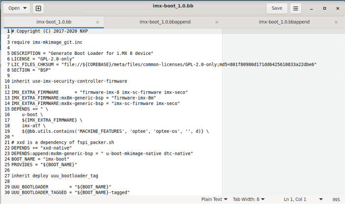
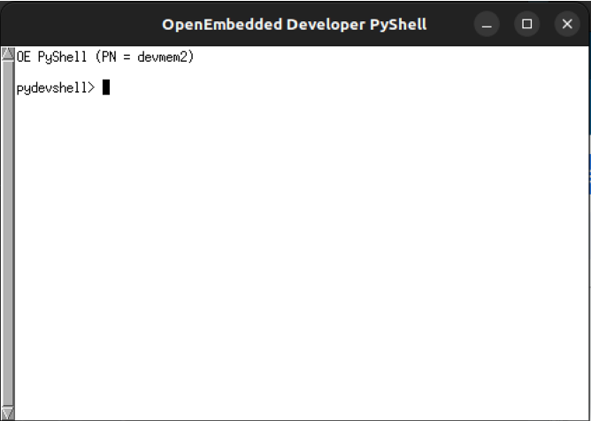
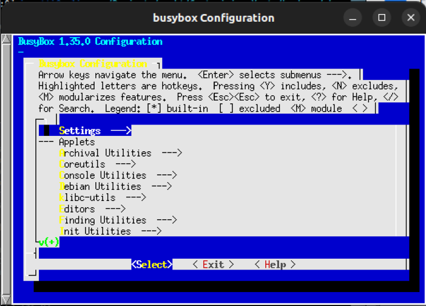

# Chương 4. Các công cụ Yocto (Yocto Tools)

Sau khi đã hiểu Yocto Project là gì, các biến của nó nằm ở đâu và có ý nghĩa gì, đã đến lúc xem các công cụ chính của Yocto Project.

Trong chương này, chúng ta sẽ giới thiệu những lệnh Yocto được dùng nhiều nhất, còn trong các chương tiếp theo, chúng ta sẽ giải thích thêm cách chúng có thể tạo đúng Yocto image tùy biến của mình, có thể bằng cách thêm các recipe tùy biến.

## 4.1 bitbake

BitBake là một thành phần cốt lõi của Yocto Project và được build system dùng để build package và image.

Bằng lệnh `bitbake`, chúng ta có thể chạy các task shell và Python một cách hiệu quả và song song, trong khi vẫn làm việc với những ràng buộc phụ thuộc inter-task phức tạp. Để chỉ dẫn BitBake làm việc đó, chúng ta dùng các recipe được viết theo một định dạng riêng để thực hiện các tập task. Mọi khía cạnh này sẽ được giải thích chi tiết trong Chương 5; lúc này, chúng ta chỉ giới thiệu công cụ bằng cách trình bày usage message của nó và một số cách dùng cơ bản.

Để lấy usage message của `bitbake`, chúng ta có thể thực thi nó với option argument `-h` quen thuộc như dưới đây:

```
$ bitbake -h
Usage: bitbake [options] [recipename/target recipe:do_task ...]

    Executes the specified task (default is 'build') for a given set of
    target recipes (.bb files).
    It is assumed there is a conf/bblayers.conf available in cwd or in
    BBPATH which will provide the layer, BBFILES and other configuration
    information.

Options:
  --version       show program's version number and exit
  -h, --help      show this help message and exit
  -b BUILDFILE, --buildfile=BUILDFILE
                  Execute tasks from a specific .bb recipe directly.
                  WARNING: Does not handle any dependencies from other
                  recipes.
  -k, --continue  Continue as much as possible after an error. While the
                  target that failed and anything depending on it cannot
                  be built, as much as possible will be built before
                  stopping.
  -f, --force     Force the specified targets/task to run (invalidating
                  any existing stamp file).
  -c CMD, --cmd=CMD
                  Specify the task to execute. The exact options
                  available depend on the metadata. Some examples might
                  be 'compile' or 'populate_sysroot' or 'listtasks' may
                  give a list of the tasks available.
...
```

> Usage message khá dài, vì vậy nó đã bị cắt bớt vì lý do dung lượng.

Ngay đầu, chúng ta có thể thấy rằng một `conf/bblayers.conf` phải có sẵn trong working directory hiện tại hoặc trong environment variable `BBPATH`, file này sẽ cung cấp thông tin về layer, `BBFILES` và các thông tin cấu hình khác (như đã giới thiệu trong Mục 3.4.5 và 3.4.6). Thật vậy, nếu muốn chạy `bitbake` từ một thư mục bên ngoài build directory, chúng ta phải chắc chắn đặt `BBPATH` trỏ tới build directory. Ví dụ:

```
$ export BBPATH="/path/to/our/build/directory"
$ bitbake target
```

Bạn đọc có thể thấy rằng có rất nhiều tùy chọn có thể dùng với `bitbake`, và trong mục này chúng ta sẽ trình bày những tùy chọn quan trọng nhất, rồi ở phần sau của sách, chúng ta sẽ trình bày thêm những cách dùng hữu ích (để có tài liệu tham khảo đầy đủ về lệnh `bitbake`, hãy xem user manual của BitBake tại `https://docs.yoctoproject.org/bitbake/2.6/index.html`).

### 4.1.1 Thực thi task (Executing Tasks)

Tiếp tục xem usage message ở trên, chúng ta có thể thấy cách thực thi một task cho một tập recipe target. Dù chúng ta vẫn chưa biết chi tiết recipe là gì hay task là gì (các khái niệm này sẽ được giải thích chi tiết lần lượt trong Chương 6 và Mục 5.3), chúng ta có thể dễ dàng hình dung rằng recipe chỉ là một danh sách task (hay quy tắc) phải được thực thi theo thứ tự (tùy theo sự phụ thuộc lẫn nhau giữa chúng) để có được một package. Task cuối cùng được thực thi có tên là `build` (hay `do_build`).

Vì vậy usage message của `bitbake` cho chúng ta biết rằng nếu chỉ định tên một recipe như dưới đây, task mặc định `build` của `my_recipe` sẽ được thực thi:

```
$ bitbake my_recipe
```

> Task mặc định, khi không có task nào được chỉ định (ví dụ, bằng tùy chọn command-line `-c` – xem bên dưới), được chỉ định bởi biến `BB_DEFAULT_TASK` mà không có tiền tố `do_` (thật vậy, task mặc định `do_build` được chỉ định là `BB_DEFAULT_TASK="build"`).

Mặt khác, thực thi các task cụ thể cho một file recipe riêng lẻ khá đơn giản; chúng ta chỉ cần chỉ định file đó, và `bitbake` sẽ parse nó rồi thực thi task được chỉ định. Để chỉ định một task khác task mặc định, chúng ta có thể dùng option argument `-c` như dưới đây:

```
$ bitbake -b foo.bb -c clean
```

Lệnh trên chạy task `do_clean()` (hay `clean`) cho file recipe `foo.bb`.

Chúng ta cũng có thể chỉ định các task khác nhau cho từng target khi chỉ định nhiều target. Ví dụ, chúng ta yêu cầu `bitbake` thực thi task `do_fetch` cho recipe `foo` rồi task `do_clean` cho recipe `bar`:

```
$ bitbake foo:do_fetch bar:do_clean
```

Chúng ta có thể dùng task đặc biệt `do_listtasks` để có danh sách chi tiết mọi task có trong một recipe cụ thể. Ví dụ, lệnh dưới đây hiển thị mọi task của recipe `i2c-tools`:

```
$ bitbake -c listtasks i2c-tools
...
do_build                Default task for a recipe - depends on all othe
r normal tasks required to 'build' a recipe
do_checkuri             Validates the SRC_URI value
do_clean                Removes all output files for a target
do_cleanall             Removes all output files, shared state cache, a
nd downloaded source files for a target
do_cleansstate          Removes all output files and shared state cache
for a target
do_compile              Compiles the source in the compilation directory
do_configure            Configures the source by enabling and disabling
 any build-time and configuration options for the software being built
...
do_pydevshell           Starts an interactive Python shell for developm
ent/debugging
do_unpack               Unpacks the source code into a working directory
NOTE: Tasks Summary: Attempted 1 tasks of which 0 didn't need to be rer
un and all succeeded.
```

Ở đây chúng ta nên chú ý rằng mọi task đều được hiển thị kèm một ghi chú nhỏ về việc chúng làm. Mọi thông tin này được lưu trong `sources/poky/meta/conf/documentation.conf` bằng các variable flag dưới đây (xem Mục 5.1.4 để biết thêm thông tin về variable flag):

```
$ cat sources/poky/meta/conf/documentation.conf
# this file holds documentation for known keys, possible values and
# their meanings. Please update, correct and extend this documentation.
# Mail your changes to openembedded-devel@openembedded.org
# DESCRIPTIONS FOR TASKS #

do_bootimg[doc] = "Creates a bootable live image"
do_build[doc] = "Default task for a recipe - depends on all other norma
l tasks required to 'build' a recipe"
do_bundle_initramfs[doc] = "Combines an initial ramdisk image and kerne
l together to form a single image"
do_checkuri[doc] = "Validates the SRC_URI value"
do_clean[doc] = "Removes all output files for a target"
do_cleanall[doc] = "Removes all output files, shared state cache, and d
ownloaded source files for a target"
do_cleansstate[doc] = "Removes all output files and shared state cache
for a target"
do_compile[doc] = "Compiles the source in the compilation directory"
do_compile_kernelmodules[doc] = "Compiles loadable modules for the Linu
x kernel"
do_compile_ptest_base[doc] = "Compiles the runtime test suite included
in the software being built"
do_configure[doc] = "Configures the source by enabling and disabling an
y build-time and configuration options for the software being built"
do_configure_ptest_base[doc] = "Configures the runtime test suite inclu
ded in the software being built"
do_deploy[doc] = "Writes deployable output files to the deploy director
y"
do_pydevshell[doc] = "Starts an interactive Python shell for developmen
t/debugging"
do_devshell[doc] = "Starts a shell with the environment set up for deve
lopment/debugging"
do_diffconfig[doc] = "Compares the old and new config files after runni
ng do_menuconfig for the kernel"
do_fetch[doc] = "Fetches the source code"
do_install[doc] = "Copies files from the compilation directory to a hol
ding area"
...
```

Hai cách thú vị khác để thực thi một task là dùng option argument `-f` và dùng option argument `-C`. Hãy xem chúng làm gì.

Nhìn vào usage message của `bitbake`, chúng ta có

```
...
  -f, --force     Force the specified targets/task to run (invalidating
                  any existing stamp file).
...
  -C INVALIDATE_STAMP, --clear-stamp=INVALIDATE_STAMP
                  Invalidate the stamp for the specified task such as
                  'compile' and then run the default task for the
                  specified target(s).
...
```

Cách dùng của chúng khá giống nhau, nhưng khi dùng `-f`, chúng ta yêu cầu `bitbake` ép thực thi các target/task được chỉ định ngay cả khi stamp file của nó gợi ý bỏ qua (tương tự như lệnh `make` làm khi nó xem một target file là đã lỗi thời), vì mọi stamp file đang có đều bị vô hiệu hóa. Còn khi dùng `-C`, chúng ta chỉ vô hiệu hóa stamp file của task được chỉ định, rồi chạy task mặc định cho target được chỉ định.

Ví dụ, chúng ta có thể ép chạy lại task `unpack` cho một recipe bằng command line sau:

```
$ bitbake -c unpack -f recipe
```

Hoặc chúng ta có thể ép thực thi task `do_compile` của một recipe, như trong ví dụ command-line tiếp theo:

```
$ bitbake -C compile -c compile recipe
```

Khi build một Yocto image, có thể hữu ích khi dùng option argument `-k` như dưới đây:

```
$ bitbake -k image-recipe
```

Bằng cách này, chúng ta yêu cầu `bitbake` tiếp tục quá trình build càng xa càng tốt sau khi gặp lỗi.

Dù sẽ không tạo ra image nào, nó sẽ làm theo cách sao cho mọi thứ không phụ thuộc vào target bị lỗi đều được build trước khi dừng. Thật vậy, theo mặc định, `bitbake` dừng khi một task thất bại, ngay cả khi nó có thể tiếp tục build các task khác. Bằng các option argument như vậy, chúng ta yêu cầu `bitbake` tiếp tục lâu nhất có thể, vì vậy khi đã tìm được cách sửa cho target bị lỗi, chúng ta có thể tiếp tục và tăng tốc việc build image bằng cách chỉ compile các task còn lại phụ thuộc vào task bị lỗi trước đó.

Trước khi kết thúc phần tổng quan về command line của `bitbake`, chúng ta nên xem các option argument `-v` (`--verbose`) và `-D` (`--debug`); chúng có thể rất hữu ích khi debug một recipe. Thật vậy, trong usage message chúng ta có thể đọc thấy

```
...
  -v, --verbose   Enable tracing of shell tasks (with 'set -x'). Also
                  print bb.note(...) messages to stdout (in addition to
                  writing them to ${T}/log.do_<task>).
  -D, --debug     Increase the debug level. You can specify this more
                  than once. -D sets the debug level to 1, where only
                  bb.debug(1, ...) messages are printed to stdout; -DD
                  sets the debug level to 2, where both bb.debug(1, ...)
                  and bb.debug(2, ...) messages are printed; etc.
                  Without -D, no debug messages are printed. Note that
                  -D only affects output to stdout. All debug messages
                  are written to ${T}/log.do_taskname, regardless of the
                  debug level.
...
```

Với option argument `-v`, chúng ta có thể hiển thị thêm các ghi chú thông tin trên standard output, còn với option argument `-D`, chúng ta có thể hiển thị cả các debugging message.

> Như có thể dễ dàng hiểu, các hàm `bb.note()` và `bb.debug()` được dùng để hiển thị ghi chú hoặc debugging message trong các task khác nhau, còn bạn đọc nên chú ý rằng bất kể debug level là bao nhiêu, mọi debug message đều được ghi vào `${T}/log.do_taskname`.
>
> Bạn đọc nên nhớ rằng `${T}` chỉ tới một thư mục tạm bên trong cây thư mục của build directory (trong trường hợp của chúng ta, nó sẽ là `tmp/work/imx8mp_icore-poky-linux/engicam-evaluation-` `image-mx8/1.0-r0/temp`).
>
> Ngoài ra, điều quan trọng cần biết là chúng ta có thể dễ dàng xem mọi log bằng cách xem file `bitbake-cookerdaemon.log` nằm trong build directory.

### 4.1.2 Dùng thêm file cấu hình (Using More Configuration Files)

Trong Mục 3.4, chúng ta đã trình bày nhiều file cấu hình, và đặc biệt trong Mục 3.4.1 chúng ta đã xem chi tiết một trong những file cấu hình quan trọng nhất cần quản lý; tuy nhiên, đây không phải là những file cấu hình duy nhất được `bitbake` đọc. Thật vậy, mọi cấu hình được đặt trong file `conf/local.conf` cũng có thể được đặt trong các file cấu hình `conf/site.conf` và `conf/auto.conf`.

Hai file này không được tạo bởi script khởi tạo môi trường, vì vậy chúng ta cần tự tạo chúng, và chúng có thể được dùng như sau:

- `site.conf`: Được dùng để cấu hình nhiều build directory. Ví dụ, nếu có nhiều build environment và chúng dùng chung một số đặc điểm, chúng ta có thể đặt các thuộc tính build mặc định này ở đây (thông thường biến `PACKAGE_CLASSES` có thể được đặt ở đây).

- `auto.conf`: Thường chứa các biến giống như trong file `conf/local.conf` hoặc `conf/site.conf`, nhưng nó được tạo và ghi bởi một hệ thống Continuous Integration (CI) hoặc một Autobuilder (AB).

Khi chạy `bitbake`, nó đọc các file cấu hình theo một thứ tự cụ thể: `site.conf`, `auto.conf` và `local.conf` (xem Mục 3.4.4).

Ngoài các file này, chúng ta có thể cung cấp thêm file cấu hình bằng các option argument `-r` (hay `--read=`) và/hoặc `-R` (hay `--postread`). Vì vậy, như được nêu trong usage message (được lặp lại dưới đây), nếu dùng `-r PREFILE`, chúng ta yêu cầu `bitbake` đọc file được chỉ định trước `bitbake.conf`, còn với `-R` `POSTFILE`, chúng ta yêu cầu bitbake đọc file được chỉ định sau `bitbake.conf`:

```
...
  -r PREFILE, --read=PREFILE
                        Read the specified file before bitbake.conf.
  -R POSTFILE, --postread=POSTFILE
                        Read the specified file after bitbake.conf.
...
```

Bằng cách này, chúng ta có thể thay đổi file cấu hình của `bitbake` từ command line đơn giản bằng cách thêm vào trước hoặc sau một số định nghĩa lại biến (xem Mục 12.4 để có ví dụ thực tế).

Dù sao, một cách tốt để có ý niệm về cả các thiết lập cấu hình được dùng trong execution environment lẫn những file cấu hình nào được đọc (và theo thứ tự nào) là chạy lệnh bitbake sau:

```
$ bitbake -e
```

Ở đầu output message, chúng ta có thể thấy nhiều file cấu hình được dùng trong execution environment, như dưới đây:

```
#
# INCLUDE HISTORY:
#
# /home/giometti/yocto/imx-yocto-bsp/imx8mp-build/conf/bblayers.conf
# /home/giometti/yocto/imx-yocto-bsp/sources/poky/meta/conf/layer.conf
# /home/giometti/yocto/imx-yocto-bsp/sources/poky/meta-poky/conf/layer.
conf
# /home/giometti/yocto/imx-yocto-bsp/sources/meta-openembedded/meta-oe/
conf/layer.conf
...
```

Ở trên, chúng ta có thể thấy file đầu tiên được đọc là `bblayers.conf`, sau đó mọi file `layer.conf` của mỗi layer được định nghĩa đều được đọc, cho đến file trong layer của Engicam:

```
...
# /home/giometti/yocto/imx-yocto-bsp/sources/meta-engicam-nxp/conf/laye
r.conf
...
```

Tại thời điểm này, `bitbake` bắt đầu include các file cấu hình khác như đã nói ở trên:

```
...
# conf/bitbake.conf includes:
#   /home/giometti/yocto/imx-yocto-bsp/sources/poky/meta/conf/abi_versi
on.conf
#   conf/site.conf
#   conf/auto.conf
#   /home/giometti/yocto/imx-yocto-bsp/imx8mp-build/conf/local.conf
#   /home/giometti/yocto/imx-yocto-bsp/sources/poky/meta/conf/multiconf
ig/default.conf
#   /home/giometti/yocto/imx-yocto-bsp/sources/meta-engicam-nxp/conf/ma
chine/imx8mp-icore.conf includes:
#     /home/giometti/yocto/imx-yocto-bsp/sources/meta-engicam-nxp/conf/
machine/include/imx8mp-engicam.inc includes:
#       /home/giometti/yocto/imx-yocto-bsp/sources/meta-freescale/conf/
machine/include/imx-base.inc includes:
#         /home/giometti/yocto/imx-yocto-bsp/sources/meta-freescale/con
f/machine/include/fsl-default-settings.inc
...
```

Trong output trên, chúng ta có thể thấy cả `site.conf` và `auto.conf` đều không được định nghĩa, nhưng nếu định nghĩa một trong hai cùng với một file cấu hình tùy biến khác, chúng ta có thể làm như sau:

```
$ echo 'MY_CUSTOM_VAR="value 1"' > conf/auto.conf
$ echo 'MY_CUSTOM_VAR="value 2"' > conf/my_conf_file.conf
```

Chúng ta thêm một biến tùy biến vào cả `auto.conf` lẫn một file `my_conf_file.conf` chung, sau đó có thể thực thi `bitbake` như sau:

```
$ bitbake -e -r conf/my_conf_file.conf
#
# INCLUDE HISTORY:
#
# conf/my_conf_file.conf
# /home/giometti/yocto/imx-yocto-bsp/imx8mp-build/conf/bblayers.conf
...
#   conf/site.conf
#   /home/giometti/yocto/imx-yocto-bsp/imx8mp-build/conf/auto.conf
...
```

Giờ file cấu hình đầu tiên được đọc là `my_conf_file.conf`, thay vì `bblayers.conf`, và các file `auto.conf` giờ được đọc với đường dẫn `/home/giometti/yocto/imx-yocto-bsp/imx8mp-build/conf/auto.conf`. Và không chỉ vậy! Nếu đi qua output, chúng ta có thể thấy cách `bitbake` gán giá trị cuối cùng cho biến tùy biến của mình; thật vậy, chúng ta có thể đọc thấy:

```
...
#
# $MY_CUSTOM_VAR [2 operations]
#   set /home/giometti/yocto/imx-yocto-bsp/imx8mp-build/conf/my_conf_fi
le.conf:1
#     "value 2"
#   set /home/giometti/yocto/imx-yocto-bsp/imx8mp-build/conf/auto.conf:1
#     "value 1"
# pre-expansion value:
#   "value 1"
MY_CUSTOM_VAR="value 1"
...
```

đây là giá trị được mong đợi do thứ tự đọc các file cấu hình. Ngược lại, nếu dùng command line dưới đây, chúng ta nên mong đợi một hành vi khác:

```
$ bitbake -e -R conf/my_conf_file.conf
#
# INCLUDE HISTORY:
#
# /home/giometti/yocto/imx-yocto-bsp/imx8mp-build/conf/bblayers.conf
...
#   conf/site.conf
#   /home/giometti/yocto/imx-yocto-bsp/imx8mp-build/conf/auto.conf
...
#   /home/giometti/yocto/imx-yocto-bsp/sources/poky/meta/conf/sanity.co
nf
# conf/my_conf_file.conf
# /home/giometti/yocto/imx-yocto-bsp/sources/poky/meta/classes/base.bbc
lass includes:
#   /home/giometti/yocto/imx-yocto-bsp/sources/poky/meta/classes/patch.
bbclass includes:
...
```

Giờ file `my_conf_file.conf` được đọc như file cấu hình cuối cùng; thật vậy, file `base.class` được parse sau nó (và các class file khác theo sau), khi đó giá trị cuối cùng của `MY_CUSTOM_VAR` giờ được đặt như dưới đây:

```
...
#
# $MY_CUSTOM_VAR [2 operations]
#   set /home/giometti/yocto/imx-yocto-bsp/imx8mp-build/conf/auto.conf:1
#     "value 1"
#   set /home/giometti/yocto/imx-yocto-bsp/imx8mp-build/conf/my_conf_fi
le.conf:1
#     "value 2"
# pre-expansion value:
#   "value 2"
MY_CUSTOM_VAR="value 2"
...
```

điều này là đúng.

Một ví dụ thú vị khác về việc thiết lập biến là ví dụ về biến `PACKAGE_CLASSES` mà chúng ta đã thay đổi trong file `conf/local.conf` như trong Mục 2.3. Bạn đọc nên nhớ rằng chúng ta đã làm như sau:

```
$ cat conf/local.conf
MACHINE ??= 'imx8mp-icore-cy'
#MACHINE ??= 'imx8mp-icore-cy'
DISTRO ?= 'fsl-imx-xwayland'
PACKAGE_CLASSES ?= 'package_rpm'
...
# Switch to IPKG packaging and include package-management in the image
PACKAGE_CLASSES = "package_ipk"
EXTRA_IMAGE_FEATURES += "package-management"
...
```

Và nếu kiểm tra trong output của `bitbake -e`, chúng ta có thể thấy những gì được trình bày dưới đây:

```
...
#
# $PACKAGE_CLASSES [4 operations]
#   set? /home/giometti/yocto/imx-yocto-bsp/imx8mp-build/conf/local.con
f:3
#     "package_rpm"
#   set /home/giometti/yocto/imx-yocto-bsp/imx8mp-build/conf/local.conf
:23
#     "package_ipk"
#   set? /home/giometti/yocto/imx-yocto-bsp/sources/poky/meta/conf/dist
ro/defaultsetup.conf:16
#     "package_ipk"
#   set /home/giometti/yocto/imx-yocto-bsp/sources/poky/meta/conf/docum
entation.conf:312
#     [doc] "This variable specifies the package manager to use when pa
ckaging data. It is set in the conf/local.conf file in the Build Direct
ory."
# pre-expansion value:
#   "package_ipk"
PACKAGE_CLASSES="package_ipk"
...
```

Trong output trên, chúng ta thấy cách biến `PACKAGE_CLASSES` được đặt trong nhiều file cấu hình mà `bitbake` đọc, và đặc biệt trong `conf/local.conf` của chúng ta, đầu tiên nó thực hiện một phép gán set? rồi sau đó một phép gán set (đây là hai loại phép gán biến khác nhau được giải thích rõ trong Mục 5.1.2). Hơn nữa, nó đặt flag `[doc]` cho biến `PACKAGE_CLASSES` như được chỉ định trong file `documentation.conf` như đã giới thiệu trong Mục 4.1.1.

Trước khi tiếp tục, bạn đọc nên chú ý rằng thực thi `bitbake` với option argument `-e` chỉ là một mẹo để hiển thị giá trị mà một biến cụ thể nhận được trong Yocto build system. Thật vậy, chúng ta có thể làm như dưới đây để dễ dàng lấy giá trị `PACKAGE_CLASSES`:

```
$ bitbake -e | grep 'PACKAGE_CLASSES='
PACKAGE_CLASSES="package_ipk"
```

Lưu ý dấu bằng (`=`) ở cuối regular expression. Nó có thể được dùng để chỉ chọn phép gán biến và loại bỏ nhiễu.

### 4.1.3 Truyền biến từ command line (Passing Variables from the Command Line)

Một cách thú vị khác để dùng BitBake là khả năng truyền các thiết lập đặc biệt qua environment variable. Thật vậy, trước khi parse các file cấu hình, lệnh `bitbake` xét một số biến nhất định:

- `BB_ENV_PASSTHROUGH` chỉ định danh sách nội bộ các biến được phép đi từ environment bên ngoài vào environment của `bitbake`. Theo mặc định, giá trị của biến này không được chỉ định, và khi đó danh sách sau được dùng: `BBPATH`, `BB_PRESERVE_ENV`, `BB_ENV_PASSTHROUGH` và `BB_ENV_PASSTHROUGH_ADDITIONS`.

- `BB_ENV_PASSTHROUGH_ADDITIONS` chỉ định một tập biến bổ sung (bên cạnh danh sách nội bộ được đặt qua `BB_ENV_PASSTHROUGH`) được phép đi từ environment bên ngoài vào environment của `bitbake`.

- `BB_PRESERVE_ENV` tắt việc lọc environment, và mọi biến đều được phép đi từ environment bên ngoài vào environment của `bitbake`.

- `BB_ORIGENV` chứa một bản sao của environment bên ngoài ban đầu (trước mọi bước lọc) mà `bitbake` được chạy trong đó.

- `BITBAKE_UI` được dùng để chỉ định module User Interface (UI) được dùng khi chạy `bitbake` (biến này tương đương với tùy chọn command-line `-u`).

Ngoài `BB_ORIGENV`, mọi biến ở trên đều phải được đặt trong environment bên ngoài thì mới có tác dụng, và chúng được dùng để truyền một số dữ liệu vào `bitbake` và từ đó vào Yocto build system; tuy nhiên, chúng ta có thể muốn truyền nhiều biến hơn thế, và để làm vậy, chúng ta có thể dùng ít nhất hai cách.

> Trước khi tiếp tục, tốt hơn là nhấn mạnh rằng truyền biến bên ngoài vào `bitbake` không phải là cách làm việc thông thường trong Yocto Project; đó là lý do `bitbake` thường lọc execution environment của nó trước khi bắt đầu công việc. Tuy nhiên, có thể có một số tình huống đặc biệt mà quy tắc này có thể được bỏ qua; đó là lý do chúng ta sẽ trình bày các kỹ thuật này.

Cách đơn giản nhất là dùng `BB_PRESERVE_ENV`, nhưng cách này không phải là tốt nhất vì mọi biến đều được truyền vào `bitbake`, và đây cũng là một cách error-prone. Vì vậy, đơn giản là chúng ta không xem nó là một cách hợp lệ.

Vì vậy, cách thực sự đầu tiên, và cũng là cách tự nhiên thực sự để giải quyết vấn đề, là dùng biến `BB_ENV_PASSTHROUGH`, vì nó được đưa vào cho chính việc này. Để cho thấy cách dùng nó, hãy định nghĩa một biến tùy biến cần truyền vào `bitbake` như dưới đây:

```
$ export MY_CUSTOM_VAR="some value"
```

> Lưu ý rằng từ khóa `export` là cần thiết trong Bash để chỉ định các biến được export tới mọi child process.

Bây giờ, nếu kiểm tra environment của `bitbake`, chúng ta có thể xác nhận rằng `MY_CUSTOM_VAR` không được định nghĩa:

```
$ bitbake -e | grep MY_CUSTOM_VAR= || echo "not found"
not found
```

Ngược lại, nếu dùng `BB_ENV_PASSTHROUGH` như dưới đây, giờ biến đã được tìm thấy:

```
$ export BB_ENV_PASSTHROUGH="MY_CUSTOM_VAR"
$ bitbake -e | grep MY_CUSTOM_VAR= || echo "not found"
MY_CUSTOM_VAR="some value"
```

Trong `BB_ENV_PASSTHROUGH`, chúng ta có thể đưa vào một danh sách các biến cách nhau bằng khoảng trắng để truyền vào `bitbake`, như Yocto build system làm với biến `BB_ENV_PASSTHROUGH_ADDITIONS`, như dưới đây:

```
$ bitbake -e | grep BB_ENV_PASSTHROUGH_ADDITIONS=
BB_ENV_PASSTHROUGH_ADDITIONS="ALL_PROXY BBPATH_EXTRA BB_LOGCONFIG BB_NO_
NETWORK BB_NUMBER_THREADS BB_SETSCENE_ENFORCE BB_SRCREV_POLICY DISTRO FT
PS_PROXY FTP_PROXY GIT_PROXY_COMMAND HTTPS_PROXY HTTP_PROXY MACHINE NO_P
ROXY PARALLEL_MAKE SCREENDIR SDKMACHINE SOCKS5_PASSWD SOCKS5_USER SSH_AG
ENT_PID SSH_AUTH_SOCK STAMPS_DIR TCLIBC TCMODE all_proxy ftp_proxy ftps_
proxy http_proxy https_proxy no_proxy "
```

> Vì `BB_ENV_PASSTHROUGH_ADDITIONS` được Yocto build system dùng, tốt hơn là không dùng nó để quản lý các biến của chúng ta.

Một cách tinh vi hơn để truyền một environment variable là dùng `BB_ORIGENV` trong một recipe, như dưới đây:

```
MY_VAR = d.getVar("BB_ORIGENV", False).getVar("MY_VAR", False)
```

Lý do là, như đã nói ở trên, `bitbake` lưu một bản sao của environment ban đầu vào biến `BB_ORIGENV`, và khi đó chúng ta có thể đọc nó bằng một hàm Python (lúc này chúng ta chưa thể thử hành vi này, nhưng trong Mục 5.1.5 chúng ta sẽ thử nó).

Dù không có gì sai với các cách này, bạn đọc nên nhớ rằng `bitbake` có chấp nhận đối số `--postread`, như đã giải thích ở trên. Điều đó có nghĩa là chúng ta có thể ghi bao nhiêu biến `bitbake` tùy thích vào một file cấu hình tạm nào đó và cho nó được đọc sau `bitbake.conf` bằng cách chỉ định tên file trên command line.

```
For example:
$ cat > conf/my_conf_file.conf <<__EOF__
MY_CUSTOM_VAR="some value"
__EOF__
$ bitbake -e --postread=conf/my_conf_file.conf | grep MY_CUSTOM_VAR=
MY_CUSTOM_VAR="some value"
```

Cách này có thể là một lựa chọn thay thế hợp lệ cho hai cách đã trình bày ở trên. Thật vậy, trong các chương tiếp theo của sách, chúng ta sẽ thấy cách sau cùng này là cách được ưa dùng.

## 4.2 bitbake-layers

Lệnh `bitbake-layers` xử lý các task thông thường liên quan đến meta layer, như được nêu trong usage message của nó:

```
$ bitbake-layers -h
NOTE: Starting bitbake server...
usage: bitbake-layers [-d] [-q] [-F] [--color COLOR] [-h] <subcommand>
...

BitBake layers utility
options:
  -d, --debug           Enable debug output
  -q, --quiet           Print only errors
  -F, --force           Force add without recipe parse verification
  --color COLOR         Colorize output (where COLOR is auto, always,
                        never)
  -h, --help            show this help message and exit

subcommands:
  <subcommand>
    show-layers         show current configured layers.
    show-overlayed      list overlayed recipes (where the same recipe
                        exists in another layer)
    show-recipes        list available recipes, showing the layer they
                        are provided by
    show-appends        list bbappend files and recipe files they apply
                        to
    show-cross-depends  Show dependencies between recipes that cross
                        layer boundaries.
    layerindex-fetch    Fetches a layer from a layer index along with
                        its dependent layers, and adds them to
                        conf/bblayers.conf.
    layerindex-show-depends
                        Find layer dependencies from layer index.
    add-layer           Add one or more layers to bblayers.conf.
    remove-layer        Remove one or more layers from bblayers.conf.
    flatten             flatten layer configuration into a separate
                        output directory.
    create-layer        Create a basic layer

Use bitbake-layers <subcommand> --help to get help on a specific command
```

Như chúng ta thấy ở trên, ví dụ, bằng subcommand `show-layers`, chúng ta có thể hiển thị mọi layer đã được cấu hình. Nếu thử thực thi subcommand này trên Yocto source đã cài, chúng ta sẽ nhận được kết quả như dưới đây:

```
$ bitbake-layers show-layers
NOTE: Starting bitbake server...
layer                 path                                      priority
========================================================================
meta      /home/giometti/yocto/imx-yocto-bsp/sources/poky/meta         5
meta-poky /home/giometti/yocto/imx-yocto-bsp/sources/poky/meta-poky    5
...
meta-bsp  /home/giometti/yocto/imx-yocto-bsp/sources/meta-imx/meta-bsp 8
...
meta-v2x  /home/giometti/yocto/imx-yocto-bsp/sources/meta-imx/meta-v2x 9
...
meta-qt6  /home/giometti/yocto/imx-yocto-bsp/sources/meta-qt6          5
...
```

Ở đây, chúng ta có thể thấy tên mọi layer, đường dẫn của chúng và, ở tham số cuối cùng, độ ưu tiên của chúng. Tham số này xác lập độ ưu tiên dùng cho các recipe trong layer khi Yocto build system tìm thấy các recipe cùng tên ở các layer khác nhau. Giá trị độ ưu tiên càng lớn thì quyền ưu tiên càng cao.

Để chỉ định độ ưu tiên mong muốn cho một layer mới, chúng ta có thể dùng option argument `--priority` trong subcommand `create-layer`, subcommand mà chúng ta có thể dùng để thêm một layer mới vào Yocto source hiện tại. Dưới đây là usage message của subcommand:

```
$ bitbake-layers create-layer -h
NOTE: Starting bitbake server...
usage: bitbake-layers create-layer [-h] [--layerid LAYERID]
                                   [--priority PRIORITY]
                                   [--example-recipe-name EXAMPLERECIPE]
                                   [--example-recipe-version VERSION]
                                   layerdir

Create a basic layer

positional arguments:
  layerdir              Layer directory to create

options:
  -h, --help            show this help message and exit
  --layerid LAYERID, -i LAYERID
                        Layer id to use if different from layername
  --priority PRIORITY, -p PRIORITY
                        Priority of recipes in layer
  --example-recipe-name EXAMPLERECIPE, -e EXAMPLERECIPE
                        Filename of the example recipe
  --example-recipe-version VERSION, -v VERSION
                        Version number for the example recipe
```

Lệnh này tạo một meta layer mới trong đường dẫn `layerdir`, nhưng để thực sự thêm nó vào Yocto Project của mình, chúng ta phải dùng subcommand `add-layer` như dưới đây:

```
$ bitbake-layers add-layer -h
NOTE: Starting bitbake server...
usage: bitbake-layers add-layer [-h] layerdir [layerdir ...]

Add one or more layers to bblayers.conf.

positional arguments:
  layerdir    Layer directory/directories to add
...
```

Để bỏ một layer, chúng ta có thể dùng subcommand `remove-layer`:

```
$ bitbake-layers remove-layer -h
NOTE: Starting bitbake server...
usage: bitbake-layers remove-layer [-h] layerdir [layerdir ...]

Remove one or more layers from bblayers.conf.

positional arguments:
  layerdir    Layer directory/directories to remove (wildcards allowed, enclose
in quotes to avoid shell expansion)
...
```

Một subcommand thú vị khác (dù ít được dùng hơn) là `flatten`, có thể được dùng để gộp bất kỳ layer nào được chỉ định, hoặc mọi layer, thành một layer duy nhất:

```
$ bitbake-layers flatten -h
NOTE: Starting bitbake server...
usage: bitbake-layers flatten [-h] [layer ...] outputdir

Takes the specified layers (or all layers in the current layer
configuration if none are specified) and builds a "flattened" directory
containing the contents of all layers, with any overlayed recipes removed
and bbappends appended to the corresponding recipes. Note that some manual
cleanup may still be necessary afterwards, in particular:

* where non-recipe files (such as patches) are overwritten (the flatten
  command will show a warning for these)
* where anything beyond the normal layer setup has been added to
  layer.conf (only the lowest priority number layer's layer.conf is used)
* overridden/appended items from bbappends will need to be tidied up
* when the flattened layers do not have the same directory structure (the
  flatten command should show a warning when this will cause a problem)

Warning: if you flatten several layers where another layer is intended to
be used "inbetween" them (in layer priority order) such that recipes /
bbappends in the layers interact, and then attempt to use the new output
layer together with that other layer, you may no longer get the same
build results (as the layer priority order has effectively changed).

positional arguments:
  layer       Optional layer(s) to flatten (otherwise all are flattened)
  outputdir   Output directory
...
```

Bạn đọc có thể thấy từ usage message ở trên rằng subcommand này có thể hữu ích, nhưng nó có thể cần sự trợ giúp của con người.

Một cách dùng hữu ích khác của lệnh này là xem xét các recipe trong các layer bằng các subcommand `show-recipes`, `show-appends` và `show-overlayed`. Bằng `show-recipes`, chúng ta có thể liệt kê các recipe có sẵn cùng các layer mà chúng thuộc về. Ví dụ, chúng ta có thể làm như sau:

```
$ bitbake-layers show-recipes u-boot-engicam
...
=== Matching recipes: ===
u-boot-engicam:
  meta-engicam-nxp     2022.04
```

Trong ví dụ này, rõ ràng chúng ta chỉ tìm thấy một recipe trong meta layer của Engicam. Nhưng chúng ta cũng có thể dùng wildcard với một kết quả hoàn toàn khác:

```
$ bitbake-layers show-recipes u-boot-*
...
=== Matching recipes: ===
u-boot-boundary:
  meta-freescale-3rdparty 2022.04 (skipped: incompatible with machine i
mx8mp-icore (not in COMPATIBLE_MACHINE))
u-boot-engicam:
  meta-engicam-nxp     2022.04
u-boot-fslc:
  meta-freescale       2022.07 (skipped: PREFERRED_PROVIDER_virtual/boo
tloader set to u-boot-engicam, not u-boot-fslc)
u-boot-fslc-mfgtool:
  meta-freescale       2022.07+gitAUTOINC+a21d7668eb
u-boot-fslc-mxsboot:
  meta-freescale       2022.07 (skipped: incompatible with machine imx8
mp-icore (not in COMPATIBLE_MACHINE))
u-boot-imx:
  meta-bsp             2022.04 (skipped: PREFERRED_PROVIDER_virtual/boo
tloader set to u-boot-engicam, not u-boot-imx)
  meta-freescale       2022.04 (skipped: PREFERRED_PROVIDER_virtual/boo
tloader set to u-boot-engicam, not u-boot-imx)
u-boot-imx-mfgtool:
  meta-bsp             2022.04
  meta-freescale       2022.04
u-boot-imx-tools:
  meta-bsp             2022.04
...
```

Lần này, output dài hơn khá nhiều, và chúng ta có thể thấy một số recipe bị bỏ qua do thiết lập `PREFERRED_PROVIDER` và những recipe khác do thiết lập `COMPATIBLE_MACHINE` (xem Mục 6.3.3 để biết thêm thông tin về biến này). Những recipe khác như `u-boot-imx-mfgtool` đến từ nhiều hơn một layer, và trong trường hợp này, chúng được liệt kê với phiên bản ưu tiên đứng đầu. Để có danh sách mọi recipe bị overlay và các phiên bản có sẵn trong mỗi layer, với phiên bản ưu tiên đứng đầu, chúng ta có thể dùng subcommand `show-overlayed`.

Cuối cùng, subcommand `show-appends` thú vị hơn:

```
$ bitbake-layers show-appends -h
NOTE: Starting bitbake server...
usage: bitbake-layers show-appends [-h] [pnspec ...]

Lists recipes with the bbappends that apply to them as subitems.

positional arguments:
  pnspec      optional recipe name specification (wildcards allowed, en
close in quotes to avoid shell expansion)
...
```

Subcommand này có thể được dùng để hiển thị các append file (sẽ được giải thích chi tiết trong Chương 6) của một hoặc nhiều recipe, tức là mọi file `.bbappend`, như trong ví dụ dưới đây:

```
$ bitbake-layers show-appends imx-boot
...
=== Matched appended recipes ===
imx-boot_1.0.bb:
  /home/giometti/yocto/imx-yocto-bsp/sources/meta-engicam-nxp/recipes-b
sp/imx-boot/imx-boot_1.0.bbappend
  /home/giometti/yocto/imx-yocto-bsp/sources/meta-imx/meta-bsp/recipes-
bsp/imx-mkimage/imx-boot_1.0.bbappend
imx-boot_1.0.bb:
  /home/giometti/yocto/imx-yocto-bsp/sources/meta-engicam-nxp/recipes-b
sp/imx-boot/imx-boot_1.0.bbappend
  /home/giometti/yocto/imx-yocto-bsp/sources/meta-imx/meta-bsp/recipes-
bsp/imx-mkimage/imx-boot_1.0.bbappend
```

Trong output trên, chúng ta có thể thấy có hai recipe cho `imx-boot`, và cả hai đều có hai append file; hai recipe này có thể được tìm thấy như ở trên bằng subcommand `show-recipes`:

```
$ bitbake-layers show-recipes imx-boot
...
=== Matching recipes: ===
imx-boot:
  meta-bsp             1.0
  meta-freescale       1.0
```

Phần lớn các lệnh này sẽ được giải thích và dùng nhiều trong Chương 7.

## 4.3 recipetool

Tiện ích này có thể được dùng để xử lý các task thông thường liên quan đến recipe. Thật vậy, nếu xem usage message của nó, chúng ta có output sau:

```
$ recipetool -h
NOTE: Starting bitbake server...
usage: recipetool [-d] [-q] [--color COLOR] [-h] <subcommand> ...

OpenEmbedded recipe tool

options:
  -d, --debug     Enable debug output
  -q, --quiet     Print only errors
  --color COLOR   Colorize output (where COLOR is auto, always, never)
  -h, --help      show this help message and exit

subcommands:
  setvar          Set a variable within a recipe
  newappend       Create a bbappend for the specified target in the
                  specified layer
  create          Create a new recipe
  edit            Edit the recipe and appends for the specified target.
                  This obeys $VISUAL if set, otherwise $EDITOR,
                  otherwise vi.
  appendfile      Create/update a bbappend to replace a target file
  appendsrcfiles  Create/update a bbappend to add or replace source
                  files
  appendsrcfile   Create/update a bbappend to add or replace a source
                  file
Use recipetool <subcommand> --help to get help on a specific command
```

Công cụ này được dùng nhiều trong sách, đặc biệt từ Chương 9 trở đi; tuy nhiên, trong những trang này, chúng ta sẽ giới thiệu các cách dùng chính của nó.

Dùng subcommand `create` như dưới đây, chúng ta có thể tự động hóa việc tạo các recipe cơ bản dựa trên các file source (ở local hoặc remote):

```
$ recipetool create -h
NOTE: Starting bitbake server...
usage: recipetool create [-h] [-o OUTFILE] [-p PROVIDES] [-m]
                         [-x EXTRACTPATH]
                         [-N NAME] [-V VERSION] [-b] [--also-native]
                         [--src-subdir SUBDIR] [-a | -S SRCREV]
                         [-B SRCBRANCH]
                         [--keep-temp] [--npm-dev] [--mirrors]
                         source

Creates a new recipe from a source tree

arguments:
  source                Path or URL to source

options:
  -h, --help            show this help message and exit
  -o OUTFILE, --outfile OUTFILE
                        Specify filename for recipe to create
  -p PROVIDES, --provides PROVIDES
                        Specify an alias for the item provided by the
                        recipe
  -m, --machine         Make recipe machine-specific as opposed to
                        architecture-specific
  -x EXTRACTPATH, --extract-to EXTRACTPATH
                        Assuming source is a URL, fetch it and extract
                        it to the directory specified as EXTRACTPATH
  -N NAME, --name NAME  Name to use within recipe (PN)
  -V VERSION, --version VERSION
                        Version to use within recipe (PV)
  -b, --binary          Treat the source tree as something that should
                        be installed verbatim (no compilation, same
                        directory structure)
  --also-native         Also add native variant (i.e. support building
                        recipe for the build host as well as the target
                        machine)
  --src-subdir SUBDIR   Specify subdirectory within source tree to use
  -a, --autorev         When fetching from a git repository, set SRCREV
                        in the recipe to a floating revision instead of
                        fixed
  -S SRCREV, --srcrev SRCREV
                        Source revision to fetch if fetching from an SCM
                        such as git (default latest)
  -B SRCBRANCH, --srcbranch SRCBRANCH
                        Branch in source repository if fetching from an
                        SCM such as git (default master)
...
```

> Lưu ý option argument `--also-native`, có thể được dùng để thêm biến thể native của recipe cho build host (cũng như cho target machine). Xem Mục 11.6 để biết thêm thông tin về loại recipe này.

Trước tiên, chúng ta nên chú ý rằng source có thể nằm ở cả local lẫn remote, tức là source có thể nằm trong một thư mục trên local host, hoặc có thể nằm trên một remote host. Tham số `source` có thể là một tên file:

```
$ recipetool create hello.c
```

hoặc một URL, và trong trường hợp này, tốt hơn nên cung cấp option argument `-o` để chỉ định tên recipe được dùng:

```
$ recipetool create -o zlib_1.2.8.bb http://zlib.net/zlib-1.2.8.tar.gz
```

Nó cũng có thể là một Git repository, khi đó chúng ta yêu cầu một branch cụ thể bằng option argument `-B`:

```
$ recipetool create -B master https://github.com/bast/cmake-example.git
```

Một lưu ý cuối cùng là chúng ta cũng có thể chỉ định một Git repository ở local bằng lệnh sau, chạy trong thư mục chứa repository:

```
$ recipetool create git://$(pwd)
```

Hơn nữa, tiện ích này cũng có thể được dùng để tạo một append file (tức là `.bbappend`) cho một recipe có sẵn bằng subcommand `newappend` như được chỉ định trong usage message tiếp theo:

```
$ recipetool newappend -h
NOTE: Starting bitbake server...
usage: recipetool newappend [-h] [-e] [-w] destlayer target

arguments:
  destlayer             Base directory of the destination layer to write
                        the bbappend to
  target                Target recipe/provide to append

options:
  -h, --help            show this help message and exit
  -e, --edit            Edit the new append. This obeys $VISUAL if set,
                        otherwise $EDITOR, otherwise vi.
  -w, --wildcard-version
                        Use wildcard to make the bbappend apply to any
                        recipe version
```

Lệnh này thực sự hữu ích vì, như chúng ta sẽ thấy trong các chương tiếp theo, chúng ta có thể dễ dàng thay đổi một recipe để sửa một thiết lập cấu hình hoặc để hỗ trợ hardware của mình. Hơn nữa, mọi bước này đều có thể được làm trong layer tùy biến của chúng ta, điều này làm tăng đáng kể khả năng tùy biến và giúp code dễ đọc hơn.

Dùng subcommand `edit`, chúng ta có thể sửa một recipe và mọi append file của nó cùng một lúc (tùy theo editor của hệ thống):

```
$ recipetool edit -h
NOTE: Starting bitbake server...
usage: recipetool edit [-h] target

arguments:
  target      Target recipe/provide to edit
...
```

Thật vậy, nếu nhớ lại rằng với recipe `imx-boot` chúng ta có hai append file trong Yocto source (trong mục trước, chúng ta đã dùng lệnh `bitbake-layers show-appends imx-boot` để tìm chúng), thì chúng ta có thể sửa cả recipe lẫn các append file bằng lệnh dưới đây:

```
$ EDITOR=gedit recipetool edit imx-boot
```

Chúng ta đã đặt `EDITOR` thành `gedit` để gọi editor này thay vì editor mặc định (chúng ta dùng `vim`), nhằm có một cửa sổ mới như trong Hình 4-1.



Hình 4-1. Recipe `imx-boot` và các append file của nó được sửa cùng một lúc

Trong cửa sổ mới, chúng ta có recipe `imx-boot` và các append file của nó (hai file `imx-boot_1.0.bbappend` trong các layer `meta-engicam-nxp` và `meta-` `imx`) được sửa cùng một lúc!

Một cách thú vị khác để dùng `recipetool` là dùng subcommand `setvar` để thêm, xóa hoặc cập nhật một biến trong một recipe (hoặc trong một file được include):

```
$ recipetool setvar -h
NOTE: Starting bitbake server...
usage: recipetool setvar [-h] [--recipe-only] [--patch] [--delete]
                         recipefile varname [value]

Adds/updates the value a variable is set to in a recipe

arguments:
  recipefile         Recipe file to update
  varname            Variable name to set
  value              New value to set the variable to

options:
  -h, --help         show this help message and exit
  --recipe-only, -r  Do not set variable in any include file if present
  --patch, -p        Create a patch to make the change instead of
                     Modifying the recipe
  --delete, -D       Delete the specified value instead of setting it
```

Cách dùng rất đơn giản, và chúng ta đề nghị bạn đọc tò mò xem Mục 11.3.3 để có các ví dụ sử dụng thực tế.

Tiếp theo, hai subcommand cuối cùng (thật ra là ba, nhưng hai trong số đó có cách dùng gần như nhau) là `appendfile` và `appendsrcfiles`, cần nói thêm vài lời để giải thích rõ hơn.

Về `appendfile`, usage message của nó được trình bày dưới đây:

```
$ recipetool appendfile -h
NOTE: Starting bitbake server...
usage: recipetool appendfile [-h] [-m MACHINE] [-w] [-r RECIPE]
                             DESTLAYER targetpath newfile

Creates a bbappend (or updates an existing one) to replace the specified
file that appears in the target system, determining the recipe that
packages the file and the required path and name for the bbappend
automatically. Note that the ability to determine the recipe packaging a
particular file depends upon the recipe's do_packagedata task having
already run prior to running this command (which it will have when the
recipe has been built successfully, which in turn will have happened if
one or more of the recipe's packages is included in an image that has
been built successfully).

arguments:
  DESTLAYER             Base directory of the destination layer to write
                        the bbappend to
  targetpath            Path to the file to be replaced (as it would
                        appear within the target image, e.g. /etc/motd)
  newfile               Custom file to replace the target file with

options:
  -h, --help            show this help message and exit
  -m MACHINE, --machine MACHINE
                        Make bbappend changes specific to a machine only
  -w, --wildcard-version
                        Use wildcard to make the bbappend apply to any
                        recipe version
  -r RECIPE, --recipe RECIPE
                        Override recipe to apply to (default is to find
                        which recipe already packages the file)
```

Như chúng ta đọc được trong comment ở trên, chúng ta có thể dùng subcommand này để tạo (hoặc cập nhật) một `.bbappend` cho recipe nhằm thay một file xuất hiện trong target system, và lệnh này sẽ có khả năng tự phát hiện recipe nào đóng gói file đó cũng như đường dẫn và tên cần thiết cho append file.

Đây là một hành vi rất thú vị, vì việc tìm ra recipe nào đóng gói một file không hề đơn giản. Vì vậy, khi đã tạo ra image cuối cùng cho hệ thống embedded, và cần thay đổi, ví dụ, một file cấu hình trong root filesystem, chúng ta có thể dùng lệnh này để làm việc đó trong chốc lát.

> Lưu ý rằng, theo những gì được nêu trong usage message, khả năng xác định recipe đóng gói một file cụ thể phụ thuộc vào việc task `do_packagedata()` của recipe đã chạy trước khi chạy lệnh này (điều này sẽ đúng khi recipe đã được build thành công, mà điều đó lại sẽ xảy ra nếu một hoặc nhiều package của recipe được đưa vào một image đã được build thành công).
>
> Vì vậy, lệnh này có thể thất bại trong trường hợp task `do_packagedata` của package chứa file mong muốn chưa được thực thi thành công.

Mặt khác, usage message của subcommand `appendsrcfiles` được trình bày dưới đây:

```
$ recipetool appendsrcfiles -h
NOTE: Starting bitbake server...
usage: recipetool appendsrcfiles [-h] [-m MACHINE] [-w] [-W]
                                 [-D DESTDIR]
                                 DESTLAYER RECIPE FILE [FILE ...]

Creates a .bbappend (or updates an existing one) to add or replace the
specified file in the recipe sources, either those in WORKDIR or those
in the source tree. This command lets you specify multiple files with a
destination directory, so cannot specify the destination filename. See
the appendsrcfile command for the other behavior.

arguments:
  DESTLAYER             Base directory of the destination layer to write
                        the bbappend to
  RECIPE                Override recipe to apply to
  FILE                  File(s) to be added to the recipe sources
                        (WORKDIR or S)

options:
  -h, --help            show this help message and exit
  -m MACHINE, --machine MACHINE
                        Make bbappend changes specific to a machine only
  -w, --wildcard-version
                        Use wildcard to make the bbappend apply to any
                        recipe version
  -W, --workdir         Unpack file into WORKDIR rather than S
  -D DESTDIR, --destdir DESTDIR
                        Destination directory (relative to S or WORKDIR,
                        defaults to ".")
```

> Bạn đọc có thể dễ dàng kiểm tra rằng `appendsrcfile` (không có chữ `s` cuối) gần như là một phiên bản chuyên biệt của subcommand này; đó là lý do nó không được dùng trong sách. Tuy nhiên, ở đây chúng ta nói rõ rằng `appendsrcfile` phải được dùng thay cho dạng số nhiều của nó khi chúng ta muốn chỉ định tên file đích mà mình muốn có trong root filesystem cuối cùng.

Subcommand này có thể được dùng để tạo (hoặc cập nhật) một `.bbappend` cho một recipe nhằm thêm hoặc thay một file được chỉ định trong source của recipe. Các file mới theo mặc định được giải nén vào thư mục source (do biến `S` chỉ định) hoặc trực tiếp vào thư mục nơi package được build (do biến `WORKDIR` chỉ định) nếu chúng không phải source mà chỉ là các file cần cài vào root filesystem (ví dụ, nếu chúng là binary, image, v.v.).

> Bạn đọc nên chuyển tới Mục 11.3 để xem các ví dụ sử dụng thực tế của các lệnh này.

## 4.4 devshell (và pydevshell) (devshell (and pydevshell))

Khi debug một số lệnh nhất định hoặc ngay cả khi chỉ sửa package, tiện ích `devshell` có thể rất hữu ích. Để gọi `devshell`, chúng ta phải dùng `bitbake` theo dạng sau, trong đó `<target>` là tên một recipe:

```
$ bitbake -c devshell <target>
```

Làm như vậy, chúng ta yêu cầu `bitbake` thực thi mọi task cho đến và bao gồm `do_patch` cho recipe target; sau đó, một terminal mới được mở, và chúng ta được đặt vào thư mục do biến `S` chỉ định (tức là source directory).

Trong terminal mới, mọi environment variable build-related của Yocto vẫn được định nghĩa, vì vậy bạn có thể dùng các lệnh như `configure` và `make` để build code cho target như thể build system đang thực thi chúng. Do đó, làm việc theo cách này có thể hữu ích khi debug một bản build hoặc chuẩn bị software để dùng với Yocto build system.

Hãy làm một ví dụ dùng `devshell` trên một target tên là `devmem2`:

```
$ bitbake -c devshell devmem2
```

> Có thể xảy ra trường hợp khi thực thi lệnh trên, lỗi sau xuất hiện:
>
> ```
> ERROR: devmem2-2.0-r0 do_devshell: No valid terminal found, unable
>  to open devshell.
> Tried the following commands:
>         tmux split-window -c "{cwd}" "do_terminal"
>         tmux new-window -c "{cwd}" -n "OpenEmbedded Developer Shel
> l" "do_terminal"
>         xfce4-terminal -T "OpenEmbedded Developer Shell" -e "do_te
> rminal"
>         terminology -T="OpenEmbedded Developer Shell" -e do_termin
> al
>         mate-terminal --disable-factory -t "OpenEmbedded Developer
>  Shell" -x do_terminal
>         konsole --separate --workdir . -p tabtitle="OpenEmbedded D
> eveloper Shell" -e do_terminal
>         gnome-terminal -t "OpenEmbedded Developer Shell" – do_term
> inal
>         xterm -T "OpenEmbedded Developer Shell" -e do_terminal
>         rxvt -T "OpenEmbedded Developer Shell" -e do_terminal
>         tmux new -c "{cwd}" -d -s devshell -n devshell "do_termina
> l"
>         screen -D -m -t "OpenEmbedded Developer Shell" -S devshell
>  do_terminal
> ...
> ```
>
> Lý do là, như chúng ta đọc được trong error message, `bitbake` không tìm thấy chương trình terminal emulator hợp lệ nào để thực thi; để giải quyết vấn đề này, chúng ta chỉ cần cài một trong các lệnh đã được thử ở trên. Ví dụ, để dùng chương trình `screen` làm terminal emulator, chúng ta phải dùng lệnh cài đặt sau:
>
> ```
> $ sudo apt install screen
> ```
>
> Với `tmux`, chúng ta có thể dùng lệnh sau:
>
> ```
> $ sudo apt install tmux
> ```
>
> Nếu thích một emulator đồ họa như `rxvt`, chúng ta có thể làm
>
> ```
> $ sudo apt install rxvt-unicode
> ```
>
> Sau đó chúng ta phải re-execute BitBake.

Nếu mọi thứ hoạt động tốt, một terminal mới sẽ được mở tại working directory của package `devmem2`:

```
$ echo $PWD
/home/giometti/yocto/imx-yocto-bsp/imx8mp-build/tmp/work/armv8a-poky-li
nux/devmem2/2.0-r0/git
$ ls
devmem2.c  LICENSE  README.md
```

Hơn nữa, environment của emulator mới có mọi thiết lập cần thiết để compile code cho target; thật vậy, ví dụ, chúng ta có các environment variable sau:

```
$ echo $CC
aarch64-poky-linux-gcc -march=armv8-a+crc+crypto -fstack-protector-stro
ng -O2 -D_FORTIFY_SOURCE=2 -Wformat -Wformat-security -Werror=format-se
curity --sysroot=/home/giometti/yocto/imx-yocto-bsp/imx8mp-build/tmp/wo
rk/armv8a-poky-linux/devmem2/2.0-r0/recipe-sysroot
$ echo $CFLAGS
-O2 -pipe -g -feliminate-unused-debug-types -fmacro-prefix-map=/home/gi
ometti/yocto/imx-yocto-bsp/imx8mp-build/tmp/work/armv8a-poky-linux/devm
em2/2.0-r0=/usr/src/debug/devmem2/2.0-r0 -fdebug-prefix-map=/home/giome
tti/yocto/imx-yocto-bsp/imx8mp-build/tmp/work/armv8a-poky-linux/devmem2
/2.0-r0=/usr/src/debug/devmem2/2.0-r0 -fdebug-prefix-map=/home/giometti
/yocto/imx-yocto-bsp/imx8mp-build/tmp/work/armv8a-poky-linux/devmem2/2.
0-r0/recipe-sysroot= -fdebug-prefix-map=/home/giometti/yocto/imx-yocto-
bsp/imx8mp-build/tmp/work/armv8a-poky-linux/devmem2/2.0-r0/recipe-sysro
ot-native= -DFORCE_STRICT_ALIGNMENT
```

> Bạn đọc có thể có ý niệm đầy đủ hơn về những gì được định nghĩa trong environment mới chỉ bằng cách dùng lệnh `env`.

Nói đơn giản, trong các terminal được tạo ra, những điều sau xảy ra:

- Biến `PATH` bao gồm mọi công cụ cross-toolchain cần thiết để compile code cho target.

- Các biến `pkgconfig` tìm đúng các file `.pc`.

- Lệnh `configure` tìm thấy mọi file cần thiết để compile đúng code cho target.

Trong tình huống này, chúng ta có thể thực thi bằng tay bất kỳ lệnh compile nào, hoặc có thể thử chạy một task `bitbake` cụ thể bằng cách chạy script tương ứng trong thư mục `${WORKDIR}/temp` có tiền tố là chuỗi `run.do_`.

Ví dụ, vì không có `Makefile` cũng như `configure` script để compile chương trình `devmem2`, chúng ta có thể thử thực thi script `run.do_compile` để làm cùng các bước mà `bitbake` sẽ làm để compile code. Đáng tiếc là không có script `run.do_compile` nào trong thư mục `temp`:

```
$ ls ../temp/run.do_*
../temp/run.do_devshell
../temp/run.do_devshell.2561711
../temp/run.do_fetch
../temp/run.do_fetch.2561654
../temp/run.do_patch
../temp/run.do_patch.2561690
../temp/run.do_prepare_recipe_sysroot
../temp/run.do_prepare_recipe_sysroot.2561663
../temp/run.do_qa_patch.2561690
../temp/run.do_qa_unpack.2561662
../temp/run.do_terminal.2561711
../temp/run.do_unpack
../temp/run.do_unpack.2561662
```

> Lưu ý rằng mọi file `run.do_` không có phần mở rộng là số (là PID của task đang thực thi) đều là symbolic link (symlink) tới phiên bản gần nhất của file đó.

Để tạo task còn thiếu, chúng ta phải chạy nó bên ngoài `devshell`, vì vậy hãy thoát bằng lệnh `exit` để kết thúc `devshell` rồi thực thi:

```
$ bitbake -c compile devmem2
```

Sau đó re-enter `devshell`, và chúng ta sẽ thấy kết quả sau:

```
$ ls
devmem2  devmem2.c  LICENSE  README.md
$ ls ../temp/run.do_compile*
../temp/run.do_compile  ../temp/run.do_compile.2564184
```

Giờ script `run.do_compile` đã tồn tại, và chúng ta có thể thực thi nó để compile lại code cho đến khi hoàn thành công việc.

```
$ ../temp/run.do_compile
devmem2.c: In function 'main':
devmem2.c:120:66: warning: format '%d' expects argument of type 'int',
but argument 3 has type 'size_t' {aka 'long unsigned int'} [-Wformat=]
  120 |    sprintf(fmt_str, "Read at address  0x%%08lX (%%p): 0x%%0%dlX
\n", 2*data_size);
...
```

Giờ chúng ta có thể sửa mọi warning như được gợi ý dưới đây:

```
--- devmem2.c
+++ devmem2.c
@@ -117,7 +117,7 @@
                       fprintf(stderr, "Illegal data type '%c'.\n", acc
ess_type);
                       exit(2);
       }
-       sprintf(fmt_str, "Read at address  0x%%08lX (%%p): 0x%%0%dlX\n"
, 2*data_size);
+       sprintf(fmt_str, "Read at address  0x%%08lX (%%p): 0x%%0%ldlX\n
", 2*data_size);
     printf(fmt_str, (unsigned long)target, virt_addr, read_result);
     fflush(stdout);

@@ -145,8 +145,8 @@
                               read_result = *((uint64_t *) virt_addr);
                               break;
               }
-               sprintf(fmt_str, "Write at address 0x%%08lX (%%p): 0x%%
0%dlX, "
-                       "readback 0x%%0%dlX\n", 2*data_size, 2*data_siz
e);
+               sprintf(fmt_str, "Write at address 0x%%08lX (%%p): 0x%%
0%ldlX, "
+                       "readback 0x%%0%ldlX\n",        2*data_size, 2*
data_size);
               printf(fmt_str, (unsigned long)target, virt_addr,
                       write_val, read_result);
               fflush(stdout);
```

Khi xong, chúng ta có thể re-execute script compile để kiểm tra mọi thứ có OK không:

```
$ ../temp/run.do_compile
```

Giờ lệnh này sẽ không còn đưa ra warning message nào.

Lưu ý rằng việc thực thi một script `run.do_<cmd>` và việc `bitbake` thực thi một task là như nhau. Nói cách khác, chạy script sẽ chạy lại task giống hệt như khi nó được chạy bằng lệnh `bitbake -c <cmd>`.

Giờ thì dễ hiểu rằng bằng cách này chúng ta có một công cụ hợp lệ và mạnh mẽ để kiểm tra mọi task `bitbake` được dùng để tạo ra một package!

Tương tự như làm việc trong một development shell như vừa mô tả ở trên, chúng ta cũng có thể tạo và làm việc trong một Python development shell tương tác như dưới đây:

```
$ bitbake -c pydevshell devmem2
```

Nếu mọi thứ hoạt động tốt, một terminal sẽ được mở như trong Hình 4-2.



Hình 4-2. pydevshell cho recipe devmem2

Cũng như với `devshell`, khi gọi task `pydevshell`, mọi task cho đến và bao gồm `do_patch` đều được chạy cho target được chỉ định. Tuy nhiên, khác với trường hợp `devshell`, các đối tượng và code Python then chốt có sẵn theo cùng cách như với các task của BitBake – cụ thể là environment variable `d` (gọi là data store hay internal data dictionary; xem Mục 5.1.5 để biết thêm thông tin về biến này).

Vì vậy, các lệnh như sau rất hữu ích khi khám phá data store và chạy các hàm:

```
> d.getVar("S")
'/home/giometti/yocto/imx-yocto-bsp/imx8mp-build/tmp/work/armv8a-poky-l
inux/devmem2/2.0-r0/git
> d.setVar("FOO", "bar")
> d.getVar("FOO")
'bar'
> bb.build.exec_func("do_compile", d)
devmem2.c: In function 'main':
devmem2.c:120:66: warning: format '%d' expects argument of type 'int',
but argument 3 has type 'size_t' {aka 'long unsigned int'} [-Wformat=]
 120 |         sprintf(fmt_str, "Read at address  0x%%08lX (%%p): 0x%%0
%dlX\n", 2*data_size);
...
```

Như chúng ta thấy, các lệnh được thực thi giống như thể Yocto build system đang thực thi chúng, hoặc như thể chúng ta đang thực thi chúng từ `devshell` như đã làm ở trên.

Để thoát `devshell`, chúng ta có thể dùng lệnh `exit()` (chú ý cặp ngoặc đơn) hoặc chỉ cần gõ tổ hợp phím `CTRL-D` (tức là EOF – end-of-file).

## 4.5 devtool

Cũng như `recipetool`, công cụ command-line này có thể được dùng để tự động tạo recipe mới, nhưng nó cũng có thể được dùng để hỗ trợ việc build, kiểm thử và đóng gói software.

Theo cùng cách với `recipetool`, lệnh `devtool` dùng một số subcommand cho phép chúng ta thêm, sửa và nâng cấp recipe.

Usage message được trình bày dưới đây:

```
$ devtool -h
NOTE: Starting bitbake server...
usage: devtool [--basepath BASEPATH] [--bbpath BBPATH] [-d] [-q]
               [--color COLOR] [-h]
               <subcommand> ...

OpenEmbedded development tool

options:
  --basepath BASEPATH   Base directory of SDK / build directory
  --bbpath BBPATH       Explicitly specify the BBPATH, rather than
                        getting it from the metadata
  -d, --debug           Enable debug output
  -q, --quiet           Print only errors
  --color COLOR         Colorize output (where COLOR is auto, always,
                        never)
  -h, --help            show this help message and exit
subcommands:
  Beginning work on a recipe:
    add                   Add a new recipe
    modify                Modify the source for an existing recipe
    upgrade               Upgrade an existing recipe
  Getting information:
    status                Show workspace status
    latest-version        Report the latest version of an existing
                          recipe
    check-upgrade-status  Report upgradability for multiple (or all)
                          recipes
    search                Search available recipes
  Working on a recipe in the workspace:
    build                 Build a recipe
    rename                Rename a recipe file in the workspace
    edit-recipe           Edit a recipe file
    find-recipe           Find a recipe file
    configure-help        Get help on configure script options
    update-recipe         Apply changes from external source tree to
                          recipe
    reset                 Remove a recipe from your workspace
    finish                Finish working on a recipe in your workspace
  Testing changes on target:
    deploy-target         Deploy recipe output files to live target
                          machine
    undeploy-target       Undeploy recipe output files in live target
                          machine
    build-image           Build image including workspace recipe
                          packages
  Advanced:
    create-workspace      Set up workspace in an alternative location
    extract               Extract the source for an existing recipe
    sync                  Synchronize the source tree for an existing
                          recipe
    import                Import exported tar archive into workspace
    menuconfig            Alter build-time configuration for a recipe
    export                Export workspace into a tar archive
Use devtool <subcommand> --help to get help on a specific command
```

Đây là một công cụ khác được dùng nhiều trong sách, đặc biệt từ Chương 9 trở đi; tuy nhiên, như đã làm ở trên, trong các trang tiếp theo chúng ta sẽ giới thiệu các cách dùng chính của nó.

### 4.5.1 Thêm và sửa recipe trong workspace (Adding and Modifying Recipes in the Workspace)

Khi dùng subcommand `add`, một recipe được tạo tự động, tương tự như đã thấy ở trên với `recipetool`, còn khi dùng subcommand `modify`, recipe có sẵn được chỉ định sẽ được dùng để xác định nơi lấy source code và cách patch nó. Trong cả hai trường hợp, một môi trường riêng được thiết lập để khi build recipe, một source tree nằm dưới sự kiểm soát của chúng ta được dùng để tạo ra package. Nhờ dùng một môi trường riêng, chúng ta có thể thực hiện mọi thay đổi mong muốn cho source và kiểm thử nó mà không thay đổi source gốc.

Môi trường mới này được tạo trong thư mục `workspace` (nói chung gọi là workspace), thường nằm trong build directory, và để xem nó chứa gì, chúng ta có thể dùng subcommand `status` như dưới đây:

```
$ devtool status
NOTE: Starting bitbake server...
INFO: Creating workspace layer in /home/giometti/yocto/imx-yocto-bsp/im
x8mp-build/workspace
INFO: No recipes currently in your workspace - you can use "devtool mod
ify" to work on an existing recipe or "devtool add" to add a new one
```

Trong ví dụ trên, vì chưa dùng `devtool` lần nào, một môi trường sạch được tạo trong thư mục `workspace` bên trong build directory của chúng ta:

```
$ ls workspace
README  conf
```

Trong file `README` có một số thông tin hữu ích về cách workspace của `devtool` hoạt động và cách Yocto developer nên dùng nó; chúng ta trình bày nội dung của nó dưới đây vì nó rất thú vị:

```
$ cat workspace/README
This layer was created by the OpenEmbedded devtool utility in order to
contain recipes and bbappends that are currently being worked on. The
idea is that the contents is temporary - once you have finished working
on a recipe you use the appropriate method to move the files you have
been working on to a proper layer. In most instances you should use the
devtool utility to manage files within it rather than modifying files
directly (although recipes added with "devtool add" will often need
direct modification.)

If you no longer need to use devtool or the workspace layer's contents
you can remove the path to this workspace layer from your
conf/bblayers.conffile (and then delete the layer, if you wish).

Note that by default, if devtool fetches and unpacks source code, it
will place it in a subdirectory of a "sources" subdirectory of the
layer. If you prefer it to be elsewhere you can specify the source
tree path on the command line.
```

Ngoài những điều này, chúng ta nên xem file `layer.conf` trong thư mục `conf` ở trên để hiểu rõ cách workspace đóng vai trò của nó trong Yocto build system:

```
$ cat workspace/conf/layer.conf
# ### workspace layer auto-generated by devtool ###
BBPATH =. "${LAYERDIR}:"
BBFILES += "${LAYERDIR}/recipes/*/*.bb \
            ${LAYERDIR}/appends/*.bbappend"
BBFILE_COLLECTIONS += "workspacelayer"
BBFILE_PATTERN_workspacelayer = "^${LAYERDIR}/"
BBFILE_PATTERN_IGNORE_EMPTY_workspacelayer = "1"
BBFILE_PRIORITY_workspacelayer = "99"
LAYERSERIES_COMPAT_workspacelayer = "${LAYERSERIES_COMPAT_core}"
```

Nếu nhớ lại những gì đã thảo luận trong Mục 3.4.6, nội dung trên chỉ là định nghĩa của một layer mới; thật vậy, nếu xem `bblayers.conf`, chúng ta có nội dung sau:

```
$ cat conf/bblayers.conf
...
BBLAYERS += "${BSPDIR}/sources/meta-virtualization"
BBLAYERS += "/home/giometti/yocto/imx-yocto-bsp/sources/meta-engicam-n
xp"
BBLAYERS += "/home/giometti/yocto/imx-yocto-bsp/imx8mp-build/workspace"
```

Như chúng ta thấy, một dòng mới đã được thêm vào cuối file để thêm `workspace` mới vào danh sách `BBLAYERS`. Bằng cách này, chúng ta báo cho Yocto build system xét đến mọi recipe được thêm vào workspace của `devtool`, mà rốt cuộc là một layer mới.

Bạn đọc nên chú ý rằng layer mới này có độ ưu tiên được đặt là `99`, cao nhất, và vì vậy, theo cách này, mọi recipe đặt ở đây đều được dùng để tạo ra các image mới.

Để hiểu rõ hơn cách `workspace` hoạt động và nó chứa gì, hãy thêm một số recipe ví dụ; ví dụ, với subcommand `add`, chúng ta thêm một recipe mới (chưa tồn tại) vào workspace:

```
$ devtool add -h
NOTE: Starting bitbake server...
usage: devtool add [-h] [--same-dir | --no-same-dir] [--fetch URI]
                   [--npm-dev] [--version VERSION] [--no-git]
                   [--srcrev SRCREV | --autorev] [--srcbranch SRCBRANCH]
                   [--binary] [--also-native] [--src-subdir SUBDIR]
                   [--mirrors] [--provides PROVIDES]
                   [recipename] [srctree] [fetchuri]

Adds a new recipe to the workspace to build a specified source tree. Can
optionally fetch a remote URI and unpack it to create the source tree.

arguments:
  recipename            Name for new recipe to add (just name - no
                        version, path or extension). If not specified,
                        will attempt to auto-detect it.
  srctree               Path to external source tree. If not specified,
                        a subdirectory of /home/giometti/yocto/imx-yocto
                        -bsp/imx8mp-build/workspace/sources will be
                        used.
  fetchuri              Fetch the specified URI and extract it to create
                        the source tree

options:
  -h, --help            show this help message and exit
  --same-dir, -s        Build in same directory as source
  --no-same-dir         Force build in a separate build directory
  --fetch URI, -f URI   Fetch the specified URI and extract it to create
                        the source tree (deprecated - pass as positional
                        argument instead)
  --npm-dev             For npm, also fetch devDependencies
  --version VERSION, -V VERSION
                        Version to use within recipe (PV)
  --no-git, -g          If fetching source, do not set up source tree as
                        a git repository
  --srcrev SRCREV, -S SRCREV
                        Source revision to fetch if fetching from an SCM
                        such as git (default latest)
  --autorev, -a         When fetching from a git repository, set SRCREV
                        in the recipe to a floating revision instead of
                        fixed
  --srcbranch SRCBRANCH, -B SRCBRANCH
                        Branch in source repository if fetching from an
                        SCM such as git (default master)
  --binary, -b          Treat the source tree as something that should
                        be installed verbatim (no compilation, same
                        directory structure). Useful with binary
                        packages e.g. RPMs.
  --also-native         Also add native variant (i.e. support building
                        recipe for the build host as well as the target
                        machine)
  --src-subdir SUBDIR   Specify subdirectory within source tree to use
  --mirrors             Enable PREMIRRORS and MIRRORS for source tree
                        fetching (disable by default).
  --provides PROVIDES, -p PROVIDES
                        Specify an alias for the item provided by the
                        recipe. E.g. virtual/libgl
```

Lệnh này khá phức tạp và đầy đủ, nhưng để làm một ví dụ đơn giản về cách thêm một recipe mới, chúng ta có thể lấy một dự án công khai như NetTest tại `https://github.com/giometti/nettest`. Đây là một dự án đơn giản hiện thực một cặp chương trình client/server để kiểm tra và phân tích khả năng kết nối mạng và các vòng lặp; hai chương trình có tên là `nettestc` (client) và `nettests` (server).

Để thêm code này vào workspace, chúng ta có thể dùng lệnh dưới đây:

```
$ devtool add nettest https://github.com/giometti/nettest.git
NOTE: Starting bitbake server...
INFO: Fetching git://github.com/giometti/nettest.git;protocol=https;bra
nch=master...
...
Build Configuration:
BB_VERSION           = "2.0.0"
BUILD_SYS            = "x86_64-linux"
NATIVELSBSTRING      = "universal"
TARGET_SYS           = "aarch64-poky-linux"
MACHINE              = "imx8mp-icore"
DISTRO               = "fsl-imx-xwayland"
DISTRO_VERSION       = "5.15-kirkstone"
TUNE_FEATURES        = "aarch64 armv8a crc crypto"
TARGET_FPU           = ""
meta
meta-poky            = "HEAD:24a3f7b3648185e33133f5d96b184a6cb6524f3d"
meta-oe
meta-multimedia
meta-python          = "HEAD:744a4b6eda88b9a9ca1cf0df6e18be384d9054e3"
...
meta-engicam-nxp     = "kirkstone:983ed77473c8567045d88165a33c81c4ac8b4
e89"
workspace            = "<unknown>:<unknown>"
...
INFO: Using default source tree path /home/giometti/yocto/imx-yocto-bsp
/imx8mp-build/workspace/sources/nettest
INFO: Using source tree as build directory since that would be the defa
ult for this recipe
INFO: Recipe /home/giometti/yocto/imx-yocto-bsp/imx8mp-build/workspace/
recipes/nettest/nettest_git.bb has been automatically created; further
editing may be required to make it fully functional
```

Như chúng ta thấy, output của `devtool` khá giống output của `bitbake`, nơi chúng ta có phần tóm tắt cấu hình build hiện tại và trạng thái source (trong các output tiếp theo, chúng ta không trình bày toàn bộ những thứ này vì lý do dung lượng).

Lệnh `devtool add` có thể không tự xác định đúng tên recipe hoặc bản phát hành. Trong trường hợp này, subcommand `rename` rất hữu ích, như được nêu trong usage message của nó:

```
$ devtool rename -h
NOTE: Starting bitbake server...
usage: devtool rename [-h] [--version VERSION] [--no-srctree]
                      recipename [newname]

Renames the recipe file for a recipe in the workspace, changing the name
or version part or both, ensuring that all references within the
workspace are updated at the same time. Only works when the recipe file
itself is in the workspace, e.g. after devtool add. Particularly useful
when devtool add did not automatically determine the correct name.
arguments:
  recipename            Current name of recipe to rename
  newname               New name for recipe (optional, not needed if you
                        only want to change the version)

options:
  -h, --help            show this help message and exit
  --version VERSION, -V VERSION
                        Change the version (NOTE: this does not change
                        the version fetched by the recipe, just the
                        version in the recipe file name)
  --no-srctree, -s      Do not rename the source tree directory (if the
                        default source tree path has been used) -
                        keeping the old name may be desirable if there
                        are internal/other external references to this
                        path
```

Mặt khác, bằng subcommand `modify`, chúng ta có thể thay đổi source của một recipe có sẵn bằng cách giải nén source mà recipe fetch về vào một Git tree, để chúng ta có thể làm việc trên đó:

```
$ devtool modify -h
NOTE: Starting bitbake server...
usage: devtool modify [-h] [--wildcard] [--extract | --no-extract]
                      [--same-dir | --no-same-dir] [--branch BRANCH]
                      [--no-overrides] [--keep-temp]
                      recipename [srctree]

Sets up the build environment to modify the source for an existing
recipe. The default behaviour is to extract the source being fetched by
the recipe into a git tree so you can work on it; alternatively, if you
already have your own pre-prepared source tree you can specify
-n/--no-extract.

arguments:
  recipename            Name of existing recipe to edit (just name - no
                        version, path or extension)
  srctree               Path to external source tree. If not specified,
                        a subdirectory of /home/giometti/yocto/imx-yocto
                        -bsp/imx8mp-build/workspace/sources will be
                        used.

options:
  -h, --help            show this help message and exit
  --wildcard, -w        Use wildcard for unversioned bbappend
  --extract, -x         Extract source for recipe (default)
  --no-extract, -n      Do not extract source, expect it to exist
  --same-dir, -s        Build in same directory as source
  --no-same-dir         Force build in a separate build directory
  --branch BRANCH, -b BRANCH
                        Name for development branch to checkout (when
                        not using -n/--no-extract) (default "devtool")
  --no-overrides, -O    Do not create branches for other override
                        configurations
  --keep-temp           Keep temporary directory (for debugging)
```

Một lệnh sử dụng có thể là như sau, trong đó chúng ta yêu cầu `devtool` sửa recipe có sẵn `devmem2`:

```
$ devtool modify devmem2
...
INFO: Source tree extracted to /home/giometti/yocto/imx-yocto-bsp/imx8m
p-build/workspace/sources/devmem2
INFO: Using source tree as build directory since that would be the defa
ult for this recipe
INFO: Recipe devmem2 now set up to build from /home/giometti/yocto/imx-
yocto-bsp/imx8mp-build/workspace/sources/devmem2
```

> Bạn đọc nên chú ý hai option argument thú vị. Thứ nhất là `--no-extract` (hay `-n`), có thể được dùng để chỉ định rằng chúng ta kỳ vọng source code đã tồn tại, thay vì hành vi mặc định là check out một bản sao mới. Ví dụ:
>
> ```
> $ devtool modify --no-extract devmem2 ~/develop/devmem2
> ```
>
> Ở đây, chúng ta chỉ định rằng source của `devmem2` đã có sẵn trong thư mục `~/develop/devmem2`, vì vậy build system không có gì để giải nén.
>
> Option argument thú vị thứ hai là `--same-dir` (hay `-s`), có thể được dùng để buộc build directory trùng với source directory.

Để xác nhận rằng mọi recipe đã được nhập vào workspace, chúng ta có thể dùng subcommand `status`:

```
$ devtool status
NOTE: Starting bitbake server...
devmem2: /home/giometti/yocto/imx-yocto-bsp/imx8mp-build/workspace/sour
ces/devmem2
nettest: /home/giometti/yocto/imx-yocto-bsp/imx8mp-build/workspace/sour
ces/nettest (/home/giometti/yocto/imx-yocto-bsp/imx8mp-build/workspace/
recipes/nettest/nettest_git.bb)
```

Với package `devmem2`, thư mục chứa source được báo ra, còn với `nettest`, chúng ta còn có (trong ngoặc đơn) vị trí của recipe mới được tạo. Thông tin này cũng có thể được lấy bằng cách xem các file mới được tạo trong thư mục con `workspace`:

```
$ tree workspace/
workspace/
├── appends
│   ├── devmem2_2.0.bbappend
│   └── nettest_git.bbappend
├── conf
│   └── layer.conf
├── recipes
│   └── nettest
│       └── nettest_git.bb
├── sources
│   ├── devmem2
│   │   ├── devmem2.c
│   │   ├── LICENSE
│   │   └── README.md
│   └── nettest
│       ├── tests
│       │   ├── misc.sh.inc
│       │   ├── veth_eth.sh
│       │   └── veth_udp.sh
│       ├── LICENSE
│       ├── Makefile
│       ├── Makefile.inc
│       ├── misc.h
│       ├── nettestc.c
│       ├── nettest.h
│       ├── nettests.c
│       └── README.md
└── README

8 directories, 19 files
```

Output trên cho thấy hoàn hảo cấu trúc thư mục `workspace`:

- `attic` (thực ra không được trình bày ở đây, nhưng chúng ta có thể thấy ở phần sau của sách) là một thư mục backup do `devtool` tạo ra khi nó cần giữ lại thứ gì đó khi lệnh `devtool reset` được dùng.

- `conf` là thư mục cấu hình chứa file `layer.conf`.

- `appends` là thư mục chứa các append file (`.bbappend`) trỏ tới các source bên ngoài.

- `recipes` là thư mục chứa recipe, mỗi thư mục được thêm có một folder với tên trùng với tên recipe được thêm. `devtool` đặt file recipe (`.bb`) tương ứng trong thư mục con đó.

- `sources` là thư mục chứa một working copy của các file source được dùng khi build recipe, mỗi tập file source ứng với một recipe tương ứng có một folder (lưu ý rằng, như được nêu trong các usage message, đây là thư mục mặc định được dùng làm vị trí của source tree khi chúng ta không cung cấp đường dẫn source tree).

Nhớ lại output của các subcommand `add` và `modify`, chúng ta có thể thấy trong thư mục `sources` có hai thư mục tên là `nettest` và `devmem2`, nơi các source đã được đặt. Sau đó trong `appends` có hai thư mục nơi đặt các append file định nghĩa các source bên ngoài. Nếu xem các file này chứa gì, chúng ta có thể thấy nội dung như sau:

```
$ cat workspace/appends/devmem2_2.0.bbappend
FILESEXTRAPATHS:prepend := "${THISDIR}/${PN}:"
FILESPATH:prepend := "/home/giometti/yocto/imx-yocto-bsp/imx8mp-build/w
orkspace/sources/devmem2/oe-local-files:"
# srctreebase: /home/giometti/yocto/imx-yocto-bsp/imx8mp-build/workspac
e/sources/devmem2
inherit externalsrc
# NOTE: We use pn- overrides here to avoid affecting multiple variants
in the case where the recipe uses BBCLASSEXTEND
EXTERNALSRC:pn-devmem2 = "/home/giometti/yocto/imx-yocto-bsp/imx8mp-bui
ld/workspace/sources/devmem2"
EXTERNALSRC_BUILD:pn-devmem2 = "/home/giometti/yocto/imx-yocto-bsp/imx8
mp-build/workspace/sources/devmem2"

# initial_rev: 5b395a946894eb4f4ef5d07c80a50a88573a541e
```

Các file này dùng các biến `FILESEXTRAPATHS` và `FILESPATH` để mở rộng search path mà Yocto build system dùng khi tìm file và patch lúc xử lý recipe và append file (xem Mục 5.3.4 để biết thêm thông tin về các biến này). Hơn nữa, các biến `EXTERNALSRC` và `EXTERNALSRC_BUILD` (với override đặc biệt `pn-` được mô tả trong Mục 5.3.1), được định nghĩa trong class `externalsrc`, được dùng để hỗ trợ build software từ source code nằm bên ngoài Yocto build system.

Build software từ một source tree bên ngoài có nghĩa là quy trình fetch, unpack và patch thông thường của build system không được dùng, đây chính là trường hợp khi chúng ta dùng workspace của `devtool`.

> Như chúng ta sẽ thấy ở Chương 6, theo mặc định, Yocto build system dùng các biến `S` và `B` để lần lượt xác định vị trí source code đã giải nén của recipe và để build nó. Tuy nhiên, khi recipe của chúng ta kế thừa class `externalsrc`, chúng ta dùng các biến `EXTERNALSRC` và `EXTERNALSRC_BUILD` lần lượt thay cho `S` và `B`.
>
> Theo mặc định, thư mục `B` được đặt là `${WORKDIR}/${BPN}-{PV}/`, tách biệt với source directory `S`. Mặt khác, class này kỳ vọng source code hỗ trợ các bản build recipe dùng biến `B` để trỏ tới thư mục nơi Yocto build system đặt các object được tạo ra khi build từ recipe.

Lưu ý cuối cùng, chúng ta nên thấy rằng trong `recipes` chỉ có recipe mới được tạo cho `nettest`, còn không có recipe nào cho `devmem2`. Lý do là `devtool` dùng recipe gốc. Để chứng minh, chúng ta có thể dùng subcommand `edit-recipe` để thay đổi recipe của `devmem2` và xác nhận rằng trong trường hợp này, recipe gốc bị sửa. Usage message của subcommand `edit-recipe` được trình bày dưới đây:

```
$ devtool edit-recipe -h
NOTE: Starting bitbake server...
usage: devtool edit-recipe [-h] [--any-recipe] recipename

Runs the default editor (as specified by the EDITOR variable) on the
specified recipe. Note that this will be quicker for recipes in the
workspace as the cache does not need to be loaded in that case.

arguments:
  recipename        Recipe to edit

options:
  -h, --help        show this help message and exit
  --any-recipe, -a  Does nothing (exists for backwards-compatibility)
```

Vì vậy chúng ta có thể gọi nó như dưới đây:

```
$ devtool edit-recipe devmem2
```

Nếu mọi thứ hoạt động tốt, chúng ta sẽ thấy kết quả như dưới đây:

```
SUMMARY = "Simple program to read/write from/to any location in memory"
LICENSE = "GPL-2.0-or-later"
LIC_FILES_CHKSUM = "file://devmem2.c;endline=38;md5=a9eb9f3890384519f43
5aedf986297cf"

SRC_URI = git://github.com/denix0/devmem2.git;protocol=https;branch=mai
n"
SRCREV = "5b395a946894eb4f4ef5d07c80a50a88573a541e"

S = "${WORKDIR}/git"

CFLAGS += "-DFORCE_STRICT_ALIGNMENT"

do_compile() {
    ${CC} -o devmem2 devmem2.c ${CFLAGS} ${LDFLAGS}
}
do_install() {
    install -d ${D}${bindir}
    install devmem2 ${D}${bindir}
}
```

Giờ chúng ta có thể thay đổi recipe một chút, ví dụ bằng cách bỏ chữ `Simple` khỏi biến `SUMMARY` như dưới đây:

```
SUMMARY = "Program to read/write from/to any location in memory"
```

Nếu lưu file với sửa đổi này, chúng ta có thể kiểm tra rằng recipe trong layer `meta-openembedded/meta-oe` đã bị sửa:

```
$ git -C ../sources/meta-openembedded/meta-oe/ diff
diff --git a/meta-oe/recipes-support/devmem2/devmem2_2.0.bb b/meta-oe/r
ecipes-support/devmem2/devmem2_2.0.bb
index aee6bfe3d..07f99e43c 100644
--- a/meta-oe/recipes-support/devmem2/devmem2_2.0.bb
+++ b/meta-oe/recipes-support/devmem2/devmem2_2.0.bb
@@ -1,4 +1,4 @@
-SUMMARY = "Simple program to read/write from/to any location in memory"
+SUMMARY = "Program to read/write from/to any location in memory"
 LICENSE = "GPL-2.0-or-later"
 LIC_FILES_CHKSUM =
"file://devmem2.c;endline=38;md5=a9eb9f3890384519f435aedf986297cf"
```

Trong trường hợp này, nếu đã thay đổi recipe gốc và muốn giữ mọi sửa đổi trong một layer riêng (ví dụ, layer của chúng ta), chúng ta có thể làm một file `.bbappend`, nơi đặt mọi sửa đổi.

### 4.5.2 Xem xét recipe (Inspecting Recipes)

Bên cạnh `add` và `modify`, để làm việc trên một recipe, chúng ta cũng có thể dùng subcommand `upgrade`:

```
$ devtool upgrade -h
NOTE: Starting bitbake server...
usage: devtool upgrade [-h] [--version VERSION] [--srcrev SRCREV]
                       [--srcbranch SRCBRANCH] [--branch BRANCH]
                       [--no-patch]
                       [--no-overrides] [--same-dir | --no-same-dir]
                       [--keep-temp] [--keep-failure]
                       recipename [srctree]
Upgrades an existing recipe to a new upstream version. Puts the upgraded
recipe file into the workspace along with any associated files, and
extracts the source tree to a specified location (in case patches need
rebasing or adding to as a result of the upgrade).

arguments:
  recipename            Name of recipe to upgrade (just name - no
                        version, path or extension)
  srctree               Path to where to extract the source tree. If not
                        specified, a subdirectory of  /home/giometti/yoc
                        to/imx-yocto-bsp/imx8mp-build/workspace/sources
                        will be used.

options:
  -h, --help            show this help message and exit
  --version VERSION, -V VERSION
                        Version to upgrade to (PV). If omitted, latest
                        upstream version will be determined and used, if
                        possible.
  --srcrev SRCREV, -S SRCREV
                        Source revision to upgrade to (useful when
                        Fetching from an SCM such as git)
  --srcbranch SRCBRANCH, -B SRCBRANCH
                        Branch in source repository containing the
                        revision to use (if fetching from an SCM such as
                        git)
  --branch BRANCH, -b BRANCH
                        Name for new development branch to checkout
                        (default "devtool")
  --no-patch            Do not apply patches from the recipe to the new
                        source code
  --no-overrides, -O    Do not create branches for other override
                        configurations
  --same-dir, -s        Build in same directory as source
  --no-same-dir         Force build in a separate build directory
  --keep-temp           Keep temporary directory (for debugging)
  --keep-failure        Keep failed upgrade recipe and associated files
                        (for debugging)
```

Cách dùng khá đơn giản, và chúng ta đề nghị xem Mục 11.2 để có một số ví dụ sử dụng. Tuy nhiên, liên quan chặt chẽ với subcommand này là `latest-version` và `check-upgrade-status`, trong đó subcommand thứ nhất có thể được dùng để kiểm tra các bản phát hành mới của một package:

```
$ devtool latest-version -h
NOTE: Starting bitbake server...
usage: devtool latest-version [-h] recipename

Queries the upstream server for what the latest upstream release is (for
git, tags are checked, for tarballs, a list of them is obtained, and one
with the highest version number is reported)

arguments:
  recipename  Name of recipe to query (just name - no version, path or
              extension)
...
```

Subcommand này có thể được dùng để kiểm tra một recipe riêng lẻ, như trong ví dụ dưới đây:

```
$ devtool latest-version dropbear
...
INFO: Current version: 2020.81
INFO: Latest version: 2022.83
```

còn với `check-upgrade-status`, chúng ta có thể kiểm tra nhiều hơn một recipe:

```
$ devtool check-upgrade-status -h
NOTE: Starting bitbake server...
usage: devtool check-upgrade-status [-h] [--all] [recipe ...]

Prints a table of recipes together with versions currently provided by
recipes, and latest upstream versions, when there is a later version available

arguments:
  recipe      Name of the recipe to report (omit to report upgrade info
              for all recipes)

options:
  -h, --help  show this help message and exit
  --all, -a   Show all recipes, not just recipes needing upgrade
```

Một ví dụ sử dụng để kiểm tra hai recipe được trình bày dưới đây:

```
$ devtool check-upgrade-status -a dropbear i2c-tools
...
INFO: dropbear   2020.81    2022.83    Yi Zhao <yi.zhao@windriver.com>
INFO: i2c-tools  4.3        MATCH      Anuj Mittal <anuj.mittal@intel.com>
```

> Lưu ý rằng nếu không có option argument `-a`, thì chỉ mục `dropbear` được hiển thị, vì package `i2c-tools` đã ở bản phát hành mới nhất.
>
> Bạn đọc nên lưu ý rằng vào lúc đọc đoạn này, công cụ có thể đã có phiên bản mới, nghĩa là output ở trên có thể khác.

Để tìm các recipe có sẵn bằng cách so khớp tên recipe, tên package, mô tả và các file được cài, chúng ta có thể dùng subcommand `search`:

```
$ devtool search -h
NOTE: Starting bitbake server...
usage: devtool search [-h] keyword

Searches for available recipes. Matches on recipe name, package name,
description and installed files, and prints the recipe name and summary
on match.

arguments:
  keyword     Keyword to search for (regular expression syntax allowed,
              use quotes to avoid shell expansion)
...
```

Ví dụ, một cách dùng đơn giản để tìm thứ gì đó liên quan đến I2C bus được trình bày dưới đây:

```
$ devtool search i2c
...
linux-libc-headers    Sanitized set of kernel headers for the C library
's use
libinput              Library to handle input devices in Wayland compos
itors
imx-test              Test programs for i.MX BSP
powertop              Power usage tool
i2c-tools             Set of i2c tools for linux
...
```

> Lưu ý rằng lệnh này thực sự cơ bản, và để tìm file trong recipe tốt hơn thì nên dùng lệnh `oe-pkgdata-util` được giải thích trong mục tiếp theo.

Khi đã tìm được tên recipe, chúng ta có thể dùng subcommand `find-recipe` để xác định vị trí file recipe tương ứng:

```
$ devtool find-recipe i2c-tools
...
/home/giometti/yocto/imx-yocto-bsp/sources/poky/meta/recipes-devtools/i
2c-tools/i2c-tools_4.3.bb
```

Sau đó chúng ta có thể vào thư mục của recipe để xem xét nó.

### 4.5.3 Build và kiểm thử code (Building and Testing the Code)

Chúng ta đã thấy subcommand `edit-recipe` để thay đổi file recipe của một package; tuy nhiên, khi mọi sửa đổi cần thiết đã sẵn sàng, chúng ta có thể dùng subcommand `build` để thử build package mới:

```
$ devtool build -h
NOTE: Starting bitbake server...
usage: devtool build [-h] [-s] [-c] recipename

Builds the specified recipe using bitbake (up to and including
do_populate_sysroot, do_packagedata)

arguments:
  recipename            Recipe to build

options:
  -h, --help            show this help message and exit
  -s, --disable-parallel-make
                        Disable make parallelism
  -c, --clean           clean up recipe building results
```

Vì vậy, ví dụ, để build các công cụ NetTest, chúng ta có thể dùng lệnh sau:

```
$ devtool build nettest
...
NOTE: nettest: compiling from external source tree /home/giometti/yocto
/imx-yocto-bsp/imx8mp-build/workspace/sources/nettest
NOTE: Tasks Summary: Attempted 730 tasks of which 722 didn't need to be
 rerun and all succeeded.
```

Nếu xem thư mục source, chúng ta thấy hai thư mục đặc biệt tên là `oe-workdir` và `oe-logs`:

```
$ cd /home/giometti/yocto/imx-yocto-bsp/imx8mp-build
$ ls workspace/sources/nettest
LICENSE       README.md  nettestc    nettestc.o  nettests.d  oe-workdir
Makefile      misc.h     nettestc.c  nettests    nettests.o  tests
Makefile.inc  nettest.h  nettestc.d  nettests.c  oe-logs
```

Trong `oe-logs`, chúng ta thấy mọi file log được tạo ra trong khi build, còn trong `oe-workdir`, chúng ta có thể thấy mọi kết quả build. Tuy nhiên, trong ví dụ này, chúng ta có thể thấy có điều gì đó không ổn; thật vậy, trong `oe-workdir` không có file thực thi nào, và các file thực thi duy nhất nằm trong thư mục source:

```
$ find -L workspace/sources/nettest -executable -a -name 'nettest?'
workspace/sources/nettest/nettests
workspace/sources/nettest/nettestc
```

Hơn nữa, nhìn kỹ, chúng ta còn thấy chúng có định dạng sai:

```
$ file workspace/sources/nettest/nettest?
workspace/sources/nettest/nettestc: ELF 64-bit LSB pie executable, x86-
/home/giometti/yocto/imx-yocto-bsp/imx8mp-build
64, version 1 (SYSV), dynamically linked, interpreter /lib64/ld-linux-x
86-64.so.2, BuildID[sha1]=1265dff47c9e15a019fa7dc6c92b4783519a6687, for
 GNU/Linux 3.2.0, with debug_info, not stripped
workspace/sources/nettest/nettests: ELF 64-bit LSB pie executable, x86-
64, version 1 (SYSV), dynamically linked, interpreter /lib64/ld-linux-x
86-64.so.2, BuildID[sha1]=b0ae20314e4bb412bf40237fba1a8b8f0f14876a, for
 GNU/Linux 3.2.0, with debug_info, not stripped
```

Vì vậy chúng ta phải sửa recipe! Để làm vậy, chúng ta phải dùng subcommand `edit-recipe` như đã giải thích ở trên:

```
$ devtool edit-recipe nettest
```

Recipe phải được thay đổi như dưới đây để cài đặt đúng các file thực thi, nếu không sẽ không có gì được chuyển vào `oe-workdir`:

```
--- workspace/recipes/nettest/nettest_git.bb
+++ workspace/recipes/nettest/nettest_git.bb
@@ -30,8 +30,7 @@
 }

 do_install () {
-        # NOTE: unable to determine what to put here - there is a Makefile
           but no
-        # target named "install", so you will need to define this yourself
-        :
+        install -d ${D}${bindir}
+        install nettestc nettests ${D}${bindir}/
 }
```

Tuy nhiên, như vậy vẫn chưa đủ; thật vậy, nếu thử build code, một lỗi sẽ xảy ra, cho biết định dạng machine sai đã được tạo ra. Lỗi sẽ giống như dưới đây:

```
Subprocess output:aarch64-poky-linux-objcopy: Unable to recognize the f
ormat of the input file `/home/giometti/yocto/imx-yocto-bsp/imx8mp-buil
d/tmp/work/armv8a-poky-linux/nettest/1.0+git999-r0/package/usr/bin/nett
estc'
```

Để giải quyết vấn đề này, chúng ta phải thay đổi source của NetTest như dưới đây:

```
--- a/Makefile.inc
+++ b/Makefile.inc
@@ -3,8 +3,6 @@ all: $(TARGETS)
 VERSION := $(shell git describe --tags --abbrev=10 \
                        --dirty --long --always 2> /dev/null || \
                                echo "v0.0.0")
-CC := $(CROSS_COMPILE)gcc
-AR := $(CROSS_COMPILE)ar
 CFLAGS += -O2 -Wall -D_GNU_SOURCE -D__VERSION=\"$(VERSION)\"
 CFLAGS += -MMD    # automatic .d dependency file generation
 ifneq ($(DYNAMIC),y)
```

> Bạn đọc không cần lo lắng về chi tiết những gì các bước này làm, vì đây chỉ là phần giới thiệu về `devtool`. Mọi khía cạnh này sẽ được giải thích rõ hơn bắt đầu từ Chương 9 trở đi.

Bây giờ, trước khi compile lại code, tốt hơn nên dọn sạch các kết quả build trước đó bằng option argument `-c`, như dưới đây:

```
$ devtool build -c nettest
```

Việc này sẽ xóa mọi file có định dạng sai, sau đó chúng ta phải compile lại bằng subcommand `build` quen thuộc. Giờ mọi thứ sẽ ở đúng chỗ và đúng định dạng; cụ thể, chúng ta có cấu trúc trong `oe-workdir` phản ánh mọi thứ cần được cài vào root filesystem image cuối cùng:

```
$ tree workspace/sources/nettest/oe-workdir/image/
workspace/sources/nettest/oe-workdir/image/
└── usr
    └── bin
        ├── nettestc
        └── nettests

2 directories, 2 files
```

Giờ các file này có thể được chuyển vào development kit để thực thi. Tuy nhiên, để chắc chắn đưa mọi thứ cần thiết vào đúng chỗ, chúng ta vẫn có thể dùng `devtool` để deploy mọi file của package trực tiếp lên target qua SSH bằng subcommand `deploy-target`:

```
$ devtool deploy-target -h
NOTE: Starting bitbake server...
usage: devtool deploy-target [-h] [-c] [-s] [-n] [-p] [--no-check-space]
                             [-e SSH_EXEC] [-P PORT] [-I KEY]
                             [-S | --no-strip]
                             recipename target

Deploys a recipe's build output (i.e. the output of the do_install task)
to a live target machine over ssh. By default, any existing files will
be preserved instead of being overwritten and will be restored if you
run devtool undeploy-target. Note: this only deploys the recipe itself.
and not any runtime dependencies, so it is assumed that those have been
installed on the target beforehand.

arguments:
  recipename            Recipe to deploy
  target                Live target machine running an ssh server:
                        user@hostname[:destdir]

options:
  -h, --help            show this help message and exit
  -c, --no-host-check   Disable ssh host key checking
  -s, --show-status     Show progress/status output
  -n, --dry-run         List files to be deployed only
  -p, --no-preserve     Do not preserve existing files
  --no-check-space      Do not check for available space before
                        deploying
  -e SSH_EXEC, --ssh-exec SSH_EXEC
                        Executable to use in place of ssh
  -P PORT, --port PORT  Specify port to use for connection to the target
  -I KEY, --key KEY     Specify ssh private key for connection to the
                        target
  -S, --strip           Strip executables prior to deploying (default:
                        False).
                        The default value of this option can be
                        controlled setting the strip option in the
                        [Deploy] section to True or False.
  --no-strip            Do not strip executables prior to deploy
```

> Lệnh này rất mạnh, và nó sẽ được dùng nhiều trong Chương 9.

Mặt khác, để xóa mọi file đã deploy khỏi target và khôi phục target như trước, chúng ta có thể dùng (như đã được gợi ý trong thông điệp ở trên) `undeploy-target`:

```
$ devtool undeploy-target -h
NOTE: Starting bitbake server...
usage: devtool undeploy-target [-h] [-c] [-s] [-a] [-n] [-e SSH_EXEC]
                               [-P PORT] [-I KEY]
                               [recipename] target
Un-deploys recipe output files previously deployed to a live target
machine by devtool deploy-target.

arguments:
  recipename            Recipe to undeploy (if not using -a/--all)
  target                Live target machine running an ssh server:
                        user@hostname

options:
  -h, --help            show this help message and exit
  -c, --no-host-check   Disable ssh host key checking
  -s, --show-status     Show progress/status output
  -a, --all             Undeploy all recipes deployed on the target
  -n, --dry-run         List files to be undeployed only
  -e SSH_EXEC, --ssh-exec SSH_EXEC
                        Executable to use in place of ssh
  -P PORT, --port PORT  Specify port to use for connection to the target
  -I KEY, --key KEY     Specify ssh private key for connection to the
                        target
```

> Bạn đọc nên chú ý ở đây rằng để dùng đúng các lệnh này, phải thỏa mãn hai yêu cầu:
>
> 1) Với các recipe mới (không được thêm vào workspace bằng subcommand modify), chúng ta phải chắc chắn mọi phụ thuộc build đều có mặt trong Yocto Project của mình. Các phụ thuộc này phải được thêm vào biến DEPENDS như được trình bày ở nhiều phần của Chương 9 trở đi.
>
> 2) Với các recipe có phụ thuộc runtime, chúng ta phải chắc chắn rằng các package này tồn tại trên target hardware trước khi thử chạy ứng dụng (ví dụ, bằng subcommand deploy-target). Nếu các package phụ thuộc (ví dụ như thư viện) không tồn tại trên target, ứng dụng của chúng ta sẽ lỗi khi chạy.

Lợi ích của việc dùng hai lệnh này, thay vì chuyển mọi file bằng tay, là theo cách này chúng ta mô phỏng mọi việc mà build system sẽ làm khi công cụ được cài vào một Yocto image, và khi đó chúng ta chắc chắn mọi thứ được làm đúng.

Trong trường hợp không thể đơn giản deploy package lên target bằng cách chuyển file (ví dụ, vì đang sửa kernel hoặc bootloader), chúng ta có thể dùng subcommand `build-image`:

```
$ devtool build-image -h
NOTE: Starting bitbake server...
usage: devtool build-image [-h] [-p PACKAGES] [imagename]

Builds an image, extending it to include packages from recipes in the
workspace

arguments:
  imagename             Image recipe to build

options:
  -h, --help            show this help message and exit
  -p PACKAGES, --add-packages PACKAGES
                        Instead of adding packages for the entire
                        workspace, specify packages to be added to the
                        image (separate multiple packages by commas)
```

Cách dùng lệnh này rất đơn giản, và bạn đọc có thể xem Mục 8.2 và 8.4 để có nhiều ví dụ sử dụng; tuy nhiên, chúng ta nên chú ý option argument `-p`, có thể được dùng để chỉ định một danh sách comma-separated các package cần thêm vào image mới được tạo. Điều này có thể rất hữu ích trong trường hợp không phải mọi package trong workspace đều sẵn sàng để kiểm thử hoặc compile, và chúng ta không muốn đưa chúng vào bản build.

### 4.5.4 Hoàn tất công việc (Finalizing the Job)

Khi công việc đã xong, chúng ta có thể bỏ một recipe khỏi workspace và đơn giản là bỏ mọi sửa đổi (có thể vì không hài lòng với những gì đã làm), bằng subcommand `reset`:

```
$ devtool reset -h
NOTE: Starting bitbake server...
usage: devtool reset [-h] [--all] [--no-clean] [--remove-work]
                     [recipename ...]

Removes the specified recipe(s) from your workspace (resetting its state
                     back to that defined by the metadata).

arguments:
  recipename         Recipe to reset

options:
  -h, --help         show this help message and exit
  --all, -a          Reset all recipes (clear workspace)
  --no-clean, -n     Don't clean the sysroot to remove recipe output
  --remove-work, -r  Clean the sources directory along with append
```

Mặt khác, nếu hài lòng với những gì đã làm, chúng ta có thể lưu công việc vào layer gốc hoặc vào một layer mới, có thể bằng option argument `--append` để tạo một append file trong một layer khác của chúng ta (kỹ thuật này sẽ được dùng nhiều ở phần sau của sách vì nó cho phép gói mọi tùy biến trong layer tùy biến của chúng ta), bằng subcommand `update-recipe`:

```
$ devtool update-recipe -h
NOTE: Starting bitbake server...
usage: devtool update-recipe [-h] [--mode MODE] [--initial-rev INITIAL_REV]
                             [--append LAYERDIR] [--wildcard-version]
                             [--no-remove] [--no-overrides] [--dry-run]
                             [--force-patch-refresh]
                             recipename

Applies changes from external source tree to a recipe
(updating/adding/removing patches as necessary, or by updating SRCREV).
Note that these changes need to have been committed to the git
repository in order to be recognised.

arguments:
  recipename            Name of recipe to update

options:
  -h, --help            show this help message and exit
  --mode MODE, -m MODE  Update mode (where MODE is patch, srcrev, auto;
                        default is auto)
  --initial-rev INITIAL_REV
                        Override starting revision for patches
  --append LAYERDIR, -a LAYERDIR
                        Write changes to a bbappend in the specified
                        layer instead of the recipe
  --wildcard-version, -w
                        In conjunction with -a/--append, use a wildcard
                        to make the bbappend apply to any recipe version
  --no-remove, -n       Don't remove patches, only add or update
  --no-overrides, -O    Do not handle other override branches (if they
                        exist)
  --dry-run, -N         Dry-run (just report changes instead of writing
                        them)
  --force-patch-refresh
                        Update patches in the layer even if they have
                        not been modified (useful for refreshing patch
                        context)
```

Như chúng ta đọc được trong usage message ở trên, mọi thay đổi của chúng ta cần phải được commit vào Git repository thì mới được nhận ra. Thật vậy, nếu xem working directory của `nettest` trong workspace, chúng ta sẽ thấy một branch `devtool` mới đã được tạo:

```
$ cd workspace/sources/nettest/
$ git status
On branch devtool
nothing to commit, working tree clean
```

Hơn nữa, một tag mới `devtool-base` được dùng để đánh dấu commit gốc mới nhất:

```
$ git log --decorate --oneline -1
faf8744 (HEAD -> devtool, tag: v1.0, tag: devtool-base, origin/master, o
rigin/HEAD, master) Add README file
```

Mọi dấu này được `devtool` dùng để phát hiện mọi sửa đổi mà chúng ta muốn thêm vào source code, để nó có thể tạo một patch set khi chúng ta dùng subcommand `update-recipe` (xem Chương 8 trở đi để biết cách dùng thực tế).

> Bạn đọc nên lưu ý rằng trong trường hợp kernel từ remote được patch bằng các patch bổ sung được thêm vào biến `SRC_URI`, thì tag `devtool-patched` cũng được dùng để theo dõi các sửa đổi này. Ví dụ, trong trường hợp có recipe `linux-renesas.bb` chứa thiết lập sau:
>
> ```
> KERNEL_URL="git://github.com/renesas-rz/rz_linux-cip.git"
> SRC_URI = " \
>     ${KERNEL_URL};protocol=https;nocheckout=1;branch=${BRANCH} \
>     file://touch.cfg \
>     file://0001-arm64-renesas-add-support-for-HCE-Engineering-A55-
> VA.patch \
> "
> Then, once we execute the devtool modify linux-renesas command we
> get the following tags:
> $ git log --oneline
> ebe7ce7bd (HEAD -> rz-5.10-cip41, tag: devtool-patched) arm64 rene
> sas: add support for HCE Engineering A55-VAL board
> eeca3e330 (grafted, tag: devtool-base, origin/rz-5.10-cip41, devto
> ol) drm: rcar-du: rcar_du_crtc: add condition for RZ/G2L's PLL set
> ting
> ...
> ```
>
> Ở đây, tag `devtool-base` được đặt tại `HEAD` của Git repository, còn tag `devtool-patched` được đặt tại file `.patch` được áp dụng cuối cùng.
>
> Tuy nhiên, dù tốt hơn là biết các tag này tồn tại và chúng được dùng để làm gì, mọi khía cạnh này đều được che đi bởi subcommand `devtool` `update-recipe`, và developer có thể bỏ qua chúng.

Nếu phải commit các thay đổi vào một layer được chỉ định, chúng ta cũng có thể dùng subcommand `finish`, mà như chúng ta thấy dưới đây, tương đương với một `update-recipe` theo sau là subcommand `reset`:

```
$ devtool finish -h
NOTE: Starting bitbake server...
usage: devtool finish [-h] [--mode MODE] [--initial-rev INITIAL_REV]
                      [--force]
                      [--remove-work] [--no-clean] [--no-overrides]
                      [--dry-run] [--force-patch-refresh]
                      recipename destination

Pushes any committed changes to the specified recipe to the specified
layer and remove it from your workspace. Roughly equivalent to an
update-recipe followed by reset, except the update-recipe step will do
the "right thing" depending on the recipe and the destination layer
specified. Note that your changes must have been committed to the git
repository in order to be recognised.

arguments:
  recipename            Recipe to finish
  destination           Layer/path to put recipe into. Can be the name
                        of a layer configured in your bblayers.conf, the
                        path to the base of a layer, or a partial path
                        inside a layer.
                        devtool finish will attempt to complete the path
                        based on the layer's structure.

options:
  -h, --help            show this help message and exit
  --mode MODE, -m MODE  Update mode (where MODE is patch, srcrev, auto;
                        default is auto)
  --initial-rev INITIAL_REV
                        Override starting revision for patches
  --force, -f           Force continuing even if there are uncommitted
                        changes in the source tree repository
  --remove-work, -r     Clean the sources directory under workspace
  --no-clean, -n        Don't clean the sysroot to remove recipe output
  --no-overrides, -O    Do not handle other override branches (if they
                        exist)
  --dry-run, -N         Dry-run (just report changes instead of writing
                        them)
  --force-patch-refresh
                        Update patches in the layer even if they have
                        not been modified (useful for refreshing patch
                        context)
```

Bằng cách cung cấp một `destination` cụ thể (tức là tên một layer trong `bblayers.conf`, một đường dẫn một phần bên trong một layer, hoặc một đường dẫn đầy đủ), chúng ta có thể commit các thay đổi vào một layer tùy biến (xem Chương 9 trở đi để biết cách dùng thực tế).

### 4.5.5 Cấu hình code (Configuring the Code)

Nếu software mà chúng ta đang thay đổi dùng một công cụ cấu hình như GNU autoconf hoặc công cụ `menuconfig` của Linux, v.v., thì subcommand `configure-help` hoặc `menuconfig` có thể được dùng để cấu hình đúng code.

Để hiểu cách dùng chúng, chúng ta phải thêm các package mới vào workspace. Package thứ nhất là daemon Point-to-Point Protocol:

```
$ devtool modify ppp
...
INFO: Adding local source files to srctree...
INFO: Source tree extracted to /home/giometti/yocto/imx-yocto-bsp/imx8m
p-build/workspace/sources/ppp
INFO: Using source tree as build directory since recipe inherits autoto
ols-brokensep
INFO: Recipe ppp now set up to build from /home/giometti/yocto/imx-yoct
o-bsp/imx8mp-build/workspace/sources/ppp
```

> Lưu ý rằng class `autotools-brokensep` dành cho các recipe mà một build directory tách biệt không hoạt động được, trong khi autotools tiêu chuẩn có hỗ trợ điều này.

Công cụ này dùng script `configure`, và chúng ta có thể xem Yocto build system sẽ gọi nó như thế nào trong giai đoạn cấu hình (tức là task `do_configure`) bằng subcommand `configure-help` như dưới đây:

```
$ devtool configure-help --no-pager ppp
...
configure information for ppp
------------------------------------------

Arguments currently passed to the configure script:

--build=x86_64-linux --host=aarch64-poky-linux --target=aarch64-poky-li
nux --prefix=/usr --exec_prefix=/usr --bindir=/usr/bin --sbindir=/usr/s
bin --libexecdir=/usr/libexec --datadir=/usr/share --sysconfdir=/etc --
sharedstatedir=/com --localstatedir=/var --libdir=/usr/lib --includedir
=/usr/include --oldincludedir=/usr/include --infodir=/usr/share/info --
mandir=/usr/share/man --disable-silent-rules --with-libtool-sysroot=/ho
me/giometti/yocto/imx-yocto-bsp/imx8mp-build/tmp/work/armv8a-poky-linux
/ppp/2.4.9-r0/recipe-sysroot --disable-strip --disable-static
...
Some of those are fixed. The ones that are specified through EXTRA_OECO
NF (which you can change or add to easily):

--disable-strip --disable-static

The ./configure --help output for ppp follows.
------------------------------------------
Support for Linux has not been included
in this distribution.  Sorry.
Unable to locate kernel source
```

> `--no-pager` ở trên được dùng để có output phù hợp với sách; bạn đọc có thể không dùng nó và chỉ cần bật công cụ pager của mình.

Trước tiên, lệnh cho chúng ta biết các đối số hiện đang được truyền cho configure script (các đối số cố định và các đối số chúng ta có thể chỉ định qua biến `EXTRA_OECONF`) rồi đến output của việc thực thi `./configure --help`. Giờ chúng ta có thể thêm các tùy chọn khác và xem output tương ứng bằng option argument `--arg` như dưới đây:

```
$ devtool configure-help --no-pager ppp --arg --my-opt1 --my-opt2
...
The ./configure --my-opt1 --my-opt2 output for ppp follows.
------------------------------------------
Support for Linux has not been included
in this distribution.  Sorry.
Unable to locate kernel source
```

> Script `configure` do package `ppp` cung cấp không theo chuẩn; đó là lý do output trông lạ như vậy.

Để xem subcommand `menuconfig` hoạt động thế nào, chúng ta phải sửa một recipe khác hỗ trợ lệnh `make menuconfig` để mở một configuration menu Linux-like; vì vậy hãy cài công cụ BusyBox:

```
$ devtool modify busybox
...
INFO: Adding local source files to srctree...
INFO: Source tree extracted to /home/giometti/yocto/imx-yocto-bsp/imx8m
p-build/workspace/sources/busybox
WARNING: SRC_URI is conditionally overridden in this recipe, thus sever
al devtool-override-* branches have been created, one for each override
 that makes changes to SRC_URI. It is recommended that you make changes
 to the devtool branch first, then checkout and rebase each devtool-ove
rride-* branch and update any unique patches there (duplicates on those
 branches will be ignored by devtool finish/update-recipe)
INFO: Using source tree as build directory since that would be the defa
ult for this recipe
INFO: Recipe busybox now set up to build from /home/giometti/yocto/imx-
yocto-bsp/imx8mp-build/workspace/sources/busybox
```

> Warning về các conditional override cho biến `SRC_URI` (xem Mục 5.3 để biết override là gì) là do, ví dụ, recipe có override này:
>
> ```
> SRC_URI:append:libc-musl = " file://musl.cfg "
> ```
>
> Vì vậy, nếu override này được áp dụng, chúng ta sẽ có các source khác. Công cụ tính đến mọi khả năng này chỉ bằng cách thêm một branch khác cho mỗi override như dưới đây:
>
> ```
> $ git -C workspace/sources/busybox/ branch
> * devtool
>   devtool-no-overrides
>   devtool-override-libc-musl
>   devtool-override-toolchain-clang
>   master
> ```
>
> Chúng ta cũng có thể yêu cầu devtool không tạo branch cho các cấu hình override khác bằng option argument `-O` (hay `--no-overrides`). Điều này có thể giúp chúng ta tránh các lỗi có thể xảy ra khi thực thi subcommand `modify` ở trên.

Bây giờ, nếu thực thi lệnh sau, configuration menu sẽ xuất hiện trong một cửa sổ mới như trong Hình 4-3:

```
$ devtool menuconfig busybox
```



Hình 4-3. Configuration menu của BusyBox

Bây giờ, nếu thử thay đổi cấu hình (ví dụ, bằng cách thêm tính năng CATV), khi thoát, lệnh trên sẽ báo như sau:

```
...
INFO: Updating config fragment /home/giometti/yocto/imx-yocto-bsp/imx8m
p-build/workspace/sources/busybox/oe-local-files/devtool-fragment.cfg
```

Và trong file mới, chúng ta có configuration fragment mới:

```
$ cat workspace/sources/busybox/oe-local-files/devtool-fragment.cfg
# Tue Mar 19 12:39:55 2024
CONFIG_FEATURE_CATV=y
```

đây chính xác là sửa đổi chúng ta vừa thực hiện trong cấu hình.

### 4.5.6 Các lệnh khác (Miscellaneous Commands)

Nếu chỉ muốn xem code của một recipe cụ thể, chúng ta có thể dùng subcommand `extract`:

```
$ devtool extract -h
NOTE: Starting bitbake server...
usage: devtool extract [-h] [--branch BRANCH] [--no-overrides]
                       [--keep-temp]
                       recipename srctree

Extracts the source for an existing recipe

arguments:
  recipename            Name of recipe to extract the source for
  srctree               Path to where to extract the source tree

options:
  -h, --help            show this help message and exit
  --branch BRANCH, -b BRANCH
                        Name for development branch to checkout (default
                        "devtool")
  --no-overrides, -O    Do not create branches for other override
                        configurations
  --keep-temp           Keep temporary directory (for debugging)
```

Nó có thể được dùng trên mọi recipe được bật trong build system ngay cả khi recipe đó chưa nằm trong workspace; ví dụ, để xem source code của package `i2c-tools`, chúng ta có thể dùng lệnh sau:

```
$ devtool extract i2c-tools /tmp/i2c-tools
...
INFO: Source tree extracted to /tmp/i2c-tools
```

Chúng ta cũng có thể dùng subcommand `sync`, tương tự lệnh `extract`, ngoại trừ việc nó fetch branch đã được đồng bộ và patch vào một git repository có sẵn. Điều này cho phép developer theo dõi quá trình phát triển upstream trong khi vẫn duy trì git repository local của mình cùng lúc:

```
$ devtool sync -h
NOTE: Starting bitbake server...
usage: devtool sync [-h] [--branch BRANCH] [--keep-temp] recipename
                    srctree

Synchronize the previously extracted source tree for an existing recipe

arguments:
  recipename            Name of recipe to sync the source for
  srctree               Path to the source tree

options:
  -h, --help            show this help message and exit
  --branch BRANCH, -b BRANCH
                        Name for development branch to checkout
                        (default: devtool)
  --keep-temp           Keep temporary directory (for debugging)
                        (default: False)
```

Nếu muốn lưu trữ mọi thứ đang làm trong thư mục `workspace`, chúng ta dùng subcommand `export`:

```
$ devtool export -h
NOTE: Starting bitbake server...
usage: devtool export [-h] [--file FILE] [--overwrite]
                      [--include INCLUDE [INCLUDE ...] |
                      --exclude EXCLUDE [EXCLUDE ...]]

Export one or more recipes from current workspace into a tar archive

options:
  -h, --help            show this help message and exit
  --file FILE, -f FILE  Output archive file name
  --overwrite, -o       Overwrite previous export tar archive
  --include INCLUDE [INCLUDE ...], -i INCLUDE [INCLUDE ...]
                        Include recipes into the tar archive
  --exclude EXCLUDE [EXCLUDE ...], -e EXCLUDE [EXCLUDE ...]
                        Exclude recipes into the tar archive
```

Sau đó chúng ta có thể khôi phục chúng (hoặc chuyển sang workspace khác) bằng subcommand `import`:

```
$ devtool import -h
NOTE: Starting bitbake server...
usage: devtool import [-h] [--overwrite] FILE

Import tar archive previously created by "devtool export" into workspace

arguments:
  FILE             Name of the tar archive to import

options:
  -h, --help       show this help message and exit
  --overwrite, -o  Overwrite files when extracting
```

Cuối cùng, nếu chưa có workspace và muốn chỉ định nơi đặt workspace, chúng ta có thể dùng `create-workspace` để đặt nó:

```
$ devtool create-workspace -h
NOTE: Starting bitbake server...
usage: devtool create-workspace [-h] [--create-only] [layerpath]

Sets up a new workspace. NOTE: other devtool subcommands will create a
workspace automatically as needed, so you only need to use devtool
create-workspace if you want to specify where the workspace should be
located.

arguments:
  layerpath      Path in which the workspace layer should be created

options:
  -h, --help     show this help message and exit
  --create-only  Only create the workspace layer, do not alter
                 configuration
```

Dù sao, như chúng ta đọc được trong thông điệp ở trên và như đã thấy ở đầu mục này, các subcommand của `devtool` sẽ tự động tạo workspace khi cần, vì vậy lệnh này chỉ hữu ích khi chúng ta muốn thay đổi hành vi mặc định.

## 4.6 oe-pkgdata-util

Một lệnh khác được dùng nhiều trong sách là `oe-pkgdata-util`, có thể được dùng để xử lý các task thông thường liên quan đến package của target. Dưới đây là usage message của nó:

```
$ oe-pkgdata-util --help
usage: oe-pkgdata-util [-h] [-d] [-p PKGDATA_DIR] <subcommand> ...

OpenEmbedded pkgdata tool - queries the pkgdata files written out during
do_package

options:
  -h, --help            show this help message and exit
  -d, --debug           Enable debug output
  -p PKGDATA_DIR, --pkgdata-dir PKGDATA_DIR
                        Path to pkgdata directory (determined
                        automatically if not specified)

subcommands:
  lookup-pkg            Translate between recipe-space package names and
                        runtime package names
  list-pkgs             List packages
  list-pkg-files        List files within a package
  lookup-recipe         Find recipe producing one or more packages
  package-info          Show version, recipe and size information for
                        one or more packages
  find-path             Find package providing a target path
  read-value            Read any pkgdata value for one or more packages
  glob                  Expand package name glob expression
Use oe-pkgdata-util <subcommand> --help to get help on a specific command
```

Bạn đọc nên chú ý rằng thông điệp nói rằng lệnh truy vấn các file pkgdata được ghi ra trong do_package, nghĩa là chúng ta có thể xem xét mọi package mà task `do_package` đã được thực thi cho chúng. Nếu không, chúng ta sẽ nhận được lỗi như dưới đây:

```
$ oe-pkgdata-util list-pkg-files devmem2
devmem2:
ERROR: Unable to find any built recipe-space package named devmem2
```

Để biết những package nào đã được build, chúng ta có thể dùng subcommand `list-pkgs`:

```
$ oe-pkgdata-util list-pkgs -h
usage: oe-pkgdata-util list-pkgs [-h] [-r] [-p RECIPE] [-u]
                                 [pkgspec ...]

Lists packages that have been built

arguments:
  pkgspec               Package name to search for (wildcards * ?
                        allowed, use quotes to avoid shell expansion)

options:
  -h, --help            show this help message and exit
  -r, --runtime         Show runtime package names instead of
                        recipe-space package names
  -p RECIPE, --recipe RECIPE
                        Limit to packages produced by the specified
                        recipe
  -u, --unpackaged      Include unpackaged (i.e. empty) packages
```

Nếu không chỉ định package nào, chúng ta nhận được danh sách đầy đủ; nếu không, chúng ta có thể nhận được một tập con, như trong ví dụ sau:

```
$ oe-pkgdata-util list-pkgs '*i2c*'
i2c-tools
i2c-tools-dbg
i2c-tools-dev
i2c-tools-doc
i2c-tools-misc
i2c-tools-src
i2c-tools-staticdev
```

> Chú ý dấu nháy để tránh shell expansion.

Các subcommand được dùng nhiều nhất của công cụ `oe-pkgdata-util` chắc chắn là `list-pkg-files` và `find-path`. Subcommand thứ nhất được dùng để liệt kê các file trong một package:

```
$ oe-pkgdata-util list-pkg-files -h
usage: oe-pkgdata-util list-pkg-files [-h] [-r] [-p RECIPE] [-u] [-l]
                                      [pkg ...]
Lists files included in one or more packages

arguments:
  pkg                   Package name to report on (if -p/--recipe is not
                        specified)

options:
  -h, --help            show this help message and exit
  -r, --runtime         Specified package(s) are runtime package names
                        instead of recipe-space package names
  -p RECIPE, --recipe RECIPE
                        Report on all packages produced by the specified
                        recipe
  -u, --unpackaged      Include unpackaged (i.e. empty) packages (only
                        useful with -p/--recipe)
  -l, --long            Show more information per file
```

Ví dụ, để xem mọi file đã cài của package `i2c-tools` cùng kích thước của chúng, chúng ta có thể dùng command line sau:

```
$ oe-pkgdata-util list-pkg-files -l i2c-tools
i2c-tools:
        /usr/lib/libi2c.so.0                   15
        /usr/lib/libi2c.so.0.1.1               9992
        /usr/sbin/eeprog                       18400
        /usr/sbin/i2cdetect.i2c-tools          18488
        /usr/sbin/i2cdump.i2c-tools            22584
        /usr/sbin/i2cget.i2c-tools             22584
        /usr/sbin/i2cset.i2c-tools             22584
        /usr/sbin/i2ctransfer.i2c-tools        18496
```

Lệnh thứ hai, `find-path`, được dùng để tìm kiếm ngược, tức là tìm một package cung cấp một đường dẫn trên target:

```
$ oe-pkgdata-util find-path -h
usage: oe-pkgdata-util find-path [-h] targetpath

Finds the recipe-space package providing the specified target path

arguments:
  targetpath  Path to find (wildcards * ? allowed, use quotes to avoid
              shell expansion)
...
```

Lấy một ví dụ, hãy thử tìm package nào cung cấp file `/usr/sbin/eeprog` trên target:

```
$ oe-pkgdata-util find-path /usr/sbin/eeprog
i2c-tools: /usr/sbin/eeprog
```

Một cách dùng thú vị khác của `oe-pkgdata-util` là với subcommand `lookup-recipe`:

```
$ oe-pkgdata-util lookup-recipe -h
usage: oe-pkgdata-util lookup-recipe [-h] [-c] pkg [pkg ...]

Looks up the specified runtime package(s) to see which recipe they were
produced by

arguments:
  pkg             Runtime package name to look up
...
```

Vì trong Yocto Project, một recipe có thể tạo ra nhiều hơn một package (như chúng ta sẽ thấy trong Mục 9.3), chúng ta cần một cách để xác định recipe nào tạo ra một package. Ví dụ, nếu xem các package Python3 đã được build, chúng ta có một danh sách khá dài:

```
$ oe-pkgdata-util list-pkgs 'python3*'
python3-2to3
python3-asyncio
...
python3-debugger
...
python3-misc
...
python3-numpy
...
```

Và nếu muốn tìm recipe tạo ra, ví dụ, `python3-numpy`, chúng ta có thể làm như dưới đây:

```
$ find sources/ -name 'python3-numpy_*.bb'
sources/poky/meta/recipes-devtools/python/python3-numpy_1.22.3.bb
```

Tuy nhiên, nếu thử làm tương tự với package `python3-debugger`, chúng ta sẽ không tìm thấy gì:

```
$ find sources/ -name 'python3-debugger*.bb'
```

Vậy chúng ta có thể làm gì? Để dễ dàng giải quyết việc này, chúng ta có thể dùng lệnh dưới đây:

```
$ oe-pkgdata-util lookup-recipe python3-debugger
python3
```

Điều này có nghĩa là package được tạo ra bởi recipe `python3`, recipe này nằm ở

```
$ find sources/ -name 'python3_*.bb'
sources/poky/meta/recipes-devtools/python/python3_3.10.7.bb
```

Nếu nhớ rằng bằng `bitbake -e` chúng ta có thể xem các biến, thì để xác nhận đây là đúng recipe, chúng ta có thể kiểm tra thiết lập `PACKAGES` trong recipe như dưới đây:

```
$ bitbake -e python3 | grep 'PACKAGES='
PACKAGES="python3-tests python3-2to3 python3-asyncio python3-audio pyth
on3-codecs python3-compile python3-compression python3-core python3-cry
pt python3-ctypes python3-curses python3-datetime python3-db python3-de
bugger python3-difflib python3-distutils-windows python3-distutils pyth
...
python3-locale python3 python3-misc python3-man"
```

Và `python3-debugger` có trong danh sách.

> Bạn đọc nên xem Mục 10.3 để có một số ví dụ sử dụng thực tế.

Hai subcommand hữu ích khác mà chúng ta có thể dùng để xem thông tin package là `package-info` và `read-value`. Các lệnh này có thể được dùng để lấy thông tin được lưu trong thư mục `tmp/pkgdata/${MACHINE}/` trong build directory. Trong trường hợp của chúng ta, thư mục có tên là `tmp/pkgdata/imx8mp-icore/`, và nếu thử đọc một file trong thư mục con `runtime`, chúng ta có thể thấy nội dung sau:

```
$ cat tmp/pkgdata/imx8mp-icore/runtime/i2c-tools
PN: i2c-tools
PV: 4.3
PR: r0
PKGV: 4.3
PKGR: r0
LICENSE: GPL-2.0-or-later
DESCRIPTION: The i2c-tools package contains a heterogeneous set of I2C
tools for Linux: a bus probing tool, a chip dumper, register-level SMBu
s access helpers, EEPROM decoding scripts, EEPROM programming tools, an
d a python module for SMBus access. All versions of Linux are supported
, as long as I2C support is included in the kernel.
SUMMARY: Set of i2c tools for linux
RDEPENDS:i2c-tools: update-alternatives-opkg glibc (>= 2.35)
SECTION: base
PKG:i2c-tools: i2c-tools
...
```

> Trong các chương tiếp theo của sách, chúng ta sẽ giải thích phần lớn các biến này. Hơn nữa, bạn đọc tò mò về những gì thư mục `pkgdata` và các thư mục con của nó chứa có thể xem trang Yocto Project Documentation tại `https://docs.yoctoproject.org/` `overview-manual/concepts.html#yocto-project-concepts`.

Subcommand `package-info` theo mặc định trả về các biến `PKGV`, `PKGE`, `PKGR`, `PN`, `PV`, `PE`, `PR` và `PKGSIZE`, còn bằng `read-value` chúng ta có thể chỉ định biến muốn đọc:

```
$ oe-pkgdata-util read-value -h
usage: oe-pkgdata-util read-value [-h] [-f FILE] [-n] [-u]
                                  valuenames [pkg ...]

Reads the named value from the pkgdata files for the specified packages

arguments:
  valuenames            Name of the value/s to look up (separated by
                        commas, no spaces)
  pkg                   Runtime package name to look up
options:
  -h, --help            show this help message and exit
  -f FILE, --file FILE  Read package names from the specified file
                        (one per line, first field only)
  -n, --prefix-name     Prefix output with package name
  -u, --unescape        Expand escapes such as \n
```

Ví dụ, chúng ta có thể lấy cùng lúc mô tả ngắn và license của package `i2c-tools` bằng lệnh dưới đây:

```
$ oe-pkgdata-util read-value SUMMARY,LICENSE i2c-tools
Set of i2c tools for linux GPL-2.0-or-later
```

Tuy nhiên, nó thường được dùng để lấy các phụ thuộc runtime của một package:

```
$ oe-pkgdata-util read-value RDEPENDS i2c-tools
update-alternatives-opkg glibc (>= 2.35)
```

Bằng cách này, chúng ta biết rằng để cài package i2c-tools, chúng ta cần các package `update-alternatives-opkg` và `glibc`.

## 4.7 Tóm tắt (Summary)

Trong chương này, chúng ta đã học được rất nhiều về các công cụ Yocto. Giờ chúng ta biết lệnh `bitbake` là gì và cách dùng nó để build code và tạo ra các package có thể cài lên các machine tùy biến của mình.

Chúng ta cũng đã tìm hiểu tiện ích `bitbake-layers` để quản lý các meta layer của Yocto Project, và đã thấy cách thêm hoặc sửa recipe bằng `recipetool` và `devtool`. Sau đó chúng ta đã xem các tiện ích hữu ích khác; tuy nhiên, trước khi bắt đầu tùy biến Yocto Project của mình, chúng ta cần thêm một số thông tin cơ bản về cách `bitbake` quản lý biến và task, và về cách một recipe được cấu trúc. Đó là lý do đã đến lúc chuyển sang chương tiếp theo, nơi chúng ta sẽ thấy chi tiết hơn cách `bitbake` hoạt động (sau đó trong Chương 6, chúng ta sẽ bắt đầu nói về recipe).

