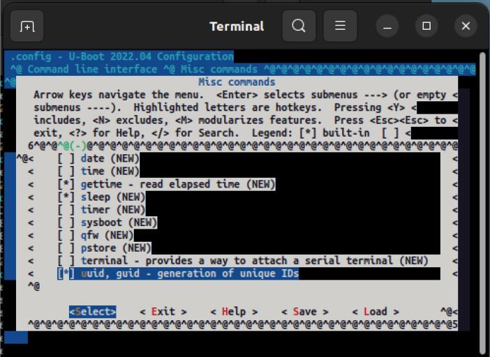
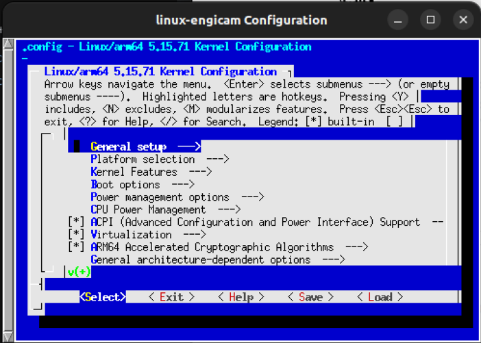
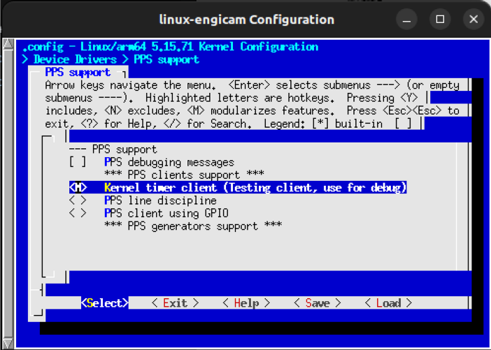
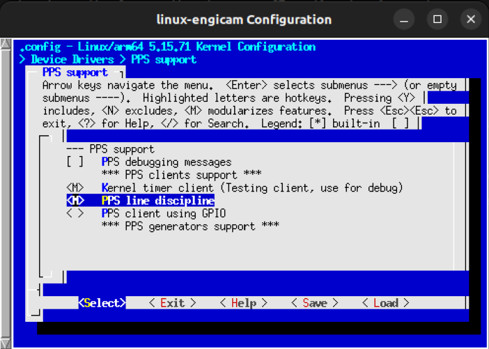
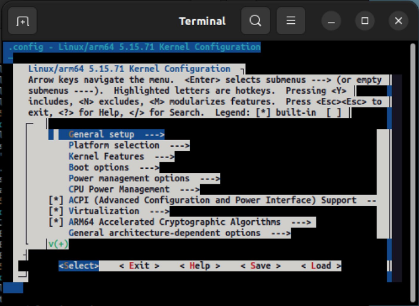

# Chương 8. Thêm hardware mới (Adding New Hardware)

Giờ chúng ta đã có một layer tùy biến mới, và đã thấy BitBake cùng các thành phần khác của Yocto hoạt động thế nào, trong chương này chúng ta sẽ xem cách một developer có thể định nghĩa một hardware mới bằng cách thêm một machine mới.

Sau đó, chúng ta sẽ trình bày cách developer có thể tùy biến bootloader và kernel cho hệ thống embedded của mình (và chúng ta cũng sẽ nói vài lời về cách tùy biến các prebootloader).

## 8.1 Thêm một machine (Adding a Machine)

Như đã nói ở nhiều phần của sách, thông thường một machine tùy biến được thiết kế bằng cách thay đổi một số phần trong sơ đồ mạch của một development kit đã hoạt động cho phù hợp với nhu cầu cụ thể. Kết quả là một machine mới rất giống development kit gốc (thường chỉ có ít khác biệt về hardware) và có các ngoại vi khác.

Trong hầu hết các trường hợp, những thay đổi đó nhỏ đến mức, ở bước đầu tiên, chúng ta có thể dùng trên hardware mới cả bootloader lẫn kernel chạy trên development kit! Ví dụ, chúng ta đã áp dụng giải pháp như vậy trong Mục 2.3, khi thay đổi biến `UBOOT_CONFIG` trong file `imx8mp-icore.conf` của layer `meta-engicam-nxp` từ `2gb` thành `4gb`.

Tuy nhiên, giải pháp này không phải là tốt nhất vì

1) Nó chỉ có thể được dùng cho một số ít thiết lập rất hạn chế.

2) Mọi sửa đổi liên quan đến hardware tùy biến của chúng ta nên được làm trong layer của mình, có thể bằng cách đổi tên machine hiện tại cho phù hợp với dự án (tức là bằng override).

Vì vậy hãy xem một số kỹ thuật best-practice có thể dùng để thêm vào Yocto Project mọi sửa đổi cần làm để hỗ trợ hardware của mình.

> Bạn đọc nên lưu ý rằng chúng ta sẽ không trình bày cách tạo một machine hoàn toàn mới từ đầu, mà chỉ trình bày cách sửa một machine đang chạy cho phù hợp với các sửa đổi hardware của mình! Để xem cách định nghĩa một machine mới, bạn đọc tò mò có thể xem `https://docs.yoctoproject.org/dev-manual/new-machine.html`.

### 8.1.1 Bằng cách include machine.conf gốc (By Including the Original machine.conf)

Bước đầu tiên là tạo một tên machine mới để dùng trong biến `MACHINE` thay cho tên machine của development kit. Trong ví dụ của chúng ta, ta có `MACHINE=”imx8mp-icore”` (xem Mục 2.2) được định nghĩa trong layer `meta-engicam-nxp` như dưới đây:

```
$ cat meta-engicam-nxp/conf/machine/imx8mp-icore.conf
#@TYPE: Machine
#@NAME: NXP i.MX 8M Plus i.core
#@SOC: i.MX8MP
#@DESCRIPTION: Machine configuration for Engicam imx8mp-icore SOM
#@MAINTAINER: <support@engicam.com>

require include/imx8mp-engicam.inc

KERNEL_DEVICETREE_BASENAME = "imx8mp-icore"
KERNEL_DEVICETREE:append:use-nxp-bsp = " \
        engicam/imx8mp-icore-starterkit.dtb \
        engicam/imx8mp-icore-ctouch2.dtb \
"

UBOOT_CONFIG_BASENAME = "imx8mp_icore"
UBOOT_CONFIG ??= "2gb"
UBOOT_CONFIG[1gb] = "${UBOOT_CONFIG_BASENAME}_1gb_defconfig,sdcard"
UBOOT_CONFIG[2gb] = "${UBOOT_CONFIG_BASENAME}_defconfig,sdcard"
UBOOT_CONFIG[4gb] = "${UBOOT_CONFIG_BASENAME}_4gb_defconfig,sdcard"

# Set DDR FIRMWARE
DDR_FIRMWARE_VERSION = "202006"
DDR_FIRMWARE_NAME = " \
        lpddr4_pmu_train_1d_dmem_${DDR_FIRMWARE_VERSION}.bin \
        lpddr4_pmu_train_1d_imem_${DDR_FIRMWARE_VERSION}.bin \
        lpddr4_pmu_train_2d_dmem_${DDR_FIRMWARE_VERSION}.bin \
        lpddr4_pmu_train_2d_imem_${DDR_FIRMWARE_VERSION}.bin \
"

IMXBOOT_TARGETS_BASENAME = "flash_evk"
IMX_DEFAULT_BSP = "nxp"

IMX_KERNEL_CONFIG_AARCH64 = "imx8_icore_defconfig"
```

Như chúng ta thấy, trong file này có những thiết lập quan trọng nhất cho SOM được gắn trên development kit, vì vậy chúng ta có thể tạo một file mới trong thư mục `conf/machine` thuộc layer của mình với nội dung tiếp theo:

```
$ cd sources/meta-cy/
$ cat conf/machine/imx8mp-icore-cy.conf
#@TYPE: Machine
#@NAME: CY machine based on NXP i.MX 8M Plus i.core
#@SOC: i.MX8MP
#@DESCRIPTION: Machine configuration for custom CY imx8mp-icore SOM
#@MAINTAINER: <giometti@enneenne.com>

require conf/machine/imx8mp-icore.conf

UBOOT_CONFIG = "4gb"

MACHINEOVERRIDES =. "imx8mp-icore:"
```

> Lưu ý rằng đây là một mẹo không sạch, vì việc include một file `.conf` không phải là thông lệ. Mọi file được include đều nên kết thúc bằng `.inc`.

Làm như vậy, chúng ta báo cho Yocto build system biết rằng machine `imx8mp-icore-cy` của chúng ta được dẫn xuất từ `imx8mp-icore` với một số thay đổi nhỏ; thiết lập quan trọng nhất ở đây là thiết lập áp dụng cho biến `MACHINEOVERRIDES`, được dùng để chỉ định rằng machine của chúng ta cần mọi machine override mà machine cha `imx8mp-icore` cần (xem Mục 5.3.2).

Bây giờ, để compile một Yocto image cho machine mới, chúng ta có thể đơn giản dùng lệnh dưới đây:

```
$ MACHINE=imx8mp-icore-cy bitbake engicam-evaluation-image-mx8
```

> Trước khi làm vậy, bạn đọc nên kiểm tra rằng sửa đổi đã làm ở các mục trước trong layer `meta-engicam-nxp` đã được bỏ. Để làm vậy, chúng ta chỉ cần dùng lệnh dưới đây:
>
> ```
> $ cd sources/meta-engicam-nxp
> $ git reset –hard
> ```
>
> Hơn nữa, chúng ta nên chú ý xóa mọi file non-tracked. Nếu mọi thứ đã được xóa, chúng ta sẽ thấy kết quả như dưới đây:
>
> ```
> $ git status
> On branch kirkstone
> Your branch is up to date with 'origin/kirkstone'.
>
> nothing to commit, working tree clean
> ```

Nếu xem các thông điệp mà lệnh `bitbake` trên hiển thị, chúng ta có thể kiểm chứng rằng giờ trong các thiết lập cấu hình build đã có machine mới của mình:

```
...
Build Configuration:
BB_VERSION           = "2.0.0"
BUILD_SYS            = "x86_64-linux"
NATIVELSBSTRING      = "universal"
TARGET_SYS           = "aarch64-poky-linux"
MACHINE              = "imx8mp-icore-cy"
...
```

Khi xong, chúng ta có thể thử image mới như thường lệ; tuy nhiên, giờ chúng ta phải lấy image từ thư mục con mới được tạo `tmp/deploy/images/imx8mp-icore-cy` trong build directory:

```
$ cd tmp/deploy/images/imx8mp-icore-cy
$ ls *.wic.zst
engicam-evaluation-image-mx8-imx8mp-icore-cy-20231128095310.rootfs.wic.
zst
engicam-evaluation-image-mx8-imx8mp-icore-cy.wic.zst
```

Vì vậy, để thử image mới, chúng ta phải ghi lại thẻ microSD đã dùng trước đó bằng lệnh dưới đây:

```
$ zstdcat engicam-evaluation-image-mx8-imx8mp-icore-cy.wic.zst | \
        sudo dd of=/dev/sdd bs=8M conv=fdatasync status=progress
```

> Một lần nữa, bạn đọc nên thay device `/dev/ssd` *(ghi chú: đúng là `/dev/sdd`, như lệnh ở trên)* được dùng ở trên bằng block device của mình.

Bây giờ trên serial console, chúng ta sẽ thấy output sau:

```
U-Boot 2022.04-master+g05dea559b9 (Oct 26 2023 - 13:17:23 +0000)

CPU:   i.MX8MP[8] rev1.1 1600 MHz (running at 1200 MHz)
CPU:   Industrial temperature grade (-40C to 105C) at 20C
Reset cause: POR
Model: Engicam i.MX8MPlus iCore
DRAM:  4 GiB
...
```

OK, hệ thống khởi động lại, và chúng ta có đúng dung lượng DRAM, còn ở cuối giai đoạn boot, chúng ta có thể kiểm chứng rằng tên machine đã thay đổi, đúng như mong đợi:

```
...
NXP i.MX Release Distro 5.15-kirkstone imx8mp-icore-cy ttymxc1

imx8mp-icore-cy login:
```

Bây giờ, trước khi chuyển sang mục tiếp theo, chúng ta có thể thay đổi file cấu hình `conf/local.conf` trong build directory như dưới đây. Việc này để tránh phải thêm thiết lập `MACHINE=imx8mp-icore-cy` vào trước mọi lệnh `bitbake` (và mọi lệnh Yocto khác) tiếp theo:

```
--- conf/local.conf
+++ conf/local.conf
@@ -1,4 +1,4 @@
-MACHINE ??= 'imx8mp-icore'
+MACHINE ??= 'imx8mp-icore-cy'
 DISTRO ?= 'fsl-imx-xwayland'
 PACKAGE_CLASSES ?= 'package_rpm'
 EXTRA_IMAGE_FEATURES ?= "debug-tweaks"
```

OK, giờ là lúc xem một cách khác để tạo một cấu hình machine mới bằng cách clone file `machine.conf` gốc thay vì include nó.

### 8.1.2 Bằng cách clone machine.conf gốc (By Cloning the Original machine.conf)

Nếu quyết định clone file `machine.conf` gốc, chúng ta có thể làm đơn giản bằng cách

```
$ cd sources/meta-cy/conf/machine/
$ cp ../../../meta-engicam-nxp/conf/machine/imx8mp-icore.conf \
        imx8mp-icore-cy.conf
```

sau đó sửa nó để đặt đúng memory layout và thêm `MACHINEOVERRIDES` vì cùng các lý do đã giải thích ở trên:

```
--- imx8mp-icore-cy.conf
+++ imx8mp-icore-cy.conf
@@ -1,8 +1,8 @@
 #@TYPE: Machine
-#@NAME: NXP i.MX 8M Plus i.core
+#@NAME: CY machine based on NXP i.MX 8M Plus i.core
 #@SOC: i.MX8MP
-#@DESCRIPTION: Machine configuration for Engicam imx8mp-icore SOM
-#@MAINTAINER: <support@engicam.com>
+#@DESCRIPTION: Machine configuration for custom CY imx8mp-icore SOM
+#@MAINTAINER: <giometti@enneenne.com>

 require include/imx8mp-engicam.inc

@@ -14,7 +14,7 @@
 "

 UBOOT_CONFIG_BASENAME = "imx8mp_icore"
-UBOOT_CONFIG ??= "2gb"
+UBOOT_CONFIG ??= "4gb"
 UBOOT_CONFIG[1gb] = "${UBOOT_CONFIG_BASENAME}_1gb_defconfig,sdcard"
 UBOOT_CONFIG[2gb] = "${UBOOT_CONFIG_BASENAME}_defconfig,sdcard"
 UBOOT_CONFIG[4gb] = "${UBOOT_CONFIG_BASENAME}_4gb_defconfig,sdcard"
@@ -32,4 +32,6 @@
 IMXBOOT_TARGETS_BASENAME = "flash_evk"
 IMX_DEFAULT_BSP = "nxp"

-IMX_KERNEL_CONFIG_AARCH64 = "imx8_icore_defconfig"
+IMX_KERNEL_CONFIG_AARCH64 = "imx8_icore_defconfig"
+
+MACHINEOVERRIDES =. "imx8mp-icore:"
```

Bây giờ chúng ta có thể giả định rằng mình đang ở cùng điều kiện như mục trước, nhưng không phải vậy. Thật vậy, nếu thử tạo Yocto image, chúng ta nhận được kết quả sau:

```
$ bitbake engicam-evaluation-image-mx8
ERROR: ParseError at /home/giometti/yocto/imx-yocto-bsp/sources/meta-cy
/conf/machine/imx8mp-icore-cy.conf:7: Could not include required file i
nclude/imx8mp-engicam.inc
```

Lý do là include file `imx8mp-engicam.inc` bị tham chiếu sai, như đã giải thích trong Mục 5.4.1. Thật vậy, BitBake tìm file đầu tiên mà nó có thể tìm thấy trong `BBPATH` hoặc thư mục hiện tại, và dùng từ khóa `require` như trên là sai vì không có thư mục con `include` nào trong layer của chúng ta! Vì vậy, điều tốt nhất cần làm là đặt nó có tính đến việc trong `BBPATH` có mọi thư mục meta layer và thư mục `include` nằm trong `meta-engicam-nxp/conf/machine`. Vì vậy chúng ta phải làm như dưới đây:

```
--- imx8mp-icore-cy.conf
+++ imx8mp-icore-cy.conf
@@ -4,7 +4,7 @@
 #@DESCRIPTION: Machine configuration for custom CY imx8mp-icore SOM
 #@MAINTAINER: <giometti@enneenne.com>

-require include/imx8mp-engicam.inc
+require conf/machine/include/imx8mp-engicam.inc

 KERNEL_DEVICETREE_BASENAME = "imx8mp-icore"
```

Bây giờ, nếu thử tạo Yocto image `engicam-evaluation-image-mx8`, mọi thứ sẽ hoạt động tốt như trước.

> Dù phương pháp clone thứ nhất ở mục trước là một mẹo khéo và chỉ cho phép chúng ta làm rất ít sửa đổi, phương pháp sau cùng này cho phép chúng ta kiểm soát đầy đủ hơn các thiết lập của machine, đặc biệt nếu file `imx8mp-icore.conf` gốc sẽ bị các developer của Engicam thay đổi trong các bản phát hành tương lai.

Tại thời điểm này, chúng ta đã có một machine mới trong Yocto build system, nhưng machine này vẫn dùng cùng bootloader và các thiết lập kernel của kit embedded Engicam, và thường thì điều này không phù hợp với nhu cầu của chúng ta! Thật vậy, hardware dẫn xuất có nhiều khác biệt so với development kit là chuyện khá thường gặp, vì vậy hãy xem cách giải quyết vấn đề này.

## 8.2 Tùy biến bootloader (Customizing the Bootloader)

Trước khi tiếp tục, chúng ta phải nói rõ rằng với từ bootloader, chúng ta thường muốn nói đến chương trình U-Boot chứ không phải mọi software package khác nhau cần thiết để thực sự boot; thật vậy, ngày nay khá thường gặp là để boot một hệ thống GNU/Linux, chúng ta cần một prebootloader (như ARM Trusted Firmware – thường được gọi là TF-A hoặc ATF), cùng các phần software đi kèm khác (như Open Portable Trusted Execution Environment hay OP-TEE), prebootloader này nạp bootloader (tức là U-Boot), rồi bootloader nạp kernel (rõ ràng là Linux).

Trong tình huống này, bạn đọc có thể tiếp tục hiểu rằng khi chúng ta nói tùy biến bootloader, ý chúng ta chỉ là chương trình U-Boot.

> Một số ghi chú về các chương trình software này và cách sửa chúng được trình bày trong Mục 8.3.

Như mọi developer giỏi đều biết, U-Boot hỗ trợ nhiều kiến trúc khác nhau, nhưng khi đã được compile, nó chỉ có thể chạy trên kiến trúc mà nó được compile cho (và quy tắc tương tự áp dụng cho kernel). Vì vậy, trong mục này (và cũng tương tự với mục về tùy biến kernel), chúng ta có thể làm một số việc đặc thù cho các CPU i.MX8. Tuy nhiên, chúng ta sẽ cố gắng hết sức để giữ phần giải thích tổng quát nhất có thể, và bạn đọc nên tính đến việc thực hiện các thay đổi nhỏ cho phù hợp với nhu cầu của mình.

### 8.2.1 Hiểu các biến cấu hình U-Boot (Understanding the U-Boot Configuration Variables)

Trước khi bắt đầu thay đổi code và recipe của U-Boot, chúng ta nên giới thiệu một số biến từ class uboot-config, class được dùng để đơn giản hóa việc cấu hình U-Boot cho một machine. Class được định nghĩa trong `poky/meta/classes/uboot-config.bbclass`, và bằng cách xem phần đầu của file này, chúng ta có thể tìm thấy cách chỉ định cấu hình machine:

```
$ cat sources/poky/meta/classes/uboot-config.bbclass:
# Handle U-Boot config for a machine
#
# The format to specify it, in the machine, is:
#
# UBOOT_CONFIG ??= <default>
# UBOOT_CONFIG[foo] = "config,images,binary"
#
# or
#
# UBOOT_MACHINE = "config"
#
...
```

Mỗi flag variable định nghĩa các giá trị được dùng cho

- `UBOOT_MACHINE`: File cấu hình mặc định (file `_defconfig` trong thế giới U-Boot) được truyền cho command line của `make` khi build source U-Boot.

- `IMAGE_FSTYPES`: Như đã chỉ rõ trong Mục 6.5.2, biến này chỉ định các định dạng mà Yocto build system dùng trong khi build khi tạo root filesystem.

- `UBOOT_BINARY`: Chỉ định tên của binary image U-Boot.

Một ví dụ thực tế từ layer `meta-freescale` được trình bày dưới đây:

```
UBOOT_CONFIG ??= "sdcard"
UBOOT_CONFIG[nor] = "P4080DS_config,,u-boot-with-dtb.bin"
UBOOT_CONFIG[sdcard] = "P4080DS_SDCARD_config,,u-boot.pbl"
UBOOT_CONFIG[spi] = "P4080DS_SPIFLASH_config,,u-boot.pbl"
```

Trong ví dụ này, mỗi cấu hình chỉ định một file `_defconfig` được dùng làm `UBOOT_MACHINE` và một tên riêng cho `UBOOT_BINARY`, còn không cấu hình nào định nghĩa tham số thứ hai cho `IMAGE_FSTYPES` để dùng cho image U-Boot. Biến `UBOOT_CONFIG` chỉ định theo mặc định một trong ba cấu hình khả dĩ (tức là `sdcard`).

Lưu ý rằng với các thiết lập đơn giản, chúng ta có thể chỉ cần đặt biến `UBOOT_MACHINE`.

### 8.2.2 Tùy biến U-Boot bằng tay (Customizing U-Boot by Hand)

Phương pháp thứ nhất để tùy biến U-Boot là làm mọi bước bằng tay và định nghĩa một repository riêng (dẫn xuất từ repository của development kit gốc), nơi chúng ta có thể đặt mọi thay đổi của mình.

Giải pháp này có ưu điểm là nó hoạt động trong mọi điều kiện và cho phép developer kiểm soát hoàn toàn source và recipe của bootloader.

> Thành thật mà nói, giải pháp thứ hai được trình bày trong mục tiếp theo cũng có thể được dùng để định nghĩa một repository riêng, nhưng (như bạn đọc có thể thấy khi đọc sách này) việc có khả năng dùng một kỹ thuật thủ công có thể giải quyết một số tình huống mà các công cụ tự động không hoạt động.

Để bắt đầu tùy biến, chúng ta cần tìm ra recipe nào mà Yocto Project đang dùng để tạo image bootloader; chúng ta có thể dễ dàng làm việc đó bằng cách kiểm tra ai đang cung cấp package `virtual/bootloader` qua việc truy vấn biến `PREFERRED_PROVIDER_virtual/bootloader`, như dưới đây:

```
$ cy-vars PREFERRED_PROVIDER_virtual/bootloader
PREFERRED_PROVIDER_virtual/bootloader="u-boot-engicam"
```

Sau đó, để tìm recipe `u-boot-engicam` nằm ở đâu, chúng ta có thể làm như sau:

```
$ bitbake-layers show-recipes u-boot-engicam
...
=== Matching recipes: ===
u-boot-engicam:
  meta-engicam-nxp     2022.04
```

Vì vậy, recipe chúng ta phải xét là recipe có tên `u-boot-engicam`, nằm trong thư mục `meta-engicam`, cụ thể là file `u-boot-engicam_2022.04.bb`.

Phần quan trọng cần xét trong recipe này là giá trị của các biến `SRC_URI` và `SRCREV`, được định nghĩa như dưới đây:

```
$ cd meta-engicam-nxp
$ cat recipes-bsp/u-boot-engicam/u-boot-engicam_2022.04.bb
# Copyright (C) 2013-2016 Freescale Semiconductor
# Copyright 2018 (C) O.S. Systems Software LTDA.
# Copyright 2017-2022 NXP

require recipes-bsp/u-boot/u-boot.inc

DESCRIPTION = "i.MX U-Boot supporting i.MX reference boards."
...
SRC_URI = "${UBOOT_SRC};branch=${SRCBRANCH}"
UBOOT_SRC = "git://github.com/engicam-stable/u-boot-engicam-nxp-2022.04
.git;protocol=https"
SRCBRANCH = "master"
SRCREV = "05dea559b91f3f41c47c23e895196299d4bac75f"
#SRCREV = "${AUTOREV}"
...
```

Ở đây, việc tìm ra repository chứa source code và commit cần dùng là đơn giản; tuy nhiên, để chắc chắn, chúng ta có thể yêu cầu BitBake tìm các giá trị này cho chúng ta:

```
$ cy-vars 'SRC_URI\|SRCREV' u-boot-engicam
SRCREV="05dea559b91f3f41c47c23e895196299d4bac75f"
SRC_URI="git://github.com/engicam-stable/u-boot-engicam-nxp-2022.04.git
;protocol=https;branch=master"
```

Vì vậy, để tạo repository tùy biến nơi thực hiện mọi thay đổi, chúng ta có thể chuyển vào thư mục cha `yocto` và thực thi lệnh sau:

```
$ git clone https://github.com/engicam-stable/u-boot-engicam-nxp-2022.0
4.git
```

Sau đó chúng ta có thể vào thư mục `u-boot-engicam-nxp-2022.04` để tạo branch tùy biến `master-cy` bắt đầu từ commit ID `05dea559b91f3f41c47c23e895196299d4bac75f`:

```
$ cd u-boot-engicam-nxp-2022.04/
$ git checkout -b master-cy 05dea559b91f3f41c47c23e895196299d4bac75f Switched
to a new branch 'master-cy'
$ git log --oneline -1
05dea559b9 (HEAD -> master-cy, origin/master, origin/HEAD, master) imx8m
p icore 2e: fixed i2c6 pin uboot
```

OK, giờ đã có một repository tùy biến, chúng ta phải tạo một recipe tùy biến cho bootloader; tuy nhiên, cách tốt nhất để làm việc đó là dùng một file `u-boot-` `engicam_2022.04.bbappend`, có thể được tạo trong layer tùy biến của chúng ta ở thư mục `recipes-bsp/u-boot-engicam`, như dưới đây:

```
$ cd ../imx-yocto-bsp/sources/meta-cy/recipes-bsp/u-boot-engicam
$ cat u-boot-engicam_2022.04.bbappend
DESCRIPTION = "i.MX U-Boot supporting CY (i.MX8) reference boards."

UBOOT_SRC = "git:///home/giometti/yocto/u-boot-engicam-nxp-2022.04/"
SRCBRANCH = "master-cy"
SRCREV = "${AUTOREV}"
```

Trong file `.bbappend` ở trên, biến `UBOOT_SRC` đã được thay đổi để chỉ tới repository mới được tạo (và bạn đọc nên thay đổi nó tùy theo thiết lập của mình), và biến `SRCBRANCH` giờ cũng trỏ tới branch mới. Về `SRCREV`, chúng ta đặt nó thành `${AUTOREV}` để source code U-Boot được compile lại mỗi lần chúng ta thực hiện một commit mới trong repository mới.

> Tất nhiên, đây không phải là các thiết lập cuối cùng (chúng ta nên dùng một remote Git repository và một commit ID well-fixed cho `SRCREV`); tuy nhiên, lúc này chúng ta có thể để nguyên chúng để hiểu rõ một quy trình tùy biến hoạt động thế nào (trong Mục 13.2, chúng ta sẽ xem cách cố định một bản phát hành cụ thể).
>
> Hơn nữa, lưu ý rằng khi `SRCREV` được đặt thành `${AUTOREV}`, lệnh `devtool modify` được trình bày dưới đây có thể thất bại!

Bây giờ, để kiểm tra mọi thứ có còn hoạt động tốt không, chúng ta có thể thử compile lại U-Boot với recipe mới (qua `.bbappend`). Trước tiên, chúng ta xóa trạng thái hiện tại:

```
$ bitbake -c cleansstate u-boot-engicam
```

Sau đó chúng ta có thể yêu cầu BitBake compile lại code:

```
$ bitbake u-boot-engicam
...
NOTE: Executing Tasks
Setscene tasks: 196 of 196
Currently  1 running tasks (821 of 833)  98% |######################## |
0: u-boot-engicam-2022.04-r0 do_compile - 7s (pid 3778889)
```

OK, việc compile vẫn hoạt động, nhưng giờ chúng ta phải thực sự tùy biến bootloader bằng cách tạo machine tùy biến của mình trong source U-Boot. Để làm vậy, chúng ta phải tạo một file cấu hình tùy biến (tức là một file `_defconfig`) và một device tree tùy biến (tức là một file `.dtb`).

Để đạt mục tiêu này, hãy xem lại các thiết lập U-Boot trong file cấu hình machine của chúng ta; ta có như sau:

```
$ cat meta-cy/conf/machine/imx8mp-icore-cy.conf
...
UBOOT_CONFIG_BASENAME = "imx8mp_icore"
UBOOT_CONFIG ??= "4gb"
UBOOT_CONFIG[1gb] = "${UBOOT_CONFIG_BASENAME}_1gb_defconfig,sdcard"
UBOOT_CONFIG[2gb] = "${UBOOT_CONFIG_BASENAME}_defconfig,sdcard"
UBOOT_CONFIG[4gb] = "${UBOOT_CONFIG_BASENAME}_4gb_defconfig,sdcard"
...
```

Ở đây, chúng ta thấy `UBOOT_CONFIG` được đặt thành 4gb, khi đó `UBOOT_MACHINE` sẽ được đặt thành `imx8mp_icore_4gb_defconfig`, là file cấu hình của development kit, trong khi chúng ta muốn có file cấu hình của riêng mình. Ở bước đầu tiên, file này, mà chúng ta sẽ đặt tên là `imx8mp_icore_cy_4gb_defconfig`, có thể là một bản sao của `imx8mp_icore_4gb_defconfig` (với ít sửa đổi), vì vậy chúng ta phải kiểm tra trong repository U-Boot mới xem file đó nằm ở đâu:

```
$ cd $BUILDDIR/../../u-boot-engicam-nxp-2022.04/
$ find . -name imx8mp_icore_4gb_defconfig
./configs/imx8mp_icore_4gb_defconfig
```

Sau đó, trong file đó, chúng ta có thể tìm ra file device tree mặc định nào được dùng để cấu hình image U-Boot. Điều này được định nghĩa bởi mục cấu hình `CONFIG_DEFAULT_DEVICE_TREE`, được đặt như dưới đây:

```
$ grep CONFIG_DEFAULT_DEVICE_TREE configs/imx8mp_icore_4gb_defconfig
CONFIG_DEFAULT_DEVICE_TREE="imx8mp-icore"
```

Vì vậy file device tree mặc định cho machine Engicam là `imx8mp-icore.dtb`, và chúng ta có thể tìm file dts tương ứng như dưới đây:

```
$ find . -name imx8mp-icore.dts
./arch/arm/dts/imx8mp-icore.dts
```

Tốt, giờ đã rõ chúng ta phải làm gì để thêm machine tùy biến của mình; trước tiên, chúng ta phải tạo một file `_defconfig` riêng bằng cách đơn giản chép file của Engicam rồi thay đổi nó như dưới đây:

```
$ cp configs/imx8mp_icore_4gb_defconfig \
        configs/imx8mp_icore_cy_4gb_defconfig
```

Sau khi chép, các sửa đổi như dưới đây:

```
--- configs/imx8mp_icore_cy_4gb_defconfig
+++ configs/imx8mp_icore_cy_4gb_defconfig
@@ -22,7 +22,7 @@
 CONFIG_SPL_DRIVERS_MISC=y
 CONFIG_SPL=y
 CONFIG_SPL_IMX_ROMAPI_LOADADDR=0x48000000
-CONFIG_DEFAULT_DEVICE_TREE="imx8mp-icore"
+CONFIG_DEFAULT_DEVICE_TREE="imx8mp-icore-cy"
 CONFIG_DISTRO_DEFAULTS=y
 CONFIG_SYS_LOAD_ADDR=0x40400000
 CONFIG_BOOTCOMMAND="run distro_bootcmd;run bsp_bootcmd"
```

Sau đó chúng ta phải tạo một file device tree phù hợp bằng cách làm tương tự như trên:

```
$ cp arch/arm/dts/imx8mp-icore.dts \
         arch/arm/dts/imx8mp-icore-cy.dts
$ cp arch/arm/dts/imx8mp-icore-u-boot.dtsi \
         arch/arm/dts/imx8mp-icore-cy-u-boot.dtsi
```

Và các sửa đổi cần thiết là

```
--- ./arch/arm/dts/imx8mp-icore-cy.dts
+++ ./arch/arm/dts/imx8mp-icore-cy.dts
@@ -9,7 +9,7 @@
 #include "imx8mp.dtsi"

 / {
-        model = "Engicam i.MX8MPlus iCore";
+        model = "CY board i.MX8MPlus iCore";
         compatible = "fsl,imx8mp-evk", "fsl,imx8mp";

         chosen {
```

> Lưu ý rằng chúng ta cũng phải chép file `arch/arm/dts/imx8mp-icore-u-boot.dtsi` để có một file device SPL hợp lệ.

Trong ví dụ này, chúng ta chỉ đơn giản đổi tên model, nhưng tất nhiên, trong trường hợp hardware của chúng ta cần điều chỉnh thêm, chúng ta phải làm việc thêm một chút trong source U-Boot. Tuy nhiên, đây là các bước tối thiểu phải làm để định nghĩa board tùy biến dựa trên board của hãng hardware.

Bây giờ, để kích hoạt các thay đổi này, chúng ta phải commit chúng bằng lệnh sau:

```
$ git add configs/imx8mp_icore_cy_4gb_defconfig \
          arch/arm/dts/imx8mp-icore-cy.dts \
          arch/arm/dts/imx8mp-icore-cy-u-boot.dtsi
$ git commit -s -m "arm dts: add new board imx8mp-icore-cy"
[master-cy e82751c363] arm dts: add new board imx8mp-icore-cy
 Date: Tue Nov 28 17:09:26 2023 +0100
 3 files changed, 920 insertions(+)
 create mode 100644 arch/arm/dts/imx8mp-icore-cy-u-boot.dtsi
 create mode 100644 arch/arm/dts/imx8mp-icore-cy.dts
 create mode 100644 configs/imx8mp_icore_cy_4gb_defconfig
```

Các sửa đổi cho source U-Boot đã sẵn sàng, nhưng giờ chúng ta phải thay đổi cấu hình của machine `imx8mp-icore-cy` như sau để chỉ dẫn cho Yocto build system cách cấu hình việc compile U-Boot cho machine tùy biến:

```
--- a/conf/machine/imx8mp-icore-cy.conf
+++ b/conf/machine/imx8mp-icore-cy.conf
@@ -13,7 +13,8 @@ KERNEL_DEVICETREE:append:use-nxp-bsp = " \
        engicam/imx8mp-icore-ctouch2.dtb \
 "

-UBOOT_CONFIG_BASENAME = "imx8mp_icore"
+UBOOT_CONFIG_BASENAME = "imx8mp_icore_cy"
+UBOOT_DTB_NAME = "imx8mp-icore-cy.dtb"
 UBOOT_CONFIG ??= "4gb"
 UBOOT_CONFIG[1gb] = "${UBOOT_CONFIG_BASENAME}_1gb_defconfig,sdcard"
 UBOOT_CONFIG[2gb] = "${UBOOT_CONFIG_BASENAME}_defconfig,sdcard"
```

Bằng cách này, chúng ta báo cho build system biết rằng giờ nó phải dùng một cấu hình khác cho package U-Boot.

> Lưu ý rằng chúng ta cũng phải đặt `UBOOT_DTB_NAME` thành `imx8mp-icore-cy.dtb` vì trong layer Engicam nó đã được định nghĩa như dưới đây:
>
> ```
> $ rgrep UBOOT_DTB_NAME \
>     sources/meta-engicam-nxp/conf/machine/include/imx8mp-engicam.i
> nc
> UBOOT_DTB_NAME = "${KERNEL_DEVICETREE_BASENAME}.dtb"
> ```
>
> Đây là một lỗi về khái niệm của các developer Engicam, vì mọi thứ liên quan đến recipe U-Boot không nên phụ thuộc vào các recipe khác và đặc biệt là không phụ thuộc vào recipe kernel!
>
> Tuy nhiên, điều này hoàn toàn không phải là vấn đề, vì khi tùy biến kernel ở mục tiếp theo, chúng ta có thể dễ dàng sửa nó bằng cách thay đổi biến `KERNEL_DEVICETREE_BASENAME` tương ứng.
>
> Biến `UBOOT_DTB_NAME` là riêng cho các meta layer của họ Freescale iMX.

Sau đó, để kiểm chứng các thay đổi, chúng ta nên xóa trạng thái hiện tại của recipe U-Boot rồi compile lại một Yocto image mới bằng cách thực thi lần lượt hai lệnh tiếp theo:

```
$ bitbake -c cleansstate u-boot-engicam && \
  bitbake engicam-evaluation-image-mx8
```

Trong quá trình compile, chúng ta sẽ thấy source U-Boot được compile lại, và cuối cùng, chúng ta phải ghi lại thẻ microSD như thường lệ. Sau đó trên serial console, chúng ta sẽ thấy kết quả như dưới đây:

```
U-Boot SPL 2022.04-master-cy+ge82751c363 (Nov 29 2023 - 15:15:45 +0000)
DDRINFO: start DRAM init
DDRINFO: DRAM rate 4000MTS
DDRINFO:ddrphy calibration done
DDRINFO: ddrmix config done
SEC0:  RNG instantiated
Normal Boot
Trying to boot from BOOTROM
Boot Stage: Primary boot
image offset 0x8000, pagesize 0x200, ivt offset 0x0
NOTICE:  BL31: v2.6(release):automotive-13.0.0_1.1.0-0-g3c1583ba0
NOTICE:  BL31: Built : 11:00:38, Nov 21 2022

U-Boot 2022.04-master-cy+ge82751c363 (Nov 29 2023 - 15:15:45 +0000)

CPU:   i.MX8MP[8] rev1.1 1600 MHz (running at 1200 MHz)
CPU:   Industrial temperature grade (-40C to 105C) at 20C
Reset cause: POR
Model: CY board i.MX8MPlus iCore
DRAM:  4 GiB
Core:  56 devices, 21 uclasses, devicetree: separate
MMC:   FSL_SDHC: 1, FSL_SDHC: 2
...
```

Đúng vậy, U-Boot giờ đang dùng code mới, và chúng ta chắc chắn về điều đó vì có thể thấy branch hiện tại và HEAD trong chuỗi `2022.04-master-cy+ge82751c363` cùng tên model tùy biến của mình trong `Model:` `CY board i.MX8MPlus iCore`.

Từ thời điểm này, mỗi lần chúng ta thực hiện một commit mới, Yocto build system sẽ build lại U-Boot với các thay đổi của chúng ta. Tuy nhiên, điều này có nghĩa là chúng ta phải commit các thay đổi ngay cả khi chúng chưa ở dạng cuối cùng, nếu không sẽ không có gì thay đổi. Tất nhiên điều đó có thể chấp nhận được, nhưng chúng ta có thể tránh làm vậy bằng một mẹo đơn giản.

Ở bước đầu tiên, chúng ta phải chắc chắn source đã có sẵn bằng cách thực hiện một bản build mới:

```
$ bitbake -c build u-boot-engicam
```

> Lưu ý rằng trong trường hợp này, chúng ta cũng có thể dùng target `virtual/bootloader` như dưới đây:
>
> ```
> $ bitbake -c build virtual/bootloader
> ...
> NOTE: Executing Tasks
> Setscene tasks: 196 of 196
> Currently  2 running tasks (819 of 833)  98% |################### |
> 0: u-boot-engicam-2022.04-r0 do_populate_lic - 0s (pid 2004837)
> 1: u-boot-engicam-2022.04-r0 do_deploy_source_date_epoch - 0s (pid
>  2004836)
> ```
>
> Như chúng ta thấy ở trên, `bitbake` chọn đúng recipe.

Bây giờ chúng ta có thể chuyển vào thư mục source do biến `S` trỏ tới (xem Mục 6.3.2), biến mà chúng ta có thể đọc như thường lệ:

```
$ cy-vars dirs u-boot-engicam
...
S="/home/giometti/yocto/imx-yocto-bsp/imx8mp-build/tmp/work/imx8mp_icor
e_cy-poky-linux/u-boot-engicam/2022.04-r0/git"
...
```

Vậy hãy chuyển vào thư mục đó và thử thay đổi gì đó, ví dụ, chúng ta có thể sửa lệnh `version` để hiển thị một thông điệp tùy biến như dưới đây:

```
--- a/cmd/version.c
+++ b/cmd/version.c
@@ -14,7 +14,7 @@
 #include <asm/cb_sysinfo.h>
 #endif
-#define U_BOOT_VERSION_STRING U_BOOT_VERSION " (" U_BOOT_DATE " - " \
+#define U_BOOT_VERSION_STRING "CY-" U_BOOT_VERSION " (" U_BOOT_DATE "
- " \
        U_BOOT_TIME " " U_BOOT_TZ ")" CONFIG_IDENT_STRING

 const char version_string[] = U_BOOT_VERSION_STRING;
```

Bây giờ chúng ta có thể kiểm tra mọi thứ có OK không bằng cách thử compile lại code:

```
$ bitbake -C compile -c compile u-boot-engicam
...
NOTE: Tainting hash to force rebuild of task /home/giometti/yocto/imx-y
octo-bsp/sources/meta-engicam-nxp/recipes-bsp/u-boot-engicam/u-boot-eng
icam_2022.04.bb, do_compile
WARNING: /home/giometti/yocto/imx-yocto-bsp/sources/meta-engicam-nxp/re
cipes-bsp/u-boot-engicam/u-boot-engicam_2022.04.bb:do_compile is tainte
d from a forced run
...
0: u-boot-engicam-2022.04-r0 do_compile - 7s (pid 1967968)
...
```

Option argument `-C` là cần thiết để buộc compile mới vì chúng ta đã thay đổi source bằng tay, và chúng ta nên dùng nó mỗi lần thay đổi rồi compile lại code.

> Do dùng option argument `-C`, giờ mỗi lần thực thi `bitbake`, việc thấy thông điệp `do_<task> is tainted` `from a forced run` là bình thường.

Khi code đã ở dạng phù hợp để thử trên machine, chúng ta có thể deploy nó bằng lệnh dưới đây:

```
$ bitbake -C deploy u-boot-engicam
...
NOTE: Tainting hash to force rebuild of task /home/giometti/yocto/imx-y
octo-bsp/sources/meta-engicam-nxp/recipes-bsp/u-boot-engicam/u-boot-eng
icam_2022.04.bb, do_deploy
WARNING: /home/giometti/yocto/imx-yocto-bsp/sources/meta-engicam-nxp/re
cipes-bsp/u-boot-engicam/u-boot-engicam_2022.04.bb:do_compile is tainte
d from a forced run
WARNING: /home/giometti/yocto/imx-yocto-bsp/sources/meta-engicam-nxp/re
cipes-bsp/u-boot-engicam/u-boot-engicam_2022.04.bb:do_deploy is tainted
 from a forced run
...
```

> Lần này, chúng ta không dùng option argument `-c` vì muốn thực thi task mặc định.

Bây giờ chúng ta có thể thử code U-Boot mới bằng cách tạo lại một microSD image mới như thường lệ với `bitbake engicam-evaluation-image-mx8`. Nếu mọi thứ đã được làm đúng, khi thực thi lệnh `version` tại U-Boot prompt, chúng ta sẽ thấy kết quả như dưới đây:

```
u-boot=> version
CY-U-Boot 2022.04-master-cy+g272669822a (Nov 30 2023 - 08:36:04 +0000)

aarch64-poky-linux-gcc (GCC) 11.3.0
GNU ld (GNU Binutils) 2.38.20220708
```

Tuyệt! Giờ chúng ta có thể đưa mọi thay đổi vào repository của mình, chắc chắn rằng những gì đã làm là đúng.

Bây giờ, trước khi xem cách thứ hai để thay đổi U-Boot, chúng ta nên nói vài lời về cách thay đổi cấu hình U-Boot.

Mọi U-Boot developer đều biết có hai cách chính để làm việc đó:

1) Bằng cách thay đổi file `configs/<machine>.h`, cách này thuộc về ví dụ ở trên

2) Bằng cách thay đổi file `.config` và theo đó là file `_defconfig`, đây chính xác là điều chúng ta sẽ giải thích ngay bây giờ

Giả sử chúng ta muốn thêm lệnh `uuid` vào U-Boot, khi đó có hai khả năng: chúng ta biết phải làm gì trong file cấu hình mặc định của machine (tức là file `imx8mp_icore_cy_defconfig`), hoặc có thể yêu cầu build system làm việc đó cho chúng ta. Trong trường hợp thứ nhất, chúng ta có thể trực tiếp thực hiện các thay đổi, còn trong trường hợp thứ hai, chúng ta có thể làm như sau.

Trước tiên, chúng ta cần thực thi devshell:

```
$ bitbake -c devshell u-boot-engicam
```

Và làm như vậy, chúng ta chuyển vào thư mục nơi build system giữ source:

```
$ pwd
/home/giometti/yocto/imx-yocto-bsp/imx8mp-build/tmp/work/imx8mp_icore_c
y-poky-linux/u-boot-engicam/2022.04-r0/git
```

OK, đây là cùng thư mục chúng ta đã tìm ra ở trên, nhưng đáng tiếc đây không phải là nơi đúng để gọi lệnh `make menuconfig` (tức là lệnh phải dùng để mở configuration menu của U-Boot), vì vậy chúng ta phải chuyển tới nơi chứa file `.config`. Để tìm nó, chúng ta có thể làm như dưới đây:

```
$ find .. -name .config
../build/imx8mp_icore_cy_4gb_defconfig/.config
```

Như chúng ta thấy, build system đã tạo một thư mục được đặt tên theo file cấu hình mặc định, nơi cấu hình đó đã được áp dụng, vì vậy hãy chuyển vào thư mục đó:

```
$ cd ../build/imx8mp_icore_cy_4gb_defconfig/
```

Bây giờ, trước khi tiếp tục, chúng ta nên kiểm tra xem file cấu hình mặc định hiện tại đã được rút gọn về dạng tối thiểu hay chưa. Để làm vậy, chúng ta có thể tạo một bản sao phù hợp của file cấu hình mặc định rồi so nó với file hiện tại; điều này có nghĩa là chúng ta nên tạo cấu hình mặc định tối thiểu bằng lệnh `make savedefconfig` như dưới đây:

```
$ make savedefconfig
...
  HOSTCC  scripts/kconfig/conf.o
  HOSTLD  scripts/kconfig/conf
scripts/kconfig/conf  --savedefconfig=defconfig Kconfig
```

Cấu hình mặc định tối thiểu có tên là `defconfig`, và chúng ta có thể so nó với file trong thư mục `configs` như dưới đây:

```
$ diff -q ../../git/configs/imx8mp_icore_4gb_defconfig defconfig
Files ../../git/configs/imx8mp_icore_4gb_defconfig and defconfig differ
```

Điều này chưa tối ưu, vì mọi file `_defconfig` đều nên ở trạng thái tối thiểu (tức là được tạo bằng lệnh `make savedefconfig`); tuy nhiên, chúng ta có thể đơn giản thay nó bằng file `defconfig` mới được tạo, hoặc cố chỉ lấy những khác biệt cần áp dụng lên phiên bản hiện tại của file `imx8mp_icore_4gb_defconfig`. Trong trường hợp thứ nhất, chúng ta chỉ cần thực hiện một commit phù hợp trong repository U-Boot tùy biến, còn trong trường hợp thứ hai, chúng ta có thể dùng mẹo sau: hãy lưu phiên bản hiện tại của file `defconfig` như dưới đây:

```
$ cp defconfig defconfig.orig
```

Sau đó chúng ta có thể tiến hành như bình thường bằng cách chạy lệnh `make menuconfig` để thay đổi cấu hình U-Boot:

```
$ make menuconfig
```

> Trong trường hợp nhận được error message sau khi thực thi lệnh trên:
>
> ```
> *
> * Unable to find the ncurses package.
> * Install ncurses (ncurses-devel or libncurses-dev
> * depending on your distribution).
> *
> make[3]: *** [/home/giometti/yocto/imx-yocto-bsp/imx8mp-build/tmp/
> work/imx8mp_icore_cy-poky-linux/u-boot-engicam/2022.04-r0/git/scri
> pts/kconfig/
> Makefile:224: scripts/kconfig/.mconf-cfg] Error 1
> make[2]: *** [/home/giometti/yocto/imx-yocto-bsp/imx8mp-build/tmp/
> work/imx8mp_icore_cy-poky-linux/u-boot-engicam/2022.04-
> r0/git/Makefile:574: menuconfig] Error 2
> make[1]: *** [Makefile:177: sub-make] Error 2
> make: *** [Makefile:15: __sub-make] Error 2
> ```
>
> chúng ta có thể giải quyết bằng cách thoát devshell rồi thực thi lệnh tiếp theo:
>
> ```
> $ sudo apt install libncurses-dev
> ```
>
> Tại thời điểm này, chúng ta có thể khởi động lại devshell như trên, và mọi thứ sẽ hoạt động đúng.

Nếu mọi thứ hoạt động tốt, chúng ta sẽ thấy configuration menu quen thuộc của U-Boot. Để bật lệnh `uuid`, chúng ta phải đi qua các mục menu `Command line interface`, rồi `Misc commands`, rồi đánh dấu mục `uuid, guid - generation of unique IDs` như trong Hình 8-1.



Hình 8-1. Configuration menu của U-Boot

> Đường viền cửa sổ xấu xí là do một số thiết lập terminal không hợp lệ, vì vậy bạn đọc có thể yên tâm bỏ qua chúng và dùng tiện ích menu cấu hình như thường lệ.

Sau đó chúng ta có thể lưu và thoát. Trong trường hợp file `_defconfig` gốc chưa ở dạng tối thiểu (như trường hợp của chúng ta), chúng ta có thể lấy các khác biệt do thay đổi cấu hình của mình bằng cách tạo lại file `defconfig` rồi dùng lệnh `diff` như dưới đây:

```
$ make savedefconfig
  GEN     Makefile
scripts/kconfig/conf  --savedefconfig=defconfig Kconfig
$ diff -u defconfig.orig defconfig
--- defconfig.orig      2024-02-07 12:24:56.564022695 +0000
+++ defconfig   2024-02-07 12:25:46.909785434 +0000
@@ -63,6 +63,7 @@
 CONFIG_CMD_TIME=y
 CONFIG_CMD_GETTIME=y
 CONFIG_CMD_TIMER=y
+CONFIG_CMD_UUID=y
 CONFIG_CMD_REGULATOR=y
 CONFIG_CMD_EXT4_WRITE=y
 CONFIG_OF_CONTROL=y
```

Vì vậy, trong trường hợp này, chúng ta chỉ cần thêm dòng `CONFIG_CMD_UUID=y` vào file cấu hình mặc định. Tuy nhiên, trước khi làm vậy, chúng ta nên kiểm tra mọi thứ có OK không bằng cách compile lại U-Boot rồi chạy nó trên devkit. Vậy hãy thoát devshell, rồi thực thi các lệnh compile và deploy quen thuộc như dưới đây:

```
$ bitbake -C compile -c compile u-boot-engicam
$ bitbake -C deploy u-boot-engicam
```

Nếu không gặp lỗi nào, chúng ta có thể build lại image binary:

```
$ bitbake engicam-evaluation-image-mx8
```

Cuối cùng, tạo lại một microSD mới. Khi chạy phiên bản U-Boot mới, giờ chúng ta sẽ có lệnh `uuid` như dưới đây:

```
u-boot=> uuid
62686d1d-127a-4fbc-9461-af3212443c0f
```

Bây giờ, để cố định các thay đổi, chúng ta có thể thực hiện một commit mới trong repository U-Boot tùy biến như dưới đây:

```
--- a/configs/imx8mp_icore_4gb_defconfig
+++ b/configs/imx8mp_icore_4gb_defconfig
@@ -153,4 +153,4 @@ CONFIG_OPTEE=y
 CONFIG_CMD_OPTEE_RPMB=y
 CONFIG_TEE=y
 CONFIG_FIT_SIGNATURE=y
-
+CONFIG_CMD_UUID=y
```

Sau đó chúng ta chỉ cần commit các thay đổi:

```
$ git add configs/imx8mp_icore_4gb_defconfig
$ git commit -s -m "configs imx8mp_icore_4gb_defconfig: add uuid comman
d support"
[master-cy e0bb517601] configs imx8mp_icore_4gb_defconfig: add uuid com
mand support
 1 file changed, 1 insertion(+), 1 deletion(-)
```

Sau đó chúng ta có thể thử commit mới như thường lệ bằng cách tạo lại một Yocto image mới. Nếu làm vậy, như dưới đây, chúng ta cũng sẽ thấy source U-Boot được fetch lại do commit cuối cùng ở trên:

```
$ bitbake engicam-evaluation-image-mx8
...
NOTE: Executing Tasks
Setscene tasks: 3839 of 3839
Currently  1 running tasks (2871 of 8909)  32% |#########              |
0: u-boot-engicam-2022.04-r0 do_fetch - 0s (pid 2706323) |<=>          |
...
```

Khi xong, bạn đọc có thể thử code trên hệ thống của mình và kiểm chứng mọi thứ hoạt động như mong muốn.

### 8.2.3 Tùy biến U-Boot bằng devtool (Customizing U-Boot with devtool)

Những gì chúng ta thấy ở mục trước là một best practice để quản lý source U-Boot nhằm tạo code tùy biến cho board của mình; tuy nhiên, còn một cách khác để làm việc này, đó là dùng `devtool` và qua đó tự động hóa (gần như) mọi bước đã trình bày ở mục trước.

Để trình bày giải pháp này, chúng ta nên tạm thời hủy mọi thiết lập đã làm ở mục trước cho recipe U-Boot. Chúng ta có thể dễ dàng làm việc đó bằng cách đổi tên file `.bbappend` đã tạo ở trên như sau:

```
$ cd sources/meta-cy/recipes-bsp/u-boot-engicam/
$ mv u-boot-engicam_2022.04.bbappend \
         u-boot-engicam_2022.04.bbappend.DISABLED
$ cd $BUILDDIR
```

Hơn nữa, chúng ta cần dùng các thiết lập mặc định cho devkit của Engicam, và để làm vậy, chúng ta có thể đổi thiết lập `MACHINE` mặc định trong `conf/local.conf` thành `MACHINE = ’imx8mp-icore’`, hoặc thực thi mọi lệnh tiếp theo với thiết lập `MACHINE = ”imx8mp-icore”` đặt ở đầu, như chúng ta làm dưới đây khi gọi tiện ích devtool để thay đổi source U-Boot:

```
$ MACHINE="imx8mp-icore" devtool modify virtual/bootloader
...
INFO: Mapping virtual/bootloader to u-boot-engicam
...
INFO: Source tree extracted to /home/giometti/yocto/imx-yocto-bsp/imx8m
p-build/workspace/sources/u-boot-engicam
INFO: Recipe u-boot-engicam now set up to build from /home/giometti/yoc
to/imx-yocto-bsp/imx8mp-build/workspace/sources/u-boot-engicam
```

Như chúng ta thấy ở trên, tiện ích `devtool` phát hiện đúng recipe và tạo một mục mới tên là `u-boot-engicam` trong workspace.

Tại thời điểm này, chúng ta có thể dùng subcommand `edit-recipe` để thay đổi recipe hiện tại:

```
$ MACHINE="imx8mp-icore" devtool edit-recipe virtual/bootloader
```

Với mục đích của chúng ta, chúng ta không cần thay đổi recipe này; tuy nhiên, để làm một số sửa đổi làm ví dụ, chúng ta có thể đổi chuỗi của biến `DESCRIPTION` bằng cách đặt nó thành `"i.MX U-Boot supporting CY` `(i.MX8) reference boards."` (cùng giá trị đã dùng ở mục trước).

Giờ chúng ta có thể compile code như dưới đây:

```
$ MACHINE="imx8mp-icore" devtool build u-boot-engicam
...
NOTE: u-boot-engicam: compiling from external source tree /home/giomet
ti/yocto/imx-yocto-bsp/imx8mp-build/workspace/sources/u-boot-engicam
NOTE: Tasks Summary: Attempted 817 tasks of which 805 didn't need to b
e rerun and all succeeded.
```

Như mong đợi, giờ build system cho chúng ta biết recipe `u-boot-engicam` hiện được compile từ một source tree bên ngoài. Vì vậy giờ chúng ta có thể chuyển vào thư mục `workspace/sources/u-boot-engicam` để thực hiện các sửa đổi.

Để mô phỏng những gì đã làm ở mục trước, chúng ta chỉ cần thay đổi chuỗi model trong device tree như dưới đây:

```
--- a/arch/arm/dts/imx8mp-icore.dts
+++ b/arch/arm/dts/imx8mp-icore.dts
@@ -9,7 +9,7 @@
 #include "imx8mp.dtsi"

 / {
-       model = "Engicam i.MX8MPlus iCore";
+       model = "CY board [devtool] i.MX8MPlus iCore";
        compatible = "fsl,imx8mp-evk", "fsl,imx8mp";

        chosen {
```

Làm như vậy, chúng ta sẽ có output sau khi xem trạng thái repository:

```
$ git status
On branch devtool
Changes not staged for commit:
  (use "git add <file>..." to update what will be committed)
  (use "git restore <file>..." to discard changes in working directory)
        modified:   arch/arm/dts/imx8mp-icore.dts

no changes added to commit (use "git add" and/or "git commit -a")
```

> Bạn đọc nên chú ý rằng giờ branch hiện tại đã tự động được đổi thành `devtool` để đánh dấu rằng chúng ta đang dùng công cụ này để thực hiện các thay đổi.

Bây giờ chúng ta build lại code để kiểm tra rằng các sửa đổi không làm hỏng gì:

```
$ MACHINE="imx8mp-icore" devtool build u-boot-engicam
NOTE: Tasks Summary: Attempted 817 tasks of which 808 didn't need to be
 rerun and all succeeded.
```

Bạn đọc nên chú ý rằng chúng ta không thực hiện commit nào trong repository ở workspace, nhưng code đã được compile lại đúng. Bây giờ, để thử các sửa đổi trên embedded machine, chúng ta có thể dùng `build-image`; tuy nhiên, trước khi làm vậy, chúng ta phải nhớ đặt đúng biến `UBOOT_CONFIG` trong file `imx8mp-icore.conf` của layer Engicam. Lý do là chúng ta đang dùng `imx8mp-icore` làm thiết lập `MACHINE`, và trong trường hợp của chúng ta phải đặt `UBOOT_CONFIG` thành `4gb` như đã làm trong Mục 2.3.

OK, nếu mọi thứ giờ đã sẵn sàng, chúng ta có thể build lại U-Boot:

```
$ MACHINE="imx8mp-icore" devtool build u-boot-engicam
...
NOTE: u-boot-engicam: compiling from external source tree /home/giomett
i/yocto/imx-yocto-bsp/imx8mp-build/workspace/sources/u-boot-engicam
...
```

> Lưu ý rằng `devtool` cho chúng ta biết giờ nó đang compile từ một source tree bên ngoài!

Nếu không có lỗi, chúng ta có thể thử nó bằng cách compile lại toàn bộ image như thường lệ:

```
$ MACHINE="imx8mp-icore" \
        devtool build-image engicam-evaluation-image-mx8
...
INFO: Building image engicam-evaluation-image-mx8 with the following ad
ditional packages: u-boot-engicam
...
```

Bạn đọc nên chú ý ở trên rằng `devtool` thông báo cho chúng ta biết image `engicam-evaluation-image-mx8` giờ được compile với package bổ sung `u-boot-` `engicam`!

> Bạn đọc cũng nên chú ý rằng trong trường hợp này, lệnh sau sẽ dẫn đến cùng kết quả:
>
> ```
> $ MACHINE="imx8mp-icore" bitbake engicam-evaluation-image-mx8
> ```
>
> Tuy nhiên, có một trường hợp đặc biệt mà hai lệnh không hoạt động giống nhau. Thật vậy, với `devtool`, mọi package trong workspace sẽ được thêm vào image cuối cùng, ngay cả khi chúng không được nêu tường minh trong biến `IMAGE_INSTALL` (và chúng có thể bị bỏ qua bằng option argument `-p`, như đã trình bày trong Mục 4.5.3). Ngược lại, khi dùng lệnh trên, điều này sẽ không xảy ra.

Khi xong, chúng ta có thể chuyển Yocto image mới vào thẻ microSD và thử các sửa đổi đối với source U-Boot.

> Cảnh báo (Warning): Vì chúng ta đã dùng thiết lập `MACHINE` là `imx8mp-icore`, chúng ta phải đặt lên microSD file `engicam-evaluation-image-mx8-imx8mp-icore.wic.zst` trong `tmp/deploy/images/imx8mp-icore/` chứ không phải file chúng ta thường dùng cho machine ví dụ `imx8mp-icore-cy`!

Nếu mọi thứ đã được làm đúng, chúng ta sẽ thấy các booting message dưới đây:

```
...
U-Boot 2022.04-master+g05dea559b9 (Feb 13 2024 - 13:40:00 +0000)

CPU:   i.MX8MP[8] rev1.1 1600 MHz (running at 1200 MHz)
CPU:   Industrial temperature grade (-40C to 105C) at 21C
Reset cause: POR
Model: CY board [devtool] i.MX8MPlus iCore
DRAM:  4 GiB
...
```

Tại thời điểm này, để lưu các thay đổi, chúng ta có thể thực hiện một commit:

```
$ git add arch/arm/dts/imx8mp-icore.dts
$ git commit -s -m "arm imx8mp-icore.dts: rework to support CY board"
[devtool 85654bc5d5] arm imx8mp-icore.dts: rework to support CY board
 1 file changed, 1 insertion(+), 1 deletion(-)
```

Đây chỉ là một ví dụ, vì vậy chúng ta chỉ có một commit, nhưng tất nhiên, chúng ta có thể thực hiện bất kỳ commit nào cần thiết để lưu và ghi lại công việc của mình!

Bây giờ, trước khi kết thúc phần này, chúng ta phải xem cách thao tác để thay đổi cấu hình U-Boot. Phần này cần một số giải thích vì nó không gọn gàng như việc thay đổi code.

Khi dùng `devtool`, cách thông thường để thay đổi một cấu hình có thể là dùng subcommand `menuconfig`; tuy nhiên, các recipe U-Boot khá thường gặp lỗi dưới đây:

```
$ MACHINE="imx8mp-icore" devtool menuconfig u-boot-engicam
INFO: Launching menuconfig
...
make: *** No rule to make target 'menuconfig'.  Stop.
Command failed.
Press any key to continue...
```

Lý do là không phải mọi recipe U-Boot đều hỗ trợ đúng cách thao tác như vậy. Vì vậy chúng ta phải dùng một mẹo không sạch để giải quyết vấn đề!

> Cách đúng để dùng lệnh `devtool` `menuconfig` sẽ được giải thích trong Mục 8.4.3.

Mẹo này tương tự như trước, tức là chúng ta phải thay đổi file `.config` trong build directory. Vấn đề bây giờ là source của chúng ta nằm trong workspace, vì vậy không thể dùng lệnh `find` như đã làm ở mục trước; tuy nhiên, chúng ta có thể dùng `bitbake` để tìm ra build directory nằm ở đâu, như dưới đây:

```
$ MACHINE="imx8mp-icore" cy-vars dirs u-boot-engicam
B="/home/giometti/yocto/imx-yocto-bsp/imx8mp-build/tmp/work/imx8mp_icor
e-poky-linux/u-boot-engicam/2022.04-r0/u-boot-engicam-2022.04/"
...
S="/home/giometti/yocto/imx-yocto-bsp/imx8mp-build/workspace/sources/u-
boot-engicam"
...
```

Như chúng ta thấy, source (do `S` trỏ tới) nằm trong workspace, còn build directory (do `B` trỏ tới) thì không, vì vậy chúng ta có thể thực thi `devshell` rồi chuyển thẳng vào thư mục đó:

```
$ MACHINE="imx8mp-icore" bitbake -c devshell u-boot-engicam
$ pwd
/home/giometti/yocto/imx-yocto-bsp/imx8mp-build/workspace/sources/u-boo
t-engicam
$ cd /home/giometti/yocto/imx-yocto-bsp/imx8mp-build/tmp/work/imx8mp_icore-p
oky-linux/u-boot-engicam/2022.04-r0/u-boot-engicam-2022.04/
```

Bây giờ, như đã làm ở mục trước, chúng ta nên chuyển vào thư mục được đặt tên theo file cấu hình mặc định:

```
$ ls
imx8mp_icore_4gb_defconfig
$ cd imx8mp_icore_4gb_defconfig/
```

Bây giờ, như đã làm trước đó, chúng ta có thể tạo một file `defconfig` để lưu dùng sau:

```
$ make savedefconfig
...
scripts/kconfig/conf  --savedefconfig=defconfig Kconfig
$ cp defconfig defconfig.orig
```

Sau đó chúng ta có thể yên tâm thực thi lệnh `make menuconfig` và thực hiện mọi thiết lập cần thiết để bật lệnh `uuid` như ở mục trước. Khi xong, chúng ta có thể xem các thiết lập cấu hình:

```
$ make savedefconfig
...
scripts/kconfig/conf  --savedefconfig=defconfig Kconfig
$ diff -u defconfig.orig defconfig
--- defconfig.orig      2024-02-14 11:26:12.387778204 +0000
+++ defconfig   2024-02-14 11:26:55.513158680 +0000
@@ -63,6 +63,7 @@
 CONFIG_CMD_TIME=y
 CONFIG_CMD_GETTIME=y
 CONFIG_CMD_TIMER=y
+CONFIG_CMD_UUID=y
 CONFIG_CMD_REGULATOR=y
 CONFIG_CMD_EXT4_WRITE=y
 CONFIG_OF_CONTROL=y
```

OK, giờ chúng ta có thể thoát `devshell` và compile lại code. Tuy nhiên, nếu làm như thường lệ, chúng ta sẽ thấy không có gì được compile vì build system không thể nhận ra các thay đổi! Đó là lý do chúng ta phải làm như ở mục trước khi buộc compile lại:

```
$ MACHINE="imx8mp-icore" bitbake -C compile -c compile u-boot-engicam
```

Bằng cách này, mỗi lần thực thi lệnh `devtool build` như dưới đây, một lần compile mới sẽ bị buộc thực hiện:

```
$ MACHINE="imx8mp-icore" devtool build u-boot-engicam
```

Nếu mọi thứ compile tốt, chúng ta có thể yêu cầu Yocto build system tạo lại Yocto image như thường lệ:

```
$ MACHINE="imx8mp-icore" devtool build-image engicam-evaluation-image-mx8
```

Khi xong, chúng ta có thể kiểm tra xem lệnh mới đã được thêm đúng chưa:

```
U-Boot 2022.04-master+g05dea559b9 (Feb 14 2024 - 16:56:57 +0000)

CPU:   i.MX8MP[8] rev1.1 1600 MHz (running at 1200 MHz)
CPU:   Industrial temperature grade (-40C to 105C) at 25C
Reset cause: POR
Model: CY board [devtool] i.MX8MPlus iCore
DRAM:  4 GiB
...
Normal Boot
Hit any key to stop autoboot:  0
u-boot=> uuid
9750a803-0a3d-4c3e-ac14-e9905a6ef5ff
```

Tuyệt! Giờ chúng ta phải đưa mọi thiết lập đã làm vào để thay đổi cấu hình mặc định như dưới đây:

```
--- a/configs/imx8mp_icore_4gb_defconfig
+++ b/configs/imx8mp_icore_4gb_defconfig
@@ -153,4 +153,4 @@ CONFIG_OPTEE=y
 CONFIG_CMD_OPTEE_RPMB=y
 CONFIG_TEE=y
 CONFIG_FIT_SIGNATURE=y
-
+CONFIG_CMD_UUID=y
```

Và sau đó chúng ta có thể thực hiện một commit khác để lưu thiết lập sau cùng này trong Git repository của `devtool`:

```
$ git add configs/imx8mp_icore_4gb_defconfig
$ git commit -s -m "configs imx8mp_icore_4gb_defconfig: add uuid comman
d support"
[devtool 05699dab0b] configs imx8mp_icore_4gb_defconfig: add uuid comma
nd support
 1 file changed, 1 insertion(+), 1 deletion(-)
```

> Để buộc thực thi task `do_configure` cho package, chúng ta có thể dùng option argument `-c` của subcommand `devtool build`, như dưới đây:
>
> ```
> $ MACHINE="imx8mp-icore" devtool build -c u-boot-engicam
> ```
>
> Sau đó, chúng ta phải build lại package.

Chúng ta có thể tiếp tục theo cách này cho đến khi đã thêm mọi thay đổi cần thiết, và khi xong, chúng ta có thể lấy danh sách đầy đủ bằng lệnh dưới đây:

```
$ git log --oneline devtool-base..devtool
05699dab0b (HEAD -> devtool) configs imx8mp_icore_4gb_defconfig: add
uuid command support
85654bc5d5 arm imx8mp-icore.dts: rework to support CY board
```

Khi xong, chúng ta có thể dùng `devtool` để lưu mọi công việc vào layer riêng của mình như dưới đây:

```
$ MACHINE="imx8mp-icore" \
        devtool update-recipe --append $CY_METADIR u-boot-engicam
...
NOTE: Writing append file /home/giometti/yocto/imx-yocto-bsp/sources/me
ta-cy/recipes-bsp/u-boot-engicam/u-boot-engicam_2022.04.bbappend
NOTE: Copying 0001-arm-imx8mp-icore.dts-rework-to-support-CY-board.patc
h to /home/giometti/yocto/imx-yocto-bsp/sources/meta-cy/recipes-bsp/u-b
oot-engicam/u-boot-engicam/0001-arm-imx8mp-icore.dts-rework-to-support-
CY-board.patch
NOTE: Copying 0002-configs-imx8mp_icore_4gb_defconfig-add-uuid-command-
.patch to /home/giometti/yocto/imx-yocto-bsp/sources/meta-cy/recipes-bs
p/u-boot-engicam/u-boot-engicam/0002-configs-imx8mp_icore_4gb_defconfig
-add-uuid-command-.patch
```

Bằng lệnh này, chúng ta yêu cầu BitBake tạo một file `.bbappend` trong layer `meta-cy`, khi đó Yocto build system sẽ tạo file `u-boot-engicam_2022.04.bbappend` sau:

```
$ cat sources/meta-cy/recipes-bsp/u-boot-engicam/u-boot-engicam_2022.04
.bbappend
FILESEXTRAPATHS:prepend := "${THISDIR}/${PN}:"

SRC_URI += "file://0001-arm-imx8mp-icore.dts-rework-to-support-CY-board.
patch file
://0002-configs-imx8mp_icore_4gb_defconfig-add-uuid-command-.patch"
```

Đáng tiếc là subcommand `update-recipe` không đưa sửa đổi của chúng ta đối với biến `DESCRIPTION` vào file `.bbappend` mới được tạo, vì khi gọi subcommand `edit-recipe`, sửa đổi đã được thực hiện trong recipe gốc. Thật vậy, trong layer `meta-engicam-nxp`, chúng ta kiểm tra điều đó:

```
$ cd sources/meta-engicam-nxp
$ git diff
diff --git a/conf/machine/imx8mp-icore.conf b/conf/machine/imx8mp-icore
.conf
index 06dba1e..f5c035c 100644
--- a/conf/machine/imx8mp-icore.conf
+++ b/conf/machine/imx8mp-icore.conf
@@ -14,7 +14,7 @@ KERNEL_DEVICETREE:append:use-nxp-bsp = " \
 "

 UBOOT_CONFIG_BASENAME = "imx8mp_icore"
-UBOOT_CONFIG ??= "2gb"
+UBOOT_CONFIG ??= "4gb"
 UBOOT_CONFIG[1gb] = "${UBOOT_CONFIG_BASENAME}_1gb_defconfig,sdcard"
 UBOOT_CONFIG[2gb] = "${UBOOT_CONFIG_BASENAME}_defconfig,sdcard"
 UBOOT_CONFIG[4gb] = "${UBOOT_CONFIG_BASENAME}_4gb_defconfig,sdcard"
diff --git a/recipes-bsp/u-boot-engicam/u-boot-engicam_2022.04.bb b/rec
ipes-bsp/u-boot-engicam/u-boot-engicam_2022.04.bb
index 194a938..2a34d12 100644
--- a/recipes-bsp/u-boot-engicam/u-boot-engicam_2022.04.bb
+++ b/recipes-bsp/u-boot-engicam/u-boot-engicam_2022.04.bb
@@ -4,7 +4,7 @@

 require recipes-bsp/u-boot/u-boot.inc

-DESCRIPTION = "i.MX U-Boot suppporting i.MX reference boards."
+DESCRIPTION = "i.MX U-Boot supporting CY (i.MX8) reference boards."

 LICENSE = "GPL-2.0-or-later"
 LIC_FILES_CHKSUM = "file://Licenses/gpl-2.0.txt;md5=b234ee4d69f5fce448
6a80fdaf4a4263"
```

Những gì chúng ta có thể làm ở đây là chuyển mọi sửa đổi recipe bằng tay để có mọi thứ trong layer của mình.

Khi mọi sửa đổi đã được thực hiện và mọi thứ đã sẵn sàng, chúng ta có thể giải phóng workspace bằng lệnh sau:

```
$ MACHINE="imx8mp-icore" devtool reset u-boot-engicam
NOTE: Starting bitbake server...
INFO: Cleaning sysroot for recipe u-boot-engicam...
INFO: Leaving source tree /home/giometti/yocto/imx-yocto-bsp/imx8mp-bui
ld/workspace/sources/u-boot-engicam as-is; if you no longer need it the
n please delete it manually
```

> Lưu ý rằng theo mặc định, thư mục chứa source của chúng ta trong quá trình phát triển không bị xóa, và trong trường hợp đó chúng ta phải xóa nó bằng tay.

Trước khi kết thúc mục này, chúng ta muốn nhấn mạnh một lưu ý cuối cùng về khả năng tạo một repository riêng bằng `devtool`. Thật vậy, nếu dùng option argument `--mode srcrev` như dưới đây, chúng ta có thể yêu cầu `bitbake` tạo một file `.bbappend` không thêm patch mà chỉ cập nhật biến `SRCREV` trong recipe:

```
$ MACHINE="imx8mp-icore" devtool update-recipe \
        --mode srcrev --append $CY_METADIR u-boot-engicam
INFO: Updating SRCREV in recipe u-boot-engicam_2022.04.bb
NOTE: Writing append file /home/giometti/yocto/imx-yocto-bsp/sources/me
ta-cy/recipes-bsp/u-boot-engicam/u-boot-engicam_2022.04.bbappend
INFO: You will need to update SRC_URI within the recipe to point to a g
it repository where you have pushed your changes
```

> Tất nhiên, lệnh trên phải được thực thi trước devtool reset, nếu không chúng ta sẽ gặp lỗi:
>
> ```
> ERROR: No recipe named 'u-boot-engicam' in your workspace
> ```

Bây giờ, file `u-boot-engicam_2022.04.bbappend` chứa thiết lập sau:

```
$ cat u-boot-engicam_2022.04.bbappend
SRCREV = "05699dab0b4130f57b1a715ea4241847deda19eb"
```

Đó là commit ID cuối cùng của chúng ta, còn `devtool` gợi ý chúng ta cập nhật đúng biến `SRC_URI` trong recipe (hoặc tốt hơn, trong file `.bbappend`) để trỏ tới một git repository tùy biến nơi chúng ta đã push các thay đổi. Bây giờ những gì phải làm là push mọi sửa đổi lên repository gốc hoặc chỉ cần tạo một repository mới như đã giải thích trước đó.

## 8.3 Ghi chú về các prebootloader (Notes on the Prebootloaders)

Như đã giới thiệu trong Mục 8.2, các CPU hiện đại thường dùng nhiều software package để thực sự boot; ví dụ, với nền tảng ARM, prebootloader dùng để thiết lập DRAM (và các task nhỏ khác) có tên là ARM Trusted Firmware (ATF hoặc TF-A), và software đi kèm có tên là Open Portable Trusted Execution Environment (OP-TEE), được dùng để thực thi một số task security- related.

Thông thường, RomBoot bên trong CPU nạp ATF, ATF lại nạp bootloader (tức là U-Boot) và OP-TEE. Sau đó U-Boot nạp kernel, còn OP-TEE ngồi chờ các yêu cầu từ kernel (xem thêm thông tin về tương tác giữa OP-TEE và kernel tại `https://docs.kernel.org/tee/op-tee.html`).

Trong quá trình tùy biến, có thể cần sửa ATF (có thể cần trong trường hợp chúng ta sửa nhiều các ngoại vi được dùng để boot), và cách thông thường để làm việc đó là thay đổi source của package được tham chiếu bởi package `virtual/trusted-firmware-a`.

Trong ví dụ của chúng ta, nếu thử dùng `devtool` để làm việc này, chúng ta nhận được output sau:

```
$ devtool modify virtual/trusted-firmware-a
...
ERROR: Unable to find any recipe file matching "virtual/trusted-firmware
-a"
```

> Trên các bản phát hành Yocto gần đây (như Scarthgap), chúng ta có thể có hai phiên bản Trusted Firmware, tức là TF-A thông thường và phiên bản có tên Trusted Firmware for Cortex-M (TF-M), là một bản triển khai tham chiếu open source của hệ điều hành runtime trusted execution environment dành cho Cortex-M, được host tại `www.trustedfirmware.org`.
>
> Ví dụ, chúng ta có thể có hai bản triển khai này trong Yocto Scarthgap của ST, như dưới đây:
>
> ```
> $ bitbake st-image-weston -e | grep 'virtual/trusted-firmware.*='
> PREFERRED_PROVIDER_virtual/trusted-firmware-a="tf-a-stm32mp"
> PREFERRED_PROVIDER_virtual/trusted-firmware-m="tf-m-stm32mp"
> ```

Lý do là biến `PREFERRED_PROVIDER_virtual/trusted-firmware-a` chưa được đặt đúng. Chúng ta có thể kiểm chứng điều đó bằng lệnh `bitbake` với tiện ích của mình như dưới đây:

```
$ cy-vars virtual
PREFERRED_PROVIDER_virtual/bootloader="u-boot-engicam"
PREFERRED_PROVIDER_virtual/containerd="containerd-opencontainers"
PREFERRED_PROVIDER_virtual/crypt="libxcrypt"
PREFERRED_PROVIDER_virtual/docker="docker-ce"
PREFERRED_PROVIDER_virtual/egl="imx-gpu-viv"
PREFERRED_PROVIDER_virtual/gettext="gettext"
PREFERRED_PROVIDER_virtual/kernel="linux-engicam"
PREFERRED_PROVIDER_virtual/libc="glibc"
PREFERRED_PROVIDER_virtual/libgl="imx-gpu-viv"
PREFERRED_PROVIDER_virtual/libiconv="glibc"
PREFERRED_PROVIDER_virtual/libintl="glibc"
PREFERRED_PROVIDER_virtual/make="make"
PREFERRED_PROVIDER_virtual/mesa="mesa"
PREFERRED_PROVIDER_virtual/runc="runc-opencontainers"
PREFERRED_PROVIDER_virtual/xserver="xserver-xorg"
```

Có nhiều virtual package, nhưng không có cái nào liên quan đến ATF. Vì vậy chúng ta phải tìm đúng tên package bằng tay, và để làm vậy, chúng ta có thể dùng lệnh `bitbake-layers show-recipes` như dưới đây:

```
$ bitbake-layers show-recipes -r '*atf*'
...
=== Matching recipes: ===
atftp
imx-atf
imx-atf-boundary (skipped: incompatible with machine imx8mp-icore-cy (n
ot in COMPATIBLE_MACHINE))
p8platform
qoriq-atf (skipped: incompatible with machine imx8mp-icore-cy (not in C
OMPATIBLE_MACHINE))
qoriq-atf-tools
```

> Lưu ý rằng chúng ta đã dùng option argument `-r` trong lệnh trên để chỉ có một danh sách recipe thay cho output thông thường.

Trong danh sách này, chúng ta có thể bỏ qua các package `atftp` và `qoriq-atf-tools` vì chúng hoàn toàn không phải là ATF. Còn với những package khác (vốn là ATF), chúng ta có thể chọn package `imx-atf`, vì BitBake cho biết các package kia nên bị bỏ qua do không tương thích với machine của chúng ta!

> Đây là một ví dụ tuyệt vời về lý do chúng ta nên thêm thiết lập `COMPATIBLE_MACHINE` vào recipe của mình!

OK, giờ đã biết package ATF nào cần thay đổi, chúng ta có thể tiến hành như đã giải thích ở trên:

```
$ devtool modify imx-atf
...
Currently  1 running tasks (91 of 93)  96% |#########################  |
0: imx-atf-2.6+gitAUTOINC+3c1583ba0a-r0 do_unpack - 4s (pid 846945)
...
```

> Lưu ý rằng ở cuối bước giải nén, `devtool` nói:
>
> ```
> ...
> INFO: Source tree extracted to /home/giometti/yocto/imx-yocto-bsp/
> imx8mp-build/workspace/sources/imx-atf
> INFO: Using source tree as build directory since that would be the
>  default for this recipe
> INFO: Recipe imx-atf now set up to build from /home/giometti/yocto
> /imx-yocto-bsp/imx8mp-build/workspace/sources/imx-atf
> ```
>
> Thông điệp này được hiển thị khi hệ thống phát hiện các biến `B` và `S` trỏ tới cùng một thư mục; có thể kiểm tra điều này như dưới đây:
>
> ```
> $ cy-vars dirs imx-atf
> B="/home/develop/Projects-OLD/packt/Customizing_Yocto/yocto/imx-yo
> cto-bsp/imx8mp-build/workspace/sources/imx-atf"
> ...
> S="/home/develop/Projects-OLD/packt/Customizing_Yocto/yocto/imx-yo
> cto-bsp/imx8mp-build/workspace/sources/imx-atf"
> ...
> ```

Bây giờ chúng ta có thể chuyển vào thư mục trong workspace nơi source ATF đã được giải nén, và có thể bắt đầu thực hiện mọi sửa đổi cần thiết:

```
$ cd workspace/sources/imx-atf
$ ls
bl1   changelog.yaml  fdts         Makefile           readme.rst
bl2   common          include      make_helpers       services
bl2u  dco.txt         lib          package.json       tools
bl31  docs            license.rst  package-lock.json
bl32  drivers         licenses     plat
```

Nếu việc thay đổi ATF là không thường gặp, thì thay đổi OP-TEE còn ít gặp hơn nữa. Tuy nhiên, trong trường hợp phải làm, chúng ta có thể làm như với ATF nhưng lưu ý rằng virtual package có tên là `virtual/optee-os`. Nếu làm như vậy trong ví dụ của chúng ta, ta nhận được

```
$ devtool modify virtual/optee-os
...
ERROR: Unable to find any recipe file matching "virtual/optee-os"
```

Không may, chúng ta gặp cùng lỗi như trước. Điều này đã được dự đoán; thật vậy, nếu xem danh sách `PREFERRED_PROVIDER` ở trên, chúng ta có thể thấy ngay cả `PREFERRED_PROVIDER_virtual/optee-os` cũng không tồn tại. Vì vậy chúng ta lại phải tìm đúng package bằng tay:

```
$ bitbake-layers show-recipes -r '*optee*'
...
=== Matching recipes: ===
optee-client (skipped: missing required machine feature 'optee' (not in
 MACHINE_FEATURES))
optee-client-qoriq (skipped: incompatible with machine imx8mp-icore-cy
(not in COMPATIBLE_MACHINE))
optee-os (skipped: missing required machine feature 'optee' (not in MAC
HINE_FEATURES))
optee-os-qoriq (skipped: incompatible with machine imx8mp-icore-cy (not
 in COMPATIBLE_MACHINE))
optee-test (skipped: missing required machine feature 'optee' (not in M
ACHINE_FEATURES))
optee-test-qoriq (skipped: incompatible with machine imx8mp-icore-cy (n
ot in COMPATIBLE_MACHINE))
packagegroup-fsl-optee-imx
```

Trong danh sách này, dễ thấy rằng package đúng là `optee-os`; tuy nhiên, công cụ cho chúng ta biết nó không thể được chọn vì tùy chọn `optee` không được chỉ định trong `MACHINE_FEATURES`. Điều này có nghĩa là file `machine.conf` của chúng ta không chỉ định nó, và nếu muốn dùng OP-TEE, chúng ta phải sửa thiết lập này.

Có thể đi đến cùng kết luận ngay cả khi dùng `devtool` để thay đổi recipe OP-TEE:

```
$ devtool modify optee-os
...
ERROR: optee-os is unavailable:
  optee-os was skipped: missing required machine feature 'optee' (not i
n MACHINE_FEATURES)
optee-os was skipped: missing required machine feature 'optee' (not in
MACHINE_FEATURES)
```

Bạn đọc tò mò có thể thử bật tính năng này trong thiết lập của mình rồi thử sửa OP-TEE.

## 8.4 Tùy biến kernel (Customizing the Kernel)

Linux là kernel của Yocto OS, và vì đó là thành phần giao tiếp giữa hardware và các process chạy trong OS, nó phải được sửa để hỗ trợ mọi ngoại vi. Đó là lý do nếu embedded machine của chúng ta khác với machine phát triển gốc, chúng ta phải sửa nó.

Để làm vậy, chúng ta có thể làm tương tự như đã làm ở trên với U-Boot.

### 8.4.1 Hiểu các biến cấu hình Linux (Understanding the Linux Configuration Variables)

Về các biến cấu hình Linux, biến quan trọng nhất là `KERNEL_DEVICETREE` (được định nghĩa bởi class kernel-devicetree), được dùng để chỉ định tên file device tree (tức là file `.dtb`) của Linux kernel được tạo ra.

Tuy nhiên, các biến quan trọng khác cần biết là

- `KBUILD_DEFCONFIG`: Chỉ định file cấu hình kernel được dùng trong khi build kernel.

- `KERNEL_DEVICETREE_BUNDLE`: Cho phép Linux kernel và device tree binary được gói cùng nhau trong một file duy nhất khi nó được đặt thành `1` (các thiết lập này nên được bật nếu bootloader đã được thiết lập đúng; nếu không, quá trình boot có thể bị dừng).

- `KERNEL_IMAGETYPE`: Chỉ định loại kernel cần build, và nó thường được đặt trong file `machine.conf`. Mặc định là `zImage`, nhưng giá trị khác được dùng nhiều nhất là `fitImage` để có một flattened image tree image.

- `KERNEL_IMAGE_NAME` và `KERNEL_IMAGE_LINK_NAME`:<br>Lần lượt là tên và tên link của kernel image.

- `KERNEL_DTB_NAME` và `KERNEL_DTB_LINK_NAME`:<br>Lần lượt là tên và tên link của kernel device tree binary (`.dtb`).

  Lưu ý rằng khi image flattened image tree (FIT) được bật (bằng cách đặt `KERNEL_IMAGETYPE` thành `fitImage`), thì các file kernel và DTB được đặt vào đó, vì vậy FIT image được tham chiếu bằng `KERNEL_FIT_NAME` và `KERNEL_FIT_LINK_NAME`. Đây lần lượt là tên và tên link của FIT image.

### 8.4.2 Tùy biến Linux bằng tay (Customizing Linux by Hand)

Như đã thấy với U-Boot, chúng ta có thể tạo một repository mới để tùy biến kernel, và để làm vậy, chúng ta cần biết recipe nào được dùng để compile kernel. Không dùng `devtool`, chúng ta có thể dùng tiện ích `cy-vars` để truy vấn thiết lập `PREFERRED_PROVIDER_virtual/kernel`, như dưới đây:

```
$ cy-vars virtual
PREFERRED_PROVIDER_virtual/bootloader="u-boot-engicam"
PREFERRED_PROVIDER_virtual/containerd="containerd-opencontainers"
PREFERRED_PROVIDER_virtual/crypt="libxcrypt"
PREFERRED_PROVIDER_virtual/docker="docker-ce"
PREFERRED_PROVIDER_virtual/egl="imx-gpu-viv"
PREFERRED_PROVIDER_virtual/gettext="gettext"
PREFERRED_PROVIDER_virtual/kernel="linux-engicam"
...
```

Vì vậy chúng ta phải thay đổi recipe có tên `linux-engicam`, tất nhiên là nằm trong layer của Engicam:

```
$ cd sources/
$ find meta-engicam-nxp/ -name 'linux-engicam*.bb'
meta-engicam-nxp/recipes-kernel/linux-engicam/linux-engicam_5.15.bb
```

Trong file `linux-engicam_5.15.bb`, chúng ta có thể thấy những gì được trình bày dưới đây:

```
$ cat meta-engicam-nxp/recipes-kernel/linux-engicam/linux-engicam_5.15.
bb
...
KERNEL_SRC ?= "git://github.com/engicam-stable/linux-engicam-nxp.git;pr
otocol=http"
SRCBRANCH = "5.15.71"
SRC_URI = "${KERNEL_SRC};branch=${SRCBRANCH}"
SRCREV = "ac5854881745bdc06b48cb58670e0a98c0eaf3a6"
```

Vì vậy, như đã làm trước đó với U-Boot, chúng ta có thể clone kernel repository vào thư mục cha `yocto` bằng các lệnh sau:

```
$ git clone https://github.com/engicam-stable/linux-engicam-nxp.git
```

Sau đó chúng ta phải tạo branch tùy biến `5.15.71-cy` bắt đầu từ commit ID `ac5854881745bdc06b48cb58670e0a98c0eaf3a6`:

```
$ cd linux-engicam-nxp/
$ git checkout -b 5.15.71-cy ac5854881745bdc06b48cb58670e0a98c0eaf3a6
Updating files: 100% (55830/55830), done.
Switched to a new branch '5.15.71-cy'
$ git log --oneline -1
ac5854881745 (HEAD -> 5.15.71-cy) imx6sx smarcore: added support for ks
z9021/ksz9031
```

Bây giờ chúng ta cần một file `.bbappend` (trong thư mục mới `recipes-kernel/linux-engicam` thuộc meta layer của mình) để chỉ dẫn cho Yocto build system những gì cần làm để compile kernel tùy biến. Chúng ta có thể làm việc đó bằng cách thêm file `linux-engicam_5.15.bbappend` chứa nội dung dưới đây:

```
$ cat recipes-kernel/linux-engicam/linux-engicam_5.15.bbappend
KERNEL_SRC = "git:///home/giometti/yocto/linux-engicam-nxp/"
SRCBRANCH = "5.15.71-cy"
SRCREV = "${AUTOREV}"
```

Như với bootloader ở trên, chúng ta đặt `SRCREV` thành `${AUTOREV}` để source kernel được compile lại mỗi lần chúng ta thực hiện một commit mới trong kernel repository. Hơn nữa, chúng ta đã thay đổi các biến `KERNEL_SRC` và `SRCBRANCH` để trỏ tới repository mới được tạo.

Bây giờ chúng ta phải kiểm tra xem mọi thứ có vẫn tiếp tục compile đúng không, vì vậy hãy xóa trạng thái hiện tại của recipe `linux-engicam` rồi compile lại code:

```
$ bitbake -c cleansstate linux-engicam && bitbake linux-engicam
...
NOTE: Executing Tasks
Setscene tasks: 172 of 172
Currently  1 running tasks (749 of 765)  97% |######################## |
0: linux-engicam-5.15.71+gitAUTOINC+ac58548817-r0 do_compile - 6s (pid
175644)
```

OK, giờ chúng ta có thể bắt đầu định nghĩa machine tùy biến trong source kernel. Để làm vậy, chúng ta chỉ cần nhớ những gì đã tìm ra trong Mục 8.1 ở file `imx8mp-icore.conf` thuộc layer của Engicam, tức là biến `KERNEL_DEVICETREE_BASENAME` được đặt thành `imx8mp-icore`; vì vậy file device tree sẽ dựa trên tiền tố `imx8mp-icore`. Nếu tìm kiếm một chút trong source kernel, chúng ta có thể dễ dàng kiểm chứng điều đó:

```
$ cd ../../linux-engicam-nxp/
$ find . -name imx8mp-icore*.dts
./arch/arm64/boot/dts/engicam/imx8mp-icore-fasteth-ctouch2-amp10.dts
./arch/arm64/boot/dts/engicam/imx8mp-icore-fasteth-ctouch2.dts
./arch/arm64/boot/dts/engicam/imx8mp-icore-starterkit.dts
...
./arch/arm64/boot/dts/engicam/imx8mp-icore-2e-ctouch3-yes7.dts
```

Tuy nhiên, để tìm ra file device tree nào được bootloader truyền cho kernel, chúng ta phải xem kỹ hơn file cấu hình của bootloader; thật vậy, chúng ta có thể thấy như sau:

```
$ cd ../u-boot-engicam-nxp-2022.04/
$ rgrep imx8mp-icore configs/imx8mp_icore_cy_4gb_defconfig
CONFIG_DEFAULT_DEVICE_TREE="imx8mp-icore-cy"
CONFIG_DEFAULT_FDT_FILE="imx8mp-icore-starterkit.dtb"
```

Vì vậy file cần clone là `imx8mp-icore-starterkit.dts`. Chúng ta có thể lấy nó bằng cách làm như dưới đây:

```
$ cp arch/arm64/boot/dts/engicam/imx8mp-icore-starterkit.dts \
    arch/arm64/boot/dts/engicam/imx8mp-icore-cy-board.dts
```

Hơn nữa, chúng ta có thể thay đổi nó để mô phỏng một số sửa đổi, như đã làm với source U-Boot:

```
--- a/arch/arm64/boot/dts/engicam/imx8mp-icore-cy-board.dts
+++ b/arch/arm64/boot/dts/engicam/imx8mp-icore-cy-board.dts
@@ -9,7 +9,7 @@
 #include "../freescale/imx8mp.dtsi"

 / {
-        model = "Engicam i.Core i.MX8MPlus";
+        model = "CY board i.Core i.MX8MPlus";
         compatible = "engi,imx8-icore", "fsl,imx8mp";

         chosen {
```

> Một lần nữa, bạn đọc nên tính đến việc chúng ta chỉ thực hiện một thay đổi rất nhỏ để có một tên model khác, nhưng trong trường hợp hardware thật, cần làm nhiều việc hơn.

Sau đó chúng ta cũng có thể thêm file device tree mới vào Makefile của kernel như dưới đây:

```
--- a/arch/arm64/boot/dts/engicam/Makefile
+++ b/arch/arm64/boot/dts/engicam/Makefile
@@ -13,6 +13,7 @@ dtb-$(CONFIG_ARCH_MXC) += \
                          imx8mp-icore-2e-net-phy.dtb \
                          imx8mp-icore-2e-ctouch3-yes7.dtb \
                          imx8mp-icore-starterkit.dtb \
+                         imx8mp-icore-cy-board.dtb \
                          imx8mp-smarcore-multimedia-4k.dtb \
                          imx8mp-smarcore-xtouch2.dtb \
                          imx8mp-icore-fasteth-starterkit.dtb \
```

Sau đó hãy commit các sửa đổi này như dưới đây:

```
$ git add arch/arm64/boot/dts/engicam/Makefile arch/arm64/boot/dts/engi
cam/imx8mp-icore-cy-board.dts
$ git commit -s -m "arm dts: add new board imx8mp-icore-cy-board"
[5.15.71-cy d1c9a311f7ef] arm dts: add new board imx8mp-icore-cy-board
 2 files changed, 1030 insertions(+)
 create mode 100644 arch/arm64/boot/dts/engicam/imx8mp-icore-cy-board.d
ts
```

Bây giờ, như trước, để các thay đổi có hiệu lực, chúng ta cần cả thay đổi cấu hình mặc định của U-Boot lẫn thay đổi một chút file cấu hình machine.

Source U-Boot phải được thay đổi như dưới đây:

```
--- a/configs/imx8mp_icore_cy_4gb_defconfig
+++ b/configs/imx8mp_icore_cy_4gb_defconfig
@@ -32,7 +32,7 @@ CONFIG_SPL_LOAD_FIT=y
 CONFIG_OF_BOARD_FIXUP=y
 CONFIG_OF_BOARD_SETUP=y
 CONFIG_OF_SYSTEM_SETUP=y
-CONFIG_DEFAULT_FDT_FILE="imx8mp-icore-starterkit.dtb"
+CONFIG_DEFAULT_FDT_FILE="imx8mp-icore-cy-board.dtb"
 CONFIG_ARCH_MISC_INIT=y
 CONFIG_BOARD_EARLY_INIT_F=y
 CONFIG_BOARD_LATE_INIT=y
```

Sau đó chúng ta phải commit các thay đổi:

```
$ git add configs/imx8mp_icore_cy_4gb_defconfig
$ git commit -s -m 'configs imx8mp_icore_cy_4gb_defconfig: set default
FDT file to imx8mp-icore-cy-board.dtb'
[master-cy 272669822a] configs imx8mp_icore_cy_4gb_defconfig: set defau
lt FDT file to imx8mp-icore-cy-board.dtb
 1 file changed, 1 insertion(+), 1 deletion(-)
```

Cuối cùng, cấu hình machine trong meta layer của chúng ta phải được thay đổi như dưới đây:

```
--- a/conf/machine/imx8mp-icore-cy.conf
+++ b/conf/machine/imx8mp-icore-cy.conf
@@ -6,15 +6,16 @@

 require conf/machine/include/imx8mp-engicam.inc

-KERNEL_DEVICETREE_BASENAME = "imx8mp-icore"
+KERNEL_DEVICETREE_BASENAME = "imx8mp-icore-cy"

 KERNEL_DEVICETREE:append:use-nxp-bsp = " \
         engicam/imx8mp-icore-starterkit.dtb \
         engicam/imx8mp-icore-ctouch2.dtb \
+        engicam/imx8mp-icore-cy-board.dtb \
 "

 UBOOT_CONFIG_BASENAME = "imx8mp_icore_cy"
-UBOOT_DTB_NAME = "imx8mp-icore-cy.dtb"
+# UBOOT_DTB_NAME = "imx8mp-icore-cy.dtb"
 UBOOT_CONFIG ??= "4gb"
 UBOOT_CONFIG[1gb] = "${UBOOT_CONFIG_BASENAME}_1gb_defconfig,sdcard"
 UBOOT_CONFIG[2gb] = "${UBOOT_CONFIG_BASENAME}_defconfig,sdcard"
```

> Bạn đọc nên chú ý rằng giờ chúng ta đã định nghĩa biến `KERNEL_DEVICETREE_BASENAME` với giá trị đúng của nó, tức là `imx8mp-icore-cy`, vì vậy có thể bỏ các thiết lập đã làm ở trên cho `UBOOT_DTB_NAME`.
>
> Tuy nhiên, thay vì bỏ hoàn toàn dòng đó, chúng ta muốn comment nó lại để nhấn mạnh (và ghi nhớ) điểm chưa hoàn hảo này.

Bây giờ chúng ta phải compile lại một image mới bằng `bitbake` `engicam-evaluation-image-mx8` quen thuộc rồi ghi lại thẻ microSD. Nếu giờ mọi thứ hoạt động tốt, chúng ta sẽ thấy kết quả như dưới đây:

```
...
Starting kernel ...
[    0.000000] Booting Linux on physical CPU 0x0000000000 [0x410fd034]
[    0.000000] Linux version 5.15.71+gd1c9a311f7ef (oe-user@oe-host) (a
arch64-poky-linux-gcc (GCC) 11.3.0, GNU ld (GNU Binutils) 2.38.20220708
) #1 SMP PREEMPT Wed Nov 29 17:06:47 UTC 2023
[    0.000000] Machine model: CY board i.Core i.MX8MPlus
...
```

Ở đây, chúng ta có thể kiểm chứng kernel tùy biến mới đang chạy bằng cách xem chuỗi `Machine model: CY board i.Core i.MX8MPlus`.

Về cấu hình kernel, rõ ràng chúng ta có thể thay đổi file cấu hình `imx8mp_icore_cy_4gb_defconfig` rồi commit các thay đổi để thử thiết lập mới. Tuy nhiên, điều này kỳ quặc vì chúng ta commit chỉ để thử nghiệm chứ không phải để lưu thứ gì đó ổn định. Để tránh quy trình này (dù sao nó cũng không sai), chúng ta có thể dùng lệnh `bitbake` như dưới đây:

```
$ bitbake -c menuconfig linux-engicam
```

Lệnh này yêu cầu BitBake thực thi task `do_menuconfig`, task này sẽ mở một terminal mới, như trong Hình 8-2.



Hình 8-2. Cửa sổ `menuconfig` của kernel

Bây giờ chúng ta có thể thử thay đổi cấu hình kernel hiện tại, và một ví dụ đơn giản có thể là thêm một kernel module thử nghiệm, vốn thường không được compile theo mặc định. Chúng ta có thể đi qua `Device Drivers`, rồi `PPS` `support`, và chọn mục `Kernel timer client (Testing client, use` `for debug)`, như trong Hình 8-3.

> PPS support là một kernel subsystem đặc biệt cung cấp một giao diện lập trình (API) để định nghĩa nhiều PPS source trong hệ thống. PPS có nghĩa là Pulse Per Second, và một PPS source chỉ là một thiết bị cung cấp một tín hiệu high-precision mỗi giây, để một ứng dụng có thể dùng nó để điều chỉnh thời gian của system clock.
>
> Xem `https://docs.kernel.org/driver-api/pps.html` để biết thêm thông tin.



Hình 8-3. Cấu hình PPS support bằng cách thêm timer client

Sau đó chúng ta có thể thoát và lưu cấu hình mới. Bây giờ, để xem những gì đã thay đổi, chúng ta nên dùng `bitbake` một lần nữa nhưng yêu cầu task `do_diffconfig`:

```
$ bitbake -c diffconfig linux-engicam
...
Config fragment has been dumped into:
 /home/giometti/yocto/imx-yocto-bsp/imx8mp-build/tmp/work/imx8mp_icore_
cy-poky-linux/linux-engicam/5.15.71+gitAUTOINC+d1c9a311f7-r0/fragment.c
fg
NOTE: Tasks Summary: Attempted 309 tasks of which 308 didn't need to be
 rerun and all succeeded.
```

Trong file `fragment.cfg` là các thay đổi của chúng ta:

```
$ cat /home/giometti/yocto/imx-yocto-bsp/imx8mp-build/tmp/work/imx8mp_i
core_cy-poky-linux/linux-engicam/5.15.71+gitAUTOINC+d1c9a311f7-r0/fragm
ent.cfg
CONFIG_PPS_CLIENT_KTIMER=m
```

> Chỉ để giải thích một chút về kernel configuration fragment, chúng ta có thể nói rằng việc cấu hình kernel có thể được làm thuận tiện bằng configuration fragment. Configuration fragment là các file nhỏ chứa các tùy chọn cấu hình kernel theo cú pháp của file cấu hình `.config` gốc của kernel.
>
> Trong ví dụ trên, chúng ta có thiết lập mới:
>
> ```
> CONFIG_PPS_CLIENT_KTIMER=m
> ```
>
> đây là sửa đổi duy nhất chúng ta phải thêm vào file cấu hình kernel (tức là `.config`).

Bây giờ, để thử sửa đổi, chúng ta phải chuyển file này vào kernel recipe, và có thể dễ dàng làm việc đó bằng `recipetool` như dưới đây:

```
$ recipetool appendsrcfile -W $CY_METADIR/ linux-engicam \
      /home/giometti/yocto/imx-yocto-bsp/imx8mp-build/tmp/work/imx8mp_i
core_cy-poky-linux/linux-engicam/5.15.71+gitAUTOINC+d1c9a311f7-r0/fragm
ent.cfg pps_ktimer.cfg
...
NOTE: Writing append file /home/giometti/yocto/imx-yocto-bsp/sources/me
ta-cy/recipes-kernel/linux-engicam/linux-engicam_5.15.bbappend
NOTE: Copying /home/giometti/yocto/imx-yocto-bsp/imx8mp-build/tmp/work/
imx8mp_icore_cy-poky-linux/linux-engicam/5.15.71+gitAUTOINC+d1c9a311f7-
r0/fragment.cfg to /home/giometti/yocto/imx-yocto-bsp/sources/meta-cy/r
ecipes-kernel/linux-engicam/linux-engicam/pps_ktimer.cfg
```

> Lưu ý rằng chúng ta đã dùng option argument `-W` trong lệnh `recipetool` ở trên vì các file fragment phải được thêm vào `WORKDIR` chứ không phải vào thư mục `S`! Xem Mục 4.3.

File fragment đã được đổi tên thành `pps_ktimer.cfg`, một tên phù hợp và mô tả rõ hơn, và file `linux-engicam_5.15.bbappend` đã được cập nhật với mục `SRC_URI` mới như dưới đây:

```
$ cat /home/giometti/yocto/imx-yocto-bsp/sources/meta-cy/recipes-kernel
/linux-engicam/linux-engicam_5.15.bbappend
...
SRCREV = "${AUTOREV}"
SRC_URI += "file://pps_ktimer.cfg"

FILESEXTRAPATHS:prepend := "${THISDIR}/${PN}:"
```

> Trước khi tiếp tục, chúng ta phải kiểm tra một bug có thể có trong kernel recipe của `meta-imx`, bug này vẫn còn vào thời điểm viết sách. Nếu không được sửa, ngay cả khi file fragment đã được thêm vào `SRC_URI`, nó sẽ không được áp dụng trong task `do_configure` của kernel recipe!
>
> Để kiểm tra, chúng ta phải buộc thực thi task `do_configure` rồi kiểm tra xem fragment đã được xử lý chưa. Vậy:
>
> ```
> $ bitbake -c configure -f linux-engicam
> ...
> NOTE: Tainting hash to force rebuild of task /home/giometti/yocto/
> imx-yocto-bsp/sources/meta-engicam-nxp/recipes-kernel/linux-engica
> m/linux-engicam_5.15.bb, do_configure
> WARNING: /home/giometti/yocto/imx-yocto-bsp/sources/meta-engicam-n
> xp/recipes-kernel/linux-engicam/linux-engicam_5.15.bb:do_configure
>  is tainted from a forced run
> ```
>
> Bây giờ file `.config` nằm trong thư mục do biến `B` chỉ định, và tên của nó có thể lấy bằng `cy-vars` như dưới đây:
>
> ```
> $ cy-vars B linux-engicam
> B="/home/giometti/yocto/imx-yocto-bsp/imx8mp-build/tmp/work/imx8mp
> _icore_cy-poky-linux/linux-engicam/5.15.71+gitAUTOINC+d1c9a311f7-r
> 0/build"
> ```
>
> Vì vậy để kiểm tra thiết lập mới, chúng ta có thể dùng lệnh sau:
>
> ```
> $ grep CONFIG_PPS_CLIENT_KTIMER \
>          /home/giometti/yocto/imx-yocto-bsp/imx8mp-build/tmp/work/
> imx8mp_icore_cy-poky-linux/linux-engicam/5.15.71+gitAUTOINC+d1c9a3
> 11f7-r0/build/.config
> # CONFIG_PPS_CLIENT_KTIMER is not set
> ```
>
> Fragment chưa được xử lý! Để giải quyết vấn đề này, chúng ta có thể thêm file `.bbappend` sau vào meta layer của mình:
>
> ```
> $ cat $CY_METADIR/recipes-kernel/linux-engicam/linux-engicam_%.bba
> ppend
> do_configure:append() {
>     for i in ../*.cfg; do
>         [ -f "$i" ] || break
>         bbdebug 2 "applying $i file contents to .config"
>         cat "$i" >> ${B}/.config
>     done
> }
> ```
>
> Làm như vậy, chúng ta chỉ append một thủ tục đơn giản vào task `do_configure` của kernel recipe, thủ tục này áp dụng mọi file `.cfg` có trong build directory vào file cấu hình `.config`.
>
> Để kiểm tra xem giờ mọi thứ có hoạt động đúng không, trước tiên chúng ta phải xóa mọi file đã được tạo:
>
> ```
> $ bitbake -c cleanall linux-engicam
> ```
>
> Rồi thực thi lại task `do_configure`:
>
> ```
> $ bitbake -c configure linux-engicam
> ```
>
> Bây giờ các fragment sẽ được áp dụng đúng:
>
> ```
> $ grep CONFIG_PPS_CLIENT_KTIMER \
>          /home/giometti/yocto/imx-yocto-bsp/imx8mp-build/tmp/work/
> imx8mp_icore_cy-poky-linux/linux-engicam/5.15.71+gitAUTOINC+d1c9a3
> 11f7-r0/build/.config
> # CONFIG_PPS_CLIENT_KTIMER is not set
> CONFIG_PPS_CLIENT_KTIMER=m
> ```
>
> Mục đầu tiên là do file cấu hình mặc định, còn mục thứ hai là do file fragment `pps_ktimer.cfg`.

Bây giờ chúng ta có thể tạo lại Yocto image:

```
$ bitbake engicam-evaluation-image-mx8
...
WARNING: /home/giometti/yocto/imx-yocto-bsp/sources/meta-engicam-nxp/re
cipes-kernel/linux-engicam/linux-engicam_5.15.bb:do_compile is tainted
from a forced run
...
```

Chúng ta có thể kiểm chứng recipe `linux-engicam` được build lại, và khi xong, có thể kiểm tra trên serial console xem kernel module mới đã được thêm đúng chưa:

```
...
NXP i.MX Release Distro 5.15-kirkstone imx8mp-icore-cy ttymxc1

imx8mp-icore login: root
root@imx8mp-icore:~# echo 8 > /proc/sys/kernel/printk
root@imx8mp-icore:~# modprobe pps-ktimer
[   29.273506] pps pps0: new PPS source ktimer
[   29.277919] pps pps0: ktimer PPS source registered
root@imx8mp-icore:~# cat /sys/class/pps/pps0/name
ktimer
```

Tuyệt! Module giờ đã có mặt.

Lưu ý rằng nếu phải thêm thứ gì khác vào các thiết lập kernel hiện tại, ví dụ hỗ trợ `PPS line discipline` (nằm trong cùng mục menu như trước), chúng ta phải tạo một `fragment.cfg` mới. File này phải được append vào file trước đó hoặc được thêm vào `SRC_URI` như đã làm trước đó với `recipetool` (hoặc đơn giản bằng cách sửa file `.bbappend` bằng tay).

Quy trình đúng để làm việc đó là mở `menuconfig`:

```
$ bitbake -c menuconfig linux-engicam
```

Sau đó chọn `PPS line discipline` dưới dạng module (`m`), theo cùng cách như đã làm trước đó với mục `Kernel timer client` (xem Hình 8-4), và tạo configuration fragment mới bằng task `do_diffconfig`:

```
$ bitbake -c diffconfig linux-engicam
...
Config fragment has been dumped into:
 /home/giometti/yocto/imx-yocto-bsp/imx8mp-build/tmp/work/imx8mp_icore_
cy-poky-linux/linux-engicam/5.15.71+gitAUTOINC+d1c9a311f7-r0/fragment.c
fg
NOTE: Tasks Summary: Attempted 309 tasks of which 308 didn't need to be
 rerun and all succeeded.
```

file này chỉ chứa các thay đổi sau cùng:

```
$ cat /home/giometti/yocto/imx-yocto-bsp/imx8mp-build/tmp/work/imx8mp_i
core_cy-poky-linux/linux-engicam/5.15.71+gitAUTOINC+d1c9a311f7-r0/fragm
ent.cfg
CONFIG_PPS_CLIENT_LDISC=m
```



Hình 8-4. Cấu hình PPS support bằng cách thêm line discipline

Vì vậy developer nên tính đến điều đó và làm như sau:

```
$ cat /home/giometti/yocto/imx-yocto-bsp/imx8mp-build/tmp/work/imx8mp_i
core_cy-poky-linux/linux-engicam/5.15.71+gitAUTOINC+d1c9a311f7-r0/fragm
ent.cfg >> $CY_METADIR/recipes-kernel/linux-engicam/linux-engicam/pps_k
timer.cfg
```

Hoặc tốt hơn, định nghĩa một file fragment mới bằng cách dùng lại `recipetool`, như dưới đây:

```
$ recipetool appendsrcfile -W $CY_METADIR/ linux-engicam \
      /home/giometti/yocto/imx-yocto-bsp/imx8mp-build/tmp/work/imx8mp_i
core_cy-poky-linux/linux-engicam/5.15.71+gitAUTOINC+d1c9a311f7-r0/fragment.
cfg pps_ldisc.cfg
...
NOTE: Writing append file /home/giometti/yocto/imx-yocto-bsp/sources/me
ta-cy/recipes-kernel/linux-engicam/linux-engicam_5.15.bbappend
NOTE: Copying /home/giometti/yocto/imx-yocto-bsp/imx8mp-build/tmp/work/
imx8mp_icore_cy-poky-linux/linux-engicam/5.15.71+gitAUTOINC+d1c9a311f7-
r0/fragment.cfg to /home/giometti/yocto/imx-yocto-bsp/sources/meta-cy/r
ecipes-kernel/linux-engicam/linux-engicam/pps_ldisc.cfg
```

Giải pháp sau này được ưa dùng hơn vì chúng ta có một file fragment phù hợp cho mỗi thiết lập. Giải pháp trước là đúng, nhưng chúng ta nên dùng một tên file phù hợp, ví dụ `pps_settings.cfg` thay vì `pps_ktimer.cfg`, để tránh hiểu nhầm. Trong trường hợp sau cùng này, `linux-` `engicam_5.15.bbappend` trở thành

```
$ cat $CY_METADIR/recipes-kernel/linux-engicam/linux-engicam_5.15.bbapp
end
...
SRCREV = "${AUTOREV}"
SRC_URI += "file://pps_ktimer.cfg \
            file://pps_ldisc.cfg \
            "

FILESEXTRAPATHS:prepend := "${THISDIR}/${PN}:"
```

### 8.4.3 Tùy biến Linux bằng devtool (Customizing Linux with devtool)

Bây giờ, tương tự những gì đã làm trong Mục 8.2.3 với U-Boot, chúng ta có thể giải thích cách tùy biến kernel bằng `devtool`.

Như đã làm trước đó, chúng ta nên tạm thời hủy mọi thiết lập đã làm ở mục trước đối với các recipe Linux và U-Boot. Một lần nữa, chúng ta có thể dễ dàng làm việc đó bằng cách đổi tên file `.bbappend` đã tạo ở trên. Với kernel, chúng ta có

```
$ cd ../sources/meta-cy/recipes-kernel/linux-engicam/
$ mv linux-engicam_5.15.bbappend linux-engicam_5.15.bbappend.DISABLED
$ cd $BUILDDIR
```

Hơn nữa, chúng ta cần dùng các thiết lập mặc định cho devkit của Engicam bằng cách thêm thiết lập `MACHINE=”imx8mp-icore”` vào trước mọi lệnh `bitbake` và `devtool` tiếp theo.

Sau đó chúng ta có thể gọi tiện ích `devtool` để thay đổi source Linux như thường lệ:

```
$ MACHINE="imx8mp-icore" devtool modify virtual/kernel
...
INFO: Mapping virtual/kernel to linux-engicam
...
INFO: Copying kernel config to srctree
INFO: Source tree extracted to /home/giometti/yocto/imx-yocto-bsp/imx8m
p-build/workspace/sources/linux-engicam
INFO: Recipe linux-engicam now set up to build from /home/giometti/yoct
o/imx-yocto-bsp/imx8mp-build/workspace/sources/linux-engicam
```

Như chúng ta thấy ở trên, tiện ích `devtool` phát hiện đúng recipe và tạo một mục mới tên là `linux-engicam` trong workspace.

Tại thời điểm này, chúng ta có thể dùng subcommand `edit-recipe` để thay đổi recipe hiện tại:

```
$ MACHINE="imx8mp-icore" devtool edit-recipe virtual/kernel
```

Như với U-Boot, chúng ta không cần thay đổi recipe này; tuy nhiên, để làm một số sửa đổi làm ví dụ, chúng ta có thể đổi chuỗi của biến `SUMMARY` bằng cách đặt nó thành `"Linux Kernel for CY board"`.

Giờ chúng ta có thể compile code như dưới đây:

```
$ MACHINE="imx8mp-icore" devtool build linux-engicam
...
NOTE: linux-engicam: compiling from external source tree /home/giometti
/yocto/imx-yocto-bsp/imx8mp-build/workspace/sources/linux-engicam
NOTE: Tasks Summary: Attempted 817 tasks of which 805 didn't need to be
 rerun and all succeeded.
```

Như mong đợi, giờ build system cho chúng ta biết recipe `linux-engicam` hiện được compile từ một source tree bên ngoài. Vì vậy giờ chúng ta có thể chuyển vào thư mục `workspace/sources/linux-engicam` để thực hiện các sửa đổi:

```
$ cd workspace/sources/linux-engicam/
```

Để mô phỏng những gì đã làm ở mục trước, chúng ta chỉ cần thay đổi chuỗi model trong device tree như dưới đây:

```
--- a/arch/arm64/boot/dts/engicam/imx8mp-icore-starterkit.dts
+++ b/arch/arm64/boot/dts/engicam/imx8mp-icore-starterkit.dts
@@ -9,7 +9,7 @@
 #include "../freescale/imx8mp.dtsi"

 / {
-       model = "Engicam i.Core i.MX8MPlus";
+       model = "CY board [devtool] i.Core i.MX8MPlus";
        compatible = "engi,imx8-icore", "fsl,imx8mp";

        chosen {
```

Tại thời điểm này, repository mới được tạo của chúng ta sẽ có output trạng thái tương tự như sau:

```
$ git status
On branch 5.15.71
Your branch is behind 'origin/5.15.71' by 2 commits, and can be fast-fo
rwarded.
  (use "git pull" to update your local branch)

Changes not staged for commit:
  (use "git add <file>..." to update what will be committed)
  (use "git restore <file>..." to discard changes in working directory)
        modified:   arch/arm64/boot/dts/engicam/imx8mp-icore-starterkit.dts

no changes added to commit (use "git add" and/or "git commit -a")
```

> Bạn đọc nên chú ý rằng lần này branch hiện tại không bị đổi thành `devtool`; tuy nhiên, chúng ta vẫn có thể phát hiện các thay đổi tiếp theo bằng các tag `devtool-base` và `devtool-patched` như dưới đây:
>
> ```
> $ git log --decorate --oneline -1
> ac5854881745 (HEAD -> 5.15.71, tag: devtool-patched, tag: devtool
> -base, devtool) imx6sx smarcore: added support for ksz9021/ksz9031
> ```

Bây giờ chúng ta nên thử build lại code để kiểm tra rằng các sửa đổi vẫn cho phép compile source đúng:

```
$ MACHINE="imx8mp-icore" devtool build linux-engicam
...
NOTE: Tasks Summary: Attempted 747 tasks of which 734 didn't need to be
 rerun and all succeeded.
```

Bây giờ, để thử các sửa đổi trên embedded machine, chúng ta có thể dùng subcommand `build-image`:

```
$ MACHINE="imx8mp-icore" devtool build u-boot-engicam
```

> Bạn đọc nên chắc chắn rằng biến `UBOOT_CONFIG` trong file `sources/meta-engicam-nxp/conf/machine/imx8mp-icore.conf` thuộc layer Engicam đã được đặt đúng (xem những gì đã làm trong Mục 8.2.3).

Trong trường hợp không có lỗi, chúng ta có thể đi tiếp bằng cách compile lại toàn bộ image như thường lệ:

```
$ MACHINE="imx8mp-icore" devtool build-image engicam-evaluation-image-m
x8
...
WARNING: Skipping recipe linux-engicam as it doesn't produce a package
with the same name
WARNING: No recipes in workspace, building image engicam-evaluation-ima
ge-mx8 unmodified
...
```

> Bạn đọc nên chú ý ở trên rằng lần này `devtool` cho chúng ta biết recipe `linux-engicam` sẽ bị bỏ qua vì nó không tạo ra package cùng tên. Hành vi này khá thường gặp với kernel recipe; chúng ta không cần lo lắng về nó.

Khi xong, chúng ta có thể chuyển Yocto image mới vào thẻ microSD rồi thử các sửa đổi đối với source Linux.

> Đừng quên dùng file `engicam-evaluation-image-mx8-imx8mp-icore.wic.zst` trong thư mục `tmp/deploy/images/imx8mp-icore/` chứ không phải file chúng ta thường dùng cho machine ví dụ `imx8mp-icore-cy`!

Nếu mọi thứ đã được làm đúng, chúng ta sẽ thấy các booting message dưới đây:

```
...
Starting kernel ...

[    0.000000] Booting Linux on physical CPU 0x0000000000 [0x410fd034]
[    0.000000] Linux version 5.15.71+gac5854881745 (oe-user@oe-host) (a
arch64-poky-linux-gcc (GCC) 11.3.0, GNU ld (GNU Binutils) 2.38.20220708
) #1 SMP PREEMPT Thu Feb 15 15:33:19 UTC 2024
[    0.000000] Machine model: CY board [devtool] i.Core i.MX8MPlus
...
```

Bây giờ, để lưu các thay đổi, chúng ta có thể thực hiện một commit mới:

```
$ git add arch/arm64/boot/dts/engicam/imx8mp-icore-starterkit.dts
$ git commit -s -m "arm64 imx8mp-icore-starterkit.dts: rework to suppor
t CY board"
[5.15.71 bd04d3ed43a4] arm64 imx8mp-icore-starterkit.dts: rework to sup
port CY board
 1 file changed, 1 insertion(+), 1 deletion(-)
```

OK, mọi sửa đổi source giờ đã sẵn sàng, nhưng còn cách thay đổi cấu hình Linux thì sao? Như đã nói ở trên với U-Boot, với `devtool`, cách thông thường để thay đổi một cấu hình là dùng subcommand `menuconfig`, vì vậy hãy thử xem lần này chúng ta có may mắn không:

```
$ MACHINE="imx8mp-icore" devtool menuconfig linux-engicam
INFO: Launching menuconfig
...
```

Tuyệt! Lần này lệnh hoạt động, và Hình 8-5 cho thấy một ví dụ về những gì chúng ta sẽ thấy trên màn hình.



Hình 8-5. Lại một cửa sổ menuconfig khác

Đây chính xác là những gì chúng ta đã thấy trong Hình 8-2. Bây giờ chúng ta có thể thử thay đổi cấu hình kernel hiện tại, như ở mục trước, tức là đi qua `Device Drivers`, rồi `PPS support`, và chọn mục `Kernel` `timer client` `(Testing client, use for debug)`.

Sau đó chúng ta có thể thoát và lưu cấu hình mới, và `devtool` sẽ báo như sau:

```
...
INFO: Updating config fragment /home/giometti/yocto/imx-yocto-bsp/imx8m
p-build/workspace/sources/linux-engicam/oe-local-files/devtool-fragment
.cfg
```

Điều này có nghĩa là kernel đã được sửa, và các thiết lập mới đã được thêm dưới dạng fragment trong file `devtool-fragment.cfg`:

```
$ cat /home/giometti/yocto/imx-yocto-bsp/imx8mp-build/workspace/sources
/linux-engicam/oe-local-files/devtool-fragment.cfg
CONFIG_PPS_CLIENT_KTIMER=m
```

đây là sửa đổi duy nhất chúng ta phải thêm vào file cấu hình kernel (tức là `.config`).

Bây giờ, để thử sửa đổi, chúng ta có thể yêu cầu build system tạo lại Yocto image:

```
$ MACHINE="imx8mp-icore" \
       devtool build-image engicam-evaluation-image-mx8
```

Khi xong, chúng ta có thể kiểm tra xem kernel module mới đã được thêm đúng chưa:

```
...
NXP i.MX Release Distro 5.15-kirkstone imx8mp-icore ttymxc1

imx8mp-icore login: root
root@imx8mp-icore:~# echo 8 > /proc/sys/kernel/printk
root@imx8mp-icore:~# modprobe pps-ktimer
[   29.273506] pps pps0: new PPS source ktimer
[   29.277919] pps pps0: ktimer PPS source registered
root@imx8mp-icore:~# cat /sys/class/pps/pps0/name
ktimer
```

Tuyệt! Module đã được thêm. Bây giờ, như đã làm trước đó, chúng ta có thể tiếp tục theo cách này cho đến khi đã thêm mọi thay đổi cần thiết, và khi xong, chúng ta có thể lấy danh sách đầy đủ bằng cùng lệnh như trong ví dụ dưới đây:

```
$ git log --oneline devtool-base..HEAD
bd04d3ed43a4 (HEAD -> 5.15.71) arm64 imx8mp-icore-starterkit.dts: rewor
k to support CY board
```

Khi xong, chúng ta có thể dùng `devtool` để lưu mọi công việc vào layer riêng của mình như dưới đây:

```
$ MACHINE="imx8mp-icore" \
        devtool update-recipe --append $CY_METADIR linux-engicam
...
INFO: Updating config fragment
/tmp/devtoolvd8nmozw/tmpcqjp_1er/devtool-fragment.cfg
NOTE: Writing append file /home/giometti/yocto/imx-yocto-bsp/sources/me
ta-cy/recipes-kernel/linux-engicam/linux-engicam_5.15.bbappend
NOTE: Copying devtool-fragment.cfg to /home/giometti/yocto/imx-yocto-bs
p/sources/meta-cy/recipes-kernel/linux-engicam/linux-engicam/devtool-fr
agment.cfg
NOTE: Copying 0001-arm64-imx8mp-icore-starterkit.dts-rework-to-support-.
patch to /hom
e/giometti/yocto/imx-yocto-bsp/sources/meta-cy/recipes-kernel/linux-eng
icam/linux-engicam/0001-arm64-imx8mp-icore-starterkit.dts-rework-to-sup
port-.patch
```

> Lưu ý rằng để lưu cấu hình kernel, chúng ta cũng có thể làm như sau:
>
> ```
> $ MACHINE="imx8mp-icore" bitbake -c savedefconfig virtual/kernel
> ...
> Saving defconfig to:
> /home/giometti/yocto/imx-yocto-bsp/imx8mp-build/tmp/work/imx8mp_ic
> ore-poky-linux/linux-engicam/5.15.71+git999-r0/linux-engicam-5.15.
> 71+git999/defconfig
> NOTE: Tasks Summary: Attempted 445 tasks of which 444 didn't need
> to be rerun and all succeeded.
> ```
>
> Bây giờ chúng ta có thể ghi đè file `defconfig` mới được tạo lên file được chỉ định trong recipe gốc nằm trong source kernel, ví dụ:
>
> ```
> $ cp /home/giometti/yocto/imx-yocto-bsp/imx8mp-build/tmp/work/imx8
> mp_icore-poky-linux/linux-engicam/5.15.71+git999-r0/linux-engicam-
> 5.15.71+git999//defconfig \
>         arch/arm64/configs/imx8_icore_defconfig
> ```
>
> Bây giờ chúng ta có thể commit file `imx8_icore_defconfig` như thường lệ, và khi đó `devtool` sẽ tạo một patch cho chúng ta (theo cùng cách như đã thấy ở trên với U-Boot).

Bằng lệnh này, chúng ta yêu cầu `bitbake` tạo một file `.bbappend` trong layer `meta-cy`, vì vậy file `linux-engicam_5.15.bbappend` sau được tạo ra:

```
$ cat sources/meta-cy/recipes-kernel/linux-engicam/linux-engicam_5.15.b
bappend
FILESEXTRAPATHS:prepend := "${THISDIR}/${PN}:"

SRC_URI += "file://devtool-fragment.cfg file://0001-arm64-imx8mp-icore-
starterkit.dts-rework-to-support-.patch"
```

Như ở mục trước, subcommand `update-recipe` không đưa sửa đổi của chúng ta đối với biến `SUMMARY` vào file `.bbappend`, vì khi gọi subcommand `edit-recipe`, sửa đổi đã được thực hiện trong recipe gốc. Trong layer `meta-` `engicam-nxp`, chúng ta kiểm tra điều đó:

```
$ cd sources/meta-engicam-nxp
$ git diff
diff --git a/conf/machine/imx8mp-icore.conf b/conf/machine/imx8mp-icore
.conf
index 06dba1e..f5c035c 100644
--- a/conf/machine/imx8mp-icore.conf
+++ b/conf/machine/imx8mp-icore.conf
@@ -14,7 +14,7 @@ KERNEL_DEVICETREE:append:use-nxp-bsp = " \
 "

 UBOOT_CONFIG_BASENAME = "imx8mp_icore"
-UBOOT_CONFIG ??= "2gb"
+UBOOT_CONFIG ??= "4gb"
 UBOOT_CONFIG[1gb] = "${UBOOT_CONFIG_BASENAME}_1gb_defconfig,sdcard"
 UBOOT_CONFIG[2gb] = "${UBOOT_CONFIG_BASENAME}_defconfig,sdcard"
 UBOOT_CONFIG[4gb] = "${UBOOT_CONFIG_BASENAME}_4gb_defconfig,sdcard"
diff --git a/recipes-kernel/linux-engicam/linux-engicam_5.15.bb b/recip
es-kernel/linux-engicam/linux-engicam_5.15.bb
index 499727d..2c6c091 100644
--- a/recipes-kernel/linux-engicam/linux-engicam_5.15.bb
+++ b/recipes-kernel/linux-engicam/linux-engicam_5.15.bb
@@ -5,7 +5,7 @@
 # SPDX-License-Identifier: MIT
 #

-SUMMARY = "Linux Kernel provided and supported by NXP"
+SUMMARY = "Linux Kernel for CY board"
 DESCRIPTION = "Linux Kernel provided and supported by NXP with focus o
n \
 i.MX Family Reference Boards. It includes support for many IPs such as
 GPU, VPU and IPU."
```

Những gì chúng ta có thể làm ở đây là chuyển mọi sửa đổi recipe bằng tay để có mọi thứ trong layer của mình.

Khi mọi sửa đổi đã được thực hiện và mọi thứ đã sẵn sàng, chúng ta có thể giải phóng workspace bằng lệnh sau:

```
$ MACHINE="imx8mp-icore" devtool reset linux-engicam
NOTE: Starting bitbake server...
INFO: Cleaning sysroot for recipe linux-engicam...
INFO: Leaving source tree /home/giometti/yocto/imx-yocto-bsp/imx8mp-bui
ld/workspace/sources/linux-engicam as-is; if you no longer need it then
 please delete it manually
```

> Lưu ý rằng theo mặc định, thư mục chứa source của chúng ta trong quá trình phát triển không bị xóa, và trong trường hợp đó chúng ta phải xóa nó bằng tay.

Như đã làm trong Mục 8.2.3, chúng ta cũng có thể dùng option argument `--mode srcrev` để tạo một file `.bbappend` không thêm patch mà chỉ cập nhật biến `SRCREV` trong recipe:

```
$ MACHINE="imx8mp-icore" devtool update-recipe \
        --mode srcrev --append $CY_METADIR linux-engicam
...
INFO: Updating SRCREV in recipe linux-engicam_5.15.bb
INFO: Updating config fragment /tmp/devtool7j5vafre/tmp1shk4wo9/devtool
-fragment.cfg
NOTE: Writing append file /home/giometti/yocto/imx-yocto-bsp/sources/me
ta-cy/recipes-kernel/linux-engicam/linux-engicam_5.15.bbappend
NOTE: Copying devtool-fragment.cfg to /home/giometti/yocto/imx-yocto-bs
p/sources/meta-cy/recipes-kernel/linux-engicam/linux-engicam/devtool-fr
agment.cfg
INFO: You will need to update SRC_URI within the recipe to point to a g
it repository where you have pushed your changes
```

Bây giờ, `linux-engicam_5.15.bbappend` chứa thiết lập sau:

```
$ cat linux-engicam_5.15.bbappend
SRCREV = "bd04d3ed43a46f260d61736b269dadc4c3939d6b"

FILESEXTRAPATHS:prepend := "${THISDIR}/${PN}:"

SRC_URI += "file://devtool-fragment.cfg"
```

Và `SRCDEV` *(ghi chú: đúng là `SRCREV`)* trỏ tới commit ID cuối cùng của chúng ta, còn `devtool` lại gợi ý chúng ta cập nhật đúng biến `SRC_URI` trong recipe (hoặc tốt hơn, trong file `.bbappend`) để trỏ tới một git repository tùy biến.

## 8.5 Tóm tắt (Summary)

Trong chương này, chúng ta đã học cách thêm một machine mới vào Yocto build system để hỗ trợ một hardware mới được phát triển từ một kit embedded đang chạy. Chúng ta đã tìm hiểu cách thay đổi U-Boot (kèm một ghi chú về prebootloader) và cách sửa kernel.

Giờ hardware mới đã được hỗ trợ đầy đủ, chúng ta nên xem cách thêm software mới vào Yocto OS để làm mọi task mà embedded machine của chúng ta được thiết kế để làm. Vì vậy hãy chuyển sang chương tiếp theo.

> Từ thời điểm này cho đến hết sách, chúng ta sẽ dùng machine mới `imx8mp-icore-cy` được tạo trong chương này thay cho `imx8mp-icore` của Engicam, nhưng mọi thứ vẫn sẽ tiếp tục hoạt động với machine gốc.

