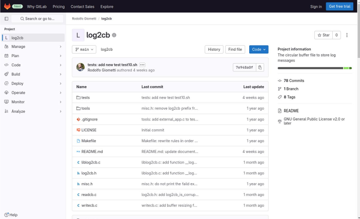
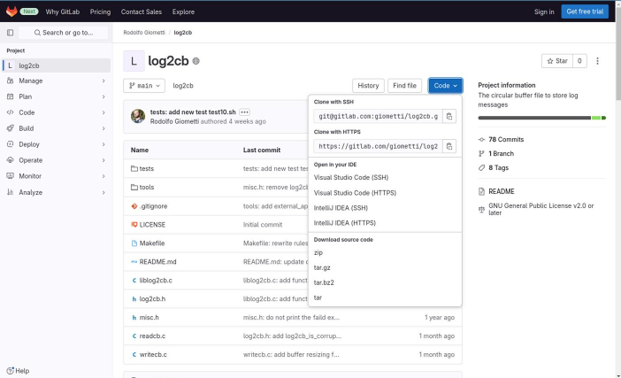
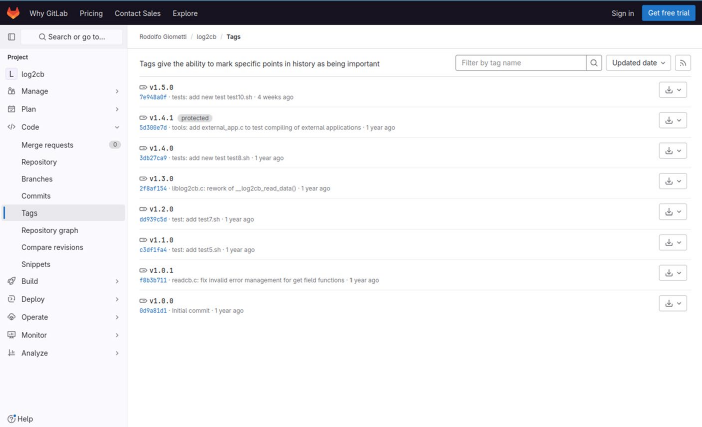
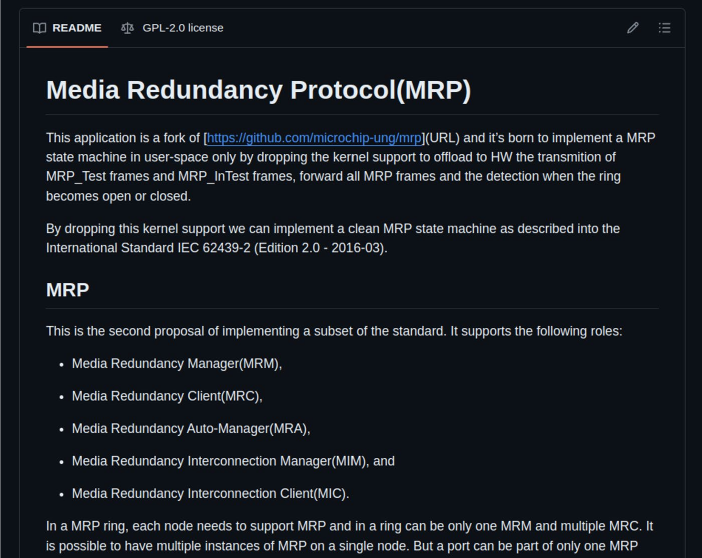

# Chương 9. Recipe cho ứng dụng C (C Application Recipes)

Trong Chương 6, chúng ta đã thấy recipe là gì và cách dùng khái niệm overlay để thay đổi nó từ các layer khác nhau. Ngoài ra, trong Chương 8, chúng ta đã tìm hiểu cách định nghĩa một machine mới dẫn xuất từ một development kit đã được hỗ trợ. Giờ là lúc xem cách tạo recipe cho các software package mới mà chúng ta muốn chạy trên embedded machine, hoặc cách thay đổi các recipe đã có để phù hợp với ứng dụng embedded cụ thể của mình.

Trong chương này, chúng ta bắt đầu một loạt ví dụ về các dự án C-based (các dự án và thư viện user space hoặc kernel space); trong chương tiếp theo, chúng ta sẽ xem một số ví dụ về các dự án Python-based. Sau đó, trong các chương tiếp theo nữa, chúng ta sẽ tiếp tục phần trình bày này bằng cách đề xuất các ví dụ khác nhau về những trường hợp thực tế thường gặp.

Bạn đọc nên tính đến việc, dù chúng ta đã phân loại từng ví dụ, họ vẫn có thể điều chỉnh những gì được gợi ý trong một ví dụ cho các vấn đề khác; vì vậy, ý hay là không dừng lại ở tiêu đề của mỗi mục, mà nên đọc nội dung của nó để xem giải pháp đề xuất có thể giải quyết vấn đề của mình không.

> Trước khi tiếp tục, bạn đọc nên chắc chắn rằng kit embedded của mình truy cập được qua serial console và network interface như đã giải thích trong Mục 1.3.

## 9.1 Chương trình user space (User Space Programs)

Viết một recipe cho một chương trình user space thực sự là một việc đơn giản. Một ví dụ tốt về cách làm việc đó được trình bày trong Yocto source ở layer `poky`, như đã giới thiệu trong Mục 6.3 và được trình bày lại dưới đây:

```
$ cat poky/meta-skeleton/recipes-skeleton/hello-single/hello_1.0.bb
DESCRIPTION = "Simple helloworld application"
SECTION = "examples"
LICENSE = "MIT"
LIC_FILES_CHKSUM = "file://${COMMON_LICENSE_DIR}/MIT;md5=0835ade698e0bc
f8506ecda2f7b4f302"

SRC_URI = "file://helloworld.c"

S = "${WORKDIR}"

do_compile() {
        ${CC} ${LDFLAGS} helloworld.c -o helloworld
}

do_install() {
        install -d ${D}${bindir}
        install -m 0755 helloworld ${D}${bindir}
}
```

Vì vậy, để làm một ví dụ sơ đẳng về cách tạo recipe cho các dự án C mà chúng ta tự phát triển trên máy của mình, có thể xét chương trình C hello-world dưới đây:

```
$ cd ~/yocto/examples/hello/
$ cat hello.c
#include <stdio.h>

int main(int argc, char *argv[])
{
        printf("hello world!\n");
        return 0;
}
```

> Lưu ý rằng thư mục `hello` có thể nằm ở bất cứ đâu trong filesystem của chúng ta và không nhất thiết nằm trong build directory. Trong ví dụ của chúng ta, có một thư mục riêng tên là `examples`, có thể lấy tại `https://github.com/Apress/` `Yocto-Project-Customization-for-Linux`.

Bây giờ chúng ta có thể dùng lệnh `recipetool` như trong Mục 4.3 để tạo một recipe tùy biến từ chính thư mục đó:

```
$ recipetool create hello.c
NOTE: Starting bitbake server...
INFO: Fetching file:///home/giometti/yocto/examples/hello/hello.c...
...
NOTE: No setscene tasks
NOTE: Executing Tasks
NOTE: Tasks Summary: Attempted 2 tasks of which 0 didn't need to be rer
un and all succeeded.
INFO: Recipe hello.bb has been created; further editing may be required
 to make it fully functional
```

Giờ một file recipe `hello.bb` mới đã được tạo trong thư mục local với nội dung sau:

```
$ cat hello.bb
# Recipe created by recipetool
# This is the basis of a recipe and may need further editing in order to
# be fully functional.
# (Feel free to remove these comments when editing.)

# Unable to find any files that looked like license statements. Check
# the accompanying documentation and source headers and set LICENSE and
# LIC_FILES_CHKSUM accordingly.
#
# NOTE: LICENSE is being set to "CLOSED" to allow you to at least start
# building - if this is not accurate with respect to the licensing of
# the software being built (it will not be in most cases) you must
# specify the correct value before using this recipe for anything other
# than initial testing/development!
LICENSE = "CLOSED"
LIC_FILES_CHKSUM = ""
SRC_URI = "file:///home/giometti/yocto/examples/hello/hello.c"

S = "${WORKDIR}/home"

# NOTE: no Makefile found, unable to determine what needs to be done

do_configure () {
        # Specify any needed configure commands here
        :
}

do_compile () {
        # Specify compilation commands here
        :
}

do_install () {
        # Specify install commands here
        :
}
```

Vì vậy, lệnh `recipetool` đã tạo file recipe `hello.bb` với các thông tin đặt sẵn sau:

- `LICENSE` được đặt là `CLOSED` và `LIC_FILES_CHKSUM` được đặt là chuỗi rỗng – lý do là chúng ta hoàn toàn không chỉ định license nào.

- `SRC_URI` trỏ tới file `hello.c`, vì đó là file source duy nhất của dự án.

- Và các task `do_configure`, `do_compile` và `do_install` rỗng mà chúng ta phải điền các lệnh phù hợp để compile ứng dụng.

Thật vậy, bạn đọc nên chú ý thông điệp sau trong output ở trên:

```
# NOTE: no Makefile found, unable to determine what needs to be done
```

Tốt, chúng ta có thể sửa điều này theo hai cách: cung cấp một lệnh compile trong phương thức `do_compile()` như trong ví dụ `hello_1.0.bb` ở trên, hoặc có thể thêm một `Makefile` như dưới đây:

```
$ cat Makefile
TARGET = hello

all: ${TARGET}

install:
        install -d ${DESTDIR}/usr/bin/
        install hello ${DESTDIR}/usr/bin/
```

OK, giờ chúng ta có thể xóa recipe `hello.bb` hiện tại và thực thi lại lệnh `recipetool`:

```
$ rm hello.bb
$ recipetool create -N hello .
NOTE: Starting bitbake server...
...
INFO: Recipe hello.bb has been created; further editing may be required
 to make it fully functional
```

Và trong file `hello.bb`, chúng ta sẽ có nội dung sau:

```
$ cat hello.bb
# Recipe created by recipetool
...
# No information for SRC_URI yet (only an external source tree was
# specified)
SRC_URI = ""

# NOTE: this is a Makefile-only piece of software, so we cannot generate
# much of the recipe automatically - you will need to examine the
# Makefile yourself and ensure that the appropriate arguments are passed
# in.

do_configure () {
        # Specify any needed configure commands here
        :
}

do_compile () {
        # You will almost certainly need to add additional arguments here
        oe_runmake
}
do_install () {
        # This is a guess; additional arguments may be required
        oe_runmake install 'DESTDIR=${D}'
}
```

Như chúng ta thấy, giờ các phương thức `do_compile()` và `do_install()` đã có một số chỉ dẫn được thêm bởi `recipetool`, công cụ đã phát hiện `Makefile` mới của chúng ta, và nó đã auto-added tiện ích `oe_runmake` (xem Mục 3.3.2). Tuy nhiên, như vậy vẫn chưa đủ, vì trong trường hợp này, `recipetool` không thể tự động đặt biến `SRC_URI` (hãy so output ở trên với những gì chúng ta có ở lần chạy đầu tiên).

Rõ ràng chúng ta có thể tự thêm các mục cần thiết vào `SRC_URI`; tuy nhiên, để có kết quả tốt hơn, chúng ta có thể chuyển dự án vào một Git repository để `recipetool` có thể dùng một thuật toán thông minh hơn để tự động tạo recipe. Để làm vậy, chúng ta có thể làm theo ví dụ dưới đây, xóa file `hello.bb` chưa tốt rồi tạo repository:

```
$ rm hello.bb
$ git init
Initialized empty Git repository in /home/giometti/yocto/examples/hello
/.git/
$ git add .
$ git commit -m "Initial commit"
[master (root-commit) 81ec687] Initial commit
 2 files changed, 13 insertions(+)
 create mode 100644 Makefile
 create mode 100644 hello.c
```

Giờ đã có Git repository, chúng ta có thể dùng tiền tố `git://` để báo cho `recipetool` biết thư mục được truyền làm đối số không chỉ là một thư mục đơn giản, mà là một Git repository. Làm như vậy, command line của `recipetool` trở thành

```
$ recipetool create git://$(pwd)
NOTE: Starting bitbake server...
INFO: Fetching git:///home/giometti/yocto/examples/hello;branch=master.
..
...
INFO: Recipe hello_git.bb has been created; further editing may be requ
ired to make it fully functional
```

Giờ tên recipe đã được đặt thành `hello_git.bb` (lý do là, như đã giải thích trong Mục 6.1, hậu tố `_git` thường được dùng để đánh dấu các dự án được quản lý bằng `git`), và giờ nó có nội dung sau:

```
$ cat hello_git.bb
# Recipe created by recipetool
# This is the basis of a recipe and may need further editing in order to
# be fully functional.
# (Feel free to remove these comments when editing.)

# Unable to find any files that looked like license statements. Check
# the accompanying documentation and source headers and set LICENSE and
# LIC_FILES_CHKSUM accordingly.
#
# NOTE: LICENSE is being set to "CLOSED" to allow you to at least start
# building - if this is not accurate with respect to the licensing of
# the software being built (it will not be in most cases) you must
# specify the correct value before using this recipe for anything other
# than initial testing/development!
LICENSE = "CLOSED"
LIC_FILES_CHKSUM = ""

SRC_URI = "git:///home/giometti/yocto/examples/hello;branch=master"

# Modify these as desired
PV = "1.0+git${SRCPV}"
SRCREV = "b3b4da551b6b25b56cc1fdad3f83ebfd88bcaeee"

S = "${WORKDIR}/git"

# NOTE: this is a Makefile-only piece of software, so we cannot generate
# much of the recipe automatically - you will need to examine the
# Makefile yourself and ensure that the appropriate arguments are passed
# in.

do_configure () {
        # Specify any needed configure commands here
        :
}

do_compile () {
        # You will almost certainly need to add additional arguments here
        oe_runmake
}
do_install () {
        # This is a guess; additional arguments may be required
        oe_runmake install 'DESTDIR=${D}'
}
```

Phiên bản sau cùng này của recipe chắc chắn tốt hơn trước! Nhờ dùng một Git repository, chúng ta đã có một recipe (gần như) đầy đủ (và đây là một lý do tốt nữa để mọi developer nên dùng một SCM).

Bây giờ, để thử nó, chúng ta có thể chuyển vào layer `meta-cy` và thực thi các lệnh sau:

```
$ mkdir -p recipes-example/hello
$ mv /home/giometti/yocto/examples/hello/hello_git.bb \
        recipes-example/hello/
```

Recipe giờ đã sẵn sàng, và khi đó chúng ta có thể thử compile code bằng `bitbake` như dưới đây:

```
$ bitbake hello
```

Nếu mọi thứ hoạt động tốt, quá trình compile sẽ kết thúc không có lỗi nào và một package IPKG mới sẽ được tạo như dưới đây:

```
$ cd $BUILDDIR
$ cy-ipk find hello
cy-ipk: searching in /home/giometti/yocto/imx-yocto-bsp/imx8mp-build...
tmp/deploy/ipk/armv8a/hello-dev_1.0+git0+b3b4da551b-r0_armv8a.ipk
tmp/deploy/ipk/armv8a/hello-src_1.0+git0+b3b4da551b-r0_armv8a.ipk
tmp/deploy/ipk/armv8a/hello_1.0+git0+b3b4da551b-r0_armv8a.ipk
tmp/deploy/ipk/armv8a/hello-dbg_1.0+git0+b3b4da551b-r0_armv8a.ipk
```

Bây giờ chúng ta chỉ cần chép file `hello_1.0+git0+b3b4da551b-r0_armv8a.ipk` sang target machine bằng `scp`:

```
$ scp tmp/deploy/ipk/armv8a/hello_1.0+git0+b3b4da551b-r0_armv8a.ipk \
        root@192.168.32.132:
hello_1.0+git0+b3b4da551b-r0_armv8a.ipk    100% 2090     1.4MB/s   00:00
```

> Lưu ý rằng nếu một image mới đã được cài lên thẻ microSD được tạo ở các chương đầu của sách, chúng ta có thể gặp lỗi sau:
>
> ```
> @@@@@@@@@@@@@@@@@@@@@@@@@@@@@@@@@@@@@@@@@@@@@@@@@@@@@@@@@@@
> @    WARNING: REMOTE HOST IDENTIFICATION HAS CHANGED!     @
> @@@@@@@@@@@@@@@@@@@@@@@@@@@@@@@@@@@@@@@@@@@@@@@@@@@@@@@@@@@
> IT IS POSSIBLE THAT SOMEONE IS DOING SOMETHING NASTY!
> Someone could be eavesdropping on you right now (man-in-the-middle
>  attack)!
> It is also possible that a host key has just been changed.
> The fingerprint for the RSA key sent by the remote host is
> SHA256:0b9AHYkwbkPpFjHqTmD5FUte7Axi5J1ZXIY397NaX8Q.
> Please contact your system administrator.
> Add correct host key in /home/giometti/.ssh/known_hosts to get rid
>  of this message.
> Offending RSA key in /home/giometti/.ssh/known_hosts:102
>   remove with:
>   ssh-keygen -f "/home/giometti/.ssh/known_hosts" -R "192.168.32.1
> 32"
> Host key for 192.168.32.132 has changed and you have requested str
> ict checking.
> Host key verification failed.
> lost connection
> ```
>
> Nếu vậy, chúng ta có thể khôi phục chỉ bằng cách thực thi lệnh được gợi ý như dưới đây:
>
> ```
> $ ssh-keygen -f "/home/giometti/.ssh/known_hosts" -R "192.168.32.1
> 32"
> # Host 192.168.32.132 found: line 102
> /home/giometti/.ssh/known_hosts updated.
> Original contents retained as /home/giometti/.ssh/known_hosts.old
> ```
>
> Rồi re-executing lệnh `scp`:
>
> ```
> $ scp tmp/deploy/ipk/armv8a/hello_1.0+git0+b3b4da551b-r0_armv8a.ip
> k \
>         root@192.168.32.132:
> The authenticity of host '192.168.32.132 (192.168.32.132)' can't b
> e established.
> RSA key fingerprint is SHA256:0b9AHYkwbkPpFjHqTmD5FUte7Axi5J1ZXIY3
> 97NaX8Q.
> This key is not known by any other names
> Are you sure you want to continue connecting (yes/no/[fingerprint])?
> ```
>
> Bây giờ chúng ta phải trả lời `yes`, và việc chép sẽ bắt đầu:
>
> ```
> Warning: Permanently added '192.168.32.132' (RSA) to the list of k
> nown hosts.
> hello_1.0+git0+b3b4da551b-r0_armv8a.ipk   100% 2090  1.3MB/s  00:00
> ```

Rồi cài đặt và thực thi nó:

```
# opkg install hello_1.0+git0+b3b4da551b-r0_armv8a.ipk
Installing hello (1.0+git0+b3b4da551b) on root
Configuring hello.
root@imx8mp-icore-mbevx:~# hello
hello world
```

> Cũng có thể xảy ra trường hợp một số bạn đọc gặp lỗi sau trong khi cài package:
>
> ```
> # opkg install hello_1.0+git0+b3b4da551b-r0_armv8a.ipk
> Installing hello (1.0+git0+b3b4da551b) on root
>  * check_data_file_clashes: Package hello wants to install file /u
> sr/bin/hello
>         But that file is already provided by package  * lmbench
> To remove package debris, try opkg remove hello.
> To re-attempt the install, try opkg install hello.
> ```
>
> Tình huống này có thể được khắc phục bằng lệnh sau:
>
> ```
> # opkg install --force-overwrite hello_1.0+git0+b3b4da551b-r0_armv
> 8a.ipk
> Installing hello (1.0+git0+b3b4da551b) on root
> Configuring hello.
> ```
>
> Tất nhiên, đây là một ngoại lệ, và chúng ta nên tránh làm như trên, mà nên giải quyết vấn đề, ví dụ bằng cách đổi một số tên hoặc dùng một cách đặt tên thay thế như đã giải thích trong Mục 6.3.4 về biến `ALTERNATIVE` và các biến liên quan.

OK, giờ code đã hoạt động trên target machine; tuy nhiên, một người viết recipe giỏi không nên dừng ở đây mà nên kiểm tra mọi thứ đều đúng. Thật vậy, như đã giải thích trong Mục 6.3.1, chúng ta cũng nên đặt một số biến mô tả. Khi lấy thông tin package, chúng ta có thể thấy kết quả sau:

```
$ cy-ipk get-info tmp/deploy/ipk/armv8a/hello_1.0+git0+b3b4da551b-r0_ar
mv8a.ipk
Package: hello
Version: 1.0+git0+b3b4da551b-r0
Description: hello version 1.0+gitAUTOINC+b3b4da551b-r0
 hello version 1.0+gitAUTOINC+b3b4da551b-r0.
Section: base
Priority: optional
Maintainer: NXP <lauren.post@nxp.com>
License: CLOSED
Architecture: armv8a
OE: hello
Depends: libc6 (>= 2.35)
Source: hello_git.bb
```

Vì vậy tốt hơn là sửa các trường mô tả, section, license và maintainer của package. Hơn nữa, chúng ta có thể bỏ mọi comment không cần thiết do `recipetool` thêm vào.

Ví dụ, chúng ta có thể viết lại file recipe `hello_git.bb` như dưới đây:

```
$ cat $CY_METADIR/recipes-example/hello/hello_git.bb
SUMMARY = "Yet another hello world program"
DESCRIPTION = "A simple example about how to write a recipe for a user
space C program."
MAINTAINER = "Rodolfo Giometti <giometti@enneenne.com>"
SECTION = "examples"
LICENSE = "MIT"
LIC_FILES_CHKSUM = "file://${COMMON_LICENSE_DIR}/MIT;md5=0835ade698e0bc
f8506ecda2f7b4f302"

SRC_URI = "git:///home/giometti/yocto/examples/hello;branch=master"

PV = "1.0+git${SRCPV}"
SRCREV = "b3b4da551b6b25b56cc1fdad3f83ebfd88bcaeee"

S = "${WORKDIR}/git"

do_configure () {
        :
}

do_compile () {
        oe_runmake
}

do_install () {
        oe_runmake install 'DESTDIR=${D}'
}
```

Ở đây, chúng ta nên chú ý rằng `LIC_FILES_CHKSUM` dùng biến `COMMON_LICENSE_DIR` để chỉ định license MIT, vì không có file license nào trong source.

Bây giờ, nếu tạo lại package, chúng ta sẽ có thông tin package sau:

```
$ cy-ipk get-info tmp/deploy/ipk/armv8a/hello_1.0+git0+b3b4da551b-r0_ar
mv8a.ipk
Package: hello
Version: 1.0+git0+b3b4da551b-r0
Description: Yet another hello world program
 A simple example about how to write a recipe for a user space C progra
m.
Section: examples
Priority: optional
Maintainer: Rodolfo Giometti <giometti@enneenne.com>
License: MIT
Architecture: armv8a
OE: hello
Depends: libc6 (>= 2.35)
Source: hello_git.bb
```

Giờ recipe có thể được xem là đã hoàn tất. Tuy nhiên, trước khi chuyển sang mục tiếp theo, như đã thấy trong Mục 4.5.1, chúng ta nên tính đến việc có thể làm điều tương tự như trên bằng `devtool`; vì vậy, cho đầy đủ, chúng ta sẽ trình bày dưới đây các lệnh `devtool` tương đương để thêm một recipe mới cho một chương trình user space.

Để không ghi đè những gì đã làm ở trên, chúng ta sẽ dùng một tên recipe khác (tức là `hello2`):

```
$ devtool add hello2 ~/yocto/examples/hello/
NOTE: Starting bitbake server...
INFO: Creating workspace layer in /home/giometti/yocto/imx-yocto-bsp/im
x8mp-build/workspace
NOTE: Starting bitbake server...
INFO: Using source tree as build directory since that would be the defa
ult for this recipe
INFO: Recipe /home/giometti/yocto/imx-yocto-bsp/imx8mp-build/workspace/
recipes/hello2/hello2.bb has been automatically created; further editin
g may be required to make it fully functional
```

Bây giờ, nếu xem thư mục `workspace`, chúng ta sẽ thấy nội dung như dưới đây:

```
$ tree workspace/
workspace/
├── appends
│   └── hello2.bbappend
├── conf
│   └── layer.conf
├── recipes
│   └── hello2
│       └── hello2.bb
└── README

4 directories, 4 files
```

> Tất nhiên, output có thể khác tùy theo những gì bạn đọc đã làm trong workspace của mình.

Như mong đợi, một recipe `hello2.bb` mới đã được tạo với nội dung sau:

```
$ cat workspace/recipes/hello2/hello2.bb
# Recipe created by recipetool
# This is the basis of a recipe and may need further editing in order to
# be fully functional.
# (Feel free to remove these comments when editing.)
...
LICENSE = "CLOSED"
LIC_FILES_CHKSUM = ""

# No information for SRC_URI yet (only an external source tree was
# specified)
SRC_URI = ""

# NOTE: this is a Makefile-only piece of software, so we cannot generate
# much of the recipe automatically - you will need to examine the
# Makefile yourself and ensure that the appropriate arguments are passed
# in.

do_configure () {
        # Specify any needed configure commands here
        :
}

do_compile () {
        # You will almost certainly need to add additional arguments here
        oe_runmake
}

do_install () {
        # This is a guess; additional arguments may be required
        oe_runmake install 'DESTDIR=${D}'
}
```

Chúng ta không trình bày toàn bộ nội dung, vì nó giống như ví dụ trước được tạo bằng `recipetool`. Điều này cũng được thể hiện rõ qua ghi chú `Recipe created by recipetool` mà chúng ta thấy trong output.

Hơn nữa, trong workspace, một file `.bbappend` mới đã được thêm vào:

```
$ cat workspace/appends/hello2.bbappend
inherit externalsrc
EXTERNALSRC = "/home/giometti/yocto/examples/hello"
EXTERNALSRC_BUILD = "/home/giometti/yocto/examples/hello"

# initial_rev: 58088a51b34db61e10ebab64e6cd7408a27ec8ca
```

Đây là các thiết lập để báo cho build system (qua class externalsrc) biết rằng nó phải lấy source từ một thư mục nằm ngoài Yocto build system (xem Mục 4.5.1).

Sau đó chúng ta có thể sửa recipe bằng subcommand `edit-recipe`, như dưới đây:

```
$ devtool edit-recipe hello2
```

> Lưu ý rằng lệnh tương ứng của `recipetool` cho phép chúng ta xem cả file recipe `hello2.bb` lẫn `hello2.bbappend` trong workspace, thay vì chỉ file recipe như `devtool` làm. Thật vậy, chúng ta có
>
> ```
> $ recipetool edit hello2
> ...
> 2 files to edit
> ```
>
> Và sau đó, trong editor ưa thích, chúng ta có cả `hello2.bb` lẫn `hello2.bbappend`!

Hơn nữa, để build code, giờ chúng ta có thể dùng subcommand `build`:

```
$ devtool build hello2
NOTE: Starting bitbake server...
...
NOTE: hello2: compiling from external source tree /home/giometti/yocto/
examples/hello
Setscene tasks: 168 of 168
Currently  2 running tasks (728 of 730)  99% |######################## |
0: hello2-1.0-r0 do_populate_sysroot - 0s (pid 139651)
1: hello2-1.0-r0 do_package - 0s (pid 139650)
```

Cho đến giờ, có ít khác biệt giữa giải pháp này và giải pháp trước với `recipetool`; tuy nhiên, giờ có sẵn một lệnh thực sự mới và mạnh mẽ, đó là lệnh `devtool deploy-target` mà chúng ta có thể dùng để chuyển code được tạo ra trực tiếp vào target machine! Để làm vậy, chúng ta có thể dùng lệnh dưới đây:

```
$ devtool deploy-target -s hello2 root@192.168.32.132
...
devtool_deploy.list                        100%   21    40.1KB/s   00:00
devtool_deploy.sh                          100% 1017     1.9MB/s   00:00
./
./usr/
./usr/bin/
./usr/bin/hello
INFO: Successfully deployed /home/giometti/yocto/imx-yocto-bsp/imx8mp-b
uild/tmp/work/armv8a-poky-linux/hello2/1.0-r0/image
```

> Một số bạn đọc có thể nhận được các thông điệp phụ sau trong khi deploy:
>
> ```
> tar: ./usr/bin/hello: time stamp 2024-05-13 14:21:48 is 64407765.3
> 30864
> 25 s in the future
> tar: ./usr/bin: time stamp 2024-05-13 14:21:48 is 64407765.3306766
> 25 s in the future
> tar: ./usr: time stamp 2024-05-13 14:21:48 is 64407765.330483375 s
>  in the future
> tar: .: time stamp 2024-05-13 14:21:48 is 64407765.330399625 s in
> the future
> ```
>
> Không vấn đề gì, chúng ta có thể yên tâm bỏ qua các warning này.

Bây giờ chúng ta có thể trực tiếp thử code trên target machine mà không cần cài đặt gì:

```
# hello
hello world!
```

> Lưu ý rằng, ngay cả trong trường hợp này, chúng ta cũng nên thêm các biến `SUMMARY`, `DESCRIPTION`, `MAINTAINER`, v.v. phù hợp như đã làm trước đó.

Trước khi kết thúc mục này, thật thú vị khi thử gỡ package này khỏi workspace. Như đã thấy trong Mục 4.5.4, chúng ta có thể chỉ cần gỡ package bằng subcommand `devtool reset`; tuy nhiên, nếu thử làm vậy trên workspace hiện tại, chúng ta nhận được error message sau:

```
$ devtool reset hello2
...
NOTE: Starting bitbake server...
INFO: Cleaning sysroot for recipe hello2...
ERROR: Command 'bitbake -c clean hello2' failed, output:
...
NOTE: Running task 1 of 2 (/home/giometti/yocto/imx-yocto-bsp/imx8mp-bu
ild/workspace/recipes/hello2/hello2.bb:do_buildclean)
NOTE: recipe hello2-1.0-r0: task do_buildclean: Started
Log data follows:
| DEBUG: Executing shell function do_buildclean
| NOTE: make clean
| make: *** No rule to make target 'clean'.  Stop.
| ERROR: oe_runmake failed
| WARNING: exit code 1 from a shell command.
NOTE: recipe hello2-1.0-r0: task do_buildclean: Failed
NOTE: Tasks Summary: Attempted 1 tasks of which 0 didn't need to be rer
un and 1 failed.

Summary: 1 task failed:
  /home/giometti/yocto/imx-yocto-bsp/imx8mp-build/workspace/recipes/hello
2/hello2.bb:do_buildclean
Summary: There were 2 ERROR messages, returning a non-zero exit code.

If you wish, you may specify -n/--no-clean to skip running this command
 when resetting
```

Lý do là subcommand cố thực thi một hành động dọn dẹp (tức là lệnh `bitbake -c clean hello2`), và `Makefile` của chúng ta không hiện thực target `clean` (tức là chúng ta không thể thực thi `make clean`). Trong tình huống này, chúng ta có hai giải pháp khả dĩ:

1) Chúng ta có thể cung cấp target còn thiếu để dọn dẹp working directory.

2) Chúng ta có thể làm theo gợi ý ở trên rồi chỉ định option argument `-n` (hoặc `--no-clean`) để bỏ qua hành động dọn dẹp này.

Vì không quan tâm đến việc làm giải pháp thứ nhất, chúng ta có thể chỉ cần làm như sau:

```
$ devtool reset -n hello2
NOTE: Starting bitbake server...
INFO: Leaving source tree /home/giometti/yocto/examples/hello as-is; if
 you no longer need it then please delete it manually
```

Lưu ý rằng lần này working directory không nằm trong `workspace`, vì vậy chúng ta phải cẩn thận quyết định có xóa working directory hay không!

## 9.2 Library package (Library Packages)

Có thể compile package cho các chương trình C là quan trọng, nhưng là những embedded developer và lập trình viên C giỏi, chúng ta biết rõ rằng có thể compile package cho các thư viện C cũng thiết yếu không kém.

Để xem cách làm, chúng ta có thể dùng một code thư viện đơn giản và một chương trình đơn giản cần thư viện đó. Trong mục này, chúng ta sẽ xem cách tạo shared object và recipe liên quan để dùng trong Yocto Project. Sau đó, trong mục tiếp theo, chúng ta sẽ xem cách tạo một recipe cho một chương trình C cần thư viện này.

Code của một thư viện đơn giản được trình bày dưới đây:

```
$ cd examples/hellolib/
$ cat hello.c
#include <stdio.h>

int hello(void)
{
        printf("hello world!\n");
        return 0;
}
$ cat hello.h
#ifndef HELLO_H
#define HELLO_H

extern int hello(void);

#endif /* HELLO_H */
```

Thư viện đơn giản của chúng ta (gồm hai file `hello.c` và `hello.h`) chỉ định nghĩa một hàm duy nhất tên là `hello()`, và nó có thể được compile bằng `Makefile` sau:

```
$ cat Makefile
NAME = libhello.so
CFLAGS += -Wall -O2

MAJOR = 1
MINOR = 0
PATCH = 0
SONAME = ${NAME}.${MAJOR}
TARGET = ${SONAME}.${MINOR}.${PATCH}

all: ${TARGET}

${TARGET}: hello.o
        $(CC) $(CFLAGS) $(CPPFLAGS) $(LDFLAGS) \
                -shared -fPIC -Wl,-soname,${SONAME} -o $@ $^

install:
        install -d ${DESTDIR}/usr/lib/
        install ${TARGET} ${DESTDIR}/usr/lib/
        ln -rs ${DESTDIR}/usr/lib/${TARGET} ${DESTDIR}/usr/lib/${SONAME}
        ln -rs ${DESTDIR}/usr/lib/${SONAME} ${DESTDIR}/usr/lib/${NAME}

clean:
        rm -f ${TARGET} *.o
```

Trong `Makefile` này, phần liên quan duy nhất là phần về trường `soname`, và chúng ta phải nói vài lời về nó để hiểu rõ nên quản lý nó thế nào.

Trong các hệ điều hành UNIX và UNIX-like, bên trong một shared library, trường dữ liệu `soname` là một chuỗi được dùng làm tên logic mô tả chức năng của object. Nó có mục đích cung cấp một mức gián tiếp.

Thông thường, `soname` bằng tên file của thư viện. Ví dụ, trong file thư viện `libbz2.so.1`, `soname` được đặt như dưới đây:

```
$ file libbz2.so*
libbz2.so:       symbolic link to /lib/x86_64-linux-gnu/libbz2.so.1.0
libbz2.so.1:     symbolic link to libbz2.so.1.0.4
libbz2.so.1.0:   symbolic link to libbz2.so.1.0.4
libbz2.so.1.0.4: ELF 64-bit LSB shared object, x86-64, version 1 (SYSV)
, dynamically linked, BuildID[sha1]=e56b62c27bcc7ace8f9be36b255bd7b31bf
de405, stripped
$ objdump -p libbz2.so.1.0.4 | grep SONAME
  SONAME               libbz2.so.1.0
```

`soname` được linker dùng lúc compile để xác định từ file thư viện phiên bản thư viện đích thực tế là gì, và nó thường được dùng để cung cấp thông tin backward-compatibility về phiên bản. Trong ví dụ trên, cái so-called real name của thư viện là `libbz2.so.1.0.4`, còn `soname` là `libbz2.so.1.0`, và cái so-called linker name là `libbz2.so`. Khi một chương trình được tạo ra rồi link với option argument `-lbz2`, linker phát hiện `libbz2.so` chứa `soname libbz2.so.1.0` và nhúng tên sau vào bên trong file thực thi. Thật vậy, chương trình `bzcat` yêu cầu file thư viện `libbz2.so.1.0`:

```
$ ldd $(which bzcat)
        linux-vdso.so.1 (0x00007ffd0bf99000)
        libbz2.so.1.0 => /lib/x86_64-linux-gnu/libbz2.so.1.0 (0x00007f743
533b000)
        libc.so.6 => /lib/x86_64-linux-gnu/libc.so.6 (0x00007f7435112000)
        /lib64/ld-linux-x86-64.so.2 (0x00007f743537a000)
```

Các số phiên bản này của một thư viện có thể được hình dung là `libfoo.so.MAJOR.MINOR.PATCH`, trong đó

- `PATCH` được tăng cho các thay đổi tương thích cả forward lẫn backward với các phiên bản khác, ví dụ các bản sửa lỗi từ bản phát hành trước mà không thay đổi API.

- `MINOR` nên được tăng nếu phiên bản mới của thư viện tương thích về source và binary với phiên bản cũ. Các phiên bản minor khác nhau tương thích ngược, nhưng không nhất thiết tương thích về sau, với nhau. Trong trường hợp này, code mới có thể chỉ thêm một hàm mới hoặc define mới và đánh dấu deprecated các hàm hiện có, nhưng không được bỏ bất cứ thứ gì được lộ ra bên ngoài.

- `MAJOR` được tăng khi đưa vào một thay đổi phá vỡ API hoặc theo cách nào đó không tương thích với phiên bản trước. Trong code mới, các hằng số có thể bị bỏ hoặc thay đổi (deprecated), các hàm có thể bị bỏ, và tất nhiên là mọi thay đổi mà bình thường sẽ làm tăng số `MINOR` hoặc `PATCH`.

Vì vậy, trong ví dụ trên, nếu `libbz2.so.1.0.4` được thay bằng `libbz2.so.1.0.5`, `soname` vẫn là `libbz2.so.1.0` và `bzcat` vẫn hoạt động.

Để kiểm chứng điều vừa nói, chúng ta có thể dùng code trong thư mục `example/lhello`:

```
$ cat ../lhello/lhello.c
#include <hello.h>

int main(int argc, char *argv[])
{
        return hello();
}
```

trong đó `Makefile` được viết như sau:

```
$ cat ../lhello/Makefile
TARGET = lhello
CFLAGS += -Wall -O2
LDLIBS = -lhello

all: ${TARGET}

${TARGET}: ${TARGET}.o

install:
        install -d ${DESTDIR}/usr/bin/
        install ${TARGET} ${DESTDIR}/usr/bin/

clean:
        rm -f ${TARGET} ${TARGET}.o
```

Bây giờ chúng ta nên kiểm chứng mọi thứ hoạt động như mong đợi trên host, rồi mới xem cách làm tương tự trên target. Vậy hãy compile thư viện và cài nó vào một thư mục tạm trên host như sau:

```
$ make
cc -Wall -O2   -c -o hello.o hello.c
cc -Wall -O2   \
        -shared -fPIC -Wl,-soname,libhello.so.1 -o libhello.so.1.0.0 hell
o.o
$ make install DESTDIR=/tmp/libhello/
install -d /tmp/libhello//usr/lib/
install libhello.so.1.0.0 /tmp/libhello//usr/lib/
ln -rs /tmp/libhello//usr/lib/libhello.so.1.0.0 \
           /tmp/libhello//usr/lib/libhello.so.1
ln -rs /tmp/libhello//usr/lib/libhello.so.1 \
           /tmp/libhello//usr/lib/libhello.so
$ file /tmp/libhello/usr/lib/*
/tmp/libhello/usr/lib/libhello.so:       symbolic link to libhello.so.1
.0.0
/tmp/libhello/usr/lib/libhello.so.1:     symbolic link to libhello.so.1
.0.0
/tmp/libhello/usr/lib/libhello.so.1.0.0: ELF 64-bit LSB shared object,
x86-64, version 1 (SYSV), dynamically linked, BuildID[sha1]=88c412833b0
950755ad55872c69b956009439f69, not stripped
$ objdump -p /tmp/libhello/usr/lib/libhello.so.1.0.0 | grep SONAME
  SONAME               libhello.so.1
```

OK, giờ chúng ta có thể thử compile ứng dụng cần thư viện mới:

```
$ CFLAGS="-I ../hellolib/" LDFLAGS="-L /tmp/libhello/usr/lib/" make
cc -I ../hellolib/ -Wall -O2   -c -o lhello.o lhello.c
cc -L /tmp/libhello/usr/lib/  lhello.o  -lhello -o lhello
```

Lưu ý rằng để làm việc này, chúng ta phải cung cấp các thư mục phù hợp cho compiler rồi cho linker để tìm hai file `hello.h` và `libhello.so`. Bây giờ, nếu kiểm tra những gì linker đã làm, chúng ta có thể thấy nó đã tôn trọng `soname`:

```
$ LD_LIBRARY_PATH=/tmp/libhello/usr/lib/ ldd lhello
        linux-vdso.so.1 (0x00007ffd3b86d000)
        libhello.so.1 => /tmp/libhello/usr/lib/libhello.so.1 (0x00007fe53
e51f000)
        libc.so.6 => /lib/x86_64-linux-gnu/libc.so.6 (0x00007fe53e2d8000)
        /lib64/ld-linux-x86-64.so.2 (0x00007fe53e52b000)
```

`LD_LIBRARY_PATH` là cần thiết để báo cho dynamic linker biết nơi tìm file `libhello.so.1`. Và nếu thử thực thi nó, chúng ta nhận được như sau:

```
$ LD_LIBRARY_PATH=/tmp/libhello/usr/lib/ ./lhello
hello world!
```

Tuyệt! Giờ hãy xem cách tạo một recipe cho Yocto Project để compile tất cả những thứ này cho embedded machine. Chúng ta có thể dùng lại `recipetool`, nhưng giờ chỉ định một tên phù hợp là `libhello`, vì mọi thư viện trong Yocto Project đều nên được đặt tên với tiền tố `lib`:

```
$ cd examples/hellolib
$ recipetool create -N libhello git://$(pwd)
NOTE: Starting bitbake server...
INFO: Fetching git:///home/giometti/yocto/examples/hellolib;branch=mast
er...
...
INFO: Recipe libhello_git.bb has been created; further editing may be r
equired to make it fully functional
```

> Chúng ta đã tạo một Git repository trong thư mục `hellolib`, như đã làm ở trên.

Recipe kết quả có một task `do_install()` không đúng cho một thư viện, vì vậy nó phải được viết lại như sau:

```
do_install () {
        install -m 0755 -d ${D}${libdir}
        oe_soinstall ${S}/libhello.so.1.0.0 ${D}${libdir}
        install -d ${D}${includedir}
        install -m 0755 ${S}/*.h ${D}${includedir}
}
```

trong đó chúng ta đã dùng tiện ích `oe_soinstall`, tiện ích cài file thư viện rồi tạo mọi link cần thiết (xem Mục 6.4.5).

Để thử recipe mới, chúng ta có thể làm như thường lệ bằng cách tạo một mục phù hợp trong layer tùy biến như dưới đây:

```
$ mkdir $CY_METADIR/recipes-example/libhello
$ mv libhello_git.bb $CY_METADIR/recipes-example/libhello/
```

Sau đó chúng ta có thể gọi `bitbake` như dưới đây:

```
$ bitbake libhello
```

Nếu mọi thứ hoạt động tốt, các package mới sẽ được tạo:

```
$ cy-ipk find libhello
cy-ipk: searching in /home/giometti/yocto/imx-yocto-bsp/imx8mp-build...
tmp/deploy/ipk/armv8a/libhello-src_1.0+git0+ce5c28efa3-r0_armv8a.ipk
tmp/deploy/ipk/armv8a/libhello1_1.0+git0+ce5c28efa3-r0_armv8a.ipk
tmp/deploy/ipk/armv8a/libhello-dev_1.0+git0+ce5c28efa3-r0_armv8a.ipk
tmp/deploy/ipk/armv8a/libhello-dbg_1.0+git0+ce5c28efa3-r0_armv8a.ipk
```

Mọi file cần cho việc thực thi chương trình nằm trong file package `libhello1_1.0+git0+ce5c28efa3-r0_armv8a.ipk`:

```
$ cy-ipk inspect tmp/deploy/ipk/armv8a/libhello1_1.0+git0+ce5c28efa3-r0
_armv8a.ipk
drwxr-xr-x root/root         0 2024-02-19 17:09 ./usr/
drwxr-xr-x root/root         0 2024-02-19 17:09 ./usr/lib/
lrwxrwxrwx root/root         0 2024-02-19 17:09 ./usr/lib/libhello.so.1
-> libhello.so.1.0.0
-rwxr-xr-x root/root      5968 2024-02-19 17:09 ./usr/lib/libhello.so.1
.0.0
```

còn các file cần cho việc compile chương trình nằm trong file package `libhello-dev_1.0+git0+ce5c28efa3-r0_armv8a.ipk`:

```
$ cy-ipk inspect tmp/deploy/ipk/armv8a/libhello-dev_1.0+git0+ce5c28efa3
-r0_armv8a.ipk
drwxr-xr-x root/root         0 2024-02-19 17:09 ./usr/
drwxr-xr-x root/root         0 2024-02-19 17:09 ./usr/include/
-rw-r--r-- root/root        79 2024-02-19 17:09 ./usr/include/hello.h
drwxr-xr-x root/root         0 2024-02-19 17:09 ./usr/lib/
lrwxrwxrwx root/root         0 2024-02-19 17:09 ./usr/lib/libhello.so -
> libhello.so.1.0.0
```

Bây giờ chúng ta phải tạo recipe cho chương trình `hello` cần thư viện của chúng ta, vì vậy như trước, chúng ta có thể dùng `recipetool`:

```
$ cd ../lhello/
$ recipetool create git://$(pwd)
NOTE: Starting bitbake server...
INFO: Fetching git:///home/giometti/yocto/examples/lhello;branch=master
...
...
INFO: Recipe lhello_git.bb has been created; further editing may be req
uired to make it fully functional
```

> Một lần nữa, Git repository đã được tạo trong thư mục `examples/lhello`.

Sau đó chúng ta thêm recipe vào Yocto build system như trước:

```
$ mkdir $CY_METADIR/recipes-example/lhello
$ mv lhello_git.bb $CY_METADIR/recipes-example/lhello/
```

Và compile code:

```
$ bitbake lhello
...
NOTE: Executing Tasks
ERROR: lhello-1.0+gitAUTOINC+9bcdf085b9-r0 do_compile: oe_runmake failed
ERROR: lhello-1.0+gitAUTOINC+9bcdf085b9-r0 do_compile: ExecutionError('
/home/giometti/yocto/imx-yocto-bsp/imx8mp-build/tmp/work/armv8a-poky-li
nux/lhello/1.0+gitAUTOINC+9bcdf085b9-r0/temp/run.do_compile.771536', 1,
 None, None)
ERROR: Logfile of failure stored in: /home/giometti/yocto/imx-yocto-bsp
/imx8mp-build/tmp/work/armv8a-poky-linux/lhello/1.0+gitAUTOINC+9bcdf085
b9-r0/temp/log.do_compile.771536
...
| lhello.c:1:10: fatal error: hello.h: No such file or directory
|     1 | #include <hello.h>
|       |          ^~~~~~~~~
| compilation terminated.
| make: *** [<builtin>: lhello.o] Error 1
| ERROR: oe_runmake failed
| WARNING: exit code 1 from a shell command.
...
```

Đây là bằng chứng cho thấy để compile code cần thư viện `libhello`, chúng ta cũng cần các header file. Lỗi xảy ra vì chúng ta đã quên thêm thiết lập `DEPENDS` vào `lhello_git.bb`, như dưới đây:

```
--- a/lhello_git.bb
+++ b/lhello_git.bb
@@ -14,6 +14,8 @@

 SRC_URI = "git:///home/giometti/yocto/examples/lhello;branch=master"

+DEPENDS = "libhello"
+
 # Modify these as desired
 PV = "1.0+git${SRCPV}"
 SRCREV = "${AUTOREV}"
```

Sau khi sửa recipe, lệnh `bitbake` sẽ thực thi đúng, và các package mới được tạo như dưới đây:

```
$ cy-ipk find lhello
cy-ipk: searching in /home/giometti/yocto/imx-yocto-bsp/imx8mp-build...
tmp/deploy/ipk/armv8a/lhello-dev_1.0+git0+9bcdf085b9-r0_armv8a.ipk
tmp/deploy/ipk/armv8a/lhello-src_1.0+git0+9bcdf085b9-r0_armv8a.ipk
tmp/deploy/ipk/armv8a/lhello_1.0+git0+9bcdf085b9-r0_armv8a.ipk
tmp/deploy/ipk/armv8a/lhello-dbg_1.0+git0+9bcdf085b9-r0_armv8a.ipk
```

Và package chứa file thực thi đã sẵn sàng để cài:

```
$ cy-ipk inspect tmp/deploy/ipk/armv8a/lhello_1.0+git0+9bcdf085b9-r0_ar
mv8a.ipk
drwxr-xr-x root/root         0 2024-02-19 17:54 ./usr/
drwxr-xr-x root/root         0 2024-02-19 17:54 ./usr/bin/
-rwxr-xr-x root/root      6112 2024-02-19 17:54 ./usr/bin/lhello
```

Cũng lưu ý rằng mô tả package có các phụ thuộc đúng:

```
$ cy-ipk get-info tmp/deploy/ipk/armv8a/lhello_1.0+git0+9bcdf085b9-r0_a
rmv8a.ipk
Package: lhello
Version: 1.0+git0+9bcdf085b9-r0
Description: lhello version 1.0+gitAUTOINC+9bcdf085b9-r0
...
Depends: libc6 (>= 2.35), libhello1 (>= 1.0+git0+ce5c28efa3)
Source: lhello_git.bb
```

Vậy hãy chuyển package và thư viện cần thiết của nó sang kit embedded:

```
$ scp $BUILDDIR/tmp/deploy/ipk/armv8a/lhello_1.0+git0+9bcdf085b9-r0_arm
v8a.ipk \
      $BUILDDIR/tmp/deploy/ipk/armv8a/libhello1_1.0+git0+ce5c28efa3-r0_
armv8a.ipk \
      root@192.168.32.132:/tmp/
lhello_1.0+git0+9bcdf085b9-r0_armv8a.ipk      100% 2086  3.0MB/s   00:00
libhello1_1.0+git0+ce5c28efa3-r0_armv8a.ipk   100% 2048  3.2MB/s   00:00
```

Và cài chúng như thường lệ:

```
# opkg install /tmp/lhello_1.0+git0+9bcdf085b9-r0_armv8a.ipk \
               /tmp/libhello1_1.0+git0+ce5c28efa3-r0_armv8a.ipk
Installing libhello1 (1.0+git0+ce5c28efa3) on root
Installing lhello (1.0+git0+9bcdf085b9) on root
Configuring libhello1.
Configuring lhello.
```

Bây giờ chúng ta có thể thực thi chương trình mới với thư viện liên quan:

```
# lhello
hello world!
```

Như đã làm ở mục trước, trước khi đi tiếp, chúng ta nên bỏ mọi comment không cần thiết và sửa thông tin package. Một giải pháp khả dĩ cho package `libhello` có thể như dưới đây:

```
$ cat $CY_METADIR/recipes-example/libhello/libhello_git.bb
SUMMARY = "Yet another hello world library"
DESCRIPTION = "A simple example about how to write a recipe for a user
space C library."
MAINTAINER = "Rodolfo Giometti <giometti@enneenne.com>"
SECTION = "libs"
LICENSE = "MIT"
LIC_FILES_CHKSUM = "file://${COMMON_LICENSE_DIR}/MIT;md5=0835ade698e0bc
f8506ecda2f7b4f302"
...
```

còn với package `hello`, chúng ta có thể làm như dưới đây:

```
$ cat $CY_METADIR/recipes-example/lhello/lhello_git.bb
SUMMARY = "Yet another hello world program"
DESCRIPTION = "A simple example about how to write a recipe for a user
space C program which requires an external library."
MAINTAINER = "Rodolfo Giometti <giometti@enneenne.com>"
SECTION = "examples"
LICENSE = "MIT"
LIC_FILES_CHKSUM = "file://${COMMON_LICENSE_DIR}/MIT;md5=0835ade698e0bc
f8506ecda2f7b4f302"
...
```

Bây giờ chúng ta phải tạo lại các package:

```
$ bitbake lhello
```

> Lưu ý rằng chúng ta không cần compile lại tường minh `libhello` vì `hello` phụ thuộc vào nó và `bitbake` sẽ build lại đúng cả hai.

Bây giờ chúng ta có thông tin sau cho package `hello`:

```
$ cy-ipk get-info tmp/deploy/ipk/armv8a/lhello_1.0+git0+9bcdf085b9-r0_a
rmv8a.ipk
Package: lhello
Version: 1.0+git0+9bcdf085b9-r0
Description: Yet another hello world program
 A simple example about how to write a recipe for a user space C progra
m which requires an external library.
Section: examples
Priority: optional
Maintainer: Rodolfo Giometti <giometti@enneenne.com>
License: MIT
Architecture: armv8a
OE: lhello
Depends: libc6 (>= 2.35), libhello1 (>= 1.0+git0+ce5c28efa3)
Source: lhello_git.bb
```

Và dưới đây là thông tin cho `libhello`:

```
$ cy-ipk get-info tmp/deploy/ipk/armv8a/libhello1_1.0+git0+ce5c28efa3-r
0_armv8a.ipk
Package: libhello1
Version: 1.0+git0+ce5c28efa3-r0
Description: Yet another hello world library
 A simple example about how to write a recipe for a user space C
 library.
Section: libs
Priority: optional
Maintainer: Rodolfo Giometti <giometti@enneenne.com>
License: MIT
Architecture: armv8a
OE: libhello
Depends: libc6 (>= 2.35)
Provides: libhello
Source: libhello_git.bb
```

Giờ cả hai recipe đều đã hoàn tất.

## 9.3 Multi-package (Multi-packages)

Ở các mục trước, chúng ta đã thấy cách tạo một package duy nhất cho một chương trình C và cho một thư viện C; tuy nhiên, có thể xảy ra trường hợp trong một recipe duy nhất, chúng ta thấy cả hai và có thể thêm một số công cụ và/hoặc chương trình kiểm thử. Trong trường hợp sau này, chúng ta nên có khả năng tạo ra nhiều package cho mỗi loại code có trong source repository. Để làm một ví dụ tốt về cách làm việc này, một ứng viên phù hợp là dự án Log2cb có tại `https://gitlab.com/giometti/log2cb` (Hình 9-1 là ảnh chụp màn hình trang chính của dự án).



Hình 9-1. Trang chủ của Log2cb

Dự án này hiện thực một file circular buffer cơ bản để lưu các logging message, và nó được thiết kế riêng cho các hệ thống embedded nơi việc tiết kiệm (hoặc chắc chắn về một lượng cố định) dung lượng dùng cho logging là rất quan trọng. Dù cách dùng chính của nó là với daemon syslog-ng (xem `https://github.com/syslog-ng/syslog-ng`), nó export một số hàm cho các chương trình C muốn định nghĩa circular buffer của riêng mình. Các hàm này được lưu trong một thư viện với API well-defined.

Trước khi bắt đầu viết một recipe phù hợp, tốt hơn là hiểu dự án này hoạt động thế nào, vì vậy trước tiên chúng ta nên tải code về host như được nêu ở trang chính tại menu `Code` (xem Hình 9-2).



Hình 9-2. Cách tải source của Log2cb

Để clone repository, chúng ta có thể dùng lệnh `git clone` được gợi ý cho HTTPS:

```
$ git clone https://gitlab.com/giometti/log2cb.git
Cloning into 'log2cb'...
remote: Enumerating objects: 327, done.
remote: Counting objects: 100% (327/327), done.
remote: Compressing objects: 100% (160/160), done.
remote: Total 327 (delta 216), reused 242 (delta 162), pack-reused 0
Receiving objects: 100% (327/327), 72.39 KiB | 36.19 MiB/s, done.
Resolving deltas: 100% (216/216), done.
```

Sau đó chúng ta có thể vào thư mục mới được tạo `log2cb` và xem mình đã có gì:

```
$ cd log2cb/
$ ls
liblog2cb.c  log2cb.h  misc.h    README.md  tools
LICENSE      Makefile  readcb.c  tests      writecb.c
```

Như chúng ta có thể đọc trong code hoặc trong file tài liệu `README.md`, file `liblog2cb.c` chứa thư viện, còn các file `readcb.c` và `writecb.c` chứa các chương trình cơ bản để quản lý circular buffer. Sau đó trong thư mục `tools` có một số tiện ích, và trong `tests` có một bộ kiểm thử gồm nhiều Bash script.

Khi compile code trên host, chúng ta sẽ có output sau:

```
$ make
gcc -c -O2 -Wall -D_GNU_SOURCE -D__VERSION=\"v1.5.0-0-g7e948a0f8c\" -MM
D        writecb.c \
        -o writecb.o
gcc -shared -fPIC -O2 -Wall -D_GNU_SOURCE -D__VERSION=\"v1.5.0-0-g7e948
a0f8c\" -MMD        liblog2cb.c -o liblog2cb.so
...
gcc -O2 -Wall -D_GNU_SOURCE -D__VERSION=\"v1.5.0-0-g7e948a0f8c\" -MMD
       tools/external_app.o -o tools/external_app  -L.  -llog2cb
```

> Lưu ý rằng các số phiên bản có thể khác. Vào thời điểm viết sách, bản phát hành mới nhất là v1.5.0. Vì vậy bạn đọc có thể phải chuyển sang bản phát hành đó để có thể lặp lại mọi lệnh ở trên (và các lệnh tiếp theo).

Thư viện được tạo ra có tên `liblog2cb.so` (không định nghĩa tham số `soname` như đã thấy trong Mục 9.2), còn hai chương trình chính có tên `readcb` và `writecb`, tiếp đến các công cụ có tên `cbheader` và `external_app`. `external_app`, dù nằm trong thư mục `tools`, có thể được xem là một chương trình kiểm thử (bạn đọc tò mò có thể xem code để kiểm chứng), vì vậy trong tình huống này, có thể hợp lý khi tạo bốn package khác nhau: một library package tên là `liblog2cb`, một program package tên là `log2cb` chứa `readcb` và `writecb`, một tool package tên là `log2cb-tools` chứa `cbheader`, và cuối cùng là một test package tên là `log2cb-tests` chứa `external_app`. Tuy nhiên, trước khi làm vậy, chúng ta nên chắc chắn dự án có thể được compile bằng Yocto build system, rồi mới xem cách có được mọi package mong muốn.

Vậy hãy bắt đầu bằng cách thử tải và compile nó. Để làm vậy, chúng ta nên xem các bản phát hành ổn định; thật vậy, quyết định tải bản phát hành mới nhất không phải lúc nào cũng là điều tốt...

Các bản phát hành có sẵn được liệt kê trong trang `Tags`, như trong Hình 9-3.



Hình 9-3. Các bản phát hành Log2cb có sẵn

OK, chúng ta có thể dùng bản phát hành `v1.5.0`, và để tải và compile code, lần này chúng ta quyết định dùng `devtool` với command line dưới đây:

```
$ devtool add --srcrev v1.5.0 --version 1.5.0 log2cb \
        "git://gitlab.com/giometti/log2cb.git;protocol=https"
NOTE: Starting bitbake server...
INFO: Fetching git://gitlab.com/giometti/log2cb.git;protocol=https;nobr
anch=1...
...
INFO: Using default source tree path /home/giometti/yocto/imx-yocto-bsp
/imx8mp-build/workspace/sources/log2cb
INFO: Using source tree as build directory since that would be the defa
ult for this recipe
INFO: Recipe /home/giometti/yocto/imx-yocto-bsp/imx8mp-build/workspace/
recipes/log2cb/log2cb_git.bb has been automatically created; further ed
iting may be required to make it fully functional
```

OK, code giờ đã nằm trong workspace, và để xem recipe mới được tạo, chúng ta có thể dùng subcommand `edit-recipe` như dưới đây:

```
$ devtool edit-recipe log2cb
```

Recipe mới được tạo sẽ trông như sau:

```
# Recipe created by recipetool
# This is the basis of a recipe and may need further editing in order to
# be fully functional.
# (Feel free to remove these comments when editing.)

# WARNING: the following LICENSE and LIC_FILES_CHKSUM values are best
# guesses - it is your responsibility to verify that the values are
# complete and correct.
LICENSE = "GPL-2.0-only"
LIC_FILES_CHKSUM = "file://LICENSE;md5=eb723b61539feef013de476e68b5c50a"

SRC_URI = "git://gitlab.com/giometti/log2cb.git;protocol=https;branch=m
ain"

# Modify these as desired
PV = "1.5.0+git${SRCPV}"
SRCREV = "v1.5.0"

S = "${WORKDIR}/git"

# NOTE: this is a Makefile-only piece of software, so we cannot generate
# much of the recipe automatically - you will need to examine the
# Makefile yourself and ensure that the appropriate arguments are passed
# in.

do_configure () {
        # Specify any needed configure commands here
        :
}

do_compile () {
        # You will almost certainly need to add additional arguments
        # here
        oe_runmake
}
do_install () {
        # NOTE: unable to determine what to put here - there is a
        # Makefile but no
        # target named "install", so you will need to define this
        # yourself
        :
}
```

Trước hết, chúng ta thấy file `LICENSE` đã được đoán đúng, vì vậy có thể yên tâm bỏ comment phía trên biến để có đoạn sau:

```
...
# This is the basis of a recipe and may need further editing in order to
# be fully functional.
# (Feel free to remove these comments when editing.)

LICENSE = "GPL-2.0-only"
LIC_FILES_CHKSUM = "file://LICENSE;md5=eb723b61539feef013de476e68b5c50a"
...
```

Hơn nữa, chúng ta có thể yên tâm bỏ các chú thích ở đầu về việc recipe được tạo bằng `recipetool`, v.v., và có thể thêm các biến `SUMMARY` và `DESCRIPTION`, như dưới đây:

```
SUMMARY = "Basic circular buffer file manager log messages"
DESCRIPTION = "A basic circular buffer file creator and manager to store logging
messages for embedded systems. The goal is to limit the size of ever-growing log
to a maximum amount, losing in the process oldest entries if the amount is
exceeded."
HOMEPAGE = "https://gitlab.com/giometti/log2cb"

LICENSE = "GPL-2.0-only"
LIC_FILES_CHKSUM = "file://LICENSE;md5=eb723b61539feef013de476e68b5c50a"
...
```

Sau đó chúng ta có thể bỏ các comment phía trên và bên trong các task compile cơ bản để có code sạch:

```
...
S = "${WORKDIR}/git"

do_configure () {
        :
}
do_compile () {
        oe_runmake
}

do_install () {
        :
}
```

Vì Log2cb không cần cấu hình gì, task `do_configure` có thể để nguyên; task `do_compile` cũng đúng vì chúng ta chỉ cần thực thi lệnh `make` để compile code. Thứ thực sự cần làm lại là các task `do_install()`, như dưới đây:

```
--- a/log2cb/log2cb_git.bb
+++ b/log2cb/log2cb_git.bb
@@ -31,7 +31,16 @@
 }

 do_install () {
-        :
+     # Install library files
+     install -m 0755 -d ${D}${libdir}
+     oe_soinstall ${S}/liblog2cb.so.1.5.0 ${D}${libdir}
+     install -d ${D}${includedir}
+     install -m 0755 ${S}/log2cb.h ${D}${includedir}
+
+     # Install programs files
+     install -d ${D}${bindir}
+     install readcb writecb ${D}${bindir}
+     install tools/cbheader tools/external_app ${D}${bindir}
 }
```

Như bạn đọc có thể thấy, chúng ta chỉ dùng code cài đặt như đã làm ở các mục trước cho cả chương trình lẫn file thư viện. Làm như vậy, chúng ta giả định rằng phiên bản 1.5.0 được tạo ra theo cách mà các giá trị major, minor và patch được gán như với số phiên bản thư viện theo mục trước. Trong tình huống này, phiên bản thư viện có thể được đặt là `1.5.0`, còn giá trị `soname` có thể được đặt là `1.5`.

> Mọi điều này nên được các package maintainer xem xét đúng đắn, họ có nhiệm vụ kiểm tra mọi thứ đều nhất quán. Nếu không, họ nên giải quyết các vấn đề này, có thể bằng cách đề xuất các patch phù hợp cho tác giả code.
>
> Với ví dụ của chúng ta, có thể giả định mọi thứ đều đúng, và chúng ta có thể đi tiếp như vậy.

OK, các sửa đổi trên có thể hoạt động, nhưng việc có một tên cố định cho thư viện được tạo ra không phải là tốt nhất; điều chúng ta muốn có là thứ gì đó cấu hình được để dùng cho các bản phát hành khác nhau. Nói đơn giản, chúng ta không thích có một tên cố định như `liblog2cb.so.1.5.0`, vì vậy có thể làm lại code như dưới đây:

```
--- a/log2cb_git.bb
+++ b/log2cb_git.bb
@@ -8,8 +8,9 @@
 SRC_URI = "git://gitlab.com/giometti/log2cb.git;protocol=https;branch=
main"

 # Modify these as desired
-PV = "1.5.0+git${SRCPV}"
-SRCREV = "v1.5.0"
+LOG2CB_VERSION = "1.5.0"
+PV = "${LOG2CB_VERSION}+git${SRCPV}"
+SRCREV = "v${LOG2CB_VERSION}"

 S = "${WORKDIR}/git"

@@ -24,7 +25,7 @@
 do_install () {
      # Install library files
      install -m 0755 -d ${D}${libdir}
-     oe_soinstall ${S}/liblog2cb.so.1.5.0 ${D}${libdir}
+     oe_soinstall ${S}/liblog2cb.so.${LOG2CB_VERSION} ${D}${libdir}
      install -d ${D}${includedir}
      install -m 0755 ${S}/log2cb.h ${D}${includedir}
```

Làm như vậy, chúng ta có thể đơn giản đặt đúng biến mới `LOG2CB_VERSION`, và một bản phát hành mới sẽ được đóng gói!

> Tất nhiên, vẫn với giả định rằng các số `VERSION` luôn được tác giả đặt đúng! Nhưng chúng ta có thể coi điều đó là đúng.

Bây giờ chúng ta đã sẵn sàng thử compile code; tuy nhiên, trước khi tiếp tục, chúng ta phải làm lại `Makefile` để sửa phần thiết lập `soname` còn thiếu và các vấn đề nhỏ khác. `Makefile` từ repository log2cb trông như dưới đây:

```
$ cat Makefile
TARGETS += writecb readcb
TARGETS += tools/cbheader
TARGETS += tools/external_app

# Set to n to generate statically linked files
DYNAMIC ?= y

# ----------------------------------------------------------------------

all: $(TARGETS)

VERSION := $(shell git describe --tags --abbrev=10 \
                        --dirty --long --always 2> /dev/null || \
                                echo "v0.0.0")
CC := $(CROSS_COMPILE)gcc
AR := $(CROSS_COMPILE)ar
CFLAGS += -O2 -Wall -D_GNU_SOURCE -D__VERSION=\"$(VERSION)\"
CFLAGS += -MMD    # automatic .d dependency file generation
ifneq ($(DYNAMIC),y)
CFLAGS += -static
endif
# CFLAGS += -Werror

ifeq ($(DYNAMIC),y)
define lib_rules
$1: $(foreach n,$($(1)_LDLIBS),lib$n.so)
lib$(1).so: $($(1)_SOURCES)
        $(CC) -shared -fPIC $(CFLAGS) $($(1)_CFLAGS) $(CPPFLAGS) $($(1)_CPPFLAGS)
\
                $($(1)_SOURCES) -o lib$(1).so \
                $(LDFLAGS) $($(1)_LDFLAGS) $(LDLIBS) $(foreach n,$($(1)_LDLIBS),-
l$n)
-include $($(1)_SOURCES:%.c=%.d)
...
```

Trước hết, chúng ta thấy rằng tốt hơn là buộc tạo dynamic library, khi đó một thay đổi phù hợp có thể là

```
--- a/Makefile
+++ b/Makefile
@@ -3,7 +3,7 @@ TARGETS += tools/cbheader
 TARGETS += tools/external_app

 # Set to n to generate statically linked files
-DYNAMIC ?= y
+DYNAMIC = y

 # ---------------------------------------------------------------------
```

Giờ best practice là tạo một commit để lưu và ghi lại thay đổi:

```
$ git add Makefile
$ git commit -s -m "Makefile: force dynamic linked files"
[devtool a6441a0] Makefile: force dynamic linked files
 1 file changed, 1 insertion(+), 1 deletion(-)
```

Sau đó, trước khi thực hiện các thay đổi để thêm trường `soname`, chúng ta nên kiểm tra biến `VERSION` được đặt thế nào, vì vậy có thể làm như dưới đây:

```
$ git describe --tags --abbrev=10 --dirty --long --always
devtool-base-1-ga6441a0487
```

Tất nhiên, điều này không chấp nhận được vì chúng ta mong đợi khoảng `1.5.0`. Cách dễ có thể là thay lệnh trên đơn giản bằng chuỗi `1.5.0`, nhưng như đã làm trước đó, chúng ta thích có thứ gì đó cấu hình được, vì vậy có thể để ý như sau:

```
$ git tag
devtool-base
v1.0.0
v1.0.1
v1.1.0
v1.2.0
v1.3.0
v1.4.0
v1.4.1
v1.5.0
```

Và chúng ta có thể yêu cầu lệnh `git describe` lọc mọi tag có dạng `vX.Y.Z`, như dưới đây:

```
$ git describe --tags --match 'v*' | cut -c2- | cut -d - -f 1
1.5.0
```

> Lệnh `git describe` được dùng để tìm tag gần nhất có thể tới được từ một commit. Xem man page của lệnh `man` `git-describe`.

Sau đó chúng ta có thể thay đổi `Makefile` như dưới đây:

```
--- a/Makefile
+++ b/Makefile
@@ -9,12 +9,12 @@ DYNAMIC = y

 all: $(TARGETS)

-VERSION := $(shell git describe --tags --abbrev=10 \
-                       --dirty --long --always 2> /dev/null || \
-                               echo "v0.0.0")
+VERSION := $(shell git describe --tags --match 'v*' | cut -c2- | cut -d
 - -f 1)
+SOVER   := $(shell echo $(VERSION) | cut -d '.' -f 1-2)
+
 CC := $(CROSS_COMPILE)gcc
 AR := $(CROSS_COMPILE)ar
-CFLAGS += -O2 -Wall -D_GNU_SOURCE -D__VERSION=\"$(VERSION)\"
+CFLAGS += -O2 -Wall -D_GNU_SOURCE -D__VERSION=\"v$(VERSION)\"
 CFLAGS += -MMD    # automatic .d dependency file generation
 ifneq ($(DYNAMIC),y)
 CFLAGS += -static
@@ -23,16 +23,19 @@ endif

 ifeq ($(DYNAMIC),y)
 define lib_rules
-$1: $(foreach n,$($(1)_LDLIBS),lib$n.so)
-lib$(1).so: $($(1)_SOURCES)
+$1: $(foreach n,$($(1)_LDLIBS),lib$n.so.$(VERSION))
+lib$(1).so.$(VERSION): $($(1)_SOURCES)
        $(CC) -shared -fPIC $(CFLAGS) $($(1)_CFLAGS) $(CPPFLAGS)
$($(1)_CPPFLAGS) \
-               $($(1)_SOURCES) -o lib$(1).so \
+               -Wl,-soname,lib$(1).so.$(SOVER) \
+               $($(1)_SOURCES) -o lib$(1).so.$(VERSION) \
                $(LDFLAGS) $($(1)_LDFLAGS) $(LDLIBS) $(foreach n,$($(1)_
LDLIBS),-l$n)
+       ln -s lib$(1).so.$(VERSION) lib$(1).so
+       ln -s lib$(1).so.$(VERSION) lib$(1).so.$(SOVER)
 -include $($(1)_SOURCES:%.c=%.d)

-lib$(1).so_clean:
-       rm -rf lib$(1).so $($(1)_SOURCES:.c=.o) $($(1)_SOURCES:.c=.d)
-clean: lib$(1).so_clean
+lib$(1).so.$(VERSION)_clean:
+       rm -rf lib$(1).so* $($(1)_SOURCES:.c=.o) $($(1)_SOURCES:.c=.d)
+clean: lib$(1).so.$(VERSION)_clean
 endef
 else
 define lib_rules
@@ -49,7 +52,7 @@ endif

 define prog_rules
 ifeq ($(DYNAMIC),y)
-$1: $(foreach n,$($(1)_LDLIBS),lib$n.so)
+$1: $(foreach n,$($(1)_LDLIBS),lib$n.so.$(VERSION))
 else
 $1: $(foreach n,$($(1)_LDLIBS),lib$n.a)
 endif
```

> Patch này khá phức tạp, vì vậy bạn đọc nên kiểm tra kỹ kết quả cuối cùng.

Các sửa đổi trên trước tiên định nghĩa lại `VERSION` như đã thấy ở trên, sau đó suy ra `SOVER` từ nó và thay mọi instance `lib$n.so` bằng `lib$n.so.$(VERSION)` phù hợp. Cuối cùng, như đã thấy ở mục trước, nó sửa `__VERSION` trong biến `CFLAGS` và tạo các link phù hợp tới `lib$(1).so.$(VERSION)` có tên `lib$(1).so` và `lib$(1).so.$(SOVER)`.

Như đã làm trước đó, giờ chúng ta nên commit các thay đổi:

```
$ git add Makefile
$ git commit -s -m "Makefile: add soname support for dynamic libraries"
[devtool 5efb495] Makefile: add soname support for dynamic libraries
 1 file changed, 14 insertions(+), 11 deletions(-)
```

OK, giờ chúng ta có thể thử compile code:

```
$ devtool build log2cb
...
NOTE: log2cb: compiling from external source tree /home/giometti/yocto/
imx-yocto-bsp/imx8mp-build/workspace/sources/log2cb
ERROR: log2cb-1.5.0+git999-r0 do_populate_sysroot: Fatal errors occurre
d in subprocesses:
Command '['aarch64-poky-linux-strip', '--remove-section=.comment', '--r
emove-section=.note', '--strip-unneeded', '/home/giometti/yocto/imx-yoc
to-bsp/imx8mp-build/tmp/work/armv8a-poky-linux/log2cb/1.5.0+git999-r0/s
ysroot-destdir/usr/lib/liblog2cb.so.1.5.0']' returned non-zero exit sta
tus 1.
Subprocess output:aarch64-poky-linux-strip: Unable to recognise the for
mat of the input file `/home/giometti/yocto/imx-yocto-bsp/imx8mp-build/
tmp/work/armv8a-poky-linux/log2cb/1.5.0+git999-r0/sysroot-destdir/usr/l
ib/liblog2cb.so.1.5.0'
...
```

Có gì đó không ổn. Để dễ debug điều đã xảy ra, chúng ta có thể thử dùng `devshell` như dưới đây:

```
$ bitbake -c devshell log2cb
```

Trong `devshell`, chúng ta có thể thử compile lại từ trạng thái sạch bằng lệnh `make clean` trước lệnh `make` thông thường:

```
$ make clean
rm -rf liblog2cb.so* liblog2cb.o liblog2cb.d
rm -rf writecb writecb.o writecb.d
rm -rf readcb readcb.o readcb.d
rm -rf tools/cbheader tools/cbheader.o tools/cbheader.d
rm -rf tools/external_app tools/external_app.o tools/external_app.d
$ make
gcc -c  -O2 -pipe -g -feliminate-unused-debug-types
...
```

Lệnh `make` cuối cùng không trả về lỗi, nhưng chúng ta nhận thấy compiler sai đã được dùng! Thật vậy, `make` đã gọi `gcc` thay vì `aarch64-poky-linux-gcc` như được nêu trong biến `CC` của environment hiện tại:

```
$ echo $CC
aarch64-poky-linux-gcc -march=armv8-a+crc+crypto -fstack-protector-stro
ng -O2 -D_FORTIFY_SOURCE=2 -Wformat -Wformat-security -Werror=format-se
curity --sysroot=/home/giometti/yocto/imx-yocto-bsp/imx8mp-build/tmp/wo
rk/armv8a-poky-linux/log2cb/1.5.0+git999-r0/recipe-sysroot
```

> Như đã nêu trong Mục 4.4, khi dùng `devshell`, mọi biến compile đều được đặt đúng trong environment để có thể compile code cho target như thể chúng ta đang ở trên chính target.

Vì vậy vấn đề nằm ở đây:

```
$ cat Makefile
...
CC := $(CROSS_COMPILE)gcc
AR := $(CROSS_COMPILE)ar
...
```

Khi dùng toán tử `:=`, biến `CC` của environment bị ghi đè, vì vậy chúng ta phải thực hiện các thay đổi sau:

```
--- a/Makefile
+++ b/Makefile
@@ -12,8 +12,8 @@ all: $(TARGETS)
 VERSION := $(shell git describe --tags --match 'v*' | cut -c2- | cut -
d - -f 1)
 SOVER   := $(shell echo $(VERSION) | cut -d '.' -f 1-2)

-CC := $(CROSS_COMPILE)gcc
-AR := $(CROSS_COMPILE)ar
+CC ?= $(CROSS_COMPILE)gcc
+AR ?= $(CROSS_COMPILE)ar
 CFLAGS += -O2 -Wall -D_GNU_SOURCE -D__VERSION=\"v$(VERSION)\"
 CFLAGS += -MMD    # automatic .d dependency file generation
 ifneq ($(DYNAMIC),y)
```

Bây giờ, nếu thử compile lại như đã làm ở trên, chúng ta sẽ có kết quả sau:

```
$ make clean
...
$ make
aarch64-poky-linux-gcc  -march=armv8-a+crc+crypto -fstack-protector-str
ong  -O2
...
```

OK, giờ chúng ta có thể thoát `devshell` và thử compile lại bằng `devtool`:

```
$ devtool build log2cb
...
NOTE: log2cb: compiling from external source tree /home/giometti/yocto/
imx-yocto-bsp/imx8mp-build/workspace/sources/log2cb
NOTE: Tasks Summary: Attempted 730 tasks of which 725 didn't need to be
 rerun and all succeeded.
```

Tuyệt! Giờ việc compile đã thành công, và vì vậy chúng ta cũng có thể commit các thay đổi sau cùng này:

```
$ git add Makefile
$ git commit -s -m "Makefile: fix wrong CC and AR assignment"
[devtool 3985d1c] Makefile: fix wrong CC and AR assignment
 1 file changed, 2 insertions(+), 2 deletions(-)
```

OK, giờ là lúc kiểm chứng code chạy trên target. Để làm vậy, chúng ta có thể dùng subcommand `deploy-target`:

```
$ devtool deploy-target -s log2cb root@192.168.32.132
...
./
./usr/
./usr/include/
./usr/include/log2cb.h
./usr/bin/
./usr/bin/external_app
./usr/bin/writecb
./usr/bin/readcb
./usr/lib/
./usr/lib/liblog2cb.so
./usr/lib/liblog2cb.so.1.5.0
./usr/lib/liblog2cb.so.1.5
INFO: Successfully deployed /home/giometti/yocto/imx-yocto-bsp/imx8mp-b
uild/tmp/work/armv8a-poky-linux/log2cb/1.5.0+git999-r0/image
```

> Lưu ý rằng việc nhận được một số warning message như dưới đây là bình thường nếu clock của target chưa được đặt đúng. Vì vậy, chúng ta có thể yên tâm bỏ qua chúng:
>
> ```
> tar: ./usr/include/log2cb.h: time stamp 2024-02-22 15:45:22 is 574
> 48605.422320375 s in the future
> ...
> tar: ./usr/include: time stamp 2024-02-22 15:45:22 is 57448605.422
> 128125 s in the future
> ...
> tar: ./usr/bin/external_app: time stamp 2024-02-22 15:45:22 is 574
> 48605.421556125 s in the future
> ...
> ```

Bây giờ chúng ta có thể thử thực thi lệnh `readcb` trực tiếp trên target:

```
# readcb -h
usage: readcb [-h | --help] [-v | --version] [-d | --debug]
              [-t | --print-time]
              [ -f ] [ --last | -l <n> ] <logfile>
```

Có vẻ mọi thứ đều OK, vì vậy chúng ta có thể gỡ code này khỏi target và đi tiếp để có các package khác nhau. Để làm vậy, hãy dùng subcommand `undeploy-target` để gỡ an toàn mọi code:

```
$ devtool undeploy-target -s log2cb root@192.168.32.132
NOTE: Starting bitbake server...
devtool_undeploy.sh                        100%  614   613.6KB/s   00:00
INFO: Successfully undeployed log2cb
```

Giờ chúng ta đã có một recipe hoạt động, vì vậy hãy chuyển nó vào layer tùy biến bằng subcommand `finish` như dưới đây:

```
$ devtool finish log2cb $CY_METADIR/recipes-example/
NOTE: Starting bitbake server...
ERROR: Source tree is not clean:

?? liblog2cb.so.1.5
?? liblog2cb.so.1.5.0

Ensure you have committed your changes or use -f/--force if you are sure
there's nothing that needs to be committed
```

Warning ở trên là vì Git repository không sạch; thật vậy, chúng ta có như sau:

```
$ git status
On branch devtool
Untracked files:
  (use "git add <file>..." to include in what will be committed)
        liblog2cb.so.1.5
        liblog2cb.so.1.5.0

nothing added to commit but untracked files present (use "git add" to t
rack)
```

Để giải quyết vấn đề, chúng ta có thể dọn sạch repository hoặc làm theo gợi ý của `devtool` rồi dùng option argument `-f`. Chúng ta quyết định dùng giải pháp sau:

```
$ devtool finish -f log2cb $CY_METADIR/recipes-example/
NOTE: Starting bitbake server...
WARNING: Source tree is not clean, continuing as requested by -f/--force
...
INFO: Adding new patch 0001-Makefile-force-dynamic-linked-files.patch
INFO: Adding new patch 0002-Makefile-add-soname-support-for-dynamic-lib
raries.patch
INFO: Adding new patch 0003-Makefile-fix-wrong-CC-and-AR-assignment.pat
ch
INFO: Updating recipe log2cb_git.bb
INFO: Moving recipe file to /home/giometti/yocto/imx-yocto-bsp/sources/
meta-cy/recipes-example/log2cb
INFO: Leaving source tree /home/giometti/yocto/imx-yocto-bsp/imx8mp-bui
ld/workspace/sources/log2cb as-is; if you no longer need it then please
 delete it manually
```

Giờ trong thư mục `meta-cy/recipes-example/log2cb`, chúng ta sẽ có trạng thái sau:

```
$ cd $CY_METADIR/recipes-example/log2cb
$ tree
.
├── log2cb
│   ├── 0001-Makefile-force-dynamic-linked-files.patch
│   ├── 0002-Makefile-add-soname-support-for-dynamic-libraries.patch
│   └── 0003-Makefile-fix-wrong-CC-and-AR-assignment.patch
└── log2cb_git.bb

1 directory, 4 files
```

Bây giờ, nếu thử dùng `bitbake` để compile recipe mới, chúng ta chỉ có một package như mong đợi:

```
$ bitbake log2cb
...
$ cy-ipk find log2cb
cy-ipk: searching in /home/giometti/yocto/imx-yocto-bsp/imx8mp-build...
tmp/deploy/ipk/armv8a/log2cb-dbg_1.5.0+git0+7e948a0f8c-r0_armv8a.ipk
tmp/deploy/ipk/armv8a/log2cb-src_1.5.0+git0+7e948a0f8c-r0_armv8a.ipk
tmp/deploy/ipk/armv8a/log2cb_1.5.0+git0+7e948a0f8c-r0_armv8a.ipk
tmp/deploy/ipk/armv8a/log2cb-dev_1.5.0+git0+7e948a0f8c-r0_armv8a.ipk
```

Và nếu xem nội dung package, chúng ta có thể thấy nó chứa mọi file đã cài:

```
$ cy-ipk inspect tmp/deploy/ipk/armv8a/log2cb_1.5.0+git0+7e948a0f8c-r0_
armv8a.ipk
drwxr-xr-x root/root         0 2024-01-22 17:36 ./usr/
drwxr-xr-x root/root         0 2024-01-22 17:36 ./usr/bin/
-rwxr-xr-x root/root     14472 2024-01-22 17:36 ./usr/bin/cbheader
-rwxr-xr-x root/root     10376 2024-01-22 17:36 ./usr/bin/external_app
-rwxr-xr-x root/root     14496 2024-01-22 17:36 ./usr/bin/readcb
-rwxr-xr-x root/root     18688 2024-01-22 17:36 ./usr/bin/writecb
drwxr-xr-x root/root         0 2024-01-22 17:36 ./usr/lib/
lrwxrwxrwx root/root         0 2024-01-22 17:36 ./usr/lib/liblog2cb.so.
1.5 -> liblog2cb.so.1.5.0
-rwxr-xr-x root/root     22448 2024-01-22 17:36 ./usr/lib/liblog2cb.so.
1.5.0
```

Tuy nhiên, ở đầu mục này, chúng ta đã nói rằng muốn có nhiều package hơn, vì vậy hãy xem cách tách package này thành mọi package mong muốn: `liblog2cb`, `log2cb`, `log2cb-tools` và `log2cb-tests`. Để làm vậy, chúng ta phải thêm các tên này vào biến `PACKAGES` như dưới đây:

```
PACKAGES += "lib${PN} ${PN}-tools ${PN}-tests"
```

Sau đó chúng ta phải gán các file phù hợp cho các package này bằng biến `FILES` như dưới đây:

```
FILES:${PN} = " \
    ${bindir}/readcb \
    ${bindir}/writecb \
"
FILES:lib${PN} = " \
    ${libdir}/liblog2cb.so* \
    ${includedir}/log2cb.h \
"

FILES:${PN}-tools = " \
    ${bindir}/cbheader \
"

FILES:${PN}-tests = " \
    ${bindir}/external_app \
"
```

> Mọi sửa đổi này đều là tạm thời, vì vậy bạn đọc nên đọc tiếp để có một phiên bản cuối cùng mà họ cũng có thể thử trên máy của mình.

Bây giờ, nếu build lại recipe, chúng ta có kết quả sau:

```
$ bitbake log2cb
...
$ cy-ipk find '*log2cb'
cy-ipk: searching in /home/giometti/yocto/imx-yocto-bsp/imx8mp-build...
tmp/deploy/ipk/armv8a/log2cb-dbg_1.5.0+git0+7e948a0f8c-r0_armv8a.ipk
tmp/deploy/ipk/armv8a/log2cb-src_1.5.0+git0+7e948a0f8c-r0_armv8a.ipk
tmp/deploy/ipk/armv8a/log2cb-tools_1.5.0+git0+7e948a0f8c-r0_armv8a.ipk
tmp/deploy/ipk/armv8a/liblog2cb1.5_1.5.0+git0+7e948a0f8c-r0_armv8a.ipk
tmp/deploy/ipk/armv8a/log2cb_1.5.0+git0+7e948a0f8c-r0_armv8a.ipk
tmp/deploy/ipk/armv8a/log2cb-dev_1.5.0+git0+7e948a0f8c-r0_armv8a.ipk
tmp/deploy/ipk/armv8a/log2cb-tests_1.5.0+git0+7e948a0f8c-r0_armv8a.ipk
```

Tuyệt! Mọi package mong đợi giờ đã có sẵn. Và nếu xem một số trong chúng, chúng ta sẽ thấy nội dung như dưới đây:

```
$ cy-ipk inspect tmp/deploy/ipk/armv8a/liblog2cb1.5_1.5.0+git0+7e948a0f
8c-r0_armv8a.ipk
drwxr-xr-x root/root         0 2024-01-22 17:36 ./usr/
drwxr-xr-x root/root         0 2024-01-22 17:36 ./usr/lib/
lrwxrwxrwx root/root         0 2024-01-22 17:36 ./usr/lib/liblog2cb.so.
1.5 -> liblog2cb.so.1.5.0
-rwxr-xr-x root/root     22448 2024-01-22 17:36 ./usr/lib/liblog2cb.so.
1.5.0
$ cy-ipk inspect tmp/deploy/ipk/armv8a/log2cb_1.5.0+git0+7e948a0f8c-r0_
armv8a.ipk
drwxr-xr-x root/root         0 2024-01-22 17:36 ./usr/
drwxr-xr-x root/root         0 2024-01-22 17:36 ./usr/bin/
-rwxr-xr-x root/root     14496 2024-01-22 17:36 ./usr/bin/readcb
-rwxr-xr-x root/root     18688 2024-01-22 17:36 ./usr/bin/writecb
$ cy-ipk inspect tmp/deploy/ipk/armv8a/log2cb-tools_1.5.0+git0+7e948a0f
8c-r0_armv8a.ipk
drwxr-xr-x root/root         0 2024-01-22 17:36 ./usr/
drwxr-xr-x root/root         0 2024-01-22 17:36 ./usr/bin/
-rwxr-xr-x root/root     14472 2024-01-22 17:36 ./usr/bin/cbheader
$ cy-ipk inspect tmp/deploy/ipk/armv8a/log2cb-tests_1.5.0+git0+7e948a0f
8c-r0_armv8a.ipk
drwxr-xr-x root/root         0 2024-01-22 17:36 ./usr/
drwxr-xr-x root/root         0 2024-01-22 17:36 ./usr/bin/
-rwxr-xr-x root/root     10376 2024-01-22 17:36 ./usr/bin/external_app
```

đây chính xác là những gì chúng ta mong đợi.

Tuy nhiên, công việc của chúng ta vẫn chưa xong vì nếu đọc thông tin của library package, chúng ta có

```
$ cy-ipk get-info tmp/deploy/ipk/armv8a/liblog2cb1.5_1.5.0+git0+7e948a0
f8c-r0_armv8a.ipk
Package: liblog2cb1.5
Version: 1.5.0+git0+7e948a0f8c-r0
Description: Basic circular buffer file manager log messages
 A basic circular buffer file creator and manager to store logging
 messages for embedded systems. The goal is to limit the size of
 ever-growing log to a maximum amount, loosing in the process oldest
 entries if the amount is exceeded.
Section: base
Priority: optional
Maintainer: NXP <lauren.post@nxp.com>
License: GPL-2.0-only
Architecture: armv8a
OE: log2cb
Homepage: https://gitlab.com/giometti/log2cb
Depends: libc6 (>= 2.35)
Provides: liblog2cb
Source: log2cb_git.bb
```

đây là những thông tin tương tự như của tools package:

```
$ cy-ipk get-info tmp/deploy/ipk/armv8a/log2cb-tools_1.5.0+git0+7e948a0
f8c-r0_armv8a.ipk
Package: log2cb-tools
Version: 1.5.0+git0+7e948a0f8c-r0
Description: Basic circular buffer file manager log messages
 A basic circular buffer file creator and manager to store logging
 messages for embedded systems. The goal is to limit the size of
 ever-growing log to a maximum amount, loosing in the process oldest
 entries if the amount is exceeded.
Section: base
Priority: optional
Maintainer: NXP <lauren.post@nxp.com>
License: GPL-2.0-only
Architecture: armv8a
OE: log2cb
Homepage: https://gitlab.com/giometti/log2cb
Depends: libc6 (>= 2.35), liblog2cb1.5 (>= 1.5.0+git0+7e948a0f8c)
Source: log2cb_git.bb
```

> Lưu ý rằng trường `Depends` trong package ở trên đã được Yocto build system đặt đúng; tuy nhiên, điều này không phải lúc nào cũng đúng. Trong trường hợp đó, chúng ta phải đặt đúng các biến `DEPENDS` hoặc `RDEPENDS` (xem bên dưới để có ví dụ).

Điều này kỳ quặc, và sẽ đúng hơn nếu chúng ta tính đến việc đặt section `libs` cho library package và `utils` cho các package còn lại, cung cấp mô tả tùy biến cho mỗi package và có thể sửa cả maintainer. Hơn nữa, chúng ta muốn tools package phụ thuộc vào package `log2cb`.

Để làm vậy, chúng ta có thể thực hiện các sửa đổi sau:

```
--- a/log2cb_git.bb
+++ b/log2cb_git.bb
@@ -1,6 +1,8 @@
 SUMMARY = "Basic circular buffer file manager log messages"
DESCRIPTION = "A basic circular buffer file creator and manager to store logging
messages for embedded systems. The goal is to limit the size of ever-growing log
to a maximum amount, losing in the process oldest entries if the amount is
exceeded."
 HOMEPAGE = "https://gitlab.com/giometti/log2cb"
+MAINTAINER = "Rodolfo Giometti <giometti@enneenne.com>"
+SECTION = "utils"

 LICENSE = "GPL-2.0-only"
 LIC_FILES_CHKSUM = "file://LICENSE;md5=eb723b61539feef013de476e68b5c50
a"
@@ -11,6 +13,8 @@
            file://0003-Makefile-fix-wrong-CC-and-AR-assignment.patch \
            "

+PACKAGES += "lib${PN} ${PN}-tools ${PN}-tests"
+
 # Modify these as desired
 LOG2CB_VERSION = "1.5.0"
 PV = "${LOG2CB_VERSION}+git${SRCPV}"
@@ -39,3 +43,25 @@
         install tools/cbheader tools/external_app ${D}${bindir}
 }

+FILES:${PN} = " \
+    ${bindir}/readcb \
+    ${bindir}/writecb \
+"
+
+FILES:lib${PN} = " \
+    ${libdir}/liblog2cb.so* \
+    ${includedir}/log2cb.h \
+"
+SUMMARY:lib${PN} = "Libraries for basic circular buffer file manager l
og messages"
+SECTION:lib${PN} = "libs"
+
+FILES:${PN}-tools = " \
+    ${bindir}/cbheader \
+"
+SUMMARY:${PN}-tools = "Tools for basic circular buffer file manager lo
g messages"
+RDEPENDS:${PN}-tools = "${PN}"
+
+FILES:${PN}-tests = " \
+    ${bindir}/external_app \
+"
+SUMMARY:${PN}-tools = "Tests for basic circular buffer file manager lo
g messages"
```

Trong các sửa đổi này, chúng ta đã thêm các biến `MAINTAINER` và `SECTION` làm mặc định cho mỗi package, sau đó ở cuối recipe chúng ta đã thêm các biến `FILES` cho mỗi package bằng override. Theo cùng cách, tức là bằng override, chúng ta cũng định nghĩa lại đúng các biến `SUMMARY` và `SECTION` cho mỗi package.

Bây giờ, nếu đọc lại thông tin package như trước, chúng ta có output sau:

```
$ cy-ipk get-info tmp/deploy/ipk/armv8a/liblog2cb1.5_1.5.0+git0+7e948a0
f8c-r0_armv8a.ipk
Package: liblog2cb1.5
Version: 1.5.0+git0+7e948a0f8c-r0
Description: Libraries for basic circular buffer file manager log messages
 A basic circular buffer file creator and manager to store logging
 messages for embedded systems. The goal is to limit the size of ever-
 growing log to a maximum amount, losing in the process oldest entries
 if the amount is exceeded.
Section: libs
Priority: optional
Maintainer: Rodolfo Giometti <giometti@enneenne.com>
License: GPL-2.0-only
Architecture: armv8a
OE: log2cb
Homepage: https://gitlab.com/giometti/log2cb
Depends: libc6 (>= 2.35)
Provides: liblog2cb
Source: log2cb_git.bb
```

Library package giờ đã có mô tả và section phù hợp, còn tools package trông như dưới đây:

```
$ cy-ipk get-info tmp/deploy/ipk/armv8a/log2cb-tools_1.5.0+git0+7e948a0
f8c-r0_armv8a.ipk
Package: log2cb-tools
Version: 1.5.0+git0+7e948a0f8c-r0
Description: Tests for basic circular buffer file manager log messages
 A basic circular buffer file creator and manager to store logging
 messages for embedded systems. The goal is to limit the size of ever-
 growing log to a maximum amount, losing in the process oldest entries
 if the amount is exceeded.
Section: utils
Priority: optional
Maintainer: Rodolfo Giometti <giometti@enneenne.com>
License: GPL-2.0-only
Architecture: armv8a
OE: log2cb
Homepage: https://gitlab.com/giometti/log2cb
Depends: libc6 (>= 2.35), liblog2cb1.5 (>= 1.5.0+git0+7e948a0f8c), log2
cb
Source: log2cb_git.bb
```

Package `log2cb-tools` giờ phụ thuộc vào library package, như trước, nhưng còn phụ thuộc vào package `log2cb`, đúng như chúng ta mong đợi.

## 9.4 Phụ thuộc bên ngoài (External Dependencies)

Ở các mục trước, chúng ta đã thấy cách tạo recipe cho các package cần một thư viện (hoặc code tương tự khác) để hoạt động. Nhưng chúng ta có thể làm gì nếu dự án muốn compile cần một số code không do chúng ta cung cấp, hoặc không nằm ngay trong dự án?

Để làm một ví dụ về cách tạo recipe cho một software phụ thuộc vào một software khác (trong ví dụ của chúng ta là một thư viện) không được cung cấp trong dự án, chúng ta có thể xét những gì có tại `https://github.com/giometti/umrp`.



Hình 9-4. Trang chủ của dự án hiện thực giao thức MRP trong user space

Dự án này hiện thực một state machine của Media Redundancy Protocol (MRP) (xem `https://en.wikipedia.org/wiki/Media_Redundancy_Protocol` để biết thêm thông tin về giao thức) như được mô tả trong tiêu chuẩn quốc tế IEC 62439-2, trong đó toàn bộ code chỉ chạy trong user space. MRP cho phép các vòng Ethernet switch vượt qua bất kỳ sự cố đơn lẻ nào với thời gian khôi phục nhanh hơn nhiều, và đặc biệt là theo cách đáng tin cậy hơn, so với những gì đạt được bằng các giao thức phổ biến khác, như Spanning Tree Protocol (STP). Vì những lý do này, MRP phù hợp với phần lớn các ứng dụng Ethernet công nghiệp có yêu cầu real-time.

Ở bước đầu tiên, chúng ta có thể bắt đầu bằng cách thêm source vào workspace bằng lệnh `devtool add` như dưới đây:

```
$ devtool add umrp https://github.com/giometti/umrp
...
INFO: Fetching git://github.com/giometti/umrp;protocol=https;branch=mas
ter...
...
NOTE: Tasks Summary: Attempted 2 tasks of which 0 didn't need to be rer
un and all succeeded.
INFO: Using default source tree path /home/giometti/yocto/imx-yocto-bsp
/imx8mp-build/workspace/sources/umrp
INFO: Recipe /home/giometti/yocto/imx-yocto-bsp/imx8mp-build/workspace/
recipes/umrp/umrp_git.bb has been automatically created; further editin
g may be required to make it fully functional
```

Sau đó chúng ta nên xem recipe auto-generated bằng subcommand `edit-recipe`:

```
$ devtool edit-recipe umrp
```

Chúng ta sẽ thấy nội dung như dưới đây:

```
# Recipe created by recipetool
# This is the basis of a recipe and may need further editing in order to
# be fully functional.
# (Feel free to remove these comments when editing.)

# WARNING: the following LICENSE and LIC_FILES_CHKSUM values are best
# guesses - it is your responsibility to verify that the values are
# complete and correct.
LICENSE = "GPL-2.0-only"
LIC_FILES_CHKSUM = "file://LICENSE;md5=b234ee4d69f5fce4486a80fdaf4a4263"

SRC_URI = "git://github.com/giometti/umrp;protocol=https;branch=master"

# Modify these as desired
PV = "1.0+git${SRCPV}"
SRCREV = "fb193eac1a2df51fe42e19d4ea36bb0157bda09f"

S = "${WORKDIR}/git"
# NOTE: unable to map the following CMake package dependencies: DBus1
# NOTE: the following library dependencies are unknown, ignoring: ev
# cfm_netlink nl-genl nl
#       (this is based on recipes that have previously been built and packaged)
DEPENDS = "libnl libmnl"

inherit cmake

# Specify any options you want to pass to cmake using EXTRA_OECMAKE:
EXTRA_OECMAKE = ""
```

Lưu ý rằng `devtool` đã phát hiện dự án này phải được compile bằng `cmake`, vì vậy nó đã thêm câu lệnh `inherit cmake` (để nạp class cmake) và đề xuất biến `EXTRA_OECMAKE` mà chúng ta có thể dùng để truyền thêm đối số cho `cmake` (tham khảo Mục 6.4.3 và 6.4.4).

Ở bước đầu tiên, chúng ta nên bỏ mọi comment và thêm các biến mô tả phù hợp như trong ví dụ sau:

```
SUMMARY = "User space implementation of MRP state machine"
DESCRIPTION = "A user space implementation of the Media Redundancy Protocol
(MRP) state machine as described into the International Standard IEC 62439-2."
MAINTAINER = "Rodolfo Giometti <giometti@enneenne.com>"
SECTION = "net"
LICENSE = "GPL-2.0-only"
LIC_FILES_CHKSUM = "file://LICENSE;md5=b234ee4d69f5fce4486a80fdaf4a4263"
```

Phần còn lại của recipe có thể để nguyên, sau đó chúng ta có thể thử compile dự án bằng cách thực thi subcommand `devtool build` như dưới đây:

```
$ devtool build umrp
NOTE: Starting bitbake server...
...
NOTE: Executing Tasks
ERROR: umrp-1.0+git999-r0 do_configure: ExecutionError('/home/giometti/
yocto/imx-yocto-bsp/imx8mp-build/tmp/work/armv8a-poky-linux/umrp/1.0+gi
t999-r0/temp/run.do_configure.70537', 1, None, None)
...
| CMake Error at CMakeLists.txt:50 (message):
|   Could not find libev.
|
|
| -- Configuring incomplete, errors occurred!
| See also "/home/giometti/yocto/imx-yocto-bsp/imx8mp-build/tmp/work/ar
mv8a-poky-linux/umrp/1.0+git999-r0/umrp-1.0+git999/CMakeFiles/CMakeOutp
ut.log".
...
Summary: There was 1 ERROR message, returning a non-zero exit code.
```

Lỗi này khá hiển nhiên, vì nếu đọc kỹ file `README.adoc` trong repository của dự án, chúng ta sẽ thấy câu sau:

```
$ cat workspace/sources/umrp/README.adoc
...
## Dependencies

It depends on the following libs 'libnl', 'libev', 'libmnl' and
'libcfm' and on a kernel that has MRP support (at least v5.8). This last
...
```

trong khi `devtool` chỉ đặt các phụ thuộc sau:

```
DEPENDS = "libnl libmnl"
```

Vì vậy phụ thuộc `libev` đã không được phát hiện khi recipe được tạo, và build system đã báo phụ thuộc còn thiếu. Để giải quyết vấn đề này, chúng ta có thể thử tìm thư viện này trong Yocto build system như dưới đây:

```
$ bitbake-layers show-recipes libev
...
=== Matching recipes: ===
libev:
  meta-oe              4.33
```

Tuyệt! Vậy hãy thêm `libev` vào danh sách phụ thuộc bằng cách đặt `DEPENDS` như dưới đây:

```
DEPENDS = "libnl libmnl libev"
```

Bây giờ, nếu thực thi lại lệnh build, chúng ta sẽ thấy hệ thống giờ đang tải thư viện `libev`. Tuy nhiên, chúng ta vẫn chưa may mắn, và một lỗi khác phát sinh:

```
...
| CMake Error at CMakeLists.txt:61 (message):
|   Could not find libcfm_netlink.
|
|
| -- Configuring incomplete, errors occurred!
| See also "/home/giometti/yocto/imx-yocto-bsp/imx8mp-build/tmp/work/ar
mv8a-poky-linux/umrp/1.0+git999-r0/umrp-1.0+git999/CMakeFiles/CMakeOutp
ut.log".
...
Summary: There was 1 ERROR message, returning a non-zero exit code.
```

Vấn đề bây giờ là thiếu thư viện có tên `libcfm_netlink`, vì vậy chúng ta có thể thử làm như trên bằng cách thử tìm thư viện trong build system:

```
$ bitbake-layers show-recipes libcfm-netlink
NOTE: Starting bitbake server...
Loading cache: 100% |####################################| Time: 0:00:00
Loaded 4759 entries from dependency cache.
Parsing recipes: 100% |##################################| Time: 0:00:01
Parsing of 3216 .bb files complete (3211 cached, 5 parsed). 4764 target
s, 295 skipped, 3 masked, 0 errors.
```

> Lưu ý rằng chúng ta đã dùng tên `libcfm-netlink` thay vì `libcfm_netlink` như được gợi ý trong error message vì ký tự gạch dưới bị cấm trong tên recipe.

Lần này, chúng ta không tìm được recipe nào. Vì vậy chúng ta có thể đọc lại file `README.adoc`, nơi chúng ta đọc được thông tin sau:

```
$ cat workspace/sources/umrp/README.adoc
...
CFM can be found here: https://github.com/microchip-ung/cfm
...
```

Vì vậy chúng ta nên thử thêm một library package như vậy trước khi tiếp tục compile dự án chính. Để làm vậy, hãy dùng lại lệnh `devtool add` với URL được nêu ở trên:

```
$ devtool add libcfm-netlink https://github.com/microchip-ung/cfm
...
INFO: Fetching git://github.com/microchip-ung/cfm;protocol=https;branch
=master...
...
INFO: Recipe /home/giometti/yocto/imx-yocto-bsp/imx8mp-build/workspace/
recipes/libcfm-netlink/libcfm-netlink_git.bb has been automatically cre
ated; further editing may be required to make it fully functional
```

OK, giờ chúng ta có thể xem recipe mới bằng subcommand `edit-recipe` như trước:

```
$ devtool edit-recipe libcfm-netlink
```

Như với uMRP, chúng ta bỏ mọi comment và chỉ thêm các biến mô tả để có phiên bản cuối cùng của recipe như dưới đây:

```
SUMMARY = "Implementation of Connectivity Fault Management protocol"
DESCRIPTION = "A user space implementation of the Connectivity Fault Management
(CFM) protocol as defined in 802.1Q section 12.14."
MAINTAINER = "Rodolfo Giometti <giometti@enneenne.com>"
SECTION = "libs/network"
LICENSE = "GPL-2.0-only"
LIC_FILES_CHKSUM = "file://LICENSE;md5=b234ee4d69f5fce4486a80fdaf4a4263"

SRC_URI = "git://github.com/microchip-ung/cfm;protocol=https;branch=mas
ter"

PV = "1.0+git${SRCPV}"
SRCREV = "2b431096fc280fab8cc5c4d636b09be217eb9965"

S = "${WORKDIR}/git"

DEPENDS = "libev libmnl libnl"

inherit cmake

EXTRA_OECMAKE = ""
```

Bây giờ chúng ta cảm thấy may mắn và thử build nó:

```
$ devtool build libcfm-netlink
...
NOTE: libcfm-netlink: compiling from external source tree /home/giomett
i/yocto/imx-yocto-bsp/imx8mp-build/workspace/sources/libcfm-netlink
NOTE: Tasks Summary: Attempted 796 tasks of which 787 didn't need to be
 rerun and all succeeded.
```

Tuyệt! Mọi thứ đều suôn sẻ, vì vậy chúng ta có thể quay lại chương trình `umrp` và cập nhật biến `DEPENDS` như dưới đây:

```
DEPENDS = "libnl libmnl libev libcfm-netlink"
```

Sau đó chúng ta có thể thử compile lại source uMRP:

```
$ devtool build umrp
...
NOTE: Executing Tasks
NOTE: libcfm-netlink: compiling from external source tree /home/giomett
i/yocto/imx-yocto-bsp/imx8mp-build/workspace/sources/libcfm-netlink
NOTE: umrp: compiling from external source tree /home/giometti/yocto/im
x-yocto-bsp/imx8mp-build/workspace/sources/umrp
NOTE: Tasks Summary: Attempted 805 tasks of which 793 didn't need to be
 rerun and all succeeded.
```

Tuyệt! Giờ daemon uMRP mới của chúng ta đã sẵn sàng. Tuy nhiên, như vậy vẫn chưa đủ để sử dụng đầy đủ; thật vậy, nếu xem file `README.adoc` của dự án, chúng ta có thể đọc thấy các chỉ dẫn compile sau:

````
$ cat workspace/sources/umrp/README.adoc
...
### Enable DBus support

If you wish using DBus support to remotely signal a port state change, just add
the string -DMRP_HAVE_DBus1=ON to the cmake command line as below:

```
cmake -B build/ -S . -DMRP_HAVE_DBus1=ON
```

By default all Dbus messages are sent to the path /org/mrp/Event by the
interface org.mrp.Event, but you may alter these defaults by using a command
line as below:
```
cmake -B build/ -S . -DMRP_HAVE_DBus1=ON -DMRP_DBUS_PATH="/org/act/mrp" -
DMRP_DBUS_IFACE="org.act.mrp"
```

**Note:** to successfully compile the code you may need to install the DBus
library code (for instance on Debian based system you can use the command sudo
apt install libdbus-1-dev).
...
````

Và tất nhiên, chúng ta muốn bật hỗ trợ DBus, vì vậy phải cung cấp thêm tham số cho `cmake`. Để làm vậy, chúng ta nên định nghĩa lại biến `EXTRA_OECMAKE` như dưới đây:

```
EXTRA_OECMAKE = "-DMRP_HAVE_DBus1=ON"
```

Sau đó chúng ta có thể thử compile lại dự án:

```
$ devtool build umrp
...
| CMake Error at CMakeLists.txt:66 (find_package):
|   By not providing "FindDBus1.cmake" in CMAKE_MODULE_PATH this project
|   has asked CMake to find a package configuration file provided by
|   "DBus1", but CMake did not find one.
|
|   Could not find a package configuration file provided by "DBus1" with
|   any of the following names:
|
|     DBus1Config.cmake
|     dbus1-config.cmake
|
|   Add the installation prefix of "DBus1" to CMAKE_PREFIX_PATH or set
|   "DBus1_DIR" to a directory containing one of the above files.  If
|   "DBus1" provides a separate development package or SDK, be sure it
|   has been installed.
|
|
| -- Configuring incomplete, errors occurred!
...
```

Giờ `bitbake` cho chúng ta biết nó không tìm thấy package `DBus1`, tất nhiên điều này liên quan đến thiết lập mới cho `cmake`. Để thử giải quyết vấn đề này, chúng ta có thể làm như trước và hỏi `bitbake-layers`:

```
$ bitbake-layers show-recipes '*dbus*'
...
=== Matching recipes: ===
dbus:
  meta                 1.14.0
dbus-broker:
  meta-oe              29
dbus-cxx:
  meta-oe              2.1.0
dbus-daemon-proxy:
  meta-oe              0.0.0+gitrAUTOINC+1226a0a137
dbus-glib:
  meta                 0.112
dbus-wait:
  meta                 0.1+gitAUTOINC+6cc6077a36
...
```

Rõ ràng chúng ta phải thêm `dbus` vào `DEPENDS` như dưới đây:

```
DEPENDS = "libnl libmnl libev libcfm-netlink dbus"
```

OK, giờ hãy thử compile lại:

```
$ devtool build umrp
...
| -- Could NOT find PkgConfig (missing: PKG_CONFIG_EXECUTABLE)
| CMake Error at /home/giometti/yocto/imx-yocto-bsp/imx8mp-build/tmp/wo
rk/armv8a-poky-linux/umrp/1.0+git999-r0/recipe-sysroot-native/usr/share
/c
make-3.22/Modules/FindPackageHandleStandardArgs.cmake:230 (message):
|   Could NOT find DBus1 (missing: DBus1_LIBRARY DBus1_ARCH_INCLUDE_DIR)
| Call Stack (most recent call first):
|   /home/giometti/yocto/imx-yocto-bsp/imx8mp-build/tmp/work/armv8a-pok
y-linux/umrp/1.0+git999-r0/recipe-sysroot-native/usr/share/cmake-3.22/M
odules/FindPackageHandleStandardArgs.cmake:594 (_FPHSA_FAILURE_MESSAGE)
|   /home/giometti/yocto/imx-yocto-bsp/imx8mp-build/tmp/work/armv8a-pok
y-linux/umrp/1.0+git999-r0/recipe-sysroot/usr/lib/cmake/DBus1/DBus1Conf
ig
.cmake:62 (find_package_handle_standard_args)
|   CMakeLists.txt:66 (find_package)
|
|
| -- Configuring incomplete, errors occurred!
...
```

Không may; tuy nhiên, lần này vấn đề đã rõ: chúng ta cần hỗ trợ PkgConfig. Yocto Project có một class phù hợp để làm việc với PkgConfig, vì vậy chúng ta phải kế thừa nó như dưới đây:

```
inherit pkgconfig cmake
```

Bằng cách này, chúng ta yêu cầu kế thừa cả hai class file `pkgconfig.bbclass` và `cmake.bbclass`. Giờ việc compile cuối cùng đã hoạt động đúng:

```
$ devtool build umrp
...
NOTE: umrp: compiling from external source tree /home/giometti/yocto/i
mx-yocto-bsp/imx8mp-build/workspace/sources/umrp
NOTE: Tasks Summary: Attempted 1596 tasks of which 1589 didn't need to
 be rerun and all succeeded.
```

Để tóm tắt mọi thay đổi đã làm với recipe của `umrp`, recipe cuối cùng trong workspace được trình bày dưới đây:

```
$ cat $BUILDDIR/workspace/recipes/umrp/umrp_git.bb
SUMMARY = "User space implementation of MRP state machine"
DESCRIPTION = "A user space implementation of the Media Redundancy Proto
col (MRP) state machine as described into the International Standard IEC
62439-2."
MAINTAINER = "Rodolfo Giometti <giometti@enneenne.com>"
SECTION = "net"
LICENSE = "GPL-2.0-only"
LIC_FILES_CHKSUM = "file://LICENSE;md5=b234ee4d69f5fce4486a80fdaf4a4263"

SRC_URI = "git://github.com/giometti/umrp;protocol=https;branch=master"

PV = "1.0+git${SRCPV}"
SRCREV = "fb193eac1a2df51fe42e19d4ea36bb0157bda09f"

S = "${WORKDIR}/git"

DEPENDS = "libnl libmnl libev libcfm-netlink dbus"

inherit pkgconfig cmake

EXTRA_OECMAKE = "-DMRP_HAVE_DBus1=ON"
```

còn với thư viện được nhập `libcfm-netlink`, chúng ta có code sau:

```
$ cat $BUILDDIR/workspace/recipes/libcfm-netlink/libcfm-netlink_git.bb
SUMMARY = "Implementation of Connectivity Fault Management protocol"
DESCRIPTION = "A user space implementation of the Connectivity Fault
Management (CFM) protocol as defined in 802.1Q section 12.14."
MAINTAINER = "Rodolfo Giometti <giometti@enneenne.com>"
SECTION = "libs/network"
LICENSE = "GPL-2.0-only"
LIC_FILES_CHKSUM = "file://LICENSE;md5=b234ee4d69f5fce4486a80fdaf4a4263"

SRC_URI = "git://github.com/microchip-ung/cfm;protocol=https;branch=mas
ter"

PV = "1.0+git${SRCPV}"
SRCREV = "2b431096fc280fab8cc5c4d636b09be217eb9965"

S = "${WORKDIR}/git"

DEPENDS = "libev libmnl libnl"

inherit cmake

EXTRA_OECMAKE = ""
```

Bây giờ chúng ta có thể thử daemon MRP mới bằng `devtool` với subcommand `deploy-target`; tuy nhiên, chúng ta muốn tạo các file IPKG rồi cài chúng lên embedded machine hơn. Vậy hãy tạo recipe cho các dự án `libcfm-netlink` và `umrp`:

```
$ mkdir $CY_METADIR/recipes-networking/
$ devtool finish -f libcfm-netlink $CY_METADIR/recipes-networking
...
INFO: Updating SRCREV in recipe libcfm-netlink_git.bb
INFO: Moving recipe file to /home/giometti/yocto/imx-yocto-bsp/sources/
meta-cy/recipes-networking/libcfm-netlink
INFO: Leaving source tree /home/giometti/yocto/imx-yocto-bsp/imx8mp-bui
ld/workspace/sources/libcfm-netlink as-is; if you no longer need it the
n please delete it manually
$ rm -rf $BUILDDIR/workspace/sources/libcfm-netlink
```

> Lưu ý rằng chúng ta phải thực thi một lệnh `mkdir` để tạo thư mục `recipes-networking` trong meta layer. Chúng ta đã dùng option argument `-f` để buộc subcommand `finish` thực thi vì đã nhận được một warning:
>
> ```
> ERROR: Source tree is not clean:
>
>  M cfm_server.c
>  M include/uapi/linux/cfm_bridge.h
>
> Ensure you have committed your changes or use -f/--force if you ar
> e sure there's nothing that needs to be committed
> ```
>
> Và những sửa đổi đó là do
>
> ```
> $ git -C $BUILDDIR/workspace/sources/libcfm-netlinkdiff
> diff --git a/cfm_server.c b/cfm_server.c
> old mode 100755
> new mode 100644
> diff --git a/include/uapi/linux/cfm_bridge.h b/include/uapi/linux/
> cfm_bridge.h
> old mode 100755
> new mode 100644
> ```
>
> Và chúng có thể được yên tâm bỏ đi.

```
$ devtool finish umrp $CY_METADIR/recipes-networking/
...
INFO: Updating SRCREV in recipe umrp_git.bb
INFO: Moving recipe file to /home/giometti/yocto/imx-yocto-bsp/sources/
meta-cy/recipes-networking/umrp
INFO: Leaving source tree /home/giometti/yocto/imx-yocto-bsp/imx8mp-bui
ld/workspace/sources/umrp as-is; if you no longer need it then please d
elete it manually
$ rm -rf $BUILDDIR/imx8mp-build/workspace/sources/umrp
```

Bây giờ chúng ta có thể tạo các file IPKG đơn giản bằng cách

```
$ bitbake umrp
```

Trong quá trình compile, bạn đọc sẽ chú ý thấy các package cho `libcfm-netlink` không được build! Thật vậy, bằng `cy-ipk`, chúng ta có thể kiểm chứng rằng chỉ có các package cho `umrp`:

```
$ cy-ipk find umrp libcfm-netlink
cy-ipk: searching in /home/giometti/yocto/imx-yocto-bsp/imx8mp-build...
tmp/deploy/ipk/armv8a/umrp-dbg_1.0+git0+fb193eac1a-r0_armv8a.ipk
tmp/deploy/ipk/armv8a/umrp-dev_1.0+git0+fb193eac1a-r0_armv8a.ipk
tmp/deploy/ipk/armv8a/umrp-src_1.0+git0+fb193eac1a-r0_armv8a.ipk
tmp/deploy/ipk/armv8a/umrp_1.0+git0+fb193eac1a-r0_armv8a.ipk
```

Đây là minh chứng đầu tiên về sự khác nhau giữa `DEPENDS` và `RDEPENDS`; thật vậy, `libcfm-netlink` đã được dùng để tạo package `umrp`, nhưng nó không cần cho việc cài `umrp` lên root filesystem, vì vậy không có file `.ipk` nào được tạo. Chúng ta có thể xem thông tin package để kiểm chứng điều đó:

```
$ cy-ipk get-info tmp/deploy/ipk/armv8a/umrp_1.0+git0+fb193eac1a-r0_arm
v8a.ipk
Package: umrp
Version: 1.0+git0+fb193eac1a-r0
Description: User space implementation of MRP state machine
 A user space implementation of the Media Redundancy Protocol (MRP)
 state machine as described into the International Standard IEC 62439-2.
Section: net
Priority: optional
Maintainer: Rodolfo Giometti <giometti@enneenne.com>
License: GPL-2.0-only
Architecture: armv8a
OE: umrp
Depends: libc6 (>= 2.35), libdbus-1-3 (>= 1.14.0), libev4 (>= 4.33), li
bmnl0 (>= 1.0.4)
Source: umrp_git.bb
```

Tuy nhiên, trong ví dụ của chúng ta, chúng ta muốn nói rõ rằng `libcfm-netlink` cũng cần khi cài `umrp`; để làm vậy, chúng ta phải thay đổi recipe `umrp` như dưới đây:

```
--- a/recipes-networking/umrp/umrp_git.bb
+++ b/recipes-networking/umrp/umrp_git.bb
@@ -13,6 +13,7 @@
 S = "${WORKDIR}/git"
 DEPENDS = "libnl libmnl libev libcfm-netlink dbus"
+RDEPENDS:${PN} = "libev libcfm-netlink dbus"

 inherit pkgconfig cmake
```

> Lưu ý rằng chúng ta cũng đã đặt `dbus` vào `RDEPENDS` vì nó cũng cần thiết trên root filesystem.

Bây giờ, nếu thử tạo `umrp` bằng lệnh dưới đây, các package `libcfm-netlink` cũng được tạo:

```
$ bitbake umrp
```

Thật vậy, giờ chúng ta có

```
$ cy-ipk find umrp libcfm-netlink
cy-ipk: searching in /home/develop/Projects-OLD/packt/Customizing_Yocto
/yocto/imx-yocto-bsp/imx8mp-build...
tmp/deploy/ipk/armv8a/umrp-dbg_1.0+git0+fb193eac1a-r0_armv8a.ipk
tmp/deploy/ipk/armv8a/umrp-dev_1.0+git0+fb193eac1a-r0_armv8a.ipk
tmp/deploy/ipk/armv8a/umrp-src_1.0+git0+fb193eac1a-r0_armv8a.ipk
tmp/deploy/ipk/armv8a/umrp_1.0+git0+fb193eac1a-r0_armv8a.ipk
tmp/deploy/ipk/armv8a/libcfm-netlink-staticdev_1.0+git0+2b431096fc-r0_a
rmv8a.ipk
tmp/deploy/ipk/armv8a/libcfm-netlink-dev_1.0+git0+2b431096fc-r0_armv8a.
ipk
tmp/deploy/ipk/armv8a/libcfm-netlink_1.0+git0+2b431096fc-r0_armv8a.ipk
tmp/deploy/ipk/armv8a/libcfm-netlink-dbg_1.0+git0+2b431096fc-r0_armv8a.
ipk
tmp/deploy/ipk/armv8a/libcfm-netlink-src_1.0+git0+2b431096fc-r0_armv8a.
ipk
```

Và nếu xem thông tin package `umrp`, giờ chúng ta có

```
$ cy-ipk get-info tmp/deploy/ipk/armv8a/umrp_1.0+git0+fb193eac1a-r0_arm
v8a.ipk
Package: umrp
Version: 1.0+git0+fb193eac1a-r0
Description: User space implementation of MRP state machine
 A user space implementation of the Media Redundancy Protocol (MRP)
 state machine as described into the International Standard IEC 62439-2.
Section: net
Priority: optional
Maintainer: Rodolfo Giometti <giometti@enneenne.com>
License: GPL-2.0-only
Architecture: armv8a
OE: umrp
Depends: dbus, libc6 (>= 2.35), libcfm-netlink, libdbus-1-3 (>= 1.14.0)
, libev4 (>= 4.33), libmnl0 (>= 1.0.4)
Source: umrp_git.bb
```

OK, giờ chúng ta đã sẵn sàng cài `umrp` lên target machine, và có thể chuyển file `.ipk` sang target bằng `scp`:

```
$ scp tmp/deploy/ipk/armv8a/umrp_1.0+git0+fb193eac1a-r0_armv8a.ipk \
      root@192.168.32.132:/tmp/
```

Vậy hãy cài nó lên target machine:

```
# opkg install /tmp/umrp_1.0+git0+fb193eac1a-r0_armv8a.ipk
 * Solver encountered 1 problem(s):
 * Problem 1/1:
 *   - conflicting requests
 *   - nothing provides libcfm-netlink needed by umrp-1.0+git0+fb193eac1
a-r0.armv8a
 *
 * Solution 1:
 *   - do not ask to install umrp-1.0+git0+fb193eac1a-r0.armv8a
```

Hoàn hảo; như mong đợi, chúng ta cần `libcfm-netlink`, vì vậy hãy chuyển package sang target:

```
$ scp tmp/deploy/ipk/armv8a/libcfm-netlink_1.0+git0+2b431096fc-r0_armv8
a.ipk \
    root@192.168.32.132:/tmp/
```

Rồi cài nó:

```
# opkg install /tmp/libcfm-netlink_1.0+git0+2b431096fc-r0_armv8a.ipk
 * Solver encountered 1 problem(s):
 * Problem 1/1:
 *   - conflicting requests
 *   - nothing provides libev4 >= 4.33 needed by libcfm-netlink-1.0+git
0+2b431096fc-r0.armv8a
 *
 * Solution 1:
 *   - do not ask to install libcfm-netlink-1.0+git0+2b431096fc-r0.armv8a
```

OK, có thể thấy một phụ thuộc khác dưới đây:

```
$ cy-ipk find libev4
cy-ipk: searching in /home/giometti/yocto/imx-yocto-bsp/imx8mp-build...
tmp/deploy/ipk/armv8a/libev4_4.33-r0_armv8a.ipk
```

Package `libev4` chính xác là thứ chúng ta đang tìm, vì vậy hãy chuyển nó sang target như thường lệ:

```
$ scp tmp/deploy/ipk/armv8a/libev4_4.33-r0_armv8a.ipk \
      root@192.168.32.132:/tmp/
```

Bây giờ chúng ta có thể cài mọi thứ như dưới đây:

```
# opkg install /tmp/libev4_4.33-r0_armv8a.ipk
Installing libev4 (4.33) on root
Configuring libev4.
# opkg install /tmp/libcfm-netlink_1.0+git0+2b431096fc-r0_armv8a.ipk
Installing libcfm-netlink (1.0+git0+2b431096fc) on root
Configuring libcfm-netlink.
# opkg install /tmp/umrp_1.0+git0+fb193eac1a-r0_armv8a.ipk
Installing umrp (1.0+git0+fb193eac1a) on root
Configuring umrp.
```

Giờ mọi thứ đã sẵn sàng.

> Bạn đọc tò mò có thể thử thực thi daemon uMRP, nhưng họ phải cấu hình đúng DBus để có thể thực thi chương trình `mrp_server`. Các thiết lập này nằm ngoài phạm vi của sách, vì vậy chúng ta để việc này làm bài tập.

## 9.5 Kernel module (Kernel Modules)

Biết cách tạo recipe cho các ứng dụng user space là hữu ích, vì phần lớn ứng dụng được phát triển trong môi trường này. Tuy nhiên, trong thế giới embedded, chúng ta có thể phải phát triển ứng dụng kernel vì nhiều lý do: cần device driver mới để hỗ trợ hardware mới, giao thức mạng mới (trong kernel space), hỗ trợ filesystem mới, v.v.

Tất nhiên, chúng ta có thể hiện thực mọi thứ này trực tiếp trong source kernel, nhưng một cách tốt hơn và sạch hơn để làm việc đó là dùng các kernel module out-of-tree. Giải pháp này cũng hữu ích khi mục tiêu chính của chúng ta là tạo code kernel tương thích với nhiều bản phát hành kernel, hoặc khi chúng ta không quan tâm đến việc đưa code của mình vào vanilla kernel (tức là repository Linux). Vì vậy chúng ta cần viết recipe cho các đối tượng này.

Kernel module nằm ngoài phạm vi của sách; tuy nhiên, chúng ta nên nói vài lời về chúng là gì và trông như thế nào, để bạn đọc hiểu rõ chúng ta đang nói về điều gì.

Một kernel module là một đoạn code có thể được nạp động vào kernel để thêm một chức năng mới cho nó (ví dụ, một device driver mới, một giao thức truyền thông mạng hoặc bất cứ thứ gì cần đặt bên trong kernel).

> Bạn đọc nên nhớ rằng, khi đã được nạp, code kernel trong một module hoạt động giống như khi nó nằm sẵn trong kernel lúc boot. Vì vậy, về việc thực thi code, khi đã được nạp, module của chúng ta chạy như thể nó được nạp cùng kernel lúc boot.

Tốt, giờ chúng ta có thể thêm một kernel module mới vào Yocto image bằng cách viết một code kernel đơn giản, như dưới đây:

```
$ cat examples/khello/khello.c
#define pr_fmt(fmt) "%s:%s: " fmt, KBUILD_MODNAME, __func__
#include <linux/module.h>

static int __init khello_init(void)
{
        pr_info("khello loaded\n");
        return 0;
}

static void __exit khello_exit(void)
{
        pr_info("khello unloaded\n");
}
module_init(khello_init);
module_exit(khello_exit);

MODULE_LICENSE("GPL");
MODULE_AUTHOR("Rodolfo Giometti <giometti@enneenne.com>");
MODULE_DESCRIPTION("khello: example kernel module");
```

Ngay cả khi không phải là kernel developer, bạn đọc vẫn có thể dễ dàng hiểu chúng ta sẽ làm gì. Ví dụ trên thường là code kernel đầu tiên; mọi cuốn sách nói về lập trình Linux thường trình bày nó làm ví dụ đầu tiên, và không đi sâu vào chi tiết, chúng ta có thể nói rằng những điều chính cần biết ở đây là như sau:

- Với `module_init()`, chúng ta chỉ định hàm được thực thi trong kernel space khi chèn module.

- Với `module_exit()`, chúng ta chỉ định hàm được thực thi trong kernel space khi gỡ module.

- Hàm `pr_info()` tương đương với `printf()` bên trong kernel.

- `MODULE_LICENSE()`, `MODULE_AUTHOR()` và `MODULE_DESCRIPTION()` chỉ được dùng để mô tả (cách dùng của chúng sẽ rõ hơn ở phần dưới của mục này).

Biết như vậy, sẽ rõ ràng rằng khi được nạp, module của chúng ta sẽ hiển thị thông điệp `khello loaded` và tất nhiên là thông điệp `khello` `unloaded` khi được gỡ.

Trước khi xem recipe, chúng ta nên nói vài lời về `Makefile` cần để compile một kernel module, được trình bày dưới đây:

```
$ cat examples/khello/Makefile
obj-m += khello.o
SRC := $(shell pwd)

all:
        $(MAKE) -C $(KERNEL_SRC) M=$(SRC) modules

modules_install:
        ${MAKE} -C $(KERNEL_SRC) M=$(SRC) modules_install
```

Để được compile, một kernel module phải dùng một `Makefile` định nghĩa biến `obj-m` dùng để liệt kê mọi module cần compile, rồi ít nhất hai target dùng để compile (`all`) và cài đặt (`modules_install`) module mới. Mẹo ở đây là gọi `make` trong thư mục chứa source kernel (do biến `KERNEL_SRC` chỉ định) và truyền cho nó biến `M` trỏ tới thư mục chứa module của chúng ta. `KERNEL_SRC` được Yocto build system đặt, còn `M` được `make` tính lúc thực thi.

Giờ chúng ta đã sẵn sàng tạo recipe mới. Trước tiên, chúng ta cần một git repository, vì vậy hãy tạo nó:

```
$ git init
Initialized empty Git repository in /home/giometti/yocto/examples/khell
o/.git/
$ git add .
$ git commit -s -m "Initial commit"
[master 57fe9a7] Initial commit
 Date: Fri Jan 12 17:33:26 2024 +0100
 2 files changed, 28 insertions(+)
 create mode 100644 Makefile
 create mode 100644 khello.c
```

Bây giờ chúng ta có thể dùng, ví dụ, `recipetool` để tạo recipe như dưới đây:

```
$ cd examples/khello/
$ recipetool create git://$(pwd)
NOTE: Starting bitbake server...
INFO: Fetching git:///home/giometti/yocto/examples/khello;branch=master
...
...
NOTE: Tasks Summary: Attempted 2 tasks of which 0 didn't need to be rer
un and all succeeded.
INFO: Recipe khello_git.bb has been created; further editing may be req
uired to make it fully functional
```

Recipe mới trông như dưới đây (mọi comment đã được bỏ):

```
$ cat khello_git.bb
LICENSE = "CLOSED"
LIC_FILES_CHKSUM = ""

SRC_URI = "git:///home/giometti/yocto/examples/khello;branch=master"
PV = "1.0+git${SRCPV}"
SRCREV = "57fe9a7f816aa34ba88a759812d188dd82dc0175"

S = "${WORKDIR}/git"

inherit module
```

Điều thú vị ở đây là dòng cuối cùng, tức là câu lệnh `inherit module`. Bằng câu lệnh này, recipe nói rõ rằng mọi quy tắc cần thiết để tạo một kernel module đều được lấy từ class module (nằm trong file `module.bbclass` ở layer `poky`).

Bây giờ, để kiểm tra mọi thứ đã được làm đúng chưa, chúng ta nên chuyển recipe vào meta layer bằng cách tạo một thư mục phù hợp trong `recipes-kernel` (vâng, chúng tôi biết, nó chỉ là một ví dụ, nhưng recipe liên quan đến kernel, vì vậy chúng tôi muốn chuyển nó vào thư mục này):

```
$ mkdir -p $CY_METADIR/recipes-kernel/khello/
$ mv khello_git.bb $CY_METADIR/recipes-kernel/khello/
```

Bây giờ, trước khi thử compile kernel module mới, chúng ta nên thêm một số biến thông tin như dưới đây:

```
--- a/khello_git.bb
+++ b/khello_git.bb
@@ -1,5 +1,9 @@
-LICENSE = "CLOSED"
-LIC_FILES_CHKSUM = ""
+SUMMARY = "Yet another hello world kernel module"
+DESCRIPTION = "A simple example about how to write a recipe for a kern
el space C module."
+MAINTAINER = "Rodolfo Giometti <giometti@enneenne.com>"
+SECTION = "kernel"
+LICENSE = "GPL-2.0-only"
+LIC_FILES_CHKSUM = "file://${COMMON_LICENSE_DIR}/GPL-2.0-
only;md5=801f80980d171dd642561083
3a22dbe6"

 SRC_URI = "git:///home/giometti/yocto/examples/khello;branch=master"
```

Giờ chúng ta đã sẵn sàng tạo module bằng `bitbake` như dưới đây:

```
$ bitbake khello
```

Nếu mọi thứ suôn sẻ, chúng ta sẽ có các package sau:

```
$ cy-ipk find khello
cy-ipk: searching in /home/giometti/yocto/imx-yocto-bsp/imx8mp-build...
tmp/deploy/ipk/imx8mp_icore_cy/khello-dbg_1.0+git0+57fe9a7f81-r0_imx8mp
_icore_cy.ipk
tmp/deploy/ipk/imx8mp_icore_cy/khello_1.0+git0+57fe9a7f81-r0_imx8mp_ico
re_cy.ipk
tmp/deploy/ipk/imx8mp_icore_cy/khello-src_1.0+git0+57fe9a7f81-r0_imx8mp
_icore_cy.ipk
tmp/deploy/ipk/imx8mp_icore_cy/khello-dev_1.0+git0+57fe9a7f81-r0_imx8mp
_icore_cy.ipk
```

Tuy nhiên, trước khi chuyển bất cứ thứ gì sang target machine, chúng ta nên thử xem package:

```
$ cy-ipk inspect tmp/deploy/ipk/imx8mp_icore_cy/khello_1.0+git0+57fe9a7
f81-r0_imx8mp_icore_cy.ipk
```

Nó rỗng!? Và để hiểu chuyện gì xảy ra, hãy đọc thông tin package của nó:

```
$ cy-ipk get-info tmp/deploy/ipk/imx8mp_icore_cy/khello_1.0+git0+57fe9a
7f81-r0_imx8mp_icore_cy.ipk
Package: khello
Version: 1.0+git0+57fe9a7f81-r0
Description: Yet another hello world kernel module
 A simple example about how to write a recipe for a kernel space C
 module.
Section: kernel
Priority: optional
Maintainer: Rodolfo Giometti <giometti@enneenne.com>
License: GPL-2.0-only
Architecture: imx8mp_icore_cy
OE: khello
Depends: kernel-module-khello-5.15.71+gd1c9a311f7ef
Source: khello_git.bb
```

Như chúng ta thấy, package của chúng ta phụ thuộc vào package có tên `kernel-module-khello`, nơi module thực sự nằm. Thật vậy, chúng ta có như sau:

```
$ cy-ipk find kernel-modules
cy-ipk: searching in /home/giometti/yocto/imx-yocto-bsp/imx8mp-build...
tmp/deploy/ipk/imx8mp_icore_cy/kernel-modules_5.15.71+git0+d1c9a311f7-r0_
imx8mp_icore_cy.ipk
$ cy-ipk inspect tmp/deploy/ipk/imx8mp_icore_cy/kernel-module-khello-5.15
.71+gd1c9a311f7ef_1.0+git0+57fe9a7f81-r0_imx8mp_icore_cy.ipk
drwxr-xr-x root/root         0 2024-05-17 13:10 ./lib/
drwxr-xr-x root/root         0 2024-05-17 13:10 ./lib/modules/
drwxr-xr-x root/root         0 2024-05-17 13:10 ./lib/modules/5.15.71+gd1
c9a311f7ef/
drwxr-xr-x root/root         0 2024-05-17 13:10 ./lib/modules/5.15.71+gd1
c9a311f7ef/extra/
-rw-r--r-- root/root      4480 2024-05-17 13:10 ./lib/modules/5.15.71+gd1
c9a311f7ef/extra/khello.ko
```

Lý do là Yocto build system đặt tên mọi kernel module package bằng cách thêm tiền tố `kernel-module-` vào trước; tuy nhiên, chúng ta có thể tham chiếu tới code của mình đơn giản bằng tên của nó, package này lại phụ thuộc vào package thực sự chứa module. Vì vậy, trong ví dụ của chúng ta, có thể tham chiếu tới package `khello`, ví dụ trong các image recipe, và package `kernel-module-khello` cũng sẽ tự động được cài.

Vì vậy, giờ chúng ta có thể chuyển kernel module sang target machine để thử nghiệm:

```
$ scp /tmp/deploy/ipk/imx8mp_icore_cy/kernel-module-khello-5.15.71+gd1c
9a311f7ef_1.0+git0+57fe9a7f81-r0_imx8mp_icore_cy.ipk \
      root@192.168.32.132:/tmp/
```

Trên target, chúng ta nên chắc chắn rằng mọi kernel message sẽ được hiển thị trên serial console, vì vậy hãy dùng lệnh tiếp theo để bật mọi kernel message trên kit embedded:

```
# echo 8 > /proc/sys/kernel/printk
```

> Lưu ý rằng nếu thực thi lệnh này trên một kết nối SSH, chúng ta sẽ không nhận được gì! Chúng ta phải dùng serial console để xem kernel message lúc runtime hoặc dùng lệnh `dmesg`.

Sau đó chúng ta có thể cài package mới:

```
# opkg install /tmp/kernel-module-khello-5.15.71+gd1c9a311f7ef_1.0+git0
+57fe9a7f81-r0_imx8mp_icore_cy.ipk
Installing kernel-module-khello-5.15.71+gd1c9a311f7ef (1.0+git0+57fe9a7
f81) on root
Configuring kernel-module-khello-5.15.71+gd1c9a311f7ef.
```

OK, giờ chúng ta nạp module vào kernel:

```
# modprobe khello
[ 2863.982403] khello: loading out-of-tree module taints kernel.
[ 2863.989410] khello:khello_init: khello loaded
```

> Thông điệp `loading out-of-tree module taints kernel` chỉ là một warning cho kernel developer để cho biết kernel đã bị tainted bởi một cơ chế nào đó (trong trường hợp này là bởi một module out-of-tree). Trong trường hợp này, khi chúng ta nhờ trợ giúp, họ có thể không muốn hỗ trợ chúng ta.

Tuyệt, module đã được nạp. Để gỡ nó, chúng ta chỉ cần dùng lại lệnh `modprobe`:

```
# modprobe -r khello
[ 2871.846010] khello:khello_exit: khello unloaded
```

## 9.6 Tóm tắt (Summary)

Trong chương này, chúng ta đã thấy cách tạo recipe mới cho nhiều dự án C-based. Chúng ta đã thấy cách quản lý các chương trình user space cùng thư viện của chúng và cách viết recipe tạo ra các package khác nhau để phân loại software tốt hơn. Hơn nữa, ở cuối chương, chúng ta đã thấy cách quản lý một kernel module (dù rất sơ đẳng).

Giờ là lúc chuyển sang chương tiếp theo, nơi chúng ta có thể xem cách quản lý các package Python-based.

