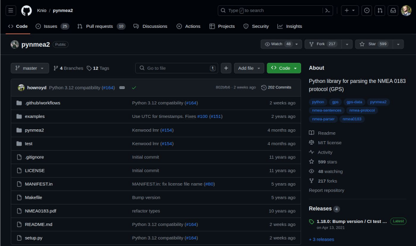
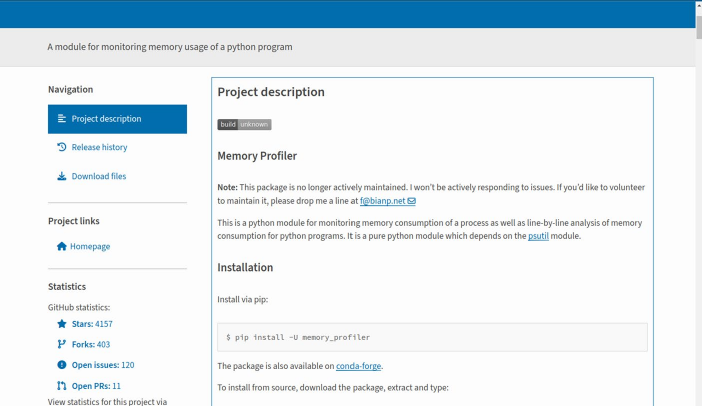
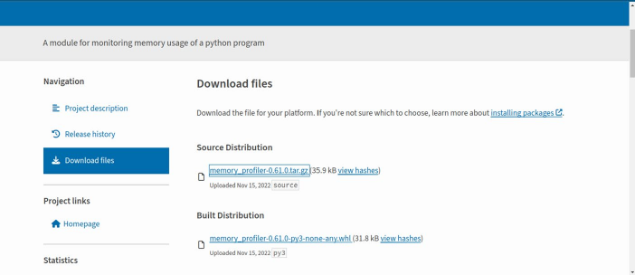
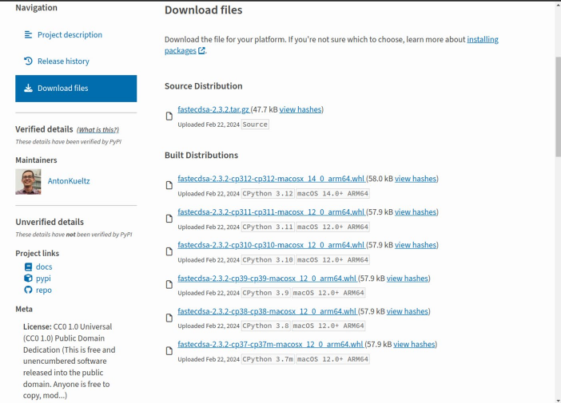

# Chương 10. Recipe cho ứng dụng Python (Python Application Recipes)

Trong thế giới embedded, ngôn ngữ C (có lẽ) là ngôn ngữ lập trình chiếm ưu thế; tuy nhiên, ngôn ngữ Python chắc chắn đứng ở vị trí thứ hai. Vì vậy việc biết cách thao tác trong trường hợp cần thêm code Python vào hệ thống embedded có thể hữu ích.

Trong chương này, chúng ta sẽ xem một số ví dụ về những gì developer có thể làm để thêm package của mình vào ứng dụng embedded.

> Trước khi tiếp tục, bạn đọc nên chắc chắn rằng kit embedded của mình truy cập được qua serial console và network interface như đã giải thích trong Mục 1.3.

## 10.1 Thêm ứng dụng Python (cho phát triển) (Adding Python Applications (for Development))

Trước tiên, để thêm code Python vào hệ thống, chúng ta có thể cân nhắc dùng lệnh `pip3` (hoặc `pip` cho code Python 2.x). Trong kit embedded của chúng ta, lệnh `pip3` hẳn đã được cài sẵn:

```
# which pip3
/usr/bin/pip3
# pip3 -h

Usage:
  pip3 <command> [options]

Commands:
  install        Install packages.
  download       Download packages.
  uninstall      Uninstall packages.
  freeze         Output installed packages in requirements format.
  list           List installed packages.
  show           Show information about installed packages.
  check          Verify installed packages have compatible dependencies.
  config         Manage local and global configuration.
  search         Search PyPI for packages.
  cache          Inspect and manage pip's wheel cache.
  index          Inspect information available from package indexes.
  wheel          Build wheels from your requirements.
  hash           Compute hashes of package archives.
  completion     A helper command used for command completion.
  debug          Show information useful for debugging.
  help           Show help for commands.
...
```

> Nếu chưa, chúng ta có thể dễ dàng cài nó bằng package python3-pip như được lệnh `oe-pkgdata-util` báo:
>
> ```
> $ oe-pkgdata-util find-path /usr/bin/pip3
> python3-pip: /usr/bin/pip3
> ```

Tuy nhiên, vấn đề khi dùng công cụ này là chúng ta không thể dùng nó trong khi tạo image. Tức là `pip3` thực sự hữu ích trong quá trình phát triển, nhưng khi phải tạo một image từ đầu, chúng ta không thể trông cậy vào nó! Điều này có nghĩa là chúng ta phải có một recipe phù hợp cho mỗi package Python muốn thêm vào image qua biến `IMAGE_INSTALL` (và các biến liên quan; xem Mục 6.5 để biết thêm thông tin về việc tạo image).

Nói dễ hiểu, điều đó có nghĩa là ngay cả khi một package có thể được cài bằng `pip3`, điều đó không có nghĩa là cùng package đó có sẵn một recipe ready-to-use cho BitBake. Đó là lý do không khuyến khích dùng công cụ này khi không biết mình đang làm gì.

OK, khi khái niệm này đã rõ, chúng ta có thể đi tiếp để trình bày hai cách khác nhau để tạo recipe cho các package Python-based, (hy vọng) sẽ bao quát phần lớn các trường hợp.

## 10.2 Dùng build system setuptools3 (Using the setuptools3 Build System)

Như được nêu trong Yocto Reference Manual tại `https://docs.yoctoproject.org/ref-manual/classes.html#setuptools3`:

> Class setuptools3 hỗ trợ các extension Python phiên bản 3.x dùng build system dựa trên setuptools (ví dụ chỉ có setup.py và chưa chuyển sang định dạng chính thức pyproject.toml). Nếu recipe của bạn dùng các build system này, recipe cần kế thừa class setuptools3.

Vì vậy mọi dự án dùng tiện ích `setup.py` để cài đặt đều là ứng viên tốt, và một trong số đó là dự án `pynmea2` tại `https://github.com/Knio/pynmea2`, như trong Hình 10-1.



Hình 10-1. Trang chủ của pynmea2

Khi xem trang chủ của dự án, chúng ta có thể thấy file `setup.py` có mặt, và bản phát hành mới nhất là 1.18.0. Trong tình huống này, một lệnh tốt để dễ dàng thêm recipe mới là dùng `devtool` như dưới đây:

```
$ devtool add -S 1.18.0 python3-pynmea2 \
          https://github.com/Knio/pynmea2.git
NOTE: Starting bitbake server...
INFO: Fetching git://github.com/Knio/pynmea2.git;protocol=https;nobranc
h=1...
...
INFO: Scanning paths for packages & dependencies: pynmea2, pynmea2/type
s, pynmea2/types/proprietary
INFO: Using default source tree path /home/giometti/yocto/imx-yocto-bsp
/imx8mp-build/workspace/sources/python3-pynmea2
...
INFO: Using source tree as build directory since that would be the defa
ult for this recipe
INFO: Recipe /home/giometti/yocto/imx-yocto-bsp/imx8mp-build/workspace/
recipes/python3-pynmea2/python3-pynmea2_git.bb has been automatically c
reated; further editing may be required to make it fully functional
```

> Bạn đọc nên chú ý rằng trong trường hợp này, chúng ta không dùng tên đơn giản hơn `pynmea2` chỉ vì best practice là thêm chuỗi `python-` vào trước, hoặc tốt hơn nữa với các dự án Python 3.x là chuỗi `python3-`, cho mọi dự án Python-based.

Như thường lệ, `devtool` cho chúng ta biết một recipe mới `python3-pynmea2_git.bb` đã được tạo trong `workspace` và chúng ta phải kiểm tra nó trước khi tiếp tục. Vậy hãy xem recipe mới bằng subcommand `edit-recipe`:

```
# Recipe created by recipetool
# This is the basis of a recipe and may need further editing in order to
# be fully functional.
# (Feel free to remove these comments when editing.)

SUMMARY = "Python library for the NMEA 0183 protcol"
HOMEPAGE = "https://github.com/Knio/pynmea2"
# WARNING: the following LICENSE and LIC_FILES_CHKSUM values are best
# guesses - it is your responsibility to verify that the values are
# complete and correct.
LICENSE = "MIT"
LIC_FILES_CHKSUM = "file://LICENSE;md5=bb5e173bc54080cb25079199959ba6b6"

SRC_URI = "git://github.com/Knio/pynmea2.git;protocol=https;branch=mast
er"

# Modify these as desired
PV = "1.0+git${SRCPV}"
SRCREV = "1.18.0"

S = "${WORKDIR}/git"

inherit setuptools3

# WARNING: the following rdepends are determined through basic analysis
# of the python sources, and might not be 100% accurate.
RDEPENDS:${PN} += "python3-core python3-datetime python3-numbers"
```

Các phần liên quan trong recipe trên là

- Câu lệnh `inherit setuptools3`, cần thiết để thêm mọi biến và hàm cần dùng để có thể cài các package Python dựa trên build system `setuptools3`

- Biến `RDEPENDS`, đã được khởi tạo qua phân tích cơ bản source của dự án và chúng ta phải xem lại cẩn thận

Trong trường hợp của chúng ta, mọi thứ có vẻ đúng, vì vậy chúng ta có thể bỏ mọi comment không cần thiết, thêm một số biến mô tả như đã làm ở chương trước, rồi chỉ cần thử tạo package mới, vẫn bằng `devtool` như dưới đây:

```
$ devtool build python3-pynmea2
NOTE: Starting bitbake server...
...
NOTE: pynmea2: compiling from external source tree /home/giometti/yocto
/imx-yocto-bsp/imx8mp-build/workspace/sources/python3-pynmea2
NOTE: Tasks Summary: Attempted 939 tasks of which 931 didn't need to be rerun
and all succeeded.
```

Recipe sẽ trông như sau:

```
SUMMARY = "Python library for the NMEA 0183 protocol"
MAINTAINER = "Rodolfo Giometti <giometti@enneenne.com>"
SECTION = "console/network"
HOMEPAGE = "https://github.com/Knio/pynmea2"
LICENSE = "MIT"
LIC_FILES_CHKSUM = "file://LICENSE;md5=bb5e173bc54080cb25079199959ba6b6"

SRC_URI = "git://github.com/Knio/pynmea2.git;protocol=https;branch=mast
er"

PV = "1.0+git${SRCPV}"
SRCREV = "c546442d1ba38e488f47ef8a190eb5e890260aa2"

S = "${WORKDIR}/git"

inherit setuptools3

RDEPENDS:${PN} += "python3-core python3-datetime python3-numbers"
```

OK, giờ chúng ta có thể thử deploy code lên target để thử trên embedded machine:

```
$ devtool deploy-target -s python3-pynmea2 root@192.168.32.132
...
devtool_deploy.list                        100% 3579     2.7MB/s   00:00
devtool_deploy.sh                          100% 1017     1.9MB/s   00:00
./
./usr/
./usr/lib/
./usr/lib/python3.10/
...
./usr/lib/python3.10/site-packages/pynmea2/nmea.py
...
```

> Output ở đây khá dài, vì vậy nó đã được ngắt vì lý do dung lượng. Tuy nhiên, bạn đọc có thể kiểm chứng rằng mọi file đều có mặt trên hệ thống của mình.

Bây giờ, để thử code, chúng ta có thể dùng ví dụ trong file `README.md`. Vậy hãy khởi động Python interpreter:

```
# python3
Python 3.10.7 (main, Sep  5 2022, 13:12:31) [GCC 11.3.0] on linux
Type "help", "copyright", "credits" or "license" for more information.
>>>
```

Sau đó chúng ta có thể dùng lệnh sau để nạp module mới rồi dùng một trong các phương thức được export của nó:

```
>>> import pynmea2
>>> msg = pynmea2.parse("$GPGGA,184353.07,1929.045,S,02410.506,E,1,04,2
.6,100.00,M,-33.9,M,,0000*6D")
>>> print(msg)
$GPGGA,184353.07,1929.045,S,02410.506,E,1,04,2.6,100.00,M,-33.9,M,,0000
*6D
```

OK, mọi thứ có vẻ hoạt động đúng, vì vậy hãy đi tiếp và tạo package tương ứng. Trước tiên, chúng ta phải gỡ code bằng subcommand `undeploy-target`:

```
$ devtool undeploy-target python3-pynmea2 root@192.168.32.132
NOTE: Starting bitbake server...
INFO: Successfully undeployed python3-pynmea2
```

Sau đó chúng ta phải tạo một recipe phù hợp trong thư mục `recipes-python` như dưới đây:

```
$ mkdir $CY_METADIR/recipes-python
$ devtool finish python3-pynmea2 $CY_METADIR/recipes-python/
INFO: Updating SRCREV in recipe python3-pynmea2_git.bb
INFO: Moving recipe file to /home/giometti/yocto/imx-yocto-bsp/sources/
meta-cy/recipes-python/python3-pynmea2
INFO: Leaving source tree /home/giometti/yocto/imx-yocto-bsp/imx8mp-bui
ld/workspace/sources/python3-pynmea2 as-is; if you no longer need it then
please delete it manually
```

OK, giờ chúng ta có thể tạo package bằng BitBake:

```
$ bitbake python3-pynmea2
```

Và các package mới được tạo được trình bày dưới đây:

```
$ cy-ipk find python3-pynmea2
cy-ipk: searching in /home/giometti/yocto/imx-yocto-bsp/imx8mp-build...
tmp/deploy/ipk/armv8a/python3-pynmea2-dbg_1.0+git0+c546442d1b-r0_armv8a
.ipk
tmp/deploy/ipk/armv8a/python3-pynmea2-dev_1.0+git0+c546442d1b-r0_armv8a
.ipk
tmp/deploy/ipk/armv8a/python3-pynmea2_1.0+git0+c546442d1b-r0_armv8a.ipk
```

Bây giờ chúng ta có thể kiểm tra thông tin của package:

```
$ cy-ipk get-info tmp/deploy/ipk/armv8a/python3-pynmea2_1.0+git0+c54644
2d1b-r0_armv8a.ipk
Package: python3-pynmea2
Version: 1.0+git0+c546442d1b-r0
Description: Python library for the NMEA 0183 protocol
 Python library for the NMEA 0183 protcol.
Section: console/network
Priority: optional
Maintainer: Rodolfo Giometti <giometti@enneenne.com>
License: MIT
Architecture: armv8a
OE: python3-pynmea2
Homepage: https://github.com/Knio/pynmea2
Depends: python3-core, python3-datetime, python3-numbers
Source: python3-pynmea2_git.bb
```

Mọi thứ có vẻ đã sẵn sàng, vì vậy chúng ta có thể chuyển package sang embedded machine:

```
$ scp tmp/deploy/ipk/armv8a/python3-pynmea2_1.0+git0+c546442d1b-r0_armv
8a.ipk \
      root@192.168.32.132:/tmp/
```

Rồi chúng ta có thể tiến hành cài package:

```
# opkg install /tmp/python3-pynmea2_1.0+git0+c546442d1b-r0_armv8a.ipk
Installing python3-pynmea2 (1.0+git0+c546442d1b) on root
Configuring python3-pynmea2.
```

Để chắc chắn mọi thứ đang chạy, chúng ta có thể làm lại phép thử nhỏ ở trên:

```
# python3
Python 3.10.7 (main, Sep  5 2022, 13:12:31) [GCC 11.3.0] on linux
Type "help", "copyright", "credits" or "license" for more information.
>>> import pynmea2
>>> msg = pynmea2.parse("$GPGGA,184353.07,1929.045,S,02410.506,E,1,04,2.6
,100.00,M,-33.9,M,,0000*6D")
>>> print(msg)
$GPGGA,184353.07,1929.045,S,02410.506,E,1,04,2.6,100.00,M,-33.9,M,,0000*6D
```

Chúng ta có cùng kết quả như trên, vì vậy công việc đã được làm đúng.

## 10.3 Dùng build system pypi (Using the pypi Build System)

Như ở mục trước, vẫn trong Yocto Reference Manual tại `https://docs.yoctoproject.org/ref-manual/classes.html#pypi`, chúng ta đọc thấy

> Class pypi đặt các biến phù hợp cho các recipe build module Python từ PyPI, Python Package Index. Theo mặc định, nó xác định tên package PyPI dựa trên BPN (bỏ tiền tố “python-” hoặc “python3-” nếu có), tuy nhiên trong một số trường hợp bạn có thể cần đặt nó thủ công trong recipe bằng cách đặt PYPI_PACKAGE.

Python Package Index là một repository software cho ngôn ngữ lập trình Python, có tại `https://pypi.org/`, và chúng ta có thể tìm thấy ở đó rất nhiều software package hữu ích.

Để cho thấy cách tạo recipe cho các package này, chúng ta có thể xét hai trường hợp chính: ở chế độ có hỗ trợ bằng `devtool` như thường lệ, và dùng class pypi thủ công.

### 10.3.1 Chế độ có hỗ trợ (The Assisted Mode)

Như đã thấy ở chương trước, dùng `devtool` khá đơn giản, và để tìm một ứng viên phù hợp cho một ví dụ thực tế, chúng ta có thể chọn dự án memory profiler tại `https://pypi.org/project/memory-profiler`, như trong Hình 10-2.



Hình 10-2. Trang chủ của memory profiler

Trong link `Download files`, chúng ta có thể có danh sách các bản phát hành sẵn sàng để tải. Vào thời điểm viết sách, tình hình như trong Hình 10-3.



Hình 10-3. Trang tải của memory profiler

Vì vậy chúng ta có thể bắt đầu công việc bằng cách dùng lại `devtool`, như dưới đây, trong đó chúng ta dùng URL để tải file `memory_profiler-0.61.0.tar.gz` từ trang web trên:

```
$ devtool add python3-memory-profiler \
          https://files.pythonhosted.org/packages/b2/88/e1907e1ca3488f2
d9507ca8b0ae1add7b1cd5d3ca2bc8e5b329382ea2c7b/memory_profiler-0.61.0.ta
r.gz
NOTE: Starting bitbake server...
INFO: Fetching https://files.pythonhosted.org/packages/b2/88/e1907e1ca3
488f2d9507ca8b0ae1add7b1cd5d3ca2bc8e5b329382ea2c7b/memory_profiler-0.61
.0.tar.gz...
...
INFO: Scanning paths for packages & dependencies: .
INFO: Please add the following line for 'COPYING' to a 'lib/recipetool/
licenses.csv' and replace `Unknown` with the license:
cde4ca348bb7feea790673481be0d980,Unknown
INFO: Using default source tree path /home/giometti/yocto/imx-yocto-bsp
/imx8mp-build/workspace/sources/python3-memory-profiler
INFO: Using source tree as build directory since that would be the defa
ult for this recipe
INFO: Recipe /home/giometti/yocto/imx-yocto-bsp/imx8mp-build/workspace/
recipes/python3-memory-profiler/python3-memory-profiler_0.61.0.bb has b
een automatically created; further editing may be required to make it f
ully functional
```

> Bạn đọc nên chú ý rằng, như đã làm ở mục trước với mọi dự án Python 3.x–based, tên package đã được thêm tiền tố `python3-` ở đầu.

Như ở mục trước, `devtool` làm việc của nó, nhưng lần này chúng ta chú ý ghi chú:

```
Please add the following line for 'COPYING' to a 'lib/recipetool/licens
es.csv' and replace `Unknown` with the license:
cde4ca348bb7feea790673481be0d980,Unknown
```

Lý do là `devtool` không nhận ra được license của dự án, và nó yêu cầu chúng ta thêm license mới này vào danh sách các license đã biết. Tuy nhiên, chúng ta biết rõ license của dự án là gì, vì nó được nêu trên trang chủ của dự án và được ghi là `BSD License (BSD)`, vì vậy có thể dễ dàng sửa.

Vậy hãy bắt đầu bằng cách bỏ các comment không cần thiết (dù sao chúng ta vẫn để lại các comment về phụ thuộc) và sửa recipe mới như thường lệ bằng subcommand `edit-recipe`. Chúng ta sẽ có kết quả như dưới đây:

```
SUMMARY = "A module for monitoring memory usage of a python program"
MAINTAINER = "Rodolfo Giometti <giometti@enneenne.com>"
SECTION = "devel/python"
HOMEPAGE = "https://github.com/pythonprofilers/memory_profiler"
LICENSE = "BSD-3-Clause"
LIC_FILES_CHKSUM = "file://COPYING;md5=cde4ca348bb7feea790673481be0d980"

SRC_URI = "https://files.pythonhosted.org/packages/b2/88/e1907e1ca3488f
2d9507ca8b0ae1add7b1cd5d3ca2bc8e5b329382ea2c7b/memory_profiler-${PV}.ta
r.gz"
SRC_URI[md5sum] = "5fe93d5035288095c4f86ef69ee19f37"
SRC_URI[sha1sum] = "116c32efa5ea3612b616e269676e05c1fab86581"
SRC_URI[sha256sum] = "4e5b73d7864a1d1292fb76a03e82a3e78ef934d06828a698d
9dada76da2067b0"
SRC_URI[sha384sum] = "7a9b686739ac1dd76c6778d9d820b8bde5d27f5294932cc14
6abe62bb79b3ac4ef316a4f2acc92273389a3473b6b144c"
SRC_URI[sha512sum] = "b4b4629133221252ad336871781225688ba704c8c19ef3238
5672e4f18e8a160e7d68b640bde8a34bafe212d9501f1b7f24ba742cfe29d5785196695
9ef3800a"

S = "${WORKDIR}/memory_profiler-${PV}"

inherit setuptools3

# WARNING: the following rdepends are from setuptools install_requires.
# These upstream names may not correspond exactly to bitbake package
# names.
RDEPENDS:${PN} += "python3-psutil"

# WARNING: the following rdepends are determined through basic analysis
# of the python sources, and might not be 100% accurate.
RDEPENDS:${PN} += "python3-asyncio python3-core python3-debugger python
3-distutils python3-logging python3-misc python3-multiprocessing python
3-numpy python3-shell"
# WARNING: We were unable to map the following python package/module
# dependencies to the bitbake packages which include them:
#    IPython
#    IPython.core.error
#    IPython.core.magic
#    IPython.core.page
#    IPython.genutils
#    IPython.ipapi
#    IPython.ipstruct
#    IPython.utils.ipstruct
#    matplotlib
#    pylab
```

Về license, giá trị đoán tốt nhất có vẻ OK, và phần liên quan của recipe là phần về các phụ thuộc của package.

Phụ thuộc đầu tiên được phát hiện là `python3-psutil`, mà `devtool` đã trích đúng từ phần `setuptools install_requires` (như được nêu trong comment ở trên). Thật vậy, nếu xem file `setup.cfg` trong thư mục gốc của dự án, chúng ta có thể thấy các thiết lập sau:

```
[options]
py_modules =
    memory_profiler
    mprof
python_requires = >=3.7
install_requires = psutil
```

Các phụ thuộc khác được phát hiện, dù không chính xác 100%, là

```
RDEPENDS:${PN} += "python3-asyncio python3-core python3-debugger python
3-distutils python3-logging python3-misc python3-multiprocessing python
3-numpy python3-shell"
```

Trong trường hợp này, như được nêu trong comment ở trên, chúng được phát hiện qua phân tích cơ bản source python, vì vậy chúng ta nên xem lại chúng cẩn thận (dù `devtool` hoạt động rất tốt).

Tuy nhiên, một số vấn đề có thể phát sinh với các phụ thuộc cuối cùng (không) được phát hiện, như trong ghi chú dưới đây:

```
# WARNING: We were unable to map the following python package/module
# dependencies to the bitbake packages which include them:
#    IPython
#    IPython.core.error
#    IPython.core.magic
#    IPython.core.page
#    IPython.genutils
#    IPython.ipapi
#    IPython.ipstruct
#    IPython.utils.ipstruct
#    matplotlib
#    pylab
```

Khi nhận được một warning message như trên, chúng ta phải tìm hiểu một chút để biết có phải thêm mục `RDEPENDS` nào nữa không, hay có thể đi tiếp mà không lo lắng. Chúng ta không phải là guru Python, nhưng trong trường hợp này, có thể yên tâm nghĩ đến việc bỏ warning và đi tiếp, chờ xem lỗi nào có thể phát sinh trong khi tạo package.

Tốt, sau mọi cân nhắc và khi mọi sửa đổi đã sẵn sàng, trạng thái cuối cùng của recipe sẽ như dưới đây:

```
SUMMARY = "A module for monitoring memory usage of a python program"
MAINTAINER = "Rodolfo Giometti <giometti@enneenne.com>"
SECTION = "devel/python"
HOMEPAGE = "https://github.com/pythonprofilers/memory_profiler"
LICENSE = "BSD-3-Clause"
LIC_FILES_CHKSUM = "file://COPYING;md5=cde4ca348bb7feea790673481be0d980"

SRC_URI = "https://files.pythonhosted.org/packages/b2/88/e1907e1ca3488f
2d9507ca8b0ae1add7b1cd5d3ca2bc8e5b329382ea2c7b/memory_profiler-${PV}.ta
r.gz"
SRC_URI[md5sum] = "5fe93d5035288095c4f86ef69ee19f37"
SRC_URI[sha1sum] = "116c32efa5ea3612b616e269676e05c1fab86581"
SRC_URI[sha256sum] = "4e5b73d7864a1d1292fb76a03e82a3e78ef934d06828a698d
9dada76da2067b0"
SRC_URI[sha384sum] = "7a9b686739ac1dd76c6778d9d820b8bde5d27f5294932cc14
6abe62bb79b3ac4ef316a4f2acc92273389a3473b6b144c"
SRC_URI[sha512sum] = "b4b4629133221252ad336871781225688ba704c8c19ef3238
5672e4f18e8a160e7d68b640bde8a34bafe212d9501f1b7f24ba742cfe29d5785196695
9ef3800a"

S = "${WORKDIR}/memory_profiler-${PV}"

inherit setuptools3
RDEPENDS:${PN} += "python3-psutil"
RDEPENDS:${PN} += "python3-asyncio python3-core python3-debugger python
3-distutils python3-logging python3-misc python3-multiprocessing python
3-numpy python3-shell"
```

OK, giờ chúng ta có thể thử build package như thường lệ:

```
$ devtool build python3-memory-profiler
...
NOTE: python3-memory-profiler: compiling from external source tree /hom
e/giometti/yocto/imx-yocto-bsp/imx8mp-build/workspace/sources/python3-m
emory-profiler
NOTE: Tasks Summary: Attempted 939 tasks of which 931 didn't need to be
 rerun and all succeeded.
```

Tuyệt! Mọi thứ đều hoạt động tốt, vì vậy chúng ta có thể thử deploy code để thử nó trên target machine:

```
$ devtool deploy-target -s python3-memory-profiler root@192.168.32.132
...
./
./usr/
./usr/bin/
./usr/bin/mprof
./usr/lib/
./usr/lib/python3.10/
...
./usr/lib/python3.10/site-packages/memory_profiler.py
...
```

> Như trước, output ở đây khá dài, vì vậy nó đã được ngắt vì lý do dung lượng. Tuy nhiên, bạn đọc có thể kiểm chứng rằng mọi file đều có mặt trên hệ thống của mình.

Bây giờ, như được viết trong tài liệu của package, chúng ta sẽ có thể thực thi lệnh `mprof`, vậy hãy thử như dưới đây:

```
# mprof
Traceback (most recent call last):
  File "/usr/bin/mprof", line 5, in <module>
    from mprof import main
  File "/usr/lib/python3.10/site-packages/mprof.py", line 17, in <modul
e>
    import memory_profiler as mp
  File "/usr/lib/python3.10/site-packages/memory_profiler.py", line 20,
 in <module>
    import pdb
ModuleNotFoundError: No module named 'pdb'
```

Lần này chúng ta không may mắn, vì có vẻ một số phụ thuộc runtime bị thiếu, vì vậy chúng ta phải kiểm tra xem mọi package được liệt kê trong biến `RDEPENDS` có mặt trong image hiện tại không. Để dễ làm việc đó, chúng ta có thể dùng tiện ích `cy-image` như dưới đây:

```
$ cy-image chk-pkg engicam-evaluation-image-mx8 python3-psutil \
    python3-asyncio python3-core python3-debugger python3-distutils \
    python3-logging python3-misc python3-multiprocessing python3-numpy \
    python3-shell
cy-image: searching in /home/giometti/yocto/imx-yocto-bsp/imx8mp-build.
..
package python3-psutil is not present
package python3-asyncio is present
package python3-core is present
package python3-debugger is not present
package python3-distutils is present
package python3-logging is present
package python3-misc is not present
package python3-multiprocessing is present
package python3-numpy is not present
package python3-shell is present
```

Các package bị thiếu là `python3-psutil`, `python3-debugger`, `python3-misc` và `python3-numpy`, vì vậy hãy xem recipe nào cung cấp chúng. Một lần nữa, chúng ta có thể dùng tiện ích `cy-ipk`:

```
$ cy-ipk recipe python3-psutil python3-debugger python3-misc python3-num
py
package python3-psutil is provideb by... python3-psutil
package python3-debugger is provideb by... python3
package python3-misc is provideb by... python3
package python3-numpy is provideb by... python3-numpy
```

Tuyệt! Vậy `python3-debugger` và `python3-misc` đã được recipe Python cốt lõi cung cấp, và chúng ta chỉ cần tạo hai package còn lại bằng BitBake:

```
$ bitbake python3-psutil python3-numpy
```

Giờ mọi package cần thiết hẳn đã sẵn sàng, và chúng ta có thể dễ dàng tìm chúng bằng cách dùng lại `cy-ipk` như dưới đây:

```
$ cy-ipk find python3-psutil python3-debugger python3-misc python3-numpy
cy-ipk: searching in /home/giometti/yocto/imx-yocto-bsp/imx8mp-build...
tmp/deploy/ipk/armv8a/python3-psutil_5.9.0-r0_armv8a.ipk
tmp/deploy/ipk/armv8a/python3-psutil-tests_5.9.0-r0_armv8a.ipk
tmp/deploy/ipk/armv8a/python3-psutil-dev_5.9.0-r0_armv8a.ipk
tmp/deploy/ipk/armv8a/python3-psutil-dbg_5.9.0-r0_armv8a.ipk
tmp/deploy/ipk/armv8a/python3-psutil-src_5.9.0-r0_armv8a.ipk
tmp/deploy/ipk/armv8a/python3-debugger_3.10.7-r0_armv8a.ipk
tmp/deploy/ipk/armv8a/python3-misc_3.10.7-r0_armv8a.ipk
tmp/deploy/ipk/armv8a/python3-numpy_1.22.3-r0_armv8a.ipk
tmp/deploy/ipk/armv8a/python3-numpy-dbg_1.22.3-r0_armv8a.ipk
tmp/deploy/ipk/armv8a/python3-numpy-src_1.22.3-r0_armv8a.ipk
tmp/deploy/ipk/armv8a/python3-numpy-dev_1.22.3-r0_armv8a.ipk
tmp/deploy/ipk/armv8a/python3-numpy-ptest_1.22.3-r0_armv8a.ipk
tmp/deploy/ipk/armv8a/python3-numpy-staticdev_1.22.3-r0_armv8a.ipk
```

Khi đã xác định được các file package, chúng ta có thể dễ dàng chuyển chúng sang target machine qua `scp`:

```
$ scp tmp/deploy/ipk/armv8a/python3-psutil_5.9.0-r0_armv8a.ipk \
      tmp/deploy/ipk/armv8a/python3-debugger_3.10.7-r0_armv8a.ipk \
      tmp/deploy/ipk/armv8a/python3-misc_3.10.7-r0_armv8a.ipk \
      tmp/deploy/ipk/armv8a/python3-numpy_1.22.3-r0_armv8a.ipk \
          root@192.168.32.132:/tmp/
```

Rồi chúng ta có thể tiến hành cài đặt qua `opkg`:

```
# opkg install /tmp/*.ipk
 * Solver encountered 3 problem(s):
 * Problem 1/3:
 *   - conflicting requests
 *   - nothing provides python3-audio needed by python3-misc-3.10.7-r0.
armv8a
 *
 * Solution 1:
 *   - do not ask to install python3-misc-3.10.7-r0.armv8a

 * Problem 2/3:
 *   - conflicting requests
 *   - nothing provides python3-doctest needed by python3-numpy-1.22.3-
r0.armv8a
 *
 * Solution 1:
 *   - do not ask to install python3-numpy-1.22.3-r0.armv8a

 * Problem 3/3:
 *   - conflicting requests
 *   - nothing provides python3-resource needed by python3-psutil-5.9.0
-r0.armv8a
 *
 * Solution 1:
 *   - do not ask to install python3-psutil-5.9.0-r0.armv8a
```

Vẫn không may! Chúng ta cần thêm package. Vậy hãy tìm chúng:

```
$ cy-ipk find python3-audio python3-doctest python3-resource
cy-ipk: searching in /home/giometti/yocto/imx-yocto-bsp/imx8mp-build...
tmp/deploy/ipk/armv8a/python3-audio_3.10.7-r0_armv8a.ipk
tmp/deploy/ipk/armv8a/python3-doctest_3.10.7-r0_armv8a.ipk
tmp/deploy/ipk/armv8a/python3-resource_3.10.7-r0_armv8a.ipk
```

Sau đó hãy chuyển chúng sang target machine:

```
$ scp tmp/deploy/ipk/armv8a/python3-audio_3.10.7-r0_armv8a.ipk \
      tmp/deploy/ipk/armv8a/python3-doctest_3.10.7-r0_armv8a.ipk \
      tmp/deploy/ipk/armv8a/python3-resource_3.10.7-r0_armv8a.ipk \
          root@192.168.32.132:/tmp/
```

Và thử cài lại mọi package:

```
# opkg install /tmp/*.ipk
 * Solver encountered 2 problem(s):
 * Problem 1/2:
 *   - conflicting requests
 *   - nothing provides python3-codecs needed by python3-misc-3.10.7-r0
.armv8a
 *
 * Solution 1:
 *   - do not ask to install python3-misc-3.10.7-r0.armv8a

 * Problem 2/2:
 *   - package python3-numpy-1.22.3-r0.armv8a requires python3-misc, but
 * none of the providers can be installed
 *   - conflicting requests
 *   - nothing provides python3-codecs needed by python3-misc-3.10.7-r0
.armv8a
 *
 * Solution 1:
 *   - do not ask to install python3-numpy-1.22.3-r0.armv8a
```

Vẫn không được. Tuy nhiên, lần này hẳn là phụ thuộc còn thiếu cuối cùng, vì cả hai lỗi đều liên quan đến package `python3-codecs` bị thiếu. Vậy hãy tìm và chuyển nó sang target machine như thường lệ:

```
$ cy-ipk find python3-codecs
cy-ipk: searching in /home/giometti/yocto/imx-yocto-bsp/imx8mp-build...
tmp/deploy/ipk/armv8a/python3-codecs_3.10.7-r0_armv8a.ipk
$ scp tmp/deploy/ipk/armv8a/python3-codecs_3.10.7-r0_armv8a.ipk \
        root@192.168.32.132:/tmp/
```

OK, hãy thử cài lại mọi package:

```
# opkg install /tmp/*.ipk
Installing python3-debugger (3.10.7) on root
Installing python3-codecs (3.10.7) on root
Installing python3-audio (3.10.7) on root
Installing python3-resource (3.10.7) on root
Installing python3-doctest (3.10.7) on root
Installing python3-misc (3.10.7) on root
Installing python3-psutil (5.9.0) on root
Installing python3-numpy (1.22.3) on root
Configuring python3-debugger.
Configuring python3-audio.
Configuring python3-codecs.
Configuring python3-misc.
Configuring python3-doctest.
Configuring python3-numpy.
Configuring python3-resource.
Configuring python3-psutil.
```

Tuyệt! Giờ chúng ta đã làm được. Bây giờ chúng ta có thể thử thực thi công cụ mới như đã làm trước đó, hy vọng lần này mọi thứ sẽ hoạt động tốt:

```
# mprof
Usage: mprof <command> <options> <arguments>

Available commands:
    run      run a given command or python file
    attach   alias for 'run --attach': attach to an existing process b
y pid or name
    rm       remove a given file generated by mprof
    clean    clean the current directory from files created by mprof
    list     display existing profiles, with indices
    plot     plot memory consumption generated by mprof run
    peak     print the maximum memory used by an mprof run

Type mprof <command> --help for usage help on a specific command.
For example, mprof plot --help will list all plotting options.
```

Giờ chúng ta đã sẵn sàng tạo recipe, vì vậy hãy dùng `devtool` với subcommand `finish` như dưới đây:

```
$ devtool finish python3-memory-profiler $CY_METADIR/recipes-python/
NOTE: Starting bitbake server...
ERROR: Source tree is not clean:

?? build/

Ensure you have committed your changes or use -f/--force if you are sur
e there's nothing that needs to be committed
```

Công cụ đã nhận ra đúng rằng source tree của chúng ta không sạch, nhưng chúng ta biết thư mục `build` đã được tạo ra trong khi build package, vì vậy có thể yên tâm dùng option argument `-f`, như được gợi ý ở trên:

```
$ devtool finish -f python3-memory-profiler $CY_METADIR/recipes-python/
NOTE: Starting bitbake server...
WARNING: Source tree is not clean, continuing as requested by -f/--forc
e...
INFO: No patches or files need updating
INFO: Moving recipe file to /home/giometti/yocto/imx-yocto-bsp/sources/
meta-cy/recipes-python/python3-memory-profiler
INFO: Leaving source tree /home/giometti/yocto/imx-yocto-bsp/imx8mp-bui
ld/workspace/sources/python3-memory-profiler as-is; if you no longer ne
ed it then please delete it manually
```

Giờ recipe đã sẵn sàng:

```
$ cd $CY_METADIR
$ tree recipes-python/python3-memory-profiler/
recipes-python/python3-memory-profiler/
└── python3-memory-profiler_0.61.0.bb

0 directories, 1 file
```

Và chúng ta có thể dùng lệnh `bitbake` để tạo file package tương ứng:

```
$ bitbake python3-memory-profiler
```

Cuối cùng, package đã sẵn sàng:

```
$ cy-ipk find python3-memory-profiler
cy-ipk: searching in /home/giometti/yocto/imx-yocto-bsp/imx8mp-build...
tmp/deploy/ipk/armv8a/python3-memory-profiler-dev_0.61.0-r0_armv8a.ipk
tmp/deploy/ipk/armv8a/python3-memory-profiler_0.61.0-r0_armv8a.ipk
tmp/deploy/ipk/armv8a/python3-memory-profiler-dbg_0.61.0-r0_armv8a.ipk
```

Và thông tin của package cũng được đặt đúng:

```
$ cy-ipk get-info tmp/deploy/ipk/armv8a/python3-memory-profiler_0.61.0-
r0_armv8a.ipk
Package: python3-memory-profiler
Version: 0.61.0-r0
Description: A module for monitoring memory usage of a python program
 A module for monitoring memory usage of a python program.
Section: devel/python
Priority: optional
Maintainer: Rodolfo Giometti <giometti@enneenne.com>
License: BSD-3-Clause
Architecture: armv8a
OE: python3-memory-profiler
Homepage: https://github.com/pythonprofilers/memory_profiler
Depends: python3-asyncio, python3-core, python3-debugger, python3-distu
tils, python3-logging, python3-misc, python3-multiprocessing, python3-n
umpy, python3-psutil, python3-shell
Source: python3-memory-profiler_0.61.0.bb
```

Bây giờ chúng ta có thể làm như trước và thử cài package lên kit embedded; tuy nhiên, chúng ta để việc này cho bạn đọc làm bài tập.

### 10.3.2 Cách thủ công (The Manual Way)

Nếu xem recipe vừa viết ở mục trên cho package `python3-memory-profiler`, chúng ta sẽ thấy rằng mình hoàn toàn không dùng class pypi! Thật vậy, trong recipe không có lời gọi `inherit pypi` nào. Vậy class này dùng để làm gì? Chúng ta có thể dùng class này để viết recipe thủ công mà không dùng `devtool`, hoặc trong trường hợp `devtool` thất bại.

Để cho thấy điều chúng ta đang nói, hãy xét package fastecdsa tại `https://pypi.org/project/fastecdsa/`. Hình 10-4 là ảnh chụp màn hình trang tải software.



Hình 10-4. Trang tải của fastecdsa

Trong trường hợp quyết định tạo package cho bản phát hành 2.3.2, chúng ta có thể lấy URL của file archive tương ứng `fastecdsa-2.3.2.tar.gz` và thực thi lệnh dưới đây:

```
$ devtool add python3-fastecdsa \
           https://files.pythonhosted.org/packages/fc/21/d5585856169c59
5d99a596dd8000afae40053f9f5c955d8ec8fb2ec3247c/fastecdsa-2.3.2.tar.gz
```

Tuy nhiên, lần này chúng ta không may mắn, vì output của lệnh trên sẽ giống như dưới đây:

```
...
  File "/home/giometti/yocto/imx-yocto-bsp/sources/poky/meta/lib/oe/lic
ense.py", line 62, in get_elements
    raise InvalidLicense(element)
oe.license.InvalidLicense: invalid characters in license 'This-is-free-
and-unencumbered-software-released-into-the-public-domain.
--------
--------Anyone-is-free-to-copy,-modify,-publish,-use,-compile,-sell,-or
--------distribute-this-software,-either-in-source-code-form-or-as-a
—-------compiled-binary,-for-any-purpose,-commercial-or-non-commercial,
—-------and-by-any-means.
...
--------For-more-information,-please-refer-to-<http://unlicense.org/>
'
ERROR: Command 'script -e -q -c "recipetool --color=always create –devt
ool -o /tmp/devtoolqp80pxf_ 'https://files.pythonhosted.org/packages/fc
/21/d5585856169c595d99a596dd8000afae40053f9f5c955d8ec8fb2ec3247c/fastec
dsa-2.3.2.tar.gz'  -x /home/giometti/yocto/imx-yocto-bsp/imx8mp-build/w
orkspace/sources/devtoolsrc8855cvb1 -N python3-fastecdsa" /dev/null' fa
iled
...
```

Trong trường hợp này, không có recipe nào được tạo, và điều duy nhất có thể làm là tự viết recipe bằng tay dùng class pypi. Trong tình huống này, chúng ta có thể chuyển vào meta layer của mình và bắt đầu tạo recipe thủ công:

```
$ cd $CY_METADIR
$ mkdir recipes-python/python3-fastecdsa
```

Chúng ta có thể dùng bộ khung sau:

```
SUMMARY = " "
MAINTAINER = " "
SECTION = " "
HOMEPAGE = " "
LICENSE = " "
LIC_FILES_CHKSUM = " "

PYPI_PACKAGE = "fastecdsa"

inherit pypi ...
```

Để biết cần viết gì vào các biến rỗng ở trên, chúng ta có thể xem trang dự án tại `https://pypi.org/project/fastecdsa` hoặc repository của dự án tại `https://github.com/AntonKueltz/fastecdsa` để lấy thông tin hữu ích. Vì vậy phần đầu của recipe có thể được điền như dưới đây:

```
SUMMARY = "A module for fast elliptic curve cryptography"
MAINTAINER = "Rodolfo Giometti <giometti@enneenne.com>"
SECTION = "devel/python"
HOMEPAGE = "https://github.com/AntonKueltz/fastecdsa"
```

Về license, trong repository chúng ta thấy một file tên là `LICENSE`, có thể được xem như dưới đây:

```
$ git clone https://github.com/AntonKueltz/fastecdsa.git
$ cd fastecdsa
$ cat LICENSE
This is free and unencumbered software released into the public domain.

Anyone is free to copy, modify, publish, use, compile, sell, or
distribute this software, either in source code form or as a compiled
binary, for any purpose, commercial or non-commercial, and by any
means.
...
For more information, please refer to <http://unlicense.org/>
```

Hơn nữa, trên trang chủ dự án ở pypi.org, chúng ta thấy license được phân loại là CC0 1.0 Universal (CC0 1.0) Public Domain Dedication. Khi tìm nhanh trong file `licenses.conf` ở meta layer poky, chúng ta có thể thấy đây là một license đã biết:

```
$ grep 'CC0.1\.0' poky/meta/conf/licenses.conf
DATA_LICENSE = "CC0-1.0"
```

Vì vậy chúng ta có thể điền thông tin license như dưới đây:

```
LICENSE = "CC0-1.0"
LIC_FILES_CHKSUM = "file://LICENSE;md5=7246f848faa4e9c9fc0ea91122d6e680"
```

trong đó checksum có được bằng lệnh `md5sum` trên file `LICENSE`:

```
$ md5sum LICENSE
7246f848faa4e9c9fc0ea91122d6e680  LICENSE
```

Bây giờ, tính đến việc package có file `setup.py`, nghĩa là nó dùng tiện ích `setuptools` để cài đặt, chúng ta phải thêm class `setuptools3` vào câu lệnh `inherit`. Cuối cùng, recipe của chúng ta sẽ trông như sau:

```
$ cat recipes-python/python3-fastecdsa/python3-fastecdsa_2.3.2.bb
SUMMARY = "A module for fast elliptic curve cryptography"
MAINTAINER = "Rodolfo Giometti <giometti@enneenne.com>"
SECTION = "devel/python"
HOMEPAGE = "https://github.com/AntonKueltz/fastecdsa"
LICENSE = "CC0-1.0"
LIC_FILES_CHKSUM = "file://LICENSE;md5=7246f848faa4e9c9fc0ea91122d6e680"

PYPI_PACKAGE = "fastecdsa"

inherit pypi setuptools3
```

OK, giờ hãy thực thi `bitbake` trên nó:

```
$ bitbake python3-fastecdsa
...
NOTE: Executing Tasks
ERROR: python3-fastecdsa-2.3.2-r0 do_fetch: No checksum specified for '
/home/giometti/Projects/DL_ARCHIVES/yocto/fastecdsa-2.3.2.tar.gz', plea
se add at least one to the recipe:
SRC_URI[sha256sum] = "f35255a6d3e41109166b5d4b08866d5acbb99f2e1e64d3a7e
74c774664cda842"
ERROR: python3-fastecdsa-2.3.2-r0 do_fetch: Bitbake Fetcher Error:
NoChecksumError('Missing SRC_URI checksum', 'https://files.pythonhosted
.org/packages/source/f/fastecdsa/fastecdsa-2.3.2.tar.gz')
...
```

Chúng ta gặp lỗi trên, điều được dự đoán trước vì chúng ta chưa chỉ định giá trị phù hợp cho `SRC_URI[sha256sum]`. Vậy hãy làm như được gợi ý, thay đổi recipe như dưới đây:

```
--- a/recipes-python/python3-fastecdsa/python3-fastecdsa_2.3.2.bb
+++ b/recipes-python/python3-fastecdsa/python3-fastecdsa_2.3.2.bb
@@ -6,5 +6,6 @@
 LIC_FILES_CHKSUM = "file://LICENSE;md5=7246f848faa4e9c9fc0ea91122d6e68
0"

 PYPI_PACKAGE = "fastecdsa"
+SRC_URI[sha256sum] = "f35255a6d3e41109166b5d4b08866d5acbb99f2e1e64d3a7
e74c774664cda842"

 inherit pypi setuptools3
```

Sau đó chúng ta có thể thực thi lại `bitbake`:

```
$ bitbake python3-fastecdsa
...
NOTE: Executing Tasks
ERROR: python3-fastecdsa-2.3.2-r0 do_compile: 'python3 setup.py bdist_w
heel ' execution failed.
ERROR: python3-fastecdsa-2.3.2-r0 do_compile:
ExecutionError('/home/giometti/yocto/imx-yocto-bsp/imx8mp-build/tmp/wor
k/armv8a-poky-linux/python3-fastecdsa/2.3.2-r0/temp/run.do_compile.1217
193', 1, None, None)
ERROR: Logfile of failure stored in: / home/giometti/yocto/imx- yocto-bsp/imx8mp-
build/tmp/work/armv8a-poky-li
nux/python3-fastecdsa/2.3.2-r0/temp/log.do_compile.1217193
Log data follows:
| DEBUG: Executing shell function do_compile
| running bdist_wheel
| running build
| running build_ext
| building 'fastecdsa.curvemath' extension
...
-I/home/giometti/yocto/imx-yocto-bsp/imx8mp-build/tmp/work/armv8a-poky-
linux/python3-fastecdsa/2.3.2-r0/recipe-sysroot/usr/include/python3.10
-c src/curve.c -o build/temp.linux-x86_64-3.10/src/curve.o -O2
| In file included from src/curve.c:1:
| src/curve.h:4:10: fatal error: gmp.h: No such file or directory
|     4 | #include "gmp.h"
|       |          ^~~~~~~
| compilation terminated.
...
```

Ở đây, chúng ta phải tìm hiểu code một chút, và khi đó có thể phát hiện rằng thứ chúng ta cần ở đây là thư viện số học GNU multiprecision, được package `gmp` cung cấp. Vì vậy chúng ta nên thêm phụ thuộc sau:

```
--- a/recipes-python/python3-fastecdsa/python3-fastecdsa_2.3.2.bb
+++ b/recipes-python/python3-fastecdsa/python3-fastecdsa_2.3.2.bb
@@ -5,6 +5,8 @@
 LICENSE = "CC0-1.0"
 LIC_FILES_CHKSUM = "file://LICENSE;md5=7246f848faa4e9c9fc0ea91122d6e680"

+DEPENDS += "gmp"
+
 PYPI_PACKAGE = "fastecdsa"
 SRC_URI[sha256sum] = "f35255a6d3e41109166b5d4b08866d5acbb99f2e1e64d3a7
e74c774664cda842"
```

Bây giờ, nếu thực thi lại `bitbake`, chúng ta sẽ đi đến kết thúc thành công. Thật vậy, package giờ đã được compile, và các file package mới đã được tạo như dưới đây:

```
$ cy-ipk find python3-fastecdsa
cy-ipk: searching in /home/giometti/yocto/imx-yocto-bsp/imx8mp-build...
tmp/deploy/ipk/armv8a/python3-fastecdsa-dbg_2.3.2-r0_armv8a.ipk
tmp/deploy/ipk/armv8a/python3-fastecdsa-dev_2.3.2-r0_armv8a.ipk
tmp/deploy/ipk/armv8a/python3-fastecdsa_2.3.2-r0_armv8a.ipk
tmp/deploy/ipk/armv8a/python3-fastecdsa-src_2.3.2-r0_armv8a.ipk
```

Và mọi thông tin package đều được đặt đúng:

```
$ cy-ipk get-info tmp/deploy/ipk/armv8a/python3-fastecdsa_2.3.2-r0_armv
8a.ipk
Package: python3-fastecdsa
Version: 2.3.2-r0
Description: A module for fast elliptic curve cryptography
 A module for fast elliptic curve cryptography.
Section: devel/python
Priority: optional
Maintainer: Rodolfo Giometti <giometti@enneenne.com>
License: CC0-1.0
Architecture: armv8a
OE: python3-fastecdsa
Homepage: https://github.com/AntonKueltz/fastecdsa
Depends: libc6 (>= 2.35), libgmp10 (>= 6.2.1), python3-core
Source: python3-fastecdsa_2.3.2.bb
```

Tuy nhiên, nếu xem các file được lưu trong package, có điều gì đó không đúng:

```
$ cy-ipk inspect tmp/deploy/ipk/armv8a/python3-fastecdsa_2.3.2-r0_armv8
a.ipk
drwxr-xr-x root/root      0 2024-02-22 19:34 ./usr/
drwxr-xr-x root/root      0 2024-02-22 19:34 ./usr/lib/
drwxr-xr-x root/root      0 2024-02-22 19:34 ./usr/lib/python3.10/
drwxr-xr-x root/root      0 2024-02-22 19:34 ./usr/lib/python3.10/site-
packages/
drwxr-xr-x root/root      0 2024-02-22 19:34 ./usr/lib/python3.10/site-
packages/UNKNOWN-0.0.0.dist-info/
-rw-r--r-- root/root   1211 2024-02-22 19:34 ./usr/lib/python3.10/site-
packages/UNKNOWN-0.0.0.dist-info/LICENSE
-rw-r--r-- root/root    154 2024-02-22 19:34 ./usr/lib/python3.10/site-
packages/UNKNOWN-0.0.0.dist-info/METADATA
-rw-r--r-- root/root    729 2024-02-22 19:34 ./usr/lib/python3.10/site-
packages/UNKNOWN-0.0.0.dist-info/RECORD
-rw-r--r-- root/root    105 2024-02-22 19:34 ./usr/lib/python3.10/site-
packages/UNKNOWN-0.0.0.dist-info/WHEEL
-rw-r--r-- root/root     10 2024-02-22 19:34 ./usr/lib/python3.10/site-
packages/UNKNOWN-0.0.0.dist-info/top_level.txt
drwxr-xr-x root/root      0 2024-02-22 19:34 ./usr/lib/python3.10/site-
packages/fastecdsa/
-rwxr-xr-x root/root  18680 2024-02-22 19:34 ./usr/lib/python3.10/site-
packages/fastecdsa/_ecdsa.cpython-310-aarch64-linux-gnu.so
-rwxr-xr-x root/root  14384 2024-02-22 19:34 ./usr/lib/python3.10/site-
packages/fastecdsa/curvemath.cpython-310-aarch64-linux-gnu.so
```

Thật vậy, không có file Python nào (file `.py`), và thư mục `UNKNOWN-0.0.0.dist-info` là không đúng. Điều này xảy ra vì package này không tương thích với chuẩn đóng gói Python wheel (còn gọi là bdist_wheel – xem `https://wheel.readthedocs.io/en/stable/`), vì vậy chúng ta phải chuyển sang hỗ trợ legacy của setuptools3, như dưới đây:

```
--- a/python3-fastecdsa_2.3.2.bb
+++ b/python3-fastecdsa_2.3.2.bb
@@ -10,4 +10,4 @@
 PYPI_PACKAGE = "fastecdsa"
 SRC_URI[sha256sum] =
"f35255a6d3e41109166b5d4b08866d5acbb99f2e1e64d3a7e74c774664cda842"

-inherit pypi setuptools3
+inherit pypi setuptools3_legacy
```

> Hỗ trợ legacy của setuptools3 được cung cấp bởi `setuptools3_legacy.bbclass` trong meta layer poky. Bạn đọc cũng nên lưu ý rằng ở đầu file có lời cảnh báo miễn trừ sau:
>
> ```
> $ cat poky/meta/classes/setuptools3_legacy.bbclass
> # This class is for packages which use the deprecated setuptools
> # behaviour, specifically custom install tasks which don't work
> # correctly with bdist_wheel.
> # This behaviour is deprecated in setuptools[1] and won't work in
> # the future, so all users of this should consider their options:
> # pure Python modules can use a modern Python tool such as
> # build[2], or packages which are doing more (such as installing
> # init scripts) should use a fully-featured build system such as
> # Meson.
> #
> # [1] https://setuptools.pypa.io/en/latest/history.html#id142
> # [2] https://pypi.org/project/build/
> ```
>
> Trong Yocto Scarthgap, class này vẫn còn.

Nếu thực thi lại `bitbake`, khi đó package sẽ chứa các file sau:

```
$ cy-ipk inspect tmp/deploy/ipk/armv8a/python3-fastecdsa_2.3.2-r0_armv8
a.ipk
...
drwxr-xr-x root/root      0 2024-02-22 19:34 ./usr/lib/python3.10/site-
packages/UNKNOWN-0.0.0-py3.10.egg-info/
-rw-r--r-- root/root    154 2024-02-22 19:34 ./usr/lib/python3.10/site-
packages/UNKNOWN-0.0.0-py3.10.egg-info/PKG-INFO
-rw-r--r-- root/root    294 2024-02-22 19:34 ./usr/lib/python3.10/site-
packages/UNKNOWN-0.0.0-py3.10.egg-info/SOURCES.txt
...
-rwxr-xr-x root/root  18680 2024-02-22 19:34 ./usr/lib/python3.10/site-
packages/fastecdsa/_ecdsa.cpython-310-aarch64-linux-gnu.so
-rwxr-xr-x root/root  14384 2024-02-22 19:34 ./usr/lib/python3.10/site-
packages/fastecdsa/curvemath.cpython-310-aarch64-linux-gnu.so
```

Vẫn không may, vì vậy chúng ta nên thử tìm hiểu thêm bằng `devshell` như trong Mục 4.4:

```
$ bitbake -c devshell python3-fastecdsa
```

Bây giờ chúng ta có thể xem working directory:

```
$ ls
fastecdsa           MANIFEST.in     README.rst  src
fastecdsa.egg-info  PKG-INFO        setup.cfg   UNKNOWN.egg-info
LICENSE             pyproject.toml  setup.py
```

Hai thư mục `egg-info` đã được tạo, nhưng thư mục hợp lệ là `fastecdsa.egg-info`. Ngoài ra, trong `fastecdsa` có mọi file khác mà lẽ ra chúng ta phải có trong package cuối cùng:

```
$ ls fastecdsa
benchmark.py  ecdsa.py  __init__.py  point.py  util.py
curve.py      encoding  keys.py      tests
```

Vì vậy một giải pháp khả dĩ là append một số code vào task `do_install` để bỏ thư mục `egg-info` không hợp lệ, cài thư mục đúng và thêm mọi file còn thiếu. Các sửa đổi cần thiết được trình bày dưới đây:

```
--- a/python3-fastecdsa_2.3.2.bb
+++ b/python3-fastecdsa_2.3.2.bb
@@ -11,3 +11,14 @@
 SRC_URI[sha256sum] = "f35255a6d3e41109166b5d4b08866d5acbb99f2e1e64d3a7
e74c774664cda842"

 inherit pypi setuptools3_legacy
+
+do_install:append() {
+        # Remove invalid UNKNOWN-0.0.0-py3.10.egg-info directory
+        rm -r ${D}${PYTHON_SITEPACKAGES_DIR}/UNKNOWN-0.0.0-py3.10.egg-info
+
+        # Install valid egg-info information
+        cp -r ${S}/fastecdsa.egg-info ${D}${PYTHON_SITEPACKAGES_DIR}/fast
ecdsa-${PV}-py${PYTHON_BASEVERSION}.egg-info
+
+        # Add all missing files
+        cp -r ${S}/fastecdsa ${D}${PYTHON_SITEPACKAGES_DIR}/
+}
```

Tại thời điểm này, nếu re-execute `bitbake`, chúng ta có kết quả tốt hơn trước:

```
$ cy-ipk inspect tmp/deploy/ipk/armv8a/python3-fastecdsa_2.3.2-r0_armv8
a.ipk
...
drwxr-xr-x root/root      0 2024-02-22 19:34 ./usr/lib/python3.10/site-
packages/fastecdsa-2.3.2-py3.10.egg-info/
-rw-r--r-- root/root  17798 2024-02-22 19:34 ./usr/lib/python3.10/site-
packages/fastecdsa-2.3.2-py3.10.egg-info/PKG-INFO
-rw-r--r-- root/root   1195 2024-02-22 19:34 ./usr/lib/python3.10/site-
packages/fastecdsa-2.3.2-py3.10.egg-info/SOURCES.txt
...
-rw-r--r-- root/root      0 2024-02-22 19:34 ./usr/lib/python3.10/site-
packages/fastecdsa/__init__.py
-rwxr-xr-x root/root  18680 2024-02-22 19:34 ./usr/lib/python3.10/site-
packages/fastecdsa/_ecdsa.cpython-310-aarch64-linux-gnu.so
-rw-r--r-- root/root   1135 2024-02-22 19:34 ./usr/lib/python3.10/site-
packages/fastecdsa/benchmark.py
-rw-r--r-- root/root  13920 2024-02-22 19:34 ./usr/lib/python3.10/site-
packages/fastecdsa/curve.py
...
-rw-r--r-- root/root   4878 2024-02-22 19:34 ./usr/lib/python3.10/site-
packages/fastecdsa/tests/test_brainpool_ecdh.py
-rw-r--r-- root/root   1121 2024-02-22 19:34 ./usr/lib/python3.10/site-
packages/fastecdsa/tests/test_key_export_import.py
-rw-r--r-- root/root    615 2024-02-22 19:34 ./usr/lib/python3.10/site-
packages/fastecdsa/tests/test_key_recovery.py
...
```

Giờ mọi file cần thiết đã có mặt; tuy nhiên, chúng ta thấy cũng có các file trong thư mục `tests` mà chúng ta có thể chuyển vào một package phù hợp tên là `python3-fastecdsa-tests` vì chúng chỉ hữu ích cho mục đích kiểm thử. Để làm vậy, chúng ta có thể thay đổi recipe như dưới đây:

```
--- a/python3-fastecdsa_2.3.2.bb
+++ b/python3-fastecdsa_2.3.2.bb
@@ -22,3 +22,8 @@
         # Add all missing files
         cp -r ${S}/fastecdsa ${D}${PYTHON_SITEPACKAGES_DIR}/
 }
+
+PACKAGES =+ "${PN}-tests"
+FILES:${PN}-tests = "${PYTHON_SITEPACKAGES_DIR}/fastecdsa/tests/"
+
+RDEPENDS:${PN}-tests = "${PN}"
```

Bây giờ, khi yêu cầu BitBake xử lý recipe `python3-fastecdsa.bb`, chúng ta có package mới như mong đợi:

```
$ bitbake python3-fastecdsa
$ cy-ipk find python3-fastecdsa
cy-ipk: searching in /home/giometti/yocto/imx-yocto-bsp/imx8mp-build...
tmp/deploy/ipk/armv8a/python3-fastecdsa-dbg_2.3.2-r0_armv8a.ipk
tmp/deploy/ipk/armv8a/python3-fastecdsa-dev_2.3.2-r0_armv8a.ipk
tmp/deploy/ipk/armv8a/python3-fastecdsa_2.3.2-r0_armv8a.ipk
tmp/deploy/ipk/armv8a/python3-fastecdsa-src_2.3.2-r0_armv8a.ipk
tmp/deploy/ipk/armv8a/python3-fastecdsa-tests_2.3.2-r0_armv8a.ipk
```

OK, giờ chúng ta phải làm bước cuối cùng: đó là chuyển package sang kit embedded để thử xem mọi thứ có hoạt động tốt không:

```
$ scp tmp/deploy/ipk/armv8a/python3-fastecdsa_2.3.2-r0_armv8a.ipk \
        root@192.168.32.132:/tmp/
```

Bây giờ chúng ta có thể cài package mới:

```
# opkg install /tmp/python3-fastecdsa_2.3.2-r0_armv8a.ipk
Installing python3-fastecdsa (2.3.2) on root
Configuring python3-fastecdsa.
```

Để thử code, chúng ta chỉ cần thực thi hàm `keys.gen_keypair()` như dưới đây để tạo một cặp key:

```
# python3
Python 3.10.7 (main, Sep  5 2022, 13:12:31) [GCC 11.3.0] on linux
Type "help", "copyright", "credits" or "license" for more information.
>>> from fastecdsa import keys, curve
>>> priv_key, pub_key = keys.gen_keypair(curve.P521)
>>> print(pub_key)
X: 0x13feefa2bb3d1f868cca8c09a67c43fd316025da645a4c16a27b9865eaab390190
59aefa76bc535a7f46e193bdd611c128de05b40b7c6590493c84e489e0e614d4c
Y: 0x1a3ab43c7c6d25893e2010ad88ab97e12f4ffad99af6f2c3ed9d401f97a62135b2
8748621ff8f7d51ce7650f3e727c397c606301385b73c07f43e9bdbd648726ded
(On curve <P521>)
>>>
```

Tuyệt, mọi thứ đều OK.

> Lưu ý rằng nếu cần dùng package này để tạo code cho một package khác, chúng ta có thể thêm (làm dòng cuối cùng của recipe) thiết lập sau:
>
> ```
> BBCLASSEXTEND = "native"
> ```
>
> Làm như vậy, chúng ta có thể gọi phiên bản native của package này trong một recipe khác, chỉ cần thêm phụ thuộc sau vào biến `DEPENDS`:
>
> ```
> DEPENDS += "python3-fastecdsa-native"
> ```
>
> Bằng cách này, chúng ta có thể dùng các hàm fastecdsa trên host (một ví dụ đầy đủ về cách dùng native package có trong Mục 11.6).

## 10.4 Tóm tắt (Summary)

Trong chương này, chúng ta đã thấy cách tạo một package Python bằng hai kỹ thuật khác nhau. Embedded developer giờ đã có cách thêm các chương trình mạnh mẽ vào hệ thống của mình; tuy nhiên, thêm package C hay Python mới không phải là việc duy nhất một Yocto developer có thể làm, và trong chương tiếp theo, chúng ta sẽ thấy nhiều ví dụ thực tế về thao tác với package.

