# 1 Build System (The Build System)

Trong chương này, chúng ta sẽ đề cập các recipe sau:

- Thiết lập host system

- Cài đặt Poky

- Tạo build directory

- Build image đầu tiên của bạn

- Giải thích hệ sinh thái Yocto của NXP

- Cài đặt hỗ trợ cho hardware NXP

- Build các image cho Wandboard

- Sử dụng giao diện web Toaster

- Chạy một Docker container Toaster

- Cấu hình network booting cho môi trường phát triển

- Dùng Docker làm container cho Yocto build system

- Chia sẻ downloads

- Chia sẻ shared state cache

- Thiết lập package feed

- Sử dụng build history

- Làm việc với build statistics

- Debug build system

## Giới thiệu

Yocto Project (`http://www.yoctoproject.org/`) là một công cụ build distribution embedded Linux sử dụng nhiều dự án open source khác. Trong cuốn sách này, thuật ngữ chung Yocto chỉ Yocto Project.

Một Linux distribution là tập hợp các software package và policy, và có hàng trăm Linux distribution hiện có. Hầu hết chúng không được thiết kế cho embedded system và thiếu sự linh hoạt cần thiết để đạt được kích thước footprint mục tiêu và các tinh chỉnh chức năng, cũng như không đáp ứng tốt các hệ thống hạn chế tài nguyên.

Ngược lại, bản thân Yocto Project không phải là một distribution; nó cho phép bạn tạo một Linux distribution được thiết kế cho embedded system cụ thể của bạn. Yocto Project cung cấp một reference distribution cho embedded Linux, gọi là Poky.

Yocto Project có các dự án BitBake và OpenEmbedded-Core (OE-Core) làm nền tảng. Cùng nhau, chúng tạo thành Yocto build system, thứ build các thành phần cần cho một sản phẩm embedded Linux, cụ thể là:

- Một bootloader image

- Một Linux kernel image

- Một root filesystem image

- Các toolchain và software development kit (SDK) để phát triển ứng dụng

Với những thứ này, Yocto Project đáp ứng nhu cầu của cả system developer lẫn application developer. Khi Yocto Project được dùng như một môi trường tích hợp cho bootloader, Linux kernel và các ứng dụng user space, chúng ta gọi đó là system development.

Đối với application development, Yocto Project build các SDK cho phép phát triển ứng dụng độc lập với Yocto build system.

Yocto Project ra một bản phát hành mới mỗi 6 tháng. Bản phát hành mới nhất tại thời điểm viết sách là Yocto 2.4 Rocko, và mọi ví dụ trong cuốn sách này đều dựa trên bản 2.4.

Một bản phát hành Yocto gồm các thành phần sau:

- Poky, build system và distribution tham chiếu

- Các Board Support Package (BSP) với những recipe cần thiết để hỗ trợ các architecture và board khác nhau

- Build Appliance, một virtual machine image sẵn sàng để dùng Yocto

- Các SDK chuẩn và extensible cho host system

- Các plugin Eclipse

Và cho các platform được hỗ trợ khác nhau:

- Các toolchain build sẵn

- Các image build sẵn

Bản phát hành Yocto 2.4 có thể tải về từ `http://downloads.yoctoproject.org/releases/yocto/yocto-2.4/.`

## Thiết lập host system

Recipe này sẽ giải thích cách thiết lập một host system Linux để dùng Yocto Project.

### Chuẩn bị

Cách được khuyến nghị để phát triển một hệ thống embedded Linux là dùng một Linux workstation native. Việc phát triển bằng virtual machine, chẳng hạn Build Appliance, không được khuyến khích, dù có thể dùng chúng cho mục đích demo và test.

Docker container ngày càng được dùng nhiều vì chúng cung cấp một cách dễ duy trì để build cùng một phiên bản Yocto trong nhiều năm, đây là nhu cầu phổ biến với các embedded system có vòng đời sản phẩm dài. Chúng ta sẽ đề cập việc dùng Docker làm Yocto build system trong recipe Using Docker as a Yocto build system container ở chính chương này.

Yocto build mọi thành phần đã nói ở trên từ đầu, kể cả toolchain cross-compilation và các native tool mà nó cần, vì vậy quá trình build của Yocto đòi hỏi nhiều về sức xử lý, về dung lượng ổ cứng lẫn I/O.

Dù Yocto vẫn chạy tốt trên các máy có cấu hình thấp hơn, đối với workstation của developer chuyên nghiệp, nên dùng các hệ thống symmetric multiprocessing (SMP) có từ 8 GB system memory trở lên và ổ cứng dung lượng lớn, nhanh, và nếu có thể thì dùng solid state drive (SSD). Do các điểm nghẽn khác nhau trong quá trình build, dường như không có nhiều cải thiện khi vượt quá tám CPU hoặc khoảng 16 GB RAM.

Lần build đầu tiên cũng sẽ tải toàn bộ source từ internet, nên cũng khuyến nghị có kết nối internet nhanh.

### Cách thực hiện...

Yocto hỗ trợ một số Linux distribution làm host, và mỗi bản phát hành Yocto sẽ ghi lại danh sách các distribution được hỗ trợ. Dù việc dùng một Linux distribution được hỗ trợ được khuyến nghị mạnh mẽ, Yocto có thể chạy trên bất kỳ hệ thống Linux nào nếu nó có các dependency sau:

- Git 1.8.3.1 trở lên

- Tar 1.27 trở lên

- Python 3.4.0 trở lên

Yocto cũng cung cấp cách cài đúng phiên bản của các công cụ này, bằng cách tải về một buildtools-tarball hoặc tự build một cái trên máy được hỗ trợ. Điều này cho phép hầu như mọi Linux distribution đều có thể chạy Yocto, đồng thời bảo đảm rằng sau này vẫn có thể tái tạo Yocto build system của bạn. Yocto Project build system cũng tự tách biệt khỏi thư viện C của host distribution, điều này giúp có thể chia sẻ build cache giữa các distribution khác nhau và cũng giúp build system bền vững với tương lai (future-proofing). Điều này quan trọng với các sản phẩm embedded có yêu cầu sẵn có long-term.

Cuốn sách này sẽ dùng Linux distribution Ubuntu 16.04 Long-Term Stable (LTS) cho mọi ví dụ. Hướng dẫn cài đặt trên các Linux distribution khác có trong mục Supported Linux Distributions của Yocto Project Reference Manual, nhưng các ví dụ chỉ được test với Ubuntu 16.04 LTS.

Để bảo đảm bạn đã cài các package dependency cần cho Yocto và để làm theo các ví dụ trong sách, hãy chạy command sau từ shell:

```
$ sudo apt-get install gawk wget git-core diffstat unzip texinfo gcc-
multilib build-essential chrpath socat libsdl1.2-dev xterm bmap-tools make
xsltproc docbook-utils fop dblatex xmlto cpio python python3 python3-pip
python3-pexpect xz-utils debianutils iputils-ping python-git bmap-tools
python3-git curl parted dosfstools mtools gnupg autoconf automake libtool
libglib2.0-dev python-gtk2  bsdmainutils  screen libstdc++-5-dev libx11-dev
```

> Tải code ví dụ
>
> Bạn có thể tải các file code ví dụ của mọi cuốn sách Packt bạn đã mua từ tài khoản của bạn tại `http://www.packtpub.com`. Nếu bạn mua cuốn sách này ở nơi khác, có thể truy cập `http://www.packtpub.com/support` và đăng ký để nhận file qua email.
>
> Code ví dụ trong sách có thể truy cập qua nhiều GitHub repository tại `https://github.com/yoctocookbook2ndedition`. Hãy làm theo hướng dẫn trên GitHub để lấy một bản sao source về máy tính của bạn.

Bạn cũng sẽ cần cấu hình phần mềm quản lý revision Git như sau:

```
$ git config --global user.email "your.email.address@somewhere.com"
$ git config --global user.name "Your Name"
```

### Cách hoạt động...

Command ở trên dùng `apt-get`, công cụ command-line Advanced Packaging Tool (APT). Nó là frontend của package manager `dpkg` có trong distribution Ubuntu. Nó sẽ cài mọi package cần thiết cùng dependency của chúng để hỗ trợ mọi tính năng của Yocto Project cũng như các ví dụ trong sách này.

Git là một hệ thống quản lý phiên bản source phân tán theo General Public License v2 (GNU), ban đầu do Linus Torvalds phát triển để phục vụ việc phát triển Linux kernel. Từ đó, nó đã trở thành tiêu chuẩn cho nhiều dự án open source. Git sẽ là công cụ được chọn để quản lý phiên bản source trong cuốn sách này.

### Còn nữa...

Nếu thời gian build là yếu tố quan trọng với bạn, có một số bước bạn có thể làm khi chuẩn bị ổ đĩa để tối ưu chúng hơn nữa:

- Đặt các build directory trên phân vùng đĩa riêng hoặc trên một solid state drive gắn ngoài tốc độ cao.

- Dùng filesystem ext4 nhưng cấu hình để không dùng journaling trên các phân vùng Yocto-dedicated của bạn. Lưu ý rằng mất điện có thể làm hỏng dữ liệu build.

- Mount filesystem sao cho thời điểm đọc không bị ghi/lưu lại khi đọc file, tắt write barrier và trì hoãn việc commit các thay đổi filesystem, với các mount option sau:

  ```
  noatime,barrier=0,commit=6000
  ```

Những thay đổi này làm giảm các biện pháp bảo vệ toàn vẹn dữ liệu, nhưng vì các build directory được tách sang ổ đĩa riêng, sự cố chỉ ảnh hưởng tới dữ liệu build tạm thời, vốn có thể xóa đi và tạo lại.

### Xem thêm

- Hướng dẫn cài đặt Yocto Project đầy đủ cho Ubuntu và các distribution được hỗ trợ khác có trong Yocto Project Reference Manual tại `http://www.yoctoproject.org/docs/2.4/ref-manual/ref-manual.html`

- Tài liệu Git và các tài liệu tham khảo khác có tại `https://git-scm.com/documentation`

## Cài đặt Poky

Recipe này sẽ giải thích cách thiết lập host system Linux của bạn với Poky, hệ thống tham chiếu của Yocto Project.

### Chuẩn bị

Poky dùng OpenEmbedded build system và vì thế dùng công cụ BitBake, một task scheduler viết bằng Python, được fork từ công cụ Portage của Gentoo. Bạn có thể nghĩ BitBake như tiện ích make trong Yocto. Nó sẽ parse metadata cấu hình và recipe, lên lịch một danh sách task và thực thi lần lượt.

BitBake cũng là giao diện command-line của Yocto.

Poky và BitBake là hai trong số các dự án open source mà Yocto sử dụng:

- Dự án Poky được cộng đồng Yocto duy trì. Bạn có thể tải Poky từ Git repository của nó tại `http://git.yoctoproject.org/cgit/cgit.cgi/poky/`.

  - Có thể theo dõi và đóng góp vào các thảo luận phát triển bằng cách truy cập mailing list phát triển tại `https://lists.yoctoproject.org/listinfo/poky`.

  - Việc phát triển Poky diễn ra trên branch master. Trước khi merge các patch được gửi vào master, maintainer test chúng trên branch master-next.

  - Các bản phát hành Yocto stable có branch riêng. Yocto 2.4 được duy trì trên branch `rocko`, và các bản phát hành Yocto được gắn tag trên branch đó.

- Mặt khác, BitBake được cả cộng đồng Yocto lẫn OpenEmbedded duy trì, vì cả hai đều dùng công cụ này. BitBake có thể tải từ Git repository của nó tại `http://git.openembedded.org/bitbake/`.

  - Có thể theo dõi và đóng góp vào các thảo luận phát triển bằng cách truy cập mailing list phát triển tại `http://lists.openembedded.org/mailman/listinfo/bitbake-devel`.

  - Bitbake cũng dùng master và master-next theo cùng cách, nhưng sau đó tạo một branch mới cho mỗi bản phát hành, ví dụ 1.32, với các tag được đặt trên branch phát hành tương ứng.

Distribution Poky chỉ hỗ trợ các máy QEMU ảo hóa cho các architecture sau:

- ARM (qemuarm, qemuarm64)

- x86 (qemux86)

- x86-64 (qemux86-64)

- PowerPC (qemuppc)

- MIPS (qemumips, qemumips64)

Ngoài ra, nó còn hỗ trợ một số BSP cho hardware tham chiếu, đại diện cho các architecture vừa liệt kê. Đó là:

- Texas Instruments BeagleBone (beaglebone)

- Freescale MPC8315E-RDB (mpc8315e-rdb)

- Các PC và thiết bị Intel x86-based (genericx86 và genericx86-64)

- Ubiquiti Networks EdgeRouter Lite (edgerouter)

Để phát triển trên hardware khác, bạn sẽ cần bổ sung cho Poky các Yocto layer hardware-specific. Phần này sẽ được đề cập sau.

### Cách thực hiện...

Dự án Poky tích hợp sẵn một bản phát hành BitBake stable, vì vậy để bắt đầu với Yocto, chúng ta chỉ cần cài Poky vào host system Linux.

> Lưu ý rằng bạn cũng có thể cài BitBake độc lập thông qua hệ thống quản lý package của distribution. Cách này không được khuyến nghị và có thể gây ra vấn đề, vì BitBake cần tương thích với metadata được dùng trong Yocto. Nếu bạn đã cài BitBake từ distribution, hãy gỡ nó ra.

Bản phát hành Yocto hiện tại là 2.4, tức Rocko, nên chúng ta sẽ cài bản đó vào host system. Chúng ta sẽ dùng thư mục `/opt/yocto` làm đường dẫn cài đặt:

```
$ sudo install -o $(id -u) -g $(id -g) -d /opt/yocto
$ cd /opt/yocto
$ git clone --branch rocko git://git.yoctoproject.org/poky
```

### Cách hoạt động...

Các lệnh trên dùng Git (công cụ command-line của hệ thống quản lý source code) để clone Poky repository, bao gồm cả BitBake, vào một thư mục `poky` mới dưới `/opt/yocto`, và trỏ nó tới branch stable `rocko`.

### Còn nữa...

Poky chứa ba thư mục metadata, `meta`, `meta-poky` và `meta-yocto-bsp`, cùng với một metadata layer mẫu, `meta-skeleton`, có thể dùng làm nền cho các layer mới. Ba thư mục metadata của Poky được giải thích ở đây:

- `meta`: Thư mục này chứa metadata OpenEmbedded-core, hỗ trợ các architecture ARM, ARM64, x86, x86-64, PowerPC, MIPS và MIPS64 cùng hardware giả lập QEMU. Bạn có thể tải nó từ Git repository tại `http://git.openembedded.org/openembedded-core/`.

  Có thể theo dõi và đóng góp vào các thảo luận phát triển bằng cách truy cập mailing list phát triển tại `http://lists.openembedded.org/mailman/listinfo/openembedded-core`.

- `meta-poky`: Thư mục này chứa metadata distribution-specific của Poky.

- `meta-yocto-bsp`: Thư mục này chứa metadata cho các board hardware tham chiếu.

### Xem thêm

- Thông tin thêm về OpenEmbedded, framework build cho embedded Linux được Yocto Project sử dụng, có tại `http://www.openembedded.org`

- Tài liệu chính thức của Yocto Project có thể truy cập tại `http://www.yoctoproject.org/docs/2.4/mega-manual/mega-manual.html`

## Tạo build directory

Trước khi build Yocto image đầu tiên, chúng ta cần tạo một build directory cho nó.

Quá trình build, trên một host system như đã mô tả ở trên, có thể mất tới 1 giờ và cần khoảng 20 GB dung lượng ổ cứng cho một image console-only. Một image đồ họa, chẳng hạn `core-image-sato`, có thể mất tới 4 giờ để build và chiếm khoảng 50 GB dung lượng.

### Cách thực hiện...

Việc đầu tiên cần làm là tạo một build directory cho project, nơi output của quá trình build sẽ được sinh ra. Đôi khi build directory có thể được gọi là project directory, nhưng build directory mới là thuật ngữ Yocto phù hợp.

Không có cách đúng duy nhất để tổ chức các build directory khi bạn có nhiều project, nhưng một cách làm tốt là mỗi architecture hoặc loại machine có một build directory. Chúng có thể dùng chung một thư mục `downloads`, thậm chí dùng chung một shared state cache (sẽ được đề cập sau), nên việc để chúng tách riêng sẽ không ảnh hưởng tới hiệu năng build, nhưng lại cho phép bạn phát triển nhiều project cùng lúc.

Để tạo build directory, chúng ta dùng script `oe-init-build-env` do Poky cung cấp. Script này cần được source vào shell hiện tại, và nó sẽ thiết lập môi trường để dùng OpenEmbedded/Yocto build system, kể cả việc thêm tiện ích BitBake vào path.

Bạn có thể chỉ định build directory cần dùng, nếu không nó sẽ dùng `build` theo mặc định. Chúng ta sẽ dùng `qemuarm` cho ví dụ này:

```
$ cd /opt/yocto/poky
$ source oe-init-build-env qemuarm
```

Script sẽ chuyển sang thư mục được chỉ định.

> Vì `oe-init-build-env` chỉ cấu hình shell hiện tại, bạn sẽ cần source nó trong mỗi shell mới. Tuy nhiên, nếu bạn trỏ script tới một build directory đã có, nó sẽ thiết lập môi trường nhưng không thay đổi bất kỳ cấu hình nào bạn đang có.

BitBake được thiết kế theo mô hình client/server, vì vậy chúng ta cũng có thể khởi động một server thường trực và kết nối một client tới nó. Để bảo BitBake server ở lại thường trực, hãy cấu hình một timeout tính bằng giây trong file cấu hình `conf/local.conf` của build directory như sau:

```
BB_SERVER_TIMEOUT = "n"
```

Với `n` là thời gian tính bằng giây để BitBake ở lại thường trực.

Với thiết lập này, ta tránh được việc nạp cache và thông tin cấu hình mỗi lần, giúp tiết kiệm một phần overhead.

### Cách hoạt động...

Script `oe-init-build-env` gọi script `scripts/oe-setup-builddir` bên trong thư mục `Poky` để tạo build directory.

Khi được tạo, build directory `qemuarm` chứa một thư mục `conf` với ba file sau:

- `bblayers.conf`: File này liệt kê các metadata layer được xét tới cho project này.

- `local.conf`: File này chứa các biến cấu hình project-specific. Bạn có thể đặt các biến cấu hình dùng chung cho nhiều project bằng file `site.conf`, nhưng file này không được tạo theo mặc định. Tương tự, còn có file `auto.conf` được các autobuilder dùng. BitBake sẽ đọc `site.conf` trước, rồi `auto.conf`, và cuối cùng là `local.conf`.

- `templateconf.cfg`: File này chứa thư mục bao gồm các file cấu hình mẫu được dùng để tạo project. Theo mặc định, nó dùng thư mục được trỏ tới bởi file `templateconf` trong thư mục cài đặt Poky, mặc định là `meta-poky/conf`.

> Để bắt đầu một bản build từ đầu, build directory chỉ cần chừng ấy. Xóa mọi thứ ngoài các file này sẽ tạo lại bản build của bạn từ đầu, như sau:
>
> ```
> $ cd /opt/yocto/poky/qemuarm
> $ rm -Rf tmp sstate-cache
> ```

### Còn nữa...

Bạn có thể chỉ định các file cấu hình mẫu khác khi tạo build directory bằng biến `TEMPLATECONF`, ví dụ:

```
$ TEMPLATECONF=meta-custom/config source oe-init-build-env <build-dir>
```

Biến `TEMPLATECONF` cần trỏ tới một thư mục chứa template cho cả `local.conf` lẫn `bblayer.conf`, nhưng có tên là `local.conf.sample` và `bblayers.conf.sample`.

Với mục đích của chúng ta, có thể dùng các file cấu hình project mặc định không sửa đổi.

## Build image đầu tiên của bạn

Trước khi build image đầu tiên, chúng ta cần quyết định loại image muốn build. Recipe này sẽ giới thiệu một số Yocto image có sẵn và hướng dẫn build một image đơn giản.

### Chuẩn bị

Poky chứa một tập target image mặc định. Bạn có thể liệt kê chúng bằng cách chạy các command sau:

```
$ cd /opt/yocto/poky
$ ls meta*/recipes*/images/*.bb
```

Mô tả đầy đủ về các image khác nhau có trong Yocto Project Reference Manual, ở `Chapter 13`, Images. Thông thường, các image mặc định này được dùng làm nền và tùy biến theo nhu cầu project của bạn. Các image nền mặc định được dùng thường xuyên nhất là:

- `core-image-minimal`: Đây là image console-only nhỏ nhất, dựa trên BusyBox, sysvinit và udev (udev-based)

- `core-image-full-cmdline`: Đây là image console-only BusyBox-based có hỗ trợ hardware đầy đủ và một hệ thống Linux hoàn chỉnh hơn, bao gồm Bash

- `core-image-lsb`: Đây là một image console-only dựa trên việc tuân thủ Linux Standard Base (LSB)

- `core-image-x11`: Đây là image cơ bản Windows-system-based X11 với một terminal đồ họa

- `core-image-sato`: Đây là image Window-system-based X11 với theme SATO và môi trường desktop di động GNOME

- `core-image-weston`: Đây là image dựa trên giao thức Wayland và compositor-based tham chiếu Weston

Bạn cũng sẽ thấy các image có các hậu tố sau:

- `dev`: Image này phù hợp cho công việc phát triển, vì nó chứa header và library

- `sdk`: Image này bao gồm một SDK hoàn chỉnh có thể dùng để phát triển trên target

- `initramfs`: Đây là image có thể dùng cho một root filesystem RAM-based, có thể được nhúng tùy chọn cùng Linux kernel

### Cách thực hiện...

1. Để build một image, chúng ta cần cấu hình machine mà ta build cho nó và truyền tên của nó cho BitBake. Ví dụ, với machine `qemuarm`, chúng ta sẽ chạy như sau:

   ```
   $ cd /opt/yocto/poky/
   $ source /opt/yocto/poky/oe-init-build-env qemuarm
   $ MACHINE=qemuarm bitbake core-image-minimal
   ```

2. Hoặc chúng ta có thể export biến `MACHINE` vào môi trường shell hiện tại trước khi source script `oe-init-build-env`, như sau:

   ```
   $ export MACHINE=qemuarm
   ```

3. Trên một project đã được cấu hình, chúng ta cũng có thể sửa file cấu hình `conf/local.conf` để đổi machine mặc định thành `qemuarm`:

   ```
   - #MACHINE ?= "qemuarm"
   + MACHINE ?= "qemuarm"
   ```

4. Sau đó, sau khi thiết lập môi trường, chúng ta chạy như sau:

   ```
   $ bitbake core-image-minimal
   ```

Với các bước trên, BitBake sẽ khởi động quá trình build cho target image được chỉ định.

### Cách hoạt động...

Khi bạn truyền một target recipe cho BitBake, trước tiên nó parse lần lượt các file cấu hình sau:

- `conf/bblayers.conf`: File này được parse để tìm mọi layer đã cấu hình

- `conf/layer.conf`: File này được parse trên mỗi layer đã cấu hình

- `meta/conf/bitbake.conf`: File này được parse cho cấu hình của chính nó

- `conf/local.conf`: File này được dùng cho mọi cấu hình khác mà người dùng có thể có cho bản build hiện tại

- `conf/machine/<machine>.conf`: File này là cấu hình machine; trong trường hợp của chúng ta, đó là `qemuarm.conf`

- `conf/distro/<distro>.conf`: File này là distribution policy; theo mặc định, đó là file `poky.conf`

  Ngoài ra còn có một số biến thể distribution khác đi kèm Poky:

  - `poky-bleeding`: Phần mở rộng của distribution mặc định Poky, bao gồm các phiên bản package up-to-date nhất

  - `poky-lsb`: Phần mở rộng của Poky để tuân thủ LSB

  - `poky-tiny`: Hướng tới việc tạo các hệ thống headless với Linux kernel nhỏ nhất và root filesystem BusyBox read-only hoặc RAM-based, dùng thư viện C `musl`

Sau đó, BitBake parse target recipe đã được cung cấp cùng các dependency của nó. Kết quả là một tập các task phụ thuộc lẫn nhau mà BitBake sẽ thực thi theo thứ tự.

Quá trình build của BitBake được minh họa trong sơ đồ sau:

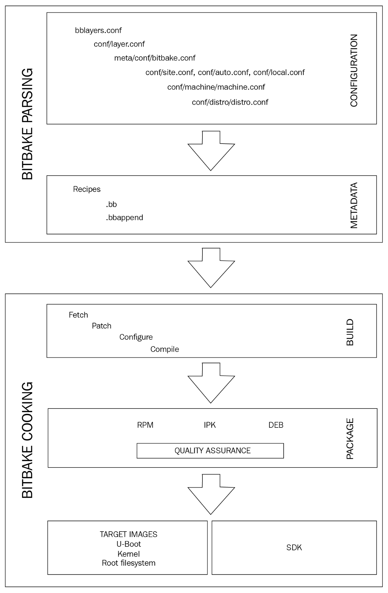

Quá trình build của BitBake

### Còn nữa...

Hầu hết developer sẽ không quan tâm tới việc giữ toàn bộ output build của mọi package, vì vậy nên cấu hình project để xóa chúng bằng cấu hình sau trong file `conf/local.conf`:

```
INHERIT += "rm_work"
```

Nhưng đồng thời, cấu hình điều này cho mọi package nghĩa là bạn sẽ không thể phát triển hoặc debug chúng.

Bạn có thể thêm một danh sách package cần loại trừ khỏi việc dọn dẹp bằng cách thêm chúng vào biến `RM_WORK_EXCLUDE`. Ví dụ, nếu bạn sắp làm công việc BSP, một thiết lập tốt có thể là:

```
RM_WORK_EXCLUDE += "linux-wandboard u-boot-fslc"
```

Hãy nhớ rằng bạn có thể dùng một file cấu hình mẫu `local.conf.sample` tùy biến trong layer của riêng bạn để giữ các cấu hình này và áp dụng chúng cho mọi project, nhờ đó chúng có thể được chia sẻ giữa mọi developer.

Trong một bản build bình thường, các package `-dbg` chứa debug symbol là không cần thiết. Để tránh tạo các package `-dbg`, hãy làm như sau:

```
INHIBIT_PACKAGE_DEBUG_SPLIT = "1"
```

Khi build xong, bạn có thể tìm các output image trong thư mục `tmp/deploy/images/qemuarm` bên trong build directory.

Bạn có thể chạy thử image trên emulator QEMU bằng cách chạy lệnh này:

```
$ runqemu qemuarm core-image-minimal
```

Script `runqemu` có trong thư mục `scripts` của Poky là một launch wrapper quanh emulator machine QEMU để đơn giản hóa việc sử dụng.

Yocto Project cũng có một tập image biên dịch sẵn cho các hardware platform được hỗ trợ, có thể tải từ `http://downloads.yoctoproject.org/releases/yocto/yocto-2.4/machines/`.

## Giải thích hệ sinh thái Yocto của NXP

Như chúng ta đã thấy, metadata của Poky bắt đầu với các layer `meta`, `meta-poky` và `meta-yocto-bsp`, và có thể được mở rộng bằng cách dùng thêm layer.

Một chỉ mục các OpenEmbedded layer hiện có tương thích với Yocto Project được duy trì tại `http://layers.openembedded.org/`.

Việc phát triển một sản phẩm embedded thường bắt đầu bằng việc đánh giá hardware dùng một thiết kế board tham chiếu của nhà sản xuất. Trừ khi bạn làm việc với một trong các board tham chiếu đã được Poky hỗ trợ, bạn sẽ cần mở rộng Poky để hỗ trợ hardware của mình bằng cách thêm các BSP layer bổ sung.

### Chuẩn bị

Việc đầu tiên cần làm là chọn hardware nền mà thiết kế của bạn sẽ dựa vào. Chúng ta sẽ dùng một board dựa trên System on Chip (SoC) NXP i.MX6 làm điểm khởi đầu cho thiết kế sản phẩm embedded.

Recipe này trình bày tổng quan về sự hỗ trợ hardware NXP trong Yocto Project.

### Cách thực hiện...

Nhà sản xuất SoC (trong trường hợp này là NXP) có một loạt board thiết kế tham chiếu để bán, cũng như các bản phát hành software Yocto-based chính thức. Tương tự, các nhà sản xuất khác dùng SoC của NXP cũng cung cấp board thiết kế tham chiếu và các BSP layer Yocto-based của riêng họ, thậm chí cả distribution.

Chọn hardware phù hợp để làm nền cho thiết kế là một trong những quyết định thiết kế quan trọng nhất của một sản phẩm embedded. Tùy nhu cầu sản phẩm, bạn sẽ quyết định hoặc:

- Dùng một board production-ready, như một single-board computer (SBC)

- Dùng một System-on-Module (SoM) và tự build carrier board tùy biến quanh nó

- Dùng trực tiếp SoC của NXP và tự thiết kế board

Phần lớn thời gian, một board production-ready sẽ không khớp với các yêu cầu cụ thể của một embedded system chuyên nghiệp, còn quá trình thiết kế một carrier board hoàn chỉnh dùng SoC của NXP thì sẽ quá tốn thời gian. Vì vậy, dùng một module phù hợp đã giải quyết sẵn những khía cạnh thiết kế thách thức nhất về kỹ thuật là lựa chọn phổ biến.

Một số đặc điểm quan trọng cần xem xét là:

- Dải nhiệt độ công nghiệp

- Quản lý năng lượng

- Khả năng cung cấp Long-term

- Wireless và Bluetooth Pre-certified (nếu có)

Cộng đồng Yocto hỗ trợ các board NXP-based được gọi là FSL community BSP và các layer chính của họ là `meta-freescale` và `meta-freescale-3rdparty`. Thương hiệu Freescale thuộc về NXP sau khi NXP mua lại Freescale. Các board được `meta-freescale` hỗ trợ chỉ giới hạn ở các thiết kế tham chiếu của NXP, đây sẽ là điểm khởi đầu nếu bạn đang cân nhắc tự thiết kế carrier board quanh SoC của NXP. Các board từ những vendor khác được duy trì trên layer `meta-freescale-3rdparty`.

Có những nhà sản xuất embedded khác dùng `meta-freescale`, nhưng họ chưa tích hợp board của mình vào community layer `meta-freescale-3rdparty`. Các nhà sản xuất này giữ BSP layer riêng, phụ thuộc vào `meta-freescale`, với hỗ trợ cụ thể cho hardware của họ. Một ví dụ là Digi International và dòng sản phẩm ConnectCore, với các Yocto layer có tại `https://github.com/digi-embedded/meta-digi`. Cũng có một distribution Yocto-based tên là Digi Embedded Yocto.

### Cách hoạt động...

Để hiểu hệ sinh thái Yocto của NXP, chúng ta cần bắt đầu với FSL community BSP, gồm layer `meta-freescale` hỗ trợ các board tham chiếu của NXP và layer đi kèm `meta-freescale-3rdparty` hỗ trợ board từ các vendor khác, cùng những khác biệt của nó với các bản phát hành NXP Yocto BSP chính thức mà NXP cung cấp cho thiết kế tham chiếu của họ.

Có một số khác biệt then chốt giữa bản phát hành Yocto của cộng đồng và của NXP:

- Các bản phát hành của NXP được NXP phát triển nội bộ mà không có sự tham gia của cộng đồng, và được dùng để xác nhận BSP trên các board tham chiếu của NXP.

- Các bản phát hành của NXP trải qua quy trình QA và test xác nhận nội bộ, và được bộ phận hỗ trợ của NXP duy trì.

- Các bản phát hành của NXP cho một platform cụ thể sẽ đạt tới một điểm trưởng thành, sau đó chúng không còn được phát triển tiếp. Lúc đó, mọi công việc phát triển đã được tích hợp vào community layer và các platform được FSL BSP community tiếp tục duy trì.

- Các bản phát hành NXP Yocto không tương thích Yocto (Yocto compatible), còn bản phát hành của cộng đồng thì có.

Đội kỹ sư của NXP làm việc rất chặt chẽ với FSL BSP community để bảo đảm mọi phát triển trong các bản phát hành chính thức của họ được tích hợp vào community layer một cách đáng tin cậy và nhanh chóng.

FSL BSP community cũng rất nhanh nhạy và năng động, nên các vấn đề thường có thể được giải quyết cùng họ để mọi bên đều có lợi.

### Còn nữa...

FSL community BSP mở rộng Poky với các layer sau:

- `meta-freescale`: Đây là community layer hỗ trợ các thiết kế tham chiếu của NXP. Nó phụ thuộc vào OpenEmbedded-Core. Các machine trong layer này sẽ được duy trì ngay cả sau khi NXP ngừng phát triển tích cực cho chúng. Bạn có thể tải `meta-freescale` từ Git repository tại `http://git.yoctoproject.org/cgit/cgit.cgi/meta-freescale/`.

  Có thể theo dõi và đóng góp vào các thảo luận phát triển bằng cách truy cập mailing list phát triển tại `https://lists.yoctoproject.org/listinfo/meta-freescale`.

  Layer `meta-freescale` cung cấp cả Linux kernel i.MX6 lẫn source U-Boot, lấy từ repository của NXP hoặc từ repository do FSL community BSP duy trì, qua các link sau:

  - Git repository Linux kernel của NXP: `http://git.freescale.com/git/cgit.cgi/imx/linux-imx.git/`

  - Git repository Linux kernel của FSL community: `https://github.com/Freescale/linux-fslc.git`

  - Git repository U-Boot của NXP: `http://git.freescale.com/git/cgit.cgi/imx/uboot-imx.git/`

  - Git repository U-Boot của FSL community: `https://github.com/Freescale/u-boot-fslc.git`

  Có các phiên bản Linux kernel và U-Boot khác, nhưng nên giữ phiên bản được nhà sản xuất hỗ trợ.

  Layer `meta-freescale` bao gồm các binary độc quyền của NXP để bật một số tính năng hardware—đáng chú ý nhất là khả năng đồ họa bằng hardware, multimedia và mã hóa. Để dùng các khả năng này, người dùng cuối cần chấp nhận NXP End-User License Agreement (EULA), có trong layer `meta-freescale`.

- `meta-freescale-3rdparty`: Layer này bổ sung hỗ trợ cho các board community-maintained khác, ví dụ Wandboard. Để tải nội dung của layer, bạn có thể truy cập `https://github.com/Freescale/meta-freescale-3rdparty/`.

- `meta-freescale-distro`: Layer này bổ sung một metadata layer cho các target image demo. Để tải nội dung của layer, bạn có thể truy cập `https://github.com/Freescale/meta-freescale-distro`.

  Layer này bổ sung hai bộ distribution khác nhau, một bộ do FSL BSP community duy trì (các distribution `fslc-`) và một bộ do NXP duy trì (các distribution `fsl-`). Chúng là superset của Poky, cho phép bạn dễ dàng chọn graphical backend sẽ dùng trong số:

  - framebuffer

  - x11

  - Wayland

  - XWayland

  Chúng ta sẽ tìm hiểu thêm về các graphical backend khác nhau trong `Chapter 4`, Application Development.

NXP dùng thêm một layer nữa bên trên các layer vừa nêu cho các bản phát hành software chính thức của họ:

- `meta-fsl-bsp-release`: Đây là layer NXP-maintained, được dùng trong các bản phát hành software chính thức của NXP. Nó chứa các sửa đổi cho cả `meta-freescale` lẫn `meta-freescale-distro`. Nó không thuộc bản phát hành của cộng đồng nhưng có thể truy cập tại `http://git.freescale.com/git/cgit.cgi/imx/meta-fsl-bsp-release.git/`.

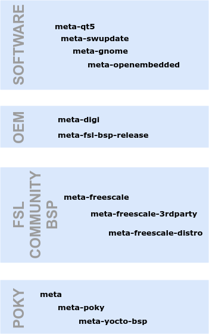

Phân cấp các layer mở rộng cho platform NXP-based

### Xem thêm

- Để biết thêm thông tin, hãy xem trang web FSL community BSP tại `http://freescale.github.io/`

- Cộng đồng hỗ trợ chính thức của NXP có thể truy cập tại `https://community.nxp.com/`

## Cài đặt hỗ trợ cho hardware NXP

Trong recipe này, chúng ta sẽ cài bản phát hành Yocto của FSL community BSP, bản này bổ sung hỗ trợ hardware NXP vào bản cài Yocto của chúng ta.

### Chuẩn bị

Với nhiều layer như vậy, việc clone thủ công từng layer và thêm chúng vào file `conf/bblayers.conf` của project rất phiền phức. Cộng đồng dùng công cụ repo do Google phát triển cho Android cộng đồng để đơn giản hóa việc cài Yocto.

Để cài repo vào host system, hãy gõ các command sau:

```
$ mkdir -p ${HOME}/bin/
$ curl https://storage.googleapis.com/git-repo-downloads/repo >
  ${HOME}/bin/repo
$ chmod a+x ${HOME}/bin/repo
```

Công cụ repo là một tiện ích Python parse một file XML, gọi là `manifest`, chứa danh sách Git repository. Sau đó công cụ repo được dùng để quản lý các repository đó như một tổng thể.

### Cách thực hiện...

Làm ví dụ, chúng ta sẽ dùng repo để tải mọi repository đã liệt kê trong recipe trước về host system. Để làm vậy, chúng ta sẽ trỏ nó tới `manifest` của FSL community BSP cho bản phát hành Rocko:

```
<?xml version="1.0" encoding="UTF-8"?>
<manifest>

  <default sync-j="4" revision="master"/>
  <remote fetch="https://git.yoctoproject.org/git" name="yocto"/>
  <remote fetch="https://github.com/Freescale" name="freescale"/>
  <remote fetch="https://github.com/openembedded" name="oe"/>

  <project remote="yocto" revision="rocko" name="poky"
path="sources/poky"/>
  <project remote="yocto" revision="rocko" name="meta-freescale"
path="sources/meta-freescale"/>

  <project remote="oe" revision="rocko" name="meta-openembedded"
path="sources/meta-openembedded"/>

  <project remote="freescale" revision="rocko" name="fsl-community-bsp-
base" path="sources/base">
    <linkfile dest="README" src="README"/>
    <linkfile dest="setup-environment" src="setup-environment"/>
  </project>

  <project remote="freescale" revision="rocko" name="meta-
freescale-3rdparty" path="sources/meta-freescale-3rdparty"/>
  <project remote="freescale" revision="rocko" name="meta-freescale-distro"
path="sources/meta-freescale-distro"/>
  <project remote="freescale" revision="rocko" name="Documentation"
path="sources/Documentation"/>

</manifest>
```

File `manifest` cho thấy mọi đường dẫn cài đặt và nguồn repository cho các thành phần khác nhau sẽ được cài.

### Cách hoạt động...

File `manifest` là danh sách các layer khác nhau cần cho bản phát hành FSL community BSP. Giờ chúng ta có thể dùng `repo` để cài nó. Chạy lệnh sau:

```
$ mkdir /opt/yocto/fsl-community-bsp
$ cd /opt/yocto/fsl-community-bsp
$ repo init -u https://github.com/Freescale/fsl-community-bsp-platform -b
rocko
$ repo sync
```

> Bạn có thể tùy chọn truyền đối số `-jN` cho sync nếu có máy multicore để chạy đa luồng; ví dụ, bạn có thể truyền `repo` `sync -j8` trên một host system tám nhân (eight-core).

### Còn nữa...

Để liệt kê các board hardware được các layer khác nhau hỗ trợ, chúng ta có thể chạy:

```
$ ls sources/meta-freescale*/conf/machine/*.conf
```

Và để liệt kê các target image mới được thêm vào, dùng lệnh sau:

```
$ ls sources/meta-freescale*/recipes*/images/*.bb
```

Bản phát hành FSL community BSP giới thiệu các target image mới sau:

- `fsl-image-mfgtool-initramfs`: Đây là một image initramfs nhỏ, RAM-based, được dùng cùng công cụ sản xuất (manufacturing tool) của NXP

- `fsl-image-multimedia`: Đây là một image console-only bao gồm multimedia framework `gstreamer` chạy trên framebuffer

- `fsl-image-multimedia-full`: Đây là phần mở rộng của `fsl-image-multimedia`, mở rộng multimedia framework `gstreamer` để bao gồm mọi plugin hiện có

- `fsl-image-machine-test`: Đây là phần mở rộng của `fsl-image-multimedia-full` để test và benchmark

Bản phát hành bao gồm repository `sources/Documentation` với tài liệu có thể build được. Để build, trước tiên chúng ta cần cài một số host tool như sau:

```
$ sudo apt-get install libfreetype6-dev libjpeg8-dev python3-dev python3-
pip python3-sphinx texlive-fonts-recommended texlive-latex-extra zlib1g-dev
fonts-liberation
$ sudo pip3 install reportlab sphinxcontrib-blockdiag
```

Sau đó chúng ta có thể build các tài liệu khác nhau bằng cách vào sub-directory của nó, và build một tài liệu HTML với:

```
$ make singlehtml
```

Hoặc một phiên bản PDF với:

```
$ make latexpdf
```

Ví dụ, để build release notes ở cả phiên bản HTML lẫn PDF, chúng ta làm:

```
$ cd /opt/yocto/fsl-community-bsp/sources/Documentation/release-notes
$ make latexpdf singlehtml
```

Các tài liệu nằm trong các thư mục `build/latex` và `build/singlehtml`.

### Xem thêm

- Hướng dẫn dùng công cụ repo, kể cả dùng repo với proxy server, có trong tài liệu Android tại `https://source.android.com/setup/downloading`

- Manifest của FSL community BSP có thể truy cập tại `https://github.com/Freescale/fsl-community-bsp-platform/blob/rocko/default.xml`

## Build các image cho Wandboard

Wandboard là một board i.MX6-based giá rẻ của NXP, có sự hỗ trợ rộng rãi từ cộng đồng. Nó hoàn hảo cho mục đích khám phá và giáo dục, nhiều tính năng hơn Raspberry Pi, và gần hơn nhiều với các embedded system high-end chuyên nghiệp.

Được thiết kế và bán bởi Technexion, một công ty Đài Loan, nó có bốn phiên bản dựa trên một SoM với các biến thể SoC i.MX6 khác nhau: solo, dual, quad và quad plus, có một, hai hoặc bốn nhân.

Technexion công bố schematic của cả board lẫn SoM dưới dạng PDF, điều này mang lại cho board một chút tính mở.

Wandboard vẫn được dùng rộng rãi, dễ mua và có cộng đồng lớn, nên chúng ta sẽ dùng nó làm ví dụ trong các chương sau. Tuy nhiên, có thể dùng bất kỳ board i.MX6-based nào để theo cuốn sách. Khi đó know-how sẽ áp dụng được cho bất kỳ embedded platform nào dùng Yocto Project.

Wandboard đã được phát hành với các revision khác nhau trong suốt lịch sử của nó: a0, b1, c1 và d1. Revision được in trên PCB và nó sẽ trở nên quan trọng vì software chạy trên mỗi revision khác nhau.

Wandboard có các thông số sau:

- 2 GB RAM

- Wi-Fi 802.11n Broadcom BCM4330

- Bluetooth 4.0 Broadcom BCM4330

- HDMI

- USB

- RS-232

- uSD

Revision D bổ sung một PMIC MMPF0100, thay Ethernet PHY Atheros AR8031 bằng Atheros AR8035, và thay BCM4330 bằng Wi-Fi 802.11ac BCM4339, cùng một số thay đổi nhỏ khác.

Đây là một hệ thống multimedia hoàn hảo với graphical processing unit 2D và 3D Vivante, tăng tốc đồ họa và video bằng hardware, và audio codec SGTL5000. Các hệ thống i.MX6-based khác nhau được dùng rộng rãi trong điều khiển và tự động hóa công nghiệp, tự động hóa gia đình, ô tô, hàng không, và các ứng dụng công nghiệp khác.

Cho sản xuất, nên dùng các OEM và sản phẩm chuyên nghiệp, vì họ có thể cung cấp chất lượng và dải nhiệt độ công nghiệp, khả năng cung cấp linh kiện, hỗ trợ và các bảo đảm sản xuất mà sản phẩm cuối cùng đòi hỏi.

### Cách thực hiện...

Hỗ trợ cho Wandboard có trong FSL community BSP layer `meta-freescale-3rdparty`. Mọi biến thể board Wandboard được gộp vào một Yocto machine duy nhất tên là `wandboard`.

Để build một image cho machine `wandboard` với distribution Poky, dùng các command sau:

```
$ cd /opt/yocto/fsl-community-bsp
$ MACHINE=wandboard DISTRO=poky source setup-environment wandboard
$ bitbake core-image-minimal
```

> Phiên bản hiện tại của script `setup-environment` chỉ hoạt động nếu build directory nằm dưới thư mục cài đặt; trong trường hợp của chúng ta là `/opt/yocto/fsl-community-bsp`.

### Cách hoạt động...

Script `setup-environment` là một wrapper quanh `oe-init-build-env` mà chúng ta đã dùng trước đó. Nó sẽ tạo build directory, thiết lập biến `MACHINE` và `DISTRO` với các giá trị được cung cấp, và nhắc bạn chấp nhận NXP EULA như đã mô tả trước đó. File cấu hình `conf/local.conf` sẽ được cập nhật với cả machine được chỉ định lẫn biến chấp nhận `EULA`. Để chấp nhận license, dòng sau đã được tự động thêm vào file cấu hình `conf/local.conf` của project:

```
ACCEPT_FSL_EULA = "1"
```

> Hãy nhớ rằng nếu bạn đóng phiên Terminal, bạn sẽ cần thiết lập lại môi trường trước khi có thể dùng BitBake. Bạn có thể yên tâm chạy lại script setup-environment như dưới đây, vì nó sẽ không đụng tới file `conf/local.conf` đã có:
>
> ```
> $ cd /opt/yocto/fsl-community-bsp/
> $ source setup-environment wandboard
> ```

Command BitBake ở trên tạo file `core-image-minimal-wandboard.wic.gz`, tức là một file WIC đã nén, bên trong thư mục `tmp/deploy/images/wandboard`.

File WIC được Yocto tạo bằng công cụ WIC, và nó là một image có phân vùng được tạo từ các build artifact của Yocto, có thể được nạp trực tiếp.

Image này có thể được nạp vào một thẻ microSD, cắm vào khe chính trên CPU board của Wandboard (khe ở bên cạnh SoM i.MX6 và dưới tản nhiệt), và boot bằng các command sau:

```
$ cd /opt/yocto/fsl-community-bsp/wandboard/tmp/deploy/images/wandboard/
$ sudo bmaptool copy --nobmap core-image-minimal-wandboard.wic.gz /dev/sdN
```

Ở đây, `/dev/sdN` tương ứng với device node được gán cho thẻ microSD trên host system của bạn.

> Nếu hệ thống của bạn thiếu tiện ích bmaptool, bạn có thể cài nó với:
>
> ```
> $ sudo apt-get install bmap-tools
> ```
>
> bmaptool sẽ từ chối nạp vào các thiết bị đang được mount và sẽ báo lỗi:
>
> ```
> bmaptool: ERROR: cannot open block device '/dev/sdN' in
> exclusive mode: [Errno 16] Device or resource busy:
> '/dev/sdN'
> ```
>
> Bạn sẽ cần unmount thẻ SD nếu Ubuntu đã tự động mount nó, bằng:
>
> ```
> $ sudo umount /dev/sdN
> ```
>
> Ở đây, `N` là một chữ cái do Linux kernel gán. Kiểm tra `dmesg` để tìm ra tên thiết bị.

Tùy chọn `--nobmap` truyền cho bmaptool cần được giải thích một chút. bmaptool là một tiện ích chuyên sao chép dữ liệu vào block device, tương tự command `dd` truyền thống. Tuy nhiên, nó có thêm một số chức năng khiến nó trở thành công cụ rất tiện để dùng trong công việc phát triển thiết bị embedded:

- Nó có thể sao chép từ file nén, như chúng ta thấy với file `wic.gz`

- Nó có thể dùng file BMAP để tăng tốc việc sao chép các sparse file

Khi dữ liệu được lưu trong một filesystem, các block dữ liệu được ánh xạ tới các sector đĩa bằng một chỉ mục on-disk. Khi một block dữ liệu không được ánh xạ tới sector đĩa nào, nó được gọi là hole, và các file có hole được gọi là sparse file. File BMAP cung cấp danh sách các vùng được ánh xạ cùng checksum cho cả chính file BMAP lẫn các vùng được ánh xạ.

Dùng file BMAP này, bmaptool có thể tăng tốc đáng kể quá trình sao chép sparse file.

Tuy nhiên, vì chúng ta không dùng file BMAP, chúng ta truyền option `--nobmap` và dùng bmaptool vì tiện dùng với file nén. Nó cũng có những tối ưu khác so với `dd` khiến nó là công cụ tốt hơn cho công việc này.

### Xem thêm

- Bạn có thể tìm thêm thông tin về công cụ repo trong tài liệu Android tại `https://source.android.com/setup/using-repo`

- Tài liệu bmaptool có thể truy cập tại `https://source.tizen.org/documentation/reference/bmaptool`

Thông tin thêm về các hardware khác nhau được đề cập trong mục này có tại:

- SBC ConnectCore 6 của Digi International tại `https://www.digi.com/products/embedded-systems/single-board-computers/connectcore-6-sbc`

- Wandboard tại `https://www.wandboard.org/`

## Sử dụng giao diện web Toaster

Toaster là một giao diện ứng dụng web cho build system của Yocto Project, được build trên framework Django với một database backend để lưu và biểu diễn dữ liệu build. Nó thay thế giao diện người dùng Hob, vốn có trong các bản phát hành trước Yocto 1.8. Trang chào mừng được hiển thị dưới đây:

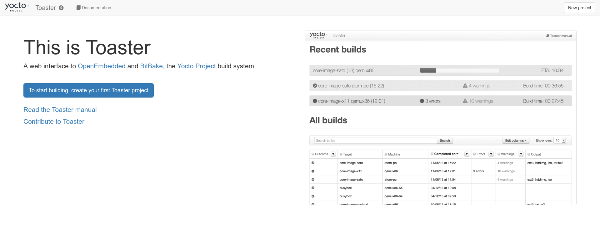

Chào mừng tới Toaster

Nó cho phép bạn thực hiện các thao tác sau:

- Cấu hình build local hoặc remote

- Quản lý layer

- Đặt các biến cấu hình

- Đặt build target

- Bắt đầu build từ command line (chế độ analysis) hoặc từ web UI (chế độ managed)

- Thu thập và biểu diễn dữ liệu build

- Duyệt các image cuối cùng

- Liệt kê các package đã cài

- Xem giá trị biến build

- Khám phá dependency của recipe, package và task

- Kiểm tra các build warning, error và trace message

- Cung cấp thống kê hiệu năng build

- Kiểm tra các build task và việc dùng shared state cache

### Chuẩn bị

Để chạy ứng dụng web Django Toaster, host machine cần được thiết lập như sau:

```
$ sudo apt-get install python3-pip
$ pip3 install --user -r /opt/yocto/poky/bitbake/toaster-requirements.txt
```

### Cách thực hiện...

Toaster có thể được khởi động bằng các command sau:

```
$ cd /opt/yocto/poky
$ source oe-init-build-env
$ source toaster start
```

`/opt/yocto/poky/bitbake/bin/toaster` là một shell script sẽ thiết lập môi trường của Toaster, nạp cấu hình mặc định và các database migration, kết nối tới OpenEmbedded Layer Index, và tải thông tin về các metadata layer có sẵn cho bản phát hành hiện tại, cũng như khởi động web server và tiến trình runbuilds poller.

Để truy cập giao diện web, hãy vào `http://127.0.0.1:8000`.

Theo mặc định, Toaster bind vào localhost ở cổng `8000`, nhưng có thể chỉ định như sau:

```
$ source toaster start webport=<IP>:<PORT>
```

#### Giao diện quản trị

Giao diện quản trị có thể truy cập tại `http://127.0.0.1:8000/admin`.

Giao diện quản trị này có thể dùng để cấu hình chính Toaster, nhưng cần tạo một tài khoản superuser từ thư mục chứa database của Toaster:

```
$ cd /opt/yocto/poky/build
$ ../bitbake/lib/toaster/manage.py createsuperuser
```

#### Bắt đầu một bản build

Toaster có thể chạy hai loại build khác nhau:

1. Bạn có thể tự bắt đầu một bản build trên terminal và Toaster sẽ theo dõi nó. Sau đó bạn có thể dùng web UI của Toaster để khám phá kết quả build. Hình sau cho thấy trang command line builds:

   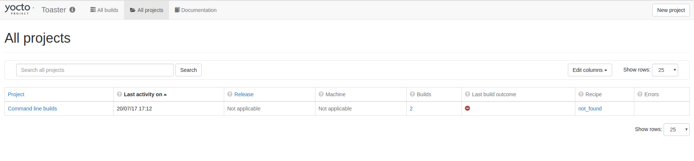

   Command line builds của Toaster

2. Bạn cũng có thể dùng giao diện web của Toaster để tạo một project mới. Project này sẽ được đặt tên là `build-toaster-<project_id>` và được tạo bên trong thư mục `Poky`:

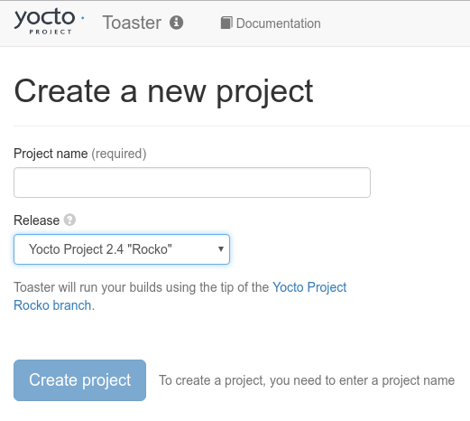

Wizard tạo project mới của Toaster

Bạn có thể dùng biến cấu hình `TOASTER_DIR` để chỉ định một build directory khác cho Toaster.

Khi tạo một project Toaster, bạn có thể chọn giữa hai loại khác nhau:

- Local builds: Loại này dùng bản clone Poky local trên máy tính của bạn. Dùng loại build này sẽ giới hạn bản build ở các layer có trong Yocto Project, `openembedded-core`, `meta-poky` và `meta-yocto-bsp`. Các layer khác sẽ cần được import thủ công bằng trang Import Layer.

- Yocto Project builds: Khi chọn một bản phát hành Yocto Project, Toaster fetch source từ các Git repository upstream của Yocto Project, và cập nhật nó mỗi lần bạn chạy build. Ở chế độ này, có thể chọn các layer tương thích, bao gồm các BSP layer cho phép bạn build cho các machine khác nhau. Trang cấu hình project của Toaster trông như sau:

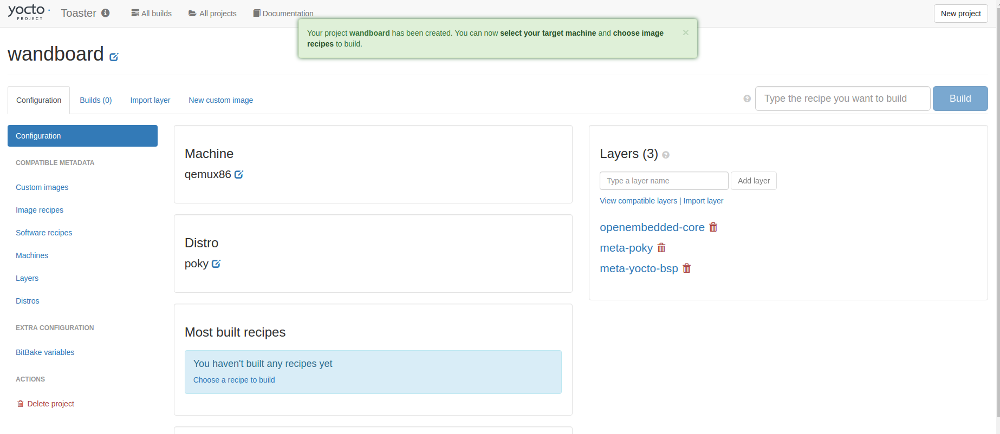

Trang cấu hình project của Toaster

#### Tùy biến image với Toaster

Sau khi một image được build, Toaster cho phép tạo một image tùy biến dựa trên recipe của image đó, trong đó có thể dễ dàng thêm/bớt package.

#### Build SDK với Toaster

Bạn có thể bảo Toaster build cả SDK chuẩn lẫn extensible SDK bằng cách chỉ định các task `populate_sdk` và `populate_sdk_ext` cho target image. Ví dụ, để tạo SDK cho target image `core-image-base`, bạn sẽ dùng như sau.

Cho SDK chuẩn:

```
core-image-base:populate_sdk
```

Hoặc cho extensible SDK:

```
core-image-base:populate_sdk_ext
```

Chúng ta sẽ tìm hiểu thêm về việc dùng SDK ở `Chapter 4`, Application Development.

### Cách hoạt động...

Phiên bản Django mà Toaster dùng được chỉ định trong file `/opt/yocto/poky/bitbake/toaster-requirements.txt`, ví dụ:

```
Django>1.8,<1.9.9
```

Django, và do đó Toaster, lưu dữ liệu trong một relational database. Cấu hình backend được thực hiện trong file `/opt/yocto/poky/bitbake/lib/toaster/toastermain/settings.py` như sau:

```
TOASTER_SQLITE_DEFAULT_DIR = os.environ.get('TOASTER_DIR')
DATABASES = {
    'default': {
        # Add 'postgresql_psycopg2', 'mysql', 'sqlite3' or 'oracle'.
        'ENGINE': 'django.db.backends.sqlite3',
        # DB name or full path to database file if using sqlite3.
        'NAME': "%s/toaster.sqlite" % TOASTER_SQLITE_DEFAULT_DIR,
        'USER': '',
        'PASSWORD': '',
        #'HOST': '127.0.0.1', # e.g. mysql server
        #'PORT': '3306', # e.g. mysql port
    }
}
```

Theo mặc định, Toaster sẽ tạo một database `toaster.sqlite` trên đường dẫn `TOASTER_DIR` đã cấu hình. Với các server production, MySQL là backend được khuyến nghị. Django có sẵn một object-relational mapper, Django ORM, tự động hóa việc chuyển dữ liệu từ relational database sang các object Python và cho phép truy cập database trong code Python. Trạng thái ban đầu của database được tạo từ một tập fixture (data dump) dưới `/opt/yocto/poky/bitbake/lib/toaster/orm/fixtures`. Các fixture của Toaster ở định dạng XML:

- `settings.xml`: File này chứa các thiết lập biến của Toaster và BitBake. Một số trong chúng có thể được thay đổi qua giao diện quản trị của Toaster.

- `poky.xml` và `oe-core.xml`: Đây là các giá trị mặc định cho cả build Poky lẫn build OE-core.

- `custom.xml`: File này cho phép bạn override dữ liệu trên bất kỳ fixture nào ở trên bằng một cấu hình tùy biến. Các định dạng XML, JSON và YAML đều được hỗ trợ.

Khi Toaster được khởi chạy, các Django fixture này được dùng để nạp dữ liệu ban đầu vào database của nó.

Toaster đã mở rộng command `manage.py` của Django với một số option Toaster-specific tùy biến. Script quản lý `manage.py` cần được gọi từ thư mục `build`, nơi chứa database của Toaster:

```
$ cd /opt/yocto/poky/build
$ /opt/yocto/poky/bitbake/lib/toaster/manage.py <command> [<command
option>]
```

Các command có thể là:

Từ `/opt/yocto/poky/bitbake/lib/toaster/toastermain/managements/commands/`:

- `buildlist`: Command này trả về danh sách build hiện tại kèm build ID của chúng

- `buildelete <build_id>`: Command này xóa mọi dữ liệu build của bản build được chỉ định bằng build ID

- `checksocket`: Command này kiểm tra rằng Toaster có thể bind vào địa chỉ IP và cổng được cung cấp

- `perf`: Đây là một kiểm tra sanity đo hiệu năng bằng cách trả về thời gian tải trang

Từ `/opt/yocto/poky/bitbake/lib/toaster/orm/managements/commands/`:

- `lsupdates`: Command này cập nhật layer index cache local

Từ `/opt/yocto/poky/bitbake/lib/toaster/bldcontrol/managements/commands/`:

- `checksettings`: Command này kiểm tra rằng các thiết lập database hiện có của Toaster đủ để bắt đầu một bản build

- `runbuilds`: Command này khởi chạy các bản build đã lên lịch

### Còn nữa...

Toaster cho phép bạn thiết lập một build server trên môi trường hosted/cloud dùng chung, cho phép bạn:

- Dùng nó với nhiều người dùng

- Phân tán nó qua nhiều build host

- Xử lý tải nặng

Thông thường, khi thiết lập Toaster trên một môi trường hosted dùng chung, web server Apache và MySQL làm database backend được sử dụng.

Hướng dẫn cài đặt cho loại server production này có trong Toaster User Manual của Yocto Project. Việc cài đặt có thể trải trên nhiều host khác nhau để chia tải.

## Chạy một Docker container Toaster

Docker là một công nghệ software cung cấp ảo hóa ở mức hệ điều hành. Functionality-wise, nó có thể so với một virtual machine, ngoại trừ việc nó bị giảm hiệu năng ít hơn. Trên Linux, nó dùng các tính năng cô lập tài nguyên của Linux kernel để cung cấp trừu tượng hóa và cô lập process. Nó cho phép bạn tạo các container chạy trên Docker và độc lập với hệ điều hành bên dưới.

Có các instance Docker của giao diện người dùng Toaster, sẽ được giới thiệu trong recipe này.

### Cách thực hiện...

1. Để cài Docker lên máy Ubuntu 16.04, thêm GPG key của Docker repository chính thức vào hệ thống:

   ```
   $ curl -fsSL https://download.docker.com/linux/ubuntu/gpg | sudo
   apt-key add -
   ```

2. Sau đó thêm Docker repository vào các nguồn APT:

   ```
   $ sudo add-apt-repository "deb [arch=amd64]
   https://download.docker.com/linux/ubuntu $(lsb_release -cs) stable"
   ```

3. Tiếp theo, cập nhật package database với các package Docker từ repository vừa thêm:

   ```
   $ sudo apt-get update
   $ sudo apt-get install docker-ce
   ```

4. Thêm user của bạn vào group docker:

   ```
   $ sudo usermod -aG docker ${USER}
   $ su - ${USER}
   ```

5. Cuối cùng, chạy thử Docker bằng container `hello-world`:

   ```
   $ docker run hello-world
   ```

6. Để chạy một instance `docker-toaster`, trước tiên chúng ta sẽ tạo một thư mục trên host machine để container `docker` lưu các bản build:

   ```
   $ mkdir /opt/yocto/docker-toaster
   ```

7. Sau đó chúng ta có thể bảo Docker chạy container `crops/toaster` và trỏ thư mục `/workdir` của nó tới thư mục local vừa tạo:

   ```
   $ docker run -it --rm -p 127.0.0.1:18000:8000 -v /opt/yocto/docker-
   toaster:/workdir crops/toaster
   ```

   > Nếu bạn thấy lỗi sau:
   >
   > ```
   > Refusing to use a gid of 0
   > Traceback (most recent call last):
   >   File "/usr/bin/usersetup.py", line 62, in <module>
   >     subprocess.check_call(cmd.split(), stdout=sys.stdout,
   > stderr=sys.stderr)
   >   File "/usr/lib/python2.7/subprocess.py", line 541, in
   > check_call
   >     raise CalledProcessError(retcode, cmd)
   > subprocess.CalledProcessError: Command '['sudo',
   > 'restrict_groupadd.sh', '0', 'toasteruser']' returned non-
   > zero exit status 1
   > ```
   >
   > Hãy bảo đảm thư mục `/opt/yocto/docker-toaster` đã được tạo trước khi chạy Docker và không thuộc sở hữu của root. Nếu bạn không tạo nó trước, Docker sẽ tạo nó với user root và việc thiết lập sẽ thất bại như trên.
   >
   > Xem `https://github.com/crops/poky-container/issues/20`.

   > Lưu ý rằng bạn có thể thay `127.0.0.1` ở trên bằng một địa chỉ IP có thể truy cập từ bên ngoài nếu bạn chạy Docker trên một máy khác.

8. Giờ bạn có thể detach khỏi container `docker` bằng Ctrl + P Ctrl + Q. Kiểm tra container vẫn đang chạy với:

   ```
   $ docker ps
   ```

9. Giờ bạn có thể truy cập giao diện web Toaster tại `http://127.0.0.1:18000`.

10. Container `docker` có thể được dừng bằng command sau:

    ```
    $ docker stop <container-id>
    ```

### Xem thêm

- Tài liệu Django có thể truy cập tại `https://docs.djangoproject.com/en/1.9/`

- Command quản lý của Django có tại `toaster/manage.py` được mô tả như một phần tài liệu Django tại `https://docs.djangoproject.com/en/1.9/ref/django-admin/`

- Tài liệu riêng của Docker có thể truy cập tại `https://docs.docker.com/engine/reference/commandline/dockerd/`

- Trang chủ của container `docker` Toaster là `https://github.com/crops/toaster-container`

## Cấu hình network booting cho môi trường phát triển

Hầu hết các board i.MX6 chuyên nghiệp sẽ có flash memory bên trong, và đó sẽ là cách được khuyến nghị để boot firmware. Wandboard không thực sự là sản phẩm dành cho dùng chuyên nghiệp nên không có, thay vào đó nó boot từ thẻ microSD. Nhưng cả flash bên trong lẫn thẻ microSD đều không lý tưởng cho công việc phát triển, vì mọi thay đổi hệ thống sẽ kéo theo việc nạp lại firmware image.

### Chuẩn bị

Thiết lập lý tưởng cho công việc phát triển là dùng cả server Trivial File Transfer Protocol (TFTP) lẫn Network File System (NFS) trên host system, và chỉ lưu bootloader U-Boot trong flash bên trong hoặc thẻ microSD. Với thiết lập này, bootloader sẽ fetch Linux kernel từ TFTP server và kernel sẽ mount root filesystem từ NFS server. Các thay đổi với kernel hoặc root filesystem đều có hiệu lực mà không cần nạp lại. Chỉ công việc phát triển bootloader mới cần bạn nạp lại vào phương tiện vật lý.

#### Cài đặt TFTP server

Nếu bạn chưa chạy TFTP server, hãy làm theo các bước sau để cài và cấu hình một TFTP server trên host Ubuntu 16.04:

```
$ sudo apt-get install tftpd-hpa
```

File cấu hình `tftpd-hpa` được cài tại `/etc/default/tftpd-hpa`. Theo mặc định, nó dùng `/var/lib/tftpboot` làm thư mục `TFTP` gốc. Hãy đổi quyền thư mục để mọi người dùng đều truy cập được, bằng command sau:

```
$ sudo chmod 1777 /var/lib/tftpboot
```

Giờ hãy sao chép Linux kernel và device tree cho Wandboard Quad Plus từ build directory như sau:

```
$ cd /opt/yocto/fsl-community-bsp/wandboard/tmp/deploy/images/wandboard/
$ cp zImage-wandboard.bin zImage-imx6qp-wandboard-revd1.dtb
/var/lib/tftpboot
```

Nếu bạn có biến thể hardware hoặc revision Wandboard khác,

> bạn sẽ cần dùng một device tree khác, như dưới đây. Các device tree tương ứng cho Wandboard Quad là:
>
> - revision b1: `zImage-imx6q-wandboard-revb1.dtb`
>
> - revision c1: `zImage-imx6q-wandboard.dtb`
>
> - revision d1: `zImage-imx6q-wandboard-revd1.dtb`
>
> Các device tree tương ứng cho Wandboard solo/dual lite là:
>
> - revision b1: `zImage-imx6dl-wandboard-revb1.dtb`
>
> - revision c1: `zImage-imx6dl-wandboard.dtb`
>
> - revision d1: `zImage-imx6dl-wandboard-revd1.dtb`
>
> Và device tree cho Wandboard Quad Plus là:
>
> - revision d1: `zImage-imx6qp-wandboard-revd1.dtb`

#### Cài đặt NFS server

Nếu bạn chưa chạy NFS server, hãy làm theo các bước sau để cài và cấu hình một cái trên host Ubuntu 16.04:

```
$ sudo apt-get install nfs-kernel-server
```

Chúng ta sẽ dùng thư mục `/nfsroot` làm gốc cho NFS server, vì vậy chúng ta sẽ untar root filesystem của target từ Yocto build directory vào đó.

Theo mặc định, Wandboard chỉ build image WIC. Chúng ta sẽ cần sửa build project để build một bản sao nén của root filesystem của target. Để làm vậy, hãy làm theo các bước sau:

```
$ cd /opt/yocto/fsl-community-bsp/wandboard
```

Sửa `conf/local.conf` và thêm dòng sau:

```
IMAGE_FSTYPES = "wic.gz tar.bz2"
```

Việc này sẽ build một file `core-image-minimal-wandboard.tar.bz2` mà sau đó ta có thể giải nén dưới `/nfsroot`, như sau:

```
$ sudo mkdir /nfsroot
$ cd /nfsroot
$ sudo tar --numeric-owner -x -v -f /opt/yocto/fsl-community-
bsp/wandboard/tmp/deploy/images/wandboard/core-image-minimal-
wandboard.tar.bz2
```

Việc giải nén root filesystem cũng có thể được thực hiện mà không cần quyền superuser bằng script `runqemu-extract-sdk`, script này dùng `pseudo` để giải nén và đặt quyền đúng cho root filesystem, như sau:

```
$ cd /opt/yocto/fsl-community-bsp/wandboard
$ bitbake meta-ide-support
$ runqemu-extract-sdk tmp/deploy/images/wandboard/core-image-minimal-
wandboard.tar.bz2 /nfsroot/rootfs/
```

> Để việc này hoạt động, thư mục `nfsroot` đích cần được user hiện tại ghi được.

Tiếp theo, chúng ta sẽ cấu hình NFS server để export thư mục `/nfsroot`.

Thêm dòng sau vào `/etc/exports`:

```
/nfsroot/ *(rw,no_root_squash,async,no_subtree_check)
```

Sau đó chúng ta sẽ khởi động lại NFS server để các thay đổi cấu hình có hiệu lực:

```
$ sudo service nfs-kernel-server restart
```

### Cách thực hiện...

Giờ chúng ta đã có các boot binary và root filesystem sẵn sàng cho network booting, và cần cấu hình U-Boot để thực hiện network boot.

Boot Wandboard và dừng tại U-Boot prompt bằng cách nhấn một phím bất kỳ trên serial console. Hãy bảo đảm nó đã được cắm cáp Ethernet và kết nối vào mạng local. Bạn sẽ thấy U-Boot banner và prompt như sau:

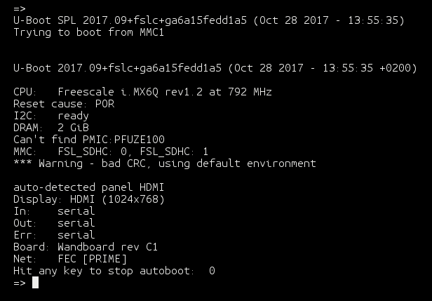

U-Boot banner

Phiên bản U-Boot của Yocto 2.4 cho Wandboard đã đưa vào các thay đổi trong environment mặc định để có ít tùy biến platform-specific hơn trong source. Do đó, các phiên bản trước từng có sẵn environment mặc định sẵn sàng thực hiện network boot chỉ bằng việc đặt vài biến môi trường và chạy script `netboot`.

Thay vào đó, U-Boot hiện tại đã thay thế nó bằng một cơ chế network boot tìm một U-Boot script tên là `extlinux.conf` trên TFTP server đã cấu hình và thực thi nó. Theo cách đó, các tùy chọn boot platform-specific được tách riêng vào boot script được biên dịch cùng source U-Boot.

Yocto Project chuẩn bị một boot script `extlinux.conf` và sao chép nó vào thư mục `deploy` cùng với các image. Chúng ta có thể thêm các kernel command line argument để truyền cho Linux kernel trong boot script này bằng biến cấu hình `UBOOT_EXTLINUX_KERNEL_ARGS`. Chi tiết hơn về việc tùy biến script `extlinux.conf` được trình bày ở `Chapter` `2`, The BSP Layer.

Tuy nhiên, cho mục đích phát triển, khôi phục các biến môi trường network boot trước đây sẽ linh hoạt hơn:

```
> env set netload 'tftpboot ${loadaddr} ${image};tftpboot ${fdt_addr}
${fdt_file}'
> env set netargs 'setenv bootargs console=${console} ${optargs}
root=/dev/nfs ip=${ipaddr} nfsroot=${serverip}:${nfsroot},v3,tcp'
> env set netboot 'echo Booting from net ...;run netargs;run netload;bootz
${loadaddr} - ${fdt_addr}'
```

Script `netload` nạp binary Linux kernel và device tree blob vào memory. Script `netargs` chuẩn bị biến môi trường `bootargs` để truyền đúng các kernel command line parameter cho network boot, và command `netboot` thực hiện network boot bằng cách chạy `netargs` và dùng command `bootz`.

Giờ chúng ta sẽ chuẩn bị phần còn lại của các biến môi trường cần thiết:

1. Cấu hình một địa chỉ IP tĩnh với:

   ```
   > env set ipaddr <static_ip>
   ```

2. Cấu hình địa chỉ IP của host system, nơi đã thiết lập các server TFTP và NFS:

   ```
   > env set serverip <host_ip>
   ```

3. Cấu hình việc mount root filesystem:

   ```
   > env set nfsroot /nfsroot
   ```

4. Cấu hình tên file của Linux kernel và device tree:

   ```
   > env set image zImage-wandboard.bin
   > env set fdt_file zImage-imx6qp-wandboard-revd1.dtb
   ```

5. Lưu U-Boot environment vào thẻ microSD:

   ```
   > env save
   ```

6. Thực hiện network boot:

   ```
   > run netboot
   ```

Linux kernel và device tree sẽ được fetch từ TFTP server, và root filesystem sẽ được kernel mount từ NFS share.

Bạn sẽ có thể đăng nhập bằng user root mà không bị hỏi mật khẩu.

Sau khi boot, chúng ta có thể tìm ra các kernel command line argument đã dùng để boot bằng cách:

```
$ cat /proc/cmdline
console=ttymxc0,115200 root=/dev/nfs ip=192.168.1.15
nfsroot=192.168.1.115:/nfsroot,v3,tcp
```

## Dùng Docker làm container cho Yocto build system

Các embedded system thường có vòng đời sản phẩm dài, nên software cần được build với cùng một phiên bản Yocto trong nhiều năm theo cách có thể dự đoán được. Các phiên bản Yocto cũ thường gặp vấn đề khi chạy trên các distribution state-of-the-art.

Để khắc phục điều này, có một số lựa chọn thay thế:

- Giữ một build machine với hệ điều hành cố định. Cách này có vấn đề vì máy cũng già đi, có thể gặp sự cố hardware và cần re-installation.

- Dùng một cloud machine với hệ điều hành cố định. Không phải ai cũng có loại hạ tầng này, và nó thường đi kèm chi phí.

- Build trong một virtual machine như VMware hoặc VirtualBox. Cách này ảnh hưởng đáng kể tới hiệu năng build.

- Dùng một Docker container làm Yocto builder. Cách này có ưu điểm là cung cấp cùng mức cô lập như virtual machine nhưng với hiệu năng build tốt hơn nhiều.

Chúng ta đã thấy cách chạy một container `docker` trong recipe Using the Toaster web interface. Giờ chúng ta sẽ xem cách tạo Docker image của riêng mình để dùng làm Yocto builder.

### Chuẩn bị

Docker có thể tự động build image bằng cách đọc các chỉ dẫn từ một file văn bản gọi là `Dockerfile`. Các Dockerfile có thể xếp chồng lên nhau, vì vậy để tạo một Docker image làm Yocto builder, chúng ta sẽ bắt đầu từ một Docker image Ubuntu 16.04 hoặc một trong các distribution được hỗ trợ khác, rồi lần lượt cấu hình image.

Sau đây là một ví dụ `Dockerfile` cho Yocto builder:

```
FROM ubuntu:16.04
MAINTAINER Alex Gonzalez <alex@lindusembedded.com>
# Upgrade system and Yocto Proyect basic dependencies
RUN apt-get update && apt-get -y upgrade && apt-get -y install gawk wget
git-core diffstat unzip texinfo gcc-multilib build-essential chrpath socat
cpio python python3 python3-pip python3-pexpect xz-utils debianutils
iputils-ping libsdl1.2-dev xterm curl
# Set up locales
RUN apt-get -y install locales apt-utils sudo && dpkg-reconfigure locales
&& locale-gen en_US.UTF-8 && update-locale LC_ALL=en_US.UTF-8
LANG=en_US.UTF-8
ENV LANG en_US.utf8
# Clean up APT when done.
RUN apt-get clean && rm -rf /var/lib/apt/lists/* /tmp/* /var/tmp/*
# Replace dash with bash
RUN rm /bin/sh && ln -s bash /bin/sh
# User management
RUN groupadd -g 1000 build && useradd -u 1000 -g 1000 -ms /bin/bash build
&& usermod -a -G sudo build && usermod -a -G users build
# Install repo
RUN curl -o /usr/local/bin/repo
https://storage.googleapis.com/git-repo-downloads/repo && chmod a+x
/usr/local/bin/repo
# Run as build user from the installation path
ENV YOCTO_INSTALL_PATH "/opt/yocto"
RUN install -o 1000 -g 1000 -d $YOCTO_INSTALL_PATH
USER build
WORKDIR ${YOCTO_INSTALL_PATH}
# Set the Yocto release
ENV YOCTO_RELEASE "rocko"
# Install Poky
RUN git clone --branch ${YOCTO_RELEASE} git://git.yoctoproject.org/poky
# Install FSL community BSP
RUN mkdir -p ${YOCTO_INSTALL_PATH}/fsl-community-bsp && cd
${YOCTO_INSTALL_PATH}/fsl-community-bsp && repo init -u
https://github.com/Freescale/fsl-community-bsp-platform -b ${YOCTO_RELEASE}
&& repo sync
# Create a build directory for the FSL community BSP
RUN mkdir -p ${YOCTO_INSTALL_PATH}/fsl-community-bsp/build
# Make /home/build the working directory
WORKDIR /home/build
```

### Cách thực hiện...

1. Để build container local từ thư mục chứa Dockerfile, chạy command sau:

   ```
   $ docker build
   ```

2. Tuy nhiên, không cần build nó local vì container được tự động build trên Docker registry: `https://hub.docker.com/r/yoctocookbook2ndedition/docker-yocto-builder`

   Trước tiên, tạo một thư mục rỗng thuộc sở hữu của một user có cùng uid và gid với user `build` bên trong container:

   ```
   $ sudo install -o 1000 -g 1000 -d /opt/yocto/docker-yocto-builder
   ```

   Và chuyển vào thư mục mới:

   ```
   $ cd /opt/yocto/docker-yocto-builder
   ```

   Để chạy container và ánh xạ thư mục `/home/build` của nó tới thư mục hiện tại, gõ:

   ```
   $ docker run -it --rm -v $PWD:/home/build
   yoctocookbook2ndedition/docker-yocto-builder
   ```

   Trong đó:

   - `-it` bảo Docker giữ `stdin` mở ngay cả khi container không được attach và gán một `pseudo-tty` cho shell tương tác

   - `--rm` bảo Docker xóa container khi thoát

   - `-v` ánh xạ thư mục hiện tại của host thành volume `/home/build` của container

3. Giờ chúng ta có thể bảo container build một project Poky với:

   ```
   build@container$ source /opt/yocto/poky/oe-init-build-env qemuarm
   build@container$ MACHINE=qemuarm bitbake core-image-minimal
   ```

4. Để build một project FSL community BSP, bạn cần ánh xạ thư mục `/opt/yocto/fsl-community-bsp/build` của container tới thư mục hiện tại, vì script `setup-environment` chỉ hoạt động khi build directory nằm dưới thư mục `installation`:

   ```
   $ docker run -it --rm -v $PWD:/opt/yocto/fsl-community-bsp/build
   yoctocookbook2ndedition/docker-yocto-builder
   ```

5. Sau đó chúng ta có thể chạy command sau bên trong container để tạo một project mới và bắt đầu build:

   ```
   build@container$ cd /opt/yocto/fsl-community-bsp/
   build@container$ mkdir -p wandboard
   build@container$ MACHINE=wandboard DISTRO=poky source setup-
   environment build
   build@container$ bitbake core-image-minimal
   ```

### Cách hoạt động...

Bảo Docker bắt đầu quá trình tạo image từ một image Ubuntu 16.04 đơn giản như việc mở đầu `Dockerfile` bằng dòng sau:

```
FROM ubuntu:16.04
```

Để kế thừa một Docker image, bạn dùng cú pháp `FROM` của Dockerfile.

Các command khác được dùng trong Dockerfile là:

- `RUN`, sẽ chạy command được chỉ định trong một layer mới và commit kết quả

- `ENV`, để đặt một biến môi trường

- `USER`, đặt username dùng cho các chỉ thị `RUN` và `CMD` theo sau nó

- `WORKDIR`, đặt thư mục làm việc cho các chỉ thị `RUN` và `CMD` theo sau nó

- `CMD`, cung cấp executable mặc định cho container, trong trường hợp này là Bash shell

Phần còn lại của `Dockerfile` làm những việc sau:

- Cập nhật Ubuntu 16.04 lên các package mới nhất

- Cài các dependency của Yocto

- Thiết lập locale cho container

- Thêm một user `build` mới

- Cài cả Poky lẫn bản phát hành FSL community BSP

Image có Poky được cài ở `/opt/yocto/poky` và FSL community BSP được cài ở `/opt/yocto/fsl-community-bsp`. Khi khởi động, thư mục mặc định là`/home/build`.

Cách làm việc thông thường với một container `docker` là bảo nó chạy command nhưng lưu output trong filesystem của host.

Trong trường hợp của chúng ta, chúng ta bảo container chạy BitBake cho mình, nhưng ánh xạ các build directory tới host bằng việc ánh xạ volume ngoài khi container được khởi tạo. Theo cách đó, toàn bộ output build được lưu trên host machine.

### Xem thêm

- Tài liệu Docker về image builder có tại `https://docs.docker.com/engine/reference/builder/`

## Chia sẻ downloads

Bạn thường sẽ làm việc với nhiều project cùng lúc, có thể cho các hardware platform khác nhau hoặc các target image khác nhau. Trong những trường hợp như vậy, việc tối ưu thời gian build bằng cách chia sẻ downloads là quan trọng.

### Chuẩn bị

Build system tìm các source đã tải về ở một số nơi:

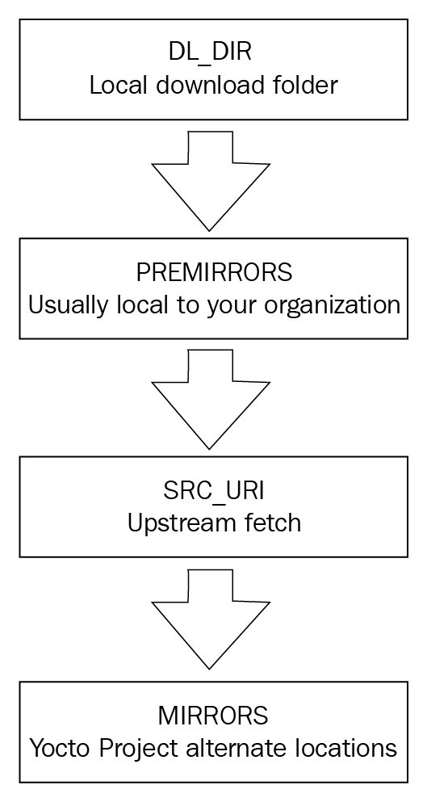

Thứ tự tìm source download

- Nó thử thư mục `downloads` local.

- Nó tìm trong các pre-mirrors đã cấu hình, thường là local trong tổ chức của bạn.

- Sau đó nó thử fetch từ source upstream như đã cấu hình trong package recipe.

- Cuối cùng, nó kiểm tra các mirror đã cấu hình. Mirror là các vị trí công khai thay thế cho source.

Nếu không tìm thấy source của một package ở bất kỳ nguồn nào trong bốn nguồn này, việc build package sẽ thất bại với lỗi. Build warning cũng được đưa ra khi fetch upstream thất bại và các mirror được thử, để có thể xem xét vấn đề upstream.

Yocto Project, kể cả các BSP layer như `meta-freescale`, duy trì một tập mirror để cô lập build system khỏi các vấn đề với server upstream. Tuy nhiên, khi thêm các layer bên ngoài, bạn có thể đang thêm hỗ trợ cho các package không có trên các mirror server của Yocto Project hay các mirror đã cấu hình khác, nên bạn được khuyến nghị giữ một pre-mirror local để tránh vấn đề về khả năng có sẵn của source.

Thiết lập mặc định của Poky cho một project mới là lưu các package source đã tải về trong build directory hiện tại. Đây là nơi đầu tiên build system sẽ tìm source download. Thiết lập này có thể được cấu hình trong file `conf/local.conf` của project bằng biến cấu hình `DL_DIR`.

### Cách thực hiện...

Để tối ưu thời gian build, nên giữ một thư mục `downloads` dùng chung giữa mọi project. Script `setup-environment` của layer `meta-freescale` đổi `DL_DIR` mặc định thành thư mục `fsl-community-bsp` do công cụ repo tạo ra. Với thiết lập này, thư mục `downloads` đã được dùng chung giữa mọi project trên host system của bạn. Nó được cấu hình như sau:

```
DL_DIR ?= "${BSPDIR}/downloads/"
```

Một thiết lập dễ mở rộng hơn (ví dụ, cho các nhóm làm việc phân tán từ xa) là cấu hình một pre-mirror. Ví dụ, thêm dòng sau vào file `conf/local.conf`:

```
INHERIT += "own-mirrors"
SOURCE_MIRROR_URL = "http://example.com/my-source-mirror"
```

Một thiết lập thường gặp là để một build server phục vụ thư mục `downloads` của nó. Build server có thể được cấu hình để chuẩn bị các tarball của các thư mục `Git` để tránh phải thực hiện thao tác Git từ server upstream. Thiết lập này trong file `conf/local.conf` sẽ ảnh hưởng tới hiệu năng build, nhưng điều này thường chấp nhận được với một build server. Thêm dòng sau:

```
BB_GENERATE_MIRROR_TARBALLS = "1"
```

Một ưu điểm của thiết lập này là thư mục `downloads` của build server cũng có thể được backup để bảo đảm khả năng có sẵn của source cho sản phẩm của bạn trong tương lai. Điều này đặc biệt quan trọng với các sản phẩm embedded có yêu cầu sẵn có long-term.

Để test thiết lập này, bạn có thể kiểm tra xem có thể build được không khi chỉ dùng các pre-mirrors, với dòng sau:

```
BB_FETCH_PREMIRRORONLY = "1"
```

Thiết lập này trong file `conf/local.conf` cũng có thể được phân phối cho cả nhóm bằng biến `TEMPLATECONF` khi tạo project.

## Chia sẻ shared state cache

Yocto Project build mọi thứ từ source. Khi bạn tạo một project mới, chỉ các file cấu hình được tạo. Sau đó quá trình build biên dịch mọi thứ từ đầu, kể cả toolchain cross-compilation và một số native tool quan trọng cho việc build.

Quá trình này có thể mất nhiều thời gian, và Yocto Project triển khai một cơ chế shared state cache được dùng cho incremental build, với mục đích chỉ build những thành phần thực sự cần thiết cho một thay đổi nhất định.

Để việc này hoạt động, build system tính checksum của dữ liệu đầu vào cho một task. Nếu dữ liệu đầu vào thay đổi, task cần được build lại. Nói đơn giản, quá trình build sinh ra một run script cho mỗi task, có thể tính checksum và so sánh. Nó cũng theo dõi output của một task để có thể dùng lại.

Một package recipe có thể sửa đổi việc shared state caching cho một task, ví dụ, luôn buộc rebuild bằng cách đánh dấu nó là `nostamp`. Giải thích in-depth hơn về cơ chế shared state cache có trong Yocto Project Reference Manual tại `http://www.yoctoproject.org/docs/2.4/ref-manual/ref-manual.html`.

### Cách thực hiện...

Theo mặc định, build system sẽ dùng một thư mục shared state cache tên là `sstate-cache` trong build directory để lưu dữ liệu cache. Điều này có thể thay đổi bằng biến cấu hình `SSTATE_DIR` trong file `conf/local.conf`. Dữ liệu cache được lưu trong các thư mục được đặt tên theo hai ký tự đầu của hash. Bên trong, tên file chứa toàn bộ checksum của task, nên chỉ cần nhìn tên file là xác định được cache có hợp lệ hay không. Các set scene task của quá trình build sẽ đánh giá dữ liệu cache và dùng nó để tăng tốc build nếu hợp lệ.

Khi muốn bắt đầu một bản build từ trạng thái sạch, bạn cần xóa cả thư mục `sstate-cache` lẫn thư mục `tmp`.

Bạn cũng có thể bảo BitBake bỏ qua shared state cache bằng đối số `--no-setscene` khi chạy nó.

Một cách làm tốt là giữ các bản backup của shared state cache sạch (ví dụ, từ một build server), có thể dùng khi shared state cache bị hỏng.

### Còn nữa...

Có thể chia sẻ shared state cache; tuy nhiên, cần làm điều đó một cách cẩn thận. Không phải mọi thay đổi đều được phần triển khai shared state cache phát hiện, và khi điều đó xảy ra, một phần hoặc toàn bộ cache cần bị vô hiệu hóa. Việc này có thể gây vấn đề khi state cache đang được chia sẻ.

Khuyến nghị trong trường hợp này phụ thuộc vào use case. Các developer làm việc với metadata Yocto nên giữ shared state cache như mặc định, tách riêng cho từng project.

Tuy nhiên, các kỹ sư validation và testing, developer kernel và bootloader, và application developer có lẽ sẽ hưởng lợi từ một shared state cache well-maintained.

Để cấu hình một ổ NFS share được dùng chung trong nhóm phát triển nhằm tăng tốc build, bạn có thể thêm dòng sau vào file cấu hình `conf/local.conf`:

```
SSTATE_MIRRORS ?= "\
     file://.* file:///nfs/local/mount/sstate/PATH"
```

Để cấu hình việc chia sẻ shared state cache qua HTTP, thêm dòng sau vào file cấu hình conf/local.conf:

```
SSTATE_MIRRORS ?= "file://.*
http://example.com/some_path/sstate-cache/PATH"
```

Biểu thức `PATH` trong các ví dụ này sẽ được build system thay bằng một thư mục đặt tên theo hai ký tự đầu của hash.

## Thiết lập package feed

Một dự án embedded system hiếm khi cần đưa thay đổi vào Yocto build system. Phần lớn thời gian và công sức dành cho phát triển ứng dụng, tiếp đó một phần ít hơn cho system development, có thể là công việc với kernel và bootloader.

Vì vậy, việc rebuild toàn bộ hệ thống có lẽ chỉ được thực hiện rất ít lần. Một project mới thường được build từ một shared state cache build sẵn, và công việc phát triển ứng dụng chỉ cần thực hiện full build hoặc incremental build cho một số ít package.

Sau khi các package được build, chúng cần được cài lên target system để test. Các machine giả lập ổn cho phát triển ứng dụng, nhưng hầu hết công việc hardware-dependent cần được thực hiện trên hardware embedded.

### Chuẩn bị

Một lựa chọn là sao chép thủ công các binary đã build vào root filesystem của target, bằng cách sao chép vào NFS share trên host system mà target đang mount root filesystem từ đó (như đã giải thích trong recipe Configuring network booting for a development setup ở trước), hoặc bằng bất kỳ phương pháp nào khác như SCP, FTP, thậm chí thẻ microSD.

Phương pháp này cũng được các IDE như Eclipse dùng khi debug một ứng dụng bạn đang làm, và được công cụ command-line devtool của Yocto dùng, công cụ này sẽ được giới thiệu sau. Tuy nhiên, phương pháp này không mở rộng tốt khi bạn cần cài nhiều package và dependency.

Lựa chọn tiếp theo là sao chép các binary đã đóng gói (tức là các package RPM, DEB hoặc IPK) vào filesystem của target rồi dùng hệ thống quản lý package của target để cài chúng. Để việc này hoạt động, filesystem của target cần được build với các công cụ quản lý package. Làm điều này đơn giản như thêm tính năng `package-management` vào root filesystem; ví dụ, bạn có thể thêm dòng sau vào file `conf/local.conf` của project:

```
EXTRA_IMAGE_FEATURES += "package-management"
```

Kiểu package mặc định trong Yocto là RPM, và với một package RPM, bạn sẽ sao chép nó vào target và dùng tiện ích `rpm` hoặc `dnf` để cài. Trong Yocto 2.4, RPM package manager mặc định là Dandified Yum (DNF). Đây là phiên bản thế hệ tiếp theo của Yellodog Updater Modified (YUM) và được cấp phép theo General Public License v2.

Tuy nhiên, cách tiện nhất để làm việc này là biến thư mục output package của host system thành một package feed. Ví dụ, nếu bạn dùng định dạng package RPM mặc định, bạn có thể biến `tmp/deploy/rpm` trong build directory thành một package feed mà target có thể dùng để cập nhật.

Để việc này hoạt động, bạn cần cấu hình một HTTP server trên máy tính để phục vụ các package.

#### Đánh phiên bản package

Bạn cũng cần bảo đảm các package được sinh ra có phiên bản đúng, nghĩa là cập nhật recipe revision, PR, với mỗi thay đổi. Có thể làm việc này thủ công, nhưng cách được khuyến nghị, và bắt buộc nếu bạn muốn dùng package feed, là dùng một PR server.

Tuy nhiên, PR server không được bật theo mặc định. Các package được sinh ra mà không có PR server thì nhất quán với nhau nhưng không có bảo đảm cập nhật cho một hệ thống đang chạy.

Cấu hình PR server đơn giản nhất là chạy nó local trên host system. Để làm vậy, bạn thêm dòng sau vào file `conf/local.conf`:

```
PRSERV_HOST = "localhost:0"
```

Với thiết lập này, tính nhất quán khi cập nhật được bảo đảm cho feed của bạn.

Nếu bạn muốn chia sẻ feed với các developer khác, hoặc đang cấu hình một build server hay package server, bạn sẽ chạy một instance duy nhất của PR server bằng command sau:

```
$ bitbake-prserv --host <server_ip> --port <port> --start
```

Và bạn sẽ cập nhật cấu hình build của project để dùng PR server tập trung, sửa `conf/local.conf` như sau:

```
PRSERV_HOST = "<server_ip>:<port>"
```

Ngoài ra, nếu bạn dùng shared state cache như đã mô tả ở trên, mọi bên đóng góp vào shared state cache cần dùng cùng một PR server.

Khi tính toàn vẹn của feed đã được bảo đảm, chúng ta cần cấu hình một HTTP server để phục vụ feed.

### Cách thực hiện...

Chúng ta sẽ dùng `lighttpd` cho ví dụ này, vì nó nhẹ và dễ cấu hình. Làm theo các bước sau:

1. Cài web server:

   ```
   $ sudo apt-get install lighttpd
   ```

2. Theo mặc định, document root được chỉ định trong file cấu hình `/etc/lighttpd/lighttpd.conf` là `/var/www/html`, nên chúng ta chỉ cần một symlink tới package feed:

   ```
   $ sudo ln -s /opt/yocto/fsl-community-bsp/wandboard/tmp/deploy/rpm
   /var/www/html/rpm
   ```

3. Tiếp theo, nạp lại cấu hình như sau:

   ```
   $ sudo service lighttpd reload
   ```

   > Cho mục đích phát triển, bạn cũng có thể khởi chạy một HTTP server Python từ thư mục feeds như sau:
   >
   > ```
   > $ cd /opt/yocto/fsl-community-
   > bsp/wandboard/tmp/deploy/rpm
   > $ sudo python -m SimpleHTTPServer 80
   > ```

4. Làm mới package index. Việc này cần làm thủ công để cập nhật package feed sau mỗi lần build:

   ```
   $ bitbake package-index
   ```

5. Nếu bạn muốn phục vụ các package từ một thư mục khác thay vì trực tiếp từ build directory:

   1. Bạn sẽ cần sao chép các package:

      ```
      $ rsync -r -u /opt/yocto/fsl-community-
      bsp/wandboard/tmp/deploy/rpm/* <new_dir>/
      ```

   2. Sau đó thêm metadata tương ứng vào các repository. Để làm vậy, bạn sẽ cần cài công cụ createrepo:

      ```
      $ sudo apt-get install createrepo
      ```

   3. Và trỏ nó tới thư mục `feed` mới:

      ```
      $ createrepo <new_dir>
      ```

Công cụ createrepo sẽ tạo metadata XML-based từ các package RPM:

> Bạn cũng có thể build và dùng tiện ích `createrepo-c` từ Yocto build system, một bản triển khai bằng C của createrepo, như sau:
>
> ```
> $ bitbake createrepo-c-native -c addto_recipe_sysroot
> $ oe-run-native createrepo-c-native createrepo_c
> <new_dir>
> ```

Sau đó chúng ta cần cấu hình filesystem của target với các package feed mới:

1. Đăng nhập vào target và tạo một thư mục mới để chứa cấu hình repository:

   ```
   $ mkdir -p /etc/yum.repos.d
   ```

   Các file cấu hình repository sẽ có định dạng sau:

   ```
   [<repo name>]
   name=<Repository description>
   baseurl=<url://path/to/repo>
   enabled=<0 (disable) or 1 (enabled)>
   gpgcheck=<0 (disable signature check) or 1 (enabled)>
   gpgkey=<url://path/to/gpg-file if gpgcheck is enabled>
   ```

   `baseurl` nêu ở trên là URL đầy đủ cho các repository, với tiền tố `http://`, `https://`, `ftp://` hoặc `file://`.

   Một ví dụ file cấu hình repository như sau:

   ```
   $ vi /etc/yum.repos.d/yocto.repo
   [yocto-rpm]
   name=Yocto 2.4: rpm
   baseurl=http://<server-ip>/rpm/
   ```

2. Khi thiết lập đã sẵn sàng, chúng ta sẽ có thể truy vấn và cập nhật package từ root filesystem của target bằng lệnh sau:

   ```
   # dnf --nogpgcheck makecache
   # dnf --nogpgcheck search <package_name>
   # dnf --nogpgcheck install <package_name>
   ```

   Theo mặc định, `dnf` được build để dùng package feed có ký (sign), nên chúng ta cần hoặc cấu hình repository ở trên với:

   ```
   gpgcheck=0
   ```

   Hoặc dùng đối số command line `--nogpgcheck` như đã thấy ở trên.

3. Để thay đổi này được lưu lâu dài trong root filesystem của target, chúng ta có thể cấu hình các package feed tại thời điểm biên dịch bằng các biến `PACKAGE_FEED_*` trong `conf/local.conf`, như sau:

   ```
   PACKAGE_FEED_URIS = "http://<server_ip>/"
   PACKAGE_FEED_BASE_PATHS = "rpm"
   ```

   Base URL của package feed được ghép như dưới đây:

   ```
   ${PACKAGE_FEED_URIS}/${PACKAGE_FEED_BASE_PATHS}/${PACKAGE_FEED_ARCH
   S}.
   ```

   Theo mặc định, package feed được chuẩn bị dưới dạng một repository duy nhất nên không cần dùng biến `PACKAGE_FEED_ARCHS`.

> Các biến nêu ở trên sẽ cấu hình filesystem cho bất kỳ định dạng package nào được hỗ trợ.

### Còn nữa...

Yocto build system có thể vừa sinh ra các package có ký vừa cấu hình target image để dùng package feed có ký.

Build system sẽ dùng GNU privacy guard (GNUPG), một bộ software mật mã RFC 4880-compliant được cấp phép theo GNU General Public License GPLv3.

#### Sinh các package có ký

Để cấu hình project ký package RPM, thêm dòng sau vào file cấu hình `conf/local.conf`:

```
INHERIT += "sign_rpm"
```

Để ký package IPK, thay vào đó hãy làm như sau:

```
INHERIT += "sign_ipk"
```

Sau đó bạn sẽ cần định nghĩa tên của GPG key dùng để ký, cùng passphrase của nó:

```
RPM_GPG_NAME = "<key ID>"
RPM_GPG_PASSPHRASE = "<key passphrase>"
```

Hoặc cho định dạng package IPK:

```
IPK_GPG_NAME = "<key ID>"
IPK_GPG_PASSPHRASE_FILE = "<path/to/passphrase/file>"
```

Xem mục Creating a GNUPG key pair tiếp theo trong chính recipe này để tìm key ID đã được sinh ra.

Yocto build system sẽ tìm GPG key riêng (private) trên host và dùng nó để ký các package được sinh ra.

> Bản phát hành Yocto 2.4 hỗ trợ ký package RPM và IPK, nhưng không hỗ trợ package DEB.

#### Dùng package feed có ký

Để target image dùng một package feed có ký, bạn sẽ cần thêm cấu hình sau vào file cấu hình `conf/local.conf`:

```
INHERIT += "sign_package_feed"
PACKAGE_FEED_GPG_NAME = "<key name>"
PACKAGE_FEED_GPG_PASSPHRASE_FILE = "<path/to/passphrase/file>"
```

`<path/to/passphrase/file>` nêu ở trên là đường dẫn tuyệt đối tới một file văn bản chứa passphrase.

Package manager `dnf` sẽ dùng public key đã cấu hình để xác minh tính xác thực của package feed.

#### Tạo cặp key GNUPG

Trong recipe Setting up the host system ở chính chương này, bạn đã cài package `gnupg` vào host machine; nếu chưa, bạn có thể cài ngay bây giờ với:

```
$ sudo apt-get install gnupg
```

Để sinh một key, gõ command sau:

```
$ gpg --gen-key
```

Làm theo hướng dẫn, giữ các giá trị mặc định. Bạn có thể cần tạo dữ liệu ngẫu nhiên bằng cách di chuột và hoạt động đĩa.

Bạn có thể kiểm tra key với:

```
$ gpg --list-keys
/home/alex/.gnupg/pubring.gpg
-----------------------------
pub   2048R/4EF0ECE0 2017-08-13
uid                  Alex Gonzalez <alex@lindusembedded.com>
sub   2048R/298446F3 2017-08-13
```

GPG key ID trong ví dụ trên là `4EF0ECE0`.

Và export nó bằng command sau:

```
$ gpg --output rpm-feed.gpg --export <id>
```

ID có thể là key ID hoặc bất kỳ phần nào của user ID, chẳng hạn địa chỉ email. Public key đã export giờ có thể được chuyển tới đích cuối cùng của nó, chẳng hạn web server của package feed.

Một ví dụ cấu hình `conf/local.conf` sẽ là:

```
INHERIT += "sign_rpm"
RPM_GPG_NAME = "4EF0ECE0"
RPM_GPG_PASSPHRASE = "<very-secure-password>"
INHERIT += "sign_package_feed"
PACKAGE_FEED_GPG_NAME = "4EF0ECE0"
PACKAGE_FEED_GPG_PASSPHRASE_FILE = "/opt/yocto/passphrase.txt"
```

> Hãy nhớ chạy lệnh sau sau khi rebuild image để repository feed được ký:
>
> ```
> $ bitbake package-index
> ```
>
> Nếu bạn chuẩn bị repository thủ công, bạn cũng sẽ phải ký nó.

#### Backup các key

Bạn có thể chuyển cặp key tới một nơi an toàn với:

```
$ gpg --output rpm-feed.pub --armor --export <key id>
$ gpg --output rpm-feed.sec --armor --export-secret-key <key id>
```

Sao chép chúng một cách an toàn tới vị trí mới và import chúng với:

```
$ gpg --import  rpm-feed.pub
$ gpg --allow-secret-key-import --import  rpm-feed.sec
```

### Xem thêm

- Thêm thông tin và user manual cho tiện ích `dnf` có tại `http://dnf.readthedocs.io/en/latest/index.html`

- Tài liệu GNUPG có thể truy cập tại `https://www.gnupg.org/documentation/`

## Sử dụng build history

Khi duy trì software cho một sản phẩm embedded, bạn cần một cách để biết điều gì đã thay đổi và nó sẽ ảnh hưởng tới sản phẩm ra sao.

Trên một hệ thống Yocto, bạn có thể cần cập nhật revision của một package (ví dụ, để sửa một lỗ hổng bảo mật), và bạn cần chắc chắn hệ quả của thay đổi đó là gì, chẳng hạn về dependency của package và các thay đổi với root filesystem.

Build history cho phép bạn làm đúng việc đó, và chúng ta sẽ khám phá nó trong recipe này.

### Cách thực hiện...

Để bật build history, thêm dòng sau vào file `conf/local.conf`:

```
INHERIT += "buildhistory"
```

Cấu hình ở trên bật việc thu thập thông tin, kể cả các dependency graph.

Để bật việc lưu build history trong một Git repository local, cũng thêm dòng sau vào file cấu hình `conf/local.conf`:

```
BUILDHISTORY_COMMIT = "1"
```

Vị trí Git repository có thể được đặt bằng biến `BUILDHISTORY_DIR`, mặc định là thư mục `buildhistory` trong build directory.

Theo mặc định, `buildhistory` theo dõi thay đổi của package, image và SDK. Điều này có thể cấu hình bằng biến `BUILDHISTORY_FEATURES`. Ví dụ, để chỉ theo dõi thay đổi image, thêm dòng sau vào `conf/local.conf`:

```
BUILDHISTORY_FEATURES = "image"
```

Nó cũng có thể theo dõi các file cụ thể và sao chép chúng vào thư mục `buildhistory`. Theo mặc định, điều này chỉ bao gồm `/etc/passwd` và `/etc/groups`, nhưng có thể dùng nó để theo dõi bất kỳ file quan trọng nào, chẳng hạn các chứng chỉ bảo mật. Các file cần được thêm bằng biến `BUILDHISTORY_IMAGE_FILES` trong file `conf/local.conf`, như sau:

```
BUILDHISTORY_IMAGE_FILES += "/path/to/file"
```

Build history sẽ làm chậm quá trình build, tăng kích thước build, và cũng có thể làm thư mục `Git` phình tới mức khó quản lý. Khuyến nghị là bật nó trên một build server cho các bản phát hành software, hoặc trong những trường hợp cụ thể, như khi cập nhật software production.

### Cách hoạt động...

Khi được bật, nó sẽ giữ một bản ghi các thay đổi của từng package và image dưới dạng một Git repository, theo cách có thể khám phá và phân tích.

> Lưu ý rằng build history chỉ ghi lại các thay đổi của bản build. Nếu project của bạn đã được build, bạn sẽ phải sửa gì đó hoặc xóa thư mục `tmp` để build history được sinh ra.

Cấu hình build và revision của metadata, như Bitbake in ra, được lưu trong file `build-id.txt`.

Với một package, build history ghi lại các thông tin sau:

- Revision của package và recipe

- Các dependency

- Kích thước package

- Các file

Với một image, nó ghi lại các thông tin sau:

- Cấu hình build

- Các dependency graph

- Danh sách file kèm quyền sở hữu và quyền truy cập, cũng như thông tin kích thước và symlink

- Danh sách các package đã cài

Và với một SDK, nó ghi lại các thông tin sau:

- Cấu hình SDK

- Danh sách cả file host lẫn file target, kèm quyền sở hữu và quyền truy cập, cũng như thông tin kích thước và symlink

- Thông tin Package-related chỉ được sinh cho SDK chuẩn, không cho extensible SDK. Bao gồm:

  - Các dependency graph

  - Danh sách các package đã cài

  Để biết thêm chi tiết về việc dùng Yocto SDK, hãy xem các recipe Preparing an SDK và Using the extensible SDK trong `Chapter 4`, Application Development.

#### Xem build history

Có thể kiểm tra thư mục `Git` chứa build history theo nhiều cách:

- Dùng các công cụ Git như `gitk` hoặc `git log`

- Dùng công cụ command-line `buildhistory-diff`, hiển thị các khác biệt ở định dạng human-readable

- Dùng một giao diện web Django-1.8-based

Để cài giao diện web Django lên một máy phát triển, trước tiên bạn cần cài một số dependency trên host:

```
$ sudo apt-get install python3-django
$ sudo apt-get install python-django-registration
```

> Lệnh này sẽ cài Django 1.8 cho cả Python 2.7 lẫn Python 3. Giao diện `buildhistory-web` hiện chỉ chạy trên Python 2.7, nhưng script import build history sẽ cần chạy dưới Python 3 vì đó là thứ BitBake của Yocto 2.4 dùng.

Giờ chúng ta có thể clone source của giao diện web và cấu hình nó:

```
$ cd /opt/yocto/fsl-community-bsp/sources
$ git clone git://git.yoctoproject.org/buildhistory-web
$ cd buildhistory-web/
```

Sửa file `settings.py` để đổi đường dẫn tới database engine:

```
    DATABASES = {
        'default': {
            'ENGINE': 'django.db.backends.sqlite3',
            'NAME': '/opt/yocto/fsl-community-bsp/sources/buildhistory-
web/bhtest.db3',
            'USER': '',
            'PASSWORD': '',
            'HOST': '',
            'PORT': '',
        }
    }
```

Sau đó bạn cần thiết lập ứng dụng Django với:

```
$ python manage.py migrate
```

Tiếp theo, import `buildhistory` như sau:

```
$ python3 warningmgr/import.py  /opt/yocto/fsl-community-bsp/sources/poky/
/opt/yocto/fsl-community-bsp/wandboard/buildhistory/
```

Command trên sẽ cần được chạy mỗi khi có một bản build mới.

Và cuối cùng, khởi động web server trên localhost với:

```
$ python manage.py runserver
```

> Để bind nó vào một địa chỉ IP và cổng khác, bạn có thể làm:
>
> ```
> $ python manage.py runserver <host>:<port>
> ```
>
> Nhưng bạn sẽ cần cấu hình `settings.py` cho phù hợp với:
>
> ```
> ALLOWED_HOSTS = [u'<host>']
> ```

Hình sau cho thấy trang chủ của giao diện web Buildhistory:

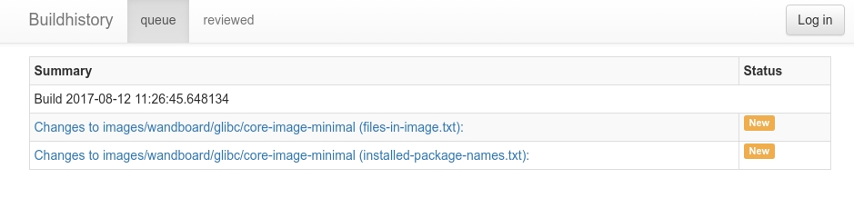

Giao diện web Buildhistory

### Còn nữa...

Để duy trì build history, điều quan trọng là tối ưu nó và ngăn nó phình to theo thời gian. Backup build history định kỳ và clean-ups dữ liệu cũ là quan trọng để giữ repository build history ở kích thước quản lý được.

Sau khi thư mục `buildhistory` đã được backup, quy trình sau sẽ cắt gọn nó và chỉ giữ lịch sử gần nhất:

1. Sao chép repository vào một RAM filesystem tạm (`tmpfs`) để tăng tốc. Kiểm tra output của command `df -h` để xem thư mục nào là filesystem `tmpfs` và chúng còn bao nhiêu dung lượng, rồi dùng một cái. Ví dụ, trong Ubuntu 16.04, có thể dùng thư mục `/run/`.

2. Sao chép build history vào thư mục `/run` như sau:

   ```
   $ sudo mkdir /run/workspace
   $ sudo chown ${USER} /run/workspace/
   $ cp -r /opt/yocto/fsl-community-bsp/wandboard/buildhistory/
   /run/workspace/
   $ cd /run/workspace/buildhistory/
   ```

3. Thêm một graft point cho một commit cách đây 1 tháng, không có parent:

   ```
   $ git rev-parse "HEAD@{1 month ago}" > .git/info/grafts
   ```

4. Làm cho graft point vĩnh viễn:

   ```
   $ git filter-branch
   ```

5. Clone một repository mới để dọn các Git object còn lại:

   ```
   $ git clone file://${tmpfs}/buildhistory buildhistory.new
   ```

6. Thay thư mục `buildhistory` cũ bằng thư mục mới đã được dọn:

   ```
   $ rm -rf buildhistory
   $ mv buildhistory.new /opt/yocto/fsl-community-
   bsp/wandboard/buildhistory/
   ```

7. Và cuối cùng, xóa workspace:

   ```
   $ rm -rf /run/workspace/
   ```

## Làm việc với build statistics

Build system có thể thu thập thông tin build theo từng task và image. Dữ liệu này có thể được dùng để xác định những chỗ cần tối ưu thời gian build và các điểm nghẽn, đặc biệt khi thêm recipe mới vào hệ thống. Recipe này sẽ giải thích cách build statistics hoạt động.

### Cách thực hiện...

Để bật việc thu thập thống kê, project của bạn cần kế thừa class `buildstats` bằng cách thêm nó vào `USER_CLASSES` trong file `conf/local.conf`. Theo mặc định, build project `fsl-community-bsp` được cấu hình để bật chúng:

```
USER_CLASSES ?= "buildstats"
```

Bạn có thể cấu hình vị trí của các thống kê này bằng biến `BUILDSTATS_BASE`, và theo mặc định nó được đặt là thư mục `buildstats` trong thư mục `tmp` dưới build directory (`tmp/buildstats`).

Thư mục `buildstats` chứa mỗi image một thư mục, với build stats nằm dưới một thư mục timestamp. Bên dưới đó là một sub-directory cho mỗi package trong image đã build, và một file `build_stats` chứa:

- Thông tin host system

- Vị trí và kích thước root filesystem

- Thời gian build

- Mức dùng CPU trung bình

### Cách hoạt động...

Độ chính xác của dữ liệu phụ thuộc vào việc thư mục download, `DL_DIR`, và thư mục shared state cache, `SSTATE_DIR`, có nằm trên cùng một phân vùng hay volume hay không, nên bạn có thể cần cấu hình chúng cho phù hợp nếu định dùng dữ liệu build.

Một ví dụ file `build-stats` trông như sau:

```
Host Info: Linux langabe 4.10.0-30-generic #34~16.04.1-Ubuntu SMP Wed Aug 2
02:13:56 UTC 2017 x86_64 x86_64
Build Started: 1502529685.16
Uncompressed Rootfs size: 93M   /opt/yocto/fsl-community-
bsp/wandboard/tmp/work/wandboard-poky-linux-gnueabi/core-image-minimal/1.0-
r0/rootfs
Elapsed time: 101.87 seconds
CPU usage: 47.8%
```

Bên trong mỗi package, chúng ta có một danh sách task; ví dụ, với `ncurses-6.0+20161126-r0`, chúng ta có các task sau:

- `do_compile`

- `do_fetch`

- `do_package`

- `do_package_write_rpm`

- `do_populate_lic`

- `do_rm_work`

- `do_configure`

- `do_install`

- `do_packagedata`

- `do_package_qa`

- `do_patch`

- `do_prepare_recipe_sysroot`

- `do_populate_sysroot`

- `do_unpack`

Mỗi task chứa các thông tin sau:

- Thời gian build

- Mức dùng CPU

- Thống kê đĩa

Thông tin được hiển thị như sau:

```
Event: TaskStarted
Started: 1502541082.15
ncurses-6.0+20161126-r0: do_compile
Elapsed time: 35.37 seconds
utime: 31
stime: 2
cutime: 7790
cstime: 1138
IO rchar: 778886123
IO read_bytes: 3354624
IO wchar: 79063307
IO cancelled_write_bytes: 1507328
IO syscr: 150688
IO write_bytes: 26726400
IO syscw: 31565
rusage ru_utime: 0.312
rusage ru_stime: 0.027999999999999997
rusage ru_maxrss: 78268
rusage ru_minflt: 5050
rusage ru_majflt: 0
rusage ru_inblock: 0
rusage ru_oublock: 1184
rusage ru_nvcsw: 705
rusage ru_nivcsw: 126
Child rusage ru_utime: 77.908
Child rusage ru_stime: 11.388
Child rusage ru_maxrss: 76284
Child rusage ru_minflt: 2995484
Child rusage ru_majflt: 0
Child rusage ru_inblock: 6552
Child rusage ru_oublock: 51016
Child rusage ru_nvcsw: 18280
Child rusage ru_nivcsw: 29984
Status: PASSED
Ended: 1502541117.52
```

Mức dùng CPU được cho bằng dữ liệu trích từ `/proc/<pid>/stat` và tính theo đơn vị clock tick:

- `utime` là khoảng thời gian process được lập lịch chạy ở user mode

- `stime` là khoảng thời gian nó được lập lịch chạy ở kernel mode

- `cutime` là thời gian các process con của process được lập lịch chạy ở user mode

- `cstime` là thời gian chúng được lập lịch chạy ở kernel mode

Và các thông tin sau cũng có sẵn từ thông tin sử dụng tài nguyên do `getrusage()` cung cấp, biểu diễn mức sử dụng tài nguyên của process gọi hàm, gồm mọi thread, cũng như các process con và hậu duệ của chúng:

- `ru_utime` là thời gian CPU ở user đã dùng, tính bằng giây

- `ru_stime` là thời gian CPU ở system đã dùng, tính bằng giây

- `ru_maxrss` là resident set size tối đa, tính bằng KB

- `ru_minflt` là số page fault không có hoạt động I/O

- `ru_majflt` là số page fault cần hoạt động I/O

- `ru_inblock` là số lần input của filesystem

- `ru_oublock` là số lần output của filesystem

- `ru_nvcsw` là số lần một process tự nguyện nhường CPU

- `ru_nivcsw` là số lần một process bị buộc phải nhường CPU

Cuối cùng, thống kê truy cập đĩa được cung cấp từ `/proc/<pid>/io` như sau:

- `rchar` là số byte đọc từ storage

- `wchar` là số byte ghi vào đĩa

- `syscr` là số thao tác read I/O ước tính

- `syscw` là số thao tác write I/O ước tính

- `read_bytes` là số byte đọc từ storage (estimate-accurate với các filesystem block-backed)

- `write_bytes` là số byte ước tính được ghi xuống storage layer

- `cancelled_write_bytes` là số byte đã ghi nhưng không thực sự xảy ra, do truncate page cache

### Còn nữa...

Bạn cũng có thể có biểu diễn đồ họa của dữ liệu bằng công cụ `pybootchartgui.py` có trong source Poky. Từ build folder của project, bạn có thể chạy command sau để có một hình `bootchart.png` trong `/tmp`:

```
$ cd /optyocto/fsl-community-bsp/wandboard/
$ /opt/yocto/fsl-community-
bsp/sources/poky/scripts/pybootchartgui/pybootchartgui.py
   tmp/buildstats/ -o /tmp
```

Một hình ví dụ được trình bày dưới đây:

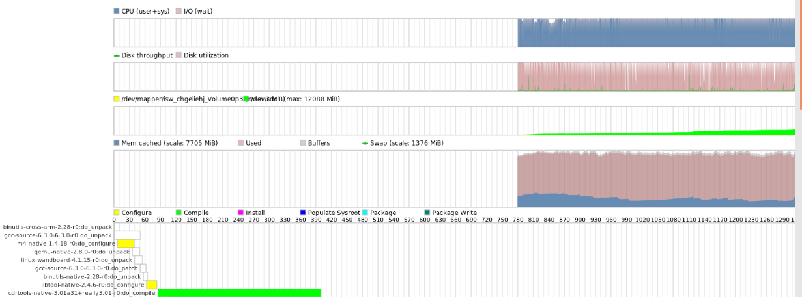

Tài liệu build statistics dạng đồ họa

### Xem thêm

- Xem tài liệu Linux kernel để biết thêm chi tiết về dữ liệu thu được qua proc filesystem: `https://git.kernel.org/pub/scm/linux/kernel/git/torvalds/linux.git/tree/Documentation/filesystems/proc.txt`

## Debug build system

Trong recipe cuối của chương này, chúng ta sẽ khám phá các phương pháp khác nhau để debug các vấn đề với build system và metadata của nó.

### Chuẩn bị

Trước tiên, hãy giới thiệu một số use case thường gặp của một phiên debug.

#### Tìm recipe

Một cách tốt để kiểm tra xem một package cụ thể có được hỗ trợ trong các layer hiện tại không là tìm nó như sau:

```
$ cd /opt/yocto/fsl-community-bsp/sources
$ find -name "*busybox*"
```

Lệnh này sẽ tìm đệ quy pattern BusyBox trong mọi layer. Bạn có thể giới hạn việc tìm ở recipe và append file bằng cách chạy:

```
$ find -name "*busybox*.bb*"
```

Yocto có một tiện ích command-line `bitbake-layers` cũng có thể dùng để tìm các recipe cụ thể trên các layer đã cấu hình, với phiên bản ưu tiên xuất hiện đầu tiên:

```
$ bitbake-layers show-recipes "<package_name>"
```

Ở đây, `<package_name>` cũng hỗ trợ wildcard.

Ví dụ:

```
$ bitbake-layers show-recipes gdb*
=== Matching recipes: ===
gdb:
  meta                 7.12.1
gdb-cross-arm:
  meta                 7.12.1
gdb-cross-canadian-arm:
  meta                 7.12.1
gdbm:
  meta                 1.12
```

> Để dùng `bitbake-layers`, environment script phải được source trước.

Cuối cùng, tiện ích command-line devtool cũng có thể dùng để tìm trong dependency cache bằng một biểu thức chính quy. Nó sẽ tìm trên tên recipe hoặc package, và cả description và các file được cài, nên nó phù hợp hơn trong bối cảnh phát triển metadata recipe:

```
$ devtool search <regular expression>
```

Để dùng devtool, môi trường cần được thiết lập trước và shared state cache đã được nạp dữ liệu:

```
$ cd /opt/yocto/fsl-community-bsp
$ source setup-environment wandboard
$ bitbake <target-image>
$ devtool search gdb
Loaded 2323 entries from dependency cache.
perl                  Perl scripting language
shared-mime-info      Shared MIME type database and specification
bash-completion       Programmable Completion for Bash 4
glib-2.0              A general-purpose utility library
python                The Python Programming Language
gdbm                  Key/value database library with extensible hashing
gcc-runtime           Runtime libraries from GCC
```

#### Dump environment của BitBake

Khi phát triển hoặc debug các recipe package hay image, việc yêu cầu BitBake liệt kê environment của nó, cả toàn cục lẫn cho một target cụ thể, dù là package hay image, là rất phổ biến.

Để dump environment toàn cục và `grep` một biến cần quan tâm (ví dụ, `DISTRO_FEATURES`), dùng command sau:

```
$ bitbake -e | grep -w DISTRO_FEATURES
```

Tùy chọn, để tìm source directory của một package recipe cụ thể như BusyBox, dùng command sau:

```
$ bitbake -e busybox | grep ^S=
```

Bạn cũng có thể chạy command sau để tìm thư mục làm việc của một package recipe hoặc image recipe:

```
$ bitbake -e <target> | grep ^WORKDIR=
```

#### Dùng development shell

BitBake cung cấp các task `devshell` và `devpyshell` để giúp developer. Chúng được chạy bằng các command sau:

```
$ bitbake -c devshell <target>
```

Và:

```
$ bitbake -c devpyshell <target>
```

Chúng sẽ unpack và patch source, rồi mở một Terminal mới (chúng sẽ tự phát hiện loại Terminal của bạn, hoặc có thể đặt bằng `OE_TERMINAL`) trong source directory của target, nơi environment đã được thiết lập đúng. Chúng chạy với flag `nostamp` nên các task up-to-date cũng sẽ được chạy lại.

Command `devpyshell` sẽ thiết lập thêm môi trường Python, gồm các object và code Python như object datastore `d`.

> Trong một môi trường đồ họa, `devshell` và `devpyshell` sẽ mở một cửa sổ Terminal hoặc console mới, nhưng nếu chúng ta làm việc trong một môi trường non-graphical, như Telnet hoặc SSH, bạn có thể cần chỉ định `screen` làm Terminal trong file cấu hình `conf/local.conf` như sau:
>
> ```
> OE_TERMINAL = "screen"
> ```

Bên trong `devshell`, bạn có thể chạy các command phát triển như `configure` và `make` hoặc gọi trực tiếp cross-compiler (dùng biến môi trường `$CC`, đã được thiết lập sẵn). Bạn cũng có thể chạy các task BitBake bên trong `devshell` bằng cách gọi trực tiếp script `${WORKDIR}/temp/run*`. Việc này cho cùng kết quả như gọi BitBake từ bên ngoài `devshell` cho task đó.

Bên trong trình thông dịch Python `devpyshell`, bạn có thể gọi các hàm như `d.setVar()` và `d.getVar()`, hoặc bất kỳ code Python nào như `bb.build.exec_fun()`.

### Cách thực hiện...

Điểm khởi đầu để debug lỗi build package là thông báo lỗi BitBake in ra trong quá trình build. Nó thường chỉ cho chúng ta task đã build thất bại.

1. Để liệt kê mọi task có sẵn cho một recipe nhất định, kèm mô tả, chúng ta chạy như sau:

   ```
   $ bitbake -c listtasks <target>
   ```

2. Nếu cần tái tạo lỗi, bạn có thể ép build với lệnh sau:

   ```
   $ bitbake -f <target>
   ```

3. Hoặc bạn có thể yêu cầu BitBake force-run chỉ một task cụ thể bằng command sau:

   ```
   $ bitbake -c compile -f <target>
   ```

> Ép chạy một task sẽ làm task đó bị "taint" và BitBake sẽ hiện một cảnh báo. Điều này nhằm thông báo rằng bản build đã bị sửa đổi. Bạn có thể bỏ cảnh báo bằng cách dọn thư mục `work` với đối số `-c clean`.

#### Task log và run file

Để debug lỗi build, BitBake tạo hai loại file hữu ích cho mỗi shell task và lưu chúng trong thư mục `temp` trong thư mục làm việc. Lấy BusyBox làm ví dụ, chúng ta sẽ xem trong:

```
/opt/yocto/fsl-community-bsp/wandboard/tmp/work/cortexa9hf-neon-poky-linux-
gnueabi/busybox/1.24.1-r0/temp
```

Và tìm một danh sách file `log*` và `run*`. Định dạng tên file là:

```
log.do_<task>.<pid> and run.do_<task>.<pid>.
```

Nhưng may thay, chúng ta cũng có các symbolic link không có phần `<pid>`, trỏ tới phiên bản mới nhất.

Các file `log` sẽ chứa output của task, và đó thường là thông tin duy nhất ta cần để debug vấn đề. File `run` chứa code thực tế được BitBake thực thi để sinh ra log nói trên. File này chỉ cần khi debug các vấn đề build phức tạp.

Mặt khác, các Python task hiện không ghi file như mô tả ở trên, dù việc này được lên kế hoạch làm trong tương lai. Các Python task chạy nội bộ và ghi thông tin log ra Terminal.

> Nếu dùng class `rm_work`, tên package cần được thêm vào biến `RM_WORK_EXCLUDE` để có thể truy cập task log và run file.

#### Thêm logging vào recipe

Các recipe BitBake chấp nhận code Bash hoặc Python. Logging trong Python được thực hiện qua class `bb` và dùng module thư viện Python logging chuẩn. Nó có các thành phần sau:

- `bb.plain`: Dùng `logger.plain`. Có thể dùng để debug, nhưng không nên commit vào source.

- `bb.note`: Dùng `logger.info`.

- `bb.warn`: Dùng `logger.warn`.

- `bb.error`: Dùng `logger.error`.

- `bb.fatal`: Dùng `logger.critical` và thoát BitBake.

- `bb.debug`: Hàm này cần được truyền một log level làm đối số đầu tiên và dùng `logger.debug`.

Để in debug output từ Bash trong recipe, chúng ta cần dùng class `logging` bằng cách:

```
inherit logging
```

Class `logging` được kế thừa mặc định bởi mọi recipe có chứa `base.bbclass`, nên thường chúng ta không phải kế thừa nó một cách tường minh. Khi đó chúng ta sẽ có các hàm Bash sau:

- `bbplain`: Hàm này in ra nguyên văn những gì được truyền vào. Có thể dùng khi debug nhưng không nên commit vào source của recipe.

- `bbnote`: Hàm này in với tiền tố `NOTE`.

- `bbwarn`: Hàm này in một cảnh báo non-fatal với tiền tố `WARNING`.

- `bberror`: Hàm này in một lỗi non-fatal với tiền tố `ERROR`.

- `bbfatal`: Hàm này dừng bản build và in thông báo lỗi giống `bberror`.

- `bbdebug`: Hàm này in các debug message với log level được truyền làm đối số đầu tiên. Nó được dùng theo định dạng sau:

  ```
  bbdebug [123] "message"
  ```

> Các hàm Bash nêu ở đây không ghi log ra console mà chỉ ghi vào các file `log`.

#### Xem các dependency

Bạn có thể yêu cầu BitBake in ra phiên bản hiện tại và phiên bản được cung cấp của các package bằng command sau:

```
$ bitbake --show-versions
```

Một việc debug thường gặp khác là loại bỏ các dependency không mong muốn.

Để xem tổng quan các dependency pulled-in, bạn có thể dùng verbose output của BitBake bằng cách chạy:

```
$ bitbake -v <target>
```

Để phân tích những dependency nào bị một package kéo vào, chúng ta có thể yêu cầu BitBake tạo các file DOT mô tả các dependency này bằng command sau:

```
$ bitbake -g <target>
```

Định dạng DOT là một ngôn ngữ mô tả đồ họa dạng văn bản, được package open source GraphViz và mọi tiện ích dùng nó hiểu được. Các file DOT có thể được hiển thị trực quan hoặc xử lý tiếp.

Bạn có thể bỏ bớt dependency khỏi graph để có output dễ đọc hơn. Ví dụ, để bỏ các dependency từ `glibc`, bạn sẽ chạy command sau:

```
$ bitbake -g <target> -I glibc
```

Sau khi chạy các command trên, chúng ta có các file sau trong thư mục hiện tại:

- `pn-buildlist`: File này cho thấy danh sách package sẽ được build bởi target đã cho

- `recipes-depends.dot`: File này cho thấy dependency giữa các recipe

- `task-depends.dot`: File này cho thấy dependency giữa các task

Để chuyển các file `.dot` sang file postscript (`.ps`), bạn có thể chạy:

```
$ dot -Tps filename.dot -o outfile.ps
```

Tuy nhiên, cách hữu ích nhất để hiển thị dữ liệu dependency là yêu cầu BitBake hiển thị nó dưới dạng đồ họa bằng dependency explorer, như sau:

```
$ bitbake -g -u taskexp <target>
```

Kết quả có thể thấy trong screenshot sau:

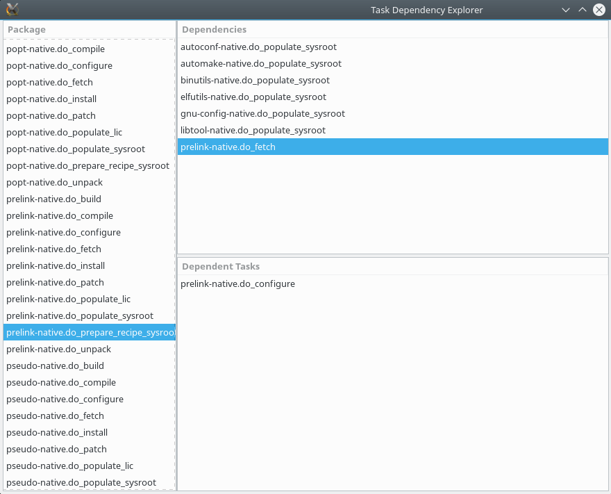

Dependency explorer cho task

#### Debug các dependency

Trong những trường hợp hiếm, bạn có thể phải debug một vấn đề task dependency, ví dụ khi BitBake bỏ sót một task dependency.

Trong sub-directory `tmp/stamps` bên trong build directory, bạn có thể tìm thấy hai loại file hữu ích khi debug các vấn đề dependency:

- `sigdata`, một database Python chứa toàn bộ metadata được dùng để tính checksum đầu vào của task

- `siginfo`, tương tự nhưng dành cho các recipe được tăng tốc bằng shared state cache

Bạn có thể dùng `bitbake-dumpsig` trên cả hai loại file này để dump các variable dependency của task, giá trị biến, cũng như danh sách các biến không bao giờ được đưa vào checksum nào.

Khi cố so sánh hai phiên bản của một task nhất định, có thể dùng `bitbake-diffsig` để dump khác biệt giữa hai revision `sigdata` hoặc `siginfo`.

#### Debug BitBake

Việc phải debug chính BitBake không phổ biến, nhưng bạn có thể tìm thấy một bug trong BitBake và muốn tự khám phá nó trước khi báo cho cộng đồng BitBake. Với những trường hợp như vậy, bạn có thể yêu cầu BitBake xuất thông tin debug ở ba mức khác nhau bằng flag `-D`. Để hiển thị toàn bộ thông tin debug, chạy command sau:

```
$ bitbake -DDD <target>
```

#### Công cụ báo lỗi

Đôi khi, bạn sẽ gặp lỗi build trên một recipe Yocto mà bạn chưa sửa. Nơi đầu tiên để kiểm tra lỗi là chính cộng đồng, nhưng trước khi mở mail client, hãy vào `http://errors.yoctoproject.org`. Trang chào mừng được hiển thị như sau:

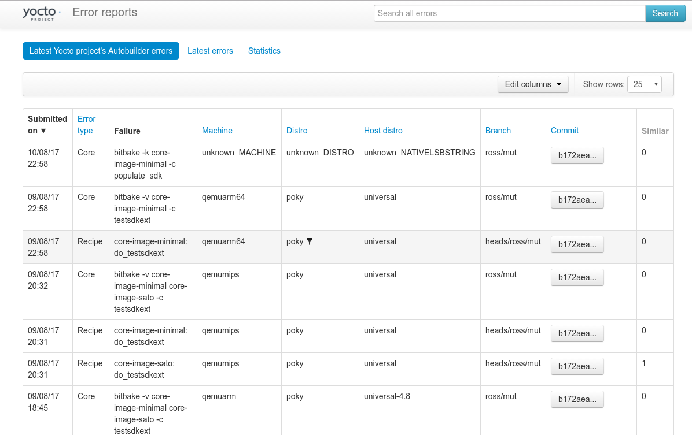

Giao diện web báo lỗi

Đây là một database trung tâm chứa các lỗi, phần lớn từ autobuilder nhưng cũng có lỗi user-reported. Ở đây, bạn có thể kiểm tra xem có ai khác đang gặp cùng vấn đề không.

Bạn có thể gửi lỗi build của mình vào database để giúp cộng đồng debug vấn đề. Để làm vậy, bạn có thể dùng class `report-error`. Thêm dòng sau vào file `conf/local.conf`:

```
INHERIT += "report-error"
```

Theo mặc định, thông tin lỗi được lưu dưới `tmp/log/error-report` trong build directory, nhưng bạn có thể đặt một vị trí cụ thể bằng biến `ERR_REPORT_DIR`.

Khi công cụ báo lỗi được kích hoạt, một lỗi build sẽ được ghi lại vào một file trong thư mục `error-report`. Output build cũng sẽ in ra một command để gửi error log lên server:

```
$ send-error-report ${LOG_DIR}/error-report/error-report_${TSTAMP}
```

Khi command này được chạy, nó sẽ trả về một link tới lỗi trên upstream.

Bạn có thể thiết lập một error server local, và dùng nó thay thế bằng cách truyền một đối số server. Code của error server là một ứng dụng web Django, và chi tiết thiết lập có tại `http://git.yoctoproject.org/cgit/cgit.cgi/error-report-web/tree/README`.
