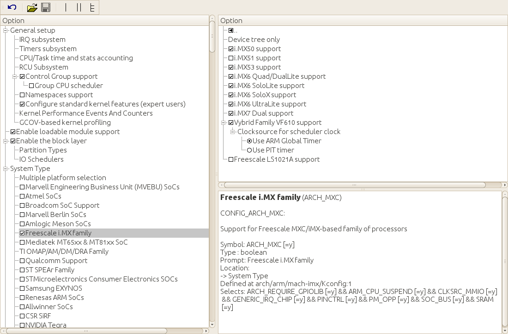
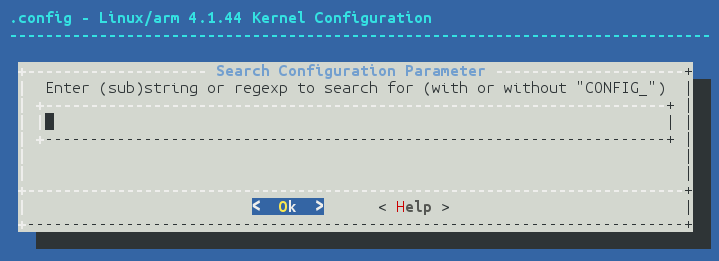

# 2 BSP Layer (The BSP Layer)

Trong chương này, chúng ta sẽ đề cập các recipe sau:

- Tạo một BSP layer tùy biến

- Thêm kernel và bootloader tùy biến

- Build bootloader U-Boot

- Mô tả build system của Linux

- Cấu hình Linux kernel

- Build Linux kernel

- Build các kernel module bên ngoài

- Debug Linux kernel và các module

- Debug quá trình boot của Linux kernel

- Sử dụng hệ thống tracing của kernel

- Quản lý device tree

- Debug các vấn đề device tree

## Giới thiệu

Ở chương trước, chúng ta đã quen với build system và hardware tham chiếu đang dùng. Chúng ta đã build image, chạy chúng, và học cách tùy biến và tối ưu build system.

Giờ môi trường build với Yocto Project đã sẵn sàng, đã đến lúc nghĩ tới việc bắt đầu công việc phát triển cho dự án embedded Linux.

Hầu hết các dự án embedded Linux đòi hỏi cả hardware lẫn software tùy biến. Một việc sớm trong quá trình phát triển là test các board hardware tham chiếu khác nhau và chọn một board làm nền cho thiết kế. Như đã thấy trong recipe Building Wandboard images ở `Chapter 1`, The Build System, cho cuốn sách này chúng ta đã chọn Wandboard, một platform NXP i.MX6-based, vì nó là một board giá phải chăng và mở, rất phù hợp với nhu cầu của chúng ta.

Wandboard dùng một SoM, SoM này được gắn lên một carrier board và bán như một single-board computer. Vì schematic là mở, SoM có thể được dùng với một thiết kế carrier board khác cho một sản phẩm cụ thể hơn nhiều.

Chương này sẽ giới thiệu system development với trọng tâm là BSP layer. Nó sẽ giải thích cách tạo một BSP layer để chứa các thay đổi hardware-specific, cũng như cho thấy cách làm việc với bootloader U-Boot và Linux kernel, những thành phần có lẽ sẽ chiếm phần lớn công việc tùy biến hệ thống.

## Tạo một BSP layer tùy biến

Các thay đổi cần để hỗ trợ một hardware platform, hay machine, mới được giữ trên một Yocto layer riêng, gọi là BSP layer. Sự tách biệt này là tốt nhất cho các bản cập nhật và patch hệ thống trong tương lai. Một BSP layer có thể hỗ trợ bất kỳ số lượng machine mới nào và bất kỳ tính năng software mới nào gắn với chính hardware.

### Cách thực hiện...

Theo quy ước, tên Yocto layer bắt đầu bằng `meta`, viết tắt của metadata. Một BSP layer sau đó có thể thêm từ khóa `bsp`, và cuối cùng là một tên duy nhất. Chúng ta sẽ gọi layer của mình là `meta-bsp-custom`.

Có một số cách để tạo một layer mới:

- Thủ công, khi bạn đã biết những gì cần thiết

- Bằng cách sao chép layer `meta-skeleton` có trong Poky

- Bằng cách dùng công cụ command-line `yocto-layer`

Bạn có thể xem layer `meta-skeleton` trong Poky và thấy nó gồm các thành phần sau:

- Một file `layer.conf`, nơi đặt các biến cấu hình của layer

- Một file license `COPYING.MIT`

- Một số thư mục có tiền tố `recipes-`, chứa các recipe ví dụ cho BusyBox, Linux kernel và một module ví dụ, một recipe service ví dụ, một recipe quản lý user ví dụ, và một ví dụ multilib.

### Cách hoạt động...

Chúng ta sẽ đề cập một số use case xuất hiện trong các ví dụ có sẵn ở vài recipe tiếp theo của cuốn sách, nên cho nhu cầu của chúng ta, ta sẽ dùng công cụ `yocto-layer`, cho phép tạo một layer tối thiểu.

Mở một Terminal mới và chuyển sang thư mục `fsl-community-bsp`. Sau đó thiết lập môi trường như sau:

```
$ source setup-environment wandboard
```

> Lưu ý rằng khi build directory đã được tạo, các biến `MACHINE` và `DISTRO` đã được cấu hình trong file `conf/local.conf` và có thể bỏ khỏi command line.

Chuyển sang thư mục `sources` và chạy command sau:

```
$ yocto-layer create bsp-custom
```

Lưu ý rằng công cụ `yocto-layer` sẽ thêm tiền tố `meta` vào layer của bạn, nên bạn không cần thêm. Nó sẽ hỏi vài câu:

- Priority của layer, được dùng để quyết định thứ tự ưu tiên giữa các layer trong trường hợp cùng một recipe (cùng tên) tồn tại đồng thời ở nhiều layer. Nó cũng được dùng để quyết định thứ tự áp dụng các `bbappends` nếu nhiều layer cùng append một recipe. Giữ giá trị mặc định là 6. Giá trị này sẽ được lưu trong file `conf/layer.conf` của layer dưới dạng `BBFILE_PRIORITY`.

- Có tạo các recipe ví dụ và append file hay không. Tạm thời hãy giữ mặc định `no`.

Layer mới của chúng ta có cấu trúc sau:

```
meta-bsp-custom/
    conf/layer.conf
    COPYING.MIT
    README
```

### Còn nữa...

Việc đầu tiên cần làm là thêm layer mới này vào file `conf/bblayer.conf` của project. Cũng nên thêm nó vào file `bblayers.conf.sample` trong thư mục `conf` mẫu của bạn, để nó được thêm đúng khi tạo project mới. Dòng được tô đậm trong code sau cho thấy việc thêm layer vào file `conf/bblayers.conf`:

```
LCONF_VERSION = "7"
BBPATH = "${TOPDIR}"
BSPDIR := "${@os.path.abspath(os.path.dirname(d.getVar('FILE', True)) +
'/../..')}"
BBFILES ?= ""
BBLAYERS = " \
  ${BSPDIR}/sources/poky/meta \
  ${BSPDIR}/sources/poky/meta-poky \
  ${BSPDIR}/sources/meta-openembedded/meta-oe \
  ${BSPDIR}/sources/meta-openembedded/meta-multimedia \
  ${BSPDIR}/sources/meta-freescale \
  ${BSPDIR}/sources/meta-freescale-3rdparty \
  ${BSPDIR}/sources/meta-freescale-distro \
  ${BSPDIR}/sources/meta-bsp-custom \
"
```

Giờ BitBake sẽ parse file `bblayers.conf` và tìm file `conf/layer.conf` từ layer của bạn. Trong đó, chúng ta thấy dòng sau:

```
BBFILES += "${LAYERDIR}/recipes-*/*/*.bb \
        ${LAYERDIR}/recipes-*/*/*.bbappend"
```

Nó cho BitBake biết cần parse những thư mục nào để tìm recipe và append file. Bạn cần bảo đảm cấu trúc thư mục và file trong layer mới này khớp với pattern đã cho, nếu không bạn sẽ cần sửa nó.

BitBake cũng sẽ tìm thấy dòng sau:

```
BBPATH .= ":${LAYERDIR}"
```

Biến `BBPATH` được dùng để tìm các file `bbclass` cùng các file cấu hình và file được include bằng các chỉ thị `include` và `require`. Việc tìm kiếm kết thúc ở kết quả khớp đầu tiên, nên tốt nhất là giữ tên file là duy nhất.

Một số biến khác mà chúng ta có thể cân nhắc định nghĩa trong file `conf/layer.conf` là:

```
LAYERDEPENDS_bsp-custom = "freescale"
LAYERVERSION_bsp-custom = "1"
```

Literal `LAYERDEPENDS` là một danh sách space-separated các layer khác mà layer của bạn phụ thuộc vào, còn literal `LAYERVERSION` chỉ định phiên bản layer của bạn, trong trường hợp các layer khác muốn thêm dependency tới một phiên bản cụ thể.

File `COPYING.MIT` chỉ định license cho metadata chứa trong layer. Yocto Project được cấp phép theo MIT license, một license free software dễ dãi, tương thích với General Public License (GPL) và các license khác. License này chỉ áp dụng cho metadata, vì mỗi package có trong bản build của bạn sẽ có license riêng.

File `README` sẽ cần được sửa cho layer cụ thể của bạn. Thông thường người ta mô tả layer và cung cấp các dependency với layer khác cùng hướng dẫn sử dụng.

#### Thêm một machine mới

Khi tùy biến BSP, thường nên đưa vào một machine mới cho hardware của bạn. Các machine được giữ dưới thư mục `conf/machine` trong BSP layer. Cách làm thông thường là dựa trên thiết kế tham chiếu. Ví dụ, Wandboard có cấu hình machine được định nghĩa tại `meta-freescale-3rdparty/conf/machine/wandboard.conf`. Hãy xem nó.

File cấu hình machine bắt đầu như sau:

```
MACHINEOVERRIDES =. "mx6:mx6dl:mx6q:"
```

Dòng này prepend (`=.`) các override đi kèm vào những override đã được định nghĩa. Chúng được dùng để giới hạn phạm vi các biến trong recipe sao cho chúng chỉ áp dụng cho một loại machine cụ thể. Ví dụ, dòng sau sẽ áp dụng cho mọi machine i.MX6-based:

```
VARIABLE_append_mx6 = ""
```

Tuy nhiên, dòng sau sẽ chỉ áp dụng cho các biến thể i.MX6 quad:

```
VARIABLE_append_mx6q = ""
```

Tiếp theo, chúng ta có vài file `include`, sẽ được xem xét sau:

```
include conf/machine/include/imx-base.inc
include conf/machine/include/tune-cortexa9.inc
```

Các biến liên quan sau là cho U-Boot, bootloader của machine:

```
UBOOT_MAKE_TARGET = ""
UBOOT_SUFFIX = "img"
SPL_BINARY = "SPL"
UBOOT_MACHINE = "wandboard_config"
```

Đây đều là các biến cấu hình quá trình build U-Boot. Chúng làm những việc sau:

- Đặt make target mặc định là rỗng để target mặc định được dùng

- Chỉ định một hậu tố cho U-Boot image

- Chỉ định tên cho Secondary Program Loader (SPL), cũng được build như một phần của U-Boot. Đây là một executable nhỏ được nạp vào SRAM, khởi tạo main memory và nạp binary U-boot chính

- Định nghĩa tên cho cấu hình target U-Boot Wandboard, được dùng trong task biên dịch U-Boot

Sau đó chúng override một số biến `UBOOT_EXTLINUX` mặc định được dùng cho cơ chế Generic Distribution Configuration, một framework để đưa cấu hình environment machine-specific ra khỏi source U-Boot và chuyển nó sang các U-Boot script được tải về lúc runtime:

```
UBOOT_EXTLINUX = "1"
UBOOT_EXTLINUX_ROOT = "root=PARTUUID=${uuid}"
```

Các biến trên bảo Yocto build script cấu hình `extlinux.conf` mặc định cho machine và thêm đối số kernel command-line `root` được chỉ định vào đó. Biến `uuid` được thay bằng giá trị thực khi WIC image được sinh ra.

U-Boot environment mặc định của Wandboard cấu hình các biến trong U-Boot environment được dùng để boot. Ví dụ, biến `mmc_boot` gọi script `scan_dev_for_boot_partition`, script này duyệt qua các phân vùng để tìm phân vùng có bootable flag. Sau đó nó tìm file `extlinux.conf` trong phân vùng đó và thực thi để boot.

Class `uboot-extlinux-config` sinh ra file `extlinux.conf` này, và nội dung của nó có thể được sửa bằng các biến `UBOOT_EXTLINUX_*` khác nhau. Một số biến hay được dùng nhất, ngoài `UBOOT_EXTLINUX_ROOT` vừa thấy, là:

- `UBOOT_EXTLINUX_CONSOLE`, để đặt đối số console mặc định của kernel command-line. Theo mặc định, nó được đặt như sau:

  ```
  UBOOT_EXTLINUX_CONSOLE ??= "console=${console}"
  ```

- `UBOOT_EXTLINUX_KERNEL_IMAGE`, tên kernel image, mặc định như sau:

  ```
  UBOOT_EXTLINUX_KERNEL_IMAGE ??= "../${KERNEL_IMAGETYPE}"
  ```

- `UBOOT_EXTLINUX_KERNEL_ARGS`, các đối số kernel command-line bổ sung, mặc định như sau:

  ```
  UBOOT_EXTLINUX_KERNEL_ARGS ??= "rootwait rw"
  ```

- `UBOOT_EXTLINUX_FDT` để chỉ định file device tree và `UBOOT_EXTLINUX_FDTDIR` để chỉ định thư mục device tree. Theo mặc định, chúng được đặt như sau:

  ```
  UBOOT_EXTLINUX_FDT ??= ""
  UBOOT_EXTLINUX_FDTDIR ??= "../"
  ```

Sau đó nó chỉ định cấu hình quá trình build Linux kernel:

```
WANDBOARD_DEFAULT_KERNEL = "linux-wandboard"
PREFERRED_PROVIDER_virtual/kernel ?= "${WANDBOARD_DEFAULT_KERNEL}"
```

Các biến trên định nghĩa tên Kernel recipe mặc định cần dùng, đồng thời đặt default provider của `virtual/kernel` là recipe đó. Các virtual package như vậy được dùng khi một tính năng hoặc thành phần được nhiều recipe cung cấp. Nó cho phép chúng ta chọn recipe nào trong số đó sẽ thực sự được dùng. Virtual package sẽ được giải thích thêm trong recipe Selecting a specific package version and provider ở `Chapter 3`, The Software Layer.

Sau đó các kernel device tree cần build được chỉ định:

```
KERNEL_DEVICETREE = " \
    imx6dl-wandboard.dtb \
    imx6dl-wandboard-revb1.dtb \
    imx6dl-wandboard-revd1.dtb \
    imx6q-wandboard.dtb \
    imx6q-wandboard-revb1.dtb \
    imx6q-wandboard-revd1.dtb \
    imx6qp-wandboard-revd1.dtb \
"
```

Các device tree khác nhau tương ứng với các biến thể Wandboard khác nhau (solo/dual lite, quad hoặc quad plus) và revision của board (b1, c1 hoặc d1).

Tên của kernel image cũng được chỉ định:

```
KERNEL_IMAGETYPE = "zImage"
```

File tiếp tục với một tập các tính năng machine bổ sung:

```
MACHINE_FEATURES += "bluetooth pci wifi touchscreen"
```

Và sau đó là danh sách các package không thiết yếu để boot machine, nên bản build sẽ không thất bại khi thiếu chúng, nhưng cần cho một image đầy đủ tính năng, trong trường hợp này là hỗ trợ cấu hình Wi-Fi và Bluetooth:

```
MACHINE_EXTRA_RRECOMMENDS += " \
  bcm4329-nvram-config \
  bcm4330-nvram-config \
"
```

Tiếp theo, nó thêm một danh sách package thiết yếu để machine boot được, nên chúng sẽ được thêm làm dependency cho mọi target image. Chúng gồm các package kernel, device tree và U-Boot:

```
MACHINE_ESSENTIAL_EXTRA_RDEPENDS += " \
    kernel-image \
    kernel-devicetree \
    u-boot-fslc \
"
```

Sau đó là cấu hình WIC-specific cần để build các image cuối cùng có phân vùng bằng công cụ WIC:

```
WKS_FILES ?= "imx-uboot-spl.wks"
```

Nó định nghĩa file WIC kickstart (WKS) dùng với công cụ tạo image WIC.

Cuối cùng, nó định nghĩa các thiết lập console mặc định cho image, gồm baud rate và cổng:

```
SERIAL_CONSOLE = "115200 ttymxc0"
```

Một machine dựa trên Wandboard có thể định nghĩa file cấu hình machine riêng, `wandboard-custom.conf`, như sau:

```
require conf/machine/wandboard.conf
UBOOT_MACHINE = "wandboard-custom_defconfig"
KERNEL_DEVICETREE = "imx6qp-wandboard-custom-revd1.dtb"
```

File cấu hình bắt đầu bằng việc include cấu hình machine gốc của Wandboard. Thông thường, các file được thiết kế để include vào file khác có phần mở rộng `.inc`, nhưng có thể dùng bất kỳ loại file nào. Một cách khác là sao chép và sửa file gốc, nhưng việc include trực tiếp file sẽ cập nhật nó cùng với layer `meta-freescale-3rdparty`.

Vì file `wandboard.conf` giờ nằm ở một layer khác, để BitBake tìm thấy nó, chúng ta cần chỉ định đường dẫn đầy đủ từ biến `BBPATH` trong layer tương ứng.

Sau đó nó override cả cấu hình U-Boot, giả sử ta cần dùng một cấu hình tùy biến, điều hiếm khi cần, lẫn tên device tree, thứ thường được tùy biến.

#### Thêm một device tree tùy biến vào Linux kernel

Để thêm file device tree này vào Linux kernel, chúng ta cần thêm file device tree vào thư mục `arch/arm/boot/dts` dưới source Linux kernel, và một cấu hình mặc định mới dưới `/arch/arm/configs/`, ban đầu cả hai chỉ được sao chép từ board tham chiếu, đồng thời sửa file `arch/arm/boot/dts/Makefile` của build system Linux để build nó như sau:

```
dtb-$(CONFIG_SOC_IMX6Q) += \
+ imx6qp-wandboard-custom-revd1.dtb \
```

Code này dùng định dạng diff, trong đó các dòng có tiền tố dấu trừ bị xóa, các dòng có dấu cộng được thêm, và các dòng không có tiền tố được giữ làm tham chiếu.

Khi patch đã được chuẩn bị, nó có thể được thêm vào thư mục `meta-bsp-custom/recipes-kernel/linux/linux-wandboard-4.1-2.0.x/`, như được chỉ định trong biến `FILESEXTRAPATHS`, và Linux kernel recipe được append bằng cách thêm một file `meta-bsp-custom/recipes-kernel/linux/linux-wandboard_4.1-2.0.x.bbappend` với nội dung sau:

```
FILESEXTRAPATHS_prepend := "${THISDIR}/${BP}:"
SRC_URI_append = " file://0001-01_02-Add-a-custom-device-tree-and-
configuration.patch"
COMPATIBLE_MACHINE = "(wandboard|wandboard-custom)"
```

Biến `FILESEXTRAPATHS` được dùng để mở rộng search path của BitBake để bao gồm thư mục chứa patch của chúng ta, và việc dùng toán tử BitBake `:=` sẽ expand nội dung của biến ngay khi định nghĩa thay vì đợi tới khi nó thực sự được dùng.

Sau đó nó thêm patch vào biến `SRC_URI` để nó được áp dụng khi build. Các file được thêm vào biến `SRC_URI` có đuôi `patch` hoặc `diff` sẽ được áp dụng theo thứ tự chúng được tìm thấy. Bạn cũng có thể ép một file được xử lý như `patch` bằng cách chỉ định thuộc tính `apply=yes` cho nó trong `SRC_URI`.

Cuối cùng, nó mở rộng biến `COMPATIBLE_MACHINE` để bao gồm cả machine `wandboard` lẫn `wandboard-custom`, nghĩa là recipe không bị bỏ qua khi build cho cả hai machine.

Một patch ví dụ hoàn chỉnh thêm device tree tùy biến vào Linux kernel có trong source code đi kèm cuốn sách.

#### Thêm một U-Boot machine tùy biến

Theo cùng cách, source U-Boot có thể được patch để thêm một machine tùy biến mới. Tuy vậy, việc sửa bootloader không hay cần như sửa kernel, và hầu hết các platform tùy biến sẽ để nguyên bootloader. Patch sẽ được thêm vào thư mục `meta-bsp-custom/recipes-bsp/u-boot/u-boot-fslc/` và recipe U-Boot được append bằng một file `meta-bsp-custom/recipes-bsp/u-boot/u-boot-fslc_%.bbappend` với nội dung sau:

```
FILESEXTRAPATHS_prepend := "${THISDIR}/${BPN}:"
SRC_URI_append = " file://0001-02_01-Add-a-custom-wandboard-custom-
machine.patch"
COMPATIBLE_MACHINE = "(wandboard|wandboard-custom)"
```

> Dấu phần trăm trong `u-boot-fslc_%.bbappend` khớp với mọi phiên bản của recipe.

Các thay đổi cần để thêm một machine mới vào U-Boot như sau:

1. Thêm một thư mục `board/wandboard-custom` mới, sao chép từ board tham chiếu Wandboard, với nội dung sau:

   - Một file `Kconfig`

   - Các file `MAINTAINERS` và `README`

   - Một `Makefile`

   - Bản sao của các file `spl.c` (giữ nguyên như `spl.c` tham chiếu) và `wandboard-custom.c` (đổi tên từ file tham chiếu `wandboard.c)`

2. Thêm một file cấu hình machine mới là file `configs/wandboard-custom_defconfig`.

   > File cấu hình cần được cấu hình sẵn cho target platform `wandboard-custom` mới.

3. Thêm một file include machine mới là file include `include/configs/wandboard-custom.h` (sao chép từ file tham chiếu `wandboard.h`)

Một patch ví dụ thêm machine tùy biến vào U-Boot có trong source code đi kèm cuốn sách.

#### Thêm một file formfactor tùy biến

Các platform tùy biến cũng có thể định nghĩa file `formfactor` riêng với những thông tin mà build system không lấy được từ nguồn khác, chẳng hạn có màn hình cảm ứng hay không, hoặc hướng màn hình. Chúng được định nghĩa trong thư mục `recipes-bsp/formfactor/` trong layer `meta-bsp-custom`.

Ví dụ, để chỉ định rằng machine mới của chúng ta có màn hình cảm ứng, chúng ta có thể định nghĩa một file `meta-bsp-custom/recipes-bsp/formfactor/formfactor_0.0.bbappend` để include một file `formfactor` như sau:

```
FILESEXTRAPATHS_prepend := "${THISDIR}/${BPN}:"
```

Và file machine-specific `meta-bsp-custom/recipes-bsp/formfactor/formfactor/wandboard-custom/machconfig` sẽ như sau:

```
HAVE_TOUCHSCREEN=1
```

Một patch ví dụ thêm `formfactor` tùy biến này có trong source code đi kèm cuốn sách.

#### Build machine tùy biến của bạn

Giờ chúng ta đã sẵn sàng tạo một project mới và build cho machine mới. Làm như sau để tạo một project mới cho machine `wandboard-custom`:

```
$ cd /opt/yocto/fsl-community-bsp/
$ MACHINE=wandboard-custom DISTRO=poky source setup-environment wandboard-
custom
```

Trừ khi bạn đã thêm layer `meta-bsp-custom` vào file `bblayers.conf.sample` trong thư mục conf mẫu, bạn sẽ cần thêm nó vào file `conf/bblayer.conf` của project mới. Bạn có thể làm điều đó với:

```
$ bitbake-layers add-layer /opt/yocto/fsl-community-bsp/sources/meta-bsp-
custom/
```

Sau đó bạn có thể build project với:

```
$ bitbake core-image-minimal
```

### Xem thêm

- Để có hướng dẫn tham chiếu về cú pháp BitBake, hãy xem Bitbake User Manual của Yocto Project

- Source ví dụ cũng có trên GitHub repository sau: `https://github.com/yoctocookbook2ndedition/meta-bsp-custom`

## Thêm kernel và bootloader tùy biến

BSP đóng gói các sửa đổi hardware cho một platform nhất định chủ yếu nằm ở bootloader, thường là U-Boot (Das U-Boot) với thiết bị ARM, và ở Linux kernel. Cả U-Boot lẫn Linux kernel đều có development tree upstream, lần lượt tại `git.denx.de` và `kernel.org`, nhưng việc các nhà sản xuất hardware embedded cung cấp tree riêng cho cả bootloader và kernel là rất phổ biến.

Việc phát triển U-Boot và Linux kernel thường được làm bên ngoài Yocto, vì chúng dễ và nhanh hơn khi build bằng một toolchain cross-compilation, như toolchain do SDK của Yocto cung cấp.

Sau đó công việc phát triển được tích hợp vào Yocto theo một trong hai cách:

- Với các patch được thêm vào các file `bbappend` của kernel và U-Boot. Phương pháp này sẽ build cùng source như board thiết kế tham chiếu mà chúng ta dùng làm nền, và áp dụng các thay đổi của chúng ta lên đó. Đây là điều chúng ta đã thấy ở recipe trước.

- Dùng một Git repository khác, fork từ các Git repository Linux kernel và U-Boot mà thiết kế tham chiếu đang dùng, và dùng một file `bbappend` để trỏ recipe tới nó. Theo cách này, chúng ta có thể commit trực tiếp các thay đổi vào repository và Yocto build system sẽ build chúng.

Thông thường, một Git repository được fork chỉ cần khi các thay đổi hardware là đáng kể và công việc trong Linux kernel và bootloader sẽ nhiều. Khuyến nghị là bắt đầu bằng các patch, và chỉ dùng repository được fork khi chúng trở nên khó quản lý.

### Chuẩn bị

Câu hỏi đầu tiên khi bắt đầu sửa Linux kernel và U-Boot là làm sao biết recipe nào trong số nhiều recipe có sẵn đang được dùng cho bản build của bạn?

#### Tìm source Linux kernel

Để tìm source Linux kernel, chúng ta có thể dùng nhiều phương pháp. Vì biết rằng ta đang build cho một machine Wandboard, việc đầu tiên cần làm là tìm file cấu hình machine:

```
$ cd /opt/yocto/fsl-community-bsp/sources
$ find -name wandboard.conf
./meta-freescale-3rdparty/conf/machine/wandboard.conf
```

Như đã thấy trước đó, file cấu hình machine này chỉ định Linux kernel recipe cần dùng:

```
WANDBOARD_DEFAULT_KERNEL = "linux-wandboard"
WANDBOARD_DEFAULT_KERNEL_use-mainline-bsp = "linux-fslc"
PREFERRED_PROVIDER_virtual/kernel ?= "${WANDBOARD_DEFAULT_KERNEL}"
```

Trừ khi chúng ta đã sửa `conf/local.conf` với override `use-mainline-bsp`, điều mà ta chưa làm, machine sẽ dùng recipe `linux-wandboard`.

Sau đó chúng ta có thể dùng ứng dụng command-line `bitbake-layers` để tìm các package `linux-wandboard` có sẵn:

```
$ bitbake-layers show-recipes linux-wandboard
=== Matching recipes: ===
linux-wandboard:
  meta-freescale-3rdparty 4.1-2.0.x
```

Vậy recipe `linux-wandboard` được dùng nằm trong layer `meta-freescale-3rdparty` và dùng Linux kernel phiên bản `4.1-2.0.x`.

> Yocto Project duy trì các Git repository Linux riêng có thể build bằng họ recipe Linux-Yocto. Các kernel này có thể được quản lý bằng các công cụ kernel Yocto-specific, và hỗ trợ các tính năng như configuration fragment. Tiếc là FSL community BSP không dùng các recipe kiểu Linux-Yocto để tích hợp kernel source cho Wandboard và, để rõ ràng, chúng sẽ không được đề cập trong cuốn sách này. Hãy xem Kernel Development Manual của Yocto Project để biết chi tiết về các kernel kiểu Linux-Yocto.

Chúng ta có thể kiểm tra output thực tế từ bản build `core-image-minimal` trước đó:

```
$ find tmp/work -type d -name "linux-wandboard"
tmp/work/wandboard-poky-linux-gnueabi/linux-wandboard
```

Vì thư mục `linux-wanboard` *(ghi chú: đúng là `linux-wandboard`)* tồn tại trong thư mục `work`, chúng ta có thể chắc chắn recipe đã được dùng.

Cuối cùng, chúng ta cũng có thể kiểm tra các Linux recipe có sẵn với lệnh sau:

```
$ cd /opt/yocto/fsl-community-bsp/
$ source setup-environment wandboard
$ bitbake-layers show-recipes 'linux*'
```

Không phải mọi kernel đó đều hỗ trợ đầy đủ machine Wandboard, nhưng các kernel trong các layer `meta-freescale*` đều hỗ trợ các machine ARM của NXP, nên chúng hữu ích để so sánh.

#### Tìm source U-Boot

Quay lại file cấu hình machine, giờ chúng ta cần xem một trong các file `include` đã nhắc ở trên:

```
include conf/machine/include/imx-base.inc
```

Bên trong file đó, preferred provider của U-Boot được định nghĩa:

```
PREFERRED_PROVIDER_u-boot ??= "u-boot-fslc"
PREFERRED_PROVIDER_virtual/bootloader ??= "u-boot-fslc"
```

Vậy `u-boot-fslc` là recipe U-Boot mà chúng ta đang tìm.

Dùng `bitbake-layers` như trước, chúng ta có thể tìm layer chứa nó và phiên bản:

```
$ bitbake-layers show-recipes u-boot-fslc
=== Matching recipes: ===
u-boot-fslc:
  meta-freescale       v2017.11+gitAUTOINC+ca0c3f3fac
```

Machine Wandboard đang dùng `u-boot-fslc` ở phiên bản `v2017.11`. Như ta thấy, phiên bản package được định nghĩa trong recipe cũng chứa SHA-1 cụ thể đang được build.

#### Phát triển bằng một Git repository fork

Chúng ta sẽ cho thấy cách append một recipe để dùng một repository được fork làm nơi làm việc. Chúng ta sẽ dùng Linux kernel làm ví dụ, nhưng khái niệm này áp dụng tốt như nhau cho U-Boot hay bất kỳ package nào khác, dù các chi tiết cụ thể sẽ thay đổi.

Chúng ta sẽ fork hoặc tạo branch từ repository được dùng trong thiết kế tham chiếu và dùng nó để chỉ định `SRC_URI` cho recipe.

### Cách thực hiện...

Cho ví dụ này, tôi đã fork repository kernel Linux Wandboard tới `https://github.com/yoctocookbook2ndedition/linux.git`. Hãy xem tài liệu của GitHub hoặc phần mềm quản lý source để biết hướng dẫn cách fork một Git repository.

Và file `recipes-kernel/linux/linux-wandboard_4.1-2.0.x.bbappend` của tôi có các thay đổi sau:

```
FILESEXTRAPATHS_prepend := "${THISDIR}/${BP}:"
WANDBOARD_GITHUB_MIRROR = "git://github.
com/yoctocookbook2ndedition/linux.git"
SRCBRANCH = "4.1-2.0.x-imx-dev"
SRCREV = "${AUTOREV}"
COMPATIBLE_MACHINE = "(wandboard|wandboard-custom)"
```

Lưu ý cách URL cần bắt đầu bằng `git://`. Điều này để BitBake có thể nhận ra nó là một Git source.

Theo mặc định, BitBake sẽ dùng giao thức Git để fetch. Dù GitHub hỗ trợ giao thức Git, nó không đưa giao thức này vào các tùy chọn clone trên trang web. Clone bằng giao thức Git trên GitHub là read-only và không cần xác thực, đó là một mặc định tốt cho build system.

Bạn cũng có thể bảo BitBake fetch bằng giao thức HTTPS, giao thức này trên GitHub là đọc/ghi và thực hiện xác thực người dùng khi ghi, bằng cách override toàn bộ biến `SRC_URI` theo cách sau:

```
FILESEXTRAPATHS_prepend := "${THISDIR}/${BPN}-${PV}:"
WANDBOARD_GITHUB_MIRROR =
"git://github.com/yoctocookbook2ndedition/linux.git"
SRCBRANCH = "4.1-2.0.x-imx-dev"
SRCREV = "${AUTOREV}"
SRC_URI = "${WANDBOARD_GITHUB_MIRROR};protocol=https;branch=$
{SRCBRANCH} \
file://defconfig \
```

> Lưu ý rằng khi override toàn bộ `SRC_URI`, chúng ta phải nhớ đưa vào toàn bộ nội dung biến từ recipe gốc.

Giờ chúng ta có thể build Linux kernel và source sẽ được fetch từ repository đã fork.

### Cách hoạt động...

Hãy xem recipe `linux-wandboard_4.1-2.0.x.bb`:

```
include linux-wandboard.inc
DEPENDS += "lzop-native bc-native"
SRCBRANCH = "4.1-2.0.x-imx"
SRCREV = "0d698de42426a92e3ba47071f11960aeb91eb349"
COMPATIBLE_MACHINE = "(wandboard)"
```

Điều thú vị đầu tiên là việc include `linux-wandboard.inc`, file mà chúng ta sẽ xem sau.

Sau đó nó khai báo hai package dependency, `lzop-native` và `bc-native`. Phần `native` cho chúng ta biết chúng được dùng trên host system, tức là dùng trong quá trình build Linux kernel. Công cụ `lzop` được dùng để tạo các file nén CPIO cần trong hệ thống `initramfs`, một hệ thống boot từ root filesystem memory-based, còn `bc` được đưa vào để tránh dependency của kernel vào Perl khi sinh một số file của kernel.

Sau đó nó đặt branch và revision, và cuối cùng đặt `COMPATIBLE_MACHINE` thành `wandboard`. Chúng ta sẽ nói về tương thích machine trong recipe Adding new packages ở `Chapter 3`, The Software Layer.

Giờ hãy xem file include `linux-wandboard.inc`:

```
SUMMARY = "Linux kernel for Wandboard"
LICENSE = "GPLv2"
LIC_FILES_CHKSUM = "file://COPYING;md5=d7810fab7487fb0aad327b76f1be7cd7"

require recipes-kernel/linux/linux-imx.inc

# Put a local version until we have a true SRCREV to point to
SCMVERSION ?= "y"

SRCBRANCH ??= "master"
LOCALVERSION ?= "-${SRCBRANCH}"

# Allow override of WANDBOARD_GITHUB_MIRROR to make use of
# local repository easier
WANDBOARD_GITHUB_MIRROR ?= "git://github.com/wandboard-org/linux.git"


# SRC_URI for wandboard kernel
SRC_URI = "${WANDBOARD_GITHUB_MIRROR};branch=${SRCBRANCH} \
           file://defconfig \
"
```

Đây thực ra là file chúng ta đang tìm. Đầu tiên, nó chỉ định license cho kernel source và trỏ tới nó, đặt một branch mặc định và chuỗi local version cho kernel, và thiết lập biến `SCR_URI` *(ghi chú: đúng là `SRC_URI`)*, nơi source code được fetch về.

Sau đó nó cung cấp biến `WANDBOARD_GITHUB_MIRROR`, biến này chúng ta có thể sửa trong file `bbappend`.

Vì vậy, thiết lập hợp lý là tạo một tài khoản GitHub và fork Linux repository `wandboard-org` được cung cấp.

Khi đã có bản fork, chúng ta cần sửa biến `WANDBOARD_GITHUB_MIRROR`. Nhưng như đã thấy trước đó, recipe cấu hình một revision và branch cụ thể. Chúng ta muốn phát triển ở đây, nên muốn đổi nó thành một development branch mới mà ta đã tạo dựa trên source revision của recipe gốc như được chỉ định trong biến `SRCREV`. Hãy gọi nó là `4.1-2.0.x-imx-dev` và đặt revision để tự động fetch điểm mới nhất trên branch bằng biến `AUTOREV`. Sau đó chúng ta có thể thêm patch đưa vào machine mới lên đầu branch.

## Build bootloader U-Boot

Chúng ta đã thấy cách sửa Yocto build system để sửa recipe U-Boot hoặc Linux kernel bằng cách thêm patch hoặc build từ một Git repository đã sửa. Giờ chúng ta sẽ xem cách sửa và build source U-Boot để đưa vào các thay đổi của mình.

Dù Yocto Project rất linh hoạt, tốt nhất là không dùng Yocto Project build system trong khi phát triển BSP. Các binary U-Boot và Linux kernel là các artifact riêng biệt và có thể được nạp riêng lẻ, nên việc build chúng bằng Yocto SDK standalone thay vì Yocto build system sẽ nhanh hơn và ít error-prone hơn. Điều này cũng giúp BSP developer không phải bận tâm tới sự phức tạp của Yocto build system.

> Điều này có thể không áp dụng cho các loại kernel Linux-Yocto, vì trong trường hợp đó Yocto Project cung cấp các công cụ riêng để hỗ trợ phát triển.

### Chuẩn bị

Chúng ta sẽ dùng một Yocto toolchain để build source U-Boot bên ngoài Yocto build system. Yocto project có các SDK biên dịch sẵn cho cả host 32 và 64-bit cho các machine được Poky hỗ trợ. Bạn có thể tải chúng từ `http://downloads.yoctoproject.org/releases/yocto/yocto-2.4/toolchain/`.

Tiếc là kể từ phiên bản 2.1, nó không còn cung cấp SDK biên dịch sẵn cho các machine i.MX6-based.

Thay vào đó, hãy build một SDK bằng bản cài Yocto Project hiện có:

```
$ cd /opt/yocto/fsl-community-bsp
$ source setup-environment wandboard
$ bitbake core-image-minimal -c populate_sdk
```

Chúng ta sẽ tìm hiểu thêm về SDK của Yocto trong `Chapter 4`, Application Development.

Chạy script cài đặt từ một shell mới để tránh vấn đề với việc thiết lập environment:

```
$ cd /opt/yocto/fsl-community-bsp/wandboard/tmp/deploy/sdk/
$ ./poky-glibc-x86_64-core-image-minimal-cortexa9hf-neon-toolchain-2.4.sh
```

Chấp nhận vị trí cài đặt mặc định. Khuyến nghị không đổi vị trí mặc định để tránh các vấn đề relocation.

Giờ chúng ta cần tải source U-Boot:

1. Tìm Git repository upstream:

   ```
   $ bitbake -e u-boot-fslc | grep ^SRC_URI=
   SRC_URI="git://github.com/Freescale/u-boot-
   fslc.git;branch=2017.11+fslc file://0001-02_01-Add-a-custom-
   wandboard-custom-machine.patch"
   ```

2. Clone source U-Boot từ repository upstream của nó:

   ```
   $ cd /opt/yocto/
   $ git clone git://github.com/Freescale/u-boot-fslc.git
   $ cd u-boot-fslc
   ```

> Branch mặc định nên là `2017.11+fslc`, nhưng nếu không phải, bạn có thể đổi nó với lệnh sau:
>
> `$ git checkout -b 2017.11+fslc origin/2017.11+fslc`.

### Cách thực hiện...

Khi đã có source ở local, chúng ta sẽ build nó bằng Yocto SDK vừa build và cài:

1. Trước khi thiết lập environment, chúng ta sẽ cấu hình U-Boot cho Wandboard:

   ```
   $ make wandboard_config
   ```

2. Để mở giao diện cấu hình đồ họa, chúng ta có thể làm như sau:

   ```
   $ make xconfig
   ```

   > Phiên bản U-Boot này được cấu hình bằng cùng framework `Kconfig` mà Linux kernel dùng. Tiếc là các công cụ cấu hình kbuild không build được khi Yocto build environment đã được thiết lập, nên chúng ta cấu hình trước khi source script thiết lập environment.

   > Lưu ý rằng chúng ta chưa dùng script thiết lập environment. Đó là vì package `make` chuẩn trên host là đủ để build các công cụ cấu hình khác nhau.

3. Giờ chúng ta thiết lập environment bằng script đi kèm SDK:

   ```
   $ source /opt/poky/2.4/environment-setup-cortexa9hf-neon-poky-
   linux-gnueabi
   ```

4. Tiếp theo bạn có thể bắt đầu build với lệnh sau:

   ```
   $ make -jN
   ```

   > Bạn có thể tùy chọn truyền đối số `-jN` để biên dịch đa luồng. Ở đây, `N` là số nhân CPU.

   Cả image `SPL` lẫn `u-boot.img`, mà chúng ta sẽ nạp tiếp theo, giờ đều nằm trong thư mục hiện tại.

> Phiên bản U-Boot này build không có vấn đề gì. Các phiên bản trước sẽ thất bại trừ khi chúng ta điều chỉnh Yocto environment mặc định. Nếu gặp vấn đề khi build, hãy xem nhanh recipe U-Boot, recipe này xóa một số flag trước khi build:
>
> ```
> $ unset LDFLAGS CFLAGS CPPFLAGS
> ```
>
> Và nó cũng truyền `CC` cho tiện ích `make` trong các flag `EXTRA_OEMAKE`, vì các phiên bản U-Boot cũ không đọc nó từ environment:
>
> ```
> $ make CC="${CC}"
> ```

### Còn nữa...

Cuối cùng, chúng ta sẽ nạp lại bootloader vào thẻ microSD của Wandboard. Chúng ta có thể làm việc này từ target hoặc từ host computer.

Từ host computer, chúng ta dùng `dd` để sao chép SPL image mới tới offset 0x400, nơi bootrom i.MX6 mong đợi tìm thấy nó:

```
$ sudo dd if=SPL of=/dev/sdN bs=1k seek=1 && sync
```

Lệnh này ghi với offset hai block, với kích thước block 512-byte, đó là 0x400 (1,024) byte.

Sau đó, chúng ta sẽ nạp binary U-Boot. SPL tìm nó tại offset được cấu hình trong biến cấu hình `CONFIG_SYS_MMCSD_RAW_MODE_U_BOOT_SECTOR`, tính theo sector. Với Wandboard, giá trị này được cấu hình là 138 (0x8a) sector, với sector kích thước 512-byte cho ra offset 69 KB. Vì vậy chúng ta nạp U-Boot image tại vị trí đó với lệnh sau:

```
$ sudo dd if=u-boot.img of=/dev/sdN bs=1k seek=69 && sync
```

> Hãy cẩn thận khi chạy command `dd`, vì nó có thể làm hại máy của bạn. Bạn cần tuyệt đối chắc chắn rằng thiết bị `sdN` tương ứng với thẻ microSD chứ không phải một ổ đĩa trên máy phát triển.

Từ chính thiết bị, chúng ta có thể dùng command `mmc` của U-Boot như sau:

1. Nạp image `SPL` vào memory:

   ```
   > env set ipaddr <target_ip>
   > env set serverip <host_ip>
   > tftp ${loadaddr} SPL
   ```

   Kích thước file dạng hexadecimal của lần truyền TFTP được giữ trong biến môi trường `filesize`, biến này chúng ta sẽ dùng sau.

2. Chọn thiết bị MMC cần thao tác. Bạn có thể dùng `mmc part` để tìm ra thiết bị đúng:

   ```
   > mmc dev 0
   > mmc part
    Partition Map for MMC device 0 -- Partition Type: DOS
    Part Start Sector Num Sectors UUID Type
    1 8192 596378 05465984-01 83
   ```

   Chúng ta có thể thấy phân vùng `1` bắt đầu tại sector `8192`, để lại đủ chỗ để nạp cả SPL lẫn U-Boot.

3. Với kích thước block 512-byte, chúng ta tính số block như sau:

   ```
   > setexpr filesizeblks $filesize / 0x200
   > setexpr filesizeblks $filesizeblks + 1
   ```

4. Sau đó chúng ta ghi tại offset hai block với số block mà image chiếm:

   ```
   > mmc write ${loadaddr} 0x2 ${filesizeblks}
   ```

5. Giờ nạp U-Boot image vào memory:

   ```
   > tftp ${loadaddr} u-boot.img
   ```

6. Và tương tự, nạp nó với offset 69 KB. Tính số block 512- byte để chứa U-Boot image vừa nạp:

   ```
   > setexpr filesizeblks $filesize / 0x200
   > setexpr filesizeblks $filesizeblks + 1
   ```

7. Và sau đó ghi tại offset 69 KB số block vừa tính cho image:

   ```
   > mmc write ${loadaddr} 0x8A ${filesizeblks}
   ```

8. Sau đó chúng ta có thể sửa source code và nạp lại theo vòng lặp cho tới khi thay đổi hoàn tất và đã được test. Rồi chúng ta có thể commit các thay đổi vào Git repository local:

   ```
   $ git add --all .
   $ git commit -s -m "Well thought commit message"
   ```

9. Sinh một patch vào thư mục patch của recipe U-Boot như sau:

   ```
   $ git format-patch -1 -o /opt/yocto/fsl-community-
   bsp/sources/meta-bsp-custom/recipes-bsp/u-boot/u-boot-fslc-
   v2017.11/
   ```

Cuối cùng, thêm patch vào recipe U-Boot như đã giải thích trước đó.

## Mô tả build system của Linux

Linux kernel là một monolithic kernel và vì thế dùng chung một address space. Dù có khả năng nạp module lúc runtime, kernel phải chứa mọi symbol mà module dùng tại thời điểm biên dịch. Khi module đã được nạp, nó cũng sẽ dùng chung address space của kernel.

Build system của kernel (kbuild) dùng biên dịch có điều kiện để quyết định phần nào của kernel được biên dịch. kbuild độc lập với Yocto build system.

Trong recipe này, chúng ta sẽ giải thích kbuild hoạt động như thế nào.

### Cách thực hiện...

Hệ thống kbuild của kernel đọc cấu hình của nó lúc build từ một file văn bản `.config` trong thư mục gốc của kernel. File này được gọi là file cấu hình kernel. Đây là một file văn bản trong đó mỗi dòng chứa một biến cấu hình duy nhất bắt đầu bằng tiền tố `CONFIG_`.

Có nhiều cách để sửa file cấu hình kernel:

1. Sửa thủ công file `.config`, dù cách này không được khuyến nghị.

2. Dùng một trong các giao diện người dùng mà kernel cung cấp (gõ command `make help` để xem các lựa chọn khác):

   - `menuconfig`: Một giao diện menu-based dùng ncurses (`make` `menuconfig`)

   - `xconfig`: Một giao diện Qt-based (`make xconfig`)

   - `gconfig`: Một giao diện GTK-based (`make gconfig`)

3. Tự động, qua một build system như Yocto.

   > Lưu ý rằng để build và dùng các giao diện này, Linux host của bạn cần có các dependency phù hợp.

4. Mỗi machine cũng định nghĩa một cấu hình mặc định trong kernel tree. Với các platform ARM, chúng được lưu trong thư mục `arch/arm/configs`. Để cấu hình một ARM kernel, tức là tạo ra file `.config` từ một cấu hình mặc định, chạy lệnh sau:

   ```
   $ make ARCH=arm <platform>_defconfig
   ```

   Ví dụ, chúng ta có thể build một cấu hình mặc định cho các processor i.MX6 của NXP bằng lệnh sau:

   ```
   $ make ARCH=arm imx_v6_v7_defconfig
   ```

   Bằng cách chỉ định tham số cấu hình `ARCH=arm`, bạn bảo hệ thống kbuild tìm `defconfig` được chỉ định trong thư mục file cấu hình ARM. Nếu bỏ nó đi, kernel sẽ mặc định dùng cấu hình x86.

### Cách hoạt động...

kbuild dùng các file `Makefile` và `Kconfig` để build kernel source. Các file `Kconfig` định nghĩa các configuration symbol và thuộc tính, còn các file `Makefile` ánh xạ configuration symbol tới các source file.

Các option và target của hệ thống kbuild có thể xem bằng cách chạy lệnh sau:

```
$ make ARCH=arm help
```

### Còn nữa...

Trong các kernel gần đây, một cấu hình mặc định chứa toàn bộ thông tin cần để mở rộng thành một file cấu hình đầy đủ. Đó là một file cấu hình kernel tối thiểu, trong đó mọi dependency đã bị loại bỏ. Để tạo một file cấu hình mặc định từ file `.config` hiện tại, bạn chạy lệnh sau:

```
$ make ARCH=arm savedefconfig
```

Lệnh này tạo một file `defconfig` trong thư mục `kernel` hiện tại. Target `make` này có thể xem như ngược lại với target `<platform>_defconfig` đã giải thích ở trước. Target trước tạo một file cấu hình từ một cấu hình tối thiểu, còn target sau mở rộng cấu hình tối thiểu thành một file cấu hình đầy đủ.

## Cấu hình Linux kernel

Linux kernel chứa một tập cấu hình machine mặc định. Với ARM, chúng nằm dưới thư mục `arch/arm/configs` trong source Linux. Tuy nhiên, Yocto Project dùng một bản sao của file cấu hình này bên trong metadata của BSP layer. Điều này cho phép dùng các file cấu hình khác nhau cho các mục đích khác nhau.

Trong recipe này, chúng ta sẽ xem cách cấu hình Linux kernel và thêm file cấu hình kết quả vào BSP layer.

### Chuẩn bị

Trước khi cấu hình kernel, chúng ta cần cung cấp một cấu hình mặc định cho machine, chính là cấu hình mà Yocto project dùng để cấu hình kernel. Khi định nghĩa một machine mới trong BSP layer, bạn cần cung cấp một file `defconfig`.

File `defconfig` của Wandboard được lưu dưới `sources/meta-freescale-3rdparty/recipes-kernel/linux/linux-wandboard/defconfig`.

Đây sẽ là file `defconfig` nền cho hardware tùy biến của chúng ta, nên chúng ta sao chép nó vào BSP layer:

```
$ cd /opt/yocto/fsl-community-bsp/sources
$ mkdir -p meta-bsp-custom/recipes-kernel/linux/linux-
wandboard-4.1-2.0.x/wandboard-custom/
$ cp meta-freescale-3rdparty/recipes-kernel/linux/linux-wandboard/defconfig
meta-bsp-custom/recipes-kernel/linux/linux-wandboard-4.1-2.0.x/wandboard-
custom/defconfig
```

Sau đó chúng ta thêm nó vào kernel bằng `meta-bsp-custom/recipes-kernel/linux/linux-wandboard_4.1-2.0.x.bbappend` như sau:

```
FILESEXTRAPATHS_prepend := "${THISDIR}/${BP}:"
```

> Lưu ý rằng file `defconfig` đã là một phần của `SRC_URI` trong recipe gốc.

Các thay đổi cấu hình kernel cho platform của bạn có thể được thực hiện trực tiếp trong file `defconfig` này.

### Cách thực hiện...

Khi đã có một cấu hình mặc định, chúng ta sẽ muốn sửa đổi nó. Cách được khuyến nghị để thay đổi cấu hình Linux kernel là dùng build system của Linux kernel với một Yocto SDK:

1. Trước tiên hãy tìm Git repository upstream bằng cách source script thiết lập environment và dùng BitBake:

   ```
   $ bitbake -e virtual/kernel | grep ^SRC_URI=
   SRC_URI="git://github.com/wandboard-org/linux.git;branch=4.1-2.0.x-
   imx            file://defconfig  file://0001-01_02-Add-a-custom-
   device-tree-and-configuration.patch"
   ```

2. Clone source Linux kernel từ repository upstream của nó:

   ```
   $ cd /opt/yocto/
   $ git clone  https://github.com/wandboard-org/linux.git linux-
   wandboard
   $ cd linux-wandboard
   ```

   > Command `git clone` ở trên thay tiền tố `git://` bằng tiền tố `https://` đã được chỉ định qua đối số protocol trong `SRC_URI` ở trên.

3. Tiếp theo, checkout branch được chỉ định trong `SRC_URI`:

   ```
   $ git checkout -b 4.1-2.0.x-imx origin/4.1-2.0.x-imx
   ```

4. Sao chép cấu hình từ layer `meta-bsp-custom` vào kernel source:

   ```
   $ cp /opt/yocto/fsl-community-bsp/sources/meta-bsp-custom/recipes-
   kernel/linux/linux-wandboard-4.1-2.0.x/wandboard-custom/defconfig
   arch/arm/configs/wandboard_defconfig
   ```

5. Sau đó cấu hình nó với cấu hình Wandboard mặc định:

   ```
   $ make ARCH=arm wandboard_defconfig
   ```

6. Để mở một công cụ cấu hình đồ họa để sửa cấu hình, chạy command sau:

   ```
   $ make ARCH=arm xconfig
   ```

   > Nếu bạn gặp lỗi biên dịch, hãy thử chạy từ một Terminal mới chưa được cấu hình environment bằng các script thiết lập environment của Yocto.
   >
   > Ngoài ra, hãy bảo đảm bạn đã cài mọi dependency được liệt kê trong `Chapter` `1`, The Build System.

7. Một cửa sổ mới sẽ mở ra với giao diện người dùng cấu hình đồ họa:

   

   Giao diện cấu hình đồ họa x11 của Linux kernel

   > Lưu ý rằng chúng ta chưa dùng script thiết lập environment. Đó là vì các tiện ích chuẩn trên host là đủ để build các công cụ cấu hình khác nhau.

8. Khi bạn lưu thay đổi, file `.config` sẽ được cập nhật.

#### Dùng Yocto để cấu hình Linux kernel

Yocto build system cũng có thể được dùng để cấu hình Linux kernel. Điều này hữu ích cho các thay đổi cấu hình nhanh khi phát triển ứng dụng:

1. Để tạo file `.config` từ file `defconfig` của machine, chạy command sau:

   ```
   $ cd /opt/yocto/fsl-community-bsp/
   $ source setup-environment wandboard
   $ bitbake -c configure virtual/kernel
   ```

   Lệnh này cũng sẽ chạy target `make` `old config` của kernel để xác nhận cấu hình với source Linux.

2. Sau đó chúng ta có thể cấu hình Linux kernel từ command line BitBake bằng lệnh sau:

   ```
   $ bitbake -c menuconfig virtual/kernel
   ```

   > Để dùng giao diện `menuconfig`, bạn sẽ cần cài các thư viện phát triển `ncurses`. Nếu gặp lỗi build, hãy làm như sau:
   >
   > ```
   > $ sudo apt-get install libncurses5-dev
   > ```

   Giao diện người dùng `menuconfig`, cũng như các giao diện cấu hình kernel khác, có chức năng tìm kiếm cho phép bạn tìm biến cấu hình theo tên. Hãy xem screenshot sau:

   

   Cửa sổ tìm kiếm của giao diện cấu hình kernel ncurses-based

   > Trong các chương sau, chúng ta sẽ nhắc tới các biến cấu hình kernel cụ thể, như `CONFIG_PRINTK`, mà không chỉ rõ toàn bộ đường dẫn tới biến cấu hình. Có thể dùng giao diện tìm kiếm của các UI khác nhau để tìm đường dẫn biến cấu hình.

3. Khi bạn lưu thay đổi, một file `.config` mới được tạo trong build directory của kernel, có thể tìm bằng command sau:

   ```
   $ bitbake -e virtual/kernel | grep ^B=B"/opt/yocto/fsl-community-
   bsp/wandboard/tmp/work/wandboard-poky-linux-gnueabi/linux-
   wandboard/4.1-2.0.x-r0/build"
   ```

> Giao diện `menuconfig` ncurses-based là giao diện duy nhất có thể được BitBake gọi.

### Còn nữa...

Bạn có thể làm cho các thay đổi kernel trở nên vĩnh viễn bằng các bước sau:

1. Tạo một cấu hình mặc định từ file `.config`, từ thư mục kernel source và trong một environment sạch (chưa được cấu hình bằng script `setup` `environment` của Yocto), bằng lệnh sau:

   ```
   $ cd /opt/yocto/fsl-community-bsp/wandboard/tmp/work/wandboard-
   poky-linux-gnueabi/linux-wandboard/4.1-2.0.x-r0/build
   $ make ARCH=arm savedefconfig
   ```

2. Sao chép file `defconfig` từ build directory của kernel sang file `defconfig` của kernel recipe như sau:

   ```
   $ cp defconfig /opt/yocto/fsl-community-bsp/sources/meta-bsp-
   custom/recipes-kernel/linux/linux-wandboard-4.1-2.0.x/wandboard-
   custom
   ```

3. Ngoài ra, bạn có thể dùng BitBake từ build directory như sau:

   ```
   $ bitbake -c savedefconfig virtual/kernel
   ```

   Lệnh này cũng tạo một file `defconfig` trong build directory của Linux kernel, file này cần được sao chép vào recipe của bạn.

## Build Linux kernel

Cũng như với U-Boot, việc phát triển Linux kernel nhanh hơn và ít error-prone hơn khi dùng Yocto SDK để build. Tuy nhiên, với các thay đổi nhỏ hơn, cũng có thể dùng Yocto build system.

Trong recipe này, chúng ta sẽ cho bạn thấy cách build và sửa source Linux kernel bằng cả SDK của Yocto lẫn Yocto build system, và boot target device với nó.

### Cách thực hiện...

Chúng ta sẽ dùng SDK của Yocto Project đã cài sẵn trên host:

1. Chuẩn bị environment như sau:

   ```
   $ source /opt/poky/2.4/environment-setup-cortexa9hf-neon-poky-
   linux-gnueabi
   ```

2. Cấu hình kernel với cấu hình machine mặc định:

   ```
   $ cd /opt/yocto/linux-wandboard
   $ cp /opt/yocto/fsl-community-bsp/sources/meta-bsp-custom/recipes-
   kernel/linux/linux-wandboard-4.1-2.0.x/wandboard-custom/defconfig
   arch/arm/configs/wandboard_defconfig
   $ make wandboard_defconfig
   ```

3. Biên dịch kernel image, các module và file device tree với lệnh sau:

   ```
   $ make -jN
   ```

   > Bạn có thể tùy chọn truyền đối số `-jN` cho make để build đa luồng.

   Lệnh này sẽ build `zImage` của kernel, các module và các file device tree.

   > Các script thiết lập environment Yocto cũ đặt biến `LD` để dùng `gcc`, nhưng Linux kernel dùng `LD` thay vào đó. Nếu việc biên dịch thất bại, hãy thử lệnh sau trước khi chạy make:
   >
   > ```
   > $ unset LDFLAGS
   > ```

4. Để chỉ build các module, bạn có thể chạy lệnh sau:

   ```
   $ make modules
   ```

5. Và để chỉ build các file device tree, bạn có thể chạy lệnh sau:

   ```
   $ make dtbs
   ```

6. Sao chép kernel image và file device tree vào thư mục gốc TFTP để test bằng network booting:

   ```
   $ cp arch/arm/boot/zImage arch/arm/boot/dts/imx6qp-
   wandboard-revd1.dtb /var/lib/tftpboot
   ```

Xem recipe Configuring network booting for a development setup ở `Chapter 1`, The Build System để có hướng dẫn chi tiết về network booting.

Một số target embedded Linux khác có thể cần biên dịch một `uImage` nếu bootloader U-Boot không được biên dịch với hỗ trợ boot `zImage`:

```
$ make LOADADDR=0x10800000 uImage
```

Một kernel `uImage` là kernel image có chứa một header được U-Boot dùng khi khởi chạy kernel image, header này bao gồm load address của kernel. Nó được make system của kernel sinh ra bằng cách gọi công cụ `mkimage`. Một `zImage` là image nén self-extracting không chứa load address của kernel.

> Công cụ `mkimage` là một phần của Yocto toolchain khi được build với FSL community BSP. Chúng ta sẽ xem cách build và cài một SDK trong recipe Preparing and using an SDK ở `Chapter 4`, Application Development. Nếu nó không có trong toolchain, bạn có thể cài công cụ này lên host bằng command sau:
>
> ```
> $ sudo apt-get install u-boot-tools
> ```

`LOADADDR` là entry point của U-Boot, địa chỉ nơi U-Boot sẽ đặt kernel trong memory. Nó được định nghĩa trong file `meta-freescale/conf/machine/include/imx-base.inc`:

```
UBOOT_ENTRYPOINT_mx6  = "0x10008000"
```

#### Dùng Yocto để build Linux kernel

Khi chỉ có ít thay đổi hoặc chúng ta không sở hữu source repository, chúng ta có thể buộc phải làm việc với patch và dùng Yocto build system để build Linux kernel.

Một workflow điển hình khi làm một sửa đổi sẽ như sau:

1. Bắt đầu biên dịch kernel package từ đầu:

   ```
   $ cd /opt/yocto/fsl-community-bsp/
   $ source setup-environment wandboard
   $ bitbake -c cleanall virtual/kernel
   ```

   Lệnh này sẽ xóa build folder, shared state cache và package source đã tải.

2. Cấu hình kernel như sau:

   ```
   $ bitbake -c configure virtual/kernel
   ```

   Lệnh này sẽ chuyển file `defconfig` của machine thành file `.config` và gọi `oldconfig` để xác nhận cấu hình với kernel source.

3. Bạn có thể tùy chọn thêm các thay đổi cấu hình của riêng bạn với lệnh sau:

   ```
   $ bitbake -c menuconfig virtual/kernel
   ```

4. Giờ, để sửa kernel source, khởi động một development shell trên kernel:

   ```
   $ bitbake -c devshell virtual/kernel
   ```

   Lệnh này mở một shell mới với environment sẵn sàng để biên dịch kernel. Shell mới sẽ chuyển sang build directory của kernel, nơi chứa một Git repository local.

   Sau đó chúng ta có thể thực hiện các sửa đổi, kể cả thay đổi cấu hình kernel.

5. Quay lại Terminal đã source Yocto environment để biên dịch source mà không xóa các sửa đổi của chúng ta, như sau:

   ```
   $ bitbake -C compile virtual/kernel
   ```

   Lưu ý chữ `C` viết hoa. Nó gọi task compile cùng mọi task theo sau nó.

Kernel source được đặt dưới thư mục `tmp/work-shared/wandboard`. Một thư mục `kernel-source` chứa source checked-out, còn `kernel-build-artifacts` chứa output build, file `defconfig`, file `map` và mọi thứ cần để build các module bên ngoài. Thư mục `work-shared` được dùng cho các package cần được giữ bên ngoài sự kiểm soát của shared state.

Kernel image mới biên dịch có dưới `tmp/deploy/images/wandboard`.

### Còn nữa...

Cuối cùng, chúng ta được chạy image trên target device. Nếu làm việc từ một hệ thống network-booted, chúng ta chỉ cần sao chép kernel image và file device tree vào thư mục gốc TFTP server và boot target với chúng bằng command sau:

```
$ cd tmp/deploy/images/wandboard/
$ cp zImage-wandboard.bin zImage-imx6qp-wandboard-revd1.dtb
/var/lib/tftpboot
```

Xem recipe Configuring network booting for a development setup ở `Chapter 1`, The Build System để biết chi tiết.

Ngoài ra, bootloader U-Boot có thể boot một Linux kernel `zImage` từ memory cùng device tree tương ứng của nó bằng cú pháp sau:

```
> bootz <kernel_addr> - <dtb_addr>
```

Ví dụ, sau khi cấu hình các thiết lập mạng của U-Boot, chúng ta có thể fetch image từ TFTP và boot image Wandboard như sau:

```
> tftp ${loadaddr} ${image}
> tftp ${fdt_addr} ${fdtfile}
> bootz ${loadaddr} - ${fdt_addr}
```

> Để kernel mount đúng root filesystem, chúng ta sẽ cần truyền các đối số kernel command-line phù hợp trong biến `bootargs` của U-Boot, ví dụ với lệnh sau:
>
> ```
> > env set bootargs 'root=PARTUUID=<uuid> rootwait rw
> console=ttymxc0,115200'
> ```

Ở đây, `<uuid>` được thay bằng UUID của phân vùng root filesystem.

Command để boot một Linux kernel image `uImage` từ memory sẽ dùng `bootm` thay thế, như sau:

```
> bootm <kernel_addr> - <dtb_addr>
```

Nếu chúng ta dùng một `initramdisk`, chúng ta sẽ truyền nó làm đối số thứ hai. Vì không dùng, chúng ta đặt một dấu gạch ngang thay vào đó.

Khi các image đã boot và được test, chúng ta có thể quay lại devshell và commit thay đổi vào Git repository local:

```
$ git add --all .
$ git commit -s -m "Well thought commit message"
```

Cuối cùng, chúng ta sinh một patch với các thay đổi vào thư mục patch của kernel recipe:

```
$ git format-patch -1 -o /opt/yocto/fsl-community-
bsp/sources/meta-bsp-custom/recipes-kernel/linux/linux-wandboard-4.1-2.0.x
```

Đối số `-1` cho `format-patch` sẽ chỉ xuất commit cuối cùng thành một patch. Bạn có thể cần sửa nó nếu có nhiều patch muốn trích ra.

Giờ chúng ta có thể thêm patch vào kernel recipe như đã mô tả trước đó.

Giờ Yocto build system có thể được dùng để sinh các image `wic.gz` có thể nạp vào thẻ microSD, như đã thấy trong recipe Building Wandboard images ở `Chapter 1`, The Build System.

## Build các kernel module bên ngoài

Linux kernel có khả năng nạp lúc runtime các module mở rộng chức năng của kernel. Các kernel module dùng chung address space của kernel và phải được link với kernel mà chúng sẽ được nạp vào. Hầu hết device driver trong Linux kernel có thể được biên dịch vào chính kernel (built-in) hoặc thành các loadable kernel module cần được đặt trong root filesystem dưới thư mục `/lib/modules`.

Cách được khuyến nghị để phát triển và phân phối một kernel module là làm cùng kernel source. Một module trong kernel tree dùng hệ thống kbuild của kernel để tự build, nên miễn là nó được chọn là module trong cấu hình kernel và kernel đã bật hỗ trợ module, Yocto sẽ build nó.

Tuy nhiên, không phải lúc nào cũng có thể phát triển module bên trong kernel. Các ví dụ thường gặp là các nhà sản xuất hardware cung cấp Linux driver cho rất nhiều phiên bản kernel và có quy trình phát triển nội bộ tách biệt khỏi cộng đồng kernel. Công việc phát triển nội bộ thường được phát hành trước dưới dạng một module out-of-tree bên ngoài, dù việc một phần hoặc toàn bộ những phát triển nội bộ này cuối cùng được đưa vào kernel chính thống là phổ biến. Tuy nhiên, upstream là một quá trình chậm, nên các công ty hardware sẽ thích phát triển nội bộ trước.

Cần nhớ rằng Linux kernel được cấp phép theo GPLv2, nên các Linux kernel module nên được phát hành với một license tương thích. Chúng ta sẽ đề cập license chi tiết hơn trong các chương sau.

### Chuẩn bị

Để biên dịch một kernel module bên ngoài với Yocto, trước tiên chúng ta cần biết cách link source module với chính kernel. Một kernel module bên ngoài cũng được build bằng hệ thống kbuild của Linux kernel mà nó sẽ được link với, nên thứ đầu tiên chúng ta cần là một `Makefile`:

```
obj-m:= hello_world.o

SRC := $(shell pwd)
all:
        $(MAKE) -C $(KERNEL_SRC) M=$(SRC)

modules_install:
        $(MAKE) -C $(KERNEL_SRC) M=$(SRC) modules_install

clean:
        rm -f *.o *~ core .depend .*.cmd *.ko *.mod.c
        rm -f Module.markers Module.symvers modules.order
        rm -rf .tmp_versions Modules.symvers
```

File `Makefile` chỉ bọc command `make` được dùng để biên dịch module trên hệ thống Linux:

```
make -C $(KERNEL_SRC) M=$(SRC)
```

Ở đây, `make` được bảo build tại vị trí của kernel source, và đối số `M` cho kbuild biết nó đang build một module tại vị trí được chỉ định.

Và sau đó chúng ta viết source của chính module (`hello_world.c`):

```
/*
 * This program is free software; you can redistribute it and/or   modify
 * it under the terms of the GNU General Public License as   published by
 * the Free Software Foundation; either version 2 of the License,  or
 * (at your option) any later version.
 *
 * This program is distributed in the hope that it will be useful,
 * but WITHOUT ANY WARRANTY; without even the implied warranty of
 * MERCHANTABILITY or FITNESS FOR A PARTICULAR PURPOSE. See the
 * GNU General Public License for more details.
 *
 * You should have received a copy of the GNU General Public   License
 * along with this program. If not, see   <http://www.gnu.org/licenses/>.
 */

#include <linux/module.h>

static int hello_world_init(void)
{
        printk("Hello world\n");
        return 0;
}

static void hello_world_exit(void)
{
        printk("Bye world\n");
}
module_init(hello_world_init);
module_exit(hello_world_exit);

MODULE_LICENSE("GPL v2");
```

Cần nhớ rằng chúng ta cần biên dịch với một kernel source đã được build. Dùng các bước sau để biên dịch:

1. Chuẩn bị environment bằng script thiết lập environment của Yocto SDK:

   ```
   $ source /opt/poky/2.4/environment-setup-cortexa9hf-neon-poky-
   linux-gnueabi
   ```

2. Tiếp theo chúng ta build module. Chạy lệnh sau từ thư mục source của module:

   ```
   $ KERNEL_SRC=/opt/yocto/linux-wandboard make
   ```

Kernel source cũng có thể được cung cấp như một phần của SDK thay vì phải clone bên ngoài. Điều này có thể hữu ích cho các nhóm dùng SDK của Yocto để phát triển các module out-of-tree. Để đưa kernel source vào SDK, chúng ta có thể thêm dòng sau vào file cấu hình `conf/local.conf`:

```
TOOLCHAIN_TARGET_TASK_append = " kernel-devsrc"
```

Chúng ta vẫn sẽ cần build kernel source trước khi link module với nó, hoặc ít nhất chạy lệnh sau trên kernel source:

```
$ make wandboard_defconfig
$ make modules_prepare
```

Lệnh này sẽ chuẩn bị kernel source để build module, nhưng vẫn sẽ không build file `Module.symvers`. Đây là file chứa mọi symbol được export của kernel, kể cả các symbol trong module, cũng như liệt kê CRC của chúng nếu `CONFIG_MODVERSIONS` được định nghĩa trong cấu hình kernel. File này được dùng để kiểm tra xem mọi symbol cần thiết đã được định nghĩa hay chưa.

### Cách thực hiện...

Khi đã biết cách biên dịch module bên ngoài, chúng ta sẵn sàng chuẩn bị một Yocto recipe cho Linux kernel module đó:

1. Chúng ta đặt file source module và `Makefile` vào `recipes-kernel/hello-world/files/` bên trong layer `meta-bsp-custom`.

2. Sau đó chúng ta tạo một file `recipes-kernel/hello-world/hello-world.bb` với nội dung sau:

   ```
   # Copyright (C) 2017 Packt Publishing.

   SUMMARY = "Simplest hello world kernel module."
   LICENSE = "GPLv2"
   LIC_FILES_CHKSUM =
   "file://${COMMON_LICENSE_DIR}/GPL-2.0;md5=801f80980d171dd6425610833
   a22dbe6"

   inherit module
   SRC_URI = " \
       file://hello_world.c \
       file://Makefile \
   "

   S = "${WORKDIR}"
   COMPATIBLE_MACHINE = "(wandboard)"
   ```

   Recipe định nghĩa source directory và hai file module sau khi kế thừa class `module`, class này lo mọi thứ. Đối số `KERNEL_SRC` trong `Makefile` được class `module` đặt thành `STAGING_KERNEL_DIR`, vị trí nơi class `kernel` đặt các Linux kernel header cần cho việc biên dịch module bên ngoài.

3. Chúng ta build nó với command sau:

   ```
   $ bitbake hello-world
   ```

   Module kết quả có tên `hello_world.ko`.

### Còn nữa...

Các hướng dẫn trên sẽ build module nhưng sẽ không cài nó vào root filesystem. Để làm vậy, chúng ta cần thêm một dependency vào root filesystem. Việc này thường được làm trong các file cấu hình machine bằng các biến `MACHINE_ESSENTIAL_*` (cho các module cần để boot) hoặc `MACHINE_EXTRA_*` (nếu chúng không thiết yếu để boot nhưng cần cho việc khác).

Các dependency thiết yếu để boot là:

- `MACHINE_ESSENTIAL_EXTRA_RDEPENDS`: Bản build sẽ thất bại nếu không tìm thấy chúng

- `MACHINE_ESSENTIAL_EXTRA_RRECOMMENDS`: Bản build sẽ không thất bại nếu không tìm thấy chúng

Các dependency không thiết yếu để boot là:

- `MACHINE_EXTRA_RDEPENDS`: Bản build sẽ thất bại nếu không tìm thấy chúng

- `MACHINE_EXTRA_RRECOMMENDS`: Bản build sẽ không thất bại nếu không tìm thấy chúng

#### Module auto-loading

Biến `KERNEL_MODULE_AUTOLOAD` được dùng để liệt kê mọi kernel module cần được nạp tự động lúc boot. Các module cần đối số lúc nạp có thể được truyền theo cú pháp modprobe bằng cách liệt kê chúng cả trong biến `KERNEL_MODULE_PROBECONF`, với cú pháp được cung cấp dưới dạng các dòng `module_conf_<module-name>`.

Ví dụ, để auto-load driver Ethernet gadget lúc boot, chúng ta có thể thêm dòng sau vào kernel recipe:

```
KERNEL_MODULE_AUTOLOAD += "g_ether"
KERNEL_MODULE_PROBECONF += "g_ether"
module_conf_g_ether = "options g_ether iProduct=Wandboard
iManufacturer=Technexion"
```

### Xem thêm

- Thông tin thêm về việc biên dịch Linux kernel module có trong thư mục tài liệu của Linux kernel dưới `Documentation/kbuild/modules.txt`

## Debug Linux kernel và các module

Chúng ta sẽ nêu bật một số phương pháp phổ biến nhất mà kernel developer dùng để debug các vấn đề kernel.

### Cách thực hiện...

Trên hết, debug Linux kernel vẫn là một quá trình thủ công, và công cụ quan trọng nhất của developer là khả năng in ra debug message.

Kernel dùng hàm `printk`, rất giống về cú pháp với lời gọi hàm `printf` của các thư viện C chuẩn, cộng thêm một log level tùy chọn. Các định dạng được phép được mô tả trong kernel source dưới `Documentation/printk-formats.txt`.

Chức năng `printk` cần được biên dịch vào kernel bằng biến cấu hình `CONFIG_PRINTK`. Bạn cũng có thể cấu hình Linux kernel để thêm một timestamp chính xác vào đầu mỗi message bằng biến cấu hình `CONFIG_PRINTK_TIME`, hoặc tốt hơn nữa, bằng đối số kernel command-line `printk.time` hoặc qua `sysfs` dưới `/sys/module/printk/parameters`.

> `sysfs` là một pseudo filesystem nơi Linux kernel đưa thông tin thiết bị ra user space.

Thông thường, mọi kernel đều có hỗ trợ `printk`, kernel của Wandboard cũng vậy, dù nó thường bị loại bỏ trên các kernel production cho embedded system nhỏ.

Hàm `printk` có thể được dùng trong bất kỳ context nào: interrupt, non-maskable interrupt (NMI) hoặc scheduler. Lưu ý rằng không nên dùng nó bên trong interrupt context.

Một câu lệnh debug hữu ích có thể dùng trong khi phát triển là:

```
printk(KERN_INFO "[%s:%d] %pf -> var1: %d var2: %d\n",
   __FUNCTION__, __LINE__, __builtin_return_address(0), var1,
   var2);
```

Điều đầu tiên cần chú ý là không có dấu phẩy giữa macro log-level và chuỗi định dạng in. Sau đó chúng ta in function và dòng nơi đặt câu lệnh debug, rồi tới parent function. Cuối cùng, chúng ta in các biến mà ta thực sự quan tâm.

### Cách hoạt động...

Các log level có trong `printk` được trình bày trong bảng sau:

| Loại | Symbol | Mô tả |
|---|---|---|
| Emergency | `KERN_EMERG` | Hệ thống không ổn định và sắp crash |
| Alert | `KERN_ALERT` | Cần hành động ngay |
| Critical | `KERN_CRIT` | Lỗi software hoặc hardware nghiêm trọng |
| Error | `KERN_ERR` | Tình trạng lỗi |
| Warning | `KERN_WARNING` | Không nghiêm trọng, nhưng có thể chỉ ra một vấn đề |
| Notice | `KERN_NOTICE` | Không nghiêm trọng, nhưng người dùng nên lưu ý |
| Information | `KERN_INFO` | Thông tin hệ thống |
| Debug | `KERN_DEBUG` | Debug message |

Nếu không chỉ định log level, log message mặc định như được cấu hình trong cấu hình kernel sẽ được dùng. Theo mặc định, đó là `KERN_WARNING`.

Mọi câu lệnh `printk` đều đi vào kernel log buffer, buffer này có thể bị ghi vòng, ngoại trừ các câu lệnh debug, chỉ xuất hiện nếu symbol `DEBUG` được định nghĩa hoặc nếu đối số command-line `debug` được truyền cho kernel. Chúng ta sẽ sớm xem cách bật dynamic kernel debug message. Kích thước log buffer của `printk` phải là lũy thừa của hai, và nên được đặt trong biến cấu hình kernel `CONFIG_LOG_BUF_SHIFT`. Bạn có thể sửa nó bằng tham số kernel command-line `log_buf_len`.

Chúng ta in kernel log buffer bằng command `dmesg`. Ngoài ra, user space của Yocto sẽ có một kernel log daemon chạy, ghi các kernel message xuống đĩa dưới `/var/log/messages`.

Các message ở trên console log level hiện tại cũng sẽ xuất hiện ngay trên console. Đối số kernel command-line `ignore_loglevel`, cũng có dưới `/sys/module/printk/parameters`, có thể được dùng để in mọi kernel message ra console bất kể log level.

Bạn cũng có thể thay đổi log level lúc runtime qua filesystem `proc`. File `/proc/sys/kernel/printk` chứa các log level hiện tại, mặc định, tối thiểu và mặc định lúc boot. Để đổi log level hiện tại thành mức tối đa, chạy trên shell của target:

```
$ echo 8 > /proc/sys/kernel/printk
```

Bạn cũng có thể đặt console log level bằng công cụ `dmesg` như sau:

```
$ dmesg -n 8
```

Để thay đổi được lưu lâu dài, bạn có thể truyền đối số command-line `loglevel` cho kernel, hoặc trên một số root filesystem image của Yocto, bạn cũng có thể dùng file `/etc/sysctl.conf` (có qua package `procps`).

### Còn nữa...

Các Linux driver không dùng trực tiếp hàm `printk`. Theo thứ tự ưu tiên, chúng dùng các message subsystem-specific (như `netdev` hoặc `v4l)` hoặc họ hàm `dev_*` và `pr_*`. Họ hàm sau được mô tả trong bảng sau:

| Device message | Generic message | Symbol printk |
|---|---|---|
| `dev_emerg` | `pr_emerg` | `KERN_EMERG` |
| `dev_alert` | `pr_alert` | `KERN_ALERT` |
| `dev_crit` | `pr_crit` | `KERN_CRIT` |
| `dev_err` | `pr_err` | `KERN_ERR` |
| `dev_warn` | `pr_warn` | `KERN_WARNING` |
| `dev_notice` | `pr_notice` | `KERN_NOTICE` |
| `dev_info` | `pr_info` | `KERN_INFO` |
| `dev_dbg` | `pr_debug` | `KERN_DEBUG` |

Để bật debug message bên trong một driver, bạn có thể làm một trong hai cách sau:

- Định nghĩa `DEBUG` trong một macro trước mọi header file khác trong source driver, như sau:

  ```
  #define DEBUG
  ```

  Tất nhiên, kernel cần được biên dịch lại và nạp lại để `define` ở trên có hiệu lực.

- Dùng tính năng dynamic debug của kernel, cho phép điều khiển các câu lệnh debug lúc runtime. Khi đó bạn có thể bật/tắt mọi debug message `dev_dbg` và `pr_debug` một cách chi tiết qua `debugfs`.

#### Dùng dynamic debug

Để dùng chức năng dynamic debug trong Linux kernel, làm theo các bước sau:

1. Bảo đảm kernel của bạn được biên dịch với dynamic debugging (`CONFIG_DYNAMIC_DEBUG`).

2. Mount debug filesystem nếu nó chưa được mount:

   ```
   $ mount -t debugfs nodev /sys/kernel/debug
   ```

3. Cấu hình debug qua thư mục `dynamic_debug/control`. Nó chấp nhận một chuỗi từ whitespace-separated:

   - `func <function name>`

   - `file <filename>`

   - `module <module name>`

   - `format <pattern>`

   - `line <line or line range>`

   - `+ <flag>`: Thêm flag được chỉ định

   - `- <flag>`: Bỏ flag được chỉ định

   - `= <flag>`: Đặt flag được chỉ định

   Các flag được định nghĩa như sau:

   - `f`: Flag này đưa tên function vào message

   - `l`: Flag này đưa số dòng vào message

   - `m`: Flag này đưa tên module vào message

   - `p`: Flag này bật debug message

   - `t`: Flag này đưa thread ID vào các message non-interrupt context

   Theo mặc định, mọi debug message đều bị tắt. File `control` chứa mọi debug point có sẵn và, theo mặc định, chúng không bật flag nào (được đánh dấu là `=_`).

   Để bật mọi câu lệnh debug trong một file, gõ lệnh sau:

   ```
   $ echo -n 'file <filename> +p' >
   /sys/kernel/debug/dynamic_debug/control
   ```

   Hoặc để chỉ bật một câu lệnh debug cụ thể, gõ lệnh sau:

   ```
   $ echo -n 'file <filename> line nnnn +p' >
   /sys/kernel/debug/dynamic_debug/control
   ```

4. Để liệt kê mọi câu lệnh debug đang bật, dùng command sau:

   ```
   $ awk '$3 != "=_"' /sys/kernel/debug/dynamic_debug/control
   ```

Để các thay đổi debug được lưu lâu dài, chúng ta có thể truyền `dyndbg="<query>"`, hoặc `module.dyndbg="<query>"` cho các module, cho kernel trong các đối số command-line.

Lưu ý rằng chuỗi query cần được truyền trong dấu ngoặc kép để được parse đúng. Bạn có thể nối nhiều query trong đối số command-line bằng dấu chấm phẩy để phân cách, ví dụ:

```
dyndbg=\"file mxc_v4l2_capture.c +pfl; file ipu_bg_overlay_sdc.c +pfl\"
```

Ví dụ, nếu chúng ta dùng đối số U-Boot `bootargs` để truyền các đối số kernel command-line, chúng ta sẽ làm như sau:

```
> env set bootargs 'dyndbg=\\"file one.c +pfl\; file two.c +pfl\; file
three.c +pfl\; file four.c +pfl\\"'
```

#### Rate-limiting debug message

Có các phần mở rộng rate-limiting và one-shot cho họ hàm `dev_*`, `pr_*` và `printk`:

- `printk_ratelimited()`, `pr_*_ratelimited()` và `dev_*_ratelimited()` in không quá 10 lần trong một khoảng 5 * HZ

- `printk_once()`, `pr_*_once()` và `dev_*_once()` sẽ chỉ in một lần

Và bạn cũng có các hàm tiện ích để dump một buffer ở dạng hexadecimal, ví dụ `print_hex_dump_bytes()`.

### Xem thêm

- Dynamic debug được mô tả trong source Linux kernel dưới `Documentation/dynamic-debug-howto.txt`

## Debug quá trình boot của Linux kernel

Chúng ta đã thấy các kỹ thuật chung nhất để debug Linux kernel. Tuy nhiên, một số tình huống đặc biệt đòi hỏi dùng các phương pháp khác. Một trong những tình huống phổ biến nhất trong phát triển embedded Linux là debug quá trình boot. Recipe này sẽ giải thích một số kỹ thuật dùng để debug quá trình boot của kernel.

### Cách thực hiện...

Một kernel crash khi boot thường không in ra gì trên console. Dù điều đó có vẻ đáng ngại, có những kỹ thuật chúng ta có thể dùng để lấy thông tin debug. Các crash sớm thường xảy ra trước khi serial console được khởi tạo, nên ngay cả khi có log message, chúng ta cũng không thấy chúng. Điều đầu tiên chúng ta sẽ trình bày là cách bật các early log message không cần serial driver.

Trong trường hợp điều đó chưa đủ, chúng ta cũng sẽ trình bày các kỹ thuật để truy cập log buffer trong memory.

### Cách hoạt động...

Việc debug các vấn đề boot có hai giai đoạn rõ rệt: trước và sau khi serial console được khởi tạo. Sau khi serial được khởi tạo và chúng ta thấy được serial output từ kernel, việc debug có thể dùng các kỹ thuật đã mô tả trước đó.

Tuy nhiên, trước khi serial được khởi tạo, có một hỗ trợ UART cơ bản trong các ARM kernel cho phép bạn dùng serial từ giai đoạn boot sớm. Hỗ trợ này được biên dịch vào bằng biến cấu hình `CONFIG_DEBUG_LL`.

Điều này bổ sung hỗ trợ cho một loạt hàm assembly debug-only cho phép bạn xuất dữ liệu ra một UART. Hỗ trợ low-level này là platform-specific, và với i.MX6 có thể tìm thấy dưới `arch/arm/include/debug/imx.S`. Code này cho phép cấu hình UART low-level này qua biến cấu hình `CONFIG_DEBUG_IMX_UART_PORT`.

Chúng ta có thể dùng trực tiếp hỗ trợ này bằng hàm `printascii` như sau:

```
extern void printascii(const char *);
printascii("Literal string\n");
```

Tuy nhiên, tốt hơn là dùng hàm `early_print`, hàm này dùng hàm vừa giải thích ở trên và chấp nhận đầu vào có định dạng theo kiểu `printf`, ví dụ:

```
early_print("%08x\t%s\n", p->nr, p->name);
```

#### Dump printk buffer của kernel từ bootloader

Một kỹ thuật hữu ích khác để debug các crash của Linux kernel khi boot là phân tích kernel log sau khi crash. Việc này chỉ khả thi nếu RAM memory được giữ nguyên qua các lần reboot và không bị bootloader khởi tạo lại.

Vì U-Boot giữ nguyên memory, chúng ta có thể dùng phương pháp này để xem kernel log trong memory nhằm tìm manh mối.

Nhìn vào kernel source, chúng ta có thể thấy log ring buffer được thiết lập như thế nào trong `kernel/printk/printk.c` và cũng lưu ý rằng nó được lưu trong `__log_buf`:

1. Để tìm vị trí của kernel buffer, chúng ta sẽ dùng file `System.map` được quá trình build Linux tạo ra, file này ánh xạ các symbol với virtual address, bằng command sau:

   ```
   $ grep __log_buf System.map
   80c37864 b __log_buf
   ```

2. Để chuyển virtual address thành physical address, chúng ta xem `__virt_to_phys()` được định nghĩa thế nào cho ARM:

   ```
   x - PAGE_OFFSET + PHYS_OFFSET
   ```

3. Biến `PAGE_OFFSET` được định nghĩa trong cấu hình kernel như sau:

   ```
   config PAGE_OFFSET
          hex
          default 0x40000000 if VMSPLIT_1G
          default 0x80000000 if VMSPLIT_2G
          default 0xC0000000
   ```

   Một số platform ARM, như i.MX6, sẽ patch động phép chuyển đổi `__virt_to_phys()` lúc runtime, nên `PHYS_OFFSET` sẽ phụ thuộc vào nơi kernel được nạp vào memory. Vì điều này có thể thay đổi, phép tính vừa thấy là platform-specific.

   Với Wandboard, physical address cho `0x80c37864` là `0x10c37864`.

4. Sau đó chúng ta có thể ép reboot bằng một magic SysRq key, tính năng này cần được bật trong cấu hình kernel bằng `CONFIG_MAGIC_SYSRQ`, nhưng đã được bật mặc định trên Wandboard:

   ```
   $ echo b > /proc/sysrq-trigger
   ```

7. Sau đó chúng ta dump địa chỉ memory đó từ U-Boot như sau:

   ```
   => md.l  0x10c37864
   10c37864: 00000000 00000000 00210034 c6000000    ........4.!.....
   10c37874: 746f6f42 20676e69 756e694c 6e6f2078    Booting Linux on
   10c37884: 79687020 61636973 5043206c 78302055     physical CPU 0x
   10c37894: 00000030 00000000 00000000 009300a4    0...............
   10c378a4: a6000000 756e694c 65762078 6f697372    ....Linux versio
   10c378b4: 2e34206e 35312e31 3433312d 2d393930    n 4.1.15-134099-
   10c378c4: 35616667 30623765 35393866 69642d62    gfa5e7b0f895b-di
   10c378d4: 20797472 656c6128 6f6c4078 696c2d67    rty (alex@log-li
   10c378e4: 2d78756e 612d7068 7a6e6f67 20296c61    nux-hp-agonzal)
   10c378f4: 63636728 72657620 6e6f6973 312e3720    (gcc version 7.1
   10c37904: 2820302e 29434347 23202920 4d532031    .0 (GCC) ) #1 SM
   10c37914: 52502050 504d4545 72462054 75412069    P PREEMPT Fri Au
   10c37924: 35322067 3a393120 313a3535 45432030    g 25 19:55:10 CE
   10c37934: 32205453 00373130 00000000 00000000    ST 2017.........
   10c37944: 00400050 c6000000 3a555043 4d524120    P.@.....CPU: ARM
   10c37954: 50203776 65636f72 726f7373 31345b20    v7 Processor [41
   ```

### Còn nữa...

Một phương pháp khác là lưu các kernel log message và kernel panic hay oops vào storage bền vững. Hỗ trợ persistent store của Linux kernel (`CONFIG_PSTORE`) cho phép bạn ghi log vào persistent memory được giữ qua các lần reboot.

Để ghi log các message panic và oops vào persistent memory, chúng ta cần cấu hình kernel với biến cấu hình `CONFIG_PSTORE_RAM`, và để ghi log các kernel message, chúng ta cần cấu hình kernel với `CONFIG_PSTORE_CONSOLE`.

Sau đó chúng ta cần cấu hình vị trí của persistent storage tại một vùng memory không dùng, nhưng giữ trống 1 MB memory cuối cùng:

1. Ví dụ, chúng ta có thể truyền các đối số kernel command-line sau để dành riêng một vùng 128 KB bắt đầu tại `0x30000000`:

   ```
   ramoops.mem_address=0x30000000 ramoops.mem_size=0x200000
   ```

2. Sau đó chúng ta sẽ mount persistent storage bằng cách thêm nó vào `/etc/fstab` để nó cũng có sẵn trong lần boot tiếp theo:

   ```
   /etc/fstab:
   pstore  /pstore  pstore  defaults  0  0
   ```

3. Sau đó chúng ta mount nó như sau:

   ```
   # mkdir /pstore
   # mount /pstore
   ```

4. Tiếp theo, chúng ta ép reboot bằng magic SysRq key:

   ```
   # echo b > /proc/sysrq-trigger
   ```

5. Khi reboot, chúng ta sẽ thấy một file bên trong `/pstore`:

   ```
   -r--r--r--  1 root root 4084 Sep 16 16:24 console-ramoops
   ```

6. File này sẽ có nội dung như sau:

   ```
   SysRq : Resetting
   CPU3: stopping
   CPU: 3 PID: 0 Comm: swapper/3 Not tainted 3.14.0-rc4-1.0.0-
   wandboard-37774-g1eae
   [<80014a30>] (unwind_backtrace) from [<800116cc>]
   (show_stack+0x10/0x14)
   [<800116cc>] (show_stack) from [<806091f4>] (dump_stack+0x7c/0xbc)
   [<806091f4>] (dump_stack) from [<80013990>]
   (handle_IPI+0x144/0x158)
   [<80013990>] (handle_IPI) from [<800085c4>]
   (gic_handle_irq+0x58/0x5c)
   [<800085c4>] (gic_handle_irq) from [<80012200>]
   (__irq_svc+0x40/0x70)
   Exception stack(0xee4c1f50 to 0xee4c1f98)
   ```

7. Chúng ta nên chuyển nó ra khỏi `/pstore` hoặc xóa hẳn để nó không chiếm memory.

## Sử dụng hệ thống function tracing của kernel

Các phiên bản Linux kernel gần đây chứa một tập tracer mà, bằng cách instrument kernel, cho phép bạn phân tích các khía cạnh khác nhau như:

- Interrupt latency

- Preemption latency

- Scheduling latency

- Process context switch

- Event tracing

- Syscall

- Stack tối đa

- Block layer

- Function

Các tracer không gây overhead hiệu năng khi không được bật.

### Chuẩn bị

Hệ thống tracing có thể được dùng trong rất nhiều tình huống debug, nhưng một trong những tracer được dùng phổ biến nhất là function tracer. Nó instrument mọi kernel function bằng một lời gọi NOP, lời gọi này được thay thế và dùng để trace các kernel function khi một trace point được bật.

Để bật function tracer trong kernel, dùng các biến cấu hình `CONFIG_FUNCTION_TRACER` và `CONFIG_FUNCTION_GRAPH_TRACER`.

Hệ thống tracing của kernel được điều khiển qua một file `tracing` trong filesystem `debug`, filesystem này được mount mặc định trên các image mặc định của Yocto. Nếu không, bạn có thể mount nó với lệnh sau:

```
$ mount -t debugfs nodev /sys/kernel/debug
```

Chúng ta có thể liệt kê các tracer có sẵn trong kernel bằng cách chạy lệnh sau:

```
$ cat /sys/kernel/debug/tracing/available_tracers
function_graph function nop
```

### Cách thực hiện...

1. Bạn có thể bật một tracer bằng cách echo tên của nó vào file `current_tracer`. Theo mặc định không có tracer nào được bật:

   ```
   $ cat /sys/kernel/debug/tracing/current_tracer
   nop
   ```

2. Bạn có thể tắt mọi tracer bằng command sau:

   ```
   $ echo -n nop > /sys/kernel/debug/tracing/current_tracer
   ```

   > Chúng ta dùng `echo -n` để tránh ký tự xuống dòng ở cuối khi echo vào các file trong `sysfs`.

3. Để bật function tracer, bạn sẽ chạy:

   ```
   $ echo -n function > /sys/kernel/debug/tracing/current_tracer
   ```

4. Có thể có một graph đẹp hơn bằng cách dùng tracer `function_graph` như sau:

   ```
   $ echo -n function_graph  >
   /sys/kernel/debug/tracing/current_tracer
   ```

### Cách hoạt động...

Khi đã biết cách bật tracing, hãy khám phá cách dùng nó:

1. Bạn có thể xem trace đã ghi ở định dạng human-readable qua các file `trace` và `trace_pipe`, trong đó file sau sẽ block khi `read` và tiêu thụ dữ liệu.

2. Tracer `function` cho output sau:

   ```
   $ cat /sys/kernel/debug/tracing/trace_pipe
   sh-394 [003] ...1 46.205203: mutex_unlock <-
    tracing_set_tracer
   sh-394 [003] ...1 46.205215: __fsnotify_parent <-
   vfs_write
   sh-394 [003] ...1 46.205218: fsnotify <-vfs_write
   sh-394 [003] ...1 46.205220: __srcu_read_lock <-
    fsnotify
   sh-394 [003] ...1 46.205223: preempt_count_add <-
    __srcu_read_lock
   sh-394 [003] ...2 46.205226: preempt_count_sub <-
    __srcu_read_lock
   sh-394 [003] ...1 46.205229: __srcu_read_unlock <-
    fsnotify
   sh-394 [003] ...1 46.205232: __sb_end_write <-
    vfs_write
   sh-394 [003] ...1 46.205235: preempt_count_add <-
    __percpu_counter_add
   sh-394 [003] ...2 46.205238: preempt_count_sub <-
    __percpu_counter_add
   sh-394 [003] d..1 46.205247: gic_handle_irq <-
    __irq_usr
   <idle>-0 [002] d..2 46.205247: ktime_get <-
    cpuidle_enter_state
   ```

   Định dạng output của function tracer như sau:

   ```
   task-PID [cpu-nr] irqs-off need-resched hard/softirq preempt-depth
   delay-timestamp function
   ```

4. Output của function tracer dạng graph như sau:

   ```
   $ cat /sys/kernel/debug/tracing/trace_pipe
   3)   ==========> |
   3)               |  gic_handle_irq() {
   2)   ==========> |
   2)               |  gic_handle_irq() {
   3)   0.637 us    |    irq_find_mapping();
   2)   0.712 us    |    irq_find_mapping();
   3)               |    handle_IRQ() {
   2)               |    handle_IRQ() {
   3)               |      irq_enter() {
   2)               |      irq_enter() {
   3)   0.652 us    |        rcu_irq_enter();
   2)   0.666 us    |        rcu_irq_enter();
   3)   0.591 us    |        preempt_count_add();
   2)   0.606 us    |        preempt_count_add();
   ```

   Định dạng output của function tracer dạng graph như sau:

   ```
   cpu-nr) timestamp | functions
   ```

### Còn nữa...

Hệ thống tracing của kernel cho phép chúng ta chèn trace vào code bằng lời gọi hàm `trace_printk`. Nó có cùng cú pháp với `printk` và có thể dùng trong cùng các tình huống: interrupt, NMI hay scheduler context.

Ưu điểm của nó là, vì nó in vào tracing buffer trong memory chứ không in ra console, nó có độ trễ thấp hơn nhiều so với `printk`, nên nó hữu ích để debug các tình huống mà `printk` ảnh hưởng tới hành vi của hệ thống, chẳng hạn khi nó che mất một timing bug.

Tracing được bật khi một tracer được cấu hình, nhưng việc trace có ghi vào ring buffer hay không có thể được điều khiển:

1. Để tắt việc ghi vào buffer, dùng command sau:

   ```
   $ echo 0 > /sys/kernel/debug/tracing/tracing_on
   ```

2. Và để re-enable nó, dùng command sau:

   ```
   $ echo 1 > /sys/kernel/debug/tracing/tracing_on
   ```

Bạn cũng có thể bật và tắt tracing từ kernel space bằng các hàm `tracing_on` và `tracing_off`.

Các trace được chèn sẽ xuất hiện trong bất kỳ tracer nào, kể cả tracer `function`, trong trường hợp đó nó sẽ xuất hiện như một comment.

#### Lọc các function trace

Bạn có thể có độ chi tiết cao hơn trong các function được trace bằng cách dùng dynamic tracer, có thể bật bằng biến cấu hình `CONFIG_DYNAMIC_FTRACE`. Biến này được bật mặc định cùng chức năng tracing. Nó thêm hai file nữa, `set_ftrace_filter` và `set_ftrace_notrace`. Thêm function vào `set_ftrace_filter` sẽ chỉ trace những function đó, còn thêm chúng vào `set_ftrace_notrace` sẽ không trace chúng, ngay cả khi chúng cũng được thêm vào `set_ftrace_filter`.

Tập tên function có sẵn có thể được lọc có thể lấy bằng command sau:

```
$ cat /sys/kernel/debug/tracing/available_filter_functions
```

Có thể thêm function bằng command sau:

```
$ echo -n <function_name> >>
/sys/kernel/debug/tracing/set_ftrace_filter
```

Lưu ý rằng chúng ta dùng toán tử nối (`>>`) để function mới được thêm vào sau các function đã có.

Function cũng có thể được bỏ đi bằng lệnh sau:

```
$ echo -n '!<function>' >>  /sys/kernel/debug/tracing/set_ftrace_filter
```

Để bỏ mọi function, chỉ cần echo một dòng trống vào file:

```
$ echo > /sys/kernel/debug/tracing/set_ftrace_filter
```

Có một cú pháp đặc biệt bổ sung thêm sự linh hoạt cho việc lọc:

```
<function>:<command>:[<parameter>]
```

Hãy giải thích từng thành phần riêng lẻ:

- `function`: Chỉ định tên function. Cho phép dùng wildcard.

- `command`: Có các thuộc tính sau:

  - `mod`: Chỉ bật tên function đã cho trong module được chỉ định ở tham số `command`

  - `traceon/traceoff`: Bật hoặc tắt tracing khi function được chỉ định được gọi tới số lần cho trong tham số, hoặc luôn luôn nếu không có tham số

  - `dump`: Dump nội dung của tracing buffer khi function đã cho được gọi tới

Đây là một số ví dụ:

```
$ echo -n 'ipu_*:mod:ipu' >
  /sys/kernel/debug/tracing/set_ftrace_filter
$ echo -n 'suspend_enter:dump' >
  /sys/kernel/debug/tracing/set_ftrace_filter
$ echo -n 'suspend_enter:traceon' >
  /sys/kernel/debug/tracing/set_ftrace_filter
```

#### Bật các trace option

Các trace có một tập option có thể được bật riêng lẻ trong thư mục `/sys/kernel/debug/tracing/options`. Một số option hữu ích nhất bao gồm:

- `print-parent`: Option này hiển thị cả caller function

- `trace_printk`: Option này tắt việc ghi của `trace_printk`

#### Dùng function tracer khi oops

Một cách khác để ghi log các kernel message khi oops hoặc panic là cấu hình function tracer dump nội dung buffer của nó ra console, để có thể phân tích các sự kiện dẫn tới crash. Dùng command sau:

```
$ echo 1 > /proc/sys/kernel/ftrace_dump_on_oops
```

Tổ hợp `sysrq-z` cũng sẽ dump nội dung của tracing buffer ra console, giống như gọi `ftrace_dump()` từ code kernel.

#### Lấy stack trace cho một function nhất định

Code tracing có thể tạo một backtrace cho mọi function được gọi. Tuy nhiên, đây là một tính năng nguy hiểm và chỉ nên dùng với một tập function đã được lọc. Hãy xem các command sau:

```
$ echo -n <function_name> > /sys/kernel/debug/tracing/set_ftrace_filter
$ echo -n function > /sys/kernel/debug/tracing/current_tracer
$ echo 1 > /sys/kernel/debug/tracing/options/func_stack_trace
$ cat /sys/kernel/debug/tracing/trace
$ echo 0 > /sys/kernel/debug/tracing/options/func_stack_trace
$ echo > /sys/kernel/debug/tracing/set_ftrace_filter
```

#### Cấu hình function tracer lúc boot

Function tracer có thể được cấu hình trong các đối số kernel command-line và khởi động sớm nhất có thể trong quá trình boot. Ví dụ, để cấu hình graphic function tracer và lọc một số function, chúng ta sẽ truyền các đối số sau từ bootloader U-Boot cho kernel:

```
ftrace=function_graph ftrace_filter=mxc_hdmi*,fb_show*
```

### Xem thêm

- Chi tiết hơn có trong thư mục tài liệu của kernel source tại `Documentation/trace/ftrace.txt`

## Quản lý device tree

Device tree là một cấu trúc dữ liệu được truyền cho Linux kernel để mô tả các thiết bị vật lý trong một hệ thống.

Trong recipe này, chúng ta sẽ giải thích cách làm việc với device tree.

### Chuẩn bị

Các thiết bị mà CPU không thể tự phát hiện được xử lý bởi platform devices API trong Linux kernel. Device tree thay thế platform data kiểu cũ, nơi các đặc tính hardware được hardcode trong kernel source để có thể khởi tạo các platform device. Trước khi device tree được dùng, bootloader (ví dụ U-Boot) phải cho kernel biết nó đang boot loại machine nào. Hơn nữa, nó phải truyền các thông tin khác như kích thước và vị trí memory, kernel command-line, v.v.

Device tree lần đầu được architecture PowerPC sử dụng và sau đó được ARM và mọi architecture khác chấp nhận, ngoại trừ x86. Nó được định nghĩa bởi đặc tả Open Firmware, đặc tả này định nghĩa định dạng flattened device tree trong Power.org Standard for Embedded Power Architecture Platform Requirements (ePAPR), mô tả một giao diện giữa chương trình boot và client.

Các thay đổi tùy biến platform thường diễn ra trong device tree mà không cần sửa kernel source.

### Cách thực hiện...

Một device tree được định nghĩa trong một file văn bản theo cú pháp device tree (`.dts`) human-readable. Mỗi board có một hoặc vài file DTS tương ứng với các cấu hình hardware khác nhau.

Các file DTS này được biên dịch thành các blob Device Tree Binary (DTB), có các tính chất sau:

- Chúng có thể relocate, nên không bao giờ dùng pointer bên trong

- Chúng cho phép chèn và xóa node động

- Chúng có kích thước nhỏ

Device tree blob có thể được gắn vào kernel binary (để tương thích kiểu cũ) hoặc, như cách phổ biến hơn, được bootloader như U-Boot truyền cho kernel.

Để biên dịch chúng, chúng ta dùng Device Tree Compiler (DTC), có trong:

- Kernel source bên trong `scripts/dtc`, và được biên dịch cùng chính kernel

- Host sysroot trong Yocto SDK

- Hoặc bạn có thể cài nó như một phần của distribution

Khuyến nghị dùng trình biên dịch DTC có trong kernel tree hoặc Yocto SDK.

Device tree có thể được biên dịch độc lập hoặc cùng hệ thống kbuild của Linux kernel, như đã thấy trước đó. Tuy nhiên, khi biên dịch độc lập, các device tree hiện đại sẽ cần được C preprocessor tiền xử lý trước.

Cần lưu ý rằng DTC hiện chỉ kiểm tra cú pháp chứ không kiểm tra binding, nên các file DTS không hợp lệ vẫn có thể được biên dịch, và file DTB kết quả có thể dẫn tới một kernel non-booting. Các file DTB không hợp lệ thường làm Linux kernel treo rất sớm nên sẽ không có serial output.

Bootloader cũng có thể sửa device tree trước khi truyền nó cho kernel.

### Cách hoạt động...

File DTS cho biến thể Wandboard nằm dưới `arch/arm/boot/dts/imx6qp-wandboard-revd1.dts` và trông như sau:

```
#include "imx6q-wandboard-revd1.dts"
#include "imx6qp.dtsi"
/ {
        model = "Wandboard i.MX6QuadPlus rev.D1";
};
```

Với `imx6q-wandboard-revd1.dts` là:

```
#include <dt-bindings/interrupt-controller/irq.h>
#include "imx6q.dtsi"
#include "imx6qdl-wandboard-revd1.dtsi"
/ {
        model = "Wandboard i.MX6Quad rev.D1";
        compatible = "fsl,imx6q-wandboard", "fsl,imx6q";
};
```

Những gì ta thấy ở đây là một root node của device tree, không có parent. Các node còn lại sẽ có parent. Cấu trúc của một node có thể được biểu diễn như sau:

```
node@0{
  an-empty-property;
  a-string-property = "a string";
  a-string-list-property = "first string", "second string";
  a-cell-property = <1>;
  a-cell-property = <0x1 0x2>;
  a-byte-data-property = [0x1 0x2 0x3 0x4];
  a-phandle-property = <&node1>;
}
```

Các property của node có thể có các đặc điểm sau:

- Rỗng

- Chứa một hoặc nhiều chuỗi

- Chứa một hoặc nhiều số 32-bit không dấu, gọi là cell

- Chứa một luồng byte nhị phân

- Là một tham chiếu tới node khác, gọi là phandle

Device tree ban đầu được C preprocessor parse và nó có thể include các file DTS khác. Các file `include` này có cùng cú pháp và thường có hậu tố `dtsi`. Việc include file cũng có thể thực hiện bằng toán tử `/include/` của device tree, dù `#include` được khuyến nghị hơn, và không nên trộn lẫn chúng. Trong trường hợp này, cả `imx6q.dtsi` và `imx6qdl-wandboard-revd1.dtsi` đều được phủ lên (overlay) bằng nội dung của `imx6qp-wandboard-revd1.dts`.

Các node device tree được mô tả trong các binding nằm trong thư mục `Documentation/devicetree/bindings/` của kernel source. Các node mới phải kèm theo binding tương ứng, và những binding này phải được các maintainer device tree review và chấp nhận. Về lý thuyết, mọi binding đều cần được duy trì, dù nhiều khả năng điều này sẽ được nới lỏng trong tương lai.

#### Property compatible

Property quan trọng nhất trong một node device tree là property compatible. Trong root node, nó định nghĩa các loại machine mà device tree tương thích. File DTS vừa thấy tương thích, theo thứ tự ưu tiên, với các loại machine `fsl,imx6q-wandboard` và `fsl,imx6q`.

Trên một node non-root, nó sẽ định nghĩa việc khớp driver cho node device tree, gắn một device với driver. Ví dụ, một platform driver gắn với một node định nghĩa property tương thích với `fsl,imx6q-tempmon` sẽ chứa đoạn trích sau:

```
static const struct of_device_id of_imx_thermal_match[] = {
    { .compatible = "fsl,imx6q-tempmon", },
    { /* end */ }
};
MODULE_DEVICE_TABLE(of, of_imx_thermal_match);

static struct platform_driver imx_thermal = {
    .driver = {
        .name   = "imx_thermal",
        .owner  = THIS_MODULE,
        .of_match_table = of_imx_thermal_match,
    },
    .probe      = imx_thermal_probe,
    .remove   = imx_thermal_remove,
};
module_platform_driver(imx_thermal);
```

#### File device tree của Wandboard

Thông thường, file DTSI đầu tiên được include là `skeleton.dtsi`, là device tree tối thiểu cần để boot, khi đã thêm một property compatible:

```
/ {
    #address-cells = <1>;
    #size-cells = <1>;
    chosen { };
    aliases { };
    memory { device_type = "memory"; reg = <0 0>; };
};
```

Đây là các top node thông dụng khác:

- `chosen`: Node này định nghĩa các tham số cố định được đặt lúc boot, như Linux kernel command line hoặc vị trí memory của `initramfs`. Nó thay thế thông tin truyền thống được truyền trong ARM tag (`ATAGS`).

- `memory`: Node này được dùng để định nghĩa vị trí và kích thước RAM. Thường thì bootloader điền giá trị này.

- `aliases`: Node này định nghĩa các lối tắt tới node khác.

- `address-cells` và `size-cells`: Chúng được dùng cho khả năng đánh địa chỉ memory và sẽ được bàn sau.

Sau đây là biểu diễn tóm tắt của file `imx6qp-wandboard-revd1.dts`, chỉ hiển thị một số bus và device được chọn:

```
#include "skeleton.dtsi"

/ {
    model = "Wandboard Quad Plus based on Freescale i.MX6 Quad Plus";
    compatible = "fsl,imx6q-wandboard", "fsl,imx6q";

    memory {};

    aliases {};

    intc: interrupt-controller@00a01000 {};

    clocks {};

    soc {
        compatible = "simple-bus";

        dma_apbh: dma-apbh@00110000 {};

        timer@00a00600 {};

        L2: l2-cache@00a02000 {};

        pcie: pcie@0x01000000 {};

        aips-bus@02000000 { /* AIPS1 */
            compatible = "fsl,aips-bus", "simple-bus";

            spba-bus@02000000 {
                compatible = "fsl,spba-bus", "simple-bus";
            };
            ecspi1: ecspi@02008000 {
               compatible = "fsl,imx6q-ecspi", "fsl,imx51-ecspi";
            };
        };

        aips-bus@02100000 {
            compatible = "fsl,aips-bus", "simple-bus";
        };
    };
};
```

Trong DTS pseudo-code này, chúng ta có thể thấy vài node định nghĩa các bus của SoC và vài node khác định nghĩa các device onboard.

#### Định nghĩa bus và các device memory-addressable

Bus thường được định nghĩa bằng property `compatible` hoặc property `simple-bus` (để định nghĩa một bus memory-mapped không gắn driver cụ thể), hoặc cả hai. Property `simple-bus` là cần thiết để các child node của bus được đăng ký là platform device.

Ví dụ, node `soc` được định nghĩa như sau:

```
soc {
    compatible = "simple-bus";
    #address-cells = <1>;
    #size-cells = <1>;
    ranges;

    aips-bus@02000000 { /* AIPS1 */
        compatible = "fsl,aips-bus", "simple-bus";
        reg = <0x02000000 0x100000>;
    }
}
```

Các property trên node `soc` được dùng để chỉ định khả năng đánh địa chỉ memory của các child node:

- `address-cells`: Property này cho biết cần bao nhiêu base address cell trong property `reg`.

- `size-cells`: Property này cho biết cần bao nhiêu size cell trong property `reg`.

- `ranges`: Property này mô tả phép chuyển đổi địa chỉ giữa bus cha và bus con. Ở đây, không có chuyển đổi và việc đánh địa chỉ của cha và con là giống nhau.

Trong trường hợp này, mọi child của `soc` cần định nghĩa việc đánh địa chỉ memory của nó bằng một property `reg` chứa một cell cho địa chỉ và một cell cho kích thước. Node `aips-bus` làm điều đó với property sau:

```
reg = <0x02000000 0x100000>;
```

### Còn nữa...

Khi device tree binary blob được Linux kernel nạp vào memory, nó được mở rộng thành một flattened device tree được truy cập theo offset. Các kernel function `fdt_*` được dùng để truy cập flattened device tree. `fdt` này sau đó được parse và chuyển thành một cấu trúc cây trong memory có thể được truy cập hiệu quả bằng họ hàm `of_*` (tiền tố này bắt nguồn từ Open Firmware).

#### Sửa và biên dịch device tree trong Yocto

Các bước sau sẽ hướng dẫn bạn sửa và biên dịch device tree:

1. Để sửa device tree trong Yocto build system, chúng ta chạy tập command sau:

   ```
   $ cd /opt/yocto/fsl-community-bsp/
   $ source setup-environment wandboard
   $ bitbake -c devshell virtual/kernel
   ```

2. Sau đó chúng ta sửa `arch/arm/boot/dts/imx6qp-wandboard-revd1.dts` và biên dịch các thay đổi với lệnh sau:

   ```
   $ make dtbs
   ```

3. Nếu muốn tạo một device tree có thêm chỗ trống, chẳng hạn 1,024 byte (ví dụ, để thêm node động như giải thích ở recipe tiếp theo), chúng ta cần chỉ định nó bằng một flag `DTC` như sau:

   ```
   $ DTC_FLAGS="-p 1024" make dtbs
   ```

4. Để deploy nó, chúng ta thoát devshell và build kernel từ build directory của project:

   ```
   $ bitbake -c deploy -f virtual/kernel
   ```

### Xem thêm

- Thêm thông tin về device tree có tại `http://www.devicetree.org`

## Debug các vấn đề device tree

Recipe này sẽ trình bày một số kỹ thuật để debug các vấn đề thường gặp với device tree.

### Cách thực hiện...

Như đã nói trước đó, các vấn đề về cú pháp của file device tree thường khiến kernel crash sớm trong quá trình boot. Các loại vấn đề khác tinh vi hơn và thường xuất hiện khi một driver sử dụng thông tin do device tree cung cấp. Với cả hai loại vấn đề, sẽ hữu ích nếu có thể xem không chỉ file cú pháp device tree, mà cả device tree blob, vì nó được cả U-Boot lẫn Linux kernel đọc. Việc sửa device tree on the fly bằng các công cụ U-Boot cung cấp cũng có thể hữu ích.

### Cách hoạt động...

Hãy xem cách truy cập device tree lúc runtime, cả từ U-Boot đang chạy lẫn từ Linux.

#### Xem device tree từ U-Boot

Bootloader U-Boot cung cấp command `fdt` để tương tác với một device tree blob. Trong environment mặc định của Wandboard, có hai biến liên quan tới device tree:

- `fdtfile`: Biến này chứa tên file device tree được dùng

- `fdt_addr`: Biến này chứa vị trí trong memory để nạp device tree

Để fetch device tree của Wandboard từ vị trí trên TFTP server và đặt nó vào memory, chúng ta dùng command sau:

```
> tftp ${fdt_addr} ${fdtfile}
```

Khi device tree blob đã ở trong memory, chúng ta cho U-Boot biết nó nằm ở đâu:

```
> fdt addr ${fdt_addr}
```

Và sau đó chúng ta có thể kiểm tra các node từ device tree bằng đường dẫn đầy đủ tới chúng từ root node. Để kiểm tra các mức được chọn, chúng ta dùng command `list`, còn để in toàn bộ subtree, chúng ta dùng command `print`:

```
> fdt list /cpus
cpus {
        #address-cells = <0x00000001>;
        #size-cells = <0x00000000>;
        cpu@0 {
        };
        cpu@1 {
        };
        cpu@2 {
        };
        cpu@3 {
        };
};
> fdt print /cpus
cpus {
        #address-cells = <0x00000001>;
        #size-cells = <0x00000000>;
        cpu@0 {
                compatible = "arm,cortex-a9";
                device_type = "cpu";
                reg = <0x00000000>;
                next-level-cache = <0x0000002c>;
                operating-points = <0x00124f80 0x00137478 0x000f32a0
0x001312d0 0x000d0020 0x001312d0 0x000c15c0 0x0011edd8 0x00060ae0
0x000ee098>;
                fsl,soc-operating-points = <0x00124f80 0x00137478
0x000f32a0 0x001312d0 0x000d0020 0x001312d0 0x000c15c0 0x0011edd8 0x0
0060ae0 0x0011edd8>;
                clock-latency = <0x0000ee6c>;
                clocks = <0x00000003 0x00000068 0x00000003 0x00000006
0x00000003 0x00000010 0x00000003 0x00000011 0x00000003 0x000000aa
 0x00000003 0x000000e7 0x00000003 0x000000ee 0x00000003 0x000000e0>;
                clock-names = "arm", "pll2_pfd2_396m", "step", "pll1_sw",
"pll1_sys", "pll1", "pll1_bypass", "pll1_bypass_src";
                arm-supply = <0x0000002d>;
                pu-supply = &lt;0x00000014>;
                soc-supply = <0x0000002e>;
        };
...
```

U-Boot cũng có thể gắn node mới vào cây, giả sử device tree còn chỗ trống (xem recipe Managing the device tree để biết cách tạo device tree có thêm chỗ trống):

```
> fdt mknode / new-node
> fdt list /new-node
new-node {
};
```

Nó cũng có thể tạo hoặc xóa property:

```
> fdt set /new-node testprop testvalue
> fdt print /new-node
new-node {
        testprop = "testvalue";
};
> fdt rm /new-node testprop
> fdt print /new-node
new-node {
};
```

Ví dụ, việc sửa kernel command line qua node `chosen` có thể hữu ích.

#### Xem device tree từ Linux kernel

Khi Linux kernel đã boot, nó đưa device tree ra ở `/proc/device-tree` như sau:

```
# ls /proc/device-tree/cpus/
#address-cells  #size-cells     cpu@0           cpu@1           cpu@2
cpu@3           name
```
