# 4 Phát triển ứng dụng (Application Development)

Trong chương này, chúng ta sẽ đề cập các recipe sau:

- Giới thiệu toolchain

- Chuẩn bị một SDK

- Sử dụng extensible SDK

- Sử dụng IDE Eclipse

- Phát triển ứng dụng GTK+

- Sử dụng IDE Qt Creator

- Phát triển ứng dụng Qt

- Mô tả các workflow phát triển ứng dụng

- Làm việc với GNU make

- Làm việc với GNU build system

- Làm việc với build system CMake

- Làm việc với builder SCons

- Phát triển với library

- Làm việc với Linux framebuffer

- Sử dụng hệ thống X Windows

- Sử dụng Wayland

- Thêm một ứng dụng trình duyệt web

- Thêm ứng dụng Python

- Tích hợp Open Java Development Kit

- Tích hợp ứng dụng Java

- Tích hợp ứng dụng Node.js

- Chạy các application container Docker

## Giới thiệu

Các ứng dụng chuyên dụng là thứ định nghĩa một sản phẩm embedded, và Yocto cung cấp các công cụ phát triển ứng dụng hữu ích, cũng như khả năng tích hợp với các Integrated Development Environment (IDE) phổ biến như Eclipse và Qt Creator. Nó cũng cung cấp nhiều utility class để giúp tích hợp các ứng dụng đã hoàn thành vào build system và target image. Một nhóm phát triển software embedded Linux thông thường được chia về mặt logic thành các vai trò sau:

- BSP developer phụ trách Board Support Package, tức bootloader và Linux kernel. Nhóm này tiếp xúc nhiều nhất với hardware. Như đã thấy ở `Chapter 2`, The BSP layer, việc phát triển BSP chủ yếu dùng Yocto SDK.

- Application developer sẽ làm việc với các ứng dụng Linux user space định nghĩa sản phẩm, kể cả giao diện người dùng. Phát triển ứng dụng cho embedded Linux không khác nhiều so với phát triển ứng dụng cho Linux server hay desktop, vì kernel đã trừu tượng hóa phần lớn các đặc thù của thiết bị embedded. Application developer cũng sẽ dùng Yocto SDK để phát triển ứng dụng của họ.

- System integrator phát hành SDK cho các nhóm khác dùng và tích hợp cả ứng dụng lẫn các thay đổi BSP vào Yocto build system. Họ cũng tạo các image sản phẩm cuối cùng.

Tóm lại, Yocto SDK là giao diện giữa Yocto Project, BSP developer và application developer, và cho phép công việc của các developer khác nhau được chia sẻ và phát triển đồng thời. Một số nhóm có cùng các kỹ sư đảm nhận mọi vai trò, trong khi một số khác thích chuyên môn hóa. Chương này sẽ giới thiệu Yocto SDK, một thành phần quan trọng trong workflow phát triển ứng dụng khi dùng Yocto Project. SDK chứa toolchain cross-compilation, và cả các header file và library dùng để cross-compile các ứng dụng của root filesystem. Chúng ta cũng sẽ giới thiệu các IDE và cho thấy cách dùng chúng để build và debug ứng dụng C và C++ trên hardware thực, và sẽ khám phá việc phát triển ứng dụng, kể cả các graphical framework và việc tích hợp với Yocto, không chỉ cho C và C++ mà cả các ngôn ngữ khác.

## Giới thiệu toolchain

Một toolchain là một tập công cụ, binary và library dùng để build các ứng dụng chạy trên một computer platform. Trong Yocto, các toolchain mặc định dựa trên các thành phần GNU với license GPL.

### Chuẩn bị

Một GNU toolchain chứa các thành phần sau:

- Assembler (GNU as): Là một phần của package binutils

- Linker (GNU ld): Cũng là một phần của package binutils

- Compiler (GNU gcc): Các phiên bản mới nhất hỗ trợ C, C++, Java, Ada, Fortran, Go và Objective C/C++

- Debugger (GNU gdb): Đây là GNU debugger

- Các công cụ cho binary file (`objdump`, `nm`, `objcopy`, `readelf`, `strip`, v.v.): Đây là một phần của package binutils.

Các thành phần này đủ để build các ứng dụng bare-metal, các bootloader như U-Boot, hoặc các hệ điều hành như Linux kernel, vì chúng không cần thư viện C và tự hiện thực các hàm thư viện C mà chúng cần. Tuy nhiên, với các ứng dụng Linux user space, cần một thư viện C POSIX-compliant. Thư viện GNU C, `glibc`, là thư viện C mặc định dùng trong Yocto Project, còn `musl`, một thư viện C nhỏ hơn, là lựa chọn thay thế được hỗ trợ, phổ biến cho các thiết bị resource-constrained. Trên embedded system, chúng ta không chỉ cần một toolchain mà cần một toolchain cross-compilation. Đó là vì chúng ta build trên một host computer nhưng chạy các binary kết quả trên target, thường là một architecture khác. Trên thực tế, có một số loại toolchain, dựa trên architecture của machine build toolchain (build machine), machine chạy toolchain (host machine), và machine chạy các binary do toolchain build ra (target machine). Các tổ hợp phổ biến nhất là:

- Native: Ví dụ là một máy x86 chạy một toolchain cũng được build trên máy x86, tạo binary để chạy trên máy x86. Điều này phổ biến ở máy tính desktop.

- Cross-compilation: Đây là loại phổ biến nhất trên embedded system; ví dụ, một máy x86 chạy một toolchain cũng được build trên máy x86 nhưng tạo binary để chạy trên một architecture khác, như ARM.

- Cross-native: Đây thường là toolchain chạy trên target. Ví dụ là khi một toolchain được build trên máy x86 nhưng chạy trên ARM và tạo binary cho ARM.

- Canadian: Loại này hiếm gặp, là khi build machine, host machine và target machine đều khác nhau.

Quá trình build một toolchain cross-compilation phức tạp và fault-prone, nên các công cụ tự động build toolchain đã ra đời, như crosstool-NG. Yocto build system cũng biên dịch toolchain riêng của nó trong mỗi lần build và, như chúng ta sẽ thấy, bạn cũng có thể dùng toolchain này để phát triển ứng dụng. Tuy nhiên, toolchain cross-compilation và thư viện C không phải là những thứ duy nhất ta cần để build ứng dụng; chúng ta còn cần một `sysroot`, tức là một root filesystem trên host chứa các library và header file có trên root filesystem của target. Tổ hợp toolchain cross-compilation, `sysroot`, và đôi khi các công cụ phát triển khác như IDE được gọi là một SDK.

### Cách thực hiện...

Có một số cách để có một SDK với Yocto project:

1. Tải một SDK biên dịch sẵn:

   Cách dễ nhất để có một SDK với toolchain cross-compilation cho một platform được hỗ trợ là tải một bản biên dịch sẵn; ví dụ, từ trang download của Yocto Project: `http://downloads.yoctoproject.org/releases/yocto/yocto-2.4/toolchain/`.

   Các script cài đặt được đặt tên như sau:

   ```
   <distro>-<c library>-<host>-<image name>-<architecture>-toolchain-
   <version>.sh
   ```

   Trong đó:

- `distro` là distribution đã cấu hình, thường là Poky

- Thư viện `c` thường là `glibc` nhưng có thể là `musl`

- `host` là machine mà toolchain sẽ chạy trên đó; thường là i686 hoặc x86_64

- `image name` là `core-image-minimal` hoặc `core-image-sato` với các toolchain biên dịch sẵn, nhưng sẽ khớp với tên image được dùng để build toolchain

- `architecture` sẽ là tổ hợp của CPU và, trong trường hợp ARM, cả ABI (hard hoặc soft floating point)

- `version` sẽ là bản phát hành Yocto Project

- Yocto Project cung cấp các toolchain build sẵn cho cả host machine x86 32 và 64-bit, và các toolchain ARM build sẵn cho cả architecture ARMv5E lẫn Cortex-A8 (ARMv7A). Chúng chứa các sysroot khớp với các target image `core-image-minimal` và `core-image-sato`. Để cài toolchain ARMv7A build sẵn cho host x86_64, chạy lệnh sau:

  ```
  $ wget
  http://downloads.yoctoproject.org/releases/yocto/yocto-2.4/toolchai
  n/x86_64/poky-glibc-x86_64-core-image-sato-cortexa8hf-neon-
  toolchain-2.4.sh
  $ chmod a+x poky-glibc-x86_64-core-image-sato-cortexa8hf-neon-
  toolchain-2.4.sh
  $ ./poky-glibc-x86_64-core-image-sato-cortexa8hf-neon-
  toolchain-2.4.sh
  ```

2. Build toolchain installer của riêng bạn:

   Trong hầu hết các dự án embedded Linux, machine của bạn sẽ được hỗ trợ bởi một layer bên ngoài và bạn sẽ có một root filesystem tùy biến mà `sysroot` cần khớp với nó. Vì vậy, nên build toolchain installer của riêng bạn khi có một root filesystem tùy biến. Ví dụ, toolchain lý tưởng để làm việc với Wandboard sẽ là Cortex-A9-specific và nhắm tới việc tạo binary hard floating point.

3. Dùng Yocto Project build system:

   Cuối cùng, nếu bạn đã có một bản cài Yocto build system trên host, bạn cũng có thể dùng nó để phát triển ứng dụng. Thông thường, application developer không cần sự phức tạp của một bản cài Yocto build system, nên một toolchain installer cho target system là đủ.

## Chuẩn bị một SDK

Yocto build system có thể được dùng để sinh một toolchain cross-compilation với `sysroot` khớp với target system, cũng như một `sysroot` chứa các ứng dụng native. Đây được gọi là Yocto Project SDK chuẩn. Yocto Project cũng có thể build một extensible SDK, mở rộng SDK chuẩn bằng cách thêm các công cụ giúp việc thêm ứng dụng và library mới dễ dàng hơn. Recipe này sẽ cho thấy cách build cả hai loại SDK.

### Chuẩn bị

SDK chuẩn chứa toolchain cross-compilation, kể cả debugger, cùng các sysroot của target và host. Kích thước của nó phụ thuộc vào image mà nó được build để khớp, nhưng thường là hàng trăm MB. Extensible SDK có hai kiểu, full (mặc định) và minimal, và cho phép một mức độ tùy biến nhất định cũng như có thể cập nhật được.

- Extensible SDK full bao gồm:

  - Toolchain

  - Toàn bộ artifact của shared state cache và mọi thứ cần để tạo lại các image mà nó được build theo

  - Ứng dụng command-line `devtool`

  - Kích thước của nó phụ thuộc vào image mà nó được build theo, nhưng có thể lên tới vài GB

- Extensible SDK minimal tạo ra một SDK nhỏ, kích thước khoảng 35 MB, không bao gồm toolchain hay library. SDK minimal cần được cập nhật bằng `devtool`, nên nó cũng cần chứa thông tin package, điều sẽ làm tăng đáng kể kích thước SDK, hoặc được cấu hình với một shared state mirror mà nó có thể dùng.

Chúng ta sẽ dùng build directory `wandboard` đã dùng trước đó và source script `setup-environment` như sau:

```
$ cd /opt/yocto/fsl-community-bsp/
$ source setup-environment wandboard
```

### Cách thực hiện...

Có một số cách để build một SDK với Yocto build system:

- Target `meta-toolchain`:

  Phương pháp này sẽ build một toolchain SDK chuẩn khớp với target platform của bạn và một `sysroot` cơ bản không khớp với root filesystem của target. Tuy nhiên, toolchain này có thể dùng để build software bare metal như bootloader U-Boot hoặc Linux kernel, vốn không cần `sysroot`. Yocto Project cung cấp các `toolchains` có thể tải về cho các hardware platform được hỗ trợ. Bạn cũng có thể tự build toolchain này bằng command sau:

  ```
  $ bitbake meta-toolchain
  ```

  Khi đã build xong, nó có thể được cài bằng các lệnh sau:

  ```
  $ cd tmp/deploy/sdk
  $ ./poky-glibc-x86_64-meta-toolchain-cortexa9hf-neon-
   toolchain-2.4.sh
  ```

- Các task `populate_sdk` hoặc `populate_sdk_ext`:

  Đây là cách được khuyến nghị để build một toolchain khớp với target platform, với `sysroot` khớp với root filesystem của target. Bạn build một SDK chuẩn với lệnh sau:

  ```
  $ bitbake core-image-sato -c populate_sdk
  ```

  Bạn cũng có thể build một extensible SDK với lệnh sau:

  ```
  $ bitbake core-image-sato -c populate_sdk_ext
  ```

  > Để build `core-image-sato`, chúng ta cần bỏ distro feature Wayland. Cách được khuyến nghị là dùng một trong các FSL community distribution có sẵn như `fslc-x11`. Để dùng distribution `fslc-x11`, thêm dòng sau vào file cấu hình `conf/local.conf`:
  >
  > ```
  > DISTRO = "fslc-x11"
  > ```
  >
  > Nếu bạn thích dùng Poky, bạn có thể thêm dòng sau vào `conf/local.conf`:
  >
  > ```
  > DISTRO_FEATURES_remove = "wayland"
  > ```

  Bạn nên thay `core-image-sato` bằng root filesystem image của target mà bạn muốn `sysroot` khớp. Toolchain kết quả có thể được cài với lệnh sau:

  ```
  $ cd tmp/deploy/sdk
  $ ./poky-glibc-x86_64-core-image-sato-cortexa9hf-neon-
  toolchain-2.4.sh
  ```

  Ngoài ra, với extensible SDK, dùng lệnh sau:

  ```
  $ ./poky-glibc-x86_64-core-image-sato-cortexa9hf-neon-toolchain-
  ext-2.4.sh
  ```

  Extensible SDK được cài vào thư mục `poky_sdk` trong thư mục `home` theo mặc định.

  > Vị trí được chọn để cài extensible SDK cần ghi được bởi những người dùng nó.

  Ngoài ra, nếu muốn toolchain có thể build ứng dụng static, bạn cần thêm các static library vào nó. Bạn có thể làm điều này bằng cách thêm các static library cụ thể vào target image, chúng cũng có thể được dùng cho biên dịch native. Ví dụ, để thêm các static library `glibc`, thêm dòng sau vào file `conf/local.conf`:

  ```
  IMAGE_INSTALL_append =  " libc-staticdev"
  ```

  Sau đó, build toolchain để khớp với root filesystem như đã giải thích ở trên.

  Tuy nhiên, toolchain có thể được tùy biến để thêm static library mà không cần thêm chúng vào image, như chúng ta sẽ thấy sau.

- Target `meta-toolchain-qt`:

  Phương pháp này sẽ mở rộng `meta-toolchain` để build ứng dụng Qt. Chúng ta sẽ xem cách build ứng dụng Qt trong recipe Developing Qt applications. Để build toolchain này, chạy command sau:

  ```
  $ bitbake meta-toolchain-qt
  ```

  Khi đã build xong, nó có thể được cài bằng code sau:

  ```
  $ cd tmp/deploy/sdk
  $ ./poky-glibc-x86_64-meta-toolchain-qt-cortexa9hf-vfp-neon-
  toolchain-qt-2.4.sh
  ```

  Các toolchain installer kết quả sẽ nằm dưới `tmp/deploy/sdk` cho mọi trường hợp nêu ở đây.

- Target `meta-ide-support`:

  Phương pháp này không sinh ra toolchain installer, nhưng nó chuẩn bị build project hiện tại để dùng toolchain của chính nó. Nó sẽ sinh ra một script `environment-setup` bên trong thư mục `tmp`. Để dùng nó, chạy lệnh sau:

  ```
  $ bitbake meta-ide-support
  ```

  Để dùng toolchain đi kèm, giờ bạn có thể source script đó như sau:

  ```
  $ source tmp/environment-setup-cortexa9hf-vfp-neon-poky-linux-
   gnueabi
  ```

### Cách hoạt động...

Như đã mô tả trước đó, SDK là một thành phần trung tâm trong các workflow phát triển software dùng Yocto Project. Việc tồn tại cả SDK chuẩn lẫn extensible SDK nên được xem là một giai đoạn chuyển tiếp, và nhiều khả năng trong tương lai SDK chuẩn sẽ bị deprecate để chuyển sang một SDK cấu hình được duy nhất. Tuy nhiên, SDK chuẩn vẫn có ưu điểm nhờ kích thước và sự đơn giản cho các giai đoạn đầu của dự án và các nhóm nhỏ. SDK chuẩn được chuẩn bị bởi class `populate_sdk_base`, class này lần lượt được kế thừa bởi `populate_sdk_ext`, class chuẩn bị extensible SDK trong Poky.

#### Tùy biến SDK chuẩn và extensible SDK

Dù các thiết lập SDK mặc định sẽ phù hợp với phần lớn người dùng, các SDK có thể được tùy biến bằng các biến sau:

- `SDKMACHINE`: Chỉ định architecture của host machine cho SDK. Mặc định là architecture của host machine, ví dụ x86_64.

- `SDKIMAGE_FEATURES`: Danh sách các image feature cần đưa vào `sysroot` của target; ví dụ, thường bạn sẽ không muốn thêm static library vào image, nhưng lại muốn cross-compile được ứng dụng static, nên bạn có thể thêm mọi static library vào toolchain bằng cách thêm SDK feature sau:

  ```
  SDKIMAGE_FEATURES_append = " staticdev-pkgs"
  ```

- `SDKPATH`: Cho phép chúng ta tùy biến đường dẫn cài đặt mặc định do installer đưa ra.

- `SDK_TITLE`: Tiêu đề được in ra khi chạy installer, mặc định là `<distro>` SDK hoặc `<distro>` extensible SDK.

- `SDK_VENDOR`: Vendor của SDK. Distro Poky đặt giá trị này là `"-pokysdk"`.

- `SDK_POSTPROCESS_COMMAND`: Chứa danh sách các function được gọi sau khi SDK được build. Biến `SDK_DIR` có sẵn để các function xác định đường dẫn SDK. Cũng có các hook chạy sau khi phần host hoặc phần target của SDK đã được tạo, với `POPULATE_SDK_POST_HOST_COMMAND` và `POPULATE_SDK_POST_TARGET_` `COMMAND`.

#### Thêm package vào SDK

Yocto build system sẽ tự động đưa vào `sysroot` của target mọi library và header file cần để build các ứng dụng chạy trên target. Có thể thêm package vào `sysroot` của target bằng cách append chúng vào biến `TOOLCHAIN_TARGET_TASK`. Ví dụ, bạn có thể chọn lọc chỉ thêm các static library cần thiết vào toolchain bằng cách thêm chúng như sau vào image recipe hoặc file `conf/local.conf`:

```
TOOLCHAIN_TARGET_TASK_append = " libc-staticdev"
```

Để thêm một native package vào `sysroot` của host trong SDK, cần hai điều:

1. Package cần kế thừa class `nativesdk`, và thường cả class `native`, bằng cách:

   ```
   BBCLASSEXTEND = "native nativesdk"
   ```

2. Package cần được thêm vào biến `TOOLCHAIN_HOST_TASK`, ví dụ bằng cách append vào recipe `nativesdk-packagegroup-sdk-host`, recipe này mặc định được thêm vào biến đó, như sau:

   ```
   RDEPENDS_${PN} += " \
       nativesdk-<packagename> \
   "
   ```

## Sử dụng extensible SDK

Ở các chương trước, chúng ta đã dùng SDK chuẩn để build bootloader U-Boot và Linux kernel, nên trong recipe này chúng ta sẽ tập trung vào extensible SDK và đặc biệt là dùng `devtool`, một công cụ command-line giúp phát triển package. Tiện ích `devtool` hỗ trợ rất nhiều loại recipe và build system, bao gồm:

- Autotools

- CMake

- SCons

- qmake

- GNU Make (Makefile)

- Kernel module Out-of-tree

- Binary package

- Node.js

- Python `setuptools` hoặc `distutils`

Chúng ta sẽ thấy ví dụ cho một số loại trên trong phần còn lại của chương.

### Chuẩn bị

Chúng ta sẽ cần build và cài extensible SDK như đã thấy ở recipe trước để ứng dụng command-line `devtool` có sẵn. Để build extensible SDK full, chúng ta làm như sau:

```
$ bitbake -c populate_sdk_ext <image name>
```

Tùy theo image được chọn, có thể xảy ra trường hợp kích thước của SDK full quá lớn để quản lý. Khi đó, chúng ta có thể cấu hình bản build để dùng extensible SDK minimal như sau:

```
SDK_EXT_TYPE = "minimal"
SDK_INCLUDE_TOOLCHAIN = "1"
SDK_INCLUDE_PKGDATA = "1"
```

Ở đây:

- `SDK_EXT_TYPE` có thể là `full`, giá trị mặc định, hoặc `minimal`.

- `SDK_INCLUDE_TOOLCHAIN` điều khiển việc có đưa toolchain vào SDK hay không. Như đã nói trước đó, SDK full mặc định sẽ bao gồm toolchain, còn SDK minimal thì không, trừ khi được cấu hình như vậy.

- `SDK_INCLUDE_PKGDATA` đưa package data của mọi world target recipe vào extensible SDK. Điều này cho phép `devtool` tìm các recipe này và ánh xạ dependency hiệu quả, nhưng làm tăng đáng kể thời gian build. Nó được dùng cùng extensible SDK minimal, và biến `EXCLUDE_FROM_WORLD_pn-<recipename>` có thể được dùng để giới hạn hàng đợi build. Ví dụ, để loại recipe `ffmpeg`, bạn sẽ thêm dòng sau vào `conf/local.conf`:

  ```
  EXCLUDE_FROM_WORLD_pn-ffmpeg = "1"
  ```

Hầu hết các layer không được chuẩn bị để build cho world target, nên rất có thể nhiều recipe sẽ cần bị loại. SDK minimal mặc định không bao gồm toolchain hay library. Trong cấu hình ở trên, chúng ta cấu hình nó để bao gồm toolchain và thêm package data cho mọi world target recipe để `devtool` biết về chúng. Với cấu hình trên, `devtool` sẽ cần build từ source những thứ nó cần. Để tránh điều đó, chúng ta có thể cấu hình một shared state cache mà nó có thể dùng, như đã thấy ở `Chapter 1`, The Build System, trong recipe Sharing the shared state cache. Sau đó chúng ta cần chia sẻ biến `SSTATE_MIRROR` này với SDK. Việc này có thể làm trong một file `conf/sdk-extra.conf`, trong build directory hoặc bất kỳ layer nào. Nếu `SSTATE_MIRRORS` là chung giữa build system và SDK, nó cũng có thể được truyền cho SDK với:

```
SDK_LOCAL_CONF_WHITELIST = "SSTATE_MIRRORS"
```

Môi trường build của extensible SDK có thể được tùy biến bằng các biến sau:

- `SDK_LOCAL_CONF_WHITELIST`, chứa danh sách các biến từ build system có sẵn trong cấu hình SDK

- `SDK_LOCAL_CONF_BLACKLIST`, danh sách các biến build system không được phép đưa vào SDK

- `SDK_INHERIT_BLACKLIST` liệt kê mọi class bị bỏ khỏi biến `INHERIT` trong cấu hình SDK

Khi SDK build xong, toolchain có thể tìm thấy dưới `tmp/deploy/sdk`. Để cài nó, chúng ta sao chép nó tới máy đích và làm như sau:

```
$ ./poky-glibc-x86_64-core-image-minimal-cortexa9hf-neon-toolchain-
ext-2.4.sh
Poky (Yocto Project Reference Distro) Extensible SDK installer version
2.4========================================================================
===========
Enter target directory for SDK (default: ~/poky_sdk):
You are about to install the SDK to " ~/poky_sdk". Proceed[Y/n]?Extracting
SDK............................done
Setting it up...
Extracting buildtools...
Preparing build system...
Parsing recipes: 100%
|##########################################################################
#######################| Time: 0:00:5$
Initialising tasks: 100%
|##########################################################################
####################| Time: 0:00:0$
Checking sstate mirror object availability: 100%
|######################################################################|
Time: 0:00:0$
Parsing recipes: 100%
|##########################################################################
#######################| Time: 0:00:4$
Initialising tasks: 100%
|##########################################################################
####################| Time: 0:00:02
done
SDK has been successfully set up and is ready to be used.
Each time you wish to use the SDK in a new shell session, you need to
source the environment setup script e.g.
$ . / ~/poky_sdk/environment-setup-cortexa9hf-neon-poky-linux-gnueabi
```

#### Khám phá nội dung extensible SDK

So sánh extensible SDK full với SDK chuẩn, cả hai đều chứa một toolchain, tức là environment setup script và cả sysroot của host (`x86_64-pokysdk-linux`) lẫn của target (`cortexa9hf-neon-poky-linux-gnueabi`):

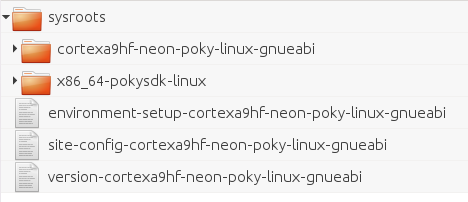

Cấu trúc chung của Yocto SDK

Tuy nhiên, extensible SDK có thêm một số thư mục:

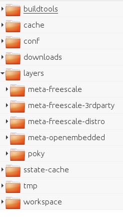

Cấu trúc thư mục của extensible SDK

Các thư mục bổ sung này gồm:

- `buildtools`, một tập công cụ độc lập với distribution được Yocto build system dùng. Package `buildtools` đã được bàn trong Setting up the host system ở `Chapter 1`, The Build System, và được dùng để loại bỏ dependency vào host distribution.

- `cache`, nơi lưu local file checksum cache, một database lưu trữ bền vững SQLite, và BitBake code parser cache.

- `conf`, với mọi file cấu hình cho SDK, gồm `bblayers.conf`, `local.conf`, `devtool.conf` và `templateconf.cfg`.

- `downloads`, chứa artifact uninative, tức là một thư viện C pre-built dùng để cô lập build system khỏi thư viện C trên host.

- `layers`, với meta data của mọi layer.

- `sstate-cache`, một bản sao của shared state cache để tăng tốc thời gian build.

- `tmp`, một bản sao của thư mục `tmp` từ build project, không có các build object.

- `workspace`, vùng làm việc được công cụ command-line `devtool` chuẩn bị.

### Cách thực hiện...

Bước đầu tiên để dùng extensible SDK là source environment setup script, như sau:

```
$ . environment-setup-cortexa9hf-neon-poky-linux-gnueabi
```

> Command built-in `source` của Bash mà chúng ta vẫn dùng cũng có thể được thay bằng một dấu `.` duy nhất, như đã thấy ở trên, là cú pháp POSIX-compliant khả chuyển.

Giờ môi trường SDK đã được thiết lập; ngoài ra, giờ bạn có thể chạy `devtool` để thực hiện các công việc phát triển. Chạy `devtool --help` để biết thêm chi tiết.

> Ứng dụng command-line `devtool` cũng có thể được dùng bên trong một build directory của Yocto Project, như chúng ta sẽ thấy trong Describing workflows for application development ở chương này.

Giờ hãy thêm một package `helloworld` mới. Đây là một ví dụ C `hello world` Makefile-based. Chúng ta bắt đầu bằng việc dùng `devtool` để thêm package mới, chỉ định tên package và URL GitHub chứa source code:

```
$ devtool add helloworld
https://github.com/yoctocookbook2ndedition/helloworld.git
NOTE: Starting bitbake server...
NOTE: Starting bitbake server...
NOTE: Fetching
git://github.com/yoctocookbook2ndedition/helloworld.git;protocol=https...
Loading cache: 100%
|##########################################################################
#########################| Time: 0:00:02
Loaded 2269 entries from dependency cache.Parsing recipes: 100%
|##########################################################################
#######################| Time: 0:00:01
Parsing of 1658 .bb files complete (1656 cached, 2 parsed). 2271 targets,
192 skipped, 0 masked, 0 errors.
NOTE: Resolving any missing task queue dependencies
Initialising tasks: 100%
|##########################################################################
####################| Time: 0:00:00
NOTE: Executing RunQueue Tasks
NOTE: Tasks Summary: Attempted 2 tasks of which 0 didn't need to be rerun
and all succeeded.
NOTE: Using default source tree path
/home/alex/poky_sdk/workspace/sources/helloworldNOTE: Starting bitbake
server...
NOTE: Using source tree as build directory since that would be the default
for this recipe
NOTE: Recipe
/home/alex/poky_sdk/workspace/recipes/helloworld/helloworld_git.bb has been
automatically created; further editing may be required to make it fully
functional
```

Tiện ích `devtool` đã clone repository và đặt nó dưới thư mục `~/poky_sdk/workspace/sources/helloworld/`. Giờ chúng ta sẵn sàng sửa template recipe đã được chuẩn bị cho mình:

```
$ devtool edit-recipe helloworld
# Recipe created by recipetool
# This is the basis of a recipe and may need further editing in order to be
fully functional.
# (Feel free to remove these comments when editing.)

# Unable to find any files that looked like license statements. Check the
accompanying
# documentation and source headers and set LICENSE and LIC_FILES_CHKSUM
accordingly.
#
# NOTE: LICENSE is being set to "CLOSED" to allow you to at least start
building - if
# this is not accurate with respect to the licensing of the software being
built (it
# will not be in most cases) you must specify the correct value before
using this
# recipe for anything other than initial testing/development!
LICENSE = "CLOSED"
LIC_FILES_CHKSUM = ""

SRC_URI =
"git://github.com/yoctocookbook2ndedition/helloworld.git;protocol=https"

# Modify these as desired
PV = "1.0+git${SRCPV}"
SRCREV = "34d80d900550333d23c1b9193d6569298fb0e968"

S = "${WORKDIR}/git"

# NOTE: this is a Makefile-only piece of software, so we cannot generate
much of the
# recipe automatically - you will need to examine the Makefile yourself and
ensure
# that the appropriate arguments are passed in.

do_configure () {
        # Specify any needed configure commands here
        :
}

do_compile () {

        # You will almost certainly need to add additional arguments here
        oe_runmake
}

do_install () {
        # NOTE: unable to determine what to put here - there is a Makefile
but no
        # target named "install", so you will need to define this yourself
        :
}
```

Chúng ta sửa recipe để rà soát và thêm một số thông tin cơ bản không trích được từ source code, như sau:

- Thông tin license: Theo mặc định, license `CLOSED` được đặt khi không xác định được license cụ thể nào. Chúng ta sẽ đổi nó thành MIT license.

- Task install: Nếu `Makefile` được dùng có chứa một rule install, nó sẽ được gọi từ task install. Vì chúng ta không có, chúng ta cần tự cung cấp các chỉ dẫn cài đặt.

Recipe cuối cùng được trình bày dưới đây:

```
DESCRIPTION = "Simple helloworld application"
SECTION = "examples"
LICENSE = "MIT"
LIC_FILES_CHKSUM =
"file://${COMMON_LICENSE_DIR}/MIT;md5=0835ade698e0bcf8506ecda2f7b4f302"

SRC_URI =
"git://github.com/yoctocookbook2ndedition/helloworld.git;protocol=https"

PV = "1.0+git${SRCPV}"
SRCREV = "34d80d900550333d23c1b9193d6569298fb0e968"

S = "${WORKDIR}/git"

do_compile () {
        oe_runmake
}

do_install () {
    install -d ${D}${bindir}
    install -m 0755 helloworld ${D}${bindir}
}
```

Giờ chúng ta có thể build package bằng command sau:

```
$ devtool build helloworld
NOTE: Starting bitbake server...Loading cache: 100%
|##########################################################################
#########################| Time: 0:00:02
Loaded 2269 entries from dependency cache.
Parsing recipes: 100%
|##########################################################################
#######################| Time: 0:00:06
Parsing of 1658 .bb files complete (1656 cached, 2 parsed). 2271 targets,
192 skipped, 0 masked, 0 errors.
NOTE: Resolving any missing task queue dependencies
Initialising tasks: 100%
|##########################################################################
####################| Time: 0:00:00
Checking sstate mirror object availability: 100%
|######################################################################|
Time: 0:00:00
NOTE: Executing SetScene Tasks
NOTE: Executing RunQueue Tasks
NOTE: helloworld: compiling from external source tree
/home/alex/poky_sdk/workspace/sources/helloworld
NOTE: Tasks Summary: Attempted 443 tasks of which 436 didn't need to be
rerun and all succeeded.
```

Tiếp theo, chúng ta sẽ deploy nó vào target để test. Giả sử có một SSH server chạy trên target, chúng ta có thể làm như sau:

```
$ devtool deploy-target helloworld root@<ipaddress>:/bin
```

Dòng trên sẽ chỉ deploy package mới. Nếu nó có dependency vào các package khác trong workspace của `devtool`, chúng ta cũng có thể build toàn bộ image và nạp nó vào target bằng command sau:

```
$ devtool build-image core-image-base
```

Khi đã test xong, chúng ta hoàn tất làm việc với package, với recipe cuối cùng được sao chép tới vị trí cuối cùng của nó trong layer `~/poky_sdk/layers/meta-custom`:

```
$ devtool finish helloworld meta-custom
NOTE: Starting bitbake server...Loading cache: 100%
|##########################################################################
#########################| Time: 0:00:00
Loaded 2269 entries from dependency cache.Parsing recipes: 100%
|##########################################################################
#######################| Time: 0:00:04
Parsing of 1658 .bb files complete (1656 cached, 2 parsed). 2271 targets,
192 skipped, 0 masked, 0 errors.
NOTE: Updating SRCREV in recipe helloworld_git.bb
NOTE: Moving recipe file to /home/alex/poky_sdk/layers/meta-custom/recipes-
example/helloworld
NOTE: Leaving source tree /home/alex/poky_sdk/workspace/sources/helloworld
as-is; if you no longer need it then please delete it manually
```

### Cách hoạt động...

Cú pháp thông dụng nhất của `devtool` như sau:

```
$ devtool <subcommad>
```

Cú pháp `help` của mỗi subcommand có thể được hiển thị bằng command sau:

```
$ devtool <subcommand> --help
```

#### Workspace layer

`Devtool` dùng một workspace layer, nơi mọi recipe mới hoặc đã sửa được thêm vào. Workspace layer này có thể được tạo tường minh, hoặc sẽ được tạo tự động khi cần. Command sau sẽ tạo một workspace layer:

```
$ devtool create-workspace <dest-path>
```

Nếu không cung cấp đường dẫn đích, `devtool` sẽ tạo nó dưới build project với tên mặc định là `workspace`, như trong hình tiếp theo:

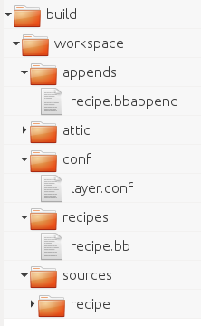

Cấu trúc thư mục của workspace layer

#### Workflow phát triển recipe

Workflow thông dụng nhất khi phát triển recipe được trình bày dưới đây:

1. `add`/`modify`/`upgrade`, các command này sẽ thêm một recipe mới, sửa một recipe có sẵn, hoặc nâng cấp một recipe có sẵn lên phiên bản mới hơn

2. `edit-recipe`, command này sẽ sửa một recipe sau khi nó đã được thêm vào workspace layer bằng các sub-commands `devtool` nêu ở trên

3. `build`/`build-image`, các command này sẽ build recipe hoặc một image đầy đủ có chứa recipe

4. `deploy-target`, chúng ta sẽ dùng command này để deploy package đã build vào target để có thể test nó

5. `finish`, với command này chúng ta hoàn tất làm việc với recipe

#### Thêm một recipe vào workspace layer

Để tạo một recipe mới, chúng ta dùng cú pháp sau:

```
$ devtool add <recipe-name> <source path> <fetch-uri>
```

Ở đây,

- `recipe-name` là tên của recipe

- `source path` là đường dẫn local tới source code

- `fetch-uri` là URI để fetch source nếu nó chưa có ở local

Các recipe mới được thêm vào thư mục `recipes` trong workspace layer. Khi tạo một recipe mới, source code có thể được fetch từ một URI và đặt vào `source path`, hoặc phải đã có sẵn ở local trong `source path`. Nếu không cung cấp `source path`, `devtool` sẽ lưu nó trong thư mục `source` trong workspace layer.

> `devtool add` sub-command là một wrapper quanh tiện ích command-line `recipetool` `create`.

Các recipe có sẵn cũng có thể được thêm vào workspace layer. Tìm recipe bạn quan tâm bằng cách cung cấp một pattern biểu thức chính quy với command sau:

```
$ devtool search <pattern>
```

Sau đó `Devtool` có thể trích source của một recipe có sẵn, thiết lập nó thành một Git repository với một tên branch được chỉ định, hoặc branch `devtool` theo mặc định, và áp dụng các patch từ recipe có sẵn. Chúng ta làm mọi bước đó bằng sub-command `modify`, như sau:

```
$ devtool modify <recipe-name>
```

Cuối cùng, thay vì sửa một recipe có sẵn, nó có thể được nâng cấp lên một phiên bản upstream mới bằng command sau:

```
$ devtool upgrade <recipe-name> <source path>
```

Một lần nữa, nếu không chỉ định đường dẫn source code, thư mục `sources` bên trong workspace layer sẽ được dùng. Ngoài ra, nếu source của recipe được fetch từ Git, command sau được dùng:

```
$ devtool upgrade <recipe-name> --srcrev <git-sha1> --srcbranch <git-
branch> <source path>
```

Ở đây,

- `recipe-name` là tên của recipe

- `git-sha1` là git revision cần checkout

- `git-branch` là git branch cần dùng

- `source path` là đường dẫn local để lưu source code vào

Các recipe đã thêm vào workspace layer có thể được liệt kê, cùng với đường dẫn source code tương ứng của chúng, bằng command sau:

```
$ devtool status
```

#### Xóa một recipe khỏi workspace layer

Một recipe có thể bị xóa khỏi workspace layer bằng command sau:

```
$ devtool reset <recipe-name>
```

Trừ khi được yêu cầu khác đi, nó cũng sẽ xóa các file của recipe khỏi sysroot. Các recipe phải đã được sao chép ra khỏi workspace layer và vào layer vị trí cuối cùng của chúng trước khi chạy command này, nếu không các thay đổi có thể bị mất. `Devtool` đủ thông minh để tạo một bản sao lưu bên trong thư mục `attic` nếu phát hiện recipe hoặc các file `append` đã bị sửa.

#### Sửa một recipe trong workspace layer

Để sửa một recipe sau khi nó đã được thêm vào workspace layer, bạn làm như sau:

```
$ devtool edit-recipe <recipe-name>
```

Code trên dùng editor mặc định như được định nghĩa trong biến môi trường `EDITOR`.

#### Build và test recipe của bạn

Trong khi phát triển, `devtool` có thể build recipe trong thư mục làm việc với cú pháp sau:

```
$ devtool build <recipe-name>
```

Sau đó nó có thể được sao chép tới target qua SSH bằng command sau:

```
$ devtool deploy-target <recipe-name> <user>@<target-ip>[:<destdir>]
```

Ở đây,

- `recipe-name` là tên của recipe

- `user` là username SSH dùng để đăng nhập

- `target-ip` là địa chỉ IP của target device đang chạy SSH server

- `destdir` là đường dẫn đích trên target device

Việc này tương đương với thực hiện `do_install` qua SSH, nên không có dependency nào được quản lý vì quá trình này không dùng package manager. Khi test xong, các file đã deploy có thể được xóa bằng cú pháp sau:

```
$ devtool undeploy-target <recipe-name> <user>@<target-ip>[:<destdir>]
```

Ngoài ra, `devtool` cũng có thể thêm recipe vào một image bằng command sau:

```
$ devtool build-image -p <packages> <target-image-name>
```

Ở đây,

- `packages` là danh sách package cần thêm vào image. Nếu không cung cấp package cụ thể nào, mọi recipe có trong workspace layer sẽ được thêm.

- `target-image-name` là tên của image output.

#### Cập nhật recipe với các thay đổi của bạn

Khi mọi sửa đổi đã được test và commit vào Git repository source trong workspace layer, `devtool` có thể được yêu cầu tạo patch cho các sửa đổi và cập nhật recipe gốc với chúng bằng cách chạy:

```
$ devtool update-recipe <recipe-name>
```

Nó cũng có thể được yêu cầu tạo hoặc sửa một bbappend trên một layer cụ thể thay vì sửa layer gốc với:

```
$ devtool update-recipe --append <dest-layer-path> <recipe-name>
```

Ở đây,

- `dest-layer-path` là đường dẫn tới layer cần sửa

- `recipe-name` là tên của recipe

#### Hoàn tất làm việc với một recipe

Command `finish` sẽ thực hiện hành động tương đương với `update-recipe` theo sau là `reset`:

```
$ devtool finish <recipe-name> <dest-layer-path>
```

### Còn nữa...

Một tính năng thú vị của extensible SDK là nó có thể được cập nhật. Điều này đặc biệt hữu ích khi chia sẻ SDK trong một nhóm application developer. Tất cả những gì cần là một web server để phục vụ SDK, và cấu hình SDK với URL của nó, ví dụ:

```
SDK_UPDATE_URL = "http://example.com/sdk"
```

Khi có meta-data hoặc thay đổi cấu hình mới hay đã sửa được đưa vào SDK và SDK được rebuild, chúng ta có thể dễ dàng phân phối nó tới mọi người dùng SDK. Trước tiên, chúng ta cần công bố SDK tới một vị trí được một web server HTTP(S) phục vụ, với cú pháp sau:

```
$ oe-publish-sdk tmp/deploy/sdk/poky-glibc-x86_64-core-image-sato-
cortexa9hf-neon-toolchain-ext-2.4.sh /path/to/web/root
```

Sau đó, chúng ta hướng dẫn người dùng SDK cập nhật nó như sau:

```
$ devtool sdk-update <server>
```

Ở đây, `server` mặc định là `SDK_UPDATE_URL` đã cấu hình trong SDK. Nếu biến này chưa được cấu hình, vẫn có thể chỉ định một server từ xa.

## Sử dụng IDE Eclipse

Eclipse là một IDE open source được viết chủ yếu bằng Java và phát hành theo Eclipse Public License (EPL). Nó có thể được mở rộng bằng plugin, và Yocto Project phát hành một Yocto plugin cho phép dùng Eclipse để phát triển ứng dụng Yocto.

### Chuẩn bị

Yocto 2.4 cung cấp các Eclipse Yocto plugin cho ba phiên bản Eclipse khác nhau: Mars, Neon và Oxygen. Chúng có thể tải tại `http://downloads.yoctoproject.org/releases/yocto/yocto-2.4/eclipse-plugin/`. Chúng ta sẽ dùng Oxygen, nhưng các hướng dẫn tương thích với mọi phiên bản. Chúng ta sẽ bắt đầu với Eclipse IDE for C/C++ developers và cài mọi plugin cần thiết.

Khuyến nghị chạy Eclipse trên Oracle Java 1.8, dù các nhà cung cấp Java khác cũng được hỗ trợ. Bạn có thể cài Oracle Java 1.8 từ website của Oracle, `https://www.java.com/en/`, hoặc dùng một Ubuntu Java Installer PPA, `https://launchpad.net/~webupd8team/+archive/ubuntu/java`. Cách sau sẽ tích hợp Java với hệ thống quản lý package của bạn, nên được ưu tiên. Để cài nó, làm theo các bước sau:

```
$ sudo add-apt-repository ppa:webupd8team/java
$ sudo apt-get update
$ sudo apt-get install oracle-java8-installer
```

Bạn có thể kiểm tra Java đã được cài đúng chưa bằng cách:

```
$ java -version
java version "1.8.0_144"
Java(TM) SE Runtime Environment (build 1.8.0_144-b01)
Java HotSpot(TM) 64-Bit Server VM (build 25.144-b01, mixed mode)
```

Để tải và cài Eclipse Oxygen IDE for C/C++ developers cho một host Linux x86_64, làm theo các bước sau:

1. Fetch tarball từ trang download của Eclipse, `http://www.eclipse.org/downloads/packages/release/Oxygen/1A`. Ví dụ:

   ```
   $ wget -O eclipse-cpp-oxygen-1a-linux-gtk-x86_64.tar.gz
   "http://mirror.kumi.systems/eclipse/technology/epp/downloads/releas
   e/oxygen/1a/eclipse-cpp-oxygen-1a-linux-gtk-x86_64.tar.gz"
   ```

2. Giải nén nó vào vị trí bạn chọn, như sau:

   ```
   $ tar xvf  eclipse-cpp-neon-3-linux-gtk-x86_64.tar.gz
   ```

3. Khởi động Eclipse IDE với lệnh sau:

   ```
   $ nohup eclipse/eclipse &
   ```

4. Đóng tab Welcome và chọn Install New Software từ menu pull-down Help. Sau đó, chọn nguồn Oxygen `http://download.eclipse.org/releases/oxygen`.

5. Cài các thành phần Eclipse sau:

- Mobile and device development:

  - C/C++ Remote (Over TCF/TE) Run/Debug Launcher

  - Remote System Explorer User Actions

  - TM Terminal via Remote System Explorer add-in

  - TCF Remote System Explorer add-in

  - TCF Target Explorer

- Programming languages:

  - C/C++ Development Tools SDK

6. Cài Eclipse Yocto plugin bằng cách thêm nguồn repository này: `http://downloads.yoctoproject.org/releases/eclipse-plugin/2.4/oxygen`, như trong screenshot sau:

   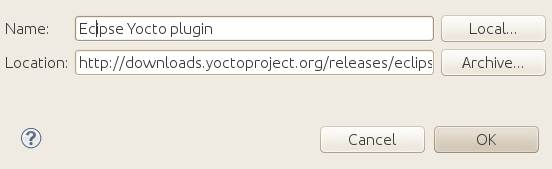

   Cửa sổ Add Repository

7. Chọn tùy chọn Yocto Project SDK plug-in.

Cuối cùng, bảo đảm mọi thành phần đều up-to-date bằng cách chọn mục menu Help \| Check for Updates.

### Cách thực hiện...

Để cấu hình Eclipse dùng một Yocto toolchain, vào Window \| Preferences \| Yocto Project SDK. Cấu hình SDK cung cấp hai tùy chọn cross-compiler:

1. Standalone pre-built toolchain: Chọn tùy chọn này khi bạn đã cài một Yocto SDK có bao gồm toolchain

2. Build system derived toolchain: Chọn tùy chọn này khi dùng một Yocto build directory đã được chuẩn bị bằng `meta-ide-support` như đã giải thích ở trên

Nó cũng cung cấp hai tùy chọn target:

1. QEMU: Chọn tùy chọn này nếu bạn dùng Poky với một machine ảo hóa như `qemuarm`.

2. External HW: Chọn tùy chọn này nếu bạn dùng hardware thực như hardware Wandboard. Tùy chọn này hữu ích nhất cho phát triển embedded.

Một ví dụ cấu hình khi dùng một Yocto SDK installer đã tải về là chọn tùy chọn Standalone pre-built toolchain cùng emulator QEMU như sau:

- Cross Compiler Options:

  - Standalone pre-built toolchain:

    - Toolchain Root Location: `/opt/poky/2.4`

    - Sysroot Location:

      ```
      /opt/poky/2.4/sysroots/armv5e-poky-linux-
      gnueabi
      ```

    - Target Architecture: `armv5e-poky-linux-gnueabi`

  - Target Options:

    - QEMU Kernel:

      ```
      /opt/poky/2.4/sysroots/armv5e-poky-linux-
      gnueabi/zImage-qemuarm.bin
      ```

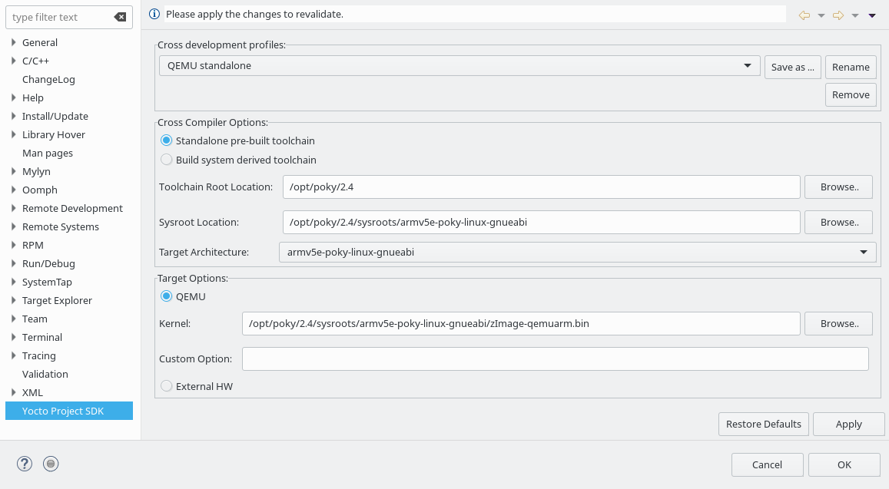

Cấu hình QEMU cho Standalone pre-built toolchain trong Yocto Project SDK plugin

Để dùng emulator QEMU với Standalone pre-built toolchain, chúng ta cần tải các file sau vào thư mục `sysroot` đã cấu hình:

- File cấu hình qemuboot: `http://downloads.yoctoproject.org/releases/yocto/yocto-2.4/machines/qemu/qemuarm/core-image-sato-sdk-qemuarm.qemuboot.conf`

  Ứng dụng `runqemu` sẽ tìm file này trong thư mục gốc `sysroot` đã cấu hình và sẽ dùng nó để cấu hình một số giá trị mặc định của QEMU. Ngoài các giá trị mặc định khác, nó đặt machine `qemuarm` thành `versatilepb` và chỉ định một device tree cần dùng, cũng như đặt loại file system mặc định là `ext4`:

  ```
  qb_machine = -machine versatilepb
  qb_dtb = zImage-versatile-pb.dtb
  qb_default_fstype = ext4
  ```

- Một QEMU kernel image: Ví dụ, `http://downloads.yoctoproject.org/releases/yocto/yocto-2.4/machines/qemu/qemuarm/zImage-qemuarm.bin`

- Một device tree cho machine QEMU ARM versatilepb: `http://downloads.yoctoproject.org/releases/yocto/yocto-2.4/machines/qemu/qemuarm/zImage-versatile-pb.dtb`

- Một SDK image root filesystem ext4: Ví dụ, `core-image-sato-sdk`: `http://downloads.yoctoproject.org/releases/yocto/yocto-2.4/machines/qemu/qemuarm/core-image-sato-sdk-qemuarm.ext4`

> Hãy bảo đảm quyền file được đặt để Eclipse có quyền đọc/ghi chúng.

Sau đó bạn sẽ có thể chạy QEMU bằng menu Run \| External Tools \| External Tools Configurations \| Run:

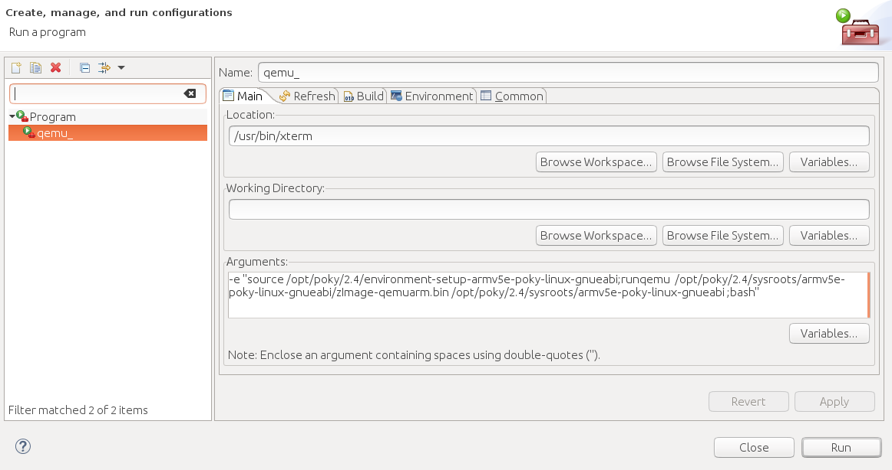

Cửa sổ cấu hình external tool

Với một build system derived toolchain dùng board tham chiếu `wandboard`, trước tiên chúng ta cần cấu hình project như sau:

```
$ cd /opt/yocto/fsl-community-bsp
$ source setup-environment wandboard
$ bitbake meta-ide-support
```

Sau đó, chúng ta có thể cấu hình Eclipse Yocto plugin như dưới đây:

- Cross Compiler Options:

  - Build system derived toolchain:

    - Toolchain Root Location: `/opt/yocto/fsl-community-bsp/wandboard`

    - Sysroot Location: `/opt/yocto/fsl-community-bsp/wandboard/tmp/sysroots/wandboard`

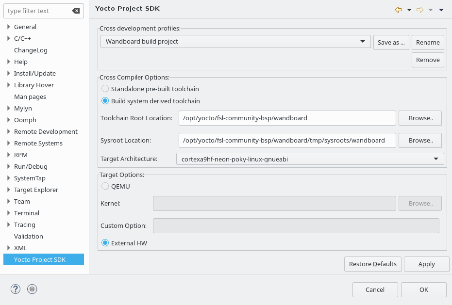

Cấu hình Build system-derived cho hardware bên ngoài trong Yocto Project SDK plugin

Cuối cùng, chúng ta có thể cấu hình với một Standalone pre-built toolchain cho Wandboard mà chúng ta cũng đã biên dịch và cài trước đó. Chúng ta sẽ thấy ví dụ về cấu hình này ở các mục tiếp theo.

### Còn nữa...

Để debug trên một target từ xa, target cần đang chạy daemon `tcf-agent`. Nó được đưa vào mặc định trên các image `-sdk`, nhưng bạn cũng có thể đưa nó vào bất kỳ image nào khác bằng cách thêm dòng sau vào file `conf/local.conf`:

```
EXTRA_IMAGE_FEATURES += "eclipse-debug"
```

### Xem thêm

- Để biết thêm thông tin, xem Yocto Project Software Development Kit (SDK) Developer's Guide tại `http://www.yoctoproject.org/docs/2.4/sdk-manual/sdk-manual.html`

## Phát triển ứng dụng GTK+

Recipe này sẽ cho thấy cách build, chạy và debug một ứng dụng đồ họa GTK+ bằng Eclipse IDE.

### Chuẩn bị

1. Thêm feature `eclipse-debug` vào file `conf/local.conf` của project, như sau:

   ```
   EXTRA_IMAGE_FEATURES += "eclipse-debug"
   ```

2. Build một target image `core-image-sato`, như sau:

   ```
   $ cd /opt/yocto/fsl-community-bsp/
   $ source setup-environment wandboard
   $ bitbake core-image-sato
   ```

3. Build một toolchain `core-image-sato` bằng command sau:

   ```
   $ bitbake -c populate_sdk core-image-sato
   ```

4. Cài toolchain bằng cách chạy installer, như sau:

   ```
   $ cd tmp/deploy/sdk
   $ ./poky-glibc-x86_64-core-image-sato-cortexa9hf-neon-
   toolchain-2.4.sh
   ```

Trước khi khởi chạy Eclipse IDE, chúng ta có thể kiểm tra xem có thể build và chạy thủ công một ứng dụng GTK hay không. Chúng ta sẽ build source ứng dụng GTK+ `hello world` sau. Sau đây là code trong `gtk_hello_world.c`:

```
#include <gtk/gtk.h>

int main(int argc, char *argv[])
{
  GtkWidget *window;
  gtk_init (&argc, &argv);
  window = gtk_window_new (GTK_WINDOW_TOPLEVEL);
  gtk_widget_show (window);
  gtk_main ();
  return 0;
}
```

Để build nó, chúng ta dùng toolchain `core-image-sato` đã cài như mô tả ở trên:

```
$ source /opt/poky/2.4/environment-setup-cortexa9hf-neon-poky-linux-gnueabi
$ ${CC} gtk_hello_world.c -o helloworld `pkg-config --cflags --libs
 gtk+-3.0`
```

Command này dùng công cụ trợ giúp `pkg-config` để đọc các file `.pc` được cài cùng các thư viện GTK trong `sysroot` nhằm xác định những compiler switch nào (`--cflags` cho các thư mục `include` và `--libs` cho các thư viện cần link) cần để biên dịch các chương trình dùng GTK. Chúng ta có thể tự sao chép binary kết quả sang Wandboard, trong khi boot `core-image-sato` qua NFS, và chạy nó từ console của target với command sau:

```
# DISPLAY=:0 helloworld
```

Lệnh này sẽ mở một cửa sổ GTK+ trên desktop SATO.

### Cách thực hiện...

Giờ chúng ta có thể cấu hình Eclipse SDK plugin dùng standalone toolchain như đã mô tả ở trên, hoặc có thể quyết định dùng Build system derived toolchain thay vào đó:

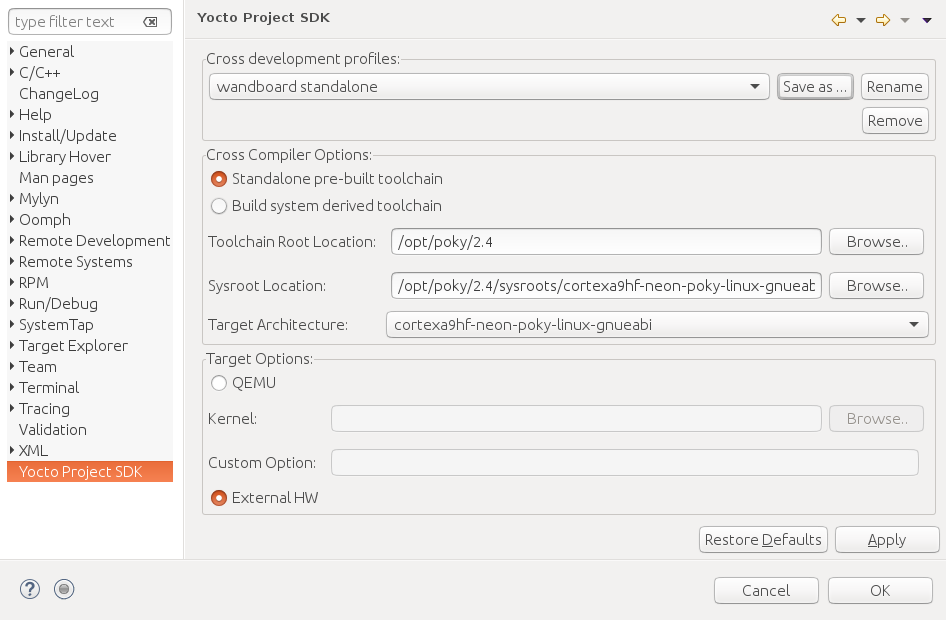

Cấu hình standalone của Yocto Project SDK cho Wandboard

Làm theo các bước sau để build và chạy một ứng dụng ví dụ `hello world`:

1. Tạo một project autotools GTK hello world mới. Chấp nhận mọi giá trị mặc định trong wizard tạo project. Đi tới File \| New \| C/C++ Project \| C Managed Build \| Yocto Project SDK Autotools Project \| Hello World GTK C Autotools Project:

   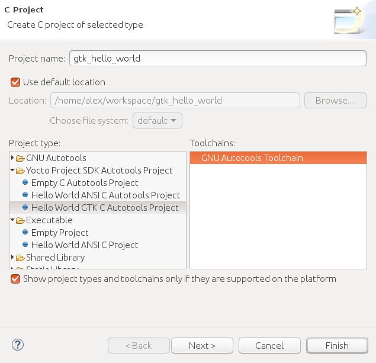

   Cửa sổ New C Project

   > Khi chọn tên cho project, hãy tránh dùng các ký tự đặc biệt như dấu gạch ngang hoặc dấu cách, vì chúng có thể gây vấn đề với các công cụ build.

   Build project bằng cách vào Project \| Build Project.

   > Bản phát hành Yocto Project 2.4 đã cập nhật các thư viện GTK+ lên 3.0. Nếu bạn gặp lỗi sau khi build:
   >
   > ```
   > configure: error: Package requirements (glib-2.0
   > gtk+-2.0) were not met
   > ```
   >
   > Bạn sẽ cần sửa script `configure.ac` trong project để dùng GTK+3.0 như sau:
   >
   > ```
   > - PKG_CHECK_MODULES(helloworld, glib-2.0 gtk+-2.0)
   > + PKG_CHECK_MODULES(helloworld, glib-2.0 gtk+-3.0)
   > ```
   >
   > Sau đó, cấu hình lại project bằng cách right-clicking vào tên project và chọn mục menu Invoke Autotools \| Invoke Autoconf, rồi Reconfigure Project và Build Project.

   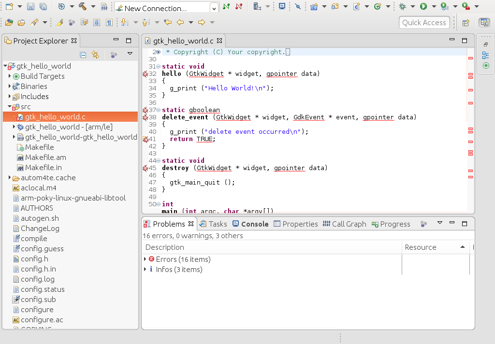

   Eclipse hiển thị lỗi phân giải symbol

2. Dù project build thành công, bạn có thể thấy lỗi được đánh dấu cả trong source lẫn trong tab Problems. Đó là vì tính năng phân tích code của Eclipse không phân giải được mọi symbol của project. Để khắc phục, hãy thêm các header file `include` cần thiết vào properties của project bằng cách vào Project \| Properties \| C/C++ General \| Paths and Symbols \| Includes:

   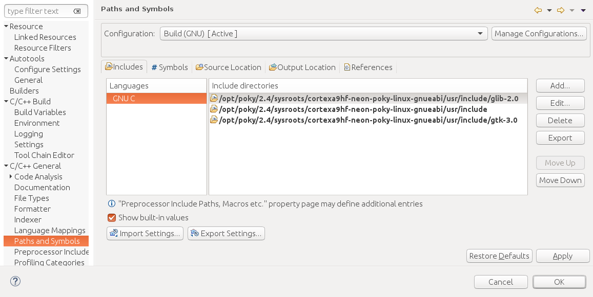

   Cửa sổ cấu hình Paths and Symbols với các đường dẫn filesystem mới đã được thêm

   > Nếu index không tự động được rebuild, bạn có thể kích hoạt nó bằng Project \| C/C++ Index \| Rebuild.

3. Giờ chúng ta sẽ tạo một kết nối mới tới target. Nhấn vào menu New Connection trên thanh trên cùng và chọn Generic Connection:

   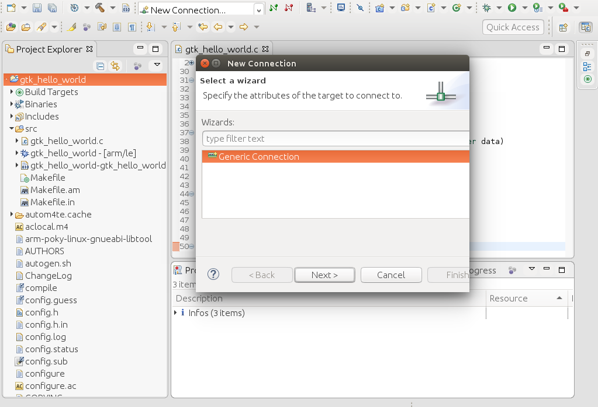

   Cửa sổ New Connection

4. Trong cửa sổ tiếp theo, nhấn nút Browse bên phải trường Connection Name. Thao tác này sẽ tự phát hiện TCF target đang chạy trên thiết bị và liệt kê nó cùng địa chỉ IP như trong screenshot tiếp theo:

   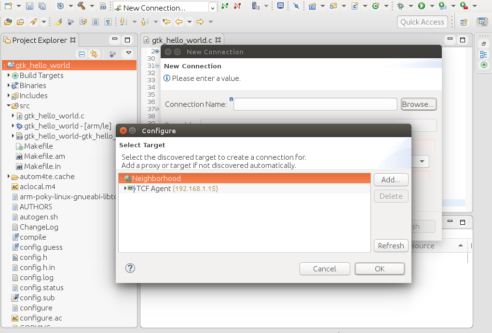

   TCF agent được tự phát hiện trên thiết bị Wandboard 192.168.1.15

5. Dưới Run \| Run Configurations, bạn sẽ có C/C++ Remote Application với một target tên là `<project_name>_gdb_arm-poky-linux-gnueabi`. Nếu không có, hãy tạo một cái:

   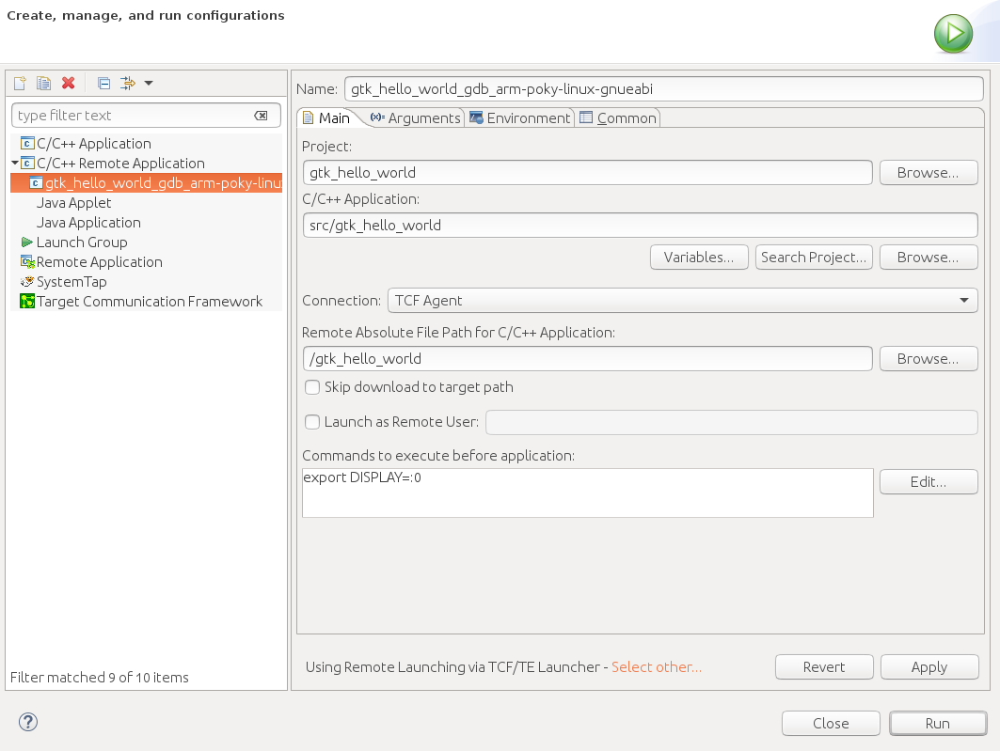

   Cửa sổ run configuration của C/C++ Remote Application

6. Ở cuối cửa sổ, nhấn Select other để chọn một trong nhiều launcher có sẵn:

   - Remote Launching via TCF/TE Launcher

   - Legacy Remote Create Process Launcher

   Launcher thứ nhất sẽ dùng kết nối TCF đã cấu hình trước đó, nhưng cũng có thể dùng launcher thứ hai, dùng kết nối SSH tới target.

7. Để cấu hình một kết nối SSH, nhấn nút New bên phải menu drop-down Connection.

   > Nếu bạn gặp vấn đề khi đăng nhập vào thiết bị và đã build target image với feature `debug-tweaks` để đăng nhập password-less, hãy thử đặt mật khẩu root và dùng nó, vì công cụ có thể không đăng nhập được với mật khẩu rỗng.

8. Tìm ứng dụng C/C++ cần khởi chạy bằng cách nhấn nút Search Project.

9. Tiếp theo, sửa Remote Absolute File Path for C/C++ Application thành một đường dẫn có sẵn trên target device, ví dụ `/gtk_hello_world`.

10. Trong trường Commands to execute before application, nhập như sau:

    ```
    export DISPLAY=:0
    ```

    > Tại thời điểm viết sách, TCF launcher không cho phép chúng ta thêm command để thực thi trước khi khởi chạy ứng dụng, mà thay vào đó thất bại với lỗi sau:
    >
    > ```
    > Failed to create script with the Commands before launch
    > in
    > '/home/alex/workspace/.metadata/.plugins/org.eclipse.tcf.
    > te.tcf.launch.cdt/prerun_commands_scripts/00-03-59-716_gt
    > k_hello_world.sh'. Possibly caused by: Failed to read the
    > Commands before launch script template 'null'.
    > ```
    >
    > Patch cho TCF launcher sửa lỗi này chưa được đưa vào kênh cập nhật Oxygen: `http://git.eclipse.org/c/gerrit/tcf/org.eclipse.tcf.git/commit/?h=1.4_neon_bugfixid=c54f26b7e07319b7ad309aab8c02b72be6d1afff` Để khắc phục tạm, biến `DISPLAY` có thể được thêm vào tab Environment thay vào đó.

11. Chạy ứng dụng và, nếu bạn dùng SSH, đăng nhập bằng `root` với mật khẩu rỗng. Bạn sẽ thấy ứng dụng GTK trên desktop SATO và output sau trong tab Console:

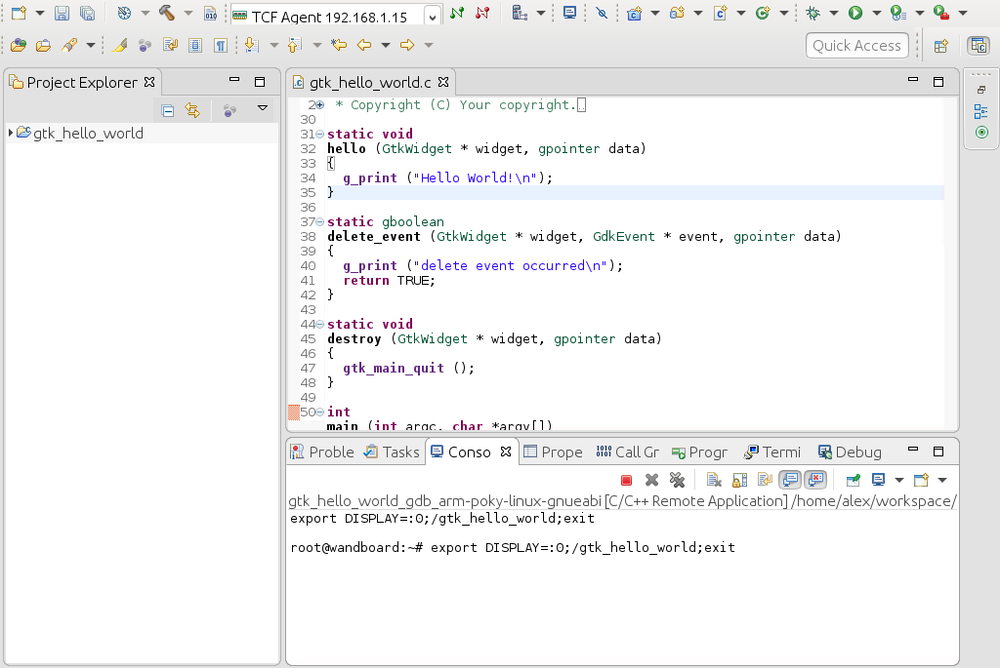

Output trên console cho thấy ứng dụng từ xa đang được thực thi

> Nếu bạn gặp vấn đề khi kết nối tới target, hãy kiểm tra rằng nó đang chạy `tcf-agent` bằng cách gõ lệnh sau trên console của target:
>
> ```
> # ps w | grep tcf
> 735 root    11428S    /usr/sbin/tcf-agent -d -L- -l0
> ```
>
> Nếu bạn gặp vấn đề đăng nhập, bạn có thể dùng perspective Remote System Explorer (RSE) của Eclipse để xóa mật khẩu và debug kết nối tới target. Khi đã thiết lập được kết nối và có thể duyệt filesystem của target qua RSE, bạn có thể quay lại run configuration.

### Còn nữa...

Để debug ứng dụng, làm theo các bước sau:

1. Double-click vào function `main` trong source file để thêm một breakpoint. Một chấm xanh sẽ xuất hiện trên side-bar.

2. Vào Run \| Debug Configuration.

3. Dưới tab Debugger, kiểm tra đường dẫn GDB debugger là đúng vị trí debugger của toolchain:

   ```
   /opt/poky/2.4/sysroots/x86_64-pokysdk-linux/usr/bin/arm-poky-
   linux-gnueabi/arm-poky-linux-gnueabi-gdb
   ```

   Nếu không đúng, hãy trỏ nó tới vị trí đúng:

   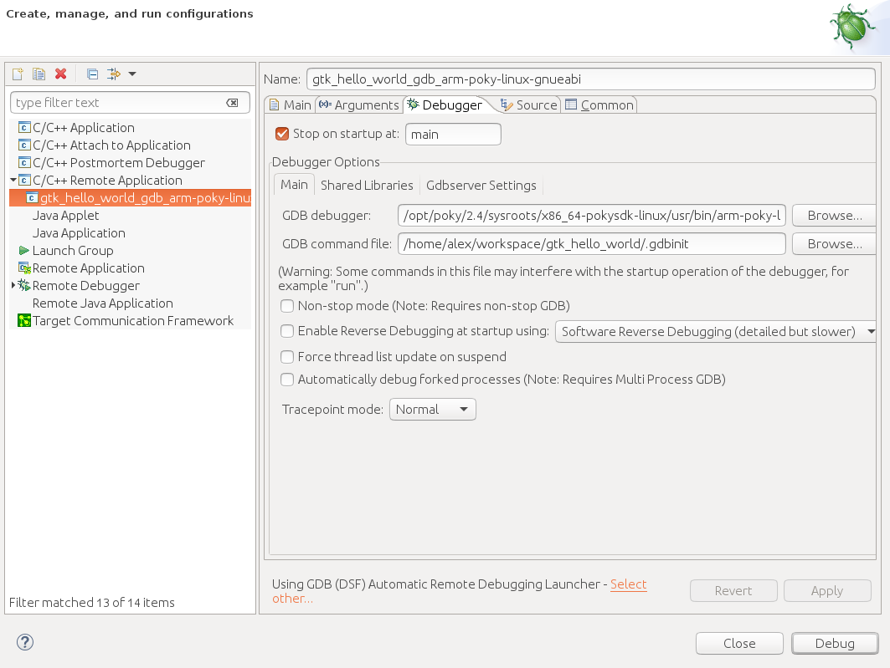

   Cửa sổ Debug Configuration

   Trên tab Main, bạn cũng có thể chọn giữa nhiều launcher:

   - GDB (DSF) Automatic Remote Debugging Launcher

   - GDB (DSF) Automatic Remote Debugger Launcher via TCF/TE Launcher

   Một lần nữa, launcher thứ nhất sẽ dùng kết nối SSH còn launcher thứ hai sẽ dùng kết nối TCF:

   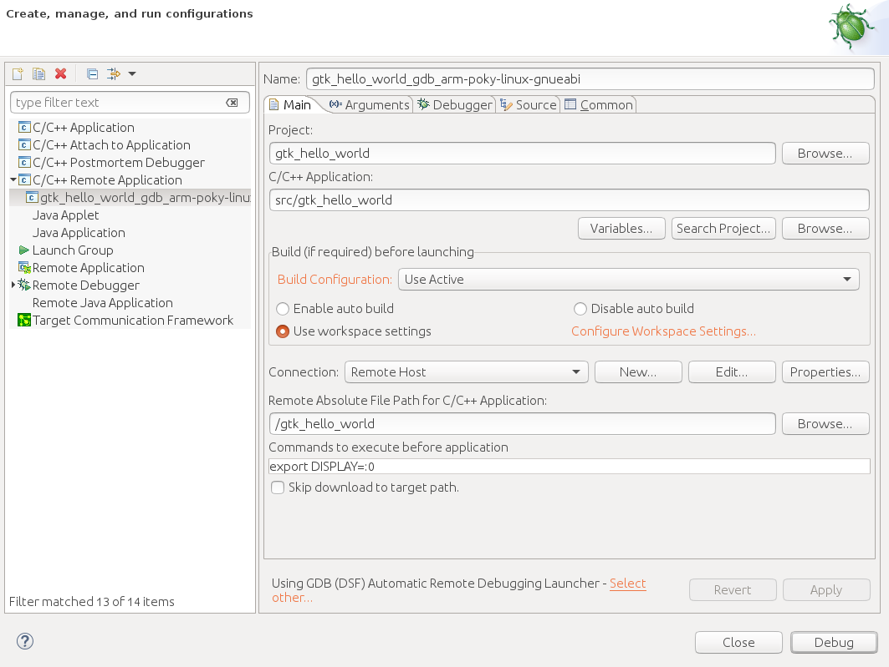

   Tab Main của Debug Configuration

4. Nhấn nút Debug. Debug perspective xuất hiện với ứng dụng đang chạy trên hardware Wandboard từ xa:

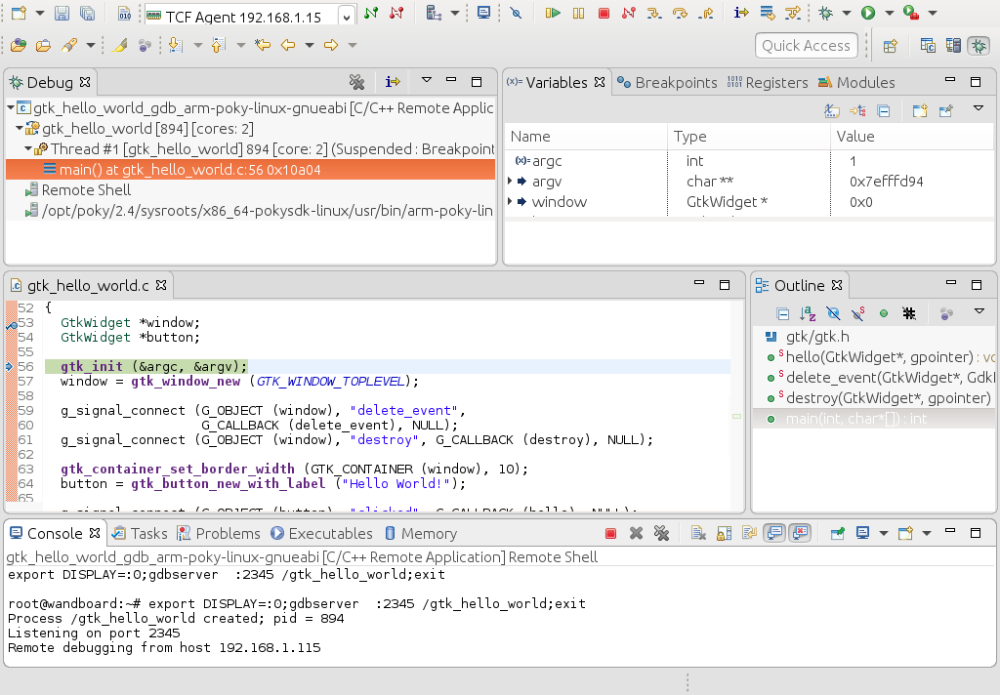

Cửa sổ Debug Perspective

> Nếu bạn gặp lỗi Text file busy, hãy nhớ đóng ứng dụng mà chúng ta đã chạy ở bước trước.

## Sử dụng IDE Qt Creator

Qt là một application framework cross-platform viết bằng C++, được phát triển bởi cả Digia, dưới tên công ty Qt, lẫn cộng đồng dự án Qt open source. Qt Creator là một IDE đa nền tảng và là một phần của SDK framework phát triển ứng dụng Qt. Nó là IDE được ưa chuộng để phát triển ứng dụng Qt bằng C++ và QML, và có nhiều license, gồm (L)GPLv3 và cả license thương mại.

### Chuẩn bị

Tải và cài Qt Creator 4.5.0 cho host của bạn từ trang download của dự án Qt. Để tải và cài vào host Linux x86_64, bạn có thể dùng các command sau:

```
$ wget
http://download.qt.io/official_releases/qtcreator/4.5/4.5.0/qt-creator-open
source-linux-x86_64-4.5.0.run
$ chmod u+x qt-creator-opensource-linux-x86_64-4.5.0.run
$ ./qt-creator-opensource-linux-x86_64-4.5.0.run
```

Hỗ trợ Qt trong Yocto 2.4 đã được chuyển sang các layer bên ngoài `meta-qt4` và `meta-qt5`:

- `http://git.yoctoproject.org/cgit/cgit.cgi/meta-qt4`

- `https://github.com/meta-qt5/meta-qt5`

Để làm việc với Qt, trước tiên chúng ta cần clone layer tương ứng vào thư mục `sources`. Chúng ta sẽ cài layer `meta-qt5`, như sau:

```
$ cd /opt/yocto/fsl-community-bsp/sources/
$ git clone https://github.com/meta-qt5/meta-qt5 -b rocko
```

Sau đó, chúng ta sẽ thêm nó vào file `conf/bblayers.conf` trong build directory:

```
+ ${BSPDIR}/sources/meta-qt5 \
```

Layer `meta-qt5` có một recipe `meta-toolchain-qt5` có thể dùng để build một SDK Qt5-ready, gồm một target sysroot với các thư viện, header Qt5 tương ứng, và một toolchain với các công cụ Qt. Tuy nhiên, cũng như target `meta-toolchain` đã giới thiệu trước đó, toolchain này sẽ không khớp với root filesystem của target image. Để build `meta-toolchain-qt5`, bạn làm như sau:

```
$ cd /opt/yocto/fsl-community-bsp/
$ source setup-environment wandboard
$ bitbake meta-toolchain-qt5
```

Tuy nhiên, cách được khuyến nghị để tạo một SDK Qt5 là thêm dòng sau vào image recipe:

```
inherit populate_sdk_qt5
```

Ví dụ, chúng ta có thể mở rộng image `core-image-sato` của Poky bằng một `recipes-sato/images/core-image-sato.bbappend` trong layer `meta-custom` có chứa dòng trên. Sau đó, chúng ta có thể build SDK với:

```
$ bitbake -c populate_sdk core-image-sato
```

> Nếu bạn thấy bản build thất bại với lỗi sau khi build:
>
> ```
> ERROR: custom-image-1.0-r0 do_populate_sdk: Could not
> invoke dnf.
> ```
>
> Hãy chuyển sang dùng định dạng package IPK bằng cách thêm dòng sau vào `conf/local.conf`:
>
> ```
> PACKAGE_CLASSES = "package_ipk"
> ```
>
> Một cách khắc phục khác cho vấn đề này là bỏ package `nativesdk-cmake` khỏi toolchain bằng cách thêm dòng sau vào file cấu hình `conf/local.conf`:
>
> ```
> RDEPENDS_nativesdk-packagegroup-sdk-host_remove =
> "nativesdk-cmake"
> ```

Cuối cùng, để cài nó, chúng ta làm như sau:

```
$ cd tmp/deploy/sdk
$ ./poky-glibc-x86_64-core-image-sato-cortexa9hf-neon-toolchain-2.4.sh
```

### Cách thực hiện...

Trước khi khởi chạy Qt Creator, chúng ta cần thiết lập môi trường phát triển bằng cách source environment setup script:

```
$ . /opt/poky/2.4/environment-setup-cortexa9hf-neon-poky-linux-gnueabi
```

Giờ chúng ta có thể chạy Qt Creator từ cùng Terminal như sau:

```
$ ./bin/qtcreator.sh &
```

Sau đó, chúng ta có thể cấu hình nó bằng cách vào Tools \| Options và làm theo các bước sau:

1. Trước tiên, chúng ta cấu hình một device mới cho Wandboard. Dưới Devices \| Add, chọn Generic Linux Device:

   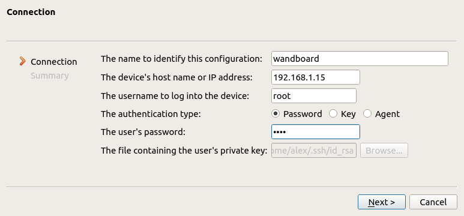

   Thiết lập kết nối thiết bị Wandboard

   Wizard sẽ test kết nối đã cấu hình với thiết bị, nên thiết bị cần đang chạy Linux.

   > Nếu target image của bạn được tạo với image feature `debug-tweaks`, bạn sẽ có thể đăng nhập vào hệ thống với mật khẩu rỗng. Nếu không, hãy đặt mật khẩu root trên target bằng command `passwd` từ root console của target và gõ nó vào trường password.

2. Dưới Build & Run, chúng ta cấu hình các compiler C và C++ mới trỏ tới đường dẫn compiler Yocto vừa cài bằng cách chọn Add \| GCC.

3. Đây là đường dẫn cho compiler C, như trong screenshot sau:

   ```
   /opt/poky/2.4/sysroots/x86_64-pokysdk-linux/usr/bin/arm-poky-
   linux-gnueabi/arm-poky-linux-gnueabi-gcc
   ```

   Nếu ABI không được auto-selected, chọn `arm-linux-generic-elf-32bit` và nhấn Apply.

4. Với compiler C++, dùng như sau:

   ```
   /opt/poky/2.4/sysroots/x86_64-pokysdk-linux/usr/bin/arm-poky-
   linux-gnueabi/arm-poky-linux-gnueabi-g++
   ```

   Nếu ABI không được auto-selected, chọn `arm-linux-generic-elf-32bit`, và nhấn Apply:

   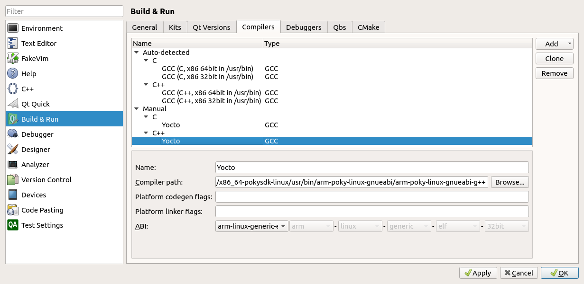

   Cửa sổ Device Compiler Configuration

5. Tương tự cho một cross-debugger, sau đây là đường dẫn, cũng được nêu trong screenshot sau:

   ```
   /opt/poky/2.4/sysroots/x86_64-pokysdk-linux/usr/bin/arm-poky-
   linux-gnueabi/arm-poky-linux-gnueabi-gdb
   ```

   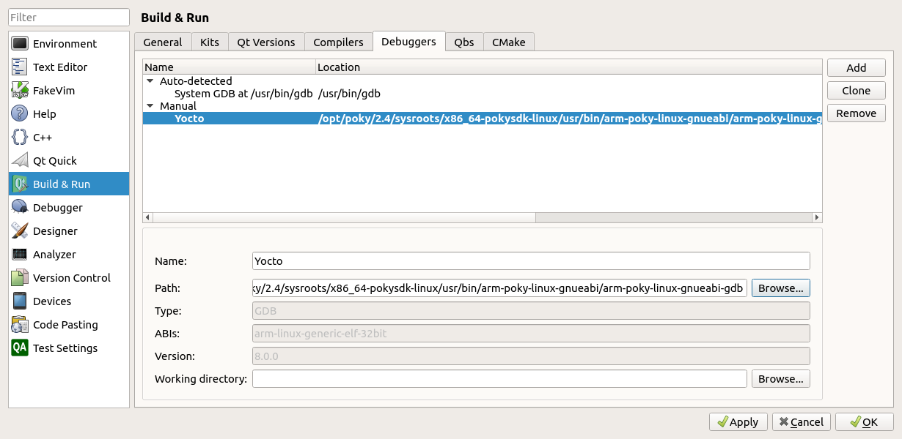

   Cửa sổ Device Debugger Configuration

6. Sau đó, chúng ta cấu hình Qt Versions bằng cách chọn builder `qmake` từ toolchain. Đây là đường dẫn, cũng được nêu trong screenshot sau:

   ```
   /opt/poky/2.4/sysroots/x86_64-pokysdk-linux/usr/bin/qt5/qmake
   ```

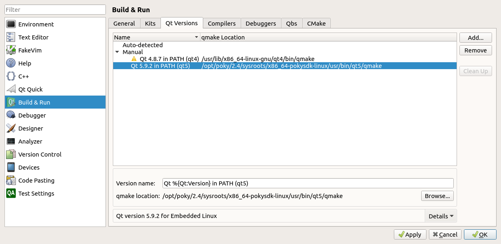

Màn hình chọn builder Qmake

Cuối cùng, chúng ta cấu hình một kit mới, như sau:

1. Chọn Generic Linux Device và cấu hình Sysroot của nó thành:

   ```
   /opt/poky/2.4/sysroots/cortexa9hf-neon-poky-linux-gnueabi
   ```

2. Chọn Compiler, Debugger và Qt version vừa định nghĩa:

   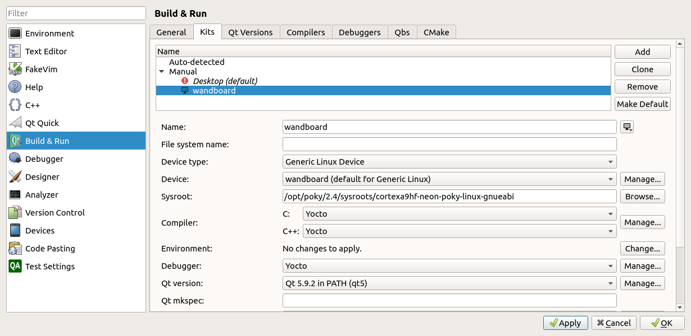

   Cửa sổ cấu hình Kit

3. Bạn cũng sẽ cần điền dòng Qt mkspec (các cấu hình định nghĩa một môi trường build) bằng `linux-oe-g++`. Đây là tên của platform cross-compilation OpenEmbedded trong `meta-qt5`.

> Trong Ubuntu, Qt Creator lưu cấu hình của nó trong thư mục `home` của người dùng dưới `.config/QtProject/`. Xóa thư mục này sẽ xóa toàn bộ cấu hình Qt Creator

## Phát triển ứng dụng Qt

Recipe này sẽ cho thấy cách build, chạy và debug một ứng dụng Qt đồ họa bằng Qt Creator.

### Chuẩn bị

Trước khi khởi chạy Qt Creator, chúng ta kiểm tra xem có thể build và chạy thủ công một ứng dụng Qt hay không. Chúng ta sẽ build một ứng dụng Qt hello world. Đây là code của `qt_hello_world.cpp`:

```
#include <QApplication>
#include <QPushButton>

 int main(int argc, char *argv[])
 {
     QApplication app(argc, argv);

     QPushButton hello("Hello world!");

     hello.show();
     return app.exec();
 }
```

Để build nó, chúng ta dùng SDK đã cài, như mô tả ở trên:

```
$ . /opt/poky/2.4/environment-setup-cortexa9hf-neon-poky-linux-gnueabi
$ qmake -project
$ qmake
```

Lệnh này dùng `qmake` để tạo một project file và một file `Makefile` với mọi code file liên quan trong thư mục. Giờ chúng ta có thể build với command sau:

```
$ make
```

> Bản build trên sẽ thất bại với lỗi sau:
>
> ```
> qt_hello_world.cpp:1:10: fatal error: QApplication: No
> such file or directory
> ```
>
> Để sửa, chúng ta cần thêm dòng sau vào file `qt_hello_world.pro` auto-generated:
>
> ```
> QT += widgets
> ```

Để chạy nó, trước tiên chúng ta cần build một filesystem có hỗ trợ Qt. Khi biên dịch một ứng dụng Qt bằng một Yocto recipe, build system sẽ tự động cài các thư viện cần thiết vào target image. Lần này chúng ta sẽ thêm một số ứng dụng Qt ví dụ vào `core-image-base` để các thư viện Qt cũng được cài. Trước tiên chúng ta chuẩn bị môi trường như sau:

```
$ cd /opt/yocto/fsl-community-bsp/
$ source setup-environment wandboard
```

Sau đó, chúng ta cấu hình project để package `qtbase-examples` được build và đưa vào image bằng cách thêm dòng sau vào file `conf/local.conf`:

```
PACKAGECONFIG_append_pn-qtbase = " fontconfig examples"
IMAGE_INSTALL_append = " qtbase-examples"
```

Sau đó chúng ta có thể build nó bằng command sau:

```
$ bitbake core-image-sato
```

Khi xong, chúng ta có thể nạp image vào thẻ microSD và boot Wandboard. Sao chép binary `qt_hello_world` sang target và chạy lệnh sau:

```
# DISPLAY=:0 qt_hello_world
```

Bạn sẽ thấy cửa sổ Qt hello world trên desktop X11.

### Cách thực hiện...

Làm theo các bước sau để build và chạy một ứng dụng hello world ví dụ bằng Qt Creator:

1. Tạo một project rỗng mới bằng cách vào File \| New File or Project \| Other project \| Empty qmake project.

2. Chỉ chọn kit wandboard mà chúng ta vừa tạo:

   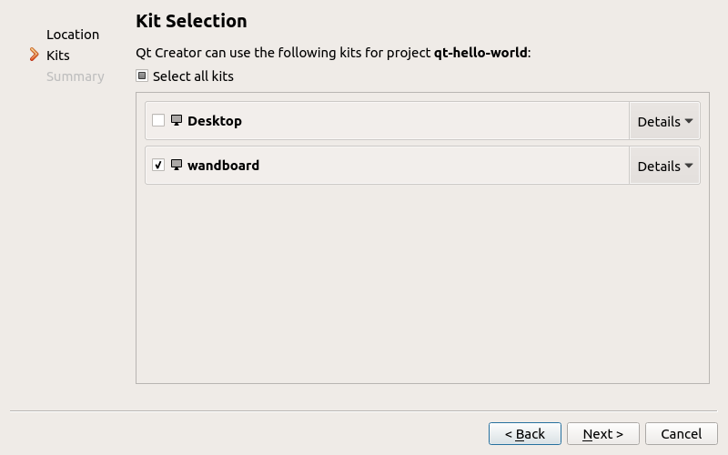

   Cửa sổ Kit Selection của Qt Creator

3. Thêm một file C++ mới, `qt_hello_world.cpp`, bằng cách vào File \| New File or Project \| C++ \| C++ Source File.

4. Dán nội dung file `qt_hello_world.cpp` vào Qt Creator, như trong screenshot sau:

   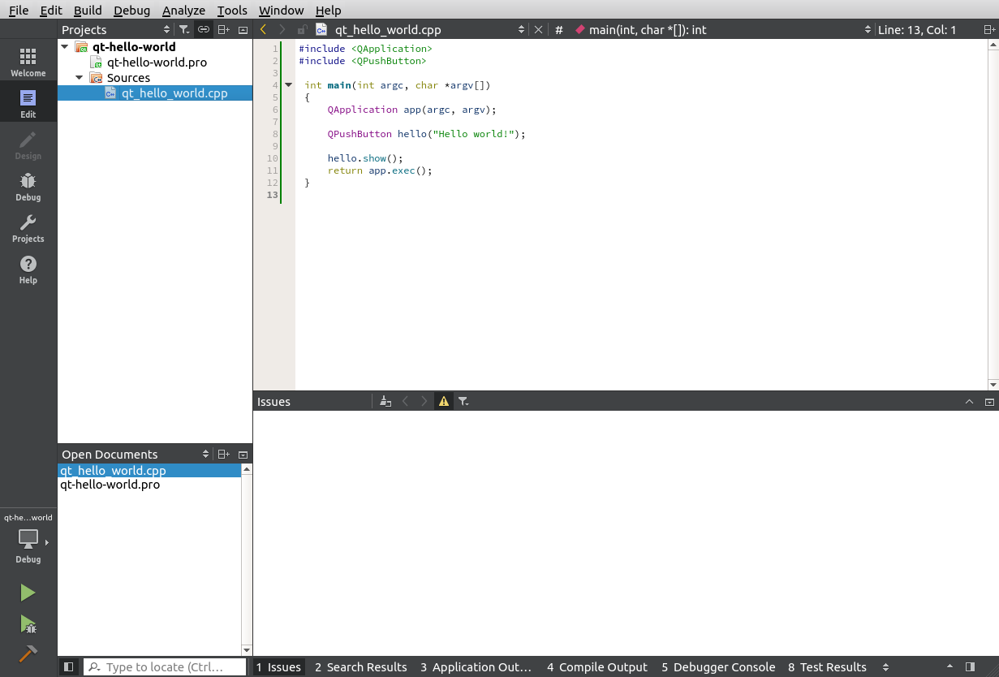

   Giao diện sửa source của Qt Creator

5. Cấu hình project với các chi tiết cài đặt trên target bằng cách thêm nội dung sau vào file `hw.pro`:

   ```
   SOURCES += \
      qt_hello_world.cpp

   TARGET =  qt_hello_world
      target.files =  qt_hello_world
      target.path = /

   INSTALLS += target
   QT += widgets
   ```

   Thay `qt_hello_world` bằng tên project của bạn.

6. Build project. Nếu có lỗi build, hãy kiểm tra rằng Yocto build environment đã được thiết lập đúng.

7. Vào Projects \| Run và kiểm tra Project Settings:

   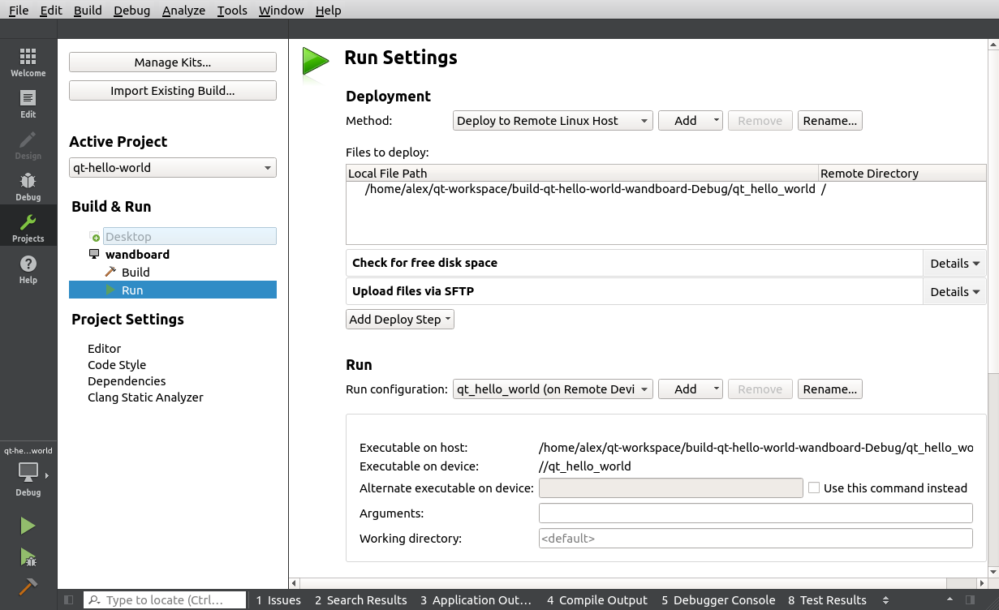

   Cửa sổ Run Settings của Qt Creator

8. Như có thể thấy trong screenshot này, Qt Creator sẽ dùng giao thức SFTP để truyền file sang target. Theo mặc định, SSH server dropbear chạy trên `core-image-sato` không hỗ trợ SFTP. Chúng ta cần thêm nó vào image để Qt Creator hoạt động bằng cách thêm package `openssh-sftp-server` vào file `conf/local.conf` của project:

   ```
   IMAGE_INSTALL_append =  " openssh-sftp-server"
   ```

   Tuy nhiên, còn có những công cụ khác chúng ta sẽ cần, như gdbserver nếu muốn debug ứng dụng, nên dễ hơn là thêm feature `qtcreator-debug`, feature này sẽ thêm mọi ứng dụng cần thiết vào target image:

   ```
   EXTRA_IMAGE_FEATURES += "qtcreator-debug"
   ```

   > Bạn có thể gặp lỗi sau:
   >
   > ```
   > Problem: package openssh-sshd-7.5p1-r0.cortexa9hf_neon
   > conflicts with dropbear provided by dropbear-2017.75-
   > r0.cortexa9hf_neon
   > ```
   >
   > Cho tới khi lỗi này được sửa, bạn có thể khắc phục tạm bằng cách thêm dòng sau vào file cấu hình `conf/local.conf`:
   >
   > ```
   > EXTRA_IMAGE_FEATURES += "qtcreator-debug ssh-server-
   > openssh "
   > ```
   >
   > Điều này buộc bỏ package `dropbear` bằng cách thêm một runtime dependency vào `openssh`, package có xung đột được định nghĩa với `dropbear` như sau:
   >
   > ```
   > RCONFLICTS_${PN} = "dropbear"
   > RCONFLICTS_${PN}-sshd = "dropbear"
   > ```

9. Giờ bạn có thể chạy project:

   > Nếu ứng dụng không deploy được do lỗi đăng nhập, hãy kiểm tra rằng bạn đã build với image feature `debug-tweaks`, đã đặt mật khẩu root trên target, hoặc đang dùng xác thực bằng SSH key.

   Khi ứng dụng đã được sao chép thành công sang thiết bị và khởi chạy, bạn sẽ thấy output sau trong tab Application Output:

   ```
   Starting //qt_hello_world...

   QStandardPaths: XDG_RUNTIME_DIR not set, defaulting to
   '/tmp/runtime-root'
   qt.qpa.screen: QXcbConnection: Could not connect to display
   Could not connect to any X display.

   Application finished with exit code 1.
   ```

   Chúng ta đang thiếu code cần để export biến `DISPLAY`. Chúng ta có thể thêm nó vào cấu hình Run Environment dưới Projects \| Run:

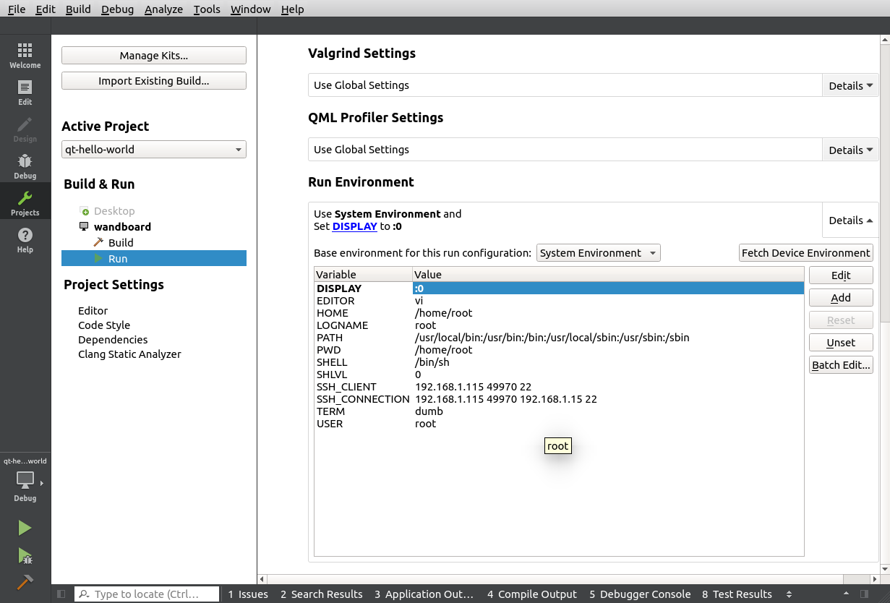

Cửa sổ thiết lập Run Environment

Re-run ứng dụng; giờ nó được khởi chạy đúng. Bây giờ bạn sẽ thấy ứng dụng Qt hello world ví dụ chạy trên desktop SATO:

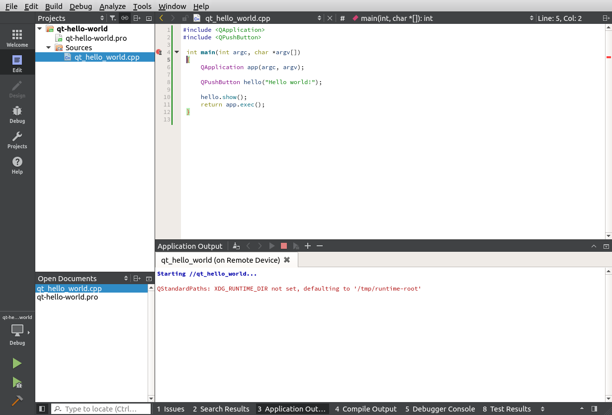

Tab Application Output

### Còn nữa...

Để debug ứng dụng, đặt một breakpoint trên source và nhấn nút Debug. Một screenshot của phiên debug được trình bày dưới đây:

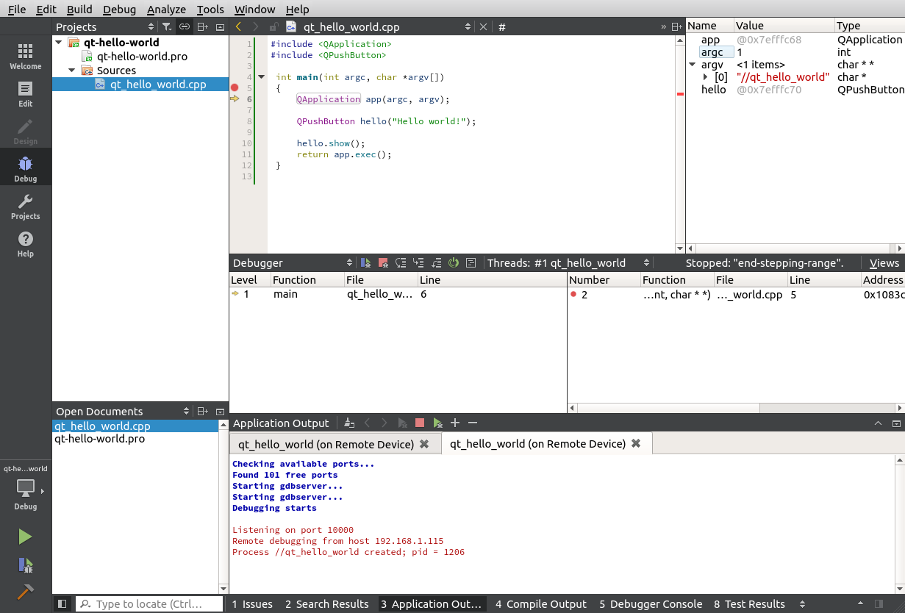

Giao diện debug của Qt Creator

## Mô tả các workflow phát triển ứng dụng

Cách được khuyến nghị để tiếp cận việc phát triển ứng dụng với Yocto Project là dùng Yocto SDK chuẩn hoặc extensible như một giao diện lặp giữa application developer và system integrator. System integrator đưa software mới vào Yocto build system để tạo và chia sẻ các SDK mới giữa application developer và BSP developer.

Tuy nhiên, có những workflow phát triển ứng dụng khác cũng hữu ích, và chúng sẽ được giới thiệu tiếp theo.

### Cách thực hiện...

Chúng ta sẽ xem các workflow phát triển sau được áp dụng cho phát triển ứng dụng như thế nào:

- External development: Khi dùng Yocto SDK

- Working directory development: Khi dùng Yocto build directory

- External source development: Khi dùng Yocto build system nhưng cấu hình một thư mục bên ngoài cho source

### Cách hoạt động...

Hãy xem chi tiết hơn các workflow phát triển khác nhau hoạt động như thế nào.

#### External development

Workflow này dùng SDK chuẩn hoặc extensible SDK do Yocto Project sinh ra. Đây là thứ chúng ta đã dùng trong các recipe trước khi build từ command line và cả khi dùng IDE Eclipse lẫn Qt Creator. Workflow này tạo ra các binary phải được sao chép riêng lẻ sang hardware để chạy và debug. Nó có thể được dùng kết hợp với các workflow khác.

Đây là workflow được khuyến nghị cho phát triển ứng dụng, đặc biệt khi dùng mọi tính năng của Yocto SDK extensible full. Xem Using the extensible SDK để có giải thích chi tiết.

Tuy nhiên, đôi khi chúng ta không phải là developer chính của package và chỉ muốn đưa vào một số bản sửa hoặc sửa đổi. Hai workflow được giải thích trong các mục sau dùng Yocto build system.

#### Working directory development

Khi ứng dụng đang được Yocto build system build, chúng ta dùng workflow này để debug các vấn đề thỉnh thoảng xảy ra. Tuy nhiên, đây không phải workflow được khuyến nghị cho các đợt phát triển dài. Chúng ta sẽ dùng custom recipe `helloworld_1.0.bb` đã thấy trong recipe Adding new packages ở `Chapter 3`, The Software Layer, `meta-custom/recipes-example/helloworld/helloworld_1.0.bb`, làm ví dụ. Recipe sau hẳn đã có trong layer `meta-custom` của bạn:

```
DESCRIPTION = "Simple helloworld application"
SECTION = "examples"
LICENSE = "MIT"
LIC_FILES_CHKSUM =
   "file://${COMMON_LICENSE_DIR}/MIT;md5=0835ade698e0bcf8506ecda2f7b4
   f302"

SRC_URI = "file://helloworld.c"

S = "${WORKDIR}"

do_compile() {
             ${CC} ${LDFLAGS} helloworld.c -o helloworld
}

do_install() {
             install -d ${D}${bindir}
             install -m 0755 helloworld ${D}${bindir}
}
```

Ở đây, source file `helloworld.c` như sau:

```
#include <stdio.h>

int main(void)
{
    return printf("Hello World");
}
```

Các bước của workflow như sau:

1. Bắt đầu biên dịch package từ đầu:

   ```
   $ cd /opt/yocto/fsl-community-bsp/
   $ source setup-environment wandboard
   $ bitbake -c cleanall helloworld
   ```

   Lệnh này sẽ xóa build folder của package, shared state cache và package source đã tải.

2. Khởi động một development shell:

   ```
   $ bitbake -c devshell helloworld
   ```

   Lệnh này sẽ fetch, giải nén và patch source `helloworld` rồi mở một shell mới với môi trường sẵn sàng để biên dịch. Shell mới sẽ chuyển sang build directory của package.

3. Tùy theo biến `SRC_URI`, build directory của package có thể đã revision-controlled sẵn. Nếu không, như trường hợp trong ví dụ này, chúng ta sẽ tạo một Git repository local, như sau:

   ```
   $ git init
   $ git add helloworld.c
   $ git commit -s -m "Original revision"
   ```

4. Thực hiện các sửa đổi cần thiết; ví dụ, sửa `helloworld.c` để in `Howdy World` như sau:

   ```
   #include <stdio.h>

   int main(void)
   {
      return printf("Howdy World");
   }
   ```

5. Thoát `devshell` và build package mà không xóa các sửa đổi của chúng ta:

   ```
   $ bitbake -C compile helloworld
   ```

   > Lưu ý chữ `C` viết hoa (gọi task compile) và cả mọi task theo sau nó.

6. Test các thay đổi trên hardware bằng cách sao chép package được sinh ra và cài nó. Vì bạn chỉ sửa một package, các dependency còn lại hẳn đã được cài trong root filesystem đang chạy. Chạy lệnh sau:

   ```
   $ bitbake -e helloworld | grep ^WORKDIR=
   WORKDIR="/usr/local/ssd/fsl-community-
   bsp/wandboard/tmp/work/cortexa9hf-neon-poky-linux-
   gnueabi/helloworld/1.0-r0"
   $ scp ${WORKDIR_PATH}/deploy-rpms/cortexa9hf_neon/helloworld-1.0-
   r0.cortexa9hf_neon.rpm root@<target_ip_address>:/
   ```

7. Trên target, chúng ta cài package mới với lệnh sau:

   ```
   $ dnf install /helloworld-1.0-r0.cortexa9hf_neon.rpm
   ```

   Điều này giả định root filesystem của target đã được build với feature `package-management` và package `helloworld` được thêm vào biến `RM_WORK_EXCLUDE` khi dùng class `rm_work`.

8. Quay lại `devshell` và commit thay đổi vào Git repository local, như sau:

   ```
   $ bitbake -c devshell helloworld
   $ git add helloworld.c
   $ git commit -s -m "Change greeting message"
   ```

9. Sinh một patch vào thư mục patch của recipe:

   ```
   $ git format-patch -1 -o /opt/yocto/fsl-community-
     bsp/sources/meta-custom/recipes-
     example/helloworld/helloworld-1.0
   ```

10. Cuối cùng, thêm patch vào biến `SRC_URI` của recipe, như sau:

    ```
    -SRC_URI = "file://helloworld.c"
    +SRC_URI = "file://helloworld.c \
    +           file://0001-Change-greeting-message.patch
    +"
    ```

#### External source development

Workflow này được khuyến nghị cho công việc phát triển một khi ứng dụng đã được tích hợp vào Yocto build system. Ví dụ, nó có thể được dùng kết hợp với external development dùng một IDE. Trong recipe mẫu đã thấy ở trên, source file được đặt trong layer `meta-custom` cùng với metadata. Phổ biến hơn là để recipe fetch trực tiếp từ một hệ thống quản lý revision như Git, nên chúng ta sẽ sửa file `meta-custom/recipes-example/helloworld/helloworld_1.0.bb` để lấy source từ một thư mục Git như sau:

```
DESCRIPTION = "Simple helloworld application"
SECTION = "examples"
LICENSE = "MIT"
LIC_FILES_CHKSUM =
"file://${COMMON_LICENSE_DIR}/MIT;md5=0835ade698e0bcf8506ecda2f7b4f302"

SRCREV = "${AUTOREV}"
SRC_URI = "git://github.com/yoctocookbook2ndedition/helloworld.git"

S = "${WORKDIR}/git"

do_compile() {
             ${CC} ${LDFLAGS} helloworld.c -o helloworld
}

do_install() {
             install -d ${D}${bindir}
             install -m 0755 helloworld ${D}${bindir}
}
```

Sau đó chúng ta có thể clone nó vào một thư mục local, như sau:

```
$ cd /opt/yocto/
$ git clone git://github.com/yoctocookbook2ndedition/helloworld.git
```

Một cách khác thay cho việc dùng một repository từ xa revision-controlled là dùng một repository local. Để làm vậy, làm theo các bước sau:

1. Tạo một Git repository local sẽ chứa source:

   ```
   $ mkdir -p /opt/yocto/helloworld
   $ cd /opt/yocto/helloworld
   $ git init
   ```

2. Sao chép file `helloworld.c` vào đây và thêm nó vào repository:

   ```
   $ git add helloworld.c
   ```

3. Sau đó, commit nó với chữ ký và message, như sau:

   ```
   $ git commit -s -m "Original revision"
   ```

Dù theo cách nào, chúng ta đều có source version-controlled trong một thư mục local. Sau đó chúng ta sẽ cấu hình file `conf/local.conf` để làm việc từ đó, như sau:

```
INHERIT += "externalsrc"
EXTERNALSRC_pn-helloworld = "/opt/yocto/helloworld"
EXTERNALSRC_BUILD_pn-helloworld = "/opt/yocto/helloworld"
```

Sau đó, chúng ta build nó với lệnh sau:

```
$ cd /opt/yocto/fsl-community-bsp/
$ source setup-environment wandboard
$ bitbake helloworld
```

Khi đó chúng ta có thể làm việc trực tiếp trong thư mục local mà không có rủi ro BitBake vô tình xóa code của chúng ta. Khi phát triển xong, các sửa đổi trong `conf/local.conf` được bỏ đi và recipe sẽ fetch source từ vị trí `SRC_URI` gốc của nó.

## Làm việc với GNU make

GNU make là một bản hiện thực make cho các hệ thống Linux. Nó được rất nhiều dự án open source sử dụng, kể cả Linux kernel. Quá trình build được quản lý bởi một `Makefile`, file này cho `make` biết cách build source code.

### Cách thực hiện...

Các Yocto recipe kế thừa `base.bbclass` và do đó hành vi mặc định của chúng là tìm một `Makefile`, `makefile` hoặc `GNUmakefile` và dùng GNU make để build package. Nếu package của bạn đã chứa một `Makefile`, tất cả những gì bạn cần lo là các đối số cần truyền cho `make`. Các đối số `make` có thể được truyền bằng biến `EXTRA_OEMAKE`, và cần cung cấp một override `do_install` gọi `oe_runmake` install, nếu không một bước install rỗng sẽ được chạy. Ví dụ, recipe `mingetty` dựa trên một `Makefile` và trông như sau:

```
SUMMARY = "Compact getty terminal handler for virtual consoles only"
SECTION = "console/utils"
HOMEPAGE = "http://sourceforge.net/projects/mingetty/"
LICENSE = "GPLv2"
PR = "r3"

LIC_FILES_CHKSUM = "file://COPYING;md5=0c56db0143f4f80c369ee3af7425af6e"
SRC_URI = "${SOURCEFORGE_MIRROR}/${BPN}/${BP}.tar.gz"

SRC_URI[md5sum] = "2a75ad6487ff271424ffc00a64420990"
SRC_URI[sha256sum] =
"0f55c90ba4faa913d91ef99cbf5cb2eb4dbe2780314c3bb17953f849c8cddd17"

# substitute our CFLAGS for "-O2 -Wall -W -pipe"
#
EXTRA_OEMAKE = "CC='${CC}' \
                CFLAGS='${CFLAGS} -D_GNU_SOURCE'"

do_install(){
    install -d ${D}${mandir}/man8 ${D}/${base_sbindir}
    oe_runmake install DESTDIR=${D}
}

inherit update-alternatives
ALTERNATIVE_${PN} = "getty"
ALTERNATIVE_LINK_NAME[getty] = "${base_sbindir}/getty"
ALTERNATIVE_TARGET[getty] = "${base_sbindir}/mingetty"
ALTERNATIVE_PRIORITY = "10"
```

> Class `update-alternatives` dùng trong recipe trên là một helper class quản lý hệ thống alternative cho nhiều provider của cùng một command. Để dùng nó, cần cung cấp các biến sau:
>
> `ALTERNATIVE_{PN}`: Danh sách mọi command trong package cần alternative provider.
>
> `ALTERNATIVE_LINK_NAME[<command>]`: Đường dẫn cho alternative command, mặc định là `${bindir}/<command>` `ALTERNATIVE_TARGET`: Đặt một link mặc định cho mọi command. Có thể chỉ định link mặc định riêng bằng `ALTERNATIVE_TARGET[<command>]`. `ALTERNATIVE_PRIORITY`: Đặt một priority mặc định cho mọi command. Có thể chỉ định priority riêng bằng `ALTERNATIVE_PRIORITY[<command>]`.

### Xem thêm

- Để biết thêm thông tin về GNU Make, truy cập `https://www.gnu.org/software/make/manual/`

## Làm việc với GNU build system

Một `Makefile` là giải pháp tốt khi bạn luôn build và chạy software trên cùng một hệ thống và những thứ như phiên bản `glibc` và `gcc` cũng như các phiên bản thư viện có sẵn đều đã biết. Tuy nhiên, hầu hết software cần được build và chạy trên nhiều hệ thống khác nhau.

### Chuẩn bị

GNU build system, hay autotools, là một tập công cụ nhằm tạo một `Makefile` cho software của bạn trên nhiều hệ thống khác nhau. Nó gồm ba công cụ chính:

- Autoconf: Công cụ này parse nội dung của file `configure.ac` mô tả source code cần build và tạo một script `configure`. Script này sau đó sẽ được dùng để sinh `Makefile` cuối cùng.

- Automake: Công cụ này parse nội dung của file `Makefile.am` và chuyển nó thành file `Makefile.in`. File này sau đó được script `configure` sinh ra trước đó dùng để có một script `config.status`, script này được tự động thực thi để tạo `Makefile` cuối cùng.

- Libtools: Công cụ này quản lý việc tạo cả static library lẫn dynamic library.

Trước khi xem các recipe autotools-based, hãy xem cách dùng Yocto SDK để build một package autotools-based, ví dụ, mẫu GNU hello. Hãy fetch và giải nén code:

```
$ wget http://ftp.gnu.org/gnu/hello/hello-2.10.tar.gz
$ tar xvf hello-2.10.tar.gz
```

Khi code đã được chuẩn bị, chúng ta cần thiết lập môi trường biên dịch như thường lệ:

```
$ source /opt/poky/2.4/environment-setup-cortexa9hf-neon-poky-linuxgnueabi
```

Tiếp theo, chúng ta có thể chạy script `configure`:

```
$ ./configure ${CONFIGURE_FLAGS}
```

Biến môi trường `CONFIGURE_FLAGS` đã được thiết lập với mọi thứ mà configure cần:

```
$ echo $CONFIGURE_FLAGS
--target=arm-poky-linux-gnueabi --host=arm-poky-linux-gnueabi --
build=x86_64-linux -with-libtool-sysroot=/opt/poky/2.4/sysroots/cortexa8hf-
neon-poky-linux-gnueabi
```

Giờ chúng ta có thể build và cài, bằng command sau:

```
$ make
$ make install DESTDIR=</path/to/destination/directory>
```

### Cách thực hiện...

Yocto build system chứa các class với kiến thức cần thiết để build các package `autotools`. Tất cả những gì recipe của bạn cần làm là kế thừa class `autotools` và cấu hình các đối số cần truyền cho script `configure` trong biến `EXTRA_OECONF`. Thông thường, hệ thống `autotools` hiểu cách cài software, nên bạn không cần override `do_install`. Có rất nhiều dự án open source dùng `autotools` làm build system. Sau đây là một ví dụ, `meta-custom/recipes-example/hello/hello_2.10.bb`, không cần thêm configure option nào:

```
DESCRIPTION = "GNU helloworld autotools recipe"
SECTION = "examples"
LICENSE = "GPLv3"
LIC_FILES_CHKSUM = "file://${COREBASE}/meta/files/common-
licenses/GPL-3.0;md5=c79ff39f19dfec6d293b95dea7b07891"

SRC_URI = "${GNU_MIRROR}/hello/hello-${PV}.tar.gz"
SRC_URI[md5sum] = "6cd0ffea3884a4e79330338dcc2987d6"
SRC_URI[sha256sum] =
"31e066137a962676e89f69d1b65382de95a7ef7d914b8cb956f41ea72e0f516b"

inherit autotools gettext
```

Nếu cần truyền thêm các tùy chọn cấu hình cho script `configure`, có thể dùng các biến `EXTRA_OECONF` và `PACKAGECONFIG_CONFARGS`.

### Xem thêm

- Để biết thêm thông tin về GNU build system, truy cập `http://www.gnu.org/software/automake/manual/html_node/GNU-Build-System.html`

## Làm việc với build system CMake

Hệ thống GNU make là một công cụ tuyệt vời khi bạn chỉ build cho các hệ thống Linux. Tuy nhiên, một số package là đa nền tảng và cần một cách quản lý các file `Makefile` trên các hệ điều hành khác nhau. CMake là một build system cross-platform có thể làm việc không chỉ với GNU make, mà cả Microsoft Visual Studio và Xcode của Apple.

### Chuẩn bị

Công cụ CMake parse các file `CMakeLists.txt` trong mỗi thư mục để điều khiển quá trình build. Sau đây là một file `CMakeLists.txt` ví dụ, để biên dịch ví dụ `helloworld`:

```
cmake_minimum_required(VERSION 2.8.10)
project(helloworld)
add_executable(helloworld helloworld.c)
install(TARGETS helloworld RUNTIME DESTINATION bin)
```

### Cách thực hiện...

Yocto build system cũng chứa các class với kiến thức cần thiết để build các package CMake. Tất cả những gì recipe của bạn cần làm là kế thừa class `cmake` và cấu hình các đối số cần truyền cho script `configure` trong biến `EXTRA_OECMAKE`. Thông thường, hệ thống CMake hiểu cách cài software, nên bạn không cần override `do_install`. Sau đây là một recipe để build ứng dụng ví dụ `helloworld.c`, `meta-custom/recipes-example/helloworld-cmake/helloworld-cmake_1.0.bb`:

```
DESCRIPTION = "Simple helloworld cmake application"
SECTION = "examples"
LICENSE = "MIT"
LIC_FILES_CHKSUM =
"file://${COMMON_LICENSE_DIR}/MIT;md5=0835ade698e0bcf8506ecda2f7b4f302"

SRC_URI = "file://CMakeLists.txt \
           file://helloworld.c"

S = "${WORKDIR}"

inherit cmake

EXTRA_OECMAKE = ""
```

Nếu cần truyền thêm các tùy chọn cấu hình cho `cmake`, có thể dùng các biến `EXTRA_OECMAKE` và `PACKAGECONFIG_CONFARGS`.

### Xem thêm

- Để biết thêm thông tin về CMake, truy cập `http://www.cmake.org/documentation/`

## Làm việc với builder SCons

`SCons` cũng là một build system đa nền tảng viết bằng Python, với các file cấu hình cũng được viết bằng chính ngôn ngữ này. Nó cũng hỗ trợ Microsoft Visual Studio, cùng các tính năng khác.

### Chuẩn bị

SCons parse các file `SConstruct`, và theo mặc định nó không truyền environment vào build system. Điều này nhằm tránh các vấn đề build do khác biệt environment. Đây là một điều phức tạp với Yocto, vì nó cấu hình environment với các thiết lập toolchain cross-compilation. SCons không định nghĩa một cách chuẩn để hỗ trợ cross-compilation, nên mỗi dự án sẽ hiện thực nó khác nhau. Với một ví dụ đơn giản như chương trình `helloworld`, chúng ta chỉ cần khởi tạo các biến `CC, LINKFLAGS` và `PATH` trong file `SConstruct` từ environment bên ngoài như sau:

```
import os
env = Environment(CC = os.environ['CC'], LINKFLAGS = os.environ['LDFLAGS'],
ENV = {'PATH': os.environ['PATH']})
env.Program("helloworld", "helloworld.c")
```

### Cách thực hiện...

Yocto build system cũng chứa các class với kiến thức cần thiết để build các package SCons. Tất cả những gì recipe của bạn cần làm là kế thừa class `scons` và cấu hình các đối số cần truyền cho script `configure` trong biến `EXTRA_OESCONS`. Dù một số package dùng SCons có thể xử lý việc cài đặt qua một install alias như class `scons` yêu cầu, recipe của bạn phần lớn sẽ cần cung cấp một override cho task `do_install`. Sau đây là một recipe ví dụ để build ứng dụng ví dụ `helloworld.c`, `meta-custom/recipes-example/helloworld-scons/helloworld-scons_1.0.bb`:

```
DESCRIPTION = "Simple helloworld scons application"
SECTION = "examples"
LICENSE = "MIT"
LIC_FILES_CHKSUM =
"file://${COMMON_LICENSE_DIR}/MIT;md5=0835ade698e0bcf8506ecda2f7b4f302"

SRC_URI = "file://SConstruct \
           file://helloworld.c"

S = "${WORKDIR}"

inherit scons

EXTRA_OESCONS = ""

do_install() {
    install -d ${D}/${bindir}
    install -m 0755 helloworld ${D}${bindir}
}
```

### Xem thêm

- Để biết thêm thông tin về SCons, truy cập `http://www.scons.org/doc/HTML/scons-user/`

## Phát triển với library

Hầu hết ứng dụng dùng shared library, giúp tiết kiệm system memory và dung lượng đĩa, vì chúng được dùng chung giữa các ứng dụng khác nhau. Module hóa code thành library cũng giúp quản lý phiên bản và quản lý code dễ hơn, cũng như cập nhật độc lập với các ứng dụng dùng chúng. Recipe này sẽ giải thích cách làm việc với cả static library lẫn shared library.

### Chuẩn bị

Theo quy ước, các file library bắt đầu bằng tiền tố `lib`. Mọi library cần được truyền tường minh cho linker để chúng được dùng, ngoại trừ `libc` sẽ được link tự động. Về cơ bản có hai loại library:

- Static library (`.a`): Khi object code được link và trở thành một phần của ứng dụng.

- Dynamic library (`.so`): Chúng được link lúc biên dịch nhưng không được đưa vào ứng dụng, nên chúng cần có sẵn lúc runtime. Nhiều ứng dụng có thể dùng chung một dynamic library nên cần ít dung lượng đĩa hơn.

Các library thường được đặt ở các vị trí root filesystem chuẩn sau:

- `/lib`: Các library cần cho việc khởi động

- `/usr/lib`: Hầu hết các library hệ thống

- `/usr/local/lib`: Các library Non-system

Các dynamic library tuân theo những quy ước đặt tên nhất định trên hệ thống đang chạy để nhiều phiên bản có thể co-exist; do đó một library có thể được tham chiếu bằng các tên khác nhau. Một số tên được giải thích dưới đây:

- Linker name với hậu tố `.so`; ví dụ, `libexample.so`.

- Tên đầy đủ (fully qualified name) hay `soname`, một symbolic link tới tên library. Ví dụ, `libexample.so.x`, trong đó `x` là số phiên bản. Tăng số phiên bản nghĩa là library không tương thích với các phiên bản trước.

- Real name. Ví dụ, `libexample.so.x.y[.z]`, trong đó `x` là số major version, `y` là số minor version, và `z` tùy chọn là số release. Tăng số minor hoặc release vẫn giữ tương thích.

Vậy, với một library `libexample` nhất định, chúng ta thấy:

- `libexample.so.x.y[.z]`, shared library thực tế cần có mặt trên cả host lẫn target

- `libexample.so.x`, một symbolic link tới file ở trên, được dùng trên target khi nạp library lúc runtime

- `libexample.so`, cũng là một symbolic link như trên, được dùng trên host khi link

Trong GNU `glibc`, việc khởi chạy một ELF binary sẽ gọi một program loader, `/lib/ld-linux-X`. Ở đây, `X` chứa cả một chuỗi architecture lẫn số phiên bản. Program loader tìm mọi shared library cần thiết. Quá trình này dùng một vài file đáng chú ý:

- `/etc/ld.so.conf`: File này lưu các thư mục được loader tìm kiếm

- `/etc/ld.so.preload`: File này được dùng để override library

Công cụ `ldconfig` đọc file `ld.so.conf` và tạo một file cache (`/etc/ld.so.cache`) để tăng tốc độ truy cập. Các biến môi trường sau cũng có thể hữu ích:

- `LD_LIBRARY_PATH`: Đây là một danh sách thư mục colon-separated để tìm library. Nó được dùng khi debug hoặc khi dùng các vị trí library non-standard.

- `LD_PRELOAD`: Biến này được dùng để override shared library.

#### Build một static library

Chúng ta sẽ build một static library, `libhelloworld`, từ hai source file, `hello.c` và `world.c`, và dùng nó để build một ứng dụng hello world. Các source file của library được trình bày ở đây. Sau đây là code của file `hello.c`:

```
char * hello (void)
{
  return "Hello";
}
```

Đây là code của file `world.c`:

```
char * world (void)
{
  return "World";
}
```

Để build library, làm theo các bước sau:

1. Cấu hình môi trường build:

   ```
   $ source /opt/poky/2.4/environment-setup-cortexa9hf-neon-poky-
   linux-gnueabi
   ```

2. Biên dịch và link library:

   ```
   $ ${CC} -c hello.c world.c
   $ ${AR} -cvq libhelloworld.a hello.o world.o
   ```

3. Kiểm tra nội dung của library:

   ```
   $ ${AR} -t libhelloworld.a
   ```

Source code của ứng dụng được trình bày tiếp theo:

- Với file `helloworld.c`, code như sau:

  ```
  #include <stdio.h>
  #include "helloworld.h"

  int main (void)
  {
    return printf("%s %s\n",hello(),world());
  }
  ```

  Với header file `helloworld.h` như sau:

  ```
  #ifndef HELLOWORLD_H
  #define HELLOWORLD_H
  char * hello (void);
  char * world (void);
  #endif
  ```

- Giờ chúng ta build nó, chỉ cho compiler nơi tìm static library (bên trong `libs/`) và include file (bên trong `inc/`):

  ```
  $ ${CC} -o helloworld helloworld.c -l helloworld -L libs/ -I inc/
  ```

- Chúng ta có thể kiểm tra nó link với những library nào bằng `readelf`:

  ```
  $ readelf -d helloworld
  Dynamic section at offset 0x534 contains 24 entries:
   Tag        Type                         Name/Value
  0x00000001 (NEEDED)                     Shared library:
     [libc.so.6]
  ```

#### Build một shared dynamic library

Dynamic library phải được biên dịch theo cách position-independent, để linker có thể đặt chúng ở bất kỳ vị trí memory nào lúc runtime. Để làm vậy, chúng ta dùng tham số `-fPIC` cho compiler. Để build một dynamic library từ cùng các source, chúng ta chạy lệnh sau:

```
$ ${CC} -fPIC -g -c hello.c world.c
$ ${CC} -shared -Wl,-soname,libhelloworld.so.1 -o libhelloworld.so hello.o
world.o
```

Giờ chúng ta build nó, chỉ cho compiler nơi tìm dynamic library (bên trong `libs/`) và include file (bên trong `inc/`):

```
$ ${CC} -o helloworld helloworld.c -l helloworld  -L libs/ -I inc/
```

Một lần nữa, chúng ta có thể kiểm tra các dynamic library bằng `readelf`, như sau:

```
$ readelf -d helloworld
Dynamic section at offset 0x6ec contains 25 entries:
  Tag        Type                         Name/Value
0x00000001 (NEEDED)                     Shared library:
  [libhelloworld.so.1]
0x00000001 (NEEDED)                     Shared library: [libc.so.6]
```

### Cách thực hiện...

Sau đây là một recipe mẫu cho ví dụ static library vừa thấy, `meta-custom/recipes-example/libhelloworld-static/libhelloworldstatic_1.0.bb`:

```
DESCRIPTION = "Simple helloworld example static library"
SECTION = "libs"
LICENSE = "MIT"
LIC_FILES_CHKSUM =
"file://${COMMON_LICENSE_DIR}/MIT;md5=0835ade698e0bcf8506ecda2f7b4f302"

SRC_URI = "file://hello.c \
           file://world.c \
           file://helloworld.h \
           file://helloworld.pc"

S = "${WORKDIR}"

do_compile() {
        ${CC} -c hello.c world.c
        ${AR} -cvq libhelloworld.a hello.o world.o
}

do_install() {
        install -d ${D}${includedir}
        install -d ${D}${libdir}
        install -m 0755 helloworld.h ${D}${includedir}
        install -m 0755 libhelloworld.a ${D}${libdir}
}
```

Theo mặc định, cấu hình trong `meta/conf/bitbake.conf` đặt mọi static library vào một package `-staticdev`. Nó cũng được đặt vào `sysroot` để có thể được dùng, cùng với header file `helloworld.h`. Với một dynamic library, chúng ta sẽ dùng recipe sau, `meta-custom/recipes-example/libhelloworld-dyn/libhelloworld-dyn_1.0.bb`:

```
DESCRIPTION = "Simple helloworld example dynamic library"
SECTION = "libs"
LICENSE = "MIT"
LIC_FILES_CHKSUM =
"file://${COMMON_LICENSE_DIR}/MIT;md5=0835ade698e0bcf8506ecda2f7b4f302"

SRC_URI = "file://hello.c \
           file://world.c \
           file://helloworld.h \
           file://helloworld.pc"

S = "${WORKDIR}"

do_compile() {
       ${CC} ${LDFLAGS} -fPIC -g -c hello.c world.c
       ${CC} ${LDFLAGS} -shared -Wl,-soname,libhelloworld.so.1 -o
libhelloworld.so.1.0 hello.o world.o
}

do_install() {
       install -d ${D}${includedir}
       install -d ${D}${libdir}
       install -m 0755 helloworld.h ${D}${includedir}
       install -m 0755 libhelloworld.so.1.0 ${D}${libdir}
       ln -s libhelloworld.so.1.0 ${D}/${libdir}/libhelloworld.so.1
       ln -s libhelloworld.so.1 ${D}/${libdir}/libhelloworld.so
}
```

Thông thường, chúng ta sẽ liệt kê các dependency của library (nếu có) trong biến `RDEPENDS`, nhưng điều này không phải lúc nào cũng cần, vì build system thực hiện một số kiểm tra dependency tự động bằng cách xem xét cả file library lẫn file `pkg-config`, và tự động thêm các dependency tìm được vào `RDEPENDS`. Nhiều phiên bản của cùng một library có thể co-exist trên hệ thống đang chạy. Để làm vậy, bạn cần cung cấp các recipe khác nhau với cùng tên package nhưng khác package revision. Ví dụ, chúng ta sẽ có `libhelloworld-1.0.bb` và `libhelloworld-1.1.bb`. Để build một ứng dụng dùng static library, chúng ta sẽ tạo một recipe trong `meta-custom/recipes-example/helloworld-static/helloworldstatic_1.0.bb`, như sau:

```
DESCRIPTION = "Simple helloworld example"
SECTION = "examples"
LICENSE = "MIT"
LIC_FILES_CHKSUM =
"file://${COMMON_LICENSE_DIR}/MIT;md5=0835ade698e0bcf8506ecda2f7b4f302"

DEPENDS = "libhelloworld-static"

SRC_URI = "file://helloworld.c"

S = "${WORKDIR}"

do_compile() {
       ${CC} ${LDFLAGS} -o helloworld helloworld.c -l helloworld
}

do_install() {
        install -d ${D}${bindir}
        install -m 0755 helloworld ${D}${bindir}
}
```

Để build bằng dynamic library, chúng ta dùng `meta-custom/recipes-example/helloworld-dyn/helloworld-dyn_1.0.bb` sau:

```
DESCRIPTION = "Simple helloworld example"
SECTION = "examples"
LICENSE = "MIT"
LIC_FILES_CHKSUM =
"file://${COMMON_LICENSE_DIR}/MIT;md5=0835ade698e0bcf8506ecda2f7b4f302"

DEPENDS = "libhelloworld-dyn"
SRC_URI = "file://helloworld.c"

S = "${WORKDIR}"

do_compile() {
        ${CC} ${LDFLAGS} -o helloworld helloworld.c -lhelloworld
}

do_install() {
        install -d ${D}${bindir}
        install -m 0755 helloworld ${D}${bindir}
}
```

### Cách hoạt động...

Library nên cung cấp thông tin cần để dùng chúng, như include header và dependency của library. Yocto Project cung cấp hai cách để library cung cấp các thiết lập build:

- Class `binconfig` là một class cũ (legacy) được dùng cho các library cung cấp một script `-config` để đưa ra các thiết lập build

- Class `pkgconfig` là phương pháp được khuyến nghị để library cung cấp các thiết lập build

Một file thiết lập build `pkg-config` có hậu tố `.pc`, được phân phối cùng library, và được cài vào một vị trí chung mà công cụ `pkg-config` biết. File `helloworld.pc` cho dynamic library trông như sau:

```
prefix=/usr/local
exec_prefix=${prefix}
includedir=${prefix}/include
libdir=${exec_prefix}/lib

Name: helloworld
Description: The helloworld library
Version: 1.0.0
Cflags: -I${includedir}/helloworld
Libs: -L${libdir} -lhelloworld
```

Tuy nhiên, với static library, chúng ta sẽ đổi dòng cuối thành:

```
Libs: -L${libdir} libhelloworld.a
```

Một package muốn dùng file `.pc` này sẽ kế thừa class `pkgconfig`.

### Còn nữa...

Có một cơ chế cho các package build cả một library lẫn một executable nhưng không muốn cả hai được cài cùng nhau. Bằng cách kế thừa class `lib_package`, package sẽ tạo một package `-bin` riêng chứa các executable.

### Xem thêm

- Chi tiết hơn về `pkg-config` có tại `http://www.freedesktop.org/wiki/Software/pkg-config/`

## Làm việc với Linux framebuffer

Linux kernel cung cấp một sự trừu tượng hóa cho hardware đồ họa dưới dạng các framebuffer device. Chúng cho phép ứng dụng truy cập hardware đồ họa qua một API well-defined. Framebuffer cũng được dùng để cung cấp một console đồ họa cho Linux kernel, để nó có thể, ví dụ, hiển thị màu và logo. Trong recipe này, chúng ta sẽ khám phá cách ứng dụng có thể dùng Linux framebuffer để hiển thị đồ họa và video.

### Chuẩn bị

Một số ứng dụng, đặc biệt trên thiết bị embedded, có thể truy cập framebuffer bằng cách ánh xạ memory và truy cập trực tiếp. Ví dụ, framework `gstreamer` có thể làm việc trực tiếp trên framebuffer, framework đồ họa Qt cũng vậy. Một số ứng dụng, như framework Qt, cũng có hỗ trợ hardware acceleration — không chỉ cho video mà cả tăng tốc đồ họa 2D và 3D được cung cấp qua các API OpenGL và OpenVG.

### Cách thực hiện...

FSL community BSP layer cung cấp một target image `fsl-image-multimedia` bao gồm framework `gstreamer`, kể cả các plugin dùng các tính năng tăng tốc hardware bên trong SoC i.MX6. Một image `fsl-image-multimedia-full` cũng được cung cấp, mở rộng các plugin `gstreamer` được hỗ trợ. Để build image `fsl-image-multimedia` với hỗ trợ framebuffer, bạn cần bỏ các distribution feature đồ họa bằng cách thêm dòng sau vào file `conf/local.conf`:

```
DISTRO_FEATURES_remove = "x11 directfb wayland vulkan"
```

Ngoài ra, FSL BSP community cung cấp một distribution `fslc-framebuffer` như một phần của `meta-freescale-distro` với một cấu hình tham chiếu cho các image framebuffer. Để dùng nó, đổi `DISTRO` trong `conf/local.conf` thành `fslc-framebuffer`.

> Bạn sẽ cần build từ đầu bằng cách xóa cả thư mục `tmp` lẫn `sstate-cache` khi thay đổi biến `DISTRO_FEATURES`.

Build image với lệnh sau:

```
$ cd /opt/yocto/fsl-community-bsp/
$ source setup-environment wandboard
$ bitbake fsl-image-multimedia
```

Chúng ta đang dùng image `fsl-image-multimedia` làm ví dụ, nhưng bất kỳ image nào đã bỏ các distribution feature đồ họa nói trên đều sẽ build các package với hỗ trợ framebuffer cho những package hỗ trợ nó. Image `fsl-image-multimedia-wandboard.wic.gz` kết quả tại `tmp/deploy/images` có thể được nạp vào thẻ microSD và boot. Device tree mặc định của Wandboard định nghĩa một node `mxcfb1`, như sau:

```
mxcfb1: fb@0 {
         compatible = "fsl,mxc_sdc_fb";
         disp_dev = "hdmi";
         interface_pix_fmt = "RGB24";
         mode_str ="1920x1080M@60";
         default_bpp = <24>;
         int_clk = <0>;
         late_init = <0>;
 };
```

Vì vậy, kết nối một màn hình HDMI 1920x1080 sẽ hiển thị một virtual Terminal với prompt đăng nhập Poky. Sau đó chúng ta có thể dùng công cụ command-line `gstreamer`, `gst-launch-1.0`, để xây dựng các pipeline `gstreamer`. Ví dụ, để xem một video hardware-accelerated trên framebuffer, bạn có thể tải file video full HD teaser Big Buck Bunny và phát nó trên framebuffer bằng công cụ command-line `gst-launch-1.0` của framework `gstreamer`, như sau:

```
# cd /home/root
# wget
 http://mirror.cessen.com/blender.org/peach/trailer/trailer_1080p.mov
# gst-launch-1.0 playbin uri=file:///home/root/trailer_1080p.mov
```

Plugin gstreamer `playbin` sẽ tự động tạo một pipeline với các element đúng. Trong trường hợp này, video sẽ dùng plugin video decoder `h.264`, `imxvpu`, plugin này dùng video processing unit bằng hardware bên trong SoC i.MX6 để giải mã video `h.264`.

Bạn có thể xem danh sách các plugin i.MX6-specific có sẵn bằng cách chạy lệnh sau:

```
# gst-inspect-1.0 | grep imx
imxpxp:  imxpxpvideosink: Freescale PxP video sink
imxpxp:  imxpxpvideotransform: Freescale PxP video transform
imxvpu:  imxvpudec: Freescale VPU video decoder
imxvpu:  imxvpuenc_h263: Freescale VPU h.263 video encoder
imxvpu:  imxvpuenc_h264: Freescale VPU h.264 video encoder
imxvpu:  imxvpuenc_mpeg4: Freescale VPU MPEG-4 video encoder
imxvpu:  imxvpuenc_mjpeg: Freescale VPU motion JPEG video encoder
imxg2d:  imxg2dvideosink: Freescale G2D video sink
imxg2d:  imxg2dvideotransform: Freescale G2D video transform
imxg2d:  imxg2dcompositor: Freescale G2D video compositor
imxaudio:  imxuniaudiodec: Freescale i.MX uniaudio decoder
imxaudio:  imxmp3audioenc: Freescale i.MX MP3 encoder
imxeglvivsink:  imxeglvivsink: Freescale EGL video sink
imxipu:  imxipuvideotransform: Freescale IPU video transform
imxipu:  imxipuvideosink: Freescale IPU video sink
imxipu:  imxipucompositor: Freescale IPU video compositor
imxv4l2videosrc:  imxv4l2videosrc: V4L2 CSI Video Source
```

### Cách hoạt động...

Các framebuffer device nằm dưới `/dev`. Framebuffer device mặc định là `/dev/fb0` và, nếu hardware đồ họa cung cấp nhiều hơn một, chúng sẽ được đánh số tuần tự. Theo mặc định, Wandboard boot với ba framebuffer device, `fb0`, `fb1` và `fb2`. Cái đầu tiên là màn hình video mặc định, cái thứ hai là một overlay plane có thể dùng để kết hợp nội dung trên màn hình, và cái thứ ba là màn hình thứ cấp. Tuy nhiên, SoC i.MX6 hỗ trợ tới bốn màn hình, nên nó có thể có tới bốn framebuffer device cộng thêm hai overlay framebuffer. Bạn có thể đổi framebuffer mặc định mà ứng dụng dùng bằng biến môi trường `FRAMEBUFFER`. Ví dụ, nếu hardware hỗ trợ nhiều framebuffer, bạn có thể dùng cái thứ hai bằng cách chạy:

```
# export FRAMEBUFFER=/dev/fb1
```

Các framebuffer device là memory-mapped và bạn có thể thực hiện thao tác file trên chúng. Ví dụ, bạn có thể xóa nội dung màn hình bằng lệnh sau:

```
# cat /dev/zero > /dev/fb0
```

Ngoài ra, bạn có thể sao chép nó với lệnh sau:

```
# cat /dev/fb0 > fb.raw
```

Bạn thậm chí có thể khôi phục nội dung với lệnh sau:

```
# cat fb.raw > /dev/fb0
```

Các chương trình user space cũng có thể truy vấn framebuffer hoặc sửa cấu hình của chúng bằng chương trình, dùng `ioctls`, hoặc từ console bằng ứng dụng `fbset`, có trong các core image của Yocto dưới dạng một applet BusyBox.

```
# fbset -fb /dev/fb0
mode "1920x1080-60"
        # D: 148.500 MHz, H: 67.500 kHz, V: 60.000 Hz
        geometry 1920 1080 1920 1080 24
        timings 6734 148 88 36 4 44 5
        accel false
        rgba 5/11,6/5,5/0,0/0
endmode
```

Bạn có thể cấu hình thiết bị framebuffer HDMI với độ phân giải, số bit mỗi pixel và tần số làm tươi cụ thể bằng cách truyền tùy chọn command-line `video` từ bootloader U-Boot cho Linux kernel. Định dạng cụ thể phụ thuộc vào framebuffer driver của thiết bị, và với Wandboard là như sau:

```
video=mxcfb<n>:dev=hdmi,<xres>x<yres><M>[@<rate>]
```

Ở đây:

- `n` là số thứ tự framebuffer

- `xres` là độ phân giải ngang

- `yres` là độ phân giải dọc

- `M` chỉ định rằng timing sẽ được tính bằng coordinated video timings của Video Electronics Standards Association (VESA) thay vì từ một bảng look-up

- `rate` là tần số làm tươi

Ví dụ, với framebuffer `fb0`, bạn có thể thêm dòng sau vào `conf/local.conf`:

```
UBOOT_EXTLINUX_KERNEL_ARGS = "video=mxcfb0:dev=hdmi,1920x1080M@60"
```

Dòng này sẽ thêm đối số kernel command-line video được chỉ định vào boot script `extlinux.conf`.

> Lưu ý rằng sau một khoảng thời gian không hoạt động, virtual console sẽ tắt hiển thị. Để bật lại màn hình, dùng lệnh sau:
>
> ```
> # echo 0 > /sys/class/graphics/fb0/blank
> ```

### Còn nữa...

Giờ chúng ta có thể bổ sung ứng dụng Qt5 cho image framebuffer. Trước bản phát hành Qt5, Qt có bản hiện thực window system riêng (QWS). Qt5 dùng các Qt platform plugin thay vào đó:

- Với các ứng dụng single-process có một cửa sổ chính, Qt5 khuyến nghị plugin EGLFS, plugin này dùng tăng tốc hardware đồ họa bên dưới, nhưng có thể dùng các plugin khác như LinuxFB hoặc DirectFB

- Với nhiều process đồ họa, phải dùng plugin Wayland

EGL là một giao diện giữa OpenGL ES và windowing system native (như X11 hoặc Wayland), còn EGLFS là platform plugin chạy ứng dụng Qt5 trên EGL và OpenGL ES 2.0 mà không cần windowing system. EGLFS sẽ buộc cửa sổ đầu tiên trở thành toàn màn hình và trở thành root widget window. EGLFS chỉ hỗ trợ một cửa sổ GL full-screen native.

Plugin LinuxFB ghi trực tiếp vào framebuffer bằng subsystem Linux `fbdev`. Do đó nó chỉ hỗ trợ render bằng software và hiệu năng bị hạn chế. Để biên dịch ứng dụng Qt hello world đã thấy trong recipe Developing Qt applications ở phần trước của chính chương này, chúng ta có thể dùng Yocto recipe `meta-custom/recipes-qt/qt-helloworld/qt-helloworld_1.0.bb` sau:

```
DESCRIPTION = "Simple QT helloworld example"
SECTION = "examples"
LICENSE = "MIT"
LIC_FILES_CHKSUM =
"file://${COMMON_LICENSE_DIR}/MIT;md5=0835ade698e0bcf8506ecda2f7b4f302"

SRC_URI = "file://qt_hello_world.cpp \
           file://qt_hello_world.pro"

DEPENDS += "qtbase fontconfig"

S = "${WORKDIR}"

inherit qmake5

do_install() {
         install -d ${D}${bindir}
         install -m 0755 qt_hello_world ${D}${bindir}
}
```

Ở đây, source file `meta-custom/recipes-qt/qt-helloworld/qt-helloworld-1.0/qt_hello_world.cpp` như sau:

```
#include <QApplication>
#include <QPushButton>

 int main(int argc, char *argv[])
 {
     QApplication app(argc, argv);

     QPushButton hello("Hello world!");

     hello.show();
     return app.exec();
 }
```

Project file `meta-custom/recipes-qt/qt-helloworld/qt-helloworld-1.0/qt_hello_world.pro` như sau:

```
SOURCES += \
   qt_hello_world.cpp
QT += widgets
```

Recipe trên chỉ kế thừa class `qmake5` với các công cụ cần cho việc biên dịch và một vài dependency, package `qtbase` và `fontconfig`, cách Qt ưa dùng để truy cập font hệ thống. Nếu dung lượng là mối bận tâm, có thể bỏ `fontconfig` và Qt sẽ dùng cả font pre-rendered lẫn font TrueType có trong thư mục `lib/fonts` của nó.

Qt5 rất modular nên biến `DEPENDS` sẽ cần được mở rộng để bao gồm mọi module Qt5 liên quan. Layer `meta-qt5` có các ví dụ có thể dùng làm tham khảo.

Sau đó, chúng ta thêm package `qt-helloworld` vào image bằng dòng sau trong file `conf/local.conf` của project:

```
IMAGE_INSTALL_append = " qt-helloworld"
```

Tiếp theo, chúng ta build image với lệnh sau:

```
$ bitbake fsl-image-multimedia
```

Sau đó chúng ta có thể nạp image vào thẻ microSD, boot nó, đăng nhập vào Wandboard và khởi chạy ứng dụng bằng cách chạy:

```
# export QT_QPA_PLATFORM="eglfs"
# /usr/bin/qt_hello_world
```

Biến môi trường `QT_QPA_PLATFORM` nêu ở trên được dùng để chọn plugin EGLFS. Nó cũng có thể được truyền cho ứng dụng trên command line bằng đối số `-platform`.

Khi khám phá khả năng của Qt5, việc xem các ví dụ có sẵn là hữu ích. Recipe packagegroup `recipes-qt/packagegroups/packagegroup-qt5-examples.bb` dưới đây có thể dùng để thêm một số ví dụ vào image:

```
SUMMARY = "QT5 examples packagegroup"

inherit packagegroup

RDEPENDS_${PN} = " \
    liberation-fonts \
    icu \
    qtbase-examples \
    qt3d-examples \
    qtconnectivity-examples \
    qtdeclarative-examples \
    qtdeclarative-tools \
    qtmultimedia-examples \
    qtsvg-examples \
    cinematicexperience \
    qt5-demo-extrafiles \
    qt5everywheredemo \
    qtsmarthome \
"
```

Để build code trên, chúng ta cũng cần cấu hình `qtbase` và `qtmultimedia` bằng cách thêm các switch `PACKAGECONFIG` sau vào file `conf/local.conf` trong build directory:

```
PACKAGECONFIG_append_pn-qtbase = " accessibility examples fontconfig sql-
sqlite icu"
PACKAGECONFIG_append_pn-qtmultimedia = " gstreamer"
```

Chúng cũng có thể được thêm dưới dạng bbappend cho các recipe tương ứng.

Các ví dụ khác nhau được cài trên root filesystem của target dưới `/usr/share`.

> Bạn có thể gặp lỗi sau khi build:
>
> ```
> /opt/yocto/fsl-community-
> bsp/wandboard/tmp/work/cortexa9hf-neon-poky-linux-
> gnueabi/qtdeclarative/5.9.2+gitAUTOINC+7c45b035b9-
> r0/git/tests/benchmarks/qml/binding/tst_binding.cpp:175:1
> 0: fatal error:tst_binding.moc: No such file or
> directory| #include "tst_binding.moc"
> ```
>
> Nếu đúng vậy, bạn có thể cần bỏ mục cấu hình `tests pkgconfig` khỏi package `qtbase` như được làm trong patch sau: `https://github.com/yoctocookbook2ndedition/meta-qt5/commit/331f0` `e8e0428927594c4b8a2790df2f881fd4663`

### Xem thêm

- Framebuffer API được mô tả trong tài liệu Linux kernel tại `https://www.kernel.org/doc/Documentation/fb/api.txt`

- Để biết thêm thông tin về Qt cho Embedded Linux, xem `https://doc.qt.io/qt-5/embedded-linux.html`

- Tài liệu cho framework GStreamer 1.0 có tại `https://gstreamer.freedesktop.org/data/doc/gstreamer/head/gstreamer-libs/html/`

## Sử dụng hệ thống X Windows

Hệ thống X Windows cung cấp framework cho một môi trường GUI — những thứ như vẽ và di chuyển cửa sổ trên màn hình và tương tác với các thiết bị nhập như chuột, bàn phím và màn hình cảm ứng. Phiên bản giao thức là v11 đã hơn hai thập kỷ, nên nó còn được biết tới là X11.

### Chuẩn bị

Bản hiện thực tham chiếu của hệ thống X Windows là X.Org server, được phát hành theo các license dễ dãi như MIT. Nó dùng mô hình client/server, với server giao tiếp với nhiều chương trình client, phục vụ đầu vào của người dùng và nhận output đồ họa. Giao thức X11 là network-transparent, nên client và server có thể chạy trên các máy khác nhau với architecture và hệ điều hành khác nhau. Tuy nhiên, phần lớn thời gian cả hai chạy trên cùng một máy và giao tiếp bằng local socket. Các đặc tả giao diện người dùng, như nút bấm hay kiểu menu, không được định nghĩa trong X11, việc này được để lại cho các ứng dụng window manager khác, thường là một phần của các desktop environment như Gnome hoặc K Desktop Environment (KDE). X11 có các driver input và video để xử lý hardware. Ví dụ, nó có `fbdev`, một framebuffer driver có thể xuất ra một Linux framebuffer non-accelerated, và `evdev`, một Linux input device driver chung, hỗ trợ chuột, bàn phím, bảng vẽ và màn hình cảm ứng.

Thiết kế của hệ thống X11 Windows khiến nó nặng nề với thiết bị embedded, và dù một thiết bị mạnh như i.MX6 quad-core dùng nó không có vấn đề gì, nhiều thiết bị embedded chọn các giải pháp đồ họa khác. Tuy nhiên, có nhiều ứng dụng đồ họa, phần lớn từ môi trường desktop, chạy trên hệ thống X11 Windows.

FSL community BSP layer cung cấp một X video driver hardware-accelerated cho SoC i.MX6, `xf86-video-imxfb-vivante`, có trong target image X11-based `core-image-sato` và các image đồ họa khác.

X server được cấu hình bằng một file `/etc/X11/xorg.conf`, file này cấu hình thiết bị được tăng tốc, như sau:

```
Section "Device"
    Identifier  "i.MX Accelerated Framebuffer Device"
    Driver      "vivante"
    Option      "fbdev"     "/dev/fb0"
    Option      "vivante_fbdev" "/dev/fb0"
    Option      "HWcursor"  "false"
EndSection
```

Việc tăng tốc đồ họa được cung cấp bởi các GPU Vivante có trong SoC i.MX6. Không khuyến nghị phát triển X11 Low-level, mà nên ưu tiên các toolkit như GTK+ và Qt. Chúng ta sẽ xem cách tích hợp cả hai loại ứng dụng đồ họa vào Yocto target image.

### Cách thực hiện...

SATO là visual style mặc định cho distribution Poky, dựa trên Gnome Mobile and Embedded (GMAE). Đây là một desktop environment dựa trên GTK+, dùng window manager matchbox. Nó có đặc điểm là chỉ hiển thị một cửa sổ toàn màn hình tại một thời điểm. Để build image `core-image-sato` với hỗ trợ X11, bạn cần bỏ các distribution feature đồ họa khác bằng cách thêm dòng sau vào file `conf/local.conf`:

```
DISTRO_FEATURES_remove = "wayland"
```

Ngoài ra, FSL BSP community cung cấp một distribution `fslc-x11` như một phần của `meta-freescale-distro` với một cấu hình tham chiếu cho các image X11-based. Để dùng nó, đổi `DISTRO` trong `conf/local.conf` thành `fslc-x11`.

Để build ứng dụng GTK hello world, `meta-custom/recipes-graphics/gtk-helloworld/gtk-helloworld-1.0/gtk_hello_world.c`, đã giới thiệu trước đó, dùng code sau:

```
#include <gtk/gtk.h>

int main(int argc, char *argv[])
{
    GtkWidget *window;
    gtk_init (&argc, &argv);
    window = gtk_window_new (GTK_WINDOW_TOPLEVEL);
    gtk_widget_show (window);
    gtk_main ();
    return 0;
}
```

Chúng ta có thể dùng recipe `meta-custom/recipes-graphics/gtk-helloworld/gtk-helloworld_1.0.bb` sau:

```
DESCRIPTION = "Simple GTK helloworld application"
SECTION = "examples"
LICENSE = "MIT"
LIC_FILES_CHKSUM =
"file://${COMMON_LICENSE_DIR}/MIT;md5=0835ade698e0bcf8506ecda2f7b4f302"

SRC_URI = "file://gtk_hello_world.c"

S = "${WORKDIR}"

DEPENDS = "gtk+3"

inherit pkgconfig

do_compile() {
    ${CC} ${LDFLAGS} gtk_hello_world.c -o helloworld `pkg-config --cflags -
-libs gtk+-3.0`
}

do_install() {
    install -d ${D}${bindir}
    install -m 0755 helloworld ${D}${bindir}
}
```

Sau đó chúng ta có thể thêm package vào image `core-image-sato` bằng dòng sau:

```
IMAGE_INSTALL_append = " gtk-helloworld"
```

Tiếp theo, chúng ta có thể build nó với lệnh sau:

```
$ cd /opt/yocto/fsl-community-bsp/
$ source setup-environment wandboard
$ bitbake core-image-sato
```

Sau khi build xong, chúng ta sẽ tìm thấy image dưới `tmp/deploy/images/wandboard`. Sau đó chúng ta có thể nạp nó và chạy ứng dụng từ serial Terminal với lệnh sau:

```
# export DISPLAY=:0
# /usr/bin/helloworld
```

### Còn nữa...

Output đồ họa có tăng tốc cũng được hỗ trợ trên framework Qt, hoặc trực tiếp trên framebuffer qua EGLFS như đã thấy trước đó, hoặc dùng X11 server có trong `core-image-sato`. Để build source Qt hello world đã giới thiệu ở recipe trước nhưng chạy trên X11, chúng ta chỉ cần thêm ứng dụng vào target image với dòng sau:

```
IMAGE_INSTALL_append = " qt-helloworld"
```

Sau đó chúng ta có thể build `core-image-sato` bằng command sau:

```
$ bitbake core-image-sato
```

Nạp và boot target. Sau đó, chạy ứng dụng với lệnh sau:

```
# export DISPLAY=:0
# /usr/bin/qt_hello_world
```

Theo mặc định, Qt5 dùng xcb Qt platform abstraction để chạy trên X11.

### Xem thêm

- Thêm thông tin về X.Org server có tại `http://www.x.org`

- Tài liệu application framework Qt có tại `https://www.qt.io/developers/`

- Thêm thông tin và tài liệu về GTK+ có tại `http://www.gtk.org/`

## Sử dụng Wayland

Wayland là một giao thức display server nhằm thay thế hệ thống X Window, và được cấp phép theo MIT license. Recipe này sẽ trình bày tổng quan về Wayland, gồm một số khác biệt chính với hệ thống X Window, và sẽ cho thấy cách dùng nó trong Yocto.

### Chuẩn bị

Giao thức Wayland theo mô hình client/server, trong đó client là các ứng dụng đồ họa yêu cầu hiển thị các pixel buffer trên màn hình, còn server, hay compositor, là nhà cung cấp dịch vụ điều khiển việc hiển thị các buffer này.

Wayland compositor có thể là một Linux display server, một ứng dụng X, hoặc một Wayland client đặc biệt. Weston là Wayland compositor tham chiếu trong dự án Wayland. Nó được viết bằng C và làm việc với các API của Linux kernel. Nó dựa vào `evdev` để xử lý các input event.

Wayland dùng Direct Rendering Manager (DRM) trong Linux kernel và không cần thứ gì như một X server. Client tự render nội dung cửa sổ vào một buffer được chia sẻ với compositor, dùng một rendering library, hoặc một engine như Qt hay GTK+.

Wayland thiếu các tính năng network transparency của X, nhưng nhiều khả năng chức năng tương tự sẽ được thêm vào trong tương lai. Nó cũng có các tính năng bảo mật tốt hơn X và được thiết kế để bảo đảm tính bí mật và tính toàn vẹn. Wayland không cho phép ứng dụng xem đầu vào của chương trình khác, bắt các input event khác, hay tạo input event giả. Nó cũng bảo vệ output của Window tốt hơn. Tuy nhiên, điều này cũng có nghĩa là hiện nó không có cách cung cấp một số tính năng mà chúng ta quen dùng trong các hệ thống desktop X như chụp màn hình, hay các tính năng thường gặp trong các chương trình hỗ trợ tiếp cận (accessibility).

Nhẹ hơn và an toàn hơn X.Org, Wayland phù hợp hơn để dùng với embedded system. Nếu cần, X.Org có thể chạy như một client của Wayland để tương thích ngược. Tuy nhiên, Wayland chưa phổ biến bằng X11 và các image Wayland-based trong Poky không nhận được nhiều sự chú ý của cộng đồng như các image X11-based.

### Cách thực hiện...

Poky cung cấp một image `core-image-weston` bao gồm compositor Weston. Để build image `core-image-weston`, bạn cần bỏ các distribution feature đồ họa khác bằng cách thêm dòng sau vào file `conf/local.conf`:

```
DISTRO_FEATURES_remove = "x11 directfb"
```

Ngoài ra, FSL BSP community cung cấp một distribution `fslc-wayland` như một phần của `meta-freescale-distro` với một cấu hình tham chiếu cho các image Wayland. Để dùng nó, đổi `DISTRO` trong `conf/local.conf` thành `fslc-wayland`.

> Bạn sẽ cần build từ đầu bằng cách xóa cả thư mục `tmp` lẫn `sstate-cache` khi thay đổi biến `DISTRO_FEATURES`.

Wayland được hỗ trợ trong toolkit Qt5 bởi plugin Qt Platform Abstraction (QPA) Wayland. Chúng ta có thể dùng cùng ví dụ Qt hello world từ recipe Using the X Windows system và chạy nó với Weston chỉ bằng việc thêm ứng dụng và plugin Wayland vào image, bằng cách thêm dòng sau vào file `conf/local.conf`:

```
IMAGE_INSTALL_append = " qtwayland qt-helloworld"
```

Sau đó, chúng ta build image với lệnh sau:

```
$ cd /opt/yocto/fsl-community-bsp/
$ source setup-environment wandboard
$ bitbake core-image-weston
```

Khi build xong, bạn sẽ tìm thấy WIC image sẵn sàng để nạp dưới `tmp/deploy/images/wandboard`.

> Tại thời điểm viết sách, layer `meta-freescale` cần được patch để bản build này thành công. Layer `meta-freescale` được dùng có thể tìm thấy tại: `https://github.com/yoctocookbook2ndedition/meta-freescale.`

Khi boot, chúng ta thấy một ứng dụng duy nhất, Wayland Terminal, có thể khởi chạy và dùng để khởi động các ứng dụng khác. Để làm vậy, chúng ta cần kết nối chuột và bàn phím USB, và nhấn vào biểu tượng Terminal để khởi chạy nó. Sau đó bạn có thể khởi chạy ứng dụng helloworld từ Terminal đồ họa Wayland bằng cách chạy:

```
# qt_hello_world -platform wayland
```

Wayland cũng có thể chạy một X11 server để tương thích ngược trong một chế độ được biết tới là XWayland. Để build XWayland, chúng ta có thể dùng các distribution feature mặc định của Poky hoặc cấu hình file `conf/local.conf` với distro `fslc-xwayland` như sau:

```
DISTRO = "fslc-xwayland"
```

Khi đó chúng ta sẽ có thể khởi chạy ứng dụng chỉ bằng:

```
# qt_hello_world
```

Vì QPA mặc định đã là xcb.

### Còn nữa...

Chạy ứng dụng GTK trên Wayland cũng khả thi. Tuy nhiên phiên bản Weston hiện tại trong Yocto 2.4 Rocko là 1.11.1, còn GTK là phiên bản 3.22.17. Tiếc là chỉ Weston 1.12 mới hỗ trợ giao thức `xdg-shell-v6`, giao thức cần để chạy các ứng dụng GTK 3.22 dùng Wayland compositor.

> Nếu chúng ta thử chạy một ứng dụng GTK 3.22 trên Weston 1.11.1, chúng ta thấy lỗi này khi khởi chạy:
>
> ```
> Gdk-WARNING **: wayland compositor does not support
> xdg_shell interface, not using Wayland display.
> ```
>
> Đây là một bug đã biết; xem `https://bugs.debian.org/cgi-bin/bugreport.cgi?bug=842001`.

Thay vào đó, khi build XWayland như đã giải thích ở trên, chúng ta có thể dùng cùng ví dụ GTK hello world từ recipe Using the X Windows system và chạy nó chỉ bằng việc thêm ứng dụng vào image với dòng sau được thêm vào file `conf/local.conf`:

```
IMAGE_INSTALL_append = " gtk-helloworld"
```

Sau đó, chúng ta có thể build và nạp image `core-image-weston` như đã giải thích ở trên. Rồi chúng ta có thể khởi chạy ứng dụng bằng cách chạy:

```
# export XDG_RUNTIME_DIR=/var/run/user/root
# helloworld
```

### Xem thêm

- Bạn có thể tìm thêm thông tin về Wayland trên trang web của dự án tại `http://wayland.freedesktop.org/`

## Thêm một ứng dụng trình duyệt web

Một trình duyệt web có vẻ không phải là package điển hình để chạy trên thiết bị embedded; tuy nhiên, i.MX6 là một application processor high-end và khả năng đồ họa và video mạnh mẽ khiến nó hoàn toàn có thể chạy một trình duyệt. Trong recipe này, chúng ta sẽ khám phá các lựa chọn trình duyệt web khác nhau có sẵn.

### Chuẩn bị

Lựa chọn trình duyệt web sẽ phụ thuộc vào công việc cụ thể mà trình duyệt được dùng và nhu cầu tăng tốc hardware. Các trình duyệt sau hiện có sẵn:

- Epiphany (được biết tới là Gnome Web trong các phiên bản gần đây)

- Firefox

- Chromium, và Qt WebEngine để tích hợp với Qt5

### Cách thực hiện...

Trình duyệt web Epiphany có trong Poky. Epiphany khởi đầu là một fork của Mozilla Suite nhằm tạo ra một trình duyệt gọn nhẹ, nhanh. Epiphany khởi đầu từ Galeon và cần thêm một fork nữa để trở thành dự án Epiphany hiện tại. Nó đã bỏ layout engine Gecko của Mozilla để chuyển sang dùng Webkit, một layout engine có nguồn gốc từ dự án KDE. Nó là trình duyệt mặc định của dự án GNOME và tuân thủ GNOME Human Interface Guidelines. Nó được phát hành theo license GPLv3. Để đưa Epiphany vào, chúng ta chỉ cần thêm nó vào image bằng cách sửa `conf/local.conf`, như sau:

```
IMAGE_INSTALL_append = " epiphany"
```

Trình duyệt Epiphany có thể dùng tăng tốc đồ họa nếu chạy trên một back-end X11 hoặc Wayland hardware-accelerated, nhưng hiện nó không dùng các tính năng tăng tốc video trên CPU i.MX6.

Trình duyệt web Firefox cũng có nguồn gốc từ Mozilla Suite. Firefox được Mozilla Foundation phát triển theo license MPL-2.0. Để đưa trình duyệt web Firefox vào, chúng ta cần thêm layer `meta-browser` vào bản cài Yocto như sau:

```
$ cd /opt/yocto/fsl-community-bsp/sources
$ git clone https://github.com/OSSystems/meta-browser.git
$ cd /opt/yocto/fsl-community-bsp/
$ source setup-environment wandboard
$ bitbake-layers add-layer /opt/yocto/fsl-community-bsp/sources/meta-
browser
```

Sau đó chúng ta có thể thêm package `firefox` vào image bằng dòng sau trong file `conf/local.conf`:

```
IMAGE_INSTALL_append = " firefox"
```

Trình duyệt Firefox có thể dùng tăng tốc đồ họa nếu chạy trên một back-end X11 hoặc Wayland hardware-accelerated, nhưng hiện nó không dùng các tính năng tăng tốc video trên CPU i.MX6.

Chromium là một trình duyệt open source do Google khởi xướng và được dự án Chromium duy trì. Nó có hỗn hợp các license open source gồm BSD, MIT, LGPL và MPL. Nó cũng có trong layer `meta-browser` đã cài trước đó. Nó phụ thuộc vào layer `meta-gnome`, layer này lại phụ thuộc vào `meta-networking` và `meta-python`, nên chúng ta cũng phải thêm chúng vào `conf/bblayers.conf` với:

```
$ bitbake-layers add-layer /opt/yocto/fsl-community-bsp/sources/meta-
openembedded/meta-python
$ bitbake-layers add-layer /opt/yocto/fsl-community-bsp/sources/meta-
openembedded/meta-networking
$ bitbake-layers add-layer /opt/yocto/fsl-community-bsp/sources/meta-
openembedded/meta-gnome
```

Chúng ta có thể thêm package `chromium` vào image bằng dòng sau trong file `conf/local.conf`:

```
IMAGE_INSTALL_append = " chromium"
```

Chromium có thể dùng tăng tốc đồ họa trên CPU i.MX6 nếu nó chạy trên một backend X11 hoặc Wayland hardware-accelerated. Nó cũng có thể chạy trên framebuffer bằng platform plugin EGLFS của Qt5.

### Còn nữa...

Tăng tốc video cho Chromium khả thi nhờ các patch có tại `https://github.com/Freescale/chromium-imx`. Tăng tốc video hoạt động trên X11 và Wayland, dù các báo cáo về mức độ dùng được rất khác nhau. Tuy nhiên, tăng tốc video cho Qt5 WebEngine chỉ có dưới dạng thương mại.

Các patch này đã được layer `meta-freescale` áp dụng. Tại thời điểm viết sách, các patch chỉ áp dụng cho một phiên bản Chromium cụ thể và sẽ cần được rà soát lại cho các phiên bản mới hơn.

Để có thể build Chromium trên bản phát hành Yocto 2.4, các bbappend áp dụng những patch này cần bị bỏ qua bằng cách thêm dòng sau vào `conf/local.conf`:

```
BBMASK .= "dynamic-layers/browser-layer/recipes-browser"
```

Dòng trên bảo Bitbake bỏ qua các recipe và bbappend trên đường dẫn được chỉ định.

### Xem thêm

- Để tìm hiểu thêm về Gnome Web, truy cập `https://wiki.gnome.org/Apps/Web/`

- Trang chủ của trình duyệt Chromium là `https://www.chromium.org/Home`

- Trang web Mozilla Firefox là `https://www.mozilla.org/en-US/firefox/`

## Thêm ứng dụng Python

Python là một ngôn ngữ lập trình thông dịch high-level widely-used. Poky hỗ trợ build cả ứng dụng Python 2 lẫn Python 3, và có một tập nhỏ công cụ phát triển Python trong thư mục `meta/recipes-devtools/python`. Nhiều ứng dụng Python hơn có trong layer `meta-python`, được đưa vào như một phần của `meta-openembedded`, mà bạn có thể tùy chọn thêm vào `conf/bblayers.conf`.

### Chuẩn bị

Công cụ chuẩn để đóng gói các module Python là Distutils, có cho cả Python 2 lẫn Python 3. Poky có class `distutils` (`distutils3` cho Python 3), được dùng để build các package Python dùng `distutils`. Một recipe ví dụ trong `meta-python` dùng class `distutils` là `meta-python/recipes-devtools/python/python-numeric_24.2.bb`, được trình bày dưới đây:

```
SUMMARY = "A sophisticated Numeric Processing Package for Python"
SECTION = "devel/python"
LICENSE = "PSF & LLNL"
LIC_FILES_CHKSUM = "file://Legal.htm;md5=e3ce75dedd4043918d15979ae43e312e"

PR = "ml3"
SRC_URI = "${SOURCEFORGE_MIRROR}/numpy/Numeric-${PV}.tar.gz
           file://0001-it-tries-to-define-this-function-differently-than-
it.patch \
"

S = "${WORKDIR}/Numeric-${PV}"

inherit distutils

SRC_URI[md5sum] = "2ae672656e06716a149acb048cca3093"
SRC_URI[sha256sum] =
"5f72e729eb6ff57442f2a38bfc9931738b59e5077928e2e70d22b4610ff15258"
```

Distutils hữu ích cho các ứng dụng Python đơn giản nhưng thiếu tính năng. Ví dụ, `distutils` không cài các dependency của package, không cho phép gỡ cài đặt package, hay cho phép chúng ta cài nhiều phiên bản của cùng một package, nên nó chỉ được khuyến nghị cho các yêu cầu đơn giản. Vì vậy, `setuptools` được phát triển để mở rộng `distutils`. Nó không có trong các thư viện Python chuẩn, nhưng có sẵn trong Poky. Cũng có một class `setuptools` trong Poky (`setuptools3` cho Python 3) được dùng để build các package Python phân phối bằng `setuptools`.

### Cách thực hiện...

Để build một ứng dụng ví dụ Python hello world bằng `setuptools`, chúng ta sẽ dùng một recipe `meta-custom/recipes-python/python-helloworld/python-helloworld_1.0.bb`, như sau:

```
DESCRIPTION = "Simple Python setuptools hello world application"
SECTION = "examples"
LICENSE = "MIT"
LIC_FILES_CHKSUM =
   "file://${COMMON_LICENSE_DIR}/MIT;md5=0835ade698e0bcf8506ecda2f7b4
   f302"

SRC_URI = "file://setup.py \
      file://python-helloworld.py \
      file://helloworld/__init__.py \
      file://helloworld/main.py"

S = "${WORKDIR}"

inherit setuptools

do_install_append () {
    install -d ${D}${bindir}
    install -m 0755 python-helloworld.py ${D}${bindir}
}
```

Để tạo một package hello world ví dụ, chúng ta tạo cấu trúc thư mục như trong screenshot sau:

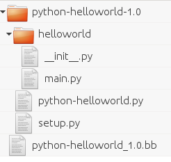

Cấu trúc thư mục

Đây là code cho cùng cấu trúc thư mục đó:

```
$ mkdir -p meta-custom/recipes-python/python-helloworld/python-
   helloworld-1.0/helloworld/
$ touch meta-custom/recipes-python/python-helloworld/python-
   helloworld-1.0/helloworld/__init__.py
```

Bạn cũng sẽ cần tạo file setup Python `meta-custom/recipes-python/python-helloworld/python-helloworld-1.0/setup.py` sau:

```
import sys
from setuptools import setup

setup(
    name = "helloworld",
    version = "0.1",
    packages=["helloworld"],
    author="Alex Gonzalez",
    author_email = "alex@example.com",
    description = "Hello World packaging example",
    license = "MIT",
    keywords= "example",
    url = "",
)
```

Bạn cũng sẽ cần file python `meta-custom/recipes-python/python-helloworld/python-helloworld-1.0/helloworld/main.py`:

```
import sys

def main(argv=None):
    if argv is None:
        argv = sys.argv
    print "Hello world!"
    return 0
```

Và cuối cùng là một test script `meta-custom/recipes-python/python-helloworld/python-helloworld-1.0/python-helloworld.py` dùng module:

```
#!/usr/bin/env python
import sys
import helloworld.main

if __name__ == '__main__':
       sys.exit(helloworld.main.main())
```

Sau đó chúng ta có thể thêm nó vào image với dòng bổ sung sau vào `conf/local.conf` hoặc file image:

```
IMAGE_INSTALL_append = " python-helloworld"
```

Sau đó, chúng ta có thể build nó với lệnh sau:

```
$ cd /opt/yocto/fsl-community-bsp/
$ source setup-environment wandboard
$ bitbake core-image-minimal
```

Sau khi nạp và boot, chúng ta có thể test module bằng cách chạy script ví dụ:

```
# /usr/bin/python-helloworld.py
Hello world!
```

### Còn nữa...

Trong `meta-python`, bạn cũng có thể tìm thấy recipe `python-pip` (`python3-pip` cho Python 3), recipe này sẽ thêm tiện ích `pip` vào target image. Có thể dùng nó để cài package từ Python Package Index (PyPI). Bạn có thể thêm nó vào image với dòng sau:

```
IMAGE_INSTALL_append  = " python3-pip"
```

Bạn sẽ cần thêm layer `meta-openembedded/meta-python` vào file `conf/bblayers.conf` để build image. Sau đó, bạn có thể build image `core-image-minimal` với lệnh sau:

```
$ cd /opt/yocto/fsl-community-bsp/
$ source setup-environment wandboard
$ bitbake core-image-minimal
```

Khi đã cài, bạn có thể dùng nó từ target, như sau:

```
# pip search <package_name>
# pip install <package_name>
```

## Tích hợp Open Java Development Kit

Cho tới Java SE phiên bản 8, Oracle cung cấp một phiên bản Java SE embedded commercially-licensed và royalties-based. Tuy nhiên, Java SE Embedded 8 là bản phát hành Java SE embedded cuối cùng mà Oracle sẽ cung cấp.

Giải pháp open source thay thế cho Oracle Java SE embedded là Open Java Development Kit (OpenJDK), một bản hiện thực open source của Java SE được cấp phép theo GPLv2, với ngoại lệ classpath, nghĩa là các ứng dụng được phép link mà không bị ràng buộc bởi license GPL. Recipe này sẽ cho thấy cách build OpenJDK bằng Yocto và tích hợp Java Runtime Environment (JRE) vào target image.

### Chuẩn bị

Các thành phần chính của OpenJDK là:

- HotSpot Java Virtual Machine (JVM)

- Java Class Library (JCL)

- Java compiler, javac

Ban đầu, OpenJDK cần được build bằng một JDK độc quyền. Tuy nhiên, dự án IcedTea cho phép chúng ta build OpenJDK bằng GNU classpath, GNU Compiler for Java (GCJ), và bootstrap một JDK để build OpenJDK. Nó cũng bổ sung cho OpenJDK một số thành phần còn thiếu có trên Java SE như plugin trình duyệt web và các bản hiện thực web start.

Yocto có thể build OpenJDK bằng layer `meta-java`, layer này có các recipe để cross-compiling OpenJDK bằng IcedTea. Có thể theo dõi và đóng góp vào các thảo luận phát triển bằng cách truy cập mailing list phát triển tại `http://lists.openembedded.org/mailman/listinfo/openembedded-devel`.

Layer `meta-java` cũng có recipe cho rất nhiều thư viện Java và VM, cũng như các công cụ phát triển ứng dụng như ant và fastjar.

### Cách thực hiện...

Để build OpenJDK 8, bạn cần clone layer `meta-java`, như sau:

```
$ cd /opt/yocto/fsl-community-bsp/sources/
$ git clone git://git.yoctoproject.org/meta-java
```

Tại thời điểm viết sách, chưa có branch Rocko, nên chúng ta sẽ làm việc trực tiếp từ branch master. Thêm layer vào file `conf/bblayers.conf`:

```
$ bitbake-layers add-layer /opt/yocto/fsl-community-bsp/sources/meta-java
```

Sau đó, cấu hình project bằng cách thêm dòng sau vào file `conf/local.conf`:

```
PREFERRED_PROVIDER_virtual/java-initial-native = "cacao-initial-native"
PREFERRED_PROVIDER_virtual/java-native = "jamvm-native"
PREFERRED_PROVIDER_virtual/javac-native = "ecj-bootstrap-native"
```

Sau đó bạn có thể thêm package OpenJDK vào image với dòng sau:

```
IMAGE_INSTALL_append = " openjre-8"
```

Cuối cùng, bạn có thể build image mình chọn:

```
$ cd /opt/yocto/fsl-community-bsp/
$ source setup-environment wandboard
$ bitbake core-image-minimal
```

> Nếu bạn đã cài các dependency được liệt kê trong Setting up the host system ở `Chapter 1`, The Build System, bạn hẳn đã sẵn sàng. Nếu không, bạn có thể cần cài package `libx11-dev` lên host để bản build thành công.

Khi chạy target image, bạn sẽ có phiên bản Java sau:

```
# java -version
openjdk version "1.8.0_102-internal"
OpenJDK Runtime Environment (build 1.8.0_102-internal-b14)
OpenJDK Zero VM (build 25.102-b14, interpreted mode)
```

### Cách hoạt động...

Để test JVM, chúng ta có thể byte-compile một Java class trên host và sao chép nó sang target để thực thi. Ví dụ, chúng ta có thể dùng ví dụ `HelloWorld.java` đơn giản sau:

```
class HelloWorld {
  public static void main(String[] args) {
    System.out.println("Hello World!");
  }
}
```

Để byte-compile nó trên host, chúng ta cần cài một Java SDK. Để cài Java SDK trên Ubuntu, chỉ cần chạy lệnh sau:

```
$ sudo apt-get install openjdk-8-jdk
```

Để byte-compile ví dụ, chúng ta chạy lệnh sau:

```
$ javac HelloWorld.java
```

Để chạy nó, chúng ta sao chép `HelloWorld.class` sang target và từ cùng thư mục đó chạy lệnh sau:

```
# java HelloWorld
```

### Còn nữa...

Khi dùng OpenJDK trên một hệ thống production, khuyến nghị luôn dùng bản phát hành mới nhất hiện có, chứa các bản sửa bug và bảo mật. Tại thời điểm viết sách, bản phát hành OpenJDK 8 mới nhất là update 112, nên các recipe `meta-java` cần được cập nhật.

### Xem thêm

- Thông tin Up-to-date về OpenJDK có tại `http://openjdk.java.net/`

## Tích hợp ứng dụng Java

Layer `meta-java` cũng cung cấp các helper class để dễ dàng tích hợp các thư viện và ứng dụng Java vào Yocto. Trong recipe này, chúng ta sẽ xem một ví dụ build một thư viện Java bằng các class được cung cấp.

### Chuẩn bị

Layer `meta-java` cung cấp hai class chính giúp tích hợp các ứng dụng và thư viện Java:

- Java bbclass: Class này cung cấp các thư mục target mặc định và một số hàm phụ trợ, cụ thể là:

  - `oe_jarinstall`: Cài và tạo symlink cho một file JAR

  - `oe_makeclasspath`: Sinh một chuỗi classpath từ tên các file JAR

  - `oe_java_simple_wrapper`: Bọc ứng dụng Java của bạn trong một shell script

- Java-library bbclass: Class này kế thừa `bbclass` Java và mở rộng nó để tạo và cài các file JAR

### Cách thực hiện...

Chúng ta sẽ dùng ví dụ Swing hello world đồ họa `meta-custom/recipes-java/java-helloworld/java-helloworld-1.0/HelloWorldSwing.java` sau:

```
import javax.swing.JFrame;
import javax.swing.JLabel;

public class HelloWorldSwing {
    private static void createAndShowGUI() {
        JFrame frame = new JFrame("Hello World!");
        frame.setDefaultCloseOperation(JFrame.EXIT_ON_CLOSE);

        JLabel label = new JLabel("Hello World!");
        frame.getContentPane().add(label);

        frame.pack();
        frame.setVisible(true);
    }

    public static void main(String[] args) {
        javax.swing.SwingUtilities.invokeLater(new Runnable() {
            public void run() {
                createAndShowGUI();
            }
        });
    }
}
```

Để tích hợp ứng dụng `HelloWorldSwing` này, chúng ta có thể dùng một Yocto recipe `meta-custom/recipes-java/java-helloworld/java-helloworld_1.0.bb`, như sau:

```
DESCRIPTION = "Simple Java Swing hello world application"
SECTION = "examples"
LICENSE = "MIT"
LIC_FILES_CHKSUM =
"file://${COMMON_LICENSE_DIR}/MIT;md5=0835ade698e0bcf8506ecda2f7b4
   f302"

RDEPENDS_${PN} = "java2-runtime"

SRC_URI = "file://HelloWorldSwing.java"

S = "${WORKDIR}"

inherit java-library

do_compile() {
        mkdir -p build
        javac -d build `find . -name "*.java"`
        fastjar cf ${JARFILENAME} -C build .
}

BBCLASSEXTEND = "native"
```

Recipe này cũng build được cho native architecture của host. Chúng ta có thể làm điều này bằng cách cung cấp một recipe `java-helloworld-native` riêng kế thừa class `native`, hoặc bằng biến `BBCLASSEXTEND` như đã làm trước đó. Trong cả hai trường hợp, khi đó chúng ta có thể dùng các override `_class-native` và `_class-target` để phân biệt chức năng native và target. Dù Java được byte-compiled và class đã biên dịch sẽ giống nhau cho cả hai, việc thêm hỗ trợ native một cách tường minh vẫn hợp lý.

### Cách hoạt động...

Class `java-library` sẽ tạo một library package với tên `lib<package>-java`. Để thêm nó vào target image, chúng ta sẽ dùng dòng sau:

```
IMAGE_INSTALL_append = " libjava-helloworld-java"
```

Recipe trên thêm `java2-runtime` như một runtime dependency. Để chọn provider nào trong số các provider có sẵn, như OpenJRE 7 hoặc 8, sẽ được dùng, chúng ta thêm dòng sau vào cấu hình distro hoặc `conf/local.conf`:

```
PREFERRED_PROVIDER_java2-runtime = "openjre-8"
```

Tuy nhiên, `RPROVIDES` trong library recipe sẽ không cài OpenJRE vào filesystem; vì vậy, chúng ta cần tự thêm nó vào image recipe hoặc file `conf/local.conf` với dòng sau:

```
IMAGE_INSTALL_append = " openjre-8"
```

Các JRE có sẵn hiện chưa chạy trên framebuffer hay Wayland, nên chúng ta sẽ dùng một image đồ họa X11-based như `core-image-sato`:

```
$ cd /opt/yocto/fsl-community-bsp/
$ source setup-environment wandboard-quad
$ bitbake core-image-sato
```

Sau đó chúng ta có thể boot nó, đăng nhập vào target, và thực thi ví dụ với OpenJDK bằng cách chạy:

```
# export DISPLAY=:0
# java -cp /usr/share/java/java-helloworld.jar HelloWorldSwing
```

### Còn nữa...

Hỗ trợ JavaFX cho OpenJDK, OpenJFX, được cho là hoạt động trên các platform i.MX6, kể cả tăng tốc đồ họa, nhưng hiện chưa có layer nào để build nó. Có các bản build OpenJFX Pre-built cho các platform ARMv6, nhưng tác giả chưa kiểm chứng rằng chúng hoạt động.

### Xem thêm

- Thêm thông tin về việc chạy OpenJFX trên các platform i.MX6 có trên OpenJDK wiki `https://wiki.openjdk.java.net/display/OpenJFX/OpenJFX+on+Freescale+i.MX6`

## Tích hợp ứng dụng Node.js

Node.js là một môi trường runtime JavaScript open source MIT-licensed. Được build trên JavaScript Runtime của Chrome (v8), nó là một framework event-driven, non-blocking và nhẹ, ban đầu chủ yếu được dùng để tạo nội dung web động nhưng hiện được dùng trong rất nhiều loại ứng dụng, từ scripting tới giao diện người dùng HTML5. Recipe này sẽ cho thấy cách thêm ứng dụng Node.js vào target image.

### Chuẩn bị

Node.js có package manager riêng, Node Packaged Modules (npm), cho phép bạn cài các module bên thứ ba cùng dependency của chúng. Module được cài local, bên trong một thư mục, hoặc toàn cục, tức là ở một vị trí thường có trong path để có thể truy cập từ mọi nơi.

Hầu hết ứng dụng Node.js dùng module rất nhiều. Một module về cơ bản là code ứng dụng được mô tả bởi một file `package.json`. Code và các file `packages.json` có thể nằm trong một thư mục, một Git repository, một tarball nén, hoặc một URI tới một tarball nén.

Một package hay module có thể được công bố lên registry `npm`. Khi đã công bố, nó có thể được tham chiếu bằng một chuỗi `<name>@<version>`, trong đó `<version>` cũng có thể là một tag, hoặc mặc định là tag latest nếu bỏ qua. Một module có thể được cài bằng lệnh sau:

```
$ npm install [-g] <module reference>
```

Trong trường hợp này, `<module reference>` là một trong các dạng sau:

- Một thư mục chứa file `packages.json` và chính code

- Một tarball nén của thứ ở trên, hoặc một URI tới nó

- Một Git repository chứa file `packages.json` và chính code

- Một chuỗi `<name>@<version>` biểu diễn một module đã được công bố trên registry `npm`

Trong command trên, `-g` tùy chọn chỉ định cài đặt toàn cục.

Để tạo một package, ví dụ, chúng ta có thể dùng code `helloworld.js` sau:

```
var http = require('http');
http.createServer(function (request, response) {
    response.writeHead(200, {'Content-Type': 'text/plain'});
    response.end('Hello World\n');
}).listen(8080);
console.log('Server started');
```

Bạn cũng sẽ cần dùng file mô tả `packages.json` tương ứng của nó:

```
{
  "name": "nodejs-helloworld",
  "version": "1.0.0",
  "description": "An example node.js hello world server",
  "main": "helloworld.js",
  "author": "Alex Gonzalez <alex@lindusembedded.com>",
  "license": "ISC"
}
```

Việc tạo file `packages.json` có thể được tự động hóa bằng công cụ `npm` bằng cách chạy lệnh sau từ cùng thư mục:

```
$ npm init
```

Để thử module, chúng ta có thể cài nó toàn cục với lệnh sau:

```
$ npm install -g .
```

Dấu `.` trong command trên chỉ định thư mục hiện tại. Nó có thể được thực thi với lệnh sau:

```
$ nodejs helloworld.js
```

Trỏ trình duyệt tới `localhost:8080` sẽ hiển thị message `Hello World`.

Khi nó đã chạy được, chúng ta có thể công bố nó lên registry `npm` với lệnh sau:

```
$ npm adduser
$ npm publish
```

Giả sử tên package của bạn là duy nhất, bạn sẽ có thể thấy package tại `https://npmjs.com/package/<package>`. Nó cũng có thể được công bố lên GitHub, để có thể được cài trực tiếp.

### Cách thực hiện...

Package Node.js có trong layer `meta-openembedded`. Để thêm nó vào image, chúng ta chỉ cần sửa image recipe hoặc `conf/local.conf` với dòng sau:

```
IMAGE_INSTALL_append = " nodejs"
```

Sau khi build image mình chọn, ví dụ `core-image-minimal`, chúng ta có thể kiểm tra Node.js đã được cài đúng chưa bằng command sau:

```
# node --version
v8.4.0
```

Chúng ta cũng có thể mở prompt JavaScript tương tác Read Eval Print Loop (REPL) của Node.js bằng command sau:

```
# node
```

Để thoát, nhấn Ctrl + D.

Để cài `npm` vào target image, thêm dòng sau vào file image hoặc file `conf/local.conf`:

```
IMAGE_INSTALL_append = " nodejs-npm"
```

Sau khi build và nạp image, giờ chúng ta có thể tìm package với lệnh sau:

```
# npm search <package>
```

Chúng ta có thể cài chúng local bằng command sau:

```
# npm install <package>
```

Ngoài ra, chúng ta có thể cài chúng toàn cục bằng command sau:

```
# npm install -g <package>
```

### Cách hoạt động...

Code ở trên sẽ cài package Node.js vào image. Tuy nhiên, phần lớn thời gian chúng ta chỉ cần thêm ứng dụng Node.js của mình và thêm Node.js làm dependency.

Chúng ta có thể thêm các script Node.js đơn giản, như đã giải thích trong Adding data, scripts or configuration files ở `Chapter 3`, The Software Layer, bằng một recipe chỉ cài các script JavaScript vào root filesystem.

Tuy nhiên, các ứng dụng Node.js thường được build trên các module, mỗi module có license riêng. Chúng ta có thể tạo một Yocto recipe dùng công cụ npm để cài dependency, nhưng khi đó cũng cần theo dõi thủ công mọi license khác nhau của chúng.

Tiện ích command-line `devtool` có thể tự động làm việc này cho chúng ta, cài từ registry `npm` hoặc từ một Git repository. Ví dụ, để cài package `nodejs-helloworld` chúng ta có thể làm như sau:

```
$ devtool add "npm://registry.npmjs.org;name=nodejs-
helloworld;version=1.0.1"
```

Ở đây, cả `name` lẫn `version` đều bắt buộc. Công cụ command-line `devtool` tạo một skeleton recipe cho chúng ta trông như sau:

```
SUMMARY = "An example node.js hello world server"
LICENSE = "MIT"
LIC_FILES_CHKSUM = "file://LICENSE;md5=2459e4101d5fabab9d291bde6cdc5a56"

SRC_URI = "npm://registry.npmjs.org;name=nodejs-helloworld;version=${PV}"

NPM_SHRINKWRAP := "${THISDIR}/${PN}/npm-shrinkwrap.json"
NPM_LOCKDOWN := "${THISDIR}/${PN}/lockdown.json"

inherit npm

# Must be set after inherit npm since that itself sets S
S = "${WORKDIR}/npmpkg"
LICENSE_${PN} = "MIT"
```

Như có thể thấy trong code trên, các file JSON `shrinkwrap` và `lockdown` được sinh ra để các phiên bản được cố định nhằm bảo đảm tính toàn vẹn của bản build.

Ngoài ra, nó có thể được sinh từ Git repository:

```
$ devtool add
https://github.com/yoctocookbook2ndedition/nodejs-helloworld.git
```

Trong trường hợp này, công cụ command-line devtool tạo một skeleton recipe cho chúng ta trông như sau:

```
SUMMARY = "An example node.js hello world server"
LICENSE = "MIT"
LIC_FILES_CHKSUM = "file://LICENSE;md5=2459e4101d5fabab9d291bde6cdc5a56"
SRC_URI = "git://github.com/yoctocookbook2ndedition/nodejs-
helloworld.git;protocol=https"

PV = "1.0.1+git${SRCPV}"
SRCREV = "41c359a25365880ef880c10c2d405314439d6666"

NPM_SHRINKWRAP := "${THISDIR}/${PN}/npm-shrinkwrap.json"
NPM_LOCKDOWN := "${THISDIR}/${PN}/lockdown.json"

inherit npm

# Must be set after inherit npm since that itself sets S
S = "${WORKDIR}/git"
LICENSE_${PN} = "MIT"
```

Nó cũng sẽ liệt kê mọi license dependency, nếu có, và thêm mọi module dependency như các package khác nhau dưới cùng một recipe.

Giờ chúng ta có thể theo workflow devtool thông thường như đã giải thích ở mục Using the extensible SDK, để build, test và tích hợp chúng vào image cuối cùng.

Sau đó package có thể được thêm vào target image bằng cách thêm dòng sau vào recipe của nó hoặc `conf/local.conf:`

```
IMAGE_INSTALL_append = " nodejs-helloworld"
```

> Lưu ý rằng branch Yocto 2.4 Rocko của `meta-openembedded` đã được cập nhật lên Node.js 8.4.0. Tiếc là phiên bản mới hơn này không hoạt động tốt với class `npm` và tiện ích command-line `devtool` trong Poky. Phiên bản Node.js 4.8.3 trước đó từ `meta-openembedded` đã hoạt động đúng. Tuy nhiên, ngay cả khi dùng 4.8.3, vẫn có những vấn đề còn mở như sau: `https://bugzilla.yoctoproject.org/show_bug.cgi?id=11728` Cho tới khi lỗi này được sửa trong branch Yocto 2.4 Rocko, thao tác revert sau trong Poky sẽ để lại một revision hoạt động được:
>
> ```
> git revert ebe531b38bea54bd29ed7b3d2ea6c533b9331953
> ```

### Còn nữa...

Cũng có một layer `meta-nodejs` với các phiên bản Node.js thay thế, ví dụ phiên bản Long Term Support (LTS) và các phiên bản bảo trì. Nếu muốn dùng nó, trước tiên chúng ta cần clone nó vào bản cài Yocto:

```
$ cd /opt/yocto/fsl-community-bsp/sources
$ git clone https://github.com/imyller/meta-nodejs.git
```

Sau đó, thêm nó vào `conf/bblayers.conf` bằng cách:

```
$ bitbake-layers add-layer /opt/yocto/fsl-community-bsp/sources/meta-nodejs
```

Việc cross-compilation một số phiên bản Node.js sẽ cần cài `multilibs` nếu build trên host x86_64. Trên Ubuntu 16.04, bạn có thể thêm chúng bằng cách:

```
$ sudo dpkg --add-architecture i386
$ sudo apt-get update
$ sudo apt-get install g++-multilib libssl-dev:i386 libcrypto++-dev:i386
zlib1g-dev:i386
```

Để thêm nó vào image đã chọn, chúng ta thêm dòng sau vào image recipe hoặc `conf/local.conf`:

```
IMAGE_INSTALL_append = " nodejs"
```

Tại thời điểm viết sách, 6.10.3 là phiên bản LTS và, để chọn nó, chúng ta thêm dòng sau vào file cấu hình `distro.conf` hoặc `conf/local.conf`:

```
PREFERRED_VERSION_nodejs = "6.10.3"
```

Sau khi build image mình chọn, ví dụ `core-image-minimal`, chúng ta có thể kiểm tra Node.js đã được cài với cú pháp sau:

```
# node --version
v6.10.3
```

> Lưu ý rằng phiên bản v6.10.3 cần được patch để build được với Yocto 2.4. bbappend chứa patch có trong layer `meta-custom` của source đi kèm cuốn sách.

### Xem thêm

- Recipe cho các package community-contributed có trong layer đi kèm `meta-nodejs-contrib` tại `https://github.com/imyller/meta-nodejs-contrib`

- Thêm thông tin về Node.js có trên trang web của dự án: `https://nodejs.org/en/`

- Package manager NPM và software registry có thể truy cập tại URL sau: `https://www.npmjs.com/`

## Chạy các application container Docker

Ở `Chapter 1`, The Build System, chúng ta đã thấy Docker CE (community edition) có thể được dùng để chạy một môi trường phát triển Yocto embedded như thế nào, và cả cách chạy một instance Docker của Toaster. Việc dùng nó có thể được mở rộng sang tái tạo môi trường test và môi trường chroot.

Tuy nhiên, kiểu cô lập container nhẹ này không chỉ hữu ích trên host mà còn có thể được tận dụng trên target embedded. Hiệu năng của một container hầu như tương đương với một ứng dụng native, và chúng cũng nhẹ, khởi động và dừng nhanh.

Docker được cấp phép Apache 2.0-licensed và cung cấp các ứng dụng self-contained có thể di chuyển giữa các máy khác nhau, nên, dù hiện chưa phổ biến, tôi kỳ vọng sẽ thấy Docker được dùng rộng rãi hơn trong embedded system vì nó giúp việc triển khai và cập nhật ứng dụng embedded dễ hơn, bằng cách tách software hệ thống lõi khỏi tầng ứng dụng chạy trên Docker. Hãy tưởng tượng việc có thể triển khai và quản lý software trên cả một loạt thiết bị embedded theo cách tương tự như bạn đang làm với ứng dụng cloud.

Container cũng mang lại thêm bảo mật khi biết rằng ứng dụng của bạn được cô lập khỏi hệ điều hành và ngay cả khi bị xâm nhập thì mối nguy cũng bị giới hạn. Ví dụ, bạn có thể cô lập một database trong một container và một ứng dụng mạng trong container khác, cho chúng giao tiếp với nhau trong khi vẫn được tách biệt an toàn, hoặc thậm chí cho chúng chạy trên các thiết bị khác nhau.

Recipe này sẽ giải thích cách cài và chạy Docker trên target.

### Chuẩn bị

Để Docker chạy đúng, nó cần một Linux kernel mới được cấu hình với hỗ trợ cụ thể. Kernel v4.1 trên Wandboard có thể chạy Docker. Tuy nhiên, cấu hình mặc định cần được cấu hình cho Docker, ví dụ bật hỗ trợ `OverlayFS`, cùng các mục khác.

Script hữu ích sau có thể dùng để kiểm tra xem một kernel đang chạy đã được cấu hình đúng để chạy Docker chưa: `https://raw.githubusercontent.com/moby/moby/master/contrib/check-config.sh`.

Dùng nó trên kernel Wandboard chuẩn, chúng ta thấy rằng các mục sau cần được thêm cho một cấu hình Docker tối thiểu:

```
CONFIG_POSIX_MQUEUE=y
CONFIG_CGROUP_FREEZER=y
CONFIG_CGROUP_DEVICE=y
CONFIG_CPUSETS=y
CONFIG_CGROUP_CPUACCT=y
CONFIG_MEMCG=y
CONFIG_CGROUP_SCHED=y
CONFIG_NAMESPACES=y
CONFIG_BRIDGE_NETFILTER=y
CONFIG_NETFILTER_XT_MATCH_ADDRTYPE=y
CONFIG_NETFILTER_XT_MATCH_IPVS=m
CONFIG_BRIDGE=y
CONFIG_VETH=y
CONFIG_DEVPTS_MULTIPLE_INSTANCES=y
CONFIG_OVERLAY_FS=y
```

Có rất nhiều tính năng tùy chọn đã bị bỏ ra. Xem source code đi kèm cuốn sách để có ví dụ cấu hình tối thiểu hoạt động được này.

### Cách thực hiện...

1. Ứng dụng Docker được cung cấp bởi layer `meta-virtualization`, nên trước tiên chúng ta cần clone nó vào bản cài FSL community BSP với code sau:

   ```
   $ cd /opt/yocto/fsl-community-bsp/sources/
   $ git clone git://git.yoctoproject.org/meta-virtualization
   ```

2. Sau đó, chúng ta cần thêm nó vào file `conf/bblayers.conf` với dòng sau:

   ```
   $ bitbake-layers add-layer /opt/yocto/fsl-community-
   bsp/sources/meta-virtualization
   ```

3. Sau đó chúng ta có thể checkout branch 2.4 với lệnh sau:

   ```
   $ git checkout -b rocko origin/rocko
   ```

4. Tương tự, chúng ta cần thêm các layer `meta-networking`, `meta-filesystems` và `meta-python` từ `meta-openembedded` làm dependency, cũng trên branch Rocko.

5. Bước tiếp theo là cấu hình file cấu hình `distro.conf` hoặc `conf/local.conf`, như sau:

   ```
   DISTRO_FEATURES_append = " virtualization"
   ```

6. Sau đó chúng ta có thể thêm không gian trống cho image để tải container:

   ```
   IMAGE_ROOTFS_EXTRA_SPACE = "10000"
   ```

7. Cuối cùng, thêm Docker vào image bằng cách thêm dòng sau vào image recipe hoặc các file `conf/local.conf`:

   ```
   IMAGE_INSTALL_append = " docker"
   ```

8. Sau đó chúng ta có thể build image mình chọn, ví dụ:

   ```
   $ bitbake core-image-minimal
   ```

9. Khi build xong và các image đã được nạp, chúng ta có thể test Docker bằng cách chạy một container `hello-world`, như sau:

   ```
   $ docker run hello-world
   ```

10. Ngoài ra, chúng ta cũng có thể khởi chạy một container Busybox và chạy ash shell với command sau:

    ```
    $ docker run -it --rm busybox sh
    ```

### Cách hoạt động...

Ảo hóa process nhẹ, hay container, dùng hỗ trợ cgroups và namespace của Linux kernel. Một namespace trừu tượng hóa một tài nguyên hệ thống toàn cục sao cho một process trong namespace đó dường như có instance riêng, được cô lập, của tài nguyên đó. Namespace bao gồm filesystem, process, mạng và user ID, cùng những thứ khác. Nói đơn giản, cgroups cho phép chúng ta phân bổ tài nguyên giữa các nhóm process do người dùng định nghĩa.

Container có thể phối hợp qua network socket và có thể mount các data volume trên host system. Việc dùng Docker volume để ghi dữ liệu từ container sang host là phổ biến, nhờ đó chỉ cần ghi ít dữ liệu vào chính container. Tuy nhiên, giữ dữ liệu bên trong container cũng khả thi bằng các Docker storage driver. Trong số các storage driver có cho Docker, overlay2, dùng hỗ trợ `OverlayFS` của kernel, là storage mặc định vì nó cho hiệu năng và độ ổn định tốt nhất.

Docker cũng cung cấp các tính năng sau:

- Tính khả chuyển của ứng dụng

- Build tự động bằng Dockerfile

- Quản lý phiên bản Git-style

- Container dùng lại được và một registry công khai (`https://hub.docker.com/`) cho container của bên thứ ba

Hãy xem một số command Docker thông dụng. Để truy vấn Docker daemon, dùng lệnh sau:

```
$ docker info
```

Để chạy một container mới, làm như sau:

```
$ docker run [-d] [--rm] [-i] [-t] <image> <command> <arguments>
```

Trong ví dụ trên:

- `image` là tên container image cần chạy

- `command` là command được truyền cho container

- `arguments` là các đối số của command

Các tùy chọn nêu trên có ý nghĩa như sau:

- `-d` tách khỏi container và để nó chạy nền

Khi chạy ở foreground,

- `-i` giữ `stdin` mở ngay cả khi không được attach

- `-t` cấp một `pseudo-tty`

  Cả hai (`-it`) đều cần khi chạy một process tương tác như một shell.

- `--rm` dọn dẹp container và xóa file system khi thoát. Nếu không, chúng được giữ lại

Để liệt kê các Docker container, dùng command sau:

```
$ docker ps -a
```

Để attach vào một container đang chạy, dùng command sau:

```
$ docker attach <container_name>
```

Để dừng và xóa container, dùng các command sau:

```
$ docker stop <container_id>
$ docker rm <container_id>
```

Cả `container_name` lẫn `container_id` đều có thể lấy từ command `docker ps` ở trên.

### Xem thêm

- Tài liệu Docker có tại `https://docs.docker.com/engine/reference/commandline/docker/`
