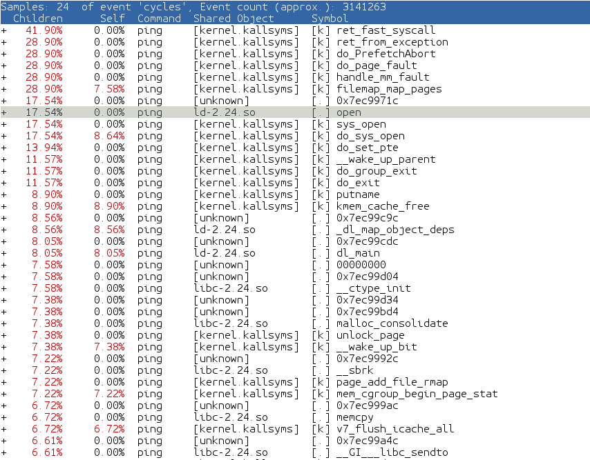
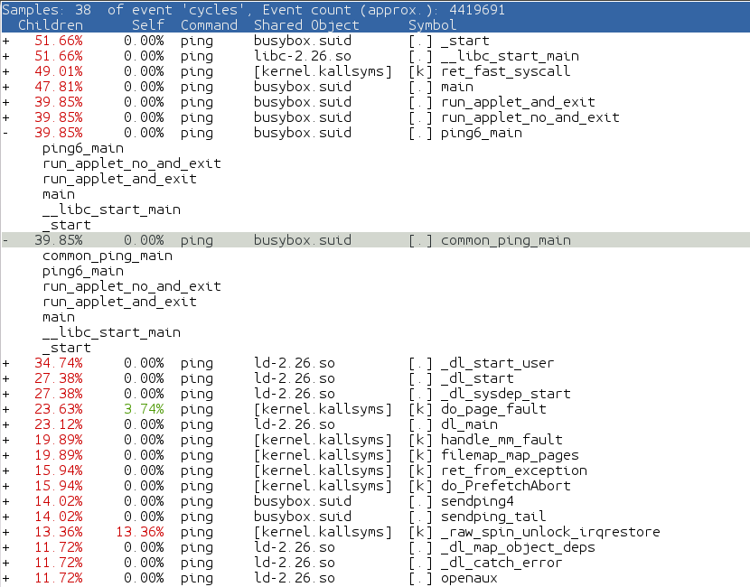
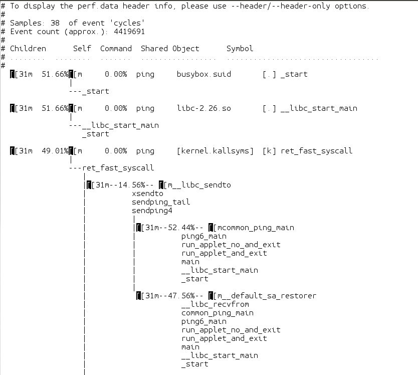
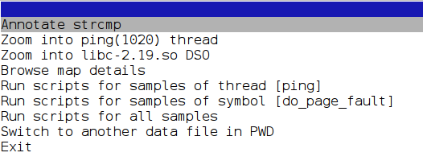
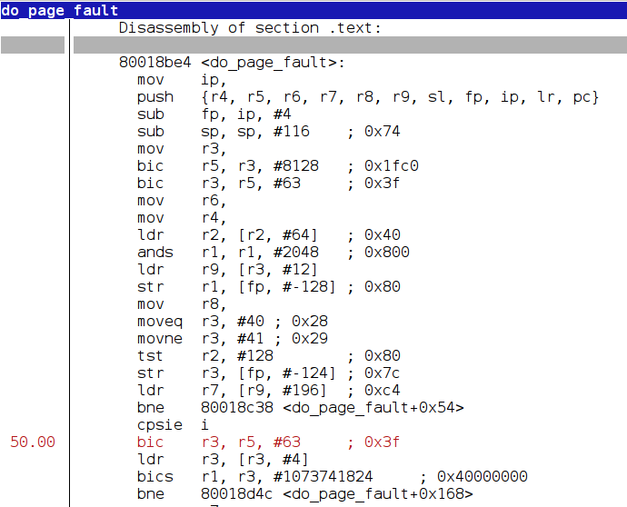
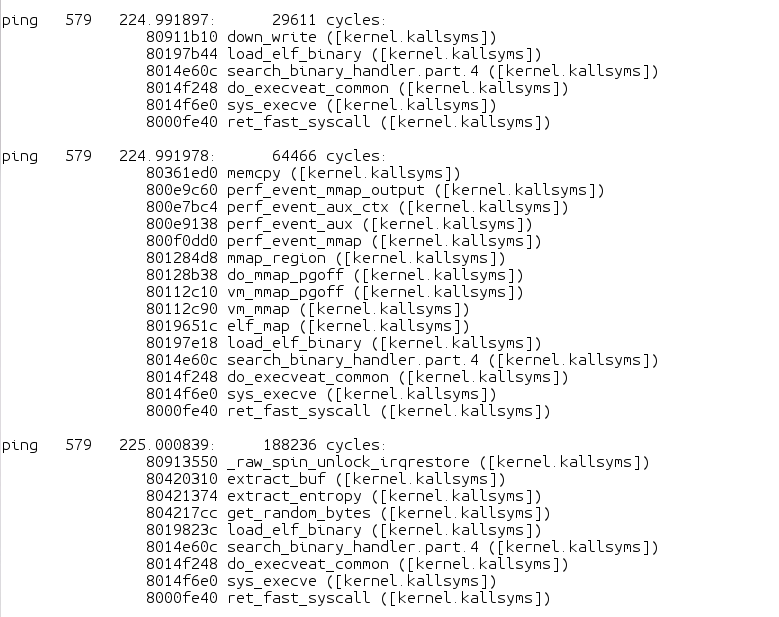
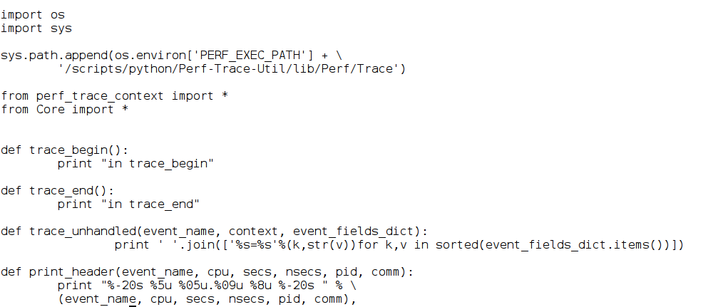
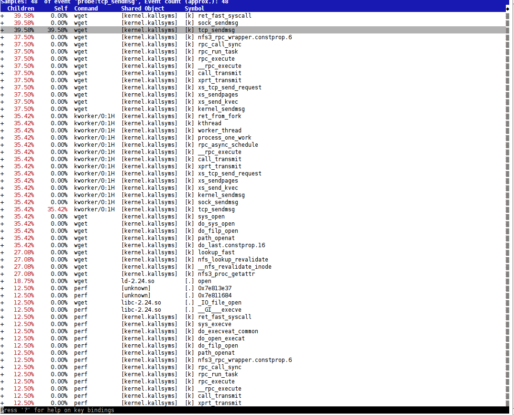

# 5 Debug, tracing và profiling (Debugging, Tracing, and Profiling)

Trong chương này, chúng ta sẽ đề cập các recipe sau:

- Phân tích core dump

- Debug GDB native

- Debug GDB cross

- Dùng strace để debug ứng dụng

- Dùng các performance counter của kernel

- Dùng static kernel tracing

- Dùng dynamic kernel tracing

- Dùng dynamic kernel event

- Khám phá các công cụ tracing và profiling của Yocto

- Tracing và profiling với perf

- Dùng SystemTap

- Dùng LTTng

- Dùng blktrace

## Giới thiệu

Debug một sản phẩm embedded Linux là việc thường gặp không chỉ trong quá trình phát triển, mà cả trên các hệ thống production đã triển khai.

Debug ứng dụng trong embedded Linux khác với debug trong một thiết bị embedded truyền thống ở chỗ chúng ta không có một mô hình memory phẳng với hệ điều hành và ứng dụng dùng chung một address space. Thay vào đó, chúng ta có một mô hình virtual memory, trong đó hệ điều hành Linux dùng chung address space và gán các vùng virtual memory cho các process đang chạy.

Với mô hình này, các cơ chế dùng để debug kernel và user space khác nhau. Ví dụ, mô hình truyền thống dùng một hardware debugger JTAG-based hữu ích để debug kernel, nhưng trừ khi nó biết về memory mapping của process user space, nó sẽ không thể debug các ứng dụng user space.

Debug ứng dụng được tiếp cận bằng cách dùng một dịch vụ debugger ở user space. Chúng ta đã thấy một ví dụ về phương pháp này khi dùng TCF agent trong Eclipse GDB. Agent thường dùng khác là gdbserver, mà chúng ta sẽ dùng trong chương này.

Cuối cùng, chúng ta sẽ khám phá lĩnh vực tracing và profiling. Tracing là việc ghi log low-level các sự kiện hệ thống xảy ra thường xuyên, còn việc phân tích thống kê các trace đã ghi được gọi là profiling.

Chúng ta sẽ dùng một số công cụ mà embedded Linux và Yocto cung cấp để trace và profile hệ thống, để chúng chạy hết tiềm năng tối đa.

## Phân tích core dump

Ngay cả sau khi đã test bảo đảm chất lượng rộng rãi, các embedded system in-field vẫn có lỗi và cần được debug. Hơn nữa, thường thì lỗi không phải thứ có thể dễ dàng tái hiện trong môi trường phòng thí nghiệm, nên chúng ta phải debug trên các hệ thống production, thường đã được hardening.

Giả sử chúng ta đã thiết kế hệ thống với tình huống nói trên trong đầu, lựa chọn debug đầu tiên của chúng ta thường là lấy càng nhiều thông tin về hệ thống bị lỗi càng tốt, ví dụ bằng cách lấy và phân tích core dump của các process hoạt động sai.

### Chuẩn bị

Trong quá trình debug các hệ thống embedded Linux, chúng ta có thể dùng cùng bộ công cụ như các hệ thống Linux chuẩn. Một trong các công cụ này cho phép ứng dụng sinh ra một memory core dump khi crash. Điều này giả định rằng chúng ta có đủ dung lượng đĩa để lưu toàn bộ memory map của ứng dụng, và việc ghi xuống đĩa đủ nhanh để không kéo hệ thống tới chỗ đứng hình.

Khi memory core dump đã được sinh ra, chúng ta dùng GDB của host để phân tích core dump. GDB cần có sẵn debug information. Để cài debug information, chúng ta dùng feature `dbg-pkgs`. Theo mặc định, feature này cài debug information của một package vào một thư mục `.debug` ở cùng vị trí với chính executable. Để thêm debug information cho mọi package trong một target image, chúng ta thêm dòng sau vào file cấu hình `conf/local.conf`:

```
EXTRA_IMAGE_FEATURES += "dbg-pkgs"
```

Debug package cũng có thể chỉ được thêm cho những package mà chúng ta quan tâm bằng cách thêm phiên bản debug của package vào image với:

```
IMAGE_INSTALL_append = " <packagename>-dbg"
```

Sau đó chúng ta có thể build một toolchain phù hợp được sinh ra để khớp với filesystem, như đã thấy trong recipe Preparing and using an SDK ở `Chapter 4`, Application Development. Core dump chứa các build ID của các executable và library đang dùng tại thời điểm crash, nên điều quan trọng là toolchain và target image phải khớp nhau.

### Cách thực hiện...

Chúng ta có thể hiển thị các giới hạn của tài nguyên system-wide bằng công cụ `ulimit`, một command built-in của các shell như Bash và ash của BusyBox. Chúng ta quan tâm tới kích thước core file, theo mặc định được đặt bằng không (zero) để tránh tạo core dump của ứng dụng. Trên hệ thống bị lỗi, tốt nhất là trong môi trường test, hãy làm cho ứng dụng dump một memory core khi crash bằng:

```
$ ulimit -c unlimited
```

> Root filesystem của Wandboard sẽ dùng `ulimit` của ash BusyBox theo mặc định. Output của nó sẽ khác với các shell khác như Bash.

Sau đó bạn có thể kiểm tra thay đổi với:

```
$ ulimit -a
-f: file size (blocks)             unlimited
-t: cpu time (seconds)             unlimited
-d: data seg size (kb)             unlimited
-s: stack size (kb)                8192
-c: core file size (blocks)        unlimited
-m: resident set size (kb)         unlimited
-l: locked memory (kb)             64
-p: processes                      5489
-n: file descriptors               1024
-v: address space (kb)             unlimited
-w: locks                          unlimited
-e: scheduling priority            0
-r: real-time priority             0
```

Cho ví dụ này, chúng ta sẽ dùng ứng dụng `wvdial` và ép một tình huống segmentation fault. Mục đích không phải debug chính ứng dụng mà để minh họa phương pháp dùng cho phân tích core dump; vì vậy, các chi tiết về cấu hình application-specific và thiết lập hệ thống không được trình bày.

Để chạy `wvdial` trên target, dùng code sau:

```
# wvdial -c
--> WvDial: Internet dialer version 1.61
--> Warning: section [Dialer Defaults] does not exist in wvdial.conf.
--> Initializing modem.
--> Sending: ATZ
--> Sending: ATQ0
--> Re-Sending: ATZ
Segmentation fault (core dumped)
```

Segmentation fault được gây ra bằng cách kill process bằng tín hiệu `SIGSEGV` từ một shell khác như sau:

```
# kill -SEGV <wvdial-pid>
```

Ứng dụng sẽ tạo một core file trong cùng thư mục, mà sau đó bạn có thể sao chép sang host system để phân tích. Chúng ta có thể điều khiển pattern tên file cho core file qua file `/proc/sys/kernel/core_pattern`. Một pattern phổ biến như sau:

```
/coredumps/core.<process-name>.<timestamp>
```

Chúng ta có thể có được điều đó với lệnh sau:

```
$ echo /coredumps/core.%e.%t > /proc/sys/kernel/core_pattern
```

> Thư mục `/coredumps` phải tồn tại và process phải ghi được vào đó để core dump được sinh ra.

### Cách hoạt động...

Khi đã có file core dump, hãy dùng cross GDB trên host để nạp nó và lấy một số thông tin hữu ích, như backtrace, theo các bước sau:

Trước tiên thiết lập môi trường trên host:

```
$ source /opt/poky/2.4/environment-setup-cortexa9hf-neon-poky-linux-gnueabi
```

Lệnh này dùng toolchain mà chúng ta đã chuẩn bị trước đó với debug information cho mọi package.

Sau đó bạn có thể khởi động cross GDB debugger, truyền cho nó phiên bản debug của ứng dụng. Các phiên bản debug được lưu trong `sysroot` ở cùng vị trí với binary chưa strip, nhưng dưới một thư mục `.debug`.

Toàn bộ banner GDB trông như sau, nhưng sẽ được bỏ qua trong các ví dụ sau:

```
$ ${GDB} /opt/poky/2.4/sysroots/cortexa
9hf-neon-poky-linux-gnueabi/usr/bin/.debug/wvdial core
GNU gdb (GDB) 8.0
Copyright (C) 2017 Free Software Foundation, Inc.
License GPLv3+: GNU GPL version 3 or later
<http://gnu.org/licenses/gpl.html>
This is free software: you are free to change and redistribute it.
There is NO WARRANTY, to the extent permitted by law.  Type "show copying"
and "show warranty" for details.
This GDB was configured as "--host=x86_64-pokysdk-linux --target=arm-poky-
linux-gnueabi".
Type "show configuration" for configuration details.
For bug reporting instructions, please see:
<http://www.gnu.org/software/gdb/bugs/>.
Find the GDB manual and other documentation resources online at:
<http://www.gnu.org/software/gdb/documentation/>.
For help, type "help".
Type "apropos word" to search for commands related to "word"...
Reading symbols from /opt/poky/2.4/sysroots/cortexa9hf-neon-poky-linux-
gnueabi/usr/bin/.debug/wvdial...done.
[New LWP 560]

warning: Could not load shared library symbols for 14 libraries, e.g.
/usr/lib/libwvstreams.so.4.6.
Use the "info sharedlibrary" command to see the complete listing.
Do you need "set solib-search-path" or "set sysroot"?
Core was generated by `wvdial -c'.
Program terminated with signal SIGSEGV, Segmentation fault.
#0  0x76b43c7c in ?? ()
```

Giờ trỏ GDB tới vị trí `sysroot` của toolchain:

```
(gdb) set sysroot /opt/poky/2.4/sysroots/cortexa9hf-neon-poky-linux-
gnueabi/
Reading symbols from /opt/poky/2.4/sysroots/cortexa9hf-neon-poky-linux-
gnueabi/usr/lib/libwvstreams.so.4.6...(no debugging symbols foun
d)...done.
Reading symbols from /opt/poky/2.4/sysroots/cortexa9hf-neon-poky-linux-
gnueabi/usr/lib/libwvutils.so.4.6...(no debugging symbols found)
...done.
Reading symbols from /opt/poky/2.4/sysroots/cortexa9hf-neon-poky-linux-
gnueabi/usr/lib/libwvbase.so.4.6...(no debugging symbols found).
..done.
Reading symbols from /opt/poky/2.4/sysroots/cortexa9hf-neon-poky-linux-
gnueabi/usr/lib/libuniconf.so.4.6...(no debugging symbols found)
...done.
Reading symbols from /opt/poky/2.4/sysroots/cortexa9hf-neon-poky-linux-
gnueabi/usr/lib/libstdc++.so.6...Reading symbols from /opt/poky/
2.4/sysroots/cortexa9hf-neon-poky-linux-
gnueabi/usr/lib/.debug/libstdc++.so.6.0.24...done.
done.
warning: File "/opt/poky/2.4/sysroots/cortexa9hf-neon-poky-linux-
gnueabi/usr/lib/libstdc++.so.6.0.24-gdb.py" auto-loading has been decl
ined by your `auto-load safe-path' set to "$debugdir:$datadir/auto-load".
To enable execution of this file add
       add-auto-load-safe-path /opt/poky/2.4/sysroots/cortexa9hf-neon-poky-
linux-gnueabi/usr/lib/libstdc++.so.6.0.24-gdb.py
line to your configuration file "/home/alex/.gdbinit".
To completely disable this security protection add
        set auto-load safe-path /
line to your configuration file "/home/alex/.gdbinit".
For more information about this security protection see the
"Auto-loading safe path" section in the GDB manual.  E.g., run from the
shell:
     info "(gdb)Auto-loading safe path"
[...]
Reading symbols from /opt/poky/2.4/sysroots/cortexa9hf-neon-poky-linux-
gnueabi/lib/libdl.so.2...Reading symbols from
/opt/poky/2.4/sysroots/cortexa9hf-neon-poky-linux-
gnueabi/lib/.debug/libdl-2.26.so...done.
```

Giờ bạn có thể hỏi GDB backtrace của ứng dụng như sau:

```
(gdb) bt
      #0  0x76b43c7c in __GI___select (nfds=1, readfds=0x7ee58018,
      writefds=0x7ee58098, exceptfds=0x7ee58118, timeout=0x7ee57fe8)
           at /usr/src/debug/glibc/2.26-
      r0/git/sysdeps/unix/sysv/linux/select.c:41
      #1  0x76db3cd8 in WvStream::_do_select(IWvStream::SelectInfo&) ()
           from /opt/poky/2.4/sysroots/cortexa9hf-neon-poky-linux-
      gnueabi/usr/lib/libwvbase.so.4.6
      #2  0x76db3ea4 in WvStream::_select(long, bool, bool, bool, bool)
           ()
           from /opt/poky/2.4/sysroots/cortexa9hf-neon-poky-linux-
      gnueabi/usr/lib/libwvbase.so.4.6
      #3  0x000191bc in WvStream::select (isex=false, writable=false,
           readable=true, msec_timeout=1, this=<optimized out>)
           at /usr/include/wvstreams/wvstream.h:417
      #4  WvDialer::wait_for_modem (this=this@entry=0x7ee58cb0,
      strs=0x0, strs@entry=0x76df4c00 <WvFastString::nullbuf>,
      timeout=1,
          timeout@entry=5000, neednewline=neednewline@entry=true,
      verbose=verbose@entry=true)
          at /usr/src/debug/wvdial/1.61-r0/wvdial-1.61/wvdialer.cc:1357
      #5  0x00019b60 in WvDialer::init_modem
      (this=this@entry=0x7ee58cb0) at /usr/src/debug/wvdial/1.61-
      r0/wvdial-1.61/wvdialer.cc:768
      #6  0x0001c9c0 in WvDialer::WvDialer (this=0x7ee58cb0, _cfg=...,
      _sect_list=<optimized out>, _chat_mode=<optimized out>)
          at /usr/src/debug/wvdial/1.61-r0/wvdial-1.61/wvdialer.cc:119
      #7  0x00014d74 in main (argc=<optimized out>, argv=<optimized
      out>) at /usr/src/debug/wvdial/1.61-r0/wvdial-1.61/wvdial.cc:212
```

Dù core dump đến từ một hệ thống production không có debug information, bằng cách tạo một `sysroot` khớp với các debug symbol, chúng ta đã có thể hiển thị một backtrace đầy đủ.

### Xem thêm

- Chi tiết hơn về core dump có trong man page core(5)

- Tài liệu sử dụng GDB có tại: `http://www.gnu.org/software/gdb/documentation/`

## Debug GDB native

Trên các thiết bị mạnh như Wandboard, debug native cũng là một lựa chọn để debug các lỗi thỉnh thoảng xảy ra. Recipe này sẽ khám phá phương pháp debug native.

### Chuẩn bị

Để phát triển native, Yocto cung cấp các target image `-dev` và `-sdk`. Chúng ta có thể tạo các phiên bản `-dev` và `-sdk` của bất kỳ image recipe nào bằng cách thêm các image feature sau:

- `tools-sdk`: Thêm các công cụ phát triển vào target image. Feature này đã có trong các image `-sdk` có sẵn nhưng không có trong các image `-dev`.

- `tools-debug`: Thêm các công cụ debug vào target image. Feature này đã có trong các image `-sdk` có sẵn nhưng không có trong các image `-dev`.

- `dev-pkgs`: Thêm các package phát triển với header và library vào target image. Feature này có trong cả hai loại image `-sdk` và `-dev` có sẵn.

- `dbg-pkgs`: Thêm debug information cho mọi package trong image.

Để chỉ thêm khả năng debug GDB native vào một image như `core-image-minimal`, chúng ta chỉ cần các feature `dbg-pkgs` và `tools-debug`, có thể thêm bằng dòng sau trong file `conf/local.conf`:

```
EXTRA_IMAGE_FEATURES += "dbg-pkgs tools-debug"
```

Ví dụ, để thêm đầy đủ khả năng phát triển native vào `core-image-minimal-dev`, chúng ta sẽ thêm dòng sau vào file `conf/local.conf`:

```
EXTRA_IMAGE_FEATURES += "tools-sdk dbg-pkgs tools-debug"
```

Để giữ kích thước image nhỏ, chúng ta có thể muốn bỏ source được cài cùng debug package bằng dòng sau:

```
PACKAGE_DEBUG_SPLIT_STYLE = "debug-without-src"
```

Để chuẩn bị một phiên bản development-ready của target image `core-image-minimal-dev`, chúng ta sẽ chạy các command sau:

```
$ cd /opt/yocto/fsl-community-bsp/
$ source setup-environment wandboard
$ bitbake core-image-minimal-dev
```

Sau đó chúng ta sẽ nạp development image vào target.

> Các image này có thể khá lớn và đôi khi vượt quá kích thước thực tế có sẵn. Trong những trường hợp đó, nên dùng network booting, như đã giải thích trong Configuring network booting for a development setup ở `Chapter 2`, The BSP Layer.

### Cách thực hiện...

Khi target đã boot, bạn có thể khởi động ứng dụng `wvdial` qua GDB native theo các bước sau:

1. Trong Command Prompt của target, khởi động GDB debugger với ứng dụng làm đối số:

   ```
   # gdb --args wvdial -c
   ```

2. Giờ bảo GDB chạy ứng dụng:

   ```
   (gdb) run
   Starting program: /usr/bin/wvdial -c
   Program received signal SIGILL, Illegal instruction.
   _armv7_tick () at armv4cpuid.S:94
   94              mrrc    p15,1,r0,r1,c14         @ CNTVCT
   ```

3. Để lấy PID của process đang được debug từ console GDB (mà chúng ta sẽ dùng sau khi gửi tín hiệu cho nó), gõ lệnh sau:

   ```
   (gdb) info inferiors
   ```

4. Sau đó yêu cầu in backtrace:

   ```
   (gdb) bt
   #0  _armv7_tick () at armv4cpuid.S:94
   #1  0x768c782c in OPENSSL_cpuid_setup () at
   /usr/src/debug/openssl/1.0.2l-r0/openssl-1.0.2l/crypto/armcap.c:157
   #2  0x76fde148 in call_init (l=<optimized out>, argc=argc@entry=2,
   argv=argv@entry=0x7efffdf4, env=env@entry=0x7efffe00)
   at /usr/src/debug/glibc/2.26-r0/git/elf/dl-init.c:72
   #3  0x76fde254 in call_init (env=<optimized out>, argv=<optimized
   out>, argc=<optimized out>, l=<optimized out>)
   at /usr/src/debug/glibc/2.26-r0/git/elf/dl-init.c:30
   #4  _dl_init (main_map=0x76fff908, argc=2, argv=0x7efffdf4,
   env=0x7efffe00) at /usr/src/debug/glibc/2.26-r0/git/elf/dl-
   init.c:120
   #5  0x76fceac4 in _dl_start_user () from /lib/ld-linux-armhf.so.3
   Backtrace stopped: previous frame identical to this frame (corrupt
   stack?)
   ```

   Đây không phải là backtrace mà bạn có khi phân tích core dump. Chuyện gì đang xảy ra ở đây? Manh mối nằm ở `libcrypto`, một phần của thư viện OpenSSL. OpenSSL dò khả năng của hệ thống bằng cách thử từng khả năng và bắt các lỗi illegal instruction. Vì vậy tín hiệu `SIGILL` bạn thấy lúc khởi động là bình thường và bạn nên bảo GDB tiếp tục như sau:

   ```
   (gdb) c
   Continuing.
   --> WvDial: Internet dialer version 1.61
   --> Warning: section [Dialer Defaults] does not exist in
   wvdial.conf.
   --> Initializing modem.
   --> Sending: ATZ
   ```

5. Giờ chúng ta sẽ gửi tín hiệu `SIGSEGV` từ một shell khác với lệnh sau:

   ```
   # kill -SEGV <wvdial-pid>
   Program received signal SIGSEGV, Segmentation fault.
   0x76b45c7c in __GI___select (nfds=1, readfds=0x7effdfe8,
   writefds=0x7effe068, exceptfds=0x7effe0e8, timeout=0x7effdfb8)
    at /usr/src/debug/glibc/2.26-
   r0/git/sysdeps/unix/sysv/linux/select.c:41
   41        return SYSCALL_CANCEL (select, nfds, readfds, writefds,
   exceptfds,
   ```

6. Và sau đó yêu cầu backtrace:

   ```
   (gdb) bt
   #0  0x76b45c7c in __GI___select (nfds=1, readfds=0x7effdfe8,
   writefds=0x7effe068, exceptfds=0x7effe0e8, timeout=0x7effdfb8)
     at /usr/src/debug/glibc/2.26-
     r0/git/sysdeps/unix/sysv/linux/select.c:41
   #1  0x76db5cd8 in WvStream::_do_select(IWvStream::SelectInfo&) ()
   from /usr/lib/libwvbase.so.4.6
   #2  0x76db5ea4 in WvStream::_select(long, bool, bool, bool, bool)
   () from /usr/lib/libwvbase.so.4.6
   #3  0x000191bc in WvStream::select (isex=false, writable=false,
   readable=true, msec_timeout=1, this=<optimized out>)
     at /usr/include/wvstreams/wvstream.h:417
   #4  WvDialer::wait_for_modem (this=this@entry=0x7effec80, strs=0x0,
   strs@entry=0x76df6c00 <WvFastString::nullbuf>, timeout=1,
      timeout@entry=5000, neednewline=neednewline@entry=true,
      verbose=verbose@entry=true)
      at /usr/src/debug/wvdial/1.61-r0/wvdial-1.61/wvdialer.cc:1357
   #5  0x00019b60 in WvDialer::init_modem (this=this@entry=0x7effec80)
   at /usr/src/debug/wvdial/1.61-r0/wvdial-1.61/wvdialer.cc:768
   #6  0x0001c9c0 in WvDialer::WvDialer (this=0x7effec80, _cfg=...,
   _sect_list=<optimized out>, _chat_mode=<optimized out>)
      at /usr/src/debug/wvdial/1.61-r0/wvdial-1.61/wvdialer.cc:119
   #7  0x00014d74 in main (argc=<optimized out>, argv=<optimized out>)
   at /usr/src/debug/wvdial/1.61-r0/wvdial-1.61/wvdial.cc:212
   ```

Kết quả này giờ khớp với core dump đã thấy ở recipe trước.

### Còn nữa...

Khi debug ứng dụng, đôi khi việc giảm mức tối ưu mà compiler dùng là hữu ích. Điều này sẽ giảm hiệu năng của ứng dụng nhưng giúp debug dễ hơn nhờ tăng độ chính xác của debug information. Bạn có thể cấu hình build system để giảm tối ưu và thêm debug information bằng cách thêm dòng code sau vào file `conf/local.conf`:

```
DEBUG_BUILD = "1"
```

Với cấu hình này, mức tối ưu được giảm từ `FULL_OPTIMIZATION (-O2)` xuống `DEBUG_OPTIMIZATION (-O -fno-omit-frame-pointer)`. Nhưng đôi khi như vậy chưa đủ, và bạn có thể muốn build không có tối ưu. Bạn có thể đạt điều này bằng cách override biến `DEBUG_OPTIMIZATION` toàn cục hoặc cho một recipe cụ thể.

## Debug GDB cross

Khi chúng ta chạy một GDB đã cross compile trên host, kết nối tới một gdbserver native chạy trên target, việc đó được gọi là cross debugging. Đây cũng là tình huống đã thấy trong recipe Using the Eclipse IDE ở `Chapter 4`, Application Development, ngoại trừ việc Eclipse dùng Target Communications Framework (TCF). Cross debugging có ưu điểm là không cần debug information trên target image, vì chúng đã có sẵn trên host.

Recipe này sẽ cho thấy cách dùng một cross GDB và gdbserver.

### Chuẩn bị

Để đưa gdbserver vào target image, bạn có thể dùng một image `-sdk` nếu có, hoặc thêm feature `tools-debug` vào image bằng cách thêm dòng sau vào file cấu hình `conf/local.conf`:

```
EXTRA_IMAGE_FEATURES += "tools-debug"
```

Giờ chúng ta sẽ build image và nạp chúng vào target.

Các image chạy trên target và `sysroot` của toolchain cần khớp nhau, và `sysroot` cần chứa debug information cho các shared library và executable. Trước khi build SDK, chúng ta cần cấu hình file `conf/local.conf` để thêm debug information như sau:

```
EXTRA_IMAGE_FEATURES += "dbg-pkgs"
```

Ví dụ, nếu bạn đang dùng các image `core-image-minimal`, SDK cần đã được sinh ra trong cùng project như sau:

```
$ bitbake -c populate_sdk core-image-minimal
```

Lệnh này sẽ sinh ra một `sysroot` chứa debug information cho binary và library.

### Cách thực hiện...

Khi SDK đã được cài, bạn có thể chạy ứng dụng cần debug trên target, trong trường hợp này là `wvdial`, bằng gdbserver.

1. Khởi chạy gdbserver với ứng dụng cần chạy làm đối số:

   ```
   # gdbserver localhost:1234 /usr/bin/wvdial -c
   Process /usr/bin/wvdial created; pid = 549
   Listening on port 1234
   ```

   `gdbserver` được khởi chạy, lắng nghe trên localhost ở một cổng ngẫu nhiên `1234` và đang đợi kết nối từ GDB từ xa.

2. Trên host, giờ bạn có thể thiết lập môi trường bằng SDK vừa cài:

   ```
   $ cd /opt/poky/2.4/
   $ source environment-setup-cortexa9hf-neon-poky-linux-gnueabi
   ```

3. Sau đó bạn có thể khởi chạy cross GDB, truyền cho nó đường dẫn tuyệt đối tới phiên bản debug của ứng dụng cần debug, nằm trong một thư mục `.debug` trong `sysroot`:

   ```
   $ ${GDB} /opt/poky/2.4/sysroots/cortexa9hf-neon-poky-linux-
   gnueabi/usr/bin/.debug/wvdial
   Reading symbols from /opt/poky/2.4/sysroots/cortexa9hf-neon-poky-
   linux-gnueabi/usr/bin/.debug/wvdial...done.
   ```

4. Tiếp theo, cấu hình GDB coi mọi file là tin cậy để nó tự động nạp bất kỳ thứ gì nó cần:

   ```
   (gdb) set auto-load safe-path /
   ```

5. Ngoài ra, như bạn biết, `wvdial` sẽ sinh ra một tín hiệu `SIGILL` làm gián đoạn phiên debug, nên hãy bảo GDB không dừng khi gặp tín hiệu đó:

   ```
   (gdb) handle SIGILL nostop
   ```

6. Sau đó bạn có thể kết nối tới target từ xa ở cổng `1234` với lệnh sau:

   ```
   (gdb) target remote <target_ip>:1234
   Remote debugging using 192.168.1.105:1234
   warning: Unable to find dynamic linker breakpoint function.
   GDB will be unable to debug shared library initializers
   and track explicitly loaded dynamic code.
   0x76fcea80 in ?? ()
   ```

7. Việc đầu tiên cần làm là đặt `sysroot` để GDB có thể tìm các library được nạp động:

   ```
   (gdb) set sysroot /opt/poky/2.4/sysroots/cortexa9hf-neon-poky-
   linux-gnueabi/
   ```

8. Gõ `c` để tiếp tục thực thi chương trình. Bạn sẽ thấy `wvdial` tiếp tục chạy trên target:

   ```
   --> WvDial: Internet dialer version 1.61
   --> Warning: section [Dialer Defaults] does not exist in
   wvdial.conf.
   --> Initializing modem.
   --> Sending: ATZ
   ```

9. Sau đó bạn sẽ thấy GDB chặn một tín hiệu `SIGILL` trên host:

   ```
   Program received signal SIGILL, Illegal instruction.
   ```

10. Giờ chúng ta sẽ gửi tín hiệu `SIGSEGV` tới ứng dụng từ một shell khác với lệnh sau:

    ```
    $ kill -SEGV <wvdial-pid>
    Program received signal SIGSEGV, Segmentation fault.
    0x76b45c7c in __GI___select (nfds=1, readfds=0x7effe008,
    writefds=0x7effe088,
      exceptfds=0x7effe108, timeout=0x7effdfd8)
      at /usr/src/debug/glibc/2.26-
    r0/git/sysdeps/unix/sysv/linux/select.c:41
    41                   /usr/src/debug/glibc/2.26-
    r0/git/sysdeps/unix/sysv/linux/select.c: No such file or directory.
    ```

11. Giờ bạn có thể yêu cầu xem backtrace:

    ```
    (gdb) bt
    #0  0x76b45c7c in __GI___select (nfds=1, readfds=0x7effe008,
        writefds=0x7effe088, exceptfds=0x7effe108, timeout=0x7effdfd8)
        at /usr/src/debug/glibc/2.26-
    r0/git/sysdeps/unix/sysv/linux/select.c:41
    #1  0x76db5cd8 in WvStream::_do_select(IWvStream::SelectInfo&) ()
        from /opt/poky/2.4/sysroots/cortexa9hf-neon-poky-linux-
    gnueabi/usr/lib/libwvbase.so.4.6
    #2  0x76db5ea4 in WvStream::_select(long, bool, bool, bool, bool)
    ()
           from /opt/poky/2.4/sysroots/cortexa9hf-neon-poky-linux-
    gnueabi/usr/lib/libwvbase.so.4.6
    #3  0x000191bc in WvStream::select (isex=false, writable=false,
    readable=true,
      msec_timeout=1, this=<optimized out>)
      at /usr/include/wvstreams/wvstream.h:417
    #4  WvDialer::wait_for_modem (this=this@entry=0x7effeca0, strs=0x0,
      strs@entry=0x76df6c00 <WvFastString::nullbuf>, timeout=1,
      timeout@entry=5000, neednewline=neednewline@entry=true,
      verbose=verbose@entry=true)
      at /usr/src/debug/wvdial/1.61-r0/wvdial-1.61/wvdialer.cc:1357
    #5  0x00019b60 in WvDialer::init_modem (this=this@entry=0x7effeca0)
        at /usr/src/debug/wvdial/1.61-r0/wvdial-1.61/wvdialer.cc:768
    #6  0x0001c9c0 in WvDialer::WvDialer (this=0x7effeca0, _cfg=...,
        _sect_list=<optimized out>, _chat_mode=<optimized out>)
        at /usr/src/debug/wvdial/1.61-r0/wvdial-1.61/wvdialer.cc:119
    #7  0x00014d74 in main (argc=<optimized out>, argv=<optimized out>)
     ---Type <return> to continue, or q <return> to quit---
    ```

### Còn nữa...

Để build các package với các flag biên dịch debug, thêm dòng sau vào file cấu hình `conf/local.conf`:

```
DEBUG_BUILD = "1"
```

Điều này đổi các flag biên dịch sang tối ưu cho debug như sau:

```
DEBUG_OPTIMIZATION = "-O -fno-omit-frame-pointer ${DEBUG_FLAGS} -
   pipe"
```

Flag `-fno-omit-frame-pointer` sẽ bảo `gcc` giữ các stack frame. Compiler cũng sẽ giảm mức tối ưu để mang lại trải nghiệm debug tốt hơn.

Sau khi build và cài lại target image và SDK, giờ bạn có thể làm theo cùng quy trình.

## Dùng strace để debug ứng dụng

Debug không phải lúc nào cũng liên quan tới làm việc với source code. Đôi khi chính một thay đổi ở yếu tố bên ngoài gây ra vấn đề.

`Strace` là một công cụ hữu ích cho các tình huống mà chúng ta tìm vấn đề bên ngoài chính binary; ví dụ, file cấu hình, dữ liệu đầu vào và giao diện kernel. Recipe này sẽ giải thích cách dùng nó.

### Chuẩn bị

Để đưa `strace` vào hệ thống, thêm dòng sau vào file `conf/local.conf`:

```
IMAGE_INSTALL_append = " strace"
```

`Strace` cũng là một phần của image feature `tools-debug`, nên bạn cũng có thể thêm nó với:

```
EXTRA_IMAGE_FEATURES += "tools-debug"
```

`Strace` cũng có trong các image `-sdk`.

Trước khi bắt đầu, chúng ta cũng sẽ đưa vào `pgrep`, một tiện ích process sẽ giúp việc debug dễ hơn bằng cách tìm process ID theo tên. Để làm vậy, thêm dòng sau vào file cấu hình `conf/local.conf`:

```
IMAGE_INSTALL_append = " procps"
```

### Cách thực hiện...

Khi in một system call, strace in các giá trị được truyền cho kernel hoặc được kernel trả về. Tùy chọn verbose in thêm chi tiết cho một số system call.

Ví dụ, chỉ lọc các system call `sendto()` từ một lần ping duy nhất trông như sau:

```
# strace -f -t -e sendto /bin/sh -c "ping -c 1 127.0.0.1"
[pid   430] 21:40:25 sendto(0,
"10\0\2543\256\1\0\0\360\310\255\1\0\0\0\0\0\0\0\0\0\0\0\0\0\0\0\0\0\0\0\0"
..., 64, 0, {sa_family=AF_I4
```

### Cách hoạt động...

`Strace` cho phép giám sát các system call vào Linux kernel của các process đang chạy. Nó dùng system call `ptrace()` để làm việc này. Điều đó nghĩa là các chương trình khác dùng `ptrace()`, như `gdb`, sẽ không chạy đồng thời được.

`Strace` là một công cụ giám sát gây xáo trộn, và process đang được giám sát sẽ chậm lại và tạo nhiều context switch hơn hẳn. Một cách chung để chạy strace trên một chương trình nhất định là:

```
strace -f -e <filter> -t -s<num> -o <log file>.strace <program>
```

Các đối số như sau:

- `f`: Bảo `strace` trace mọi process con.

- `e`: Lọc output theo một tập system call phân cách bằng dấu phẩy.

- `t`: In timestamp tuyệt đối. Dùng `r` cho timestamp tương đối so với syscall cuối, và `T` để thêm thời gian ở trong syscall.

- `s`: Tăng độ dài tối đa của chuỗi từ giá trị mặc định là `32`.

- `o`: Chuyển hướng output vào một file mà sau đó có thể được phân tích offline.

Nó cũng có thể attach vào các process đang chạy bằng command sau:

```
$ strace -p $( pgrep <program> )
```

Hoặc nhiều instance của một process bằng command sau:

```
$ strace $( pgrep <program> | sed 's/^/-p' )
```

Để detach, chỉ cần nhấn Ctrl + C.

### Xem thêm

- Các man page tương ứng để biết thêm thông tin về `strace` tại: `http://man7.org/linux/man-pages/man1/strace.1.html`

## Dùng các performance counter của kernel

Hardware performance counter rất phù hợp để tối ưu code, đặc biệt trong embedded system có một workload duy nhất. Chúng được rất nhiều công cụ tracing và profiling tích cực sử dụng. Recipe này sẽ giới thiệu subsystem performance counter của Linux và cho thấy cách dùng nó.

### Chuẩn bị

Linux Kernel Performance Counters Subsystem (LPC), thường được biết tới là `linux_perf`, là một giao diện trừu tượng cho các phép đo hiệu năng CPU-specific khác nhau. Subsystem `perf_events` không chỉ đưa ra các hardware performance counter từ CPU, mà cả các software event của kernel bằng cùng API. Nó cũng cho phép ánh xạ event tới process, dù điều này có overhead hiệu năng. Hơn nữa, nó cung cấp các event tổng quát chung giữa các architecture.

Event có thể được phân thành ba nhóm chính:

- Software event: Dựa trên các counter của kernel, các event này được dùng cho những việc như theo dõi context switch và minor fault.

- Hardware event: Đến từ CPU Performance Monitoring Unit (PMU) của processor và được dùng để theo dõi các mục architecture-specific, như số chu kỳ, cache miss, v.v. Chúng khác nhau theo từng loại processor.

- Hardware cache event: Đây là các hardware event chung chỉ có khi chúng thực sự ánh xạ được tới một CPU hardware event.

Để biết hỗ trợ `perf_event` có sẵn cho platform của bạn hay không, bạn có thể kiểm tra sự tồn tại của file `/proc/sys/kernel/perf_event_paranoid`. File này cũng được dùng để hạn chế truy cập tới các performance counter, theo mặc định được đặt để cho phép cả phép đo user lẫn kernel. Nó có thể có các giá trị sau:

- `2`: Chỉ cho phép các phép đo user-space

- `1`: Cho phép cả phép đo kernel lẫn user (mặc định)

- `0`: Cho phép truy cập dữ liệu CPU-specific nhưng không cho các raw tracepoint sample

- `-1`: Không có hạn chế

SoC i.MX6 có một CPU Cortex-A9, bao gồm một PMU, cung cấp sáu counter để thu thập thống kê về hoạt động của processor và memory, mỗi counter có thể giám sát bất kỳ event nào trong 58 event có sẵn.

Bạn có thể tìm mô tả các event có sẵn trong Cortex-A9 Technical Reference Manual.

Các performance counter của i.MX6 không cho phép truy cập độc quyền chỉ tới các phép đo user hoặc kernel. Ngoài ra, những người thiết kế SoC i.MX6 đã gộp các PMU interrupt từ mọi CPU core, trong khi lý tưởng là chúng chỉ nên được xử lý bởi chính CPU sinh ra chúng. Bạn có thể khởi động i.MX6 chỉ với một core, bằng đối số kernel command-line `maxcpus=1`, để vẫn có thể dùng giao diện `perf_events`.

Để cấu hình Linux kernel boot với một core, chúng ta đặt biến cấu hình `UBOOT_EXTLINUX_KERNEL_ARGS` như sau và build image mới:

```
UBOOT_EXTLINUX_KERNEL_ARGS += "maxcpus=1"
```

Dòng trên sẽ thay đổi file `extlinux.conf` có trong filesystem để truyền đối số command-line được chỉ định cho Linux kernel.

### Cách thực hiện...

Giao diện này đưa vào một syscall `sys_perf_event_open()`, với các counter được khởi động và dừng bằng `ioctls`, và được đọc bằng các lời gọi `read()` hoặc bằng cách `mmapping` các sample vào circular buffer. Syscall `perf_event_open()` được định nghĩa như sau:

```
#include <linux/perf_event.h>
#include <linux/hw_breakpoint.h>

int perf_event_open(struct perf_event_attr *attr,
                    pid_t pid, int cpu, int group_fd,
                    unsigned long flags);
```

Không có wrapper nào của thư viện `C` cho nó, nên nó cần được gọi bằng `syscall()`.

### Cách hoạt động...

Sau đây là một ví dụ. `perf_example.c` là một chương trình được sửa từ man page `perf_event_open` để đo số instruction cho một lời gọi `printf()`:

```
#include <stdlib.h>
#include <stdio.h>
#include <unistd.h>
#include <string.h>
#include <sys/ioctl.h>
#include <linux/perf_event.h>
#include <asm/unistd.h>
static long
perf_event_open(struct perf_event_attr *hw_event, pid_t pid,
                int cpu, int group_fd, unsigned long flags)
{
    int ret;

    ret = syscall(__NR_perf_event_open, hw_event, pid, cpu,
                   group_fd, flags);
    return ret;
}

int
main(int argc, char **argv)
{
    struct perf_event_attr pe;
    long long count;
    int fd;

    memset(&pe, 0, sizeof(struct perf_event_attr));
    pe.type = PERF_TYPE_HARDWARE;
    pe.size = sizeof(struct perf_event_attr);
    pe.config = PERF_COUNT_HW_INSTRUCTIONS;
    pe.disabled = 1;
    fd = perf_event_open(&pe, 0, -1, -1, 0);
    if (fd == -1) {
       fprintf(stderr, "Error opening leader %llx\n", pe.config);
       exit(EXIT_FAILURE);
    }

    ioctl(fd, PERF_EVENT_IOC_RESET, 0);
    ioctl(fd, PERF_EVENT_IOC_ENABLE, 0);

    printf("Measuring instruction count for this printf\n");

    ioctl(fd, PERF_EVENT_IOC_DISABLE, 0);
    read(fd, &count, sizeof(long long));

    printf("Used %lld instructions\n", count);

    close(fd);

    return 0;
}
```

Để biên dịch chương trình này bên ngoài, chúng ta có thể dùng các command sau:

```
$ source /opt/poky/2.4/environment-setup-cortexa9hf-neon-poky-linux-gnueabi
$ ${CC} ${CFLAGS} ${LDFLAGS} perf_example.c -o perf_example
```

Sau khi sao chép binary sang target, bạn có thể thực thi nó theo các bước sau:

```
# chmod a+x perf_example
# ./perf_example
Measuring instruction count for this printf
Used 0 instructions
```

Rõ ràng, việc dùng zero instruction cho lời gọi `printf()` không thể đúng. Tìm hiểu các nguyên nhân có thể, chúng ta tìm thấy một erratum đã được ghi nhận (ERR006259) trên các processor i.MX6, nói rằng để PMU được dùng, SoC cần nhận ít nhất 4 chu kỳ clock JTAG sau khi power on reset.

Chạy lại ví dụ với JTAG đã được kết nối và đang chạy:

```
# ./perf_example
Measuring instruction count for this printf
Used 3977 instructions
```

> Bạn sẽ cần hàn một đầu nối JTAG vào Wandboard vì nó không được gắn sẵn theo mặc định. Xem schematic SoM của Wandboard để biết pinout của đầu nối JTAG1.

| Tên tín hiệu | Số chân đầu nối JTAG1 trên Wandboard |
|---|---|
| 3.3V | 1 |
| nTRST | 2 |
| TMS | 3 |
| TDI | 4 |
| TDO | 5 |
| nSRST | 6 |
| TCK | 7 |
| GND | 8 |

> Ngoài ra, cũng có thể dùng một clock chạy tự do trên chân JTAG TCK.

### Còn nữa...

Dù bạn có thể truy cập trực tiếp giao diện `perf_events` như trong ví dụ trên, cách được khuyến nghị là dùng nó qua một ứng dụng user space, như perf, mà chúng ta sẽ thấy trong recipe Tracing and profiling with perf ở chương này.

### Xem thêm

- Technical Reference Manual tại `http://infocenter.arm.com/help/index.jsp?topic=/com.arm.doc.ddi0388f/BEHGGDJC.html` để biết thêm thông tin về PMU Cortex-A9

## Dùng static kernel tracing

Linux kernel liên tục được instrument bằng các static probe point gọi là tracepoint, có overhead không đáng kể khi bị tắt. Chúng cho phép ghi lại nhiều thông tin hơn function tracer đã thấy ở `Chapter 2`, The BSP Layer. Tracepoint được nhiều công cụ tracing và profiling trong Yocto sử dụng.

Recipe này sẽ giải thích cách dùng và định nghĩa static tracepoint độc lập với các công cụ user space.

### Chuẩn bị

Static tracepoint có thể được instrument bằng các kernel module tùy biến, và cả qua hạ tầng event tracing. Bật bất kỳ tính năng tracing nào trong kernel sẽ tạo một thư mục `/sys/kernel/debug/tracing/`; ví dụ, tính năng function tracing như đã giải thích trong Using the kernel function tracing system ở `Chapter 2`, The BSP Layer.

Vì vậy trước khi tiếp tục với recipe này, bạn cần cấu hình tính năng function tracing trong Linux kernel như đã giải thích trước đó.

### Cách thực hiện...

Chức năng static tracing được đưa ra qua filesystem `debugfs`. Chức năng mà giao diện cung cấp bao gồm:

Liệt kê event

Bạn có thể xem danh sách các tracepoint có sẵn được đưa ra qua `sysfs` và sắp xếp theo các thư mục subsystem với lệnh sau:

```
# ls /sys/kernel/debug/tracing/events/
asoc                 ipi                  regmap
block                irq                  regulator
cfg80211             jbd                  rpm
clk                  jbd2                 sched
cma                  kmem                 scsi
coda                 libata               signal
compaction           mac80211             skb
cpufreq_interactive  migrate              sock
drm                  module               spi
enable               napi                 sunrpc
ext3                 net                  swiotlb
ext4                 nfs                  task
fence                nfs4                 thermal
filelock             oom                  timer
filemap              pagemap              udp
ftrace               power                v4l2
gpio                 printk               vmscan
header_event         random               workqueue
header_page          raw_syscalls         writeback
i2c                  rcu
```

Hoặc trong file `available_events` với định dạng `<subsystem>:<event>` bằng các command sau:

```
#  grep 'net'  /sys/kernel/debug/tracing/available_events
net:netif_rx_ni_entry
net:netif_rx_entry
net:netif_receive_skb_entry
net:napi_gro_receive_entry
net:napi_gro_frags_entry
net:netif_rx
net:netif_receive_skb
net:net_dev_queue
net:net_dev_xmit
net:net_dev_start_xmit
```

Mô tả event

Mỗi event có một định dạng in riêng mô tả thông tin có trong log event, như sau:

```
# cat /sys/kernel/debug/tracing/events/net/netif_receive_skb/format
name: netif_receive_skb
ID: 579
format:
    field:unsigned short common_type;       offset:0;       size:2;
signed:0;
    field:unsigned char common_flags;       offset:2;       size:1;
signed:0;
    field:unsigned char common_preempt_count;       offset:3;
size:1; signed:0;
    field:int common_pid;   offset:4;       size:4; signed:1;
    field:void * skbaddr;   offset:8;       size:4; signed:0;
    field:unsigned int len; offset:12;      size:4; signed:0;
    field:__data_loc char[] name;   offset:16;      size:4; signed:0;
print fmt: "dev=%s skbaddr=%p len=%u", __get_str(name), REC->skbaddr,
REC->len
```

Bật và tắt event

Bạn có thể bật hoặc tắt event theo các cách sau:

- Bằng cách echo `0` hoặc `1` vào file `enable` của event:

  ```
  # echo 1 >
  /sys/kernel/debug/tracing/events/net/netif_receive_skb/enable
  ```

- Theo thư mục subsystem, sẽ bật hoặc tắt mọi tracepoint trong thư mục/subsystem đó:

  ```
  # echo 1 > /sys/kernel/debug/tracing/events/net/enable
  ```

- Bằng cách echo tên tracepoint duy nhất vào file `set_event`:

  ```
  # echo netif_receive_skb >>
  /sys/kernel/debug/tracing/set_event
  ```

  Lưu ý thao tác append `>>` được dùng để không xóa các event.

- Event có thể bị tắt bằng cách thêm dấu chấm than vào trước tên của chúng:

  ```
  # echo '!netif_receive_skb' >>
  /sys/kernel/debug/tracing/set_event
  ```

- Event cũng có thể được bật/tắt theo subsystem:

  ```
  # echo 'net:*' > /sys/kernel/debug/tracing/set_event
  ```

- Để tắt mọi event:

  ```
  # echo > /sys/kernel/debug/tracing/set_event
  ```

- Bạn cũng có thể bật tracepoint từ lúc boot bằng cách truyền một kernel command line-argument `trace_event=<comma` `separated event list>`.

Thêm event vào tracing buffer

Để thấy tracepoint xuất hiện trên tracing buffer, hãy bật tracing:

```
# echo 1 > /sys/kernel/debug/tracing/tracing_on
```

Các tracepoint event được tích hợp vào subsystem `ftrace` nên nếu bạn bật một tracepoint khi một tracer đang chạy, nó sẽ xuất hiện trong trace. Hành vi này được thể hiện trong các command sau:

```
# cd /sys/kernel/debug/tracing
# echo 1 > events/net/netif_receive_skb/enable
# echo netif_receive_* > set_ftrace_filter
# echo function > current_tracer
# cat trace
          <idle>-0     [000] ..s2    66.498472: netif_receive_skb_internal
<-napi_gro_receive
          <idle>-0     [000] ..s2    66.498483: netif_receive_skb: dev=eth0
skbaddr=d86c2600 len=328
```

### Cách hoạt động...

Một tracepoint được chèn bằng macro `TRACE_EVENT`. Nó chèn một callback vào kernel source, callback này được gọi với các tham số tracepoint làm đối số. Các tracepoint được thêm bằng macro `TRACE_EVENT` cho phép `ftrace` hoặc bất kỳ tracer nào khác dùng chúng. Callback chèn trace vào ring buffer của tracer gọi nó.

Để chèn một tracepoint mới vào Linux kernel, hãy định nghĩa một header file mới với định dạng đặc biệt. Theo mặc định, các file kernel của tracepoint nằm trong `include/trace/events`, nhưng kernel có chức năng để header file có thể nằm ở một đường dẫn khác. Điều này hữu ích khi định nghĩa một tracepoint trong một kernel module.

Để dùng tracepoint, header file phải được include trong mọi file chèn tracepoint, và một file `C` duy nhất phải định nghĩa `CREATE_TRACE_POINT`. Ví dụ, để mở rộng kernel module Linux `hello` `world` đã thấy ở chương trước với một tracepoint, thêm code sau vào `meta-bsp-custom/recipes-kernel/hello-world-tracepoint/files/hello_world.c`:

```
#include <linux/module.h>
#include "linux/timer.h"
#define CREATE_TRACE_POINTS
#include "trace.h"

static struct timer_list hello_timer;

void hello_timer_callback(unsigned long data)
{
        char a[] = "Hello";
        char b[] = "World";
        printk("%s %s\n",a,b);
      /* Insert the static tracepoint */
        trace_log_dbg(a, b);
      /* Trigger the timer again in 8 seconds */
        mod_timer(&hello_timer, jiffies + msecs_to_jiffies(8000));
}

static int hello_world_init(void)
{
      /* Setup a timer to fire in 2 seconds */
        setup_timer(&hello_timer, hello_timer_callback, 0);
        mod_timer(&hello_timer, jiffies + msecs_to_jiffies(2000));
        return 0;
}

static void hello_world_exit(void)
{
      /* Delete the timer */
        del_timer(&hello_timer);
}

module_init(hello_world_init);
module_exit(hello_world_exit);

MODULE_LICENSE("GPL v2");
```

Header file tracepoint trong `meta-bsp-custom/recipes-kernel/hello-world-tracepoint/files/trace.h` sẽ như sau:

```
#undef TRACE_SYSTEM
#define TRACE_SYSTEM log_dbg

#if !defined(_HELLOWORLD_TRACE) || defined(TRACE_HEADER_MULTI_READ)
#define _HELLOWORLD_TRACE

#include <linux/tracepoint.h>

TRACE_EVENT(log_dbg,
            TP_PROTO(char *a, char *b),
            TP_ARGS(a, b),
            TP_STRUCT__entry(
                    __string(a, a)
                    __string(b, b)),
            TP_fast_assign(
                    __assign_str(a, a);
                    __assign_str(b, b);),
            TP_printk("log_dbg: a %s b %s",
                      __get_str(a), __get_str(b))
        );
#endif

/* This part must be outside protection */
#undef TRACE_INCLUDE_PATH
#undef TRACE_INCLUDE_FILE
#define TRACE_INCLUDE_PATH .
#define TRACE_INCLUDE_FILE trace
#include <trace/define_trace.h>
```

Và file `Makefile` của module trong `meta-bsp-custom/recipes-kernel/hello-world-tracepoint/files/Makefile` sẽ trông như sau:

```
obj-m   := hello_world.o
CFLAGS_hello_world.o    += -I$(src)

SRC := $(shell pwd)

all:
        $(MAKE) -C "$(KERNEL_SRC)" M="$(SRC)"

modules_install:
        $(MAKE) -C "$(KERNEL_SRC)" M="$(SRC)" modules_install

clean:
        rm -f *.o *~ core .depend .*.cmd *.ko *.mod.c
        rm -f Module.markers Module.symvers modules.order
        rm -rf .tmp_versions Modules.symvers
```

Lưu ý dòng được tô đậm đưa thư mục hiện tại vào search path cho các file `include`.

Giờ chúng ta có thể build module bên ngoài, như đã thấy trong recipe Building external kernel modules ở `Chapter 2`, The BSP Layer:

```
$ cd /opt/yocto/fsl-community-bsp/sources/meta-bsp-custom/recipes-
  kernel/hello-world-tracepoint/files/
$ source /opt/poky/2.4/environment-setup-cortexa9hf-neon-poky-linux-
  gnueabi
$ KERNEL_SRC=/opt/yocto/linux-wandboard make
```

Nếu bạn đã có một bản build Yocto, bạn cũng có thể dùng nó để build kernel bằng cách:

```
$ KERNEL_SRC=/opt/yocto/fsl-community-bsp/wandboard/tmp/work-
shared/wandboard/kernel-build-artifacts/ make
```

Yocto recipe tương ứng có trong source đi kèm cuốn sách.

Sau khi sao chép module `hello_world.ko` kết quả vào root filesystem của Wandboard, bạn có thể nạp nó với lệnh sau:

```
# insmod hello_world.ko
Hello World
```

Giờ bạn có thể thấy một thư mục `log_dbg` mới bên trong `/sys/kernel/debug/tracing/events`, chứa một event tracepoint `log_dbg` với định dạng sau:

```
# cat /sys/kernel/debug/tracing/events/log_dbg/log_dbg/format
name: log_dbg
ID: 864
format:
        field:unsigned short common_type;       offset:0;       size:2;
signed:0;
        field:unsigned char common_flags;       offset:2;       size:1;
signed:0;
        field:unsigned char common_preempt_count;       offset:3;
size:1; signed:0;
        field:int common_pid;   offset:4;       size:4; signed:1;
        field:__data_loc char[] a;      offset:8;       size:4; signed:0;
        field:__data_loc char[] b;      offset:12;      size:4; signed:0;
print fmt: "log_dbg: a %s b %s", __get_str(a), __get_str(b)
```

Sau đó bạn có thể bật function tracer trên function `hello_timer_callback`:

```
# cd /sys/kernel/debug/tracing
# echo 1 > events/log_dbg/log_dbg/enable
# echo 1 > /sys/kernel/debug/tracing/tracing_on
# cat trace
<idle>-0     [000] .ns2    64.306483: log_dbg: log_dbg: a Hello b World
```

### Còn nữa...

Static tracepoint cũng có thể được lọc. Khi một event khớp với một tập filter, nó được giữ lại, nếu không nó bị loại bỏ. Các event không có filter luôn được giữ lại.

Ví dụ, để đặt một filter khớp cho event `log_dbg` được chèn trong code trên, bạn có thể khớp biến `a` hoặc `b`:

```
# echo "a == \"Hello\"" >
/sys/kernel/debug/tracing/events/log_dbg/log_dbg/filter
```

### Xem thêm

- Tài liệu Linux kernel tại `https://git.kernel.org/cgit/linux/kernel/git/torvalds/linux.git/plain/Documentation/trace/events.txt` để biết thêm thông tin về các static tracepoint event

- Loạt bài Using the TRACE_EVENT() macro của Steven Rostedt tại: `http://lwn.net/Articles/379903/`

## Dùng dynamic kernel tracing

Kprobes là một tiện ích debug kernel cho phép chúng ta chen động vào gần như bất kỳ kernel function nào (trừ chính kprobe) để thu thập thông tin debug và profiling non-disruptively. Các architecture có thể giữ một mảng các function trong blacklist, không thể bị probe bằng Kprobes.

Vì kprobes có thể được dùng để thay đổi dữ liệu và register của một function, nó chỉ nên được dùng trong môi trường phát triển.

Có ba loại probe:

- `kprobes`: Đây là kernel probe, có thể chèn vào bất kỳ vị trí nào, với nhiều hơn một kprobe được thêm tại cùng một vị trí nếu cần.

- `jprobe`: Đây là jumper probe được chèn tại entry point của một kernel function để truy cập các đối số của nó. Chỉ có thể thêm một `jprobe` tại một vị trí nhất định.

- `kretprobe`: Đây là return probe và kích hoạt khi function trả về. Cũng vậy, chỉ có thể thêm một `kretprobe` tại cùng một vị trí.

Chúng được đóng gói vào một kernel module, với function `init` đăng ký các probe và function `exit` hủy đăng ký chúng.

Recipe này sẽ giải thích cách dùng mọi loại dynamic probe.

### Chuẩn bị

Để cấu hình Linux kernel với hỗ trợ `kprobes`, bạn cần:

- Định nghĩa biến cấu hình `CONFIG_KPROBES`.

- Định nghĩa `CONFIG_MODULES` và `CONFIG_MODULE_UNLOAD` để có thể dùng module đăng ký probe.

- Định nghĩa `CONFIG_KALLSYMS` và `CONFIG_KALLSYMS_ALL` để có thể tra cứu kernel symbol.

- Tùy chọn, định nghĩa biến cấu hình `CONFIG_DEBUG_INFO` để probe có thể được chèn vào giữa function dưới dạng offset từ entry point. Để tìm điểm chèn, bạn có thể dùng `objdump`, như trong đoạn trích sau cho function `do_sys_open`:

```
$ arm-poky-linux-gnueabi-objdump -d -l vmlinux | grep
   do_sys_open
8010bfa8 <do_sys_open>:
do_sys_open():
8010c034:       0a000036        beq     8010c114
   <do_sys_open+0x16c>
8010c044:       1a000031        bne     8010c110
   <do_sys_open+0x168>
```

API `kprobes` được định nghĩa trong file `kprobes.h` và bao gồm các hàm đăng ký/hủy đăng ký và bật/tắt cho ba loại probe như sau:

```
#include <linux/kprobes.h>
int register_kprobe(struct kprobe *kp);
int register_jprobe(struct jprobe *jp)
int register_kretprobe(struct kretprobe *rp);

void unregister_kprobe(struct kprobe *kp);
void unregister_jprobe(struct jprobe *jp);
void unregister_kretprobe(struct kretprobe *rp);
```

Theo mặc định, một probe `kprobe` được bật khi đăng ký, trừ khi flag `KPROBE_FLAG_DISABLED` được truyền vào. Các định nghĩa hàm sau bật hoặc tắt probe:

```
int disable_kprobe(struct kprobe *kp);
int disable_kretprobe(struct kretprobe *rp);
int disable_jprobe(struct jprobe *jp);

int enable_kprobe(struct kprobe *kp);
int enable_kretprobe(struct kretprobe *rp);
int enable_jprobe(struct jprobe *jp);
```

Các probe `kprobe` đã đăng ký có thể được liệt kê qua filesystem `debugfs`:

```
$ cat /sys/kernel/debug/kprobes/list
```

Chúng có thể được bật hoặc tắt toàn cục với lệnh sau:

```
$ echo 0/1 > /sys/kernel/debug/kprobes/enabled
```

### Cách thực hiện...

Khi đăng ký, probe `kprobe` đặt một instruction breakpoint (hoặc jump, nếu được tối ưu) tại đầu instruction được probe. Khi breakpoint được chạm tới, một trap xảy ra, các register được lưu lại, và quyền điều khiển chuyển cho `kprobes`, nó gọi pre-handler. Sau đó nó single step qua breakpoint và gọi post-handler. Nếu có fault xảy ra, fault handler được gọi. Các handler có thể là null nếu muốn.

Một probe `kprobe` có thể được chèn vào một function symbol hoặc vào một địa chỉ, dùng trường offset, nhưng không phải cả hai.

> Đôi khi, `kprobe` vẫn quá xâm lấn để debug một số vấn đề, vì nó làm chậm các function, có thể ảnh hưởng tới việc lập lịch và gây vấn đề khi được gọi từ interrupt context.

Ví dụ, để đặt một probe `kprobe` trong syscall `open`, chúng ta sẽ dùng module tùy biến `meta-bsp-custom/recipes-kernel/open-kprobe/files/kprobe_open.c` như sau:

```
#include <linux/kernel.h>
#include <linux/module.h>
#include <linux/kprobes.h>

static struct kprobe kp = {
  .symbol_name  = "do_sys_open",
};

static int handler_pre(struct kprobe *p, struct pt_regs *regs)
{
  pr_info("pre_handler: p->addr = 0x%p, lr = 0x%lx,"
    " sp = 0x%lx\n",
  p->addr, regs->ARM_lr, regs->ARM_sp);
  /* A dump_stack() here will give a stack backtrace */
  return 0;
}

static void handler_post(struct kprobe *p, struct pt_regs *regs,
      unsigned long flags)
{
  pr_info("post_handler: p->addr = 0x%p, status = 0x%lx\n",
    p->addr, regs->ARM_cpsr);
}

static int handler_fault(struct kprobe *p, struct pt_regs *regs,
   int trapnr)
{
  pr_info("fault_handler: p->addr = 0x%p, trap #%dn",
    p->addr, trapnr);
  /* Return 0 because we don't handle the fault. */
  return 0;
}

static int kprobe_init(void)
{
  int ret;
  kp.pre_handler = handler_pre;
  kp.post_handler = handler_post;
  kp.fault_handler = handler_fault;

  ret = register_kprobe(&kp);
  if (ret < 0) {
    pr_err("register_kprobe failed, returned %d\n", ret);
    return ret;
  }
  pr_info("Planted kprobe at %p\n", kp.addr);
  return 0;
}

static void kprobe_exit(void)
{
  unregister_kprobe(&kp);
  pr_info("kprobe at %p unregistered\n", kp.addr);
}
module_init(kprobe_init)
module_exit(kprobe_exit)
MODULE_LICENSE("GPL");
```

Chúng ta biên dịch nó bằng một Yocto recipe, như đã giải thích trong recipe Building external kernel modules ở `Chapter 2`, The BSP Layer. Đây là code của file Yocto recipe `meta-bsp-custom/recipes-kernel/open-kprobe/open-kprobe.bb`:

```
SUMMARY = "kprobe on do_sys_open kernel module."
LICENSE = "GPLv2"
LIC_FILES_CHKSUM = "file://${COMMON_LICENSE_DIR}/GPL-
   2.0;md5=801f80980d171dd6425610833a22dbe6"

inherit module

PV = "0.1"

SRC_URI = " \
    file://kprobe_open.c \
    file://Makefile \
"

S = "${WORKDIR}"
```

Với file `Makefile` trong `meta-bsp-custom/recipes-kernel/open-kprobe/files/Makefile` như sau:

```
obj-m  := kprobe_open.o

SRC := $(shell pwd)

all:
  $(MAKE) -C "$(KERNEL_SRC)" M="$(SRC)"

modules_install:
  $(MAKE) -C "$(KERNEL_SRC)" M="$(SRC)" modules_install

clean:
  rm -f *.o *~ core .depend .*.cmd *.ko *.mod.c
  rm -f Module.markers Module.symvers modules.order
  rm -rf .tmp_versions Modules.symvers
```

Sao chép nó sang một target chạy cùng kernel mà nó đã được link với, và nạp nó với lệnh sau:

```
$ insmod kprobe_open.ko
Planted kprobe at 8010da84
```

Giờ chúng ta có thể thấy các handler in ra console khi một file được mở:

```
pre_handler: p->addr = 0x8014d608, lr = 0x8014d858, sp = 0xd8b99f98
pre_handler: p->addr = 0x8014d608, lr = 0x8014d858, sp = 0xd89abf98
post_handler: p->addr = 0x8014d608, status = 0x800e0013
post_handler: p->addr = 0x8014d608, status = 0x80070013
```

### Còn nữa...

Một probe `jprobe` được hiện thực bằng một `kprobe`. Nó đặt một breakpoint tại symbol hoặc địa chỉ đã cho (nhưng phải là instruction đầu tiên của một function), và tạo một bản sao của một phần stack. Khi được chạm tới, nó nhảy tới handler với cùng register và stack như function được probe. Handler phải có cùng danh sách đối số và kiểu trả về như function được probe, và gọi hàm `jprobe_return()` trước khi return để trả quyền điều khiển cho `kprobes`. Sau đó stack và trạng thái CPU gốc được khôi phục và function được probe được gọi.

Sau đây là một ví dụ về `jprobe` trong syscall open, trong file `meta-bsp-custom/recipes-kernel/open-jprobe/files/jprobe_open.c`:

```
#include <linux/kernel.h>
#include <linux/module.h>
#include <linux/kprobes.h>
static long jdo_sys_open(int dfd, const char __user *filename, int
   flags, umode_t mode)
{
  pr_info("jprobe: dfd = 0x%x, filename = 0xs "
    "flags = 0x%x mode umode %x\n", dfd, filename, flags, mode);

  /* Always end with a call to jprobe_return(). */
  jprobe_return();
  return 0;
}

static struct jprobe my_jprobe = {
  .entry        = jdo_sys_open,
  .kp = {
    .symbol_name  = "do_sys_open",
  },
};

static int jprobe_init(void)
{
  int ret;
  ret = register_jprobe(&my_jprobe);
  if (ret < 0) {
    pr_err("register_jprobe failed, returned %d\n", ret);
    return -1;
  }
  pr_info("Planted jprobe at %p, handler addr %p\n",
        my_jprobe.kp.addr, my_jprobe.entry);
  return 0;
}

static void jprobe_exit(void)
{
  unregister_jprobe(&my_jprobe);
  pr_info("jprobe at %p unregistered\n", my_jprobe.kp.addr);
}

module_init(jprobe_init)
module_exit(jprobe_exit)
MODULE_LICENSE("GPL");
```

Một probe `kretprobe` đặt một `kprobe` tại symbol hoặc địa chỉ function đã cho, khi được chạm tới sẽ thay return address bằng một trampoline, thường là một instruction nop, nơi `kprobe` được đăng ký. Khi function được probe trả về, probe `kprobe` trên trampoline được chạm tới, gọi return handler và đặt lại return address gốc trước khi tiếp tục thực thi.

Sau đây là một ví dụ về probe `kretprobe` trong syscall `open`, trong file `meta-bsp-custom/recipes-kernel/open-kretprobe/files/kretprobe_open.c`:

```
#include <linux/kernel.h>
#include <linux/module.h>
#include <linux/kprobes.h>
#include <linux/ktime.h>
#include <linux/limits.h>
#include <linux/sched.h>

/* per-instance private data */
struct my_data {
  ktime_t entry_stamp;
};

static int entry_handler(struct kretprobe_instance *ri, struct
   pt_regs *regs)
{
  struct my_data *data;

  if (!current->mm)
    return 1;  /* Skip kernel threads */

  data = (struct my_data *)ri->data;
  data->entry_stamp = ktime_get();
  return 0;
}

static int ret_handler(struct kretprobe_instance *ri, struct
   pt_regs *regs)
{
  int retval = regs_return_value(regs);
  struct my_data *data = (struct my_data *)ri->data;
  s64 delta;
  ktime_t now;

  now = ktime_get();
  delta = ktime_to_ns(ktime_sub(now, data->entry_stamp));
  pr_info("returned %d and took %lld ns to execute\n",
        retval, (long long)delta);
  return 0;
}

static struct kretprobe my_kretprobe = {
  .handler    = ret_handler,
  .entry_handler    = entry_handler,
  .data_size    = sizeof(struct my_data),
  .maxactive    = 20,
};

static int kretprobe_init(void)
{
  int ret;

  my_kretprobe.kp.symbol_name = "do_sys_open";
  ret = register_kretprobe(&my_kretprobe);
  if (ret < 0) {
    pr_err("register_kretprobe failed, returned %d\n",
        ret);
    return -1;
}
  pr_info("Planted return probe at %s: %p\n",
  my_kretprobe.kp.symbol_name,            my_kretprobe.kp.addr);
  return 0;
}

static void kretprobe_exit(void)
{
  unregister_kretprobe(&my_kretprobe);
  pr_info("kretprobe at %p unregistered\n",
      my_kretprobe.kp.addr);

  /* nmissed > 0 suggests that maxactive was set too low. */
  pr_info("Missed probing %d instances of %s\n",
    my_kretprobe.nmissed, my_kretprobe.kp.symbol_name);
}

module_init(kretprobe_init)
module_exit(kretprobe_exit)
MODULE_LICENSE("GPL");
```

Biến `maxactive` được tô đậm là số chỗ lưu dành sẵn cho return address trong probe `kretprobe`, và theo mặc định, đó là số CPU (hoặc gấp đôi số CPU trên các hệ thống preemptive, tối đa là 10). Nếu `maxactive` quá thấp, một số probe sẽ bị bỏ lỡ.

Các ví dụ đầy đủ, kể cả Yocto recipe, có trong source đi kèm cuốn sách.

### Xem thêm

- Tài liệu kprobes trong Linux kernel tại: `https://git.kernel.org/cgit/linux/kernel/git/torvalds/linux.git/tree/Documentation/kprobes.txt`

## Dùng dynamic kernel event

Dù dynamic tracing là một tính năng rất hữu ích, các kernel module tùy biến không có giao diện user-friendly. May thay, Linux kernel đã được mở rộng với hỗ trợ `kprobe` event, cho phép chúng ta đặt các probe `kprobes` bằng một giao diện `debugfs`.

### Chuẩn bị

Để dùng tính năng này, chúng ta cần cấu hình kernel với biến cấu hình `CONFIG_KPROBE_EVENT`.

### Cách thực hiện...

Giao diện `debugfs` thêm probe qua file `/sys/kernel/debug/tracing/kprobe_events`.

Ví dụ, để thêm một `kprobe` tên là `example_probe` vào function `do_sys_open`, bạn có thể chạy command sau:

```
# echo 'p:example_probe do_sys_open dfd=%r0 filename=%r1 flags=%r2
mode=%r3' > /sys/kernel/debug/tracing/kprobe_events
```

Probe sẽ in danh sách đối số của function, theo các đối số khai báo của function như thấy trong định nghĩa function như sau:

```
long do_sys_open(int dfd, const char __user *filename, int flags,
umode_t mode);
```

Sau đó bạn có thể quản lý `kprobes` qua `sysfs` như sau:

- Để xem mọi probe đã đăng ký:

  ```
  # cat /sys/kernel/debug/tracing/kprobe_events
  p:kprobes/example_probe do_sys_open dfd=%r0 filename=%r1
  flags=%r2 mode=%r3
  ```

- Để in định dạng của probe:

  ```
  # cat
  /sys/kernel/debug/tracing/events/kprobes/example_probe/format
  name: example_probe
  ID: 1235
   format:
           field:unsigned short common_type;       offset:0;
     size:2; signed:0;
           field:unsigned char common_flags;       offset:2;
     size:1; signed:0;
           field:unsigned char common_preempt_count;
     offset:3;       size:1; signed:0;
           field:int common_pid;   offset:4;       size:4;
     signed:1;
           field:unsigned long __probe_ip; offset:8;
     size:4; signed:0;
           field:u32 dfd;  offset:12;      size:4; signed:0;
           field:u32 filename;     offset:16;      size:4;
     signed:0;
           field:u32 flags;        offset:20;      size:4;
     signed:0;
           field:u32 mode; offset:24;      size:4; signed:0;
      print fmt: "(%lx) dfd=%lx filename=%lx flags=%lx mode=%lx",
     REC->__probe_ip, REC->dfd, REC->filename, REC->flags, REC-
     >mode
  ```

- Để bật probe, dùng command sau:

  ```
  # echo 1 >
  /sys/kernel/debug/tracing/events/kprobes/example_probe/enable
  ```

- Để xem output của probe trên file `trace` hoặc `trace_pipe`:

  ```
  # cat /sys/kernel/debug/tracing/trace
  # tracer: nop
  #
  # entries-in-buffer/entries-written: 59/59   #P:4
  #
  #                              _-----=> irqs-off
  #                             / _----=> need-resched
  #                            | / _---=> hardirq/softirq
  #                            || / _--=> preempt-depth
  #                            ||| /     delay
  #           TASK-PID   CPU#  ||||    TIMESTAMP  FUNCTION
  #              | |       |   ||||       |         |
                    sh-737   [000] d...  1610.378856: example_probe:
   (do_sys_open+0x0/0x184) dfd=ffffff9c filename=f88488
     flags=20241 mode=16
                    sh-737   [000] d...  1660.888921: example_probe:
   (do_sys_open+0x0/0x184) dfd=ffffff9c filename=f88a88
     flags=20241 mode=16
  ```

- Để xóa probe (sau khi tắt nó):

  ```
  # echo '-:example_probe' >>
  /sys/kernel/debug/tracing/kprobe_events
  ```

- Để xóa mọi probe:

  ```
  # echo > /sys/kernel/debug/tracing/kprobe_events
  ```

- Để kiểm tra số event trúng và bị lỡ (trước khi tắt):

  ```
  # cat /sys/kernel/debug/tracing/kprobe_profile
  example_probe                             78               0
  ```

- Với định dạng như sau:

  ```
  <event name> <hits> <miss-hits>
  ```

### Cách hoạt động...

Để đặt một probe, chúng ta dùng cú pháp sau:

```
<type>:<event name> <symbol> <fetch arguments>
```

Hãy giải thích từng tham số đã nêu:

- `type`: Là `p` cho `kprobe` hoặc `r` cho một probe `return`.

- `event name`: Tham số này là tùy chọn và có định dạng `<group/event>`. Nếu bỏ qua tên group, mặc định là `kprobes`, và nếu bỏ qua tên event, nó được tự sinh dựa trên symbol. Khi tên event được cho, nó thêm một thư mục dưới `/sys/kernel/debug/tracing/events/kprobes/` với nội dung sau:

  - `id`: Đây là ID của probe event

  - `filter`: Chỉ định các rule lọc của người dùng

  - `format`: Đây là định dạng của probe event

  - `enabled`: Được dùng để bật hoặc tắt probe event

- `symbol`: Là tên symbol cộng một offset tùy chọn, hoặc là địa chỉ memory nơi probe sẽ được chèn.

- `fetch arguments`: Các đối số này là tùy chọn và biểu diễn thông tin cần trích ra, tối đa 128 đối số. Chúng có định dạng sau:

  ```
  <name>=<offset>(<argument>):<type>
  ```

  Hãy giải thích từng tham số đã nêu:

- `name`: Đặt tên đối số

- `offset`: Thêm một offset vào đối số địa chỉ

- `argument`: Có thể có định dạng sau:

  - `%<register>`: Lấy giá trị của register được chỉ định. Với ARM, chúng là:

    - `r0` tới `r10`

    - `fp`

    - `ip`

    - `sp`

    - `lr`

    - `pc`

    - `cpsr`

    - `ORIG_r0`

  - `@<address>`: Lấy memory tại địa chỉ kernel được chỉ định

  - `@<symbol><offset>`: Lấy memory tại symbol được chỉ định và offset tùy chọn

  - `$stack`: Lấy địa chỉ stack

  - `$stack<N>`: Lấy phần tử thứ n của stack

    Và với return probe, chúng ta có:

  - `$retval`: Lấy giá trị trả về

- `type`: Tham số này đặt kiểu đối số được `kprobe` dùng để truy cập memory, từ các tùy chọn sau:

  - `u8`, `u16`, `u32`, `u64`, cho các kiểu không dấu

  - `s8`, `s16`, `s32`, `s64`, cho các kiểu có dấu

  - `string`, cho các chuỗi kết thúc bằng null

  - `bitfield`, với định dạng sau:

  ```
  b<bit-width>@<bit-offset>/<container-size>
  ```

### Còn nữa...

Các phiên bản Linux kernel hiện tại (từ v3.14 trở đi) cũng hỗ trợ user space probe event (`uprobes`), với giao diện tương tự giao diện cho các `kprobes` event.

Để cấu hình Linux kernel hỗ trợ user space probe, bạn cần thêm biến cấu hình `CONFIG_UPROBE_EVENT` vào file cấu hình kernel.

## Khám phá các công cụ tracing và profiling của Yocto

Các công cụ tracing và profiling được dùng để tăng hiệu năng, hiệu quả và chất lượng của cả ứng dụng lẫn hệ thống. Các công cụ tracing và profiling ở user space dùng performance counter cùng chức năng static và dynamic tracing mà Linux kernel cung cấp, như đã thấy ở các recipe trước.

### Chuẩn bị

Tracing cho phép chúng ta ghi log hoạt động của một ứng dụng để hành vi của nó có thể được phân tích, tối ưu và sửa chữa.

Yocto cung cấp một số công cụ tracing, gồm:

- trace-cmd: Đây là một giao diện command-line cho subsystem kernel `ftrace`, và `kernelshark`, một giao diện đồ họa cho `trace-cmd`.

- perf: Đây là một công cụ có nguồn gốc trong Linux kernel như một giao diện command-line cho subsystem performance counter event của nó. Từ đó nó đã được mở rộng và thêm một số cơ chế tracing khác.

- blktrace: Đây là một công cụ cung cấp thông tin về input/output của block layer.

- Linux Trace Toolkit Next Generation (LTTng): Đây là một công cụ cho phép tracing có tương quan giữa Linux kernel, ứng dụng và library. Yocto cũng có babeltrace, một công cụ chuyển trace thành log dễ đọc cho con người.

- SystemTap: Đây là một công cụ để instrument động Linux kernel.

Profiling chỉ một nhóm kỹ thuật dùng để đo tài nguyên mà một ứng dụng tiêu thụ và thời gian cần để thực thi ứng dụng. Dữ liệu sau đó được dùng để cải thiện hiệu năng và tối ưu ứng dụng. Một số công cụ nói trên như perf và SystemTap đã phát triển để trở thành các công cụ tracing và profiling mạnh mẽ.

Ngoài các công cụ tracing đã liệt kê, cũng có thể dùng để profiling, Yocto cung cấp thêm một số công cụ profiling khác:

- OProfile: Đây là một statistical profiler cho Linux, profile mọi code đang chạy với overhead thấp. Dù package `oprofile` vẫn có sẵn, nó không được cung cấp như một phần của image feature `tools-profile`. Perf được khuyến nghị hơn OProfile vì nó dễ dùng hơn và cung cấp cùng chức năng, thậm chí nhiều hơn.

- PowerTOP: Đây là một công cụ dùng để phân tích mức tiêu thụ năng lượng và quản lý năng lượng của hệ thống.

- LatencyTOP: Đây là một công cụ dùng để phân tích độ trễ hệ thống.

- Sysprof: Công cụ này được đưa vào cho architecture Intel trên các image đồ họa X11. Nó không hoạt động trên architecture ARM.

- Valgrind: Một framework instrumentation để phân tích động ứng dụng, chủ yếu phát hiện các lỗi liên quan tới quản lý memory.

### Cách thực hiện...

Các công cụ này có thể được thêm vào target image riêng lẻ hoặc bằng feature `tools-profile`. Để dùng các công cụ, chúng ta cũng cần đưa debug information vào ứng dụng. Với mục đích này, chúng ta nên dùng phiên bản `-dbg` của các package, hoặc tốt hơn, cấu hình Yocto để debug information được sinh ra bằng image feature `dbg-pkgs`. Để thêm cả hai feature vào image, thêm dòng sau vào file `conf/local.conf` của project:

```
EXTRA_IMAGE_FEATURES += "tools-profile dbg-pkgs"
```

Phiên bản `-sdk` của các target image đã thêm sẵn các feature này.

### Còn nữa...

Ngoài các công cụ này, Yocto cũng cung cấp các công cụ giám sát chuẩn có trên một hệ thống Linux. Một số ví dụ là:

- htop: Công cụ này có trong layer `meta-oe` và cung cấp khả năng giám sát process

- iotop: Công cụ này cũng có trong layer `meta-oe` và cung cấp thống kê I/O block device theo process

- procps: Package này có trong Poky và bao gồm các công cụ sau:

  - `ps`: Công cụ này được dùng để liệt kê và cung cấp trạng thái process.

  - `vmstat`: Được dùng cho thống kê virtual memory.

  - `uptime`: Hữu ích để giám sát load average.

  - `free`: Được dùng để giám sát mức dùng memory. Hãy nhớ tính tới các cache của kernel.

  - `slabtop`: Công cụ này cung cấp thống kê mức dùng memory cho slab allocator của kernel.

- sysstat: Package này có trong Poky và chứa, trong số các công cụ khác, những công cụ sau:

  - `pidstat`: Đây là một lựa chọn khác cho thống kê process

  - `iostat`: Công cụ này cung cấp thống kê block I/O

  - `mpstat`: Công cụ này cung cấp thống kê multi-processor

Và Yocto cũng cung cấp các công cụ mạng sau:

- `tcpdump`: Công cụ mạng này có trong layer `meta-networking` trong `meta-openembedded`. Nó bắt và phân tích lưu lượng mạng.

- `netstat`: Đây là một phần của package `net-tools` trong Poky. Nó cung cấp thống kê giao thức mạng.

- `ss`: Công cụ này có trong package `iproute2` trong Poky. Nó cung cấp thống kê socket.

## Tracing và profiling với perf

Công cụ Linux perf có thể instrument Linux kernel bằng cả hardware lẫn software performance counter event, cũng như các static và dynamic kernel trace point. Để làm vậy, nó dùng chức năng của kernel đã thấy ở các recipe trước, cung cấp một giao diện chung cho tất cả.

Công cụ này có thể được dùng để debug, xử lý sự cố, tối ưu và đo lường ứng dụng, workload, hoặc toàn hệ thống, và bao quát processor, kernel và ứng dụng. Perf có lẽ là công cụ hoàn chỉnh nhất trong số các công cụ tracing và profiling có cho hệ thống Linux.

### Chuẩn bị

Source của perf là một phần của Linux kernel. Để đưa perf vào hệ thống, thêm dòng sau vào file `conf/local.conf`:

```
IMAGE_INSTALL_append = " perf"
```

Perf cũng là một phần của image feature `tools-profile`, nên bạn cũng có thể thêm nó với dòng sau:

```
EXTRA_IMAGE_FEATURES += "tools-profile"
```

Perf cũng có trong các image `-sdk`.

Để tận dụng tối đa công cụ này, chúng ta cần có symbol cả trong các ứng dụng và library user space lẫn trong Linux kernel. Để làm vậy, chúng ta cần tránh strip binary bằng cách thêm dòng sau vào file cấu hình `conf/local.conf`:

```
INHIBIT_PACKAGE_STRIP = "1"
```

Ngoài ra, khuyến nghị thêm debug information cho các ứng dụng bằng cách thêm dòng sau:

```
EXTRA_IMAGE_FEATURES += "dbg-pkgs"
```

Theo mặc định, debug information được đặt trong một thư mục `.debug` ở cùng vị trí với binary tương ứng. Nhưng perf cần một vị trí trung tâm để tìm toàn bộ debug information. Vì vậy, để cấu hình debug information theo cấu trúc mà perf hiểu, chúng ta cũng cần dòng sau trong file cấu hình `conf/local.conf`:

```
PACKAGE_DEBUG_SPLIT_STYLE = 'debug-file-directory'
```

Debug information sẽ giải mã symbol, nhưng để perf cung cấp stack trace cho các ứng dụng user space, chúng ta cần biên dịch chúng với thông tin frame pointer. Như đã nói, điều này đạt được bằng cách thêm dòng sau vào file cấu hình `conf/local.conf`:

```
DEBUG_INFO = "1"
```

Theo mặc định, perf sẽ dùng frame pointer để dựng stack trace. Tuy nhiên, nếu không có frame pointer, các phiên bản perf gần đây cho phép dùng debug information dwarf và thư viện `libunwind` thay vào đó.

Cuối cùng, cấu hình Linux kernel với biến cấu hình `CONFIG_DEBUG_INFO` để bao gồm debug information, `CONFIG_KALLSYMS` để thêm debug symbol vào kernel, và `CONFIG_FRAME_POINTER` để có thể thấy stack trace đầy đủ.

> Như đã thấy trong recipe Using the kernel's performance counters, chúng ta cũng sẽ cần truyền `maxcpus=1` (hoặc `maxcpus=0` để tắt SMP) cho Linux kernel để dùng PMU của i.MX6, do PMU interrupt được dùng chung giữa mọi core. Ngoài ra, để dùng PMU trên các processor i.MX6, SoC cần nhận ít nhất bốn chu kỳ clock JTAG sau khi power on reset. Điều này được ghi nhận trong erratum số ERR006259.

### Cách thực hiện...

Perf có thể được dùng để cung cấp một tập thống kê event mặc định cho một workload cụ thể với:

```
# perf stat <command>
```

Ví dụ, một lần ping duy nhất sẽ cho output sau:

```
# perf stat ping -c 1 192.168.1.1
PING 192.168.1.1 (192.168.1.1): 56 data bytes
64 bytes from 192.168.1.1: seq=0 ttl=64 time=6.489 ms
--- 192.168.1.1 ping statistics ---
1 packets transmitted, 1 packets received, 0% packet loss
round-trip min/avg/max = 6.489/6.489/6.489 ms
Performance counter stats for 'ping -c 1 192.168.1.1':
         3.447000      task-clock (msec)         #    0.518 CPUs utilized
              2      context-switches          #    0.580 K/sec
              0      cpu-migrations            #    0.000 K/sec
              40      page-faults               #    0.012 M/sec
         2705987      cycles                    #    0.785 GHz
          682239      stalled-cycles-frontend   #   25.21% frontend cycles
idle
         2162693      stalled-cycles-backend    #   79.92% backend  cycles
idle
          836593      instructions              #    0.31  insns per cycle
                                                      #    2.59  stalled
cycles per insn
           76777      branches                  #   22.274 M/sec
           40112      branch-misses             #   52.24% of all branches
      0.006651333 seconds time elapsed
```

Nếu chỉ quan tâm tới một tập event cụ thể, chúng ta có thể chỉ định các event muốn xuất thông tin bằng tùy chọn `-e`.

Chúng ta cũng có thể lấy mẫu dữ liệu và lưu lại để phân tích sau:

```
# perf record <command>
```

Tốt hơn nữa, chúng ta có thể thêm stack backtrace với tùy chọn `-g`:

```
# perf record -g -- ping -c 5 <ip address>
```

Kết quả sẽ được lưu trong file `perf.data`, mà sau đó chúng ta sẽ phân tích với lệnh sau:

```
# perf report
```

Output của nó có thể thấy trong screenshot sau:



Output giao diện TUI của perf report

Thứ tự các function có thể được tùy biến bằng tùy chọn `--sort`.

Perf sẽ đọc kernel symbol từ file ELF của Linux kernel dưới `/boot`. Nếu nó được lưu ở vị trí non-standard, chúng ta có thể tùy chọn truyền vị trí của nó bằng tùy chọn `-k`. Nếu không tìm thấy, nó sẽ quay sang dùng `/proc/kallsyms`, nơi Linux kernel đưa kernel symbol ra user space khi được build với biến cấu hình `CONFIG_KALLSYMS`.

> Nếu perf report không hiển thị kernel symbol, có thể là do file ELF không khớp với kernel đang chạy. Bạn có thể thử đổi tên nó và xem việc dùng `/proc/kallsyms` có hoạt động không.

Theo mặc định, perf sẽ cố in backtrace user space bằng thông tin frame pointer nếu có. Nếu không có, chúng ta có thể yêu cầu perf dùng debug information dwarf thay vào đó bằng cách:

```
# perf record --call-graph dwarf -- ping -c 5 <ip address>
```



Output giao diện TUI của perf report với backtrace dwarf

Theo mặc định, Perf dùng một giao diện đồ họa text-based (TUI). Tuy vậy, bạn có thể yêu cầu output text-only với lệnh sau:

```
# perf report --stdio
```

Sau khi chạy command trên, chúng ta có output sau:



Output định dạng text của perf report

Chúng ta có thể thấy mọi function được gọi với các cột sau:

- `Children`: Biểu diễn tỷ lệ phần trăm dữ liệu lấy mẫu (overhead) tương ứng với các process con. Chúng được cộng dồn vào process cha bên trên.

- `Self`: Biểu diễn tỷ lệ phần trăm dữ liệu lấy mẫu (overhead) tương ứng với chính function đó.

- `Command`: Chỉ tên của command được truyền cho `perf record`.

- `Shared Object`: Biểu diễn tên ELF image (`kernel.kallsyms` sẽ xuất hiện cho kernel).

- `Privilege Level`: Có các mode sau:

  - `.` cho user mode

  - `k` cho kernel mode

  - `g` cho guest kernel ảo hóa

  - `u` cho host user space ảo hóa

  - `H` cho hypervisor

- `Symbol`: Đây là tên symbol đã được phân giải.

Trong giao diện TUI, chúng ta có thể nhấn Enter trên một tên function để truy cập một sub-menu, sẽ cho chúng ta output sau:



Function sub-menu của giao diện TUI của perf

Từ đây, ví dụ, chúng ta có thể annotate code như trong screenshot sau:



Disassembly function trong giao diện TUI của perf

Nếu dùng chế độ text, chúng ta cũng có thể có output được annotate với lệnh sau:

```
# perf annotate -d <command>
```

Command `annotate` đi sâu vào function, cung cấp code đã disassemble và source code xen kẽ bằng `objdump`, cùng số lần trúng cho mỗi instruction.

Perf cũng có thể profiling system-wide thay vì tập trung vào một workload cụ thể. Ví dụ, để giám sát hệ thống trong năm giây, chúng ta sẽ chạy command sau:

```
# perf stat -a sleep 5
Performance counter stats for 'system wide':
    5006.232669      task-clock (msec)         #    1.000 CPUs utilized
(100.00%)
            415      context-switches          #    0.083 K/sec
(100.00%)
              0      cpu-migrations            #    0.000 K/sec
(100.00%)
            178      page-faults               #    0.036 K/sec
       58189623      cycles                    #    0.012 GHz
(100.00%)
        3954881      stalled-cycles-frontend   #    6.80% frontend cycles
idle     (100.00%)
       49777199      stalled-cycles-backend    #   85.54% backend  cycles
idle     (100.00%)
       11125213      instructions              #    0.19  insns per cycle
                                                      #    4.47  stalled
cycles per insn  (100.00%)
        1570462      branches                  #    0.314 M/sec
(100.00%)
                304949      branch-misses             #   19.42% of all
branches
           5.005881334 seconds time elapsed
```

Hoặc để lấy mẫu hệ thống trong năm giây, chúng ta sẽ chạy command sau:

```
# perf record -a -g -- sleep 5
```

Khi dùng các phép đo system-wide, command chỉ được dùng làm khoảng thời gian đo. Vì lý do này, command `sleep` sẽ không tiêu tốn thêm chu kỳ.

### Cách hoạt động...

Công cụ perf cung cấp thống kê cho cả event user lẫn kernel xảy ra trong hệ thống. Nó có thể hoạt động ở hai chế độ:

- Đếm event (`perf stat`): Đếm các event trong kernel context và in thống kê ở cuối. Chế độ này có overhead thấp nhất.

- Lấy mẫu event (`perf record`): Ghi dữ liệu thu thập được vào một file theo một chu kỳ lấy mẫu nhất định. Dữ liệu sau đó có thể được đọc dưới dạng profiling (`perf report`) hoặc trace data (`perf script`). Thu thập dữ liệu vào file có thể tốn tài nguyên và file có thể nhanh chóng tăng kích thước.

Theo mặc định, perf đếm event cho mọi thread trong command đã cho, kể cả các process con, cho tới khi command kết thúc hoặc bị ngắt.

Một cách chung để chạy perf như sau:

```
perf stat|record [-e <comma separated event list> --filter '<expr>']
   [-o <filename>] [--] <command> [<arguments>]
```

Hãy giải thích chi tiết hơn các đối số trên:

- `e`: Chỉ định một danh sách event để dùng thay cho tập event mặc định. Cũng có thể chỉ định một event filter, với cú pháp được giải thích trong tài liệu source Linux kernel tại: `Documentation/trace/events.txt`.

- `o`: Chỉ định tên file output, mặc định là `perf.data`.

- `--`: Được dùng làm dấu phân cách khi command cần đối số.

Nó cũng có thể bắt đầu lấy mẫu một process đang chạy bằng cách truyền tùy chọn `-p <pid>`.

Chúng ta có thể có danh sách mọi event có sẵn bằng command sau:

```
# perf list
```

Hoặc trên một subsystem cụ thể với command sau:

```
# perf list '<subsystem>:*'
```

Bạn cũng có thể truy cập trực tiếp các raw PMU event bằng event `r<event>`, ví dụ, để đọc số data cache miss trên một core ARM:

```
# perf stat -e r3 sleep 5
Performance counter stats for 'sleep 5':
            12791      r3
    5.006582001 seconds time elapsed
```

Trừ khi được chỉ định, `perf record` sẽ lấy mẫu hardware event với tần suất trung bình 1000 Hz, nhưng tần suất có thể thay đổi bằng đối số `-F <freq>`. Tracepoint sẽ được đếm ở mỗi lần xảy ra.

#### Đọc tracing data

Perf ghi các mẫu và lưu tracing data vào một file. Trace data thô có timestamp có thể xem với lệnh sau:

```
# perf script
```

Sau khi chạy command, chúng ta có output sau:



Output của perf script

Như đã thấy, chúng ta có thể dùng `perf report` để xem dữ liệu lấy mẫu được định dạng cho phân tích profiling, nhưng chúng ta cũng có thể sinh ra các script Python mà sau đó có thể sửa để thay đổi cách trình bày dữ liệu, bằng cách chạy dòng code sau:

```
# perf script -g python
```

Lệnh này sẽ sinh ra một script `perf-script.py` trông như sau:



Script perf được sinh ra

Để chạy script, dùng command sau:

```
# perf script -s perf-script.py
```

Để command trên hoạt động, bạn cần cài package `perf-python` vào target image. Bạn có thể thêm nó vào image bằng dòng sau trong file `conf/local.conf`:

```
IMAGE_INSTALL_append = " perf-python"
```

Giờ bạn sẽ có output tương tự như với script `perf` trước đó, nhưng giờ bạn có thể sửa các câu lệnh print trong code Python để post-process dữ liệu đã lấy mẫu theo nhu cầu cụ thể của mình.

### Còn nữa...

Perf có thể dùng dynamic event để mở rộng danh sách event tới bất kỳ vị trí nào có thể đặt `kprobe`. Để làm vậy, hãy cấu hình kernel hỗ trợ `kprobe` và `uprobe` (nếu có), như đã thấy trong recipe Using dynamic kernel events trước đó.

1. Để thêm một probe point vào một function cụ thể, chạy command sau:

   ```
   # perf probe --add "tcp_sendmsg"
   Added new event:
   probe:tcp_sendmsg    (on tcp_sendmsg)
   ```

2. Giờ bạn có thể dùng nó trong mọi công cụ perf, như profiling việc tải một file:

   ```
   # perf record -e probe:tcp_sendmsg -a -g -- wget
   http://downloads.yoctoproject.org/releases/yocto/yocto-
   2.4/RELEASENOTES
   Connecting to downloads.yoctoproject.org (198.145.29.10:80)
   RELEASENOTES         100%
   |******************************************************************
   ********************| 11924   0:00:00 ETA
   [ perf record: Woken up 1 times to write data ]
   [ perf record: Captured and wrote 0.025 MB perf.data (~1074
   samples) ]
   ```

3. Bạn có thể xem dữ liệu profiling bằng command sau:

   ```
   # perf report
   ```

   Sau đó bạn có output sau:

   

   Output probe của perf report

   > Bạn có thể cần cấu hình DNS server trên target để command `wget`, như trong ví dụ trên, hoạt động. Để dùng DNS server công khai của Google, bạn có thể thêm dòng sau vào file `/etc/resolv.conf`:
   >
   > ```
   > nameserver 8.8.8.8
   > nameserver 8.8.4.4
   > ```

5. Sau đó bạn có thể xóa probe với:

   ```
   # perf probe --del tcp_sendmsg
   Removed event: probe:tcp_sendmsg
   ```

#### Profile chart

Hành vi hệ thống có thể được trực quan hóa bằng perf timechart. Để thu thập dữ liệu, chạy lệnh sau:

```
# perf timechart record -- <command> <arguments>
```

Để chuyển nó thành một file `svg`, dùng command sau:

```
# perf timechart
```

#### Dùng perf thay thế strace

Perf có thể được dùng thay cho `strace` nhưng với overhead thấp hơn nhiều, với cú pháp sau:

```
# perf trace record <command>
```

Tuy nhiên, Yocto recipe cho perf hiện chưa build hỗ trợ này. Chúng ta có thể thấy library bị thiếu trong log biên dịch:

```
Makefile:681: No libaudit.h found, disables 'trace' tool, please
install audit-libs-devel or libaudit-dev
```

Để build perf có hỗ trợ trace, chúng ta cần thêm package `audit` vào danh sách package `DEPENDS` trong recipe của nó, package này có sẵn, ví dụ, trong layer `meta-selinux`.

### Xem thêm

- Danh sách các PMU event của ARM i.MX6 có sẵn tại: `http://infocenter.arm.com/help/index.jsp?topic=/com.arm.doc.ddi0388f/BEHGGDJC.html`

- Một hướng dẫn mở rộng về việc dùng perf tại: `https://perf.wiki.kernel.org/index.php/Tutorial`

- Một số ví dụ nâng cao tại trang perf của Brendan Gregg: `http://www.brendangregg.com/perf.html`

## Dùng SystemTap

SystemTap là một công cụ system-wide cấp phép theo GPLv2, cho phép bạn thu thập dữ liệu tracing và profiling từ một hệ thống Linux đang chạy. Người dùng viết một script `systemtap`, script này sau đó được biên dịch thành một Linux kernel module được link với cùng kernel source mà nó sẽ chạy trên đó.

Script đặt các event và handler, được kernel module gọi khi các event được chỉ định xảy ra. Để làm vậy, nó dùng các giao diện `kprobes` và `uprobes` (nếu có) trong kernel, như đã thấy trong recipe Using dynamic kernel events trước đó.

### Chuẩn bị

Để dùng SystemTap, chúng ta cần thêm nó vào target image bằng cách thêm cụ thể, như sau:

```
IMAGE_INSTALL_append = " systemtap"
```

Hoặc chúng ta cũng có thể thêm nó bằng image feature `tools-profile`, hoặc một image `-sdk`.

Chúng ta cũng sẽ cần một SSH server chạy trên target. Server này đã có sẵn trên image `-sdk`; nếu không, chúng ta có thể thêm một server vào image với dòng sau:

```
EXTRA_IMAGE_FEATURES += "ssh-server-openssh"
```

Chúng ta cũng sẽ cần biên dịch kernel với biến cấu hình `CONFIG_DEBUG_INFO` để bao gồm debug information, nhưng không bật `CONFIG_DEBUG_INFO_SPLIT` vì SystemTap không xử lý tốt nó, cũng như các performance event counter và kprobes (`CONFIG_KPROBES`, `CONFIG_UPROBES`) như đã giải thích ở các recipe trước.

Các tham số cấu hình kernel khác cần có là `CONFIG_RELAY`, `CONFIG_ARM_UNWIND`, `CONFIG_DEBUG_FS`, `CONFIG_MODULES` và `CONFIG_MODULE_UNLOAD`, nhưng chúng thường là một phần của cấu hình kernel mặc định và đã được định nghĩa trong `defconfig` mặc định của Wandboard.

### Cách thực hiện...

Để dùng SystemTap trên một hệ thống Yocto, chúng ta cần chạy tiện ích `crosstap` trên host, truyền cho nó script `systemtap` cần chạy. Ví dụ, để chạy script mẫu `sys_open.stp`, chúng ta có thể dùng code sau:

```
probe begin
{
        print("Monitoring starts\n")
        printf("%6s %6s %16s\n", "UID", "PID", "NAME");
}

probe kernel.function("sys_open")
{
          printf("%6d %6d %16s\n", uid(), pid(), execname());
}

probe timer.s(60)
{
        print("Monitoring ends\n")
        exit()
}
```

Chúng ta sẽ chạy các command sau:

```
$ source setup-environment wandboard
$ cd </path/to/systemtap_script/folder>
$ crosstap root@<target_ip> sys_open.stp
```

> Nếu bạn gặp lỗi sau:
>
> ```
> Error: Native (host) systemtap not found.
> ```
>
> Điều đó có nghĩa là host chưa cài SystemTap, thứ mà CrossTap cần. Bạn chỉ cần yêu cầu BitBake build nó bằng cách:
>
> ```
> $ bitbake systemtap-native
> ```

Yocto không hỗ trợ chạy script trên target, vì điều đó đòi hỏi build module trên target, và việc này chưa được test.

Khi module được nạp trên target, host sẽ báo cáo mọi syscall open trong một khoảng 60-second.

```
Monitoring starts
UID    PID             NAME
  0    622               ls
  0    622               ls
  0    622               ls
  0    622               ls
  0    622               ls
  0    622               ls
  0    622               ls
  0    622               ls
  0    622               ls
  0    622               ls
  0    622               ls
  0    622               ls
  0    622               ls
  0    622               ls
  0    622               ls
  0    622               ls
  0    622               ls
  0    622               ls
  0    622               ls
 Monitoring ends
```

### Cách hoạt động...

Script SystemTap được viết bằng ngôn ngữ riêng của nó, kiểu C/awk-like. Chúng cho phép chúng ta trace event bằng cách dùng code kernel tại các vị trí khác nhau, như:

- Đầu và cuối các phiên SystemTap

- Entry, return hoặc offset cụ thể của các function kernel và user space

- Timer event

- Các event của hardware performance counter

Chúng cũng cho phép chúng ta trích xuất dữ liệu, như:

- Thread, process hoặc user ID

- CPU hiện tại

- Tên process

- Thời gian

- Biến cục bộ

- Backtrace kernel và user space

Ngoài ra, SystemTap cũng cung cấp khả năng phân tích dữ liệu thu thập được, và cho phép các probe khác nhau làm việc cùng nhau. SystemTap có một bộ script ví dụ phong phú và một framework để tạo các thư viện script có thể chia sẻ. Các tapset này được cài theo mặc định và có thể được mở rộng bằng script riêng của người dùng. Khi một symbol không được định nghĩa trong một script, SystemTap sẽ tìm nó trong thư viện tapset.

### Xem thêm

- Tham chiếu tapset tại: `https://sourceware.org/systemtap/tapsets/`

- Mọi ví dụ có trong source tại: `https://sourceware.org/systemtap/examples/`

- Một tham chiếu ngôn ngữ script SystemTap tại: `https://sourceware.org/systemtap/langref/`

## Dùng LTTng

LTTng là một bộ công cụ tracing và profiling cấp phép kép GPLv2 và LGPL cho cả ứng dụng lẫn kernel. Nó tạo ra các file trace binary ở Compact Trace Format (CTF) được tối ưu cho production, sau đó có thể được phân tích bằng các công cụ như babeltrace.

### Chuẩn bị

Để đưa các công cụ LTTng khác nhau vào hệ thống, thêm dòng sau vào file `conf/local.conf`:

```
IMAGE_INSTALL_append = " lttng-tools lttng-modules lttng-ust"
```

Chúng cũng là một phần của image feature `tools-profile`, nên bạn cũng có thể thêm chúng với dòng sau:

```
EXTRA_IMAGE_FEATURES += "tools-profile"
```

Chúng cũng có trong các image `-sdk`.

Linux kernel mặc định của Wandboard đã được cấu hình để dùng LTTng, nhưng các platform khác có thể cần bật `CONFIG_TRACEPOINTS`.

Công cụ command-line LTTng là giao diện người dùng chính của LTTng. Nó có thể dùng để trace cả Linux kernel — dùng các giao diện tracing của kernel đã thấy ở các recipe trước—lẫn các ứng dụng user space đã được instrument.

### Cách thực hiện...

Workflow của một phiên profiling kernel như sau:

1. Tạo một phiên profiling với lệnh sau:

   ```
   # lttng create test-session
   Spawning a session daemon
   Session test-session created.
   Traces will be written in /home/root/lttng-traces/test-
   session-20171213-201520
   ```

2. Bật các event bạn muốn trace với lệnh sau:

   ```
   # lttng enable-event --kernel sched_switch,sched_process_fork
   Kernel event sched_switch created in channel channel0
   Kernel event sched_process_fork created in channel channel0
   ```

3. Bạn có thể lấy danh sách các kernel event có sẵn với lệnh sau:

   ```
   # lttng list --kernel
   ```

   Danh sách này tương ứng với các static tracepoint event có trong Linux kernel.

4. Giờ bạn đã sẵn sàng bắt đầu lấy mẫu dữ liệu profiling:

   ```
   # lttng start
   Tracing started for session test-session
   ```

6. Chạy workload bạn muốn profile:

   ```
   # ping -c 1 192.168.1.1
   ```

7. Khi command kết thúc hoặc bị ngắt, dừng việc thu thập dữ liệu profiling:

   ```
   # lttng stop
   Waiting for data availability.
   Tracing stopped for session test-session
   ```

8. Cuối cùng, hủy phiên profiling bằng command sau. Lưu ý rằng việc này giữ lại tracing data và chỉ hủy phiên:

   ```
   # lttng destroy
   Session test-session destroyed
   ```

9. Để xem dữ liệu profiling ở dạng con người đọc được, khởi động babeltrace với:

   ```
   # babeltrace /home/root/lttng-traces/test-session-20171213-201520
   ```

Dữ liệu profiling cũng có thể được sao chép sang host để phân tích.

Các ứng dụng và library user space cần được instrument để có thể profile được. Việc này được làm bằng cách link chúng với các thư viện `liblttng-ust` và `libdl`.

Sau đó ứng dụng có thể dùng lời gọi hàm `tracef()`, có cùng định dạng với `printf()`, để xuất trace. Ví dụ, để instrument ứng dụng ví dụ `helloworld.c` đã thấy ở các chương trước, sửa source trong `meta-custom/recipes-example/helloworld/helloworld-1.0/helloworld.c` như sau:

```
#include <stdio.h>
#include <lttng/tracef.h>
int main(void)
{
        printf("Hello World");
        tracef("I said: %s", "Hello World");
        return 0;
}
```

Sửa Yocto recipe của nó trong `meta-custom/recipes-example/helloworld/helloworld_1.0.bb` như sau:

```
DESCRIPTION = "Simple helloworld application"
SECTION = "examples"
LICENSE = "MIT"
LIC_FILES_CHKSUM =
   "file://${COMMON_LICENSE_DIR}/MIT;md5=0835ade698e0bcf8506ecda2f7b4f302"

SRC_URI = "file://helloworld.c"
DEPENDS = "lttng-ust"

S = "${WORKDIR}"
do_compile() {
             ${CC} ${LDFLAGS} helloworld.c -o helloworld -llttng-ust -ldl
}
do_install() {
             install -d ${D}${bindir}
             install -m 0755 helloworld ${D}${bindir}
}
```

Sau đó build package, sao chép nó sang target, và bắt đầu một phiên profiling như sau:

1. Tạo một phiên profiling bằng command sau:

   ```
   # lttng create test-user-session
   Spawning a session daemon
   Session test-user-session created.
   Traces will be written in /home/root/lttng-traces/test-user-
   session-20171214-213957
   ```

2. Bật các event bạn muốn profile—trong trường hợp này là mọi event user space:

   ```
   # lttng enable-event -u -a
   All UST events are enabled in channel channel0
   ```

3. Bắt đầu thu thập dữ liệu profiling:

   ```
   # lttng start
   Tracing started for session test-user-session
   ```

4. Chạy workload—trong trường hợp này là chương trình ví dụ `hello world` đã được instrument:

   ```
   # helloworld
   Hello World
   ```

5. Khi nó kết thúc, dừng thu thập dữ liệu:

   ```
   # lttng stop
   Waiting for data availability.
   Tracing stopped for session test-user-session
   ```

6. Không hủy phiên, bạn có thể kiểm tra các event đã ghi bằng cách chạy:

   ```
   # lttng view
   [21:40:38.250606174] (+0.004467000) wandboard
   lttng_ust_tracef:event: { cpu_id = 1 }, { _msg_length = 19, msg =
   "I said: Hello World" }
   ```

7. Cuối cùng, bạn có thể hủy phiên profiling:

   ```
   # lttng destroy test-user-session
   Session test-user-session destroyed
   ```

### Cách hoạt động...

Tracing kernel được thực hiện bằng các chức năng tracing có trong Linux kernel, như đã thấy ở các recipe trước. Để các ví dụ hoạt động, Linux kernel phải được cấu hình phù hợp như đã thấy trong các recipe tương ứng trước đó.

LTTng cung cấp một giao diện người dùng chung để điều khiển một số tính năng tracing của kernel đã thấy trước đó, như:

- Static tracepoint event:

  - Bạn có thể bật các static tracepoint event cụ thể với lệnh sau:

  ```
  # lttng enable-event <comma separated event list> -k
  ```

  - Bạn có thể bật mọi tracepoint với lệnh sau:

  ```
  # lttng enable-event -a -k --tracepoint
  ```

  - Bạn cũng có thể bật mọi syscall như sau:

  ```
  # lttng enable-event -a -k --syscall
  ```

  - Bạn có thể bật mọi tracepoint và syscall như sau:

  ```
  # lttng enable-event -a -k
  ```

- Dynamic tracepoint event:

  - Bạn cũng có thể thêm dynamic tracepoint theo symbol với lệnh sau:

  ```
  # lttng enable-event <probe_name> -k --probe
  <symbol>+<offset>
  ```

  - Bạn cũng có thể thêm chúng bằng cách chỉ định một địa chỉ như sau:

  ```
  # lttng enable-event <probe_name> -k --probe <address>
  ```

- Function tracing:

  - Bạn cũng có thể dùng chức năng function tracing của kernel như sau:

  ```
  # lttng enable-event <probe_name> -k --function <symbol>
  ```

- Performance counter event:

  - Các hardware performance counter, ví dụ cho chu kỳ CPU, có thể được dùng với command sau:

  ```
  # lttng add-context -t perf:cpu:cpu-cycles -k
  ```

Dùng tùy chọn `add-context --help` để liệt kê thêm các context option và perf counter.

#### Mở rộng profiling ứng dụng

Có thể đạt được sự linh hoạt cao hơn trong tracing ứng dụng bằng lời gọi `tracepoint()`, bằng cách viết một file template (`.tp`) và dùng script `lttng-gen-tp` cùng với source file. Việc này sinh ra một object file mà sau đó có thể link vào ứng dụng của bạn.

Tại thời điểm viết sách, Yocto chưa có cách chuẩn để cross-instrument các ứng dụng user space, nhưng có thể làm việc này native bằng một image `-sdk`, hoặc thêm các image feature sau vào file `conf/local.conf`:

```
EXTRA_IMAGE_FEATURES += "tools-sdk dev-pkgs"
```

Ví dụ, định nghĩa một file tracepoint `hw.tp` như sau:

```
TRACEPOINT_EVENT(
    hello_world_trace_provider,
    hw_tracepoint,
    TP_ARGS(
        int, my_integer_arg,
        char*, my_string_arg
    ),
    TP_FIELDS(
        ctf_string(my_string_field, my_string_arg)
        ctf_integer(int, my_integer_field, my_integer_arg)
    )
)
```

Đưa nó qua công cụ `lttng-gen-tp` để có các file `hw.c`, `hw.h` và `hw.o`:

```
# lttng-gen-tp hw.tp
```

> Lưu ý rằng công cụ `lttng-gen-tp` không được cài cùng package `lttng-ust`, mà cùng package `lttng-ust-bin`. Package này, cũng như dependency `python3-subprocess` của nó, phải được thêm vào target image, ví dụ, bằng cách thêm dòng sau vào file `conf/local.conf`:
>
> ```
> IMAGE_INSTALL_append = " lttng-ust-bin python3-
> subprocess"
> ```

Giờ bạn có thể thêm header file `hw.h` vào ứng dụng helloworld trong file `helloworld.c` và dùng lời gọi `tracepoint()` như sau:

```
#include <stdio.h>
#include "hw.h"
int main(void)
{
    printf("Hello World");
    tracepoint(hello_world_trace_provider,  hw_tracepoint, 1, "I said:
Hello World");
    return 0;
}
```

Giờ link ứng dụng với `gcc` native như sau:

```
# gcc -o hw helloworld.c hw.o -llttng-ust -ldl
```

> Lưu ý rằng để dùng `gcc` trên target, chúng ta cần build một trong các image `-sdk`, hoặc thêm một số feature bổ sung vào image, như:
>
> ```
> EXTRA_IMAGE_FEATURES = "tools-sdk dev-pkgs"
> ```

Để profile ứng dụng của bạn, làm như sau:

1. Tạo một phiên profiling:

   ```
   # lttng create test-session
   Spawning a session daemon
   Session test-session created.
   Traces will be written in /home/root/lttng-traces/test-
   session-20171215-203431
   ```

2. Bật event cụ thể bạn muốn profile:

   ```
   # lttng enable-event --userspace
   hello_world_trace_provider:hw_tracepoint
   UST event hello_world_trace_provider:hw_tracepoint created in
   channel channel0
   ```

3. Bắt đầu thu thập dữ liệu profiling:

   ```
   # lttng start
   Tracing started for session test-session
   ```

4. Chạy workload cần profile—trong trường hợp này là ứng dụng helloworld:

   ```
   #./hw
   Hello World
   ```

5. Dừng thu thập dữ liệu:

   ```
   # lttng stop
   ```

6. Giờ kiểm tra các event đã ghi với:

   ```
   # lttng view
   [20:35:55.477038948] (+?.?????????) wandboard
   hello_world_trace_provider:hw_tracepoint: { cpu_id = 2 }, {
   my_string_field = "I said: Hello World", my_integer_field = 1 }
   ```

7. Cuối cùng, hủy phiên profiling:

   ```
   # lttng destroy test-session
   ```

### Còn nữa...

Bạn cũng có thể dùng ứng dụng Trace Compass hoặc plugin Eclipse để phân tích trace trên host, tải tại `http://projects.eclipse.org/projects/tools.tracecompass/downloads`. Trace Compass hỗ trợ không chỉ định dạng output của LTTng, mà rất nhiều định dạng khác, kể cả Common Trace Format (CTF) có thể export từ các phiên bản gần đây của công cụ perf. Nó hiện được đưa vào như một phần của Eclipse IDE for C/C++ Developers.

### Xem thêm

- Chi tiết về việc dùng LTTng tại: `http://lttng.org/docs/`

- Chi tiết về việc instrument các ứng dụng C tại: `http://lttng.org/docs/#doc-c-application`

- Một ví dụ `tracepoint()` trong source `lttng-ust` tại: `http://git.lttng.org/?p=lttng-ust.git;a=blob;f=tests/hello/hello.c;h=058f7fae10abaa2c7c5a957c1bdc80fe40f8f8f1;hb=HEAD#l98`

## Dùng blktrace

Có một vài công cụ có sẵn để giám sát và profiling I/O của block device.

`iotop`, đã nhắc trong recipe Exploring Yocto's tracing and profiling tools, cho một cái nhìn chung về throughput của hệ thống và của một process cụ thể. `iostat` cung cấp nhiều thống kê hơn về mức dùng CPU và mức sử dụng thiết bị, nhưng không cung cấp chi tiết theo từng process. Cuối cùng, `blktrace`, một công cụ cấp phép theo GPLv2, giám sát I/O của các block device cụ thể ở mức thấp, và cũng có thể tính số thao tác I/O mỗi giây (IOPS).

Recipe này sẽ giải thích cách dùng `blktrace` để trace block device và `blkparse` để chuyển trace thành định dạng dễ đọc cho con người.

Flash filesystem, dù được trình bày với user space như block device, không thể được profile bằng `blktrace`.

### Chuẩn bị

Để dùng `blktrace` và `blkparse`, bạn có thể thêm chúng vào target image bằng cách thêm cụ thể vào file `conf/local.conf` như sau:

```
IMAGE_INSTALL_append = " blktrace"
```

Ngoài ra, bạn cũng có thể dùng image feature `tools-profile`, hoặc một image `-sdk`.

Bạn cũng sẽ cần cấu hình Linux kernel với `CONFIG_FTRACE` và `CONFIG_BLK_DEV_IO_TRACE` để có thể trace các hành động block I/O.

Khi profile một block device, điều quan trọng là giảm thiểu ảnh hưởng của việc tracing lên kết quả; ví dụ, không lưu tracing data trên chính block device đang được profile.

Có một số cách để đạt được điều này:

- Chạy trace từ một block device khác.

- Chạy trace từ một thiết bị `tmpfs` RAM-based (như `/var/volatile`). Tuy nhiên, chạy từ một thiết bị memory-based sẽ giới hạn lượng tracing data có thể lưu.

- Chạy trace từ một filesystem network-mounted.

- Chạy trace qua mạng.

Ngoài ra, filesystem được dùng trên block device cần profile là một yếu tố quan trọng, vì các tính năng filesystem, như journaling, sẽ làm sai lệch thống kê I/O. Để tắt journal trên một filesystem ext4, chúng ta sẽ cần tiện ích `tune2fs`, và cũng cần tiện ích kiểm tra filesystem `e2fsck`, cả hai đều có thể được thêm vào filesystem bằng dòng sau trong `conf/local.conf`:

```
IMAGE_INSTALL_append = " e2fsprogs-tune2fs e2fsprogs-e2fsck"
```

### Cách thực hiện...

Hãy tưởng tượng bạn muốn profile I/O của thiết bị thẻ microSD trên Wandboard. Bằng cách boot hệ thống từ mạng, như đã thấy trong recipe Configuring network booting for a development setup ở `Chapter 1`, The Build System, bạn có thể tránh việc hệ thống truy cập thiết bị không cần thiết.

Cho ví dụ này, chúng ta sẽ tắt journal khỏi phân vùng ext4 bằng cách:

```
# e2fsck /dev/mmcblk2p1
# tune2fs -O ^has_journal /dev/mmcblk2p1
```

> Kiểm tra rằng `/dev/mmcblk2p1` là phân vùng đúng cho thiết bị của bạn bằng cách xem các boot log message bằng command `dmesg`. Bạn sẽ thấy nội dung như sau:
>
> ```
> [ 0.000000] mmc2: SDHCI controller on 2198000.usdhc
> [2198000.usdhc] using ADMA
> [ 0.000000] mmc2: host does not support reading read-only
> switch, assuming write-enable
> [ 0.000000] mmc2: new high speed SDHC card at address
> 1234
> [ 0.000000] mmcblk2: mmc2:1234 SA04G 3.68 GiB
> [ 0.000000] mmcblk2: p1
> ```

Và sau đó mount nó với lệnh sau:

```
# mount /dev/mmcblk2p1 /mnt
EXT4-fs (mmcblk2p1): mounted filesystem without journal. Opts: (null)
```

Có thể cần những tinh chỉnh khác để profile hiệu quả một workload cụ thể.

Workflow để profile một workload cụ thể như sau:

1. Khởi động `blktrace` để thu thập tracing data trên thiết bị `/dev/mmcblk2` với lệnh sau:

   ```
   # blktrace /dev/mmcblk2
   ```

2. Khởi động workload cần profile, ví dụ, việc tạo một file 10 KB. Mở một kết nối SSH tới target và chạy lệnh sau:

   ```
   # dd if=/dev/urandom of=/mnt/home/root/random-10k-file bs=1k
   count=10 conv=fsync
   10+0 records in
   10+0 records out
   10240 bytes (10 kB, 10 KiB) copied, 2.1445 s, 4.8 kB/s
   ```

3. Dừng profiling trên console bằng Ctrl + C. Việc này sẽ tạo một file trong cùng thư mục tên là `mmcblk2.blktrace.0` . Bạn sẽ thấy output sau:

   ```
   === mmcblk2 ===
      CPU  0:                   32 events,        2 KiB data
      CPU  1:                    1 events,        1 KiB data
      CPU  2:                   22 events,        2 KiB data
      CPU  3:                    0 events,        0 KiB data
      Total:                    55 events (dropped 0),        3 KiB
   data
   ```

Một số tùy chọn hữu ích cho `blktrace` là:

- `-w`: Được dùng để chỉ chạy trong số giây được chỉ định

- `-a`: Thêm một mask vào file hiện tại, trong đó các mask có thể là:

  - `barrier`: Chỉ thuộc tính barrier

  - `complete`: Chỉ một thao tác đã được driver hoàn thành

  - `fs`: Đây là các request FS

  - `issue`: Tùy chọn này chỉ các thao tác được phát tới driver

  - `pc`: Chỉ các packet command event

  - `queue`: Tùy chọn này biểu diễn các thao tác queue

  - `read`: Chỉ các read trace

  - `requeue`: Được dùng cho các thao tác requeue

  - `sync`: Biểu diễn các thuộc tính đồng bộ

  - `write`: Chỉ các write trace

### Cách hoạt động...

Khi đã thu thập tracing data, bạn có thể xử lý nó bằng `blkparse` như sau:

```
# blkparse mmcblk2
```

Lệnh này cung cấp một output `stdout` cho mọi dữ liệu đã thu thập, và một bản tóm tắt cuối cùng, như sau:

```
Input file mmcblk2.blktrace.0 added
Input file mmcblk2.blktrace.1 added
Input file mmcblk2.blktrace.2 added
179,0    0        1     0.000000000   645  A  WS 1056768 + 24 <- (179,1)
1048576
179,0    0        2     0.000005667   645  Q  WS 1056768 + 24 [dd]
179,0    0        3     0.000021667   645  G  WS 1056768 + 24 [dd]
179,0    0        4     0.000029000   645  P   N [dd]
179,0    0        5     0.000047334   645  I  WS 1056768 + 24 [dd]
179,0    0        6     0.000054667   645  U   N [dd] 1
179,0    0        7     0.000104667    95  D  WS 1056768 + 24 [mmcqd/2]
179,0    0        8     0.711890667    95  C  WS 1056768 + 24 [0]
179,0    0        9     0.712024667   645  A WSM 25184 + 8 <- (179,1) 16992
179,0    0       10     0.712027334   645  Q WSM 25184 + 8 [dd]
179,0    0       11     0.712036334   645  G WSM 25184 + 8 [dd]
179,0    0       12     0.712044667   645  I WSM 25184 + 8 [dd]
179,0    0       13     0.712073667    95  D WSM 25184 + 8 [mmcqd/2]
179,0    0       14     1.428851001    95  C WSM 25184 + 8 [0]
179,0    0       15     1.428936334   645  A WSM 170024 + 8 <- (179,1)
161832
179,0    0       16     1.428938667   645  Q WSM 170024 + 8 [dd]
179,0    0       17     1.428946001   645  G WSM 170024 + 8 [dd]
179,0    0       18     1.428950667   645  P   N [dd]
179,0    0       19     1.428959001   645  I WSM 170024 + 8 [dd]
179,0    0       20     1.428964667   645  U   N [dd] 1
179,0    0       21     1.428993667    95  D WSM 170024 + 8 [mmcqd/2]
179,0    0       22     2.135076667    95  C WSM 170024 + 8 [0]
.........
CPU0 (mmcblk2):
Reads Queued:           0,        0KiB      Writes Queued:           3,
20KiB
Read Dispatches:        0,        0KiB      Write Dispatches:        5,
28KiB
Reads Requeued:         0           Writes Requeued:         0
Reads Completed:        0,        0KiB      Writes Completed:        7,
36KiB
Read Merges:            0,        0KiB      Write Merges:            0,
0KiB
Read depth:             0           Write depth:             2
IO unplugs:             2           Timer unplugs:           0
CPU2 (mmcblk2):
Reads Queued:           0,        0KiB      Writes Queued:           4,
16KiB
Read Dispatches:        0,        0KiB      Write Dispatches:        2,
8KiB
Reads Requeued:         0           Writes Requeued:         0
Reads Completed:        0,        0KiB      Writes Completed:        0,
0KiB
Read Merges:            0,        0KiB      Write Merges:            0,
0KiB
Read depth:             0           Write depth:             2
IO unplugs:             1           Timer unplugs:           0
Total (mmcblk2):
Reads Queued:           0,        0KiB      Writes Queued:           7,
36KiB
Read Dispatches:        0,        0KiB      Write Dispatches:        7,
36KiB
Reads Requeued:         0           Writes Requeued:         0
Reads Completed:        0,        0KiB      Writes Completed:        7,
36KiB
Read Merges:            0,        0KiB      Write Merges:            0,
0KiB
IO unplugs:             3           Timer unplugs:           0
Throughput (R/W): 0KiB/s / 1KiB/s
Events (mmcblk2): 48 entries
Skips: 0 forward (0 -   0.0%)
```

Định dạng output của `blkparse` như sau:

```
179,0    0        7     0.000181333    83  D   W 1138688 + 8   [mmcqd/2]
```

Điều này tương ứng với:

```
<mayor,minor> <cpu> <seq_nr> <timestamp> <pid> <actions> <rwbs>
<start block> + <nr of blocks> <command>
```

Cột actions tương ứng với:

- `A`: I/O được ánh xạ lại sang thiết bị khác

- `B`: I/O bị bounce

- `C`: I/O đã hoàn thành

- `D`: I/O đã được phát tới driver

- `F`: I/O được front merge với request trên queue

- `G`: Lấy request

- `I`: I/O được chèn vào request queue

- `M`: I/O được back merge với request trên queue

- `P`: Plug request

- `Q`: I/O được xử lý bởi code request queue

- `S`: Sleep request

- `T`: Unplug do timeout

- `U`: Unplug request

- `X`: Split

Trường `RWBS` tương ứng với:

- `R`: Đọc (Read)

- `W`: Ghi (Write)

- `B`: Barrier

- `S`: Đồng bộ (Synchronous)

Một cách tracing non-disruptively khác là dùng live monitoring, tức là pipe output của `blktrace` sang `blkparse` trực tiếp mà không ghi gì xuống đĩa, như sau:

```
# blktrace /dev/mmcblk2 -o - | blkparse -i -
```

Việc này cũng có thể làm chỉ trong một dòng:

```
# btrace /dev/mmcblk2
```

### Còn nữa...

Command `blktrace` cũng có thể gửi tracing data qua mạng để nó được lưu trên một thiết bị khác.

Để làm vậy, khởi động `blktrace` trên host system sẽ giữ dữ liệu như sau:

```
$ sudo blktrace -l
```

Và trên target device, chạy một instance khác như sau:

```
# blktrace -d /dev/mmcblk2 -h <host_ip>
```

Cũng trên target, nhưng trên một kết nối SSH khác, giờ bạn có thể chạy workload cụ thể muốn trace:

```
# dd if=/dev/urandom of=/mnt/home/root/random-10k-file bs=1k count=10
  conv=fsync
10+0 records in
10+0 records out
10240 bytes (10 kB) copied, 0.00585167 s, 1.7 MB/s
```

Khi nó kết thúc, ngắt `blktrace` trên target bằng Ctrl + C. Một bản tóm tắt sẽ được in ra ở cả target lẫn host. Trên host, một thư mục mới chứa tracing data đã được tạo với định dạng:

```
<ipaddress>-<date>-<time>
```

Giờ bạn có thể chạy `blkparse` trên host để xử lý dữ liệu đã thu thập bằng cách cung cấp đường dẫn thư mục và tên thiết bị:

```
$ blkparse -D <directory-name> mmcblk2
```
