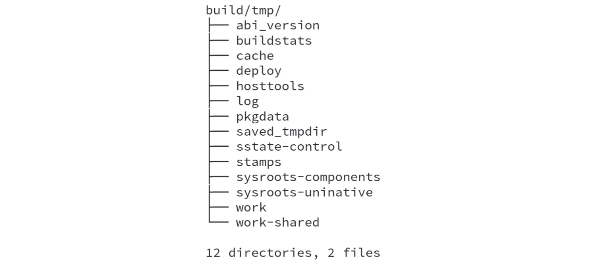
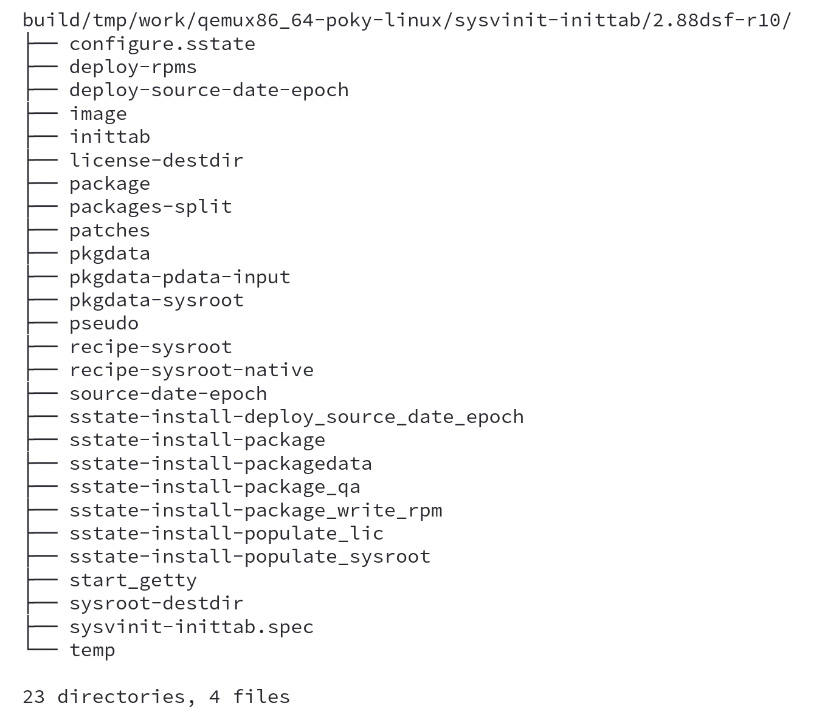
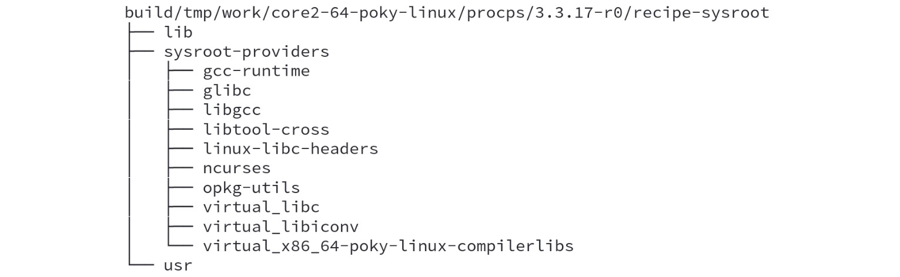
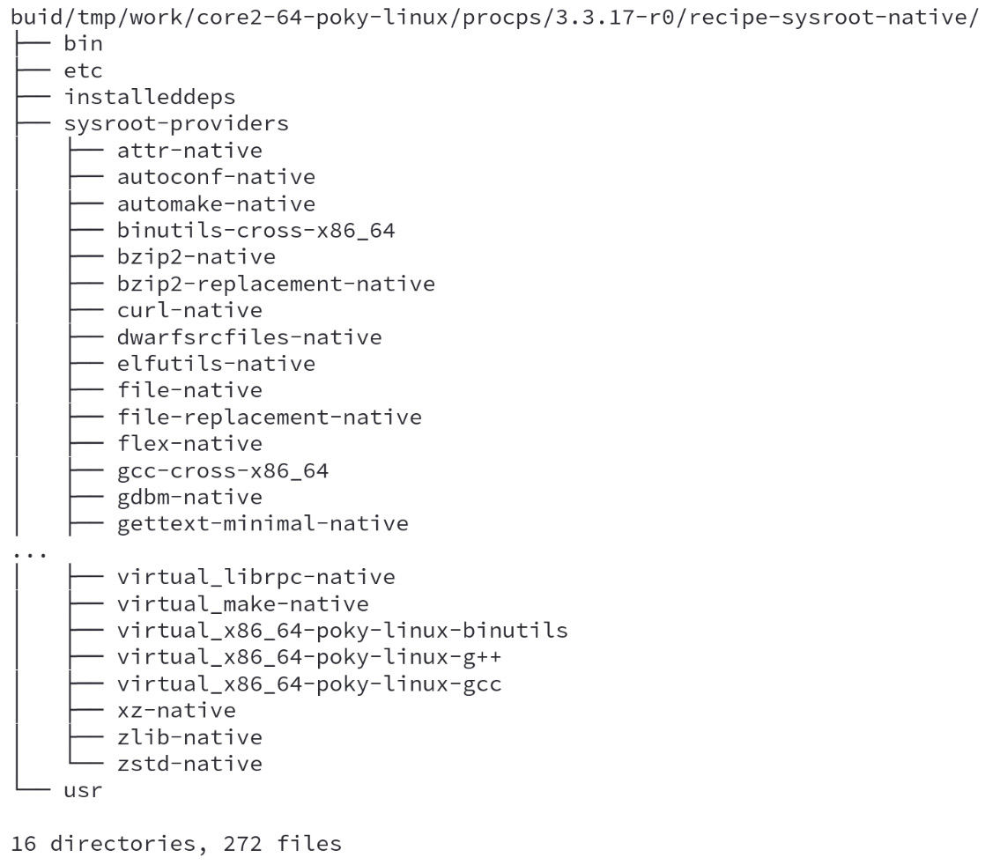

# Chương 6: Chi tiết về thư mục build tạm (Detailing the Temporary Build Directory)

Trong chương này, chúng ta sẽ cố gắng hiểu nội dung của thư mục build tạm sau khi tạo image và xem BitBake dùng nó như thế nào trong quá trình build. Ngoài ra, chúng ta sẽ học cách một số thư mục trong đó có thể hỗ trợ chúng ta bằng cách đóng vai trò là một nguồn thông tin quý giá khi mọi thứ không hoạt động như mong đợi.

## Chi tiết về thư mục build

Thư mục build là nguồn thông tin và artifact trung tâm đối với mọi người dùng Poky. Các thư mục chính của nó như sau:

- `conf`: Thư mục này chứa các file cấu hình mà chúng ta dùng để điều khiển Poky và BitBake. Chúng ta đã dùng thư mục này lần đầu trong *Chương 2*, *Build hệ thống Poky-Based của chúng ta*. Nó lưu các file cấu hình, như `build/conf/local.conf` và `build/conf/bblayers.conf`.
- `downloads`: Thư mục này lưu tất cả các artifact đã tải về. Nó hoạt động như một download cache. Chúng ta đã bàn chi tiết về nó trong *Chương 5*, *Nắm vững công cụ BitBake*.
- `sstate-cache`: Thư mục này chứa các snapshot của dữ liệu đã đóng gói. Đây là một cache chủ yếu được dùng để tăng tốc quá trình build về sau, vì nó được dùng làm cache cho quá trình build. Thư mục này được trình bày chi tiết trong *Chương 7*, *Tìm hiểu cơ chế hỗ trợ đóng gói*.
- `tmp`: Đây là thư mục build tạm và là trọng tâm chính của chương này.

## Xây dựng thư mục build

Trong các chương trước, chúng ta đã học về input và output của Poky ở mức chi tiết high-level, trừu tượng. Chúng ta đã biết rằng BitBake dùng metadata để tạo ra các loại artifact khác nhau, bao gồm image. Bên cạnh các artifact được tạo ra, BitBake còn tạo ra nội dung khác trong quá trình này, có thể được dùng theo nhiều cách, tùy thuộc vào mục tiêu của chúng ta.

BitBake thực hiện nhiều task và liên tục sửa đổi thư mục build trong quá trình build. Vì vậy, chúng ta có thể hiểu nó rõ hơn bằng cách đi theo luồng thực thi thông thường của BitBake, như sau:

- **Fetch**: Hành động đầu tiên BitBake thực hiện là tải source code. Bước này có thể sửa đổi thư mục build vì nó cố dùng bản sao source code đã tải và được cache, hoặc thực hiện việc tải về và lưu nó bên trong thư mục `build/download` *(ghi chú: đúng là `build/downloads`)*.
- **Chuẩn bị source**: Sau khi hoàn tất việc fetch source code, nó phải được chuẩn bị; ví dụ, giải nén một tarball hoặc clone một thư mục Git được cache cục bộ (từ download cache). Việc chuẩn bị này diễn ra trong thư mục `build/tmp/work`. Khi source code đã sẵn sàng, các sửa đổi cần thiết được áp dụng (ví dụ, áp các patch cần thiết và checkout đúng Git revision).
- **Cấu hình và build**: Quá trình build bắt đầu với source code *ready-to-use*. Nó bao gồm việc cấu hình các tùy chọn build (ví dụ, `./configure`) và build (ví dụ, `make`).
- **Cài đặt**: Các artifact đã build sau đó được cài đặt (ví dụ, `make install`) vào một thư mục staging dưới `build/tmp/work/<...>/image`.
- **Đóng gói sysroot**: Các artifact cần cho cross-compilation, như thư viện, header và các file khác, được copy và đôi khi được sửa đổi vào `build/tmp/work/<...>/recipe-sysroot` và `build/tmp/work/<...>/recipe-sysroot-native`.
- **Tạo package**: Các package được tạo ra từ nội dung đã cài đặt, có thể chia nội dung này ra nhiều package, và chúng có thể được cung cấp ở các định dạng khác nhau, ví dụ, `.rpm`, `.ipk`, `.deb` hoặc `.tar`.
- **Kiểm tra Quality Assurance (QA)**: Khi build một recipe, build system thực hiện nhiều kiểm tra QA khác nhau trên output để bảo đảm các vấn đề thường gặp được phát hiện và báo cáo.

## Khám phá thư mục build tạm

Hiểu thư mục build tạm (`build/tmp`) là điều rất quan trọng. Thư mục build tạm được tạo ra ngay sau khi lần build bắt đầu, và nó thiết yếu trong việc giúp chúng ta xác định vì sao một thứ gì đó không hoạt động như mong đợi.

Hình sau cho thấy nội dung của thư mục `build/tmp`:

*Hình 6.1 – Nội dung của build/tmp*

Các thư mục quan trọng nhất trong đó như sau:

- `deploy`: Thư mục này chứa các sản phẩm của lần build, như image, binary package và bộ cài SDK.
- `sysroots-components`: Thư mục này chứa một biểu diễn của `recipes-sysroot` và `recipes-sysroot-native`, cho phép BitBake biết mỗi thành phần được cài đặt ở đâu. Nó được dùng để tạo các `sysroots` recipe-specific trong quá trình build.
- `sysroots-uninative`: Thư mục này bao gồm `glibc` (một thư viện C), được dùng khi các tiện ích native được tạo ra. Điều này, đến lượt nó, cải thiện việc dùng lại các artifact shared state giữa các bản phân phối host khác nhau.
- `work`: Thư mục này chứa source code đang làm việc, cấu hình của task, các log thực thi và nội dung của các package được tạo ra.
- `work-shared`: Đây là một thư mục `work` được dùng để chia sẻ source code với nhiều recipe. `work-shared` chỉ được dùng bởi một tập con các recipe, ví dụ, `linux-yocto` và `gcc`.

## Tìm hiểu thư mục work

Thư mục `build/tmp/work` được tổ chức theo kiến trúc. Ví dụ, khi làm việc với machine `qemux86-64`, chúng ta có bốn thư mục sau:

*Hình 6.2 – Nội dung của thư mục `build/tmp/work`*

*Hình 6.2* cho thấy một ví dụ về các thư mục có thể có dưới `build/tmp/work` cho một host `x86-64` và một target `qemux86-64`. Chúng phụ thuộc vào kiến trúc và machine (architecture- and machine-dependent), như sau:

- `all-poky-linux`: Thư mục này chứa các thư mục build đang làm việc cho các package architecture-agnostic. Đây chủ yếu là các script hoặc các package language-based dạng thông dịch, ví dụ, script Perl và script Python.
- `core2-64-poky-linux`: Thư mục này chứa các thư mục build đang làm việc cho các package chung của các target dựa trên `x86-64` dùng tối ưu hóa được tinh chỉnh cho `core2-64`.
- `qemux86_64-poky-linux`: Thư mục này chứa các thư mục build đang làm việc cho các package dành riêng cho machine `qemux86-64`.
- `x86_64-linux`: Thư mục này chứa các thư mục build đang làm việc cho các package nhắm tới việc chạy trên máy build host.

Cấu trúc được chia thành các thành phần này là cần thiết để cho phép build system image và package cho nhiều machine và kiến trúc trong cùng một thư mục `build` mà không xung đột. Target machine mà chúng ta sẽ dùng là `qemux86-64`.

Thư mục `build/tmp/work` hữu ích khi kiểm tra các hành vi sai hoặc lỗi build. Nội dung của nó được tổ chức thành các sub-directories theo mẫu sau:

*Hình 6.3 – Mẫu được dùng trong các sub-directories của thư mục build/tmp/work*

Một số thư mục dưới cây được thể hiện trong *Hình 6.3* như sau:

- `<sources>`: Đây là source code đã được giải nén của phần mềm cần build. Biến `WORKDIR` trỏ tới thư mục này.
- `image`: Thư mục này chứa các file được recipe cài đặt.
- `package`: Nội dung đã giải nén của các output package được lưu ở đây.
- `packages-split`: Nội dung của các output package, đã giải nén và chia vào các sub-directories, được lưu ở đây.
- `temp`: Thư mục này lưu code task và các log thực thi của BitBake.

> **Mẹo**
>
> Chúng ta có thể tự động xóa thư mục `work` sau mỗi chu kỳ compile recipe để giảm dung lượng đĩa sử dụng, bằng cách thêm `INHERIT += "rm_work"` vào file `build/conf/local.conf`.

Cấu trúc của thư mục `work` là giống nhau cho mọi kiến trúc. Với mỗi recipe, một thư mục mang tên recipe được tạo ra. Lấy thư mục `work` machine-specific và dùng recipe `sysvinit-inittab` làm ví dụ, chúng ta thấy như sau:

*Hình 6.4 – Nội dung của build/tmp/work/core2-64-poky-linux/pm-utils/1.4.1-r1/* *(ghi chú: sách in pm-utils; đoạn văn nói về recipe sysvinit-inittab)*

Recipe `sysvinit-inittab` là một ví dụ rất tốt, vì nó machine-specific. Recipe này chứa file `inittab` định nghĩa serial console để sinh ra tiến trình đăng nhập, thứ thay đổi tùy theo từng machine.

> **Lưu ý**
>
> Build system dùng các thư mục được thể hiện trong hình trên mà không được trình bày chi tiết ở đây. Vì vậy, bạn sẽ không cần làm việc với chúng, trừ khi bạn đang phát triển công cụ build.

Thư mục `work` rất tiện cho mục đích debug; chúng ta sẽ đề cập điều này trong *Chương 10*, *Debug với Yocto Project*.

## Tìm hiểu các thư mục sysroot

Thư mục `sysroot` đóng vai trò quan trọng trong Yocto Project. Nó tạo ra một môi trường riêng lẻ và cô lập cho mỗi recipe. Môi trường này, được thiết lập cho mỗi recipe, là điều thiết yếu để bảo đảm khả năng tái lập và tránh bị lẫn với các package của máy host.

Sau khi build recipe `procps`, phiên bản `3.3.17`, chúng ta có hai tập thư mục `sysroot` – `recipes-sysroot` và `recipes-sysroot-native`.

Bên trong mỗi tập `sysroot`, có một sub-directory tên là `sysroot-provides`. Thư mục này liệt kê các package được cài đặt trên từng `sysroot` tương ứng. Sau đây là thư mục `recipe-sysroot`:

*Hình 6.5 – Nội dung của thư mục recipe-sysroot dưới build/tmp/work cho recipe procps*

Thư mục `recipe-sysroot-native` bao gồm các build dependency được dùng trên hệ thống host trong quá trình build. Nó bao gồm compiler, linker, các công cụ và nhiều thứ khác. Đồng thời, thư mục `recipe-sysroot` có các thư viện và header được dùng trong code target. Hình sau cho thấy thư mục `recipe-sysroot-native`:

*Hình 6.6 – Nội dung của thư mục recipe-sysroot-native dưới build/tmp/work cho recipe procps*

Khi gặp lỗi thiếu header hoặc lỗi link, chúng ta phải double-check xem nội dung các thư mục `sysroot` (target và host) của mình có đúng không.

## Tóm tắt

Trong chương này, chúng ta đã khám phá nội dung của thư mục build tạm sau khi tạo image. Chúng ta đã thấy BitBake dùng nó như thế nào trong quá trình build.

Trong chương tiếp theo, chúng ta sẽ hiểu rõ hơn cách việc đóng gói được thực hiện trong Poky, cách dùng package feed, dịch vụ **Package Revision** (**PR**), và cách chúng có thể giúp ích cho việc bảo trì sản phẩm của chúng ta.
