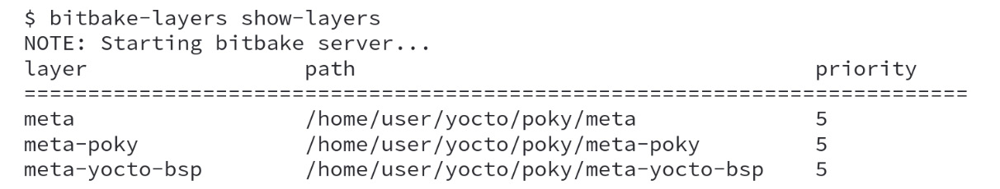
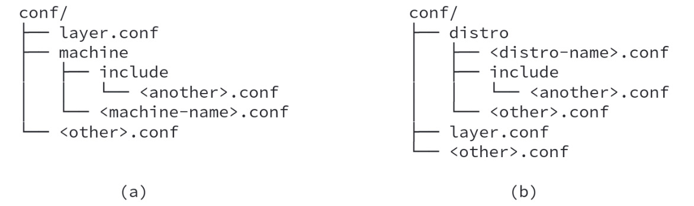
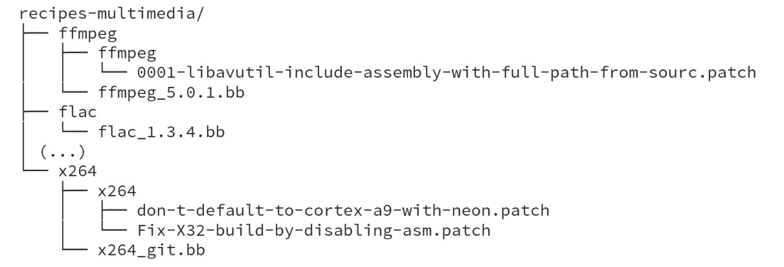
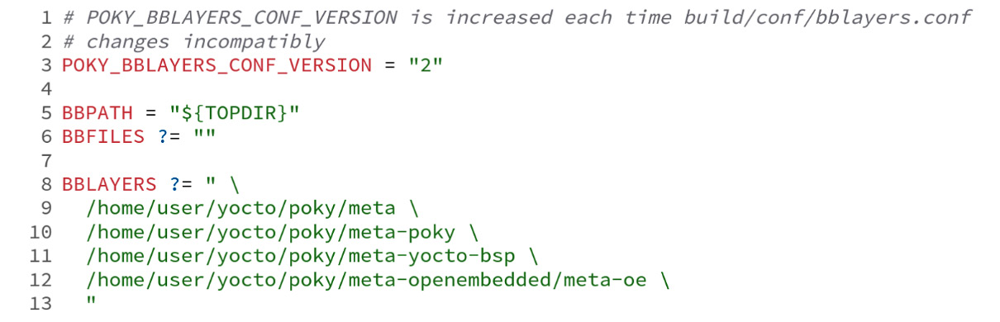
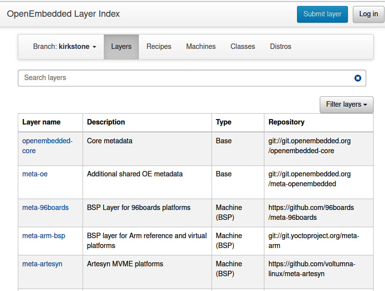
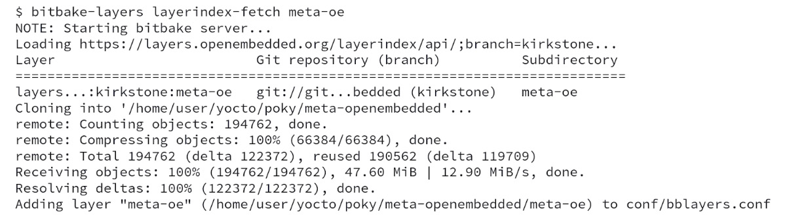

# Chương 11: Khám phá các layer bên ngoài (Exploring External Layers)

Một trong những tính năng hấp dẫn nhất của Poky là sự linh hoạt trong việc dùng các layer bên ngoài. Trong chương này, chúng ta sẽ xem xét vì sao đây là một khả năng quan trọng và cách chúng ta có thể tận dụng nó. Chúng ta cũng sẽ xem các loại layer khác nhau và bố cục cây thư mục của chúng. Cuối cùng, ở cuối chương này, chúng ta sẽ học cách đưa một layer mới vào project của mình.

## Tăng cường sự linh hoạt nhờ layer

Poky chứa metadata trải rộng trên các file định nghĩa cấu hình như các file machine và distro, các class và recipe, bao quát mọi thứ từ các ứng dụng đơn giản đến các stack và framework đồ họa đầy đủ. Có nhiều nơi mà BitBake có thể nạp metadata collection, được gọi là metadata layer.

Điểm mạnh lớn nhất của việc dùng layer là khả năng chia metadata thành các đơn vị logic, cho phép người dùng chỉ chọn metadata collection cần cho một project.

Dùng metadata layer cho phép chúng ta làm những việc sau:

- Cải thiện việc dùng lại code
- Chia sẻ và mở rộng quy mô công việc giữa các nhóm, cộng đồng và nhà cung cấp khác nhau
- Nâng cao chất lượng code của cộng đồng Yocto Project, vì nhiều developer và người dùng cùng tập trung vào một metadata layer cụ thể mà họ quan tâm

Chúng ta có thể cấu hình hệ thống vì nhiều lý do khác nhau, như nhu cầu bật/tắt một tính năng hoặc thay đổi các build flag để bật các tối ưu hóa architecture-specific. Đây là những ví dụ về các tùy chỉnh có thể thực hiện bằng layer.

Ngoài ra, chúng ta nên tổ chức metadata trong các layer khác nhau thay vì tạo môi trường project tùy chỉnh của mình, thay đổi recipe và sửa đổi file trong layer Poky. Cách tổ chức càng tách biệt thì càng dễ dùng lại các layer trong các project tương lai, vì source code Poky cũng được chia thành các layer khác nhau. Mặc định nó chứa ba layer, như chúng ta có thể thấy trong output của dòng lệnh sau:

*Hình 11.1 – Kết quả của bitbake-layers show-layers*

Output command-line cho thấy ba thuộc tính thiết yếu sau của mọi layer:

- **Tên (Name)**: Tên này thường bắt đầu bằng chuỗi `meta`.
- **Đường dẫn (Path)**: Điều này quan trọng khi chúng ta muốn thêm vào project một layer được nối vào biến `BBPATH`.
- **Mức ưu tiên (Priority)**: Đây là giá trị được BitBake dùng để quyết định recipe nào sẽ được dùng và thứ tự nối các file `.bbappend`. Điều này có nghĩa là nếu hai layer cùng chứa một file recipe (`.bb`), layer có mức ưu tiên cao nhất sẽ được dùng. Trong trường hợp `.bbappend`, mọi file `.bbappend` đều được đưa vào recipe gốc. Mức ưu tiên của layer quyết định thứ tự đưa vào, vì vậy các file `.bbappend` trong các layer có mức ưu tiên cao nhất được nối vào trước, tiếp theo là các file khác.

Lấy Poky làm ví dụ, nó có ba layer riêng lẻ trung tâm. Layer `meta-yocto-bsp` là layer **Board Support Package** (**BSP**) tham chiếu của Poky. Nó chứa các file cấu hình machine và các recipe để cấu hình package cho các machine. Vì là một layer BSP tham chiếu, nó có thể được dùng làm ví dụ.

Layer `meta-poky` là layer bản phân phối tham chiếu của Poky. Nó chứa một cấu hình bản phân phối được dùng mặc định trong Yocto Project. Bản phân phối mặc định này được mô tả trong file `poky.conf`, và nó được dùng rộng rãi để kiểm thử sản phẩm. Nó có thể được dùng làm điểm khởi đầu khi thiết kế bản phân phối của riêng bạn.

Một loại layer khác là software layer, chỉ bao gồm ứng dụng hoặc file cấu hình cho ứng dụng và có thể được dùng trên bất kỳ kiến trúc nào. Có một danh sách software layer rất lớn. Chỉ kể một vài, chúng ta có `meta-java`, `meta-qt5` và `meta-browser`. Layer `meta-java` cung cấp hỗ trợ Java runtime và SDK, layer `meta-qt5` bao gồm hỗ trợ Qt5, và `meta-browser` hỗ trợ các trình duyệt web như Firefox và Chrome.

Layer `meta` là metadata OpenEmbedded Core, chứa các recipe, class và các file cấu hình machine QEMU. Nó có thể được xem là một loại layer hỗn hợp, vì nó có bộ sưu tập phần mềm, định nghĩa BSP và bản phân phối được Yocto Project dùng làm nền tảng.

Đôi khi, sản phẩm của bạn có thể có những yêu cầu đặc biệt, và cần thực hiện các thay đổi trong file `build/conf/local.conf` theo yêu cầu. Giải pháp phù hợp nhất và dễ bảo trì nhất là tạo một distribution layer để đặt file định nghĩa bản phân phối.

> **Mẹo**
>
> File `build/conf/local.conf` là một file volatile, không được dự định để Git theo dõi.
>
> Chúng ta không nên dựa vào nó để đặt phiên bản package, provider và các tính năng hệ thống cho sản phẩm, mà thay vào đó chỉ dùng nó như một lối tắt cho mục đích kiểm thử trong quá trình phát triển.

Tránh thêm các thiết lập tùy chỉnh vào `build/conf/local.conf` giúp các lần build của chúng ta có thể tái lập về sau.

## Chi tiết về source code của một layer

Thông thường, một layer có một cây thư mục, như được thể hiện trong ảnh chụp màn hình sau:

*Hình 11.2 – Bố cục layer chuẩn*

Bên trong thư mục này có hai file, `<layer>/COPYING` và `<layer>/README`, lần lượt là license và một thông điệp cho người dùng. Trong `<layer>/README`, chúng ta phải chỉ rõ mọi dependency khác và thông tin mà người dùng layer cần biết. Tiền tố `meta-` cho layer không phải là một yêu cầu bắt buộc mà là một quy ước đặt tên thường được dùng.

Thư mục `classes` nên chứa các class dành riêng cho layer đó (các file `.bbclass`). Đây là một thư mục tùy chọn.

Thư mục `<layer>/conf` là bắt buộc và nên cung cấp các file cấu hình (các file `.conf`). File cấu hình layer, `<layer>/conf/layer.conf`, sẽ được đề cập chi tiết trong chương tiếp theo, là file chứa định nghĩa của layer.

Một ví dụ về bố cục thư mục của thư mục `<layer>/conf` được thể hiện trong *Hình 11.2* *(ghi chú: sách in Figure 11.2; đúng là Hình 11.3)*, trong đó **(a)** cho thấy cấu trúc của một BSP layer và **(b)** cho thấy cấu trúc của một distribution layer:

*Hình 11.3 – Bố cục \<layer\>/conf cho BSP layer và distribution layer*

Thư mục `recipe-*` là một cụm recipe được phân theo danh mục – ví dụ, `recipes-core`, `recipes-bsp`, `recipes-graphic`, `recipes-multimedia` và `recipes-kernel`. Bên trong mỗi thư mục, bắt đầu bằng tiền tố `recipes-`, có một thư mục mang tên recipe hoặc một nhóm recipe. Bên trong đó là các file recipe, có tên kết thúc bằng `.bb` hoặc `.bbappend`. Ví dụ, chúng ta có thể thấy ảnh chụp màn hình sau từ layer `meta`:

*Hình 11.4 – Một ví dụ về bố cục recipes-\**

## Thêm meta layer

Chúng ta có thể tìm thấy phần lớn các meta layer có sẵn tại [http://layers.openembedded.org](http://layers.openembedded.org). Có hàng trăm meta layer từ Yocto Project, OpenEmbedded, các cộng đồng và công ty, có thể được clone thủ công vào bên trong thư mục source của project.

Để đưa, ví dụ, `meta-oe` (một trong nhiều meta layer bên trong repository `meta-openembedded`) vào project của chúng ta, chúng ta có thể thay đổi nội dung của các file cấu hình hoặc dùng các dòng lệnh BitBake. Tuy nhiên, trước tiên chúng ta cần fetch source code của layer. Hãy chạy lệnh sau từ thư mục source Poky của bạn:

*Hình 11.5 – Clone layer meta-openembedded*

Chúng ta cần sửa đổi file `build/conf/bblayer.conf` *(ghi chú: đúng là `build/conf/bblayers.conf`)* để thêm vị trí layer, dùng đường dẫn tuyệt đối của nó. Hãy xem **dòng 12** trong *Hình 11.6* như sau:

*Hình 11.6 – Nội dung của build/conf/bblayers.conf sau khi đưa layer meta-openembedded vào*

Ngoài ra, chúng ta có thể dùng công cụ `bitbake-layers` để thực hiện việc đưa layer vào giúp chúng ta. Việc này có thể thực hiện bằng lệnh sau từ thư mục `build`:

*Hình 11.7 – Dòng lệnh để thêm vị trí layer*

## Hệ sinh thái layer của Yocto Project

Việc tạo một layer rất thuận tiện. Để giúp truy cập tất cả các layer có sẵn dễ dàng hơn, cộng đồng OpenEmbedded đã phát triển một index, có tại http://layers.openembedded.org, nơi có thể tìm thấy phần lớn các layer. Một ví dụ về tab **Layers** của nó được thể hiện như sau:

*Hình 11.8 – OpenEmbedded Layer Index cho Kirkstone*

Một trường hợp sử dụng tiện lợi khác của website OpenEmbedded Layer Index là tìm kiếm một loại phần mềm hoặc recipe cụ thể. OpenEmbedded Layer Index có thể cứu nguy bằng cách cho phép chúng ta tìm kiếm những thứ sau:

- Machine
- Bản phân phối
- Layer
- Recipe
- Class

Công cụ `bitbake-layers` cũng hỗ trợ việc dùng OpenEmbedded Layer Index. Ví dụ, để thêm layer `meta-oe`, chúng ta có thể dùng lệnh sau:

*Hình 11.9 – Fetch một layer từ OpenEmbedded Layer index*

## Tóm tắt

Trong chương này, chúng ta đã giới thiệu khái niệm phân lớp (layering). Chúng ta đã học chi tiết về cấu trúc thư mục và nội dung của từng loại layer. Ngoài ra, chúng ta đã thấy cách thêm một layer bên ngoài vào project theo cách thủ công hoặc bằng dòng lệnh BitBake, cũng như cách dùng OpenEmbedded Layer index để dễ dàng tìm các layer có sẵn mà chúng ta cần.

Trong chương tiếp theo, chúng ta sẽ học thêm về lý do cần tạo các layer mới và metadata thường được bao gồm trong chúng là gì (như các file định nghĩa machine, recipe và image). Chúng ta sẽ tổng kết tất cả bằng một ví dụ về tùy chỉnh bản phân phối.
