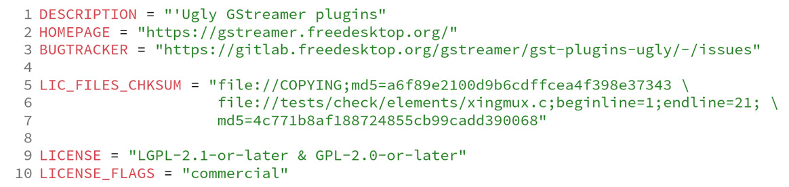
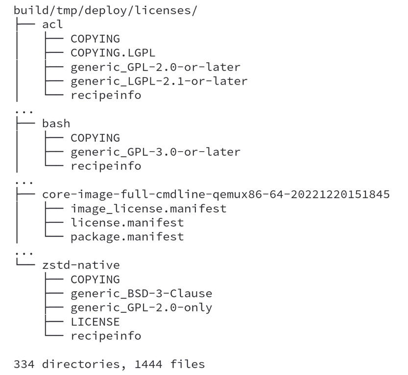
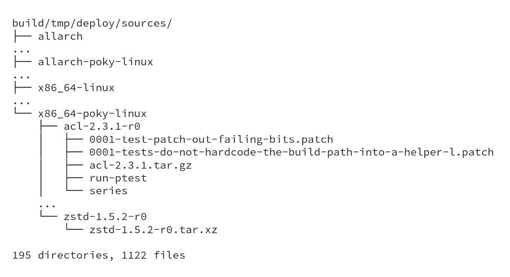

# Chương 14: Tuân thủ GPL (Achieving GPL Compliance)

Trong chương này, chúng ta sẽ xem cách bảo đảm việc tuân thủ license open source và dùng Poky để cung cấp các artifact cần thiết, như source code, văn bản license và danh sách các tác phẩm phái sinh. Điều này rất quan trọng đối với hầu hết các sản phẩm được đưa ra thị trường ngày nay, vì code open source cần tồn tại song song với code độc quyền.

## Tìm hiểu copyleft

**Copyleft** là một cách hợp pháp để dùng luật bản quyền nhằm tối đa hóa quyền và thể hiện sự tự do. Tuy nhiên, nó ảnh hưởng đến sản phẩm của chúng ta. Chúng ta phải đáp ứng mọi nghĩa vụ của các license open source và phần mềm tự do.

Khi build một bản phân phối Linux, ít nhất có hai project được dùng: Linux kernel và một compiler. **GNU Compiler Collection** (**GCC**) vẫn là compiler được dùng phổ biến nhất. Linux kernel dùng license **General Public License** (**GPL**) **v2**, còn GCC dùng các license **GPLv2**, **GPLv2.1** *(ghi chú: sách in GPLv2.1; không có license này, có lẽ ý là LGPLv2.1)* và **GPLv3**, tùy theo project được dùng.

Tuy nhiên, một hệ thống Linux-based có thể bao gồm hầu như mọi project có trên toàn thế giới, cộng thêm tất cả các ứng dụng mà công ty làm ra cho sản phẩm của mình. Vậy làm sao chúng ta biết được số lượng project và license được bao gồm, và làm sao chúng ta đáp ứng các yêu cầu tuân thủ copyleft?

> **Lưu ý**
>
> Chương này mô tả cách Yocto Project có thể giúp bạn trong task này, nhưng hãy lưu ý rằng bạn phải biết chính xác những gì cần cung cấp và các trường hợp không tương thích license có thể xảy ra. Hãy tham vấn bộ phận pháp lý của bạn hoặc một luật sư bản quyền nếu có bất kỳ nghi ngờ nào.

Trong phần tiếp theo, chúng ta sẽ xem cách Yocto Project có thể giúp chúng ta với các task phổ biến nhất cần cho việc tuân thủ copyleft.

### Tìm hiểu việc tuân thủ copyleft so với code độc quyền

Điều thiết yếu là hiểu rằng code độc quyền và code copyleft-covered có thể cùng tồn tại trong cùng một sản phẩm. Mặc dù đây là tiêu chuẩn đối với hầu hết các sản phẩm hiện nay, chúng ta phải cẩn thận với các thư viện mà chúng ta link code vào, vì một số có thể có vấn đề về tương thích license.

Một hệ thống Linux-based là một tập gồm nhiều project, mỗi project theo một license khác nhau. Yocto Project giúp các developer hiểu rằng phần lớn các project copyleft có các nghĩa vụ sau:

- Source code của project
- License của project
- Mọi sửa đổi đối với project
- Mọi script cần thiết để cấu hình và build

Nếu một project theo copyleft bị sửa đổi, văn bản license, source code gốc và mọi sửa đổi đều phải được đưa vào sản phẩm bàn giao cuối cùng.

Các giả định này bao quát hầu hết các quyền được bảo đảm bởi license copyleft. Đây là những phần mà Yocto Project có thể giúp chúng ta. Tuy nhiên, trước khi phát hành bất cứ thứ gì, nên audit tất cả các tài liệu sẽ được phát hành để bảo đảm chúng đầy đủ.

## Quản lý license phần mềm với Poky

Một tính năng quan trọng của Poky là khả năng quản lý license. Phần lớn thời gian, chúng ta chỉ quan tâm đến các bug của mình. Tuy nhiên, việc quản lý license và các loại license được dùng là cực kỳ quan trọng khi tạo ra một sản phẩm.

Poky theo dõi license trong mọi recipe. Ngoài ra, nó có một chiến lược để làm việc với các ứng dụng độc quyền trong chu kỳ phát triển.

> **Lưu ý**
>
> Một điều quan trọng cần biết là một recipe được phát hành theo một license cụ thể và đại diện cho một project được phát hành theo một license khác. Vì vậy, recipe và project là hai thực thể riêng biệt với các license riêng, nên cả hai license đều phải được xem là một phần của sản phẩm.

Trong hầu hết các recipe, thông tin là một comment chứa bản quyền, license và tên tác giả; thông tin này thuộc về chính recipe đó. Sau đó, có một tập biến để mô tả license của package, như sau:

- `LICENSE`: Biến này mô tả license mà package được phát hành theo.
- `LIC_FILES_CHKSUM`: Thoạt nhìn biến này có vẻ không hữu ích lắm. Nó mô tả file license và checksum cho một package cụ thể, và chúng ta có thể thấy nhiều biến thể trong cách một project mô tả license của mình. Các file license phổ biến nhất được lưu trong `meta/files/common-licenses/`.

Một số project bao gồm một file, như `COPYING` hoặc `LICENSE`, chỉ định license cho source code. Các project khác dùng một ghi chú ở header trong mỗi file hoặc trong file chính. Biến `LIC_FILES_CHKSUM` chứa checksum của văn bản license của một project; nếu bất kỳ chữ cái nào bị thay đổi, checksum cũng thay đổi theo. Điều này bảo đảm mọi thay đổi đều được ghi nhận và được developer chấp nhận một cách có ý thức. Một thay đổi license có thể là sửa lỗi chính tả; tuy nhiên, nó cũng có thể là một thay đổi về nghĩa vụ pháp lý, vì vậy developer cần xem xét và hiểu sự khác biệt.

Khi phát hiện một checksum license khác, BitBake báo một lỗi build và chỉ ra project đã bị thay đổi license. Bạn phải cẩn thận khi điều này xảy ra, vì thay đổi license có thể ảnh hưởng đến việc sử dụng phần mềm này. Để có thể build lại bất cứ thứ gì, bạn phải thay đổi giá trị `LIC_FILE_CHKSUM` *(ghi chú: đúng là `LIC_FILES_CHKSUM`)* cho phù hợp và cập nhật trường `LICENSE` để khớp với thay đổi license. Nên tham vấn bộ phận pháp lý của bạn nếu các điều khoản license đã thay đổi. Cũng là một thực hành tốt khi ghi lại lý do thay đổi trong một commit message để tham khảo về sau.

### Tìm hiểu license thương mại

Mặc định, Poky không dùng bất kỳ recipe nào có hạn chế license thương mại. Trong file recipe, biến `LICENSE_FLAGS` được dùng để xác định recipe đó có hạn chế license nào. Với recipe `gstreamer1.0-plugins-ugly`, các biến license-related nằm từ *dòng 5* đến *dòng 10*, như trong *Hình 14.1*:

*Hình 14.1 – Các biến license-related của recipe gstreamer1.0-plugins-ugly*

*Dòng 10* cho Poky biết rằng recipe này yêu cầu license flag `commercial` phải được chấp nhận một cách tường minh thì recipe mới được dùng. Để cho phép dùng recipe `gstreamer1.0-plugins-ugly`, chúng ta có thể dùng như sau:

*Hình 14.2 – Cách chấp nhận cài đặt các recipe có hạn chế license thương mại*

Chúng ta có thể thêm `LICENSE_FLAGS_ACCEPTED` vào bản phân phối tùy chỉnh của mình (ví dụ, `<my-layer>/conf/distro/my-distro.conf`) hoặc bên trong `build/conf/local.conf` trong các giai đoạn phát triển ban đầu. Dùng flag `commercial` sẽ chấp nhận việc cài đặt mọi recipe yêu cầu flag này. Tuy vậy, đôi khi chúng ta muốn quản lý các recipe mình dùng, đòi hỏi các điều khoản license cụ thể. Chúng ta có thể dùng dạng sau:

*Hình 14.3 – Cách chấp nhận chỉ cài đặt gstreamer1.0-plugins-ugly*

Với đoạn code trong *Hình 14.3*, chúng ta chỉ chấp nhận license flag `commercial` từ `gstreamer1.0-plugins-ugly`, chính là tên recipe. Một thực hành tốt là bảo đảm flag này chỉ được bật cho một tập recipe mà bạn được phép dùng trong bối cảnh thương mại. Hãy tham vấn bộ phận pháp lý của bạn để bảo đảm điều này.

## Dùng Poky để tuân thủ copyleft

Đến thời điểm này, chúng ta đã biết cách dùng Poky và hiểu mục tiêu chính của nó. Đã đến lúc hiểu các khía cạnh pháp lý của việc tạo ra một hệ thống Linux-based dùng các package theo các license khác nhau.

Chúng ta có thể cấu hình Poky để tạo ra các artifact cần được chia sẻ như một phần của quá trình tuân thủ copyleft.

### Tìm hiểu việc audit license

Để giúp chúng ta tuân thủ copyleft, Poky tạo ra một license manifest trong lúc build image, nằm tại `build/tmp/deploy/licenses/<image_name-machine_name>-<datastamp>/` *(ghi chú: đúng là `<datestamp>`)*.

Để minh họa quá trình này, chúng ta sẽ dùng image `core-image-full-cmdline` cho machine `qemux86-64`. Để bắt đầu ví dụ, hãy xem các file dưới `build/tmp/deploy/licenses/core-image-full-cmdline-qemux86-64-<datastamp>` *(ghi chú: đúng là `<datestamp>`)*, như sau:

- `image_license.manifest`: File này liệt kê tên recipe, phiên bản, license và các file package có trong `build/tmp/deploy/image/<machine>` nhưng không được cài đặt bên trong **root filesystem** (**rootfs**). Các ví dụ phổ biến nhất là bootloader, Linux kernel image và các file DTB.
- `package.manifest`: File này liệt kê tất cả các package trong image.
- `license.manifest`: File này liệt kê tên, phiên bản, tên recipe và license của tất cả các package đã cài đặt. Manifest này có thể được dùng để audit việc tuân thủ copyleft.

*Hình 14.4 – Bố cục thư mục của các license manifest dưới build/tmp/deploy*

License manifest của mỗi recipe nằm dưới `build/tmp/deploy/licenses/<package-name>`. *Hình 14.4* cho thấy bố cục thư mục của một số package.

### Cung cấp source code

Cách hiển nhiên nhất mà Poky có thể giúp chúng ta cung cấp source code của mọi project được dùng trong image là chia sẻ nội dung của `DL_DIR`. Tuy nhiên, cách tiếp cận này có một cạm bẫy nghiêm trọng – mọi source code độc quyền sẽ bị chia sẻ bên trong `DL_DIR` nếu nó được chia sẻ nguyên trạng. Ngoài ra, cách tiếp cận này sẽ chia sẻ mọi source code, kể cả những phần không cần thiết cho việc tuân thủ copyleft.

Poky phải được cấu hình để lưu trữ source code trước khi image cuối cùng được tạo ra. Để làm vậy, chúng ta có thể thêm các biến sau vào `build/conf/local.conf`, như trong *Hình 14.5*:

*Hình 14.5 – Cấu hình Poky để cung cấp source code của các package theo copyleft*

Class `archiver` copy source code, patch và script cho tập license được lọc. Cấu hình mặc định là đặt `COPYLEFT_LICENSE_INCLUDE` thành `"GPL* LGPL* AGPL*"`, vì vậy các recipe dùng source code được cấp phép theo các license đó được copy vào các thư mục `build/tmp/deploy/sources/<architecture>`:

*Hình 14.6 – Bố cục thư mục build/tmp/deploy/sources*

Class này cũng hỗ trợ biến `COPYLEFT_LICENSE_EXCLUDE` để bảo đảm các package dùng source code được cấp phép theo một số license cụ thể không bao giờ đi vào thư mục `sources`. Mặc định, nó được đặt thành `"CLOSED Proprietary"`. *Hình 14.6* cho thấy một số ví dụ recipe sau khi build `core-image-full-cmdline`.

### Cung cấp script compile và các sửa đổi source code

Với cấu hình được cung cấp trong phần trước, Poky sẽ đóng gói source code gốc của mỗi project. Nếu muốn đưa vào source code đã được patch, chúng ta chỉ cần dùng `ARCHIVER_MODE[src] = "patched"`; bằng cách này, Poky sẽ gói source code của project sau task `do_patch`. Nó bao gồm các sửa đổi từ các recipe hoặc file `.bbappend`.

Bằng cách này, source code và mọi sửa đổi có thể được chia sẻ dễ dàng. Tuy nhiên, vẫn còn một loại thông tin cần được tạo ra: quy trình được dùng để cấu hình và build project.

Để có một môi trường build có thể tái lập, chúng ta có thể chia sẻ project đã được cấu hình, nói cách khác, là project sau task `do_configure`. Chúng ta có thể thêm `ARCHIVER_MODE[src] = "configured"` vào `build/conf/local.conf` cho việc này.

Điều quan trọng cần nhớ là chúng ta phải xét đến việc người ở phía bên kia có thể không dùng Yocto Project cho việc tuân thủ copyleft; hoặc, nếu họ có dùng, họ phải biết rằng các sửa đổi được thực hiện đối với source code gốc và quy trình cấu hình là không có sẵn. Đây là lý do chúng ta chia sẻ project đã được cấu hình: nó cho phép bất kỳ ai tái tạo môi trường build của chúng ta.

Với mọi dạng source code, file kết quả mặc định là một tarball; các lựa chọn khác sẽ thêm `ARCHIVER_MODE[srpm] = "1"` vào `build/conf/local.conf`, và file kết quả sẽ là một package **SRPM**.

### Cung cấp văn bản license

Khi cung cấp source code, văn bản license được chia sẻ bên trong nó. Nếu muốn có văn bản license bên trong image cuối cùng, chúng ta có thể thêm nội dung sau vào `build/conf/local.conf`:

*Hình 14.7 – Cách cấu hình Poky để deploy văn bản license bên trong image cuối cùng*

Bằng cách này, các file license sẽ được đặt bên trong `rootfs`, dưới `/usr/share/common-licenses/`.

## Tóm tắt

Trong chương này, chúng ta đã học cách Poky có thể giúp việc tuân thủ license copyleft và vì sao nó không nên được dùng như một nguồn tư vấn pháp lý. Poky cho phép chúng ta tạo ra source code, các script tái tạo và văn bản license cho các package được dùng trong bản phân phối của mình. Ngoài ra, chúng ta đã học rằng license manifest được tạo ra cùng image có thể được dùng để audit image.

Trong chương tiếp theo, chúng ta sẽ học cách dùng các công cụ của Yocto Project với phần cứng thật. Sau đó, chúng ta sẽ dùng Yocto Project để tạo image cho một vài board thật.
